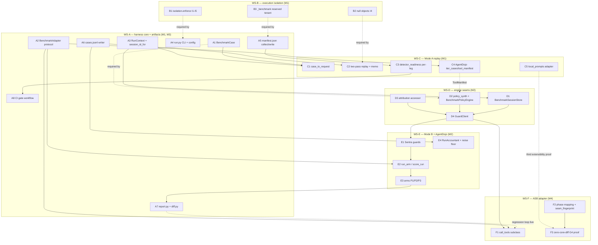

# Security-Efficacy Benchmark Harness — Workstreams Index & Sequencing

**Parent LLD**: [lld/41-benchmark-harness.md](../../lld/41-benchmark-harness.md) (v1.0, Gate-3 approved 2026-07-27)
**Parent sub-PRD**: [prd/benchmark-harness.md](../../prd/benchmark-harness.md) — FR-14.1 … FR-14.9
**Upstream HLD**: **none — a stated gap, not a precedent** (LLD 41 §1.1). This LLD designs directly against the 8 master tenets ([lld/ARCHITECTURE.md](../../lld/ARCHITECTURE.md) §1.4). Do not go looking for a companion HLD; there isn't one by design.
**Last Updated**: 2026-07-27
**Stage so far**: all six workstreams at **`SCOPE`** — LLD 41 is approved, these task docs exist, no code written.

This folder breaks LLD 41 into six independently-ownable workstreams. Each `ws-*.md` is a **build task list** — concrete enough to code from **without re-reading LLD 41**. Read this index first for the dependency graph, the shared contracts, and the one rule that sequences the whole build.

> **What this build is.** A measurement instrument (`benchmarks/`), not a product surface. Nothing here ships to a customer, nothing is on `/v1/validate`'s hot path, and **nothing here changes a detector** — raising the score is explicitly someone else's requirement (sub-PRD §7). A PR that touches `app/validators/` and calls itself benchmark work is out of scope by definition.

---

## Workstream table

| WS | ws-doc | LLD §ref | Status | Scope (one line) | Owner | Blocking? |
|---|---|---|---|---|---|---|
| **WS-A** | [ws-a-harness-core.md](ws-a-harness-core.md) | §4.1, §4.2, §4.6(D6), §4.8, §7.1, §7.3, §12, §15 | `SCOPE` | `BenchmarkCase` + `BenchmarkAdapter` protocol + `RunContext`/session-id scheme + CLI + manifest/`cases.jsonl`/report/diff writers | TBD | **Foundation — every other WS imports it** |
| **WS-B** | [ws-b-execution-isolation.md](ws-b-execution-isolation.md) | §4.7, §8 (SEC-5/6/7), §11 | `SCOPE` | `isolation.enforce()` I1–I5, null objects, bootstrap, `_benchmark` added to `RESERVED_TENANT_IDS` | TBD | **Gates all execution — `enforce()` is the first statement of every entry point** |
| **WS-C** | [ws-c-mode-a-replay.md](ws-c-mode-a-replay.md) | §4.3, §5.1, §16.1 | `SCOPE` | Mode A two-pass replay rig, per-leg `detector_readiness`, AgentDojo `iter_cases()`/`tool_manifest()`, `local_prompts` adapter | TBD | Produces M1's exit number (G2) |
| **WS-D** | [ws-d-engine-seams.md](ws-d-engine-seams.md) | §4.4a, §4.5, §4.6(D7), §11 | `SCOPE` | `BenchmarkSessionStore`, `policy_synth` + `BenchmarkPolicyEngine` patch, in-process attribution accessor, `GuardClient` | TBD | **Without it in-process Mode B cannot execute one validate** |
| **WS-E** | [ws-e-mode-b-agentdojo.md](ws-e-mode-b-agentdojo.md) | §4.4, §4.4b, §5.2, §7.1.1, §9, §13, §14 | `SCOPE` | Mode B e2e rig, `SentraRequestGuard`/`SentraContentGuard`, arms P1/P2/P3, noise floor, `RunAccountant` | TBD | Produces the headline number (G1); **blocked on an unowned LLM budget** |
| **WS-F** | [ws-f-asb-adapter.md](ws-f-asb-adapter.md) | §6, §17 M4 | `SCOPE` | ASB adapter via `ReactAgentAttack.call_tools` subclass, `seam_fingerprint`, the zero-core-diff G4 proof | TBD | Last — it *is* the FR-14.1 extensibility test |

**Status lifecycle (monotonic, never regresses):** `SCOPE` < `LLD-APPROVED` < `TASKS-DONE` < `CODE-DONE`.
Every row starts at `SCOPE`. **Only `code-loop` may set `CODE-DONE`**, and only on a `PROMOTED` outcome with a captured green re-check + merge SHA. Do not hand-set it.

---

## Dependency graph

---

## Shared contracts (the Phase-3 sweep's join keys)

Every one of these has **exactly one owner**. A consumer that needs a shape change files it against the owner; it does not fork the shape locally.

| Contract | Canonical location | Owner | Consumers | Shape note (must match everywhere) |
|---|---|---|---|---|
| **`BenchmarkCase`** | `benchmarks/core/case.py` | **WS-A** | WS-C, WS-D, WS-E, WS-F | Frozen dataclass, 16 fields. `phase` validated in `__post_init__` against `PHASES = KNOWN_PHASES - {"output"}`. `case_id` **stable across runs**. |
| **`BenchmarkAdapter`** — **four** methods | `benchmarks/core/adapter.py` | **WS-A** | implemented by WS-C (`iter_cases`, `tool_manifest`), WS-E (`run_arm`, `score_run`), WS-F (all four), WS-C `local_prompts` (`iter_cases` only) | `iter_cases(*, suite) -> Iterator[BenchmarkCase]` · `tool_manifest(*, suite) -> ToolManifest` · `run_arm(*, arm, ctx) -> ArmResult` · `score_run(*, with_arm, without_arm) -> RunScore`. **Four, not three.** |
| **run manifest schema** | `benchmarks/runs/{run_id}/manifest.json`, `schema_version: "1"` | **WS-A** | WS-B writes `isolation.*`; WS-C writes `engine.detector_readiness` + `results.mode_a`; WS-D writes `policy.*`; WS-E writes `results.mode_b` + `accounting.*` + `model.*`; WS-F writes `benchmark.seam_fingerprint` | Every writer appends to a **declared block**; nobody invents a top-level key. `exit` written **last**. |
| **`cases.jsonl` row schema** | `benchmarks/runs/{run_id}/cases.jsonl` | **WS-A** | written by WS-C (Mode A rows, `arm=null`) and WS-E (Mode B rows); read by WS-A `report.py`/`diff.py` and by `--resume` | **16 fields** (LLD §12). Join key `case_id`; resume ledger key `(case_id, arm)`. `decision` is a **first-class `ERROR`**, never coerced to ALLOW. |
| **`detector_readiness`** | `benchmarks/core/readiness.py` → `manifest.engine.detector_readiness` | **WS-C** | WS-A (`report.py` Mode A block, preflight banner, CI gate), WS-E (never quotes a detector number without it) | Per detector: `{activated, artifact, fired, verdict}` where `verdict ∈ {"scored","partial","inert"}`. **Composite detectors record per-leg** (`d2.sigma_leg`, `d2.ml_leg`, `d2.heuristic_leg`). |
| **`RunContext`** | `benchmarks/core/context.py` | **WS-A** | WS-C, WS-D, WS-E, WS-F | Carries `run_id`, `run_clock_iso`, `session_id_for(case)`, `transcript_dir`, `model_id`, `benchmark_version`, `attack_name`. **Never module globals** — `--resume` re-enters under a *prior* run's identity. |
| **`GuardClient.validate(...)`** | `benchmarks/core/guard_client.py` | **WS-D** | WS-E, WS-F | One method over two transports. In-process → `ValidationService` + attribution accessor; hosted → SDK `guard.validate()` (non-raising). Increments `n_validate_calls` in a `finally`. |
| **`BenchmarkSessionStore`** | `benchmarks/core/session_store.py` | **WS-D** | WS-E (in-process Mode B), WS-F | Exactly three async methods: `get_or_create_session`, `update_trust_score_deny`, `update_trust_score_allow`. Returns the **same dict keys** the pipeline reads positionally. |
| **`_benchmark` reserved tenant** | `app/utils/tenancy.py:67` `RESERVED_TENANT_IDS` | **WS-B** (extends a frozenset owned by [LLD 26](../../lld/26-multi-tenancy.md) §3.7) | WS-A (manifest `isolation.tenant`), WS-D, WS-E | The **one and only `app/` source edit** in this whole build. |

---

## The one gating rule

> **Isolation lands before anything executes.** `benchmarks/core/isolation.py::enforce()` must be the **first executable statement of every `benchmarks/` entry point**, before any `sys.path` manipulation and before any `app.*` import. No rig code may run against the engine — not even a smoke test — until `benchmarks/tests/test_isolation.py` proves **all three** refusal paths exit `2` (unbadged · live credential resolvable · prod base-url/account).

Why this and not something else: a benchmark run that reaches the production AWS account publishes synthetic attack metrics into the very telemetry the §3.2 release gate reads — circular contamination, and **an observed live path today** (`scripts/meas_d2_d3_fp_budget.py` reaches `MetricsPublisher()` via `sigma_engine.py:362`; it failed only because that shell's credentials happened to be fake). WS-B converts that accident into a guarantee.

**Secondary quotation gate (not a build gate):** no headline `asr_reduction_pp` is quoted anywhere — internally or otherwise — until WS-E's noise-floor replicate (≥2 pairs) has run and `noise_floor.pp` sits beside it. See [99-go-live-runbook.md](99-go-live-runbook.md).

---

## Build order

1. **WS-B** — isolation + the `_benchmark` tenant. Hermetic, no AWS, no LLM, no dependencies. Land it first so everything after it is safe by construction.
2. **WS-A** — core contracts + artifacts. Can start in parallel with WS-B; its `run.py` cannot be *run* until B1 exists.
3. **WS-C** — Mode A + AgentDojo case extraction. **Exits M1** with a real, armed D2 **and** D3 recall number (G2) — the ADR-036 gap, closed with zero LLM spend.
4. **WS-D** — engine seams. Independent of LLM budget, so it proceeds even while WS-E's budget is unowned.
5. **WS-E** — Mode B on AgentDojo `banking`. **Exits M2** with the first headline number + noise floor.
6. **WS-A (M3 tail)** — `diff.py` + CI gate go green once two Mode B runs exist. **Exits M3.**
7. **WS-F** — ASB. **Exits M4** and is the actual FR-14.1 proof. **Plan it as the largest milestone of the four**, not as "the same again for a second benchmark" (LLD §6.3, §17).

---

## Shared conventions (every WS obeys these; they are not restated per doc)

- **The badge.** `AEGION_BENCHMARK=1` is required by every entry point under `benchmarks/`. Unset ⇒ `SystemExit(2)`. It is the *badge*, not the protection — its job is to make I2–I5 unconditional.
- **The isolation chain, in order.** `I1` badge → `I3` **assert-then-sentinelize** (snapshot `botocore.Session().get_credentials()` **BEFORE** mutating anything) → `I2` credential sentinelization → `I5` prod-target denylist (hosted only) → `I4` null-object substitution → bind `_benchmark` tenant. **I3 before I2 is the whole mechanism**; reversed, I3 is vacuous and its test is unpassable.
- **Python ≥ 3.10, via `uv`.** The system interpreter is **3.9.6 and too old** (AgentDojo declares `requires-python >= 3.10`; the codebase uses `X | Y` unions). Verified working: `src/security-controller/venv` (3.12.13, has `cedarpy`), `agentdojo/.venv` (3.12.2, built from its `uv.lock`). `uv` 0.11.32 is present.
- **`benchmarks/runs/` is the only write target.** The rig writes nowhere else, ever (SEC-9, RES-7). Rollback is `rm -rf benchmarks/runs/{run_id}/`.
- **Reuse, never rebuild** — these are imports, not rewrites (LLD §16.1). Do **not** re-implement:
  - `app/services/detection_eval.py:58` `score_detector`, `:84` `fp_budget_gate` — **consumed unchanged**.
  - `DetectorScore` properties `precision:33` / `recall:38` / `f1:43` / `fp_rate:48` — **read, never re-derived**. A second `f1` is a second place for it to drift.
  - `scripts/eval_ml_classifier.py:284` `_load_thresholds` — **imported verbatim** (trivial `key: value`, no pyyaml).
  - `scripts/eval_ml_classifier.py:147` `_estimate_cost` — **extended**, one shared rate table.
  - `app/utils/tenancy.py` `RESERVED_TENANT_IDS` / `is_reserved_tenant:103` / `set_current_tenant:145` — reused.
  - `app/validators/cedar/entities.py:79` `synthesize_entities` and `scripts/seed_policies.py` — consumed unchanged; no Cedar schema change.
  - `app/utils/session_manager.py` `_get_quarantine_status:507` / `_get_increment_amount:495` / `_get_consecutive_allows_required:483` — **delegated to**, not copied.
- **Exactly ONE `app/` source edit in this entire build**: `_benchmark` → `RESERVED_TENANT_IDS` (`app/utils/tenancy.py:67`). Everything else that looks like an `app/` change is a **runtime substitution requiring no source change**. Do not budget build work for edits that do not exist.
- **`phase=output` is excluded from measurement.** `routes.py:221` fail-secure DENYs it via `_phase_not_implemented_deny` (defined `:401`). A case scored on agent output would be recorded as blocked by a stub. Excluded, counted, and reported — **never** as 100% blocked.
- **Mode A is never quoted as an efficacy number.** Mode A recall does not predict Mode B ASR reduction in either direction (LLD §2.3). Mode A is a development instrument and a CI gate; Mode B is the result.
- **Tie-breaker E** — an unreproducible measurement is not a measurement. A missing pin **aborts** the run; a dirty checkout **aborts** the run (`--allow-dirty` stamps a permanent banner).
- **Tie-breaker F** — the rig must never contaminate what it measures. Trust bleed (inbound) and prod contamination (outbound) are the same defect class.

---

## Known-open prerequisites and risks (carried, not answered)

| # | Open item | Owner | Blocks | Consequence if unresolved |
|---|---|---|---|---|
| **OP-1** | **Mode B LLM budget is unowned.** ~$40–160 per full AgentDojo P1 run; ~$100–400 with P2+P3; the with-arm is systematically dearer than the without-arm (denials trigger retries to `max_iters=15`), so paired arms cost **more** than 2×. | founder (sub-PRD §6) | **WS-E entirely**; M2, M3, M4 | Mode A (WS-A/B/C) is unaffected and still closes G2. WS-D also proceeds — it needs no LLM. |
| **OP-2** | **A non-production engine deployment is unowned.** Needed *only* for hosted Mode B latency runs. | infra / CDK | WS-E's hosted-transport tasks, SEC-1's two-credential lane | Fallback is in-process only, which loses the latency number **and nothing else**. **Never a workaround-by-using-prod** — FR-14.9 bars it outright and I5 enforces it. |
| **OP-3** | **Does ADR-040's graduation gate land in LLD 32?** LLD 41 §18.1 *recommends* `enforce_gate = fp_rate <= budget AND recall >= floor AND readiness == "scored"` as a **new** function beside `fp_budget_gate`, owned by [LLD 32](../../lld/32-detection-depth.md) §14.2 — reconciled with §14.4's already-required F1-regression floor. Not decided. | LLD 32 owner | WS-A's CI gate shape | The CI gate ships with its **own** two-sided check + readiness precondition inside `benchmarks/` and does **not** modify `fp_budget_gate`. If ADR-040 lands later, the benchmark gate delegates to it. Build as if it will not land. |
| **OP-4** | **`_benchmark` in `RESERVED_TENANT_IDS` — the cross-doc half.** The code edit is tasked (WS-B B3). But [LLD 26](../../lld/26-multi-tenancy.md) §3.7 **owns** that frozenset and is **owed an edit** listing `_benchmark`. Sign-off on extending someone else's frozenset is not this workstream's to give. | LLD 26 owner | WS-B B3's merge | Merging the code edit without the LLD 26 §3.7 sync leaves the frozenset's documented membership wrong — exactly the sibling drift the Phase-3 sweep exists to catch. |
| **OP-5** | Two ADRs from LLD 41 §18 are **recommended and not yet logged**. Next free number is **ADR-040** (`adr.md` tops at ADR-039, `:1608`). | founder | nothing (documentation debt) | §18.1 (gate reconciliation) takes ADR-040; §18.2 (attribution absent from both return surfaces) takes the next. |

---

## Cross-references

- **LLD**: [lld/41-benchmark-harness.md](../../lld/41-benchmark-harness.md) — §16 carries the implementation-status table these tasks honor.
- **Sub-PRD**: [prd/benchmark-harness.md](../../prd/benchmark-harness.md) §4.2 — DONE/PARTIAL/NOT-DONE with `file:line` evidence.
- **Sibling LLDs owed an edit**: [lld/26](../../lld/26-multi-tenancy.md) §3.7 (`RESERVED_TENANT_IDS` must list `_benchmark`); [lld/32](../../lld/32-detection-depth.md) §14.2/§14.4 (only if ADR-040 is accepted); [adr.md](../../adr.md) (ADR-040 + one more).
- **No edit owed**: [design-hld.md](../../design-hld.md) · [flow.md](../../flow.md) · [demo.md](../../demo.md) — verified: none mentions a benchmark or eval harness, and the rig adds no product endpoint, user-facing behavior or operational flow.
- **Runbook**: [99-go-live-runbook.md](99-go-live-runbook.md).
