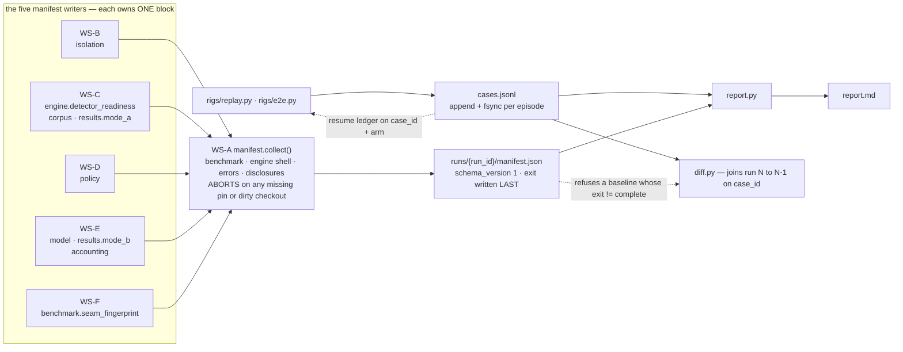

# WS-A: Harness Core, Contracts & Run Artifacts

**Parent LLD**: [lld/41-benchmark-harness.md](../../lld/41-benchmark-harness.md) §4.1, §4.2, §4.6 (D6), §4.8, §7.1, §7.1.1, §7.3, §12, §15
**Status**: `SCOPE`
**Owner**: TBD
**Milestones covered**: M1 (A1–A6), M3 (A7–A8)

> This workstream owns **four of the nine shared contracts**. Everything else in the build imports from here. Get the shapes right first; a `BenchmarkCase` field added in week three costs every adapter a rewrite, which is exactly the failure FR-14.1 exists to prevent.

## Dependencies

- **Depends on**: **WS-B** — `benchmarks/core/isolation.py::enforce()` must exist before `run.py` can execute (it is `run.py`'s first statement). You can build and unit-test A1–A3 and A5–A7 against a stub `enforce()` that returns immediately; A4 is not runnable until B1 lands.
- **Blocks**: WS-C, WS-D, WS-E, WS-F — all of them.
- **Shared contracts OWNED here**: `BenchmarkCase` · `BenchmarkAdapter` (four methods) · run-manifest schema (`schema_version: "1"`) · `cases.jsonl` row schema · `RunContext`.
- **Shared contracts CONSUMED here**: `detector_readiness` (WS-C) — read by the preflight banner, `report.py`'s Mode A block, and the CI gate. `_benchmark` (WS-B) — echoed into `manifest.isolation.tenant`.

---

## Model / read before coding

1. **`PHASES` is DERIVED, never re-typed.** [LLD 30](../../lld/30-multiphase-contract.md) owns the phase set as `KNOWN_PHASES` (`app/api/models.py:27` — `frozenset({"request","content","output","memory"})`, whose own comment calls itself "the SINGLE SOURCE OF TRUTH"). A hand-written `Literal[...]` here silently falls behind the day LLD 30 registers a fifth phase. **Subtract, don't re-list.**
2. **`phase == "output"` is excluded from measurement, in code, not in prose.** `routes.py:221` returns `_phase_not_implemented_deny(...)` (defined `:401`) because D5 is not built. A case scored on agent output would be recorded as blocked by a stub. When D5 ships the fix is **exactly one edit** — remove `"output"` from `_EXCLUDED_PHASES` — because `PHASES` is derived.
3. **`case_id` is stable across runs; `run_id` is not.** `diff.py` joins on `case_id`. A uuid there makes every diff a full add/remove and destroys G5.
4. **Nothing rides a module global.** `--resume` re-enters the process under a *previous* run's identity. A `RUN_CLOCK_ISO` captured at import time stamps resumed rows with the new process's clock while the manifest says otherwise — one `cases.jsonl` disagreeing with itself about when the run happened.
5. **Tie-breaker E**: a missing pin aborts the run. A dirty checkout aborts the run. `--allow-dirty` is the escape hatch and it stamps the artifact permanently.

---

## Milestone A1 — the case model and the adapter protocol

### A1 — `benchmarks/core/case.py` — `BenchmarkCase` (FR-14.1)

Frozen dataclass, 16 fields, deliberately a **superset of what `ValidationRequest` needs** (`app/api/models.py:54`) plus **the labels a scorer needs**, and nothing else. A field that maps to neither a wire field nor a report column does not belong.

| Field | Type | Notes |
|---|---|---|
| `benchmark` | `str` | adapter name, lowercase (`"agentdojo"`, `"asb"`, `"local_prompts"`) |
| `suite` | `str` | `banking` \| `slack` \| `travel` \| `workspace` \| `DPI` … |
| `case_id` | `str` | **STABLE across runs** — `{benchmark}:{suite}:{task_id}[:{injection_task_id}]` from the benchmark's own ids. The diff join key. |
| `episode_id` | `str` | the **trust boundary**. Mode A: `== case_id`. Mode B: the `(user_task, injection_task)` pair. Separate from `case_id` on purpose — collapsing them hard-codes Mode A semantics into the contract. |
| `phase` | `str` | MUST be in `PHASES`; checked in `__post_init__` |
| `agent_id` | `str` | the synthesized benchmark agent, e.g. `"bench-agentdojo-banking"` |
| `tool_name` | `str` | `phase=request`: the real tool. `content`/`memory`: the producing tool. |
| `tool_params` | `dict` | `phase=request`: the model's args. Empty dict on `content`/`memory`. |
| `user_input` | `str` | the user task prompt. **`""` on content/memory** — the payload rides `content_text`. |
| `content_text` | `str \| None` | `content`/`memory` ONLY. Mirrors `ValidationRequest.content_text` including its `CONTENT_TEXT_MAX_LEN` = `1_048_576` bound (`models.py:51`). The **adapter** truncates and flags rather than letting the edge 422 mid-run. |
| `operation_type` | `str` | `"READ"` \| `"WRITE"` — derived by the adapter from the tool manifest |
| `label` | `bool` | **TRUE = this case SHOULD be denied.** Mode A's ground truth; the boolean `score_detector` consumes |
| `attack_type` | `str \| None` | `indirect_injection` \| `direct_injection` \| `memory_poisoning` \| `trajectory_backdoor` \| `None` for benign |
| `injection_goal` | `str \| None` | the attacker's objective verbatim (AgentDojo `injection_task.GOAL`). **Report grouping only — never scoring, and never reachable from `policy_synth`** (§4.5's anti-gaming fence) |
| `expected_outcome` | `str` | `"deny"` \| `"allow"` — the human-readable dual of `label`, printed in `cases.jsonl` |
| `raw` | `dict` | adapter-private passthrough. **Core NEVER reads it.** It is the escape valve that keeps FR-14.1 true when benchmark #3 has odd metadata. |

```python
# benchmarks/core/case.py
from app.api.models import KNOWN_PHASES              # LLD 30 owns the set

_EXCLUDED_PHASES = frozenset({"output"})             # in KNOWN_PHASES, no live handler (routes.py:221)
PHASES           = KNOWN_PHASES - _EXCLUDED_PHASES

@dataclass(frozen=True)
class BenchmarkCase:
    ...
    def __post_init__(self):
        if self.phase in _EXCLUDED_PHASES:
            raise ExcludedPhase(self.case_id, self.phase)     # adapter catches -> counted -> reported
        if self.phase not in PHASES:
            raise UnknownPhase(self.case_id, self.phase)
        if self.label != (self.expected_outcome == "deny"):
            raise LabelMismatch(self.case_id)
        if (self.content_text is None) == (self.phase in ("content", "memory")):
            raise ContentFieldMismatch(self.case_id)          # present iff content/memory
```

**Footguns:**
- **Do NOT put the guards in a `make_case(**kw)` factory** — an earlier LLD draft did, and it is bypassable: `BenchmarkCase(phase="output", label=True, expected_outcome="allow", …)` constructs cleanly and skips *both* checks. SEC-4 claims validation happens "on construction"; only `__post_init__` makes that true. `make_case()` may survive as a thin convenience wrapper that adds **no** validation.
- **Do NOT hand-write `Phase = Literal["request","content","memory"]`.** A frozen dataclass does not enforce a `Literal` at runtime anyway, so the alias would be decoration while the runtime check does the work — and it would fall behind LLD 30.
- **Do NOT let `core` read `raw`.** The moment it does, FR-14.1 is false and WS-F's zero-diff proof fails.

**Unit tests — `benchmarks/tests/test_case_model.py`:**
- `test_output_phase_raises_excluded_phase` — constructing with `phase="output"` raises `ExcludedPhase` carrying `case_id` and `phase`.
- `test_unknown_phase_raises` — `phase="telemetry"` raises `UnknownPhase` (a phase LLD 30 does not know at all — a different error from exclusion).
- `test_label_outcome_mismatch_raises` — `label=True, expected_outcome="allow"` raises `LabelMismatch`; both consistent pairings construct.
- `test_content_text_required_iff_content_or_memory` — 4 parametrized cases: (`content`, text)=OK, (`content`, None)=raise, (`request`, None)=OK, (`request`, text)=raise.
- `test_phases_derived_from_known_phases` — asserts `PHASES == KNOWN_PHASES - {"output"}` by **importing** `KNOWN_PHASES`, so the day LLD 30 adds a phase this test carries it, not a literal.
- `test_content_text_max_len_boundary` — a `content_text` of exactly `CONTENT_TEXT_MAX_LEN` constructs; `+1` raises (import the constant from `models.py:51`, don't hardcode `1048576`).
- `test_frozen_dataclass_rejects_mutation` — `case.label = False` raises `FrozenInstanceError`.

**Integration test — `benchmarks/tests/integration/test_case_to_validation_request.py`** *(shared contract: `BenchmarkCase` ↔ `ValidationRequest`)*: builds one case per phase, runs it through WS-C's `case_to_request()`, and asserts the resulting **real** `ValidationRequest` (pydantic, `app/api/models.py:54`) validates without a `ValidationError` — i.e. the case model's field types actually satisfy the owner's schema. Catches the drift where `BenchmarkCase` says `str` and `ValidationRequest` demands `constr(max_length=…)`.

### A2 — `benchmarks/core/adapter.py` — the `BenchmarkAdapter` protocol (FR-14.1)

**Four** methods. (An earlier LLD draft said "three" in prose while listing four — four is correct: `run_arm` is per-arm and `score_run` needs *both* arms.)

```python
class BenchmarkAdapter(Protocol):
    name: str            # registry key AND manifest field. NO benchmark literal ever appears in core.
    upstream_repo: str   # absolute path to the pinned local checkout

    def iter_cases(self, *, suite: str | None = None) -> Iterator[BenchmarkCase]: ...
    def tool_manifest(self, *, suite: str) -> ToolManifest: ...
    def run_arm(self, *, arm: Arm, ctx: RunContext) -> ArmResult: ...
    def score_run(self, *, with_arm: ArmResult, without_arm: ArmResult) -> RunScore: ...
```

Also define here, in `core`, the small value types every adapter and rig shares: `ToolManifest(tool_names: list[str], read_write: dict[str,str], provenance: str, param_bounds: dict | None)`, `Arm = Literal["with","without"]`, `ArmResult`, `RunScore(asr_with, asr_without, utility_with, utility_without, refuse_rate, asr_reduction_pp)`.

**Contract rules that are load-bearing:**
- `iter_cases()` **MUST be deterministic in order — sorted by `case_id`.** Order-dependence is a reproducibility defect (tie-breaker E) and it silently changes trust accumulation in Mode B.
- `score_run()` **delegates to the benchmark's own scorer; it never re-derives "did the attack succeed."** Reimplementing it silently diverges from the published baseline and destroys the one property that makes a public benchmark worth using.
- **Registry**: a dict `{name: adapter_factory}` in `benchmarks/core/registry.py`, populated by adapter packages registering themselves at import. **Do NOT write `if name == "agentdojo": …` anywhere under `core/` or `rigs/`** — that is precisely what A2's extensibility test bans.

**Unit tests — `benchmarks/tests/test_adapter_protocol.py`:**
- `test_protocol_has_exactly_four_methods` — introspect `BenchmarkAdapter.__protocol_attrs__` (or the annotated members) and assert the set is exactly `{iter_cases, tool_manifest, run_arm, score_run}` plus `{name, upstream_repo}`. Guards against a fifth method being bolted on to serve one benchmark.
- `test_registry_rejects_duplicate_name` — registering two adapters under `"agentdojo"` raises.
- `test_registry_unknown_name_lists_available` — `get_adapter("nope")` raises with the registered names in the message (a run that dies on a typo should say what was available).
- `test_run_score_reduction_is_percentage_points` — `RunScore(asr_with=0.11, asr_without=0.43).asr_reduction_pp == pytest.approx(32.0)`; asserts it is **pp, not a relative percentage** (a relative "70% reduction" off a 3% base is a rounding error dressed as a result).

**Integration test — `benchmarks/tests/integration/test_adapter_conformance.py`** *(shared contract: `BenchmarkAdapter`)*: a reusable conformance suite, parametrized over every registered adapter, asserting: `iter_cases()` yields only `BenchmarkCase`; the yielded `case_id` sequence is **sorted and unique**; `tool_manifest()` returns a `ToolManifest` whose `tool_names` is non-empty and sorted. **WS-C, WS-E and WS-F each add their adapter to this suite's parametrization** — this is the single place adapter conformance is enforced.

---

## Milestone A2 — run identity, config and the CLI

### A3 — `benchmarks/core/context.py` + `session.py` — `RunContext` and the session-id scheme (D6, FR-14.8)

```python
# benchmarks/core/session.py
def session_id_for(episode_id: str, *, run_id: str) -> str:
    return f"bench-{run_id}-{sha256(episode_id.encode()).hexdigest()[:12]}"
```

`run_id` = `"{UTC start, 2026-07-27T14-02-11Z}-{6 hex of the manifest digest}"`.

Three properties, each load-bearing:
- **Run-unique** — sessions carry a **24h TTL** (`session_manager.py:145`). Without run-uniqueness the second run of a day inherits the first run's quarantine state and scores systematically worse for a reason that has nothing to do with the product. The most insidious noise tie-breaker E exists to kill.
- **Episode-scoped** — the hash is over `episode_id`, not `case_id`. Mode A sets `episode_id == case_id` (a replay corpus is not a session in any meaningful sense). Mode B sets it to the `(user_task, injection_task)` pair, so multi-step accumulation *inside* one task counts as a legitimate win and no task's history bleeds into an unrelated one.
- **Deterministic** — a hash, not a uuid, so the same episode in run *N* and *N−1* has a derivable session id and one episode can be re-run without the suite.

`RunContext` carries: `run_id`, `run_clock_iso` (**fixed per run**, not `datetime.now()`), `transcript_dir`, `model_id`, `benchmark_version`, `attack_name`, `transport`, `session_id_for(case)`, `arms`. Constructed **once**, from the manifest (fresh or resumed), passed explicitly.

**Footgun:** do **NOT** read `RUN_CLOCK_ISO` / `RUN_ID` as module globals in `case_to_request()` (WS-C) or `policy_synth.synthesize()` (WS-D). Under `--resume` the globals capture the *new* process's identity while the manifest says otherwise.

**Unit tests — `benchmarks/tests/test_session_id.py`:**
- `test_session_id_is_deterministic` — same `(episode_id, run_id)` twice ⇒ identical string.
- `test_session_id_differs_across_runs` — same `episode_id`, two `run_id`s ⇒ disjoint (this is the 24h-TTL leak guard).
- `test_session_id_shape` — matches `^bench-.{20,}-[0-9a-f]{12}$`.
- `test_mode_a_episode_equals_case` — the Mode A `RunContext` maps `case → session_id_for(case.case_id)`; Mode B maps `case → session_id_for(case.episode_id)`; two cases sharing an `episode_id` get the **same** session id in Mode B and **different** ids in Mode A.
- `test_run_clock_is_fixed_not_wallclock` — two `case_to_request` calls 50 ms apart under one `RunContext` produce identical `timestamp`.

### A4 — `benchmarks/run.py` — the single entry point + `benchmarks/core/config.py`

Order of operations, and it is not negotiable:

```python
# benchmarks/run.py
from benchmarks.core.isolation import enforce
enforce()                       # <-- FIRST executable statement. Before sys.path. Before any app.* import.
# only now:
from benchmarks.core import bootstrap; bootstrap.put_controller_on_path()
```

CLI flags (LLD §4.8 — the full table; every knob that can move a number lands in the manifest):

| Flag | Default | Manifest field |
|---|---|---|
| `--adapter` | **required** | `benchmark.adapter` |
| `--mode` | `A` | `mode` (`A` \| `B` \| `AB`) |
| `--suite` | all | `benchmark.suites` |
| `--arms` | `P1,P2,P3` | `results.mode_b.arms` |
| `--attack` | benchmark default | `benchmark.attack` |
| `--transport` | `in-process` | `engine.transport` |
| `--base-url` | — | `engine.base_url` (hosted only; **I5 rejects a prod host**) |
| `--concurrency` | 4, **hard cap 8** | `run.concurrency` |
| `--resume {run_id}` | off | `accounting.resumed_from` |
| `--allow-dirty` | off | `benchmark.dirty` / `engine.dirty` |
| `--user-tasks` / `--injection-tasks` | all | `benchmark.task_subset` |

**The rule that governs the table:** a knob that can move a number appears in the manifest. A knob that cannot (`--concurrency` bounds only wall clock) appears for provenance. **API keys are redacted by name, never recorded by value** (SEC-2) — `ANTHROPIC_API_KEY`, `OPENAI_API_KEY`.

**Footgun:** `--concurrency` above 8 is refused, not clamped silently. Above 8 the LLM provider's rate limiter becomes the dominant source of episode-level variance, and variance is the enemy of a run-over-run diff.

**Unit tests — `benchmarks/tests/test_cli.py`:**
- `test_concurrency_above_cap_exits_nonzero` — `--concurrency 16` exits non-zero with a message naming the cap; it does **not** silently become 8.
- `test_mode_ab_runs_both_rigs` — arg parsing maps `AB` to both rigs in order A→B.
- `test_missing_adapter_exits_2`.
- `test_every_number_moving_flag_has_a_manifest_field` — a table-driven test over the flag→manifest-field map asserting no flag in the "moves a number" set has `None` as its manifest field. This is the test that catches a new flag added without a manifest slot.

**Integration test — `benchmarks/tests/integration/test_entrypoint_order.py`** *(shared contract: the isolation chain, consumed from WS-B)*: launches `python -m benchmarks.run --help` in a **subprocess** with `AEGION_BENCHMARK` unset and asserts exit `2` — proving `enforce()` runs before argparse, not after. Then with the badge set, asserts `--help` exits 0. A `--help` that works unbadged means `enforce()` is not the first statement.

---

## Milestone A3 — the run artifacts

### A5 — `benchmarks/core/manifest.py` — collect, abort-on-missing-pin, write (FR-14.5, FR-14.6 manifest half)

`manifest.collect()` gathers **every pin before the run starts** and raises if any is missing. Then `manifest.write()` emits `benchmarks/runs/{run_id}/manifest.json`.

Top-level blocks (`schema_version: "1"`) — each has exactly one writing workstream:

| Block | Written by | Key contents |
|---|---|---|
| `benchmark` | WS-A (+ WS-F adds `seam_fingerprint`) | `adapter`, `checkout`, `git_sha`, `dirty`, `package_version`, `lockfile_sha256`, `benchmark_version`, `suites`, `attack`, `max_iters`, `seam_fingerprint` |
| `engine` | WS-A shell; **WS-C** fills `detector_readiness`; WS-D fills nothing | `repo_sha`, `dirty`, `transport`, `deployment`, `python`, `venv`, `detectors{}`, `detector_readiness{}`, `thresholds{}` |
| `model` | WS-E | `provider`, `id`, `snapshot_date`, `sampling` |
| `policy` | WS-D | `synthesized`, `agent_id`, `allowed_tools_count`, `provisioning` (`fixture`\|`seeded`), `rate_limit_neutralized`, `parameter_condition_count`, `synthesized_from` |
| `isolation` | WS-B | `tenant`, `badge`, `aws_credentials`, `metrics_publisher`, `audit_writer`, `prod_target_check` |
| `corpus` | WS-C | `n_cases`, `n_attack`, `n_benign`, `excluded_by_phase{}`, `corpus_digest` |
| `results` | WS-C (`mode_a`), WS-E (`mode_b`) | see LLD §7.2 |
| `errors`, `disclosures`, `accounting` | WS-A shell; WS-E fills `accounting` | — |



**Three artifacts, three dispositions — all three stated, because an earlier LLD draft left the important one unclassified:**

| Artifact | Git | Why |
|---|---|---|
| `manifest.json`, `report.md` | **committed** | kilobytes; the loop's whole value is the history |
| **`cases.jsonl`** | **committed** | simultaneously `diff.py`'s join source, `--resume`'s ledger, and the exactly-once accounting ledger. **The one file that cannot be regenerated without re-spending the Mode B LLM budget.** Megabytes; git handles it fine. |
| `transcripts/` | **git-ignored** | gigabytes, 90-day local retention, regenerable from the manifest |

**Abort conditions (tie-breaker E, in its most literal form):**
- `git status --porcelain` non-empty in **either** the benchmark checkout **or** the Sentra repo ⇒ `manifest.collect()` raises before a single case runs. Override `--allow-dirty` sets `"dirty": true` **and** stamps a loud banner into `report.md`, permanently visible in the artifact.
- Any required pin unresolvable ⇒ abort. A partially-pinned result is not a measurement.

**`corpus_digest`** = sha256 over the sorted `case_id` list **plus each case's `content_text` digest**. Two runs with the same digest saw the same corpus. A **changed digest with an unchanged benchmark SHA means the *adapter* changed what it extracted** — the subtle regression a benchmark-SHA pin alone would miss.

**Sampling is UNPINNABLE and the manifest must not claim otherwise.** Do **NOT** write `"temperature": 0.0` or `"seed": …` into `model`. Three facts: there is **no `seed` parameter** on the Anthropic Messages API; `temperature: 0` never guaranteed identical outputs on any model; and `temperature`/`top_p`/`top_k` are **removed on Claude Opus 5, Fable 5, Opus 4.8 and Opus 4.7 — sending any of them returns 400**, with Claude Sonnet 5 rejecting non-default values. Record `"sampling": "provider-default (UNPINNABLE)"`. The residual is bounded by WS-E's `noise_floor` instead.

**Unit tests — `benchmarks/tests/test_manifest.py`:**
- `test_missing_pin_aborts` — a collect with `git_sha=None` raises `MissingPin` naming the field; **no file is written**.
- `test_dirty_checkout_aborts_without_flag` / `test_dirty_checkout_allowed_with_flag_and_stamps` — the second asserts `manifest["benchmark"]["dirty"] is True`.
- `test_corpus_digest_stable_under_reorder` — the same case set yielded in a different order produces the **same** digest (it sorts) — while a changed `content_text` on one case changes it.
- `test_exit_written_last` — a manifest written for an aborted run has `exit != "complete"`; a clean run has `"complete"`.
- `test_no_temperature_or_seed_key` — asserts `"temperature" not in m["model"] and "seed" not in m["model"]`. This is a real regression guard: it is the exact field a well-meaning implementer re-adds.
- `test_schema_version_is_one`.

**Unit tests — `benchmarks/tests/test_manifest_no_secrets.py` (SEC-2):**
- `test_api_keys_never_serialized` — set `ANTHROPIC_API_KEY=sk-ant-TESTVALUE` and `OPENAI_API_KEY=sk-TESTVALUE` in the env, collect + write, then assert neither literal appears anywhere in the serialized JSON **or** in `report.md` **or** in any transcript file.
- `test_redact_secrets_catches_embedded_key_patterns` — a value like `"Bearer sk-ant-api03-…"` nested three levels deep in `raw` is redacted.

**Integration test — `benchmarks/tests/integration/test_manifest_all_writers.py`** *(shared contract: run-manifest schema)*: runs a **stubbed** end-to-end pass where each workstream's writer contributes its block (WS-B isolation stub, WS-C readiness stub, WS-D policy stub, WS-E results stub) and asserts (a) the emitted JSON validates against the `schema_version: "1"` shape, (b) **no writer created a top-level key outside the declared block list**, and (c) every declared block is present. This is the join-key test for the manifest contract; it is how sibling drift shows up as a red test instead of a surprise field.

### A6 — `benchmarks/core/cases_jsonl.py` — the row writer and the resume ledger (FR-14.5, §12, §14.2)

One row per case, **append + fsync per episode**. Schema — **16 fields** (the table below lists 13 rows because three of them name two fields each: `episode_id`/`session_id`, `label`/`expected_outcome`, `attack_success`/`utility`):

| Field | Type | Notes |
|---|---|---|
| `case_id` | str | **the join key** |
| `episode_id`, `session_id` | str | `session_id` is derivable but stored anyway so a row is self-contained for a trail lookup |
| `arm` | `"with"` \| `"without"` \| `null` | **null for Mode A** |
| `phase` | str | `request` \| `content` \| `memory` |
| `label`, `expected_outcome` | bool, str | ground truth |
| `decision` | `"ALLOW"` \| `"DENY"` \| `"ERROR"` | **`ERROR` is a first-class value, never coerced** (tenet 2) |
| `deciding_source` | str \| null | `sentra.trust` / `sentra.policy` / `sentra.indirect_injection` / … / `"unattributed"` |
| `trust_score_after` | float \| null | without it, an episode killed by quarantine is **indistinguishable** from one genuinely defended |
| `quarantined` | bool | true once the session entered the 10–40 band |
| `first_deny_in_episode` | bool | marks the row the by-source table counts, so the aggregate is derivable from the file rather than recomputed differently by two readers |
| `reason` | str | the product's **real** reason string, as the agent received it (OBQ-3) |
| `latency_ms` | float | in-process ⇒ compute only; hosted ⇒ includes the round-trip. **Not comparable; never in one column.** |
| `attack_success`, `utility` | bool \| null | Mode B only, from the **benchmark's own** scorer |

**Resume semantics:** the ledger key is **`(case_id, arm)`**. `--resume {run_id}` re-reads `cases.jsonl`, skips any pair already present, and appends only new rows, **under the same `RunContext`**. Residual is **under-count, never over-count** (a crash between the provider response and the fsync re-runs and re-bills one episode, ≤ ~$0.15). That direction is deliberate: an over-report makes the loop look more expensive than it is and could kill it.

**Footgun:** do **NOT** unify this with `RowPrediction` (`scripts/eval_ml_classifier.py:74`). They are parallel, not shared: `RowPrediction` is a per-row *prediction record*; `cases.jsonl` is a per-case *ledger* with resume and cost semantics. Conflating them puts resume state inside a report object and loses the FR-14.8 columns (`trust_score_after`, `quarantined`, `first_deny_in_episode`, `deciding_source`).

**Unit tests — `benchmarks/tests/test_cases_jsonl.py`:**
- `test_error_decision_is_not_coerced` — a row written with `decision="ERROR"` reads back as `"ERROR"`, and `report.py`'s aggregation counts it in **neither** numerator nor denominator.
- `test_resume_skips_existing_pair` — a ledger holding `(c1,"with")` then a resume offering `(c1,"with")` and `(c1,"without")` appends exactly one row.
- `test_resume_preserves_run_context` — resumed rows carry the **original** run's `run_clock_iso`, not the new process's.
- `test_append_is_fsynced` — the writer calls `os.fsync` per episode (assert via a spy); RPO is one episode.
- `test_mode_a_rows_have_null_arm`.
- `test_all_16_fields_present` — a written row's key set equals the schema exactly (no extras, no omissions).

**Integration test — `benchmarks/tests/integration/test_cases_jsonl_roundtrip.py`** *(shared contract: `cases.jsonl` row schema)*: writes a mixed Mode A + Mode B ledger, then drives **both** consumers over it — `report.py`'s aggregation and `diff.py`'s join — asserting the by-source counts derived by `report.py` equal the counts derivable directly from `first_deny_in_episode`, and that the diff join key resolves 100% of rows. This is the seam where "two readers recompute the aggregate differently" would show up.

### A7 — `benchmarks/core/report.py` + `diff.py` (FR-14.5, §7.3) — M3

**`report.md` prints in this FIXED order and the ordering is the point:**

1. the **disclosures** block;
2. **Mode B** — the P1 headline: ASR with/without, `asr_reduction_pp` **with `noise_floor_pp` beside it**, utility for both arms **and** the retention ratio (a ratio without its denominator hides a collapsed baseline), `refuse_rate`, `episodes_quarantined`, and the **first-deny-per-episode** by-source breakdown; then **P3 labelled "as-deployed (request-phase only)"** and **P2 labelled "clean traffic — the false-positive tax"**;
3. the literal sentence: *"Mode A below measures detector quality, not defense effectiveness. Mode A recall does not predict the ASR above in either direction — see LLD 41 §2.3."*;
4. **Mode A** per detector, with **recall printed adjacent to every `fp_budget_gate` verdict**, and `inert`/`partial` printed **instead of** metrics where readiness says so;
5. errors and exclusions with counts.

The headline appears **before** the instrument reading and the disclaimer sits **physically between them**, so a reader cannot reach Mode A without passing it.

**`diff.py`** joins run *N* to *N−1* on `case_id` and emits four buckets: **fixed** (was allowed-through, now denied), **regressed** (was denied, now allowed-through), **unchanged**, **new/removed**. A non-empty new/removed bucket while the benchmark SHA is unchanged prints a warning that **the adapter moved**. A non-empty `regressed` bucket while ASR improved is the pattern worth a human look: the aggregate hid a real loss.

**The noise floor gates the AGGREGATE line, not the per-case buckets.** Per-case flips are **reported as-is, always** — they are individually meaningful and are the debugging surface. The `within-noise` verdict rides the aggregate: when `|Δ asr_reduction_pp| < noise_floor_pp`, print `within-noise` on that line **instead of** a direction, with the floor beside it. Do **not** suppress per-case flips below the floor — a percentage-point floor cannot gate a boolean.

**Reuse:** `_write_markdown` (`scripts/eval_ml_classifier.py:255`) — **EXTENDED, not rebuilt**. Its section-emitter and table helpers are imported; what this adds is the fixed A/B ordering and the mandatory interstitial sentence.

**Footguns:**
- `diff.py` **refuses** a baseline whose `manifest.exit != "complete"` (RES-6) — prevents silent comparison against a truncated run.
- `diff.py` **refuses** to join across `schema_version` values.
- Do not print `asr_reduction_pp` to a tenth of a point without `noise_floor_pp` beside it — that is a precision claim the rig cannot support.

**Unit tests — `benchmarks/tests/test_report.py`:**
- `test_fixed_section_order` — the rendered markdown's section headings appear in the 1–5 order above.
- `test_interstitial_sentence_present_and_between` — the literal §2.3 sentence exists and its character offset is **between** the Mode B block and the Mode A block.
- `test_inert_detector_prints_no_metrics` — a detector with `verdict="inert"` renders the word `inert` and **no** precision/recall/f1 numbers anywhere in its block. `inert` is printed *instead of* a number, never beside one.
- `test_partial_detector_names_the_dead_leg` — `verdict="partial"` renders the dead leg's name (e.g. `ml_leg`) and no bare recall figure.
- `test_recall_adjacent_to_every_gate_verdict` — for each Mode A detector block containing `fp_budget_gate`, a `recall` token appears within the same block.
- `test_subset_corpus_prints_not_comparable_banner` — when `benchmark.suites` is a strict subset, the report prints "single-suite inner loop — not comparable to a full-suite headline".

**Unit tests — `benchmarks/tests/test_diff.py`:**
- `test_four_buckets` — a constructed pair of ledgers producing one of each bucket.
- `test_adapter_moved_warning` — new/removed non-empty + identical `benchmark.git_sha` ⇒ warning emitted.
- `test_refuses_incomplete_baseline` — baseline `exit="aborted"` ⇒ raises, does not diff.
- `test_refuses_schema_version_mismatch`.
- `test_within_noise_on_aggregate_only` — `|Δ| < noise_floor_pp` ⇒ the aggregate line reads `within-noise`, **and** the per-case `fixed`/`regressed` lists are still fully populated.

**Integration test — `benchmarks/tests/integration/test_two_run_diff.py`** *(shared contract: `cases.jsonl` + manifest)*: generates two complete run directories (fixture ledgers, real manifests), runs `diff.py` over them, and asserts the four buckets and the `within-noise` verdict against known-expected values. This is M3's exit gate in test form (G5).

### A8 — `.github/workflows/eval-benchmarks.yml` + `benchmarks/eval_thresholds.yaml` (FR-14.2, G3) — M3

Mirrors `.github/workflows/eval-ml-classifier.yml`: `pull_request` **paths-gated** on `app/validators/**` plus `benchmarks/**`, `workflow_dispatch` for a manual run, and a PR comment with the summary.

**Two deliberate departures from the precedent, both disclosed in the manifest rather than hidden:**
1. **No AWS credentials at all** — unlike `eval-ml-classifier.yml`, which assumes an OIDC role for Bedrock. Mode A's detectors run their deterministic path only; `ML_CLASSIFIER_ENABLED=false` in the CI profile. The gate stays free, fast and hermetic.
2. **A readiness precondition** — an `inert` **or `partial`** detector produces **no gate verdict at all**, rather than a pass.

**Thresholds file** `benchmarks/eval_thresholds.yaml` — same trivial `key: value` shape as `scripts/eval_thresholds.yaml`, and the loader is **`_load_thresholds` (`scripts/eval_ml_classifier.py:284`) imported verbatim**, not copied. Keys: `fp_budget`, `d2_threshold`, `recall_floor`.

**Gate shape** (lives in `benchmarks/`, **beside** `fp_budget_gate`, never modifying it):

```
readiness == "scored"  AND  fp_rate <= fp_budget  AND  recall >= recall_floor
```

**Footguns:**
- **Do NOT modify `detection_eval.fp_budget_gate`** (`detection_eval.py:84`). It is owned by [LLD 32](../../lld/32-detection-depth.md) §14.2 and consumed elsewhere. LLD 41 §18.1 *recommends* a new `enforce_gate` there as **ADR-040** — that is **OP-3, unresolved**. Build the benchmark-local gate; if ADR-040 lands, delegate to it.
- **Do NOT reuse `_check_gate` (`eval_ml_classifier.py:301`)** — it is shaped around `EvalReport`'s accuracy metrics and has no analogue for the readiness precondition, which is the entire point of the new gate. Deliberately re-cut; the two live side by side and neither silently changes the other.
- Note the precedent is **not** one-sided: `scripts/eval_thresholds.yaml` already carries `overall_recall: 0.70` plus six per-category floors and `_check_gate` already supports `ge`. The one-sidedness is specific to `fp_budget_gate`.

**Unit tests — `benchmarks/tests/test_gate.py`:**
- `test_inert_detector_yields_no_verdict` — `verdict="inert"` ⇒ the gate returns `None`/`NO_VERDICT`, not `True`. **This is the §18.1 pathology test**: a detector that never fires has `FP=0` ⇒ `fp_rate=0.0` ⇒ passes any budget by construction.
- `test_partial_detector_yields_no_verdict` — a dead `ml_leg` also produces no verdict.
- `test_two_sided` — `fp_rate=0.005, recall=0.10, recall_floor=0.5` ⇒ **fail** (the one-sided gate would pass it).
- `test_thresholds_loaded_with_imported_loader` — asserts the loader object is `eval_ml_classifier._load_thresholds` (identity check), so a copy-paste regression is caught.
- `test_gate_does_not_mutate_fp_budget_gate` — asserts `detection_eval.fp_budget_gate` source hash is unchanged (or simply that the benchmark gate is a distinct callable).

**Integration test — `benchmarks/tests/integration/test_ci_gate_blocks_regression.py`** *(shared contract: `detector_readiness`, consumed from WS-C)*: runs the real Mode A rig over a fixture corpus with a deliberately-degraded detector stub, and asserts the workflow's gate step exits non-zero **and** that the same corpus with a healthy stub exits zero. That is G3's exit gate ("the CI gate blocks a deliberately-regressed PR") reduced to a test.

---

## Error model

| Condition | Response |
|---|---|
| Adapter raises on one case (RES-1) | `ERROR` row; excluded from numerator **and** denominator; counted in `manifest.errors`. **Abort if `n_errors > 2%` of `n_cases`** — above that the corpus is not what the manifest says |
| Required pin unresolvable | `manifest.collect()` raises **before** case one; nothing written |
| Dirty checkout, no `--allow-dirty` | abort |
| Mid-run crash (RES-5) | `cases.jsonl` is append+fsync ⇒ **RPO = one episode** (~$0.05–0.15). `--resume {run_id}` continues under the same `RunContext`. **RTO = the remaining wall clock** — resume is a filter, not a recovery |
| Corrupted/partial artifact (RES-6) | `manifest.exit` written **last**, `"complete"` only on clean finish; `diff.py` refuses a non-complete baseline |
| Rollback (RES-7) | `rm -rf benchmarks/runs/{run_id}/`. The rig writes nothing else, anywhere. Instant; no product state to unwind |

---

## Acceptance criteria (whole workstream)

- [ ] `BenchmarkCase` is a frozen dataclass whose `__post_init__` — not a factory — enforces phase exclusion, phase membership, the `label ↔ expected_outcome` invariant, and `content_text` presence iff `content`/`memory`.
- [ ] `PHASES` is computed as `KNOWN_PHASES - {"output"}` by **importing** `app.api.models.KNOWN_PHASES`; no hand-written phase list exists anywhere under `benchmarks/`.
- [ ] `BenchmarkAdapter` declares exactly four methods; `benchmarks/core/registry.py` dispatches by name with **no** benchmark literal in any `core/` or `rigs/` module.
- [ ] `run.py`'s first executable statement is `isolation.enforce()`; `--help` exits 2 unbadged.
- [ ] `manifest.json` validates at `schema_version: "1"`, aborts on any missing pin or dirty checkout, writes `exit` last, and contains **no** `temperature` or `seed` key.
- [ ] `cases.jsonl` carries all 16 fields, is append+fsync, and `--resume` is exactly-once on `(case_id, arm)`.
- [ ] `report.md` prints the five sections in the fixed order with the §2.3 interstitial sentence physically between Mode B and Mode A, and prints `inert`/`partial` **instead of** metrics.
- [ ] `diff.py` emits four buckets, refuses an incomplete or cross-schema baseline, and applies `within-noise` to the aggregate line only.
- [ ] `.github/workflows/eval-benchmarks.yml` runs with **zero** AWS credentials and produces no gate verdict for an `inert` or `partial` detector.
- [ ] `scripts/eval_ml_classifier.py:284` `_load_thresholds` is **imported**, not copied; `detection_eval.fp_budget_gate` is **unmodified**.
- [ ] **unit tests pass** — covering: case-model validation + phase derivation + `CONTENT_TEXT_MAX_LEN` boundary; adapter-protocol arity + registry; session-id determinism/run-uniqueness/episode scoping; CLI cap + flag→manifest coverage; manifest pin-abort + dirty-abort + digest stability + no-secrets + no-temperature/seed; `cases.jsonl` ERROR non-coercion + resume exactly-once + 16-field schema; report ordering + interstitial + inert/partial rendering; diff four buckets + baseline refusals + within-noise-on-aggregate; gate readiness precondition + two-sidedness.
- [ ] **integration tests pass** — covering the shared-contract seams this WS owns: `BenchmarkCase → ValidationRequest` (`test_case_to_validation_request.py`), `BenchmarkAdapter` conformance across every registered adapter (`test_adapter_conformance.py`), the manifest multi-writer block contract (`test_manifest_all_writers.py`), the `cases.jsonl` two-reader roundtrip (`test_cases_jsonl_roundtrip.py`), the two-run diff (`test_two_run_diff.py`), the entry-point ordering against WS-B's isolation (`test_entrypoint_order.py`), and the CI gate blocking a regression (`test_ci_gate_blocks_regression.py`).
- [ ] *(human)* [LLD 41](../../lld/41-benchmark-harness.md) §7.1's manifest block list and this doc's A5 table agree — re-checked after the last block is added.

---

## Cross-references

- **This WS's LLD sections**: §4.1 (case model), §4.2 (adapter protocol + extensibility test), §4.6 D6 (session-id scheme), §4.8 (config table), §7.1 + §7.1.1 (manifest + unpinnable sampling), §7.3 (report + diff), §12 (data model), §15 (observability + CI gate).
- **Sibling WS docs sharing a contract**: [ws-b](ws-b-execution-isolation.md) (consumes `enforce()`, writes `manifest.isolation`) · [ws-c](ws-c-mode-a-replay.md) (implements `iter_cases`/`tool_manifest`, **owns `detector_readiness`** which this WS renders) · [ws-d](ws-d-engine-seams.md) (writes `manifest.policy`, consumes `RunContext`) · [ws-e](ws-e-mode-b-agentdojo.md) (implements `run_arm`/`score_run`, writes `results.mode_b` + `accounting`) · [ws-f](ws-f-asb-adapter.md) (implements all four, writes `benchmark.seam_fingerprint`).
- **Upstream owners this WS consumes unchanged**: [LLD 30](../../lld/30-multiphase-contract.md) (`KNOWN_PHASES`, `ValidationRequest`) · [LLD 32](../../lld/32-detection-depth.md) §14.2 (`fp_budget_gate` — **not modified**; see OP-3).
