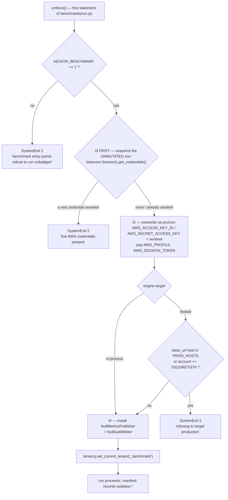

# WS-B: Execution Isolation & the `_benchmark` Reserved Tenant

**Parent LLD**: [lld/41-benchmark-harness.md](../../lld/41-benchmark-harness.md) §4.7 (D10), §8 (SEC-5/6/7), §11, §2 (the `app/` touch inventory)
**Status**: `SCOPE`
**Owner**: TBD
**Milestone covered**: M1 — **build this first; it gates everything**

> **This is not a hypothetical guard.** A smoke run of [`scripts/meas_d2_d3_fp_budget.py`](../../scripts/meas_d2_d3_fp_budget.py) completed in-process with **no AWS deployment** and still called CloudWatch `PutMetricData`. It failed only because that shell's credentials happened to be fake (`InvalidClientTokenId`, caught non-fatally). The call site is real: D2 reaches `sigma_engine.py:362`, which lazily constructs `MetricsPublisher()`, whose `__init__` builds `boto3.client('cloudwatch', …)` directly at [`metrics_publisher.py:34`](../../src/security-controller/app/utils/metrics_publisher.py). **With real credentials in the shell, a benchmark run publishes synthetic attack metrics into the production AWS account.** This workstream promotes that accident into a guarantee.

## Dependencies

- **Depends on**: nothing. Hermetic — no AWS, no LLM, no network, laptop-runnable. Build it day one.
- **Blocks**: **everything.** `enforce()` is the first executable statement of every `benchmarks/` entry point.
- **Shared contracts OWNED here**: the isolation chain (I1–I5) · the **`_benchmark` reserved tenant** (which *extends* `RESERVED_TENANT_IDS`, a frozenset owned by [LLD 26](../../lld/26-multi-tenancy.md) §3.7 — see **OP-4**).
- **Shared contracts CONSUMED here**: the run-manifest schema (WS-A) — this WS writes the `isolation` block.

---

## Model / read before coding

**The rig executes adversarial content by design, imports the production engine's code, and can — if unguarded — write into the production AWS account. The serious risk here is not an attacker; it is us.**

Four consequences, in descending order of how bad they would be (sub-PRD OBQ-5):
1. Synthetic attack traffic **corrupts the §3.2 release-gating metrics this capability exists to produce** — circular contamination, the benchmark poisoning the numbers it reports.
2. It injects fabricated attacks into a **tamper-evident audit trail** relied on as SOC 2 evidence.
3. It **pollutes live session/trust state** (24h TTL, `session_manager.py:145`).
4. It distorts exactly the production statistic [ADR-036](../../adr.md) rests on ("14,640 DENYs, all `sentra.trust`").

**Tie-breaker F**: the boundary of the measurement is *declared*, and crossing it is made to **fail**, not merely discouraged. "Point it at prod just this once to see" is the failure mode FR-14.9 exists to prevent; it must not be one CLI flag away.

**The pattern that decides the design:** **four of the seven** AWS-touching stores on the in-process path construct their boto3 client **directly in `__init__`**, bypassing the `app.utils.clients.get_clients()` registry (`SessionManager.__init__:61`, `PolicyEngine.__init__:59-60`, `AuditLogger.__init__:110`, `MetricsPublisher.__init__:34`, plus `MLClassifier.__init__:83`). So a registry-only seam would leave most stores un-neutralized. **That is why I2 (credential sentinelization) is the correctness floor and the null objects are the cleanliness layer, and not the reverse.**

---

## Milestone B1 — `benchmarks/core/isolation.py::enforce()`



### B1 — I1 the badge, I3 the assertion, I2 the sentinel — **in that order**

| # | Mechanism | Why it *fails* rather than merely discourages |
|---|---|---|
| **I1** | `AEGION_BENCHMARK=1` required | Every entry point under `benchmarks/` exits non-zero without it. This is the **badge, not the protection** — its job is to make I2–I5 unconditional. |
| **I3** | **Positive credential assertion — ASSERT FIRST, THEN sentinelize** | Sentinelization silently does nothing if an SDK reads credentials from `~/.aws/credentials` or IMDS, so `enforce()` must *assert the negative*. |
| **I2** | Credential sentinelization | `os.environ["AWS_ACCESS_KEY_ID"] = "AEGION-BENCH-NO-AWS"` (+ secret key), and **pop** `AWS_PROFILE` / `AWS_SESSION_TOKEN`, **before boto3 is imported**. Any AWS call that slips through a missing null object fails at the API with `InvalidClientTokenId`. **This is the floor: it holds even if a future code path adds an AWS client nobody anticipated.** |

**⚠️ THE ORDERING IS THE WHOLE MECHANISM, and an earlier LLD draft had it backwards.** botocore's provider chain resolves `EnvProvider` **first**. Once I2 has written the sentinel and popped `AWS_PROFILE`, `botocore.Session().get_credentials()` **can only ever return the sentinel**. Assert-after-sentinelize therefore passes unconditionally: "a developer with a live `sentra` profile is stopped here, loudly" would never once fire, and `test_isolation.py`'s live-credential case would be **unpassable** — blocking M1's exit gate on a test that cannot go green.

```python
# benchmarks/core/isolation.py  (pseudo-code, real names)
def enforce(*, transport: str = "in-process", base_url: str | None = None) -> IsolationRecord:
    # I1
    if os.environ.get("AEGION_BENCHMARK") != "1":
        raise SystemExit(2)                       # "benchmark entry points refuse to run unbadged"

    # I3 — BEFORE any mutation. Snapshot the real provider chain.
    import botocore.session
    creds = botocore.session.Session().get_credentials()
    if creds is not None and creds.access_key not in _SENTINELS:
        raise SystemExit(2)                       # "live AWS credentials present"

    # I2 — only now
    os.environ["AWS_ACCESS_KEY_ID"]     = "AEGION-BENCH-NO-AWS"
    os.environ["AWS_SECRET_ACCESS_KEY"] = "AEGION-BENCH-NO-AWS"
    os.environ.pop("AWS_PROFILE", None)
    os.environ.pop("AWS_SESSION_TOKEN", None)
    ...
```

**Footguns:**
- **Do NOT import boto3 (or anything under `app.*`) at module scope in `isolation.py`.** I2 must land before boto3 caches a session. Import `botocore.session` inside the function for the I3 snapshot only.
- **Do NOT skip I3 because "I2 covers it".** It does not — I2 only overwrites the *environment* provider; `~/.aws/credentials` and IMDS are separate links in the chain.
- **Do NOT make I1 a warning.** A soft badge is a convention with better prose.

**Unit tests — `benchmarks/tests/test_isolation_unit.py`:**
- `test_i3_snapshots_before_mutation` — monkeypatch `botocore.session.Session.get_credentials` to return a live-looking credential; assert `enforce()` raises `SystemExit(2)` **and** that `os.environ["AWS_ACCESS_KEY_ID"]` was *not* set to the sentinel first (i.e. capture the env at the moment of raise). **This is the ordering regression test** — it is the single test that would have caught the reversed draft.
- `test_i2_sets_sentinel_and_pops_profile` — after a clean `enforce()`, both key vars are the sentinel and `AWS_PROFILE` / `AWS_SESSION_TOKEN` are absent.
- `test_i3_accepts_already_sentinel` — a shell already carrying the sentinel (a nested run) passes I3 rather than tripping it.
- `test_i1_missing_badge_raises_systemexit_2` — and the exit *code* is exactly 2, not 1.
- `test_i1_wrong_badge_value_raises` — `AEGION_BENCHMARK=true` is not `1`.

### B2 — I4: `NullMetricsPublisher` / `NullAuditWriter` by module substitution

`sys.modules`-level replacement of the `MetricsPublisher` symbol **before `app.*` is imported**, so every lazy `from app.utils.metrics_publisher import MetricsPublisher` inside `sigma_engine` (`:362`, `:478`) and `audit_logger` resolves to the null object.

Purpose: make the common path **quiet and fast** — no wasted network attempts, no 30-second botocore retry storms inside a 40-minute run. **I2 is the correctness floor; I4 is the performance and cleanliness layer.** Steps 2 and 4 are independent by design: forgetting either still fails safe.

**Footguns:**
- **Do NOT add a `benchmark_mode` flag to `app/config.py`** (SEC-6 rejects it explicitly). That would put the harness's isolation guarantee **inside the artifact under measurement**: a flag read at request time can be un-read by a refactor, is invisible to the harness, and would ship to customers as dead configuration. Substitution at the rig's boundary keeps the guarantee on the rig's side of the line — tie-breaker F.
- **This is a runtime substitution, NOT an `app/` source change.** Do not budget an edit for it.
- `MetricsPublisher` is constructed **lazily inside methods**, not at import, so substituting the *class symbol* is sufficient — but the substitution must land before `sigma_engine` is imported, or the module holds the real symbol.

**Unit tests — `benchmarks/tests/test_null_objects.py`:**
- `test_null_metrics_publisher_swallows_publish` — every public method of the real `MetricsPublisher` has a no-op counterpart (introspect the real class's public method names and assert the null object implements all of them; a missing method is an `AttributeError` four hours into a run).
- `test_null_audit_writer_swallows_log_signals_and_log_decision`.
- `test_substitution_lands_before_app_import` — assert `sys.modules["app.utils.metrics_publisher"].MetricsPublisher is NullMetricsPublisher` after `enforce()`, and that importing `app.validators.sigma_engine` afterwards resolves to the null symbol.
- `test_null_objects_record_call_counts` — they count calls (so the manifest can report "0 CloudWatch calls attempted" as evidence rather than assertion).

### B3 — I5 prod-target denylist + the `_benchmark` reserved tenant

**I5 (hosted runs only):** the resolved `--base-url` host is checked against `PROD_HOSTS`, and — if credentials permit an STS call at all — the account id against **`531109575379`**. On a match: `SystemExit(2)`.

**The reserved tenant — THE ONE AND ONLY `app/` SOURCE EDIT IN THIS ENTIRE BUILD:**

```python
# src/security-controller/app/utils/tenancy.py  — around :66-69
BENCHMARK_PSEUDO_TENANT = "_benchmark"          # new, alongside _unverified / _platform / _revocation
RESERVED_TENANT_IDS = frozenset(
    {DEFAULT_TENANT, UNVERIFIED_TENANT, PLATFORM_TENANT, REVOCATION_PSEUDO_TENANT,
     BENCHMARK_PSEUDO_TENANT}                    # <-- the one-line addition
)
```

Verified current state: `RESERVED_TENANT_IDS` is defined at `tenancy.py:67` and today holds exactly `{default, _unverified, _platform, _revocation}`. `is_reserved_tenant()` at `:103` bars any customer from minting a reserved id. The run binds the tenant via the existing contextvar `set_current_tenant()` at `:145` — **reused, not reimplemented**.

Effect: every benchmark row in any store is separable by partition key (`tenancy.compose()` prefixes it), so a leaked row is identifiable **after the fact** and deletable as a unit.

**Footguns:**
- **`RESERVED_TENANT_IDS` is a `frozenset` and it is owned by [LLD 26](../../lld/26-multi-tenancy.md) §3.7, not by this build.** The code edit is one line; the **cross-doc edit is owed** and its sign-off is **OP-4, open**. Merging the code without the LLD 26 §3.7 sync leaves the frozenset's documented membership wrong — exactly the sibling drift the consistency sweep exists to catch.
- **Do NOT add anything else to `app/`.** Everything else that looks like an `app/` change in this build (`BenchmarkSessionStore`, the attribution accessor, `NullMetricsPublisher`) is a **runtime substitution requiring no source change** — see [ws-d](ws-d-engine-seams.md).
- `set_current_tenant` returns a contextvar **Token**; hold it and reset it at run end rather than leaking the binding into a test process that runs other tests afterwards.

**Unit tests — `benchmarks/tests/test_reserved_tenant.py` and `src/security-controller/tests/test_tenancy.py`:**
- `test_benchmark_tenant_is_reserved` — `is_reserved_tenant("_benchmark") is True`.
- `test_reserved_set_membership_unchanged_for_existing` — the four pre-existing ids are still present (a frozenset edit that drops one is silent and catastrophic).
- `test_customer_cannot_mint_benchmark_tenant` — whatever path enforces `is_reserved_tenant` on tenant creation rejects `_benchmark` (extend the existing reserved-id test rather than writing a parallel one).
- `test_enforce_binds_and_resets_tenant` — after `enforce()`, `current_tenant() == "_benchmark"`; after the returned token is reset, it is back to the prior value.
- `test_i5_rejects_prod_host` / `test_i5_rejects_prod_account` — `SystemExit(2)` for each; a non-prod host passes.
- `test_i5_not_applied_in_process` — an in-process run with no `--base-url` does not attempt an STS call at all.

---

## Milestone B2 — proving the refusals, and recording the evidence

### B4 — `benchmarks/tests/test_isolation.py` — the three refusal paths (M1 exit gate)

Each case launches the entry point in a **subprocess** and asserts **exit code 2**:

| Case | Setup | Asserts |
|---|---|---|
| `test_unbadged_entrypoint_exits_2` | `AEGION_BENCHMARK` unset in the subprocess env | exit 2; stderr names the badge |
| `test_live_credentials_exit_2` | a fabricated live-looking credential (`AWS_ACCESS_KEY_ID=AKIA…`, secret) **injected into the environment the subprocess starts with**, so **I3's pre-mutation snapshot sees it** | exit 2; stderr says "live AWS credentials present" |
| `test_prod_base_url_exits_2` | badge set, no creds, `--transport hosted --base-url <a PROD_HOSTS entry>` | exit 2; stderr says "refusing to target production" |

**Footgun — this is the one that makes or breaks M1's exit gate:** the live-credential case is only passable because **I3 asserts before I2 mutates**. If someone "simplifies" `enforce()` by sentinelizing first, this test becomes unpassable and M1 cannot exit. If you find yourself relaxing this test, the bug is in `enforce()`'s ordering.

Also add:
- `test_all_three_use_subprocess_not_monkeypatch` — a lint-shaped assertion (or code review note): these must be subprocess tests. In-process monkeypatching cannot prove "the first executable statement" and cannot observe a `SystemExit` that fires before argparse.

### B5 — the `isolation` manifest block (FR-14.9 evidence, recorded not asserted)

`enforce()` returns an `IsolationRecord` that WS-A serializes verbatim into `manifest.isolation`:

```jsonc
"isolation": {
  "tenant": "_benchmark", "badge": true, "aws_credentials": "sentinel",
  "metrics_publisher": "NullMetricsPublisher", "audit_writer": "NullAuditWriter",
  "prod_target_check": "passed"
}
```

**No UT beyond the shape check — this is a data-carrier.** Its correctness is covered by B1–B3's tests plus the integration test below.
- `test_isolation_record_serializes_all_six_fields` — in `benchmarks/tests/test_manifest.py` (WS-A's file), asserting the block is complete and that `aws_credentials` never contains an actual key value.

### B6 — discharge the "Rig → AWS: none, never" claim, store by store

**This row is a claim, and a claim about a tree this large has to be discharged store by store.** Hand-waving it is how §4.4a's CRITICAL survived a full LLD draft. Each of the seven is neutralized by a named mechanism owned by a named workstream:

| # | Store | Reached by | Constructed at | Neutralized by | Owner WS |
|---|---|---|---|---|---|
| 1 | **Sessions** (DynamoDB) | `validate_tool_call` → `get_or_create_session` — **the first call in the pipeline** | `boto3.resource` in `SessionManager.__init__` (`session_manager.py:61`) | `BenchmarkSessionStore` | **WS-D** |
| 2 | **Policies** (DynamoDB + S3) | Cedar → `CedarPolicyLoader.load` → `PolicyEngine.resolve_policy_bundle` | `boto3.resource`/`client` in `PolicyEngine.__init__` (`policy_engine.py:59-60`) | `BenchmarkPolicyEngine` (class-level patch of `resolve_policy_bundle:202`) | **WS-D** |
| 3 | **Sigma rules** (DynamoDB meta + S3 bodies) | `SigmaEngine.match_rules` → `load_rules_from_s3` | pooled `get_clients().dynamodb_resource()` / `.s3()` (`sigma_engine.py:147-148`) | **`get_clients()` IS the seam** (`clients.py:74`) — primed with fakes serving a **pinned local ruleset fixture**. **Not neutralized-to-empty**: an empty ruleset scores `inert`, which aborts | **WS-C** |
| 4 | **Audit + signal store** | `_fire_and_forget(audit_logger.log_signals / log_decision)` (`validation_service.py:912,925`) | `boto3.client('logs')` in `AuditLogger.__init__` (`audit_logger.py:110`) | **`NullAuditWriter` (I4)** — it is *fire-and-forget*, so a failure would be **swallowed** rather than surfaced, which is exactly why I4 rather than I2 is primary here | **WS-B** |
| 5 | **CloudWatch metrics** | lazy `MetricsPublisher()` in `sigma_engine.py:362`/`:478` | `boto3.client('cloudwatch')` directly (`metrics_publisher.py:34`) — **bypasses `get_clients()`** | **`NullMetricsPublisher` (I4)** + I2 as the floor. **The observed live contamination path** | **WS-B** |
| 6 | **RPS quota** (DynamoDB) | `check_validate_rps` — **route-handler only** (`routes.py:313`) | — | **Not reached in-process at all** — the rig calls `validate_tool_call` directly, below the handler. Hosted runs reach it, where it is inert unless founder-enabled and **fail-open**, so it cannot deny a benchmark call | n/a |
| 7 | **Bedrock**, via D2's ML leg | `IndirectInjectionValidator.validate` leg 2 (`indirect_injection.py:126`) | `boto3.client("bedrock-runtime")` **directly** in `MLClassifier.__init__` (`ml_classifier.py:83`) | inject a pinned fake through the **existing seam** `MLClassifier.__init__(bedrock_client=…)` (`ml_classifier.py:71`). **Left un-injected this store fails SILENTLY** — the error is swallowed at `:231` and returned as `abstain`, byte-identical to `ML_CLASSIFIER_ENABLED=false` (`:138-139`) | **WS-C** |

**Integration test — `benchmarks/tests/integration/test_no_aws_egress.py`** *(shared contract: the isolation chain — the contract this WS owns)*: runs a full in-process Mode A pass under `enforce()` with a **botocore event hook / socket-level guard** installed that records every attempted outbound connection, and asserts **zero** attempts to any AWS endpoint. Parametrize over the seven stores above by exercising a code path that reaches each. This is the only test that proves the row, rather than asserting it.

**Integration test — `benchmarks/tests/integration/test_tenant_binding_end_to_end.py`** *(shared contract: `_benchmark` reserved tenant)*: after `enforce()`, drive a real in-process validate (WS-D's `GuardClient`) and assert every row the rig can cause carries the `_benchmark` prefix under `tenancy.compose()`, and that `is_reserved_tenant()` returns True for it. Skipped with an explicit reason until WS-D lands; **do not delete the test in the meantime.**

---

## Error model

| Condition | Response | Exit |
|---|---|---|
| `AEGION_BENCHMARK` unset or ≠ `1` | refuse before anything else runs | `SystemExit(2)` |
| A real credential resolves from **any** provider (env, `~/.aws/credentials`, IMDS) at I3 | refuse, loudly, naming the provider if botocore exposes it | `SystemExit(2)` |
| `--base-url` resolves to a `PROD_HOSTS` entry, or STS resolves account `531109575379` | refuse | `SystemExit(2)` |
| An AWS call slips through a missing null object | fails at the API with `InvalidClientTokenId` (I2's floor) → becomes an `ERROR` row, never a silent success | run continues, error counted |
| Rollback | `rm -rf benchmarks/runs/{run_id}/`. **The rig writes nothing else, anywhere** (RES-7) | instant |

---

## Acceptance criteria (whole workstream)

- [ ] `benchmarks/core/isolation.py::enforce()` executes I1 → **I3** → **I2** → I5 → I4 → tenant-bind, in that order, and is the first executable statement of every `benchmarks/` entry point.
- [ ] `enforce()` imports nothing from `app.*` and nothing from `boto3` at module scope.
- [ ] All three refusal paths exit **exactly 2** from a **subprocess**, including the live-credential path (which is only reachable because I3 precedes I2).
- [ ] `NullMetricsPublisher` implements every public method of the real `MetricsPublisher`, and `NullAuditWriter` covers `log_signals` + `log_decision`; both are installed by `sys.modules` substitution **before** any `app.*` import.
- [ ] `_benchmark` is a member of `RESERVED_TENANT_IDS` (`app/utils/tenancy.py:67`) and the four pre-existing ids are unchanged; `is_reserved_tenant("_benchmark")` is True.
- [ ] **This is the only `app/` source edit in the entire build** — verified by `git diff --stat -- src/security-controller/app/` on the WS-B branch showing exactly one file and one hunk.
- [ ] `manifest.isolation` carries all six fields and never records a credential value.
- [ ] All seven AWS-touching stores on the in-process path are enumerated with a named neutralization and a named owning workstream (B6's table), and the ones owned here (#4, #5) are live.
- [ ] **unit tests pass** — covering: I3-snapshots-before-I2 ordering; sentinel set + profile/token popped; already-sentinel accepted; badge missing/wrong-value exits 2; null-object method parity + substitution timing + call counting; `_benchmark` reserved + existing ids intact + customer cannot mint it; tenant bind/reset; I5 prod-host and prod-account refusals; I5 not applied in-process.
- [ ] **integration tests pass** — `test_isolation.py`'s three subprocess refusal paths (the M1 exit gate), `test_no_aws_egress.py` (zero attempted AWS connections across all seven stores), and `test_tenant_binding_end_to_end.py` (the `_benchmark` contract seam, once WS-D lands).
- [ ] *(human, OP-4)* [LLD 26](../../lld/26-multi-tenancy.md) §3.7 updated to list `_benchmark` in `RESERVED_TENANT_IDS`, signed off by that LLD's owner. **The code edit must not merge without this.**

---

## Cross-references

- **This WS's LLD sections**: §4.7 (I1–I5, the reserved tenant, the refusal test), §8 SEC-5/6/7 (audit, fail-secure-on-a-dropped-check, blast radius), §11 (the store-by-store discharge), §2 (the `app/` touch inventory — **exactly one source edit**).
- **Sibling WS docs sharing a contract**: [ws-a](ws-a-harness-core.md) (calls `enforce()` first; serializes `manifest.isolation`) · [ws-c](ws-c-mode-a-replay.md) (owns stores #3 Sigma and #7 Bedrock in B6's table) · [ws-d](ws-d-engine-seams.md) (owns stores #1 Sessions and #2 Policies — **without them, in-process Mode B cannot execute one validate under I2**) · [ws-e](ws-e-mode-b-agentdojo.md) / [ws-f](ws-f-asb-adapter.md) (hosted transport is the only place I5 applies).
- **Upstream owner**: [LLD 26](../../lld/26-multi-tenancy.md) §3.7 owns `RESERVED_TENANT_IDS` — **owed an edit (OP-4)**.
- **The observed contamination path**: [`scripts/meas_d2_d3_fp_budget.py`](../../scripts/meas_d2_d3_fp_budget.py) → `sigma_engine.py:362` → `metrics_publisher.py:34`.
