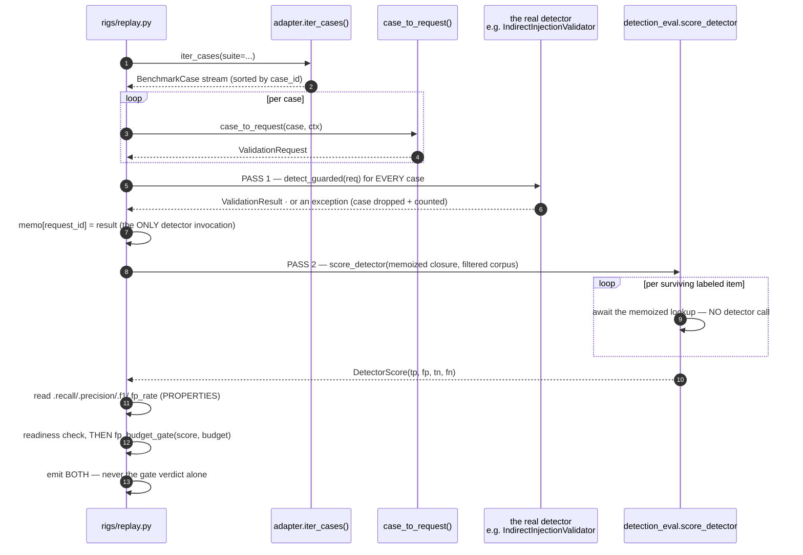

# WS-C: Mode A Detection Replay, Detector Readiness & Mode A Corpora

**Parent LLD**: [lld/41-benchmark-harness.md](../../lld/41-benchmark-harness.md) §4.3 (D9), §5.1, §16.1, §18.1
**Status**: `SCOPE`
**Owner**: TBD
**Milestones covered**: M1 (C1–C4), M3 (C5)

> **This workstream closes G2** — a real, armed recall number for D2 **and** D3, where [ADR-036](../../adr.md) records "unmeasured". It costs **zero LLM spend** and runs on a laptop or a GitHub runner in ~2 minutes. It is the highest-value-per-dollar slice in the whole build.

## Dependencies

- **Depends on**: **WS-A** (`BenchmarkCase`, `BenchmarkAdapter`, `RunContext`, `cases.jsonl` writer, manifest `corpus`/`results.mode_a`/`engine.detector_readiness` blocks) · **WS-B** (`enforce()`, `NullMetricsPublisher` — without I4 every Sigma match attempts a CloudWatch publish).
- **Blocks**: WS-A's CI gate (A8) needs `detector_readiness`; WS-D's `policy_synth` needs `ToolManifest` from C4's `tool_manifest()`; WS-E needs C4's AgentDojo adapter package to exist.
- **Shared contracts OWNED here**: **`detector_readiness`**.
- **Shared contracts CONSUMED here**: `BenchmarkCase`, `BenchmarkAdapter` (implements `iter_cases` + `tool_manifest`), `RunContext`, `cases.jsonl` row schema, run-manifest schema.

---

## Model / read before coding

1. **Mode A measures the detector's own signal, isolated from the combiner.** It calls `IndirectInjectionValidator.validate()` and its peers **directly**, exactly as [`scripts/meas_d2_d3_fp_budget.py`](../../scripts/meas_d2_d3_fp_budget.py) already does — **it deliberately bypasses the DAG scheduler.** [LLD 32](../../lld/32-detection-depth.md) §14.1 makes `ValidatorNode` (`scheduler/node.py:32`, `source` at `:60`) the uniform per-detector contract and the production path reaches every detector through `run_dag`. Routing Mode A through the DAG would reintroduce exactly the source-masking FR-14.8 exists to prevent.
   **Consequence that must be named:** Mode A's `deciding_source` is the **detector's own `ValidationResult.source`**; LLD 32's `winning_source` is the **combiner's post-arbitration answer**. Different objects. **A run-over-run diff must never put them in one column.**
2. **Mode A is never quoted as an efficacy number** (§2.3). Mode A recall does not predict Mode B ASR reduction in either direction — that is the reason two rigs exist, not a caveat.
3. **Do not rebuild the scorers.** `score_detector` (`app/services/detection_eval.py:58`) and `fp_budget_gate` (`:84`) are **consumed unchanged**. `DetectorScore.precision:33` / `.recall:38` / `.f1:43` / `.fp_rate:48` are **properties with correct zero-denominator guards** — read them, never re-derive. A second implementation of `f1` is a second place for it to drift, and the repo already has a *third* (`CategoryMetrics` at `eval_ml_classifier.py:88`) which stays where it is.
4. **A score is only emitted for a detector that was ARMED and actually FIRED.** Otherwise this rig reproduces §18.1's pathology *inside the instrument built to expose it*.

**Verified line-number delta vs LLD 41** (re-grepped 2026-07-27): `MLClassifier`'s direct `boto3.client("bedrock-runtime")` is at **`ml_classifier.py:83`** (LLD cites `:82`); the injection seam `def __init__(self, bedrock_client=None)` is at `:71` exactly as cited. All other citations in this doc matched verbatim.

---

## Milestone C1 — the replay rig

### C1 — `benchmarks/rigs/replay.py::case_to_request()` — the one conversion, in one place

```python
def case_to_request(case: BenchmarkCase, *, ctx: RunContext) -> ValidationRequest:
    return ValidationRequest(
        request_id=f"bench-{case.case_id}",       # traceable back to the case row
        session_id=ctx.session_id_for(case),      # run-unique, episode-scoped (WS-A A3)
        agent_id=case.agent_id,                   # bound by the synthesized policy (WS-D)
        tool_name=case.tool_name,
        tool_params=case.tool_params,
        user_input=case.user_input,               # "" on content/memory — see the footgun below
        timestamp=ctx.run_clock_iso,              # FIXED per run, NOT datetime.now()
        operation_type=case.operation_type,
        phase=case.phase,
        content_text=case.content_text,
    )
```

**Footguns:**
- **`user_input` is `""` on a content/memory call, and the payload rides `content_text`.** This is the named footgun in `indirect_injection.py`'s own docstring (`:101-103`): the Sigma leg matches on `req.content_text`, not `user_input`, and `ml_classifier` likewise builds a content request (`:120,126`). Putting the payload in `user_input` scores a detector on a field it never reads.
- **`timestamp` is a fixed per-run constant.** A wall-clock field makes two replays of the same corpus produce different request bodies, defeating byte-level reproducibility for no benefit — nothing in the request-phase pipeline reads it for freshness.
- **Never read `RUN_CLOCK_ISO`/`RUN_ID` as module globals** — `--resume` re-enters under a prior run's identity (WS-A A3).

**Unit tests — `benchmarks/tests/test_case_to_request.py`:**
- `test_content_case_puts_payload_in_content_text_and_empty_user_input` — parametrized over `content` and `memory`.
- `test_request_case_has_none_content_text`.
- `test_request_id_is_derived_from_case_id` — `f"bench-{case_id}"`, so an error row is traceable.
- `test_timestamp_is_run_clock` — two conversions under one ctx are byte-identical.
- `test_session_id_matches_ctx_scheme` — Mode A ctx maps case→`session_id_for(case_id)`.

### C2 — the **TWO-PASS** replay shape (the fail-secure invariant, tenet 2)



```python
# PASS 1 — the ONLY place the detector is invoked. Rig-level, OUTSIDE score_detector.
memo, errors = {}, []
for req, _label in corpus:
    try:
        memo[req.request_id] = await d2.validate(req)
    except Exception as exc:
        errors.append(ErrorRow(case_id=req.request_id, detector="D2", exc=repr(exc)))
        # request_id simply never enters `memo` -> the case is dropped, never scored

# PASS 2 — score_detector consumed UNCHANGED, over the filtered corpus, with a
# MEMOIZED closure that performs NO detector work.
scored = [(req, lab) for req, lab in corpus if req.request_id in memo]
score  = await score_detector(lambda req: _immediate(memo[req.request_id]), scored)
assert len(scored) + len(errors) == len(corpus)      # RES-2, now actually assertable
```

**⚠️ WHY TWO PASSES — this is the single most misread part of the design.** `score_detector` (`detection_eval.py:66-81`) is a bare `for req, is_attack in corpus: result = await detect(req)` loop with **no exception handling**, returning `DetectorScore` only after the loop completes. A `SkipCase` raised from inside the closure **does not skip anything** — it unwinds the whole loop and discards the entire partial tally. RES-1's ">2% error ⇒ abort" band would be unreachable (any single error aborts at 100%) and RES-2's `n_scored + n_errors == n_cases` could never hold. **Do NOT "simplify" this to one pass with a try/except inside the closure.**

**Memoization is a CORRECTNESS requirement, not an optimization** — state it in the code comment for exactly that reason. Re-invoking the detector in pass 2 would (a) double Mode A's cost, which matters once the ML classifier is enabled and each case is a model call, and (b) admit **nondeterminism**: a model-backed detector can return a different verdict on the second call, so the score would describe a corpus the error filter never saw. **One invocation per case, one recorded result, scored once.**

**Detectors under test, and the phase each is fed:**

| Detector | Class | Phase fed | Source constant |
|---|---|---|---|
| D2 indirect injection | `app.validators.indirect_injection.IndirectInjectionValidator` | `content` | `sentra.indirect_injection` |
| D3 memory integrity | `app.validators.memory_write.MemoryWriteValidator` | `memory` | `sentra.memory` |
| D1 trajectory | `TrajectoryValidator` (`app/validators/trajectory.py:55`; flag gate `_d1_enabled()` at `:49`) | `request` (sequence) | `sentra.trajectory` |
| Sigma | `app.validators.sigma_engine.SigmaEngine` | `request` / `content` | `sentra.sigma` |
| ML classifier | `app.validators.ml_classifier.*` | `request` / `content` | `sentra.ml_classifier` |

**Bootstrap:** `benchmarks/core/bootstrap.py` follows `meas_d2_d3_fp_budget.py`'s precedent to the letter —
```python
_CTRL = Path(__file__).resolve().parent.parent.parent / "src" / "security-controller"
sys.path.insert(0, str(_CTRL))
```
— **with one addition that is the whole of WS-B**: `isolation.enforce()` runs *before* that `sys.path.insert`.

**Unit tests — `benchmarks/tests/test_replay.py`:**
- `test_detector_exception_drops_case_and_counts_it` — a detector raising on 1 of 10 cases yields `len(scored)==9`, `len(errors)==1`, and a `DetectorScore` over 9 — **not** a discarded tally.
- `test_error_is_never_scored_as_allow` — the raised case appears in **neither** tp/fp/tn/fn; explicitly assert `tp+fp+tn+fn == 9`.
- `test_res2_invariant` — `len(scored) + len(errors) == len(corpus)` across a parametrized error rate.
- `test_detector_invoked_exactly_once_per_case` — a counting spy asserts `call_count == n_cases` after **both** passes. This is the memoization regression test.
- `test_pass2_closure_makes_no_detector_call` — spy count unchanged across pass 2 alone.
- `test_abort_above_2pc_error_rate` — 3 errors in 100 cases ⇒ raises `CorpusIntegrityError` (RES-1), 2 in 100 ⇒ proceeds.
- `test_metrics_read_off_detector_score_properties` — patch `DetectorScore.f1` to a sentinel and assert the emitted manifest carries the sentinel, proving the rig **reads the property** rather than recomputing.

**Integration test — `benchmarks/tests/integration/test_mode_a_end_to_end.py`** *(shared contract: `detector_readiness` + `results.mode_a` + `cases.jsonl`)*: under `enforce()`, runs the real `IndirectInjectionValidator` and `MemoryWriteValidator` over a small pinned fixture corpus, and asserts a complete run directory appears with `manifest.engine.detector_readiness`, `manifest.results.mode_a` (serialized `DetectorScore` fields **and** properties), `manifest.corpus.corpus_digest`, and one `cases.jsonl` row per case with `arm=null`.

---

## Milestone C2 — detector readiness (the mechanism that stops §18.1 repeating inside this rig)

### C3 — `benchmarks/core/readiness.py` — three legs, per detector, **per leg for composites**

**The pathology, stated precisely.** `fp_budget_gate` is one line: `return score.fp_rate <= fp_budget`, and `fp_rate = FP / (FP + TN)`. **A detector that never fires has `FP = 0`, therefore `fp_rate = 0.0`, therefore passes any budget — by construction.** The gate cannot distinguish "precise" from "inert". A live smoke run of `meas_d2_d3_fp_budget.py` scored D2 and D3 at **recall 0.000** and `fp_budget_gate` still returned **"MAY ENFORCE: YES"** for both. *(That zero is quite possibly an isolation artifact — fake credentials ⇒ inert Sigma, unarmed D1 — and this rig therefore does **not** treat it as evidence about D2 or D3. It is evidence that a rig without a readiness check will print a score for a detector that never ran.)*

**Activation vs enforcement are DIFFERENT flags, and the artifact is a third variable:**

| | Flag | Controls | Read at |
|---|---|---|---|
| **Activation** | `D1_ENABLED` | whether `TrajectoryValidator` emits a signal **at all** — default **off ⇒ ABSTAIN** | `trajectory.py:49` `_d1_enabled()` |
| **Enforcement** | `D1_ENFORCE_ENABLED` | whether an *existing* signal is stamped `enforce=True` and gates | `config.py:512` → `_apply_enforce_if(...)` at `scheduler/registry.py:248` |

**⚠️ `D2_ENABLED` and `D3_ENABLED` DO NOT EXIST.** `config.py:500-501` defines only the `*_ENFORCE_ENABLED` twins. **D1 and `ML_CLASSIFIER_ENABLED` are the only activation flags that exist.** D2 and D3 have **no activation gate** — they run whenever the phase matches and abstain only on an empty payload (`indirect_injection.py:98`, `memory_write.py:161`), so their readiness rests entirely on legs 2 and 3. **Recording a nonexistent flag as `activated: true` would be fiction.**

**The three legs `readiness.py` records, per detector — the run refuses to print a score without all three:**

1. **Activation flag, where one exists** (D1, ML classifier only).
2. **The loaded artifact** — `sigma_rule_count`, `sigma_ruleset_version`, `ml_model_id`, `d2_model_id`. **Zero rules or no model id ABORTS the run** for any detector under test: an unpinned ruleset is an unpinned variable, and tie-breaker E does not distinguish between a variable that moved and one that was never there.
3. **A fired-at-least-once assertion** — `tp + fp == 0` across the whole corpus means the detector never returned a single DENY ⇒ verdict `inert`, metrics suppressed, and `fp_budget_gate`'s verdict **suppressed rather than printed as a pass**.

**COMPOSITE DETECTORS NEED PER-LEG READINESS.** D2 is not one detector: `IndirectInjectionValidator.validate` runs three legs in order — `sigma_engine.match_rules` (`indirect_injection.py:103`), then `ml_classifier.validate` (`:126`), then heuristics. `MLClassifier.__init__` builds `boto3.client("bedrock-runtime")` **directly** (`ml_classifier.py:83`), so under WS-B's I2 every Bedrock call fails, is **swallowed at `:231`**, and returns `abstain` — **byte-identical to the `ML_CLASSIFIER_ENABLED=false` path at `:138-139`**. The Sigma and heuristic legs still fire, so `tp+fp > 0`, the fired-at-least-once assertion passes, and the report prints `readiness: "scored"` beside a D2 recall number produced by a **two-thirds-armed detector**. That is §18.1's pathology one level below where a per-detector check can see it.

Therefore `detector_readiness` records **each leg separately** for a composite (`d2.sigma_leg`, `d2.ml_leg`, `d2.heuristic_leg`), and **a detector with any dead leg prints `partial` — naming the dead leg — never a bare recall number.**

**Contract shape** (owned here, rendered by WS-A, gated on by WS-A's CI gate):

```jsonc
"detector_readiness": {
  "D1_trajectory":         {"activated": false, "artifact": null, "fired": 0, "verdict": "inert"},
  "D2_indirect_injection": {"activated": true,
                            "sigma_leg":     {"activated": true, "artifact": {"sigma_rule_count": 47}, "fired": 14},
                            "ml_leg":        {"activated": true, "artifact": {"model_id": "pinned-local-fake-v1"}, "fired": 121},
                            "heuristic_leg": {"activated": true, "artifact": null, "fired": 245},
                            "fired": 380, "verdict": "scored"},
  "sentra.sigma":          {"activated": true,
                            "artifact": {"sigma_rule_count": 47, "sigma_ruleset_version": 118},
                            "fired": 14, "verdict": "scored"}
}
```

**Arming the two artifact-fed legs (B6 stores #3 and #7, owned here):**
- **Sigma** — `SigmaEngine` loads rules from DynamoDB metadata + S3 bodies (`sigma_engine.py:147-148`, `:154`, `:193`) and `_fetch_version` **swallows failure and returns `-1`** (`:381-383`). Under I2 there is no cache to fall back on, so `match_rules` takes the `SigmaRulesLoadError` branch at `:543` and **abstains on every case**. Neutralization: **`get_clients()` (`clients.py:74`) IS the seam** — prime the registry with fakes serving a **pinned local ruleset fixture**, and record it as `detector_readiness["sentra.sigma"].artifact`. **Not neutralized-to-empty**: an empty ruleset scores `inert`, which aborts.
- **ML leg** — `MLClassifier` already accepts an injected client (`ml_classifier.py:71`). Pass a **pinned local/fake classifier** and record it as `detector_readiness.D2_indirect_injection.ml_leg.artifact`.

**Footguns:**
- **`inert` is printed INSTEAD OF a number, never beside one.** A precision figure next to "this detector never fired" is still read as a precision figure.
- **Do NOT set `D2_ENABLED`/`D3_ENABLED`** — they do not exist. An implementer who "enables" them changes nothing and produces a run that looks configured and is not.
- **Do NOT leave the ML leg un-injected and call D2 `scored`.** That is the exact failure this section exists to prevent, and it is invisible to any per-detector check.

**Unit tests — `benchmarks/tests/test_readiness.py`:**
- `test_never_fired_yields_inert` — `tp+fp == 0` ⇒ `verdict == "inert"`, and the emitted result carries **no** precision/recall/f1/fp_rate keys.
- `test_inert_suppresses_gate_verdict` — `fp_budget_gate` is not called, or its result is dropped; the manifest carries no `fp_budget_gate` key for that detector.
- `test_dead_ml_leg_yields_partial_naming_the_leg` — Sigma + heuristics fire, the ML leg abstains on 100% ⇒ `verdict == "partial"` and the dead leg name appears in the record. **This is the composite-detector test; without it a two-thirds-armed D2 reports as `scored`.**
- `test_ml_leg_abstain_indistinguishable_from_disabled_is_still_caught` — parametrize the ML leg over (a) `ML_CLASSIFIER_ENABLED=false` and (b) an injected client that raises; assert **both** produce `partial`, because the readiness record is built from the *injected artifact*, not from the return value.
- `test_zero_sigma_rules_aborts_run` — `sigma_rule_count == 0` raises before scoring, not after.
- `test_missing_model_id_aborts_run`.
- `test_d1_unarmed_records_activated_false` — with `D1_ENABLED` unset, `activated is False` and `verdict == "inert"`; the manifest note reads "D1_ENABLED unset — detector abstained on all N cases; NO score emitted".
- `test_no_fictional_activation_flag_for_d2_d3` — asserts the D2/D3 records carry `activated: null` (or omit the key) rather than `true`, and that no code reads an env var named `D2_ENABLED`/`D3_ENABLED`.

**Integration test — `benchmarks/tests/integration/test_readiness_contract.py`** *(shared contract: `detector_readiness` — the contract this WS owns)*: runs Mode A three times against the same corpus with (1) everything armed, (2) the Sigma fixture emptied, (3) the ML client un-injected, and asserts the three manifests read `scored` / abort / `partial` respectively — **and** that WS-A's report renderer and CI gate consume each verdict correctly (no metrics for `inert`/`partial`; no gate verdict emitted). This is the seam where WS-C's producer and WS-A's two consumers must agree.

---

## Milestone C3 — the AgentDojo Mode A corpus

### C4 — `benchmarks/adapters/agentdojo/adapter.py` — `iter_cases()` + `tool_manifest()`

**Pinning (tie-breaker E).** Checkout `/Users/ruchikkachaudhary/closed-source/agentdojo` at SHA **`089ed468cf3ed0322acc66b0211f26d9d90dbf60`** (`0.1.35`, `requires-python >= 3.10`, **MIT** — LICENSE read from source 2026-07-27 per FR-14.7). Installed **editable from that checkout**; the manifest pins **both** the checkout's git SHA **and** the sha256 of its `uv.lock`. The SHA fixes the benchmark code; the lock fixes its transitive dependency graph. **A PyPI version range pins neither well enough** — `agentdojo==0.1.35` leaves the resolved tree floating, and a floating tree can move the LLM client, the tokenizer or the YAML loader under us between runs.

**Case extraction map:**

| `BenchmarkCase` field | AgentDojo source |
|---|---|
| `benchmark` | `"agentdojo"` |
| `suite` | `banking` \| `slack` \| `travel` \| `workspace` (`default_suites/v1/`) via `get_suite(benchmark_version, suite_name)` (`task_suite/load_suites.py:85`) |
| `case_id` | `f"agentdojo:{suite}:{user_task.ID}:{injection_task.ID}"` — both are the benchmark's own **stable** ids |
| `episode_id` | `== case_id` for Mode A; `f"{user_task.ID}\|{injection_task.ID}"` for Mode B |
| `phase` | `"content"` — the injection is delivered through `injection_vectors.yaml` into the environment and surfaces as tool output |
| `content_text` | the rendered injection string, from `suite.get_injection_vector_defaults()` overlaid with the attack payload (`task_suite/task_suite.py:148`) |
| `user_input` | `user_task.PROMPT` — carried for report context; **`""` on the wire** for a content-phase request |
| `tool_name` | the tool whose output carries the vector; falls back to `"ingest_content"` when the vector is environment-level |
| `label` / `expected_outcome` | `True`/`"deny"` for every injected case; **benign negatives from `benchmark_suite_without_injections`'s task set, emitted as `label=False`** |
| `attack_type` | `"indirect_injection"` |
| `injection_goal` | `injection_task.GOAL` |

`tool_manifest(suite=...)` reads `suite.tools` — a `list[Function]` with `.name`, `.description` and a pydantic `.parameters` model — and returns `ToolManifest(tool_names, read_write, provenance=f"agentdojo:{suite}@{sha[:8]}")`.

**⚠️ BENIGN NEGATIVES ARE NOT OPTIONAL, and the floor is TWO numbers, not one.**

`DetectorScore.fp_rate = FP / (FP + TN)` (`detection_eval.py:48`). With no benign items, `TN + FP = 0` and the property returns `0.0` **by the guard clause** — which is not "a perfect FP rate", it is **no measurement at all**.

- **n ≥ 30 negatives** — the absolute **refuse-to-run** floor (LLD 34 §6–7's minimum-size discipline; below it a percentage is theatre). The rig refuses the Mode A pass and prints the reason.
- **n ≥ 3/budget negatives** — the floor for a corpus whose `fp_rate` is to be **gated against `fp_budget`**. At the 1% budget that is **n ≥ 300**. This is the **rule of three**: the point at which the upper 95% confidence bound on an observed zero-FP run equals the budget. Below it, "zero false positives" licenses no claim about the budget at all; at n = 300, zero FPs finally licenses *"FP rate ≤ 1%, at 95% confidence."*

**Why the second floor matters:** with *n* negatives the smallest non-zero observable `fp_rate` is `1/n`. At n=30 that is **3.3%** — more than triple a 1% budget — so the gate has exactly two reachable states, `0` (pass) or `≥0.033` (fail). **It can only pass at exactly zero false positives**, which is §18.1's degenerate pass arrived at from the corpus side instead of the flag side.

Between 30 and 300: **run and report `fp_rate` with an explicit `resolution: 1/n` annotation, and SUPPRESS the gate verdict** — the same treatment an `inert` detector gets, for the same reason. AgentDojo's clean suites clear n≥300 comfortably in aggregate; a single-suite inner loop may not, which is exactly when the annotation earns its place.

**Footguns:**
- **Do NOT emit only injected cases.** A corpus of pure positives makes `fp_rate` structurally 0.0 and every gate pass meaningless.
- **Truncate `content_text` at `CONTENT_TEXT_MAX_LEN` (1 MiB) in the adapter and flag it** — do not let the pydantic edge 422 four hours into a run.
- `iter_cases()` must yield **sorted by `case_id`** (WS-A's protocol rule).

**Unit tests — `benchmarks/tests/test_agentdojo_cases.py`:**
- `test_case_ids_are_stable_and_sorted` — two calls to `iter_cases()` yield identical, sorted, unique id sequences.
- `test_injected_cases_are_content_phase_with_payload`.
- `test_benign_negatives_emitted_with_label_false` — the clean-suite tasks appear with `label=False`, `expected_outcome="allow"`.
- `test_refuses_below_30_negatives` — a stubbed suite with 29 negatives ⇒ the rig raises with the reason in the message.
- `test_gate_suppressed_between_30_and_300` — 100 negatives ⇒ `fp_rate` present **with** `fp_resolution == 0.01` **and no** `fp_budget_gate` key.
- `test_gate_emitted_at_300_plus` — 300 negatives ⇒ gate verdict present.
- `test_content_text_truncated_and_flagged_at_max_len`.
- `test_provenance_carries_upstream_sha` — `ToolManifest.provenance` contains the pinned 8-char SHA.

**Integration test — `benchmarks/tests/integration/test_agentdojo_adapter_conformance.py`** *(shared contract: `BenchmarkAdapter`, consumed from WS-A)*: registers the AgentDojo adapter into WS-A's `test_adapter_conformance.py` parametrization and, additionally, runs a **real** Mode A pass over the `banking` suite asserting `n_benign >= 300` in aggregate and a `scored` D2 verdict. **This is M1's exit gate** (G2: a number exists where ADR-036 records "unmeasured").

### C5 — `benchmarks/adapters/local_prompts/` + retiring `demo-agents/eval/measure.py` — M3

`demo-agents/eval/measure.py:38` mints a **per-call** session id — a precedent, but the **wrong granularity** for Mode B (§4.6) and precisely the trust-bleed defect FR-14.8 exists to fix. **Two eval harnesses with different session semantics is the duplication FR-14.1 exists to prevent**, so it does not stay alongside.

- Its corpus becomes a `benchmarks/adapters/local_prompts/` adapter — implementing **`iter_cases()` only** (Mode A corpus; `tool_manifest`/`run_arm`/`score_run` raise `NotImplementedError` with a clear message). This is a **third cheap proof** of the extensibility claim.
- `measure.py` is **deleted in the same PR**. `fetch_dataset.py` survives as corpus-acquisition tooling under the new adapter.

**⚠️ `demo-agents/eval/labeled_prompts.jsonl` MUST NOT MOVE.** It has **two live consumers outside this LLD's scope**:
- [`scripts/meas_d2_d3_fp_budget.py:13,36`](../../scripts/meas_d2_d3_fp_budget.py) — the very script §18.1's finding, C2's precedent and WS-D's immunity argument all rest on;
- [`training/distilled-classifier/scripts/02_build_corpus.py:8,83`](../../training/distilled-classifier/scripts/02_build_corpus.py).

**The file stays exactly where it is; the adapter reads it in place.** *(Noted, not tasked: that second consumer builds a **training** corpus from it, which sits directly on FR-14.7/SEC-9's eval-only line. Out of scope to change here, but it should not go unremarked.)*

**Do NOT reuse `_load_dataset` (`eval_ml_classifier.py:135`)** — it loads the flat `{text,label}` JSONL shape, which cannot express phase, tool params or episode identity. The `local_prompts` adapter reads that flat shape and **converts into `BenchmarkCase`** rather than around it.

**Unit tests — `benchmarks/tests/test_local_prompts_adapter.py`:**
- `test_reads_corpus_in_place` — asserts the adapter's resolved path is `demo-agents/eval/labeled_prompts.jsonl` (unmoved) and that the file exists at that path.
- `test_flat_rows_become_benchmark_cases` — `{text, label:1}` ⇒ `BenchmarkCase(phase="content", label=True, expected_outcome="deny", content_text=text, user_input="")`.
- `test_unsupported_methods_raise_clearly` — `tool_manifest`/`run_arm`/`score_run` raise `NotImplementedError` naming the adapter as Mode-A-only.
- `test_case_ids_stable_across_reload`.

**Integration test — `benchmarks/tests/integration/test_two_live_consumers_still_work.py`** *(cross-boundary: the shared corpus file)*: after the retirement PR, executes `scripts/meas_d2_d3_fp_budget.py` in a smoke mode and imports `training/distilled-classifier/scripts/02_build_corpus.py`'s path resolution, asserting both still resolve `labeled_prompts.jsonl`. **A test whose whole job is to fail if someone moves that file.**

---

## Error model

| Condition | Response |
|---|---|
| Detector raises during pass 1 (RES-2) | dropped **before** `score_detector` sees the corpus; **never** scored as ALLOW/TN; asserted by `len(scored)+len(errors)==len(corpus)` |
| `n_errors > 2%` of `n_cases` (RES-1) | **abort** — the corpus is not what the manifest says |
| `< 30` benign negatives | refuse the Mode A pass, print the reason |
| `30 ≤ n < 3/budget` negatives | run; report `fp_rate` with `resolution: 1/n`; **suppress the gate verdict** |
| `sigma_rule_count == 0` or missing `model_id` | **abort the run** — an unpinned artifact is an unpinned variable |
| `tp + fp == 0` for a detector | `verdict: "inert"`; metrics **replaced by** the word `inert`; gate verdict suppressed |
| any dead leg on a composite | `verdict: "partial"`, naming the dead leg; **no bare recall number** |

---

## Acceptance criteria (whole workstream)

- [ ] Mode A is **two-pass**: the detector is invoked exactly once per case in pass 1, errors drop the id from the memo, and `score_detector` is consumed **unchanged** in pass 2 over a memoized closure.
- [ ] `len(scored) + len(errors) == len(corpus)` is asserted in code, and a raising detector is never scored as ALLOW/TN.
- [ ] `precision`/`recall`/`f1`/`fp_rate` are read off `DetectorScore`'s properties (`detection_eval.py:33/38/43/48`); **no formula is re-implemented** in `replay.py`, `report.py` or `manifest.py`.
- [ ] `detector_readiness` records all three legs per detector and **per leg for composites** (`d2.sigma_leg` / `ml_leg` / `heuristic_leg`); a dead leg ⇒ `partial`, never a bare recall number.
- [ ] No code anywhere reads `D2_ENABLED` or `D3_ENABLED` — **they do not exist**; D2/D3 readiness rests on artifact + fired-at-least-once.
- [ ] The Sigma ruleset is served from a **pinned local fixture** through `get_clients()` and recorded as an artifact; the ML leg is served by a **pinned injected client** through `MLClassifier.__init__(bedrock_client=…)` (`ml_classifier.py:71`) and recorded as an artifact.
- [ ] Mode A's `deciding_source` is documented in the manifest as the **detector's own** `ValidationResult.source`, explicitly distinguished from the combiner's `winning_source`.
- [ ] Both corpus floors are enforced: refuse below 30 negatives; suppress the gate verdict below `3/budget` (300 at a 1% budget) while still reporting `fp_rate` with `resolution: 1/n`.
- [ ] `demo-agents/eval/measure.py` is **deleted** and its corpus is read **in place** by `benchmarks/adapters/local_prompts/`; `labeled_prompts.jsonl` has not moved and both external consumers still resolve it.
- [ ] **unit tests pass** — covering: `case_to_request` field mapping incl. the empty-`user_input` footgun and fixed run clock; two-pass error dropping, the RES-2 invariant, exactly-once detector invocation, the 2% abort band, and property-reading; readiness inert/partial/abort paths incl. the dead-ML-leg composite case and the no-fictional-flag assertion; AgentDojo case stability/sorting, benign negatives, and both corpus floors; `local_prompts` conversion and unsupported-method errors.
- [ ] **integration tests pass** — `test_mode_a_end_to_end.py` (full run directory with readiness + results + digest + rows), `test_readiness_contract.py` (the owned contract, across all three verdicts, verified against **both** WS-A consumers), `test_agentdojo_adapter_conformance.py` (WS-A's adapter contract + M1's exit number), `test_two_live_consumers_still_work.py` (the unmoved corpus).
- [ ] *(human, G2)* A real D2 **and** D3 recall number exists from an **armed, artifact-loaded** run — `detector_readiness.verdict == "scored"` — and is recorded against ADR-036's "unmeasured".

---

## Cross-references

- **This WS's LLD sections**: §4.3 (two-pass replay, detector table, readiness, per-leg composites), §5.1 (case extraction, both negative floors), §16.1 (the per-function reuse dispositions), §18.1 (the one-sided-gate finding this readiness check answers).
- **Sibling WS docs sharing a contract**: [ws-a](ws-a-harness-core.md) (**consumes `detector_readiness`** in the report, the preflight banner and the CI gate; owns `BenchmarkCase`/`BenchmarkAdapter`/`RunContext`/`cases.jsonl`) · [ws-b](ws-b-execution-isolation.md) (owns `enforce()` + I4; this WS owns B6's stores #3 Sigma and #7 Bedrock) · [ws-d](ws-d-engine-seams.md) (**consumes `ToolManifest`** from C4's `tool_manifest()`) · [ws-e](ws-e-mode-b-agentdojo.md) (extends the same AgentDojo adapter package with `run_arm`/`score_run`).
- **Upstream owners consumed unchanged**: [LLD 32](../../lld/32-detection-depth.md) §14.2 (`score_detector`, `fp_budget_gate`, `DetectorScore`); §14.1's `ValidatorNode` contract is **deliberately bypassed** and that deviation is recorded in the manifest.
- **Open**: **OP-3** — if ADR-040's graduation gate lands in LLD 32, the readiness precondition moves there and this rig delegates. Build as if it will not.
