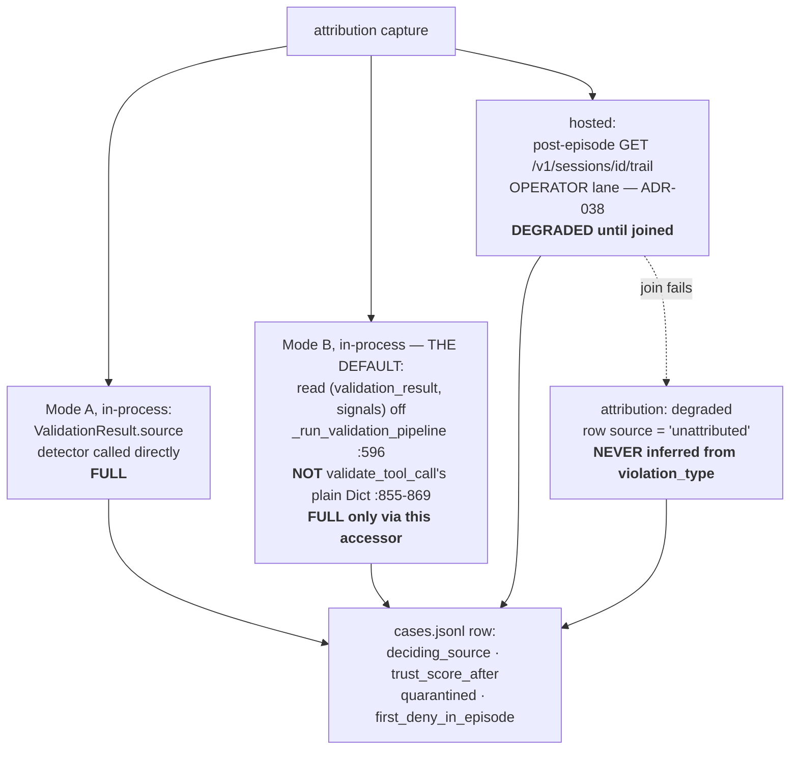

# WS-D: Engine Seams for In-Process Validation

**Parent LLD**: [lld/41-benchmark-harness.md](../../lld/41-benchmark-harness.md) §4.4a, §4.5 (D5), §4.6 (D7), §11, §18.2
**Status**: `SCOPE`
**Owner**: TBD
**Milestone covered**: M2 (first half)

> **Without this workstream, in-process Mode B cannot execute a single validate.** `ValidationService.validate_tool_call`'s very first act is a DynamoDB read, and WS-B's I2 deliberately makes every DynamoDB read fail. Something has to give, and the thing that gives is **not** I2 — it is the storage backend.
>
> **This workstream needs no LLM budget** (**OP-1**) and no non-prod deployment (**OP-2**). Build it in parallel with, or ahead of, WS-E.

## Dependencies

- **Depends on**: **WS-A** (`RunContext`, `session_id_for`, `BenchmarkCase`, manifest `policy` block) · **WS-B** (`enforce()` — this WS exists *because* I2 is absolute) · **WS-C** (`ToolManifest` from `tool_manifest()`).
- **Blocks**: **WS-E** and **WS-F** — both drive the engine only through `GuardClient`.
- **Shared contracts OWNED here**: `BenchmarkSessionStore` · `BenchmarkPolicyEngine` (applied by class-level patching) · `GuardClient.validate(...)` · the in-process attribution accessor.
- **Shared contracts CONSUMED here**: `RunContext`, run-manifest schema (`policy` block), `ToolManifest`.

---

## Model / read before coding — **THE SCOPE CORRECTION, read this first**

**Exactly ONE `app/` source edit exists in this entire build, and it is not in this workstream.** It is `_benchmark` → `RESERVED_TENANT_IDS` (`app/utils/tenancy.py:67`), owned by [WS-B](ws-b-execution-isolation.md).

Everything in *this* workstream is a **runtime substitution requiring no source change**. This has now been stated wrongly in both directions in LLD drafts, so it is stated flatly here:

| What it looks like | What it actually is | Why no edit is needed |
|---|---|---|
| "a session-store seam on `SessionManager`" | **substituting an instance attribute** | `ValidationService.__init__:303` does `self.session_manager = SessionManager()`, and **only three methods are ever called on it** (`:439`, `:840`, `:966`). Substitute the attribute on a `ValidationService` the rig constructs — the same runtime-substitution pattern WS-B's I4 uses for `MetricsPublisher`. |
| "an attribution accessor on `ValidationService`" | **calling a method that already exists** | `_run_validation_pipeline` is already a `ValidationService` method (`validation_service.py:596`) returning `(validation_result, signals)` — the same tuple `validate_tool_call` consumes at `:462`. A subclass reaches it **without an edit**. |
| "a policy-store stub" | **class-level patching of one method** | see D2 below. |

**Do NOT budget build work for edits that do not exist.**

**Verified line-number deltas vs LLD 41** (re-grepped 2026-07-27 — trust these, not the LLD's, if they disagree): `ContextValidator(policy_engine=self.policy_engine)` is at **`validation_service.py:322`** (LLD §4.5 cites `:321`); `MLClassifier`'s direct `boto3.client("bedrock-runtime")` is at **`ml_classifier.py:83`** (LLD cites `:82`), while its injection seam `def __init__(self, bedrock_client=None)` is at `:71` exactly as cited. Everything else in this doc's citations matched the LLD verbatim.

---

## Milestone D1 — `BenchmarkSessionStore`

### D1 — `benchmarks/core/session_store.py`

**The trace, end to end, because "it probably works" is exactly the assumption that costs a milestone:**

```
ValidationService.validate_tool_call        (validation_service.py:424)
  -> session_manager.get_or_create_session  (validation_service.py:439)
    -> self.table.get_item on boto3.resource('dynamodb') built in SessionManager.__init__:61,
       read at session_manager.py:135
      -> under I2's sentinel credentials, boto3 raises ClientError
        -> caught at session_manager.py:185, re-raised as SessionUpdateError
          -> caught at validation_service.py:512-518, re-raised as PipelineError
            => EVERY in-process Mode B validate raises. RES-3 aborts the run
               before the first episode finishes.
```

There is **no in-memory backend anywhere** in `session_manager.py`, `app/utils/clients.py`, or `app/config.py`.

*Why the precedent did not catch this:* `scripts/meas_d2_d3_fp_budget.py` survives fake credentials only because it calls **detector objects directly** and never touches `ValidationService`. **Mode A inherits that immunity; Mode B does not, and copying Mode A's precedent into Mode B is the error.**

**Three options were considered; the chosen one is the only one that keeps I2 absolute:**

| Option | Verdict |
|---|---|
| DynamoDB Local (a container the rig starts) | **Rejected** — adds a service dependency to a rig whose CI profile is "hermetic, no credentials, laptop-runnable", and re-introduces a real endpoint a misconfiguration could point elsewhere |
| A loopback carve-out in I2 (allow AWS calls to `localhost`) | **Rejected** — I2's whole value is that it is unconditional. A carve-out is a hole with a good reason today and no reason at all in eighteen months |
| **`BenchmarkSessionStore` — in-memory, episode-scoped, injected** | **CHOSEN** — I2 stays absolute, FR-14.9 stays unqualified, nothing in the rig can reach AWS by any path |

**Implement EXACTLY the three methods `validate_tool_call` calls — no more, no fewer:**

```python
# benchmarks/core/session_store.py
class BenchmarkSessionStore:
    """A dict, not a database: the whole point of episode scoping is that no state
    outlives an episode."""

    async def get_or_create_session(self, session_id, *, user_id, agent_id) -> Dict:
        """Returns the SAME shape session_manager returns. Same FIELD NAMES: the
        pipeline reads them positionally by key and will KeyError otherwise."""

    async def update_trust_score_deny(self, session_id, violation_type, reason="") -> Dict:
        """The DENY penalty applied in memory, plus the SAME quarantine-band
        transitions trust_checker.py:25-28 reads (10-40 => DENY ALL)."""

    async def update_trust_score_allow(self, session_id) -> Dict: ...
```

**The dict keys are a contract with three real consumers — return all of them or the pipeline `KeyError`s:**

| Key | Read at | Shape |
|---|---|---|
| `trust_score` | `trust_checker.py:54` (`session.get('trust_score', 100.0)`) | float, starts at `INITIAL_SCORE` = 100 |
| `quarantine_status` | `trust_checker.py:55` (`session.get('quarantine_status', 'active')`) | `"active"` \| `"warning"` \| `"quarantined"` \| `"suspended"` |
| `abuse_counters` | `abuse_detector.py:57` (then `.calls_this_minute`, `.last_minute_reset`) | dict |
| `tool_history` | `context_validator.py:113` (then `[-10:]`, each item `.tool_name`) | list of dicts |
| `session_id` | `trust_checker.py` logging | str |

**⚠️ DELEGATE the trust semantics; do NOT copy the bands.** Three pure helpers on `SessionManager` are functions of `trust_score` alone with **no boto3** — call them:

- `SessionManager._get_quarantine_status` (`session_manager.py:507`)
- `SessionManager._get_increment_amount` (`session_manager.py:495`)
- `SessionManager._get_consecutive_allows_required` (`session_manager.py:483`)

Delegation makes parity **structural** instead of something the parity test has to catch after it has already drifted.

**Why the arithmetic must be real, not stubbed:** the episode design — start at 100, accumulate penalties within one episode, discard at the boundary — is a **claim about product behavior under measurement**. A store that skipped the penalty arithmetic would silently measure a product whose trust layer does not exist, which is a worse error than the crash it replaced.

**Footguns:**
- **Do NOT "make `SessionManager` accept a store".** It is a 968-line class with atomic DynamoDB `UpdateExpression`s written inline in the DENY/ALLOW paths (`:192-265`, `:266-384`). That is a persistence-layer rewrite, not a narrow additive change.
- **Do NOT implement a fourth method** "for completeness". Three are called; a fourth is untested surface.
- **Do NOT persist across episodes.** The store is discarded at the episode boundary — that *is* FR-14.8's inbound half.
- Match the key names exactly — the pipeline reads them by key, and a `trustScore`/`trust_score` slip fails four layers away.

**Unit tests — `benchmarks/tests/test_session_store.py`:**
- `test_returns_all_five_consumer_keys` — a fresh session's dict key set is a superset of `{trust_score, quarantine_status, abuse_counters, tool_history, session_id}`.
- `test_initial_score_is_100` and `test_new_session_is_active`.
- `test_deny_applies_penalty` — a `POLICY_NOT_FOUND` DENY moves 100 → 85.
- `test_four_denies_enter_quarantine_band` — 100 − 15×4 = **exactly 40**, and `quarantine_status` becomes `quarantined` (the 10–40 band).
- `test_delegates_to_session_manager_helpers` — spy on `_get_quarantine_status` / `_get_increment_amount` / `_get_consecutive_allows_required` and assert each is called rather than reimplemented. **This is the anti-drift test.**
- `test_episode_boundary_discards_state` — a new episode's session starts at 100 regardless of the prior episode's trajectory.
- `test_only_three_public_async_methods` — introspection assertion.

**Integration test — `benchmarks/tests/test_session_store_parity.py`** *(shared contract: `BenchmarkSessionStore` — the contract this WS owns; named in LLD §4.4a and in M2's exit gate)*: drives the **same DENY/ALLOW sequence** through `BenchmarkSessionStore` and through a **`moto`-mocked `SessionManager`**, and asserts **identical trust trajectories and identical quarantine transitions**, step by step. Parametrize over at least: 4×DENY (quarantine entry), DENY→ALLOW×N (the consecutive-allows recovery path), and a mixed sequence.
**When the parity test fails, the store is wrong — not the test.** M2 cannot exit without it green.

---

## Milestone D2 — policy provisioning

### D2 — `benchmarks/core/policy_synth.py` + `benchmarks/core/policy_fixture.py` (FR-14.4)

**Why this requirement exists at all, with the line number.** An agent with no policy hits `policy_engine.py:327`:

```python
except PolicyNotFoundError:
    return ValidationResult(decision="DENY", reason=f"No policy found for agent {request.agent_id}",
                            violation_type="POLICY_NOT_FOUND", penalty=-15, should_deny=True)
```

An unbound benchmark agent therefore produces **100% block at 0% utility** — a vacuous result that **looks like a perfect score** and measures nothing except that we forgot to write a policy. Worse, the `−15` compounds: **four** such denials drop the session into the 10–40 quarantine band (`trust_checker.py:25-28`) where everything is denied regardless of content. **Policy synthesis is the difference between measuring a product and measuring a misconfiguration.**

```python
def synthesize(tm: ToolManifest, *, agent_id: str, ctx: RunContext) -> dict:
    return {
        "agent_id":             agent_id,               # "bench-agentdojo-banking"
        "allowed_tools":        sorted(tm.tool_names),
        "allowed_agents":       [],                     # no inter-agent invocation in AgentDojo suites
        "max_calls_per_minute": 10_000,                 # deliberate, disclosed — see below
        "platform":             "unknown",              # in VALID_PLATFORMS at seed_policies.py:87
        "cloud_region":         "us-east-1",
        "metadata": {"synthesized_from": tm.provenance,       # adapter + suite + upstream SHA
                     "synthesized_at":   ctx.run_clock_iso,   # from RunContext, NEVER a global
                     "benchmark_run_id": ctx.run_id},
    }
```

Required fields verified against `scripts/seed_policies.py:97` — `['allowed_tools', 'allowed_agents', 'max_calls_per_minute']`; `VALID_PLATFORMS` at `:87` is `{'bedrock','azure_foundry','vertex_ai','unknown'}`.

`allowed_tools` feeds Cedar entity synthesis **unchanged**: `app/validators/cedar/entities.py:79` `synthesize_entities()` reads `policy.get("allowed_tools", [])` and `policy.get("allowed_agents", [])` and builds a `Tool` entity per allowed tool plus the requested one. **No Cedar schema change is needed and none is made.**

**`max_calls_per_minute = 10_000` is a deliberate, DISCLOSED deviation.** A realistic rate limit would make the *rate limiter* the deciding source for a large fraction of episodes, which is (a) not what we are measuring and (b) a source-attribution mask of exactly the kind FR-14.8 exists to prevent. Record `policy.rate_limit_neutralized: true` in the manifest under FR-14.6's disclosure half.

**Fixture (in-process) vs seed (hosted) — and the mechanism is CLASS-LEVEL PATCHING, not subclass injection.**

There is **no `PolicyStore` in this codebase** — naming one names nothing. The two real classes are `S3PolicyStore` (`s3_policy_store.py:12`) and `CedarPolicyLoader` (`policy_loader.py:86`), and **neither is the resolution point**.

**The resolution point is `PolicyEngine.resolve_policy_bundle(agent_id)` (`policy_engine.py:202`)** — the shared resolver returning `(policy, metadata, agent)`, which `CedarPolicyLoader.load()` calls first (`policy_loader.py:99`) and where `PolicyNotFoundError` originates.

**⚠️ A SUBCLASS DOES NOT WORK HERE.** `ValidationService.__init__:315` hardcodes `self.policy_engine = PolicyEngine()`, and **three consumers capture that instance**:
- `self.policy_engine` (`:315`)
- `ContextValidator(policy_engine=self.policy_engine)` (`:322`)
- `CedarPolicyEngine(policy_engine=self.policy_engine)` (`:344`)

A subclass only helps if it is what gets constructed — and it isn't. **The mechanism is class-level patching of the single resolution method for the duration of the run**, which reaches all three consumers **because they share the class, not the instance**.

```python
# benchmarks/core/policy_fixture.py
# Applied by patching PolicyEngine.resolve_policy_bundle (policy_engine.py:202) at CLASS level.
# The class shown is illustrative of the override's shape only.
class BenchmarkPolicyEngine(PolicyEngine):
    """Overrides ONE method. Everything downstream — Cedar entity synthesis, binding
    resolution, the DENY shapes — is the real code path, unmodified."""
    async def resolve_policy_bundle(self, agent_id: str) -> tuple[Dict, Dict, Dict]:
        return (self._synthesized[agent_id], self._metadata[agent_id], self._agent[agent_id])
```

`PolicyEngine.__init__` also builds `boto3.resource('dynamodb')` and `boto3.client('s3')` directly (`policy_engine.py:59-60`), so overriding the **resolver** is what keeps the in-process run from touching DynamoDB *or* S3 at all — which is also what makes WS-B's isolation cheap to enforce.

**Hosted runs must seed** (the engine is a separate process): into the **non-prod table under the `_benchmark` tenant**, via the existing `scripts/seed_policies.py` with `--table` pointed at the non-prod name. **Record which of the two was used** (`policy.provisioning: "fixture" | "seeded"`) — a seeding failure and a fixture bug fail differently and the diff should say which. *(Hosted seeding is gated on **OP-2**, an unowned non-prod deployment.)*

**Mode A is unaffected** — detectors are called directly and never resolve a policy bundle.

**⚠️ `policy_synth.py` IS THE REAL GAMING SURFACE, and the "don't touch `app/validators/`" fence is drawn around the wrong tree.** No one needs to touch a detector to move ASR. `policy_synth.py` lives *inside* this workstream, is written by the same person who reads the score, and a parameter condition narrow enough to encode `BenchmarkCase.injection_goal` (the attacker's objective, **verbatim**) would raise ASR reduction without improving anything. Three **structural** countermeasures:

1. **Synthesis reads `tool_manifest()` ONLY.** The `ToolManifest` type does not carry `injection_goal`, and WS-A's extensibility code-scan covers `benchmarks/core/*.py` — so a synthesizer reaching for case labels is a **visible import**.
2. The manifest records `policy.parameter_condition_count` and `policy.synthesized_from` (adapter + suite + upstream SHA), so a run whose policy suddenly grew conditions is **legible in the diff**.
3. `--allow-dirty` stamps the report when synthesis was edited without a commit.

None of these prevents a determined author from gaming the number. They make it **visible in the artifact**, which is the only honest guarantee a measurement rig can offer about its own operator.

**Bounds and negative cases, honestly:** synthesis emits an *allow-list of the suite's own tools* — **it does not invent parameter bounds**. AgentDojo injection tasks generally ask the agent to call a **legitimate** tool with **attacker-chosen parameters** (`send_money` to the attacker's IBAN), so the tool-name allow-list alone will not stop them. The stop, if it comes, comes from Cedar parameter conditions, D2 on the injected content, or trust — and reporting **which** is D3's job below. This is precisely §2.3's "ASR falls with no D2 detection credit" case.

**Unit tests — `benchmarks/tests/test_policy_synth.py`:**
- `test_emits_required_seed_fields` — the three fields `seed_policies.py:97` validates are present with the right types.
- `test_platform_is_in_valid_platforms` — asserts membership in the real `VALID_PLATFORMS` set imported from `seed_policies.py:87`, not a literal.
- `test_allowed_tools_sorted_and_deduped`.
- `test_rate_limit_neutralized_and_disclosed` — `max_calls_per_minute == 10_000` **and** `manifest.policy.rate_limit_neutralized is True`.
- `test_synthesize_signature_cannot_see_case_labels` — introspect `synthesize`'s parameters and assert no `BenchmarkCase`/`injection_goal` is reachable; plus a source scan of `policy_synth.py` for the token `injection_goal`. **This is the anti-gaming test.**
- `test_parameter_condition_count_recorded` — 0 for the first build; the field exists regardless.
- `test_metadata_uses_run_context_not_globals` — resumed-run metadata carries the **original** `run_clock_iso`.

**Unit tests — `benchmarks/tests/test_policy_fixture.py`:**
- `test_patch_reaches_all_three_consumers` — with the class-level patch active, construct a real `ValidationService` and assert `service.policy_engine`, `service.context_validator.policy_engine` and `service.cedar_engine.policy_engine` **all** resolve the synthesized bundle. **This is the test that proves a subclass would have been wrong.**
- `test_patch_is_reverted_after_run` — the class method is restored, so a later test in the same process sees the real resolver.
- `test_no_boto3_call_during_resolution` — a spy on `PolicyEngine.__init__`'s clients asserts neither is used.
- `test_unknown_agent_id_still_raises_policy_not_found` — the fixture does not paper over a genuinely unbound agent; a typo'd `agent_id` must still fail loudly.

**Integration test — `benchmarks/tests/integration/test_policy_path_is_real_cedar.py`** *(shared contract: `BenchmarkPolicyEngine` + the emitted policy shape consumed by `synthesize_entities`)*: with the patch active, drive a real in-process validate for a tool **in** `allowed_tools` (expect ALLOW) and one **not** in it (expect DENY with `deciding_source` naming the policy/Cedar source) — proving `entities.py:79` consumed the synthesized shape unchanged and that everything downstream of the one overridden method is the real code path.

---

## Milestone D3 — attribution and the one client the rigs use

### D3 — the in-process attribution accessor (FR-14.8, G6, §18.2)

**The gap is on BOTH return surfaces, not just the wire** — and framing it as hosted-only is what would have left the headline rig's FR-14.8 compliance unexamined until M2's exit gate failed.



| Path | Source of `deciding_source` | Fidelity |
|---|---|---|
| **Mode A, in-process** | the detector object is called directly, so its `ValidationResult.source` (`models.py:227`) is in hand | **Full.** Exact, per-signal, no inference |
| **Mode B, in-process** *(the default, and the one that produces the headline)* | `validate_tool_call` returns a **plain `Dict`**. Its DENY body (`validation_service.py:855-869`) carries `decision`, `reason`, `trust_score`, `session_id`, `latency_ms`, `violation_type` (+ optional `threat_type`/`matched_rule`/`severity`) — **no `source`, no `winning_source`.** `winning_source` **is** computed, at `:410`, but only to label the decision trail; it never reaches the return value | **Full — but ONLY via the accessor below.** Off the plain Dict it is *absent*, not degraded |
| **Hosted** (`POST /v1/validate`) | not on the wire either — `ValidationDenyResponse` (`models.py:166`) has no `source` field. Recovered post-run from `GET /v1/sessions/{session_id}/trail` (`routes.py:583`) — an **operator-lane** read (ADR-038) | **Degraded until joined** |

**The fix for the middle row — and it requires no source change.** In-process `GuardClient` **does not read the Dict for attribution**. It calls

```python
validation_result, signals = await service._run_validation_pipeline(
    request, session, high_assurance=...)          # validation_service.py:596
```

— the same tuple `validate_tool_call` itself consumes at `:462` before handing `signals` to `DenyOverrides().combine(signals)`. From that tuple the rig reads `winning_source` **exactly as the trail builder does**, with no inference and no second pipeline run. `_run_validation_pipeline` is already a `ValidationService` method a subclass reaches — **no `app/` edit**.

**Hosted attribution** performs the trail join **out of band, after the episode completes** — **never inside the agent loop**, which would put a control-plane read on the enforcement path (tenet 1). SEC-1: a hosted run needs **TWO credentials in two lanes** — (i) a **data-plane** agent credential minted only for the non-prod deployment under `_benchmark`, for `POST /v1/validate`; (ii) a **non-prod operator credential** scoped to `_benchmark`, held **only by the post-episode join step**, because `/trail` takes `Depends(resolve_operator_tenant)` (`routes.py:562`, ADR-038 removed the agent lane). If the operator credential is unavailable, the run proceeds with `attribution: "degraded"` rather than being granted a broader one.

**⚠️ GUESSING IS BANNED.** A hosted run whose trail join fails records `attribution: "degraded"` and the report prints the by-source block with an explicit **`unattributed`** row. **Never infer a source from `violation_type`** — an inferred source that is wrong is worse than an honest `unattributed`, because tenet 3 is about naming the decider, not about producing a full-looking table.

**Nothing is added to `ValidationDenyResponse` or to the wire** — sub-PRD §5 forbids the harness from requiring a new response field, and this respects it. *(LLD §18.2 logs, but does not take, the recommendation that `validate_tool_call` return the source it already computes; that is a change request against [LLD 30](../../lld/30-multiphase-contract.md)/[LLD 33](../../lld/33-decision-trail.md), not a local edit.)*

**Also record, per row (§4.6, and without these two fields the file lies):** `trust_score_after` and `quarantined`. **Within-episode quarantine is an ABSORBING state.** Four DENYs at −15 from 100 lands on **exactly 40** — inside the 10–40 band where *all* operations are denied regardless of content — and §13 notes denials cause retries up to `max_iters=15`, so **four denials in one episode is the expected case, not the tail.** Once entered, the episode is over in every meaningful sense: every remaining call denies, the task cannot complete, and the episode reports utility 0 / attack-success 0 attributed to `sentra.trust`. That row is **indistinguishable in `cases.jsonl` from a genuinely-defended episode** unless trust state is recorded.

**Unit tests — `benchmarks/tests/test_attribution.py`:**
- `test_reads_winning_source_from_pipeline_tuple` — a stubbed `_run_validation_pipeline` returning `(result, signals)` yields the same `winning_source` the trail builder computes from the same signals.
- `test_does_not_read_the_plain_dict` — assert the accessor never touches `validate_tool_call`'s return `Dict` for attribution (spy).
- `test_never_infers_source_from_violation_type` — given `violation_type="POLICY_NOT_FOUND"` and **no** signals, `deciding_source` is `"unattributed"`, **not** `"sentra.policy"`.
- `test_trail_join_failure_marks_degraded` — hosted path with a failing `/trail` call ⇒ row `deciding_source="unattributed"`, run `attribution="degraded"`; **no exception escapes into the agent loop**.
- `test_trust_score_after_and_quarantined_recorded` — after 4 DENYs the row carries `trust_score_after == 40.0` and `quarantined is True`.
- `test_first_deny_in_episode_marks_exactly_one_row` — the by-source denominator is **episodes** and the numerator is the **FIRST deny per episode**; a quarantined episode contributing a dozen `sentra.trust` decisions still marks exactly one row.

### D4 — `benchmarks/core/guard_client.py` — one method, two transports

```python
class GuardClient:
    """The ONLY way any rig talks to the engine."""
    async def validate(self, *, case_or_call, phase, session_id, ctx) -> Decision:
        # in-process : construct ValidationService (session_manager substituted,
        #              PolicyEngine.resolve_policy_bundle patched), call it, read
        #              attribution off _run_validation_pipeline's tuple
        # hosted     : SDK guard.validate(...)  — guard.py:356, NON-RAISING
```

**⚠️ Use `guard.validate(...)`, NEVER `@guard.tool`.** `guard.py:356` explicitly "Does NOT raise on DENY — the caller inspects `decision.allowed`." The decorator at `guard.py:226` raises `ToolDenied` (`exceptions.py:99`), which **kills the agent loop and makes utility unmeasurable** — and *a rig that reports 0% ASR at 0% utility has measured nothing*.

**Accounting hook:** `GuardClient.validate()` increments `n_validate_calls` in a **`finally`**, so an exception path still counts before it becomes an `ERROR` row. Attribution key `(episode_id, arm, phase)`. *(The counter itself lives in WS-E's `RunAccountant`; the increment point is here.)*

**Transport differences that must never be collapsed:**
- **in-process** ⇒ `latency_ms` is a **compute figure**, ~5–30 ms (the deterministic frontier: trust → Cedar → Sigma) — and with `BenchmarkSessionStore` in place it also omits the session read a deployed engine pays. **The report never presents it as a product latency.**
- **hosted** ⇒ includes the round-trip; **5 s connect, 10 s read, NO RETRY** — a retried validate would double-count and distort the very latency being measured; a timeout is an `ERROR` row.

**Footguns:**
- **Do NOT retry a hosted validate.** See above.
- **Do NOT let a DENY raise** anywhere on this path.
- RES-3: **3 consecutive transport failures ⇒ abort the run.** A with-arm episode proceeding unvalidated would score as "the Guard allowed it" — a **fabricated ALLOW**, the exact tenet-2 violation.

**Unit tests — `benchmarks/tests/test_guard_client.py`:**
- `test_deny_does_not_raise` — an in-process DENY returns `Decision(allowed=False, reason=<real product string>)`.
- `test_uses_non_raising_sdk_call` — the hosted path calls `guard.validate`, and a source scan asserts `@guard.tool` / `ToolDenied` appear nowhere under `benchmarks/`.
- `test_n_validate_calls_incremented_in_finally` — a raising transport still increments the counter.
- `test_no_retry_on_hosted_timeout` — exactly one attempt; the result is an `ERROR` row.
- `test_three_consecutive_transport_failures_abort` — the third failure raises `RunAborted`; two do not.
- `test_reason_string_is_the_products_real_reason` — not a generic denial notice (OBQ-3 sub-decision: the agent must see what a real deployment would have shown it).

**Integration test — `benchmarks/tests/integration/test_in_process_validate_seam.py`** *(shared contract: `BenchmarkSessionStore` + `BenchmarkPolicyEngine` + `GuardClient` — all three this WS owns)*: under `enforce()`, with the session store substituted and the resolver patched, drive a **real** `ValidationService.validate_tool_call` end-to-end for (a) an allowed tool, (b) a denied tool, (c) a 4-DENY sequence entering quarantine — asserting a real decision, a populated `deciding_source`, correct `trust_score_after`/`quarantined`, **zero AWS calls attempted** (reusing WS-B's egress guard), and that the whole path completes without a `PipelineError`. **This is the test that proves the trace at the top of D1 is closed.**

---

## Error model

| Condition | Response |
|---|---|
| DynamoDB reachable at all from the in-process path | **a bug** — WS-B's `test_no_aws_egress.py` fails |
| Unknown `agent_id` at resolution | `PolicyNotFoundError` → the real DENY shape (`policy_engine.py:327`), penalty −15. **The fixture must not paper over this** |
| Trail join fails (hosted) | row `deciding_source="unattributed"`, run `attribution="degraded"`; never inferred |
| 3 consecutive transport failures (RES-3) | **abort the run**; no partial arm reported |
| Session enters the 10–40 band mid-episode | recorded (`quarantined`, `trust_score_after`), **not** treated as a defense; rolls up to `results.mode_b.episodes_quarantined` |
| Parity test disagreement | **the store is wrong, not the test** |

---

## Acceptance criteria (whole workstream)

- [ ] **Zero `app/` source edits from this workstream** — verified by `git diff --stat -- src/security-controller/app/` being empty on the WS-D branch.
- [ ] `BenchmarkSessionStore` implements **exactly three** async methods and returns every key read at `trust_checker.py:54-55`, `abuse_detector.py:57` and `context_validator.py:113`.
- [ ] The store **delegates** to `_get_quarantine_status:507`, `_get_increment_amount:495` and `_get_consecutive_allows_required:483` rather than copying the bands.
- [ ] **`test_session_store_parity.py` is green** — identical trust trajectories and quarantine transitions vs a `moto`-mocked `SessionManager`. **M2 cannot exit without it.**
- [ ] The store is injected by **substituting the instance attribute** set at `validation_service.py:303` — no constructor change, no persistence-layer refactor.
- [ ] `BenchmarkPolicyEngine` is applied by **class-level patching of `PolicyEngine.resolve_policy_bundle` (`policy_engine.py:202`)**, and the patch demonstrably reaches all three consumers (`:315`, `:322`, `:344`). The patch is reverted at run end.
- [ ] `policy_synth.synthesize()` emits the exact shape `seed_policies.py:97` validates, feeds `entities.py:79` unchanged, and **cannot see `injection_goal`** (signature + source scan).
- [ ] `manifest.policy` records `provisioning`, `rate_limit_neutralized`, `parameter_condition_count` and `synthesized_from`.
- [ ] In-process attribution is read from `_run_validation_pipeline`'s `(validation_result, signals)` tuple (`validation_service.py:596`), **never** from `validate_tool_call`'s plain Dict, and **no source is ever inferred from `violation_type`**.
- [ ] Nothing is added to `ValidationDenyResponse` or to the wire.
- [ ] `GuardClient` uses non-raising `guard.validate` (`guard.py:356`); `@guard.tool`/`ToolDenied` appear nowhere under `benchmarks/`. Hosted validates are **not retried**; `n_validate_calls` increments in a `finally`.
- [ ] **unit tests pass** — covering: store key completeness, initial score, penalty arithmetic, the exact-40 quarantine entry, helper delegation, episode-boundary discard, three-method surface; policy required fields, valid platform, rate-limit disclosure, the anti-gaming signature/source scan, RunContext metadata; the three-consumer patch reach, patch revert, no-boto3, unbound-agent still fails; attribution from the tuple, no-Dict-read, no-inference, degraded marking, `trust_score_after`/`quarantined`, first-deny marking; GuardClient non-raising, no-retry, finally-increment, 3-failure abort, real reason string.
- [ ] **integration tests pass** — `test_session_store_parity.py` (owned contract, vs `moto`), `test_policy_path_is_real_cedar.py` (owned contract, real Cedar downstream), `test_in_process_validate_seam.py` (all three owned contracts end-to-end with zero AWS egress).
- [ ] *(human, OP-2)* Hosted-transport seeding + the two-credential lane are **deferred** and explicitly marked as such until a non-prod deployment exists. In-process is the default and loses only the latency number.

---

## Cross-references

- **This WS's LLD sections**: §4.4a (`BenchmarkSessionStore`, the trace, the three rejected options, the scope correction), §4.5 (policy synthesis, the class-level patch, the anti-gaming fence), §4.6 D7 (three attribution paths, the absorbing-state recording, the first-deny denominator), §11 (stores #1 and #2 of the seven), §18.2 (attribution absent from both return surfaces).
- **Sibling WS docs sharing a contract**: [ws-a](ws-a-harness-core.md) (`RunContext`, manifest `policy` block, `cases.jsonl` fields `trust_score_after`/`quarantined`/`first_deny_in_episode`/`deciding_source`) · [ws-b](ws-b-execution-isolation.md) (I2 is *why* this WS exists; owns B6's store table where #1 and #2 are this WS's) · [ws-c](ws-c-mode-a-replay.md) (**provides `ToolManifest`**; Mode A never resolves a policy bundle) · [ws-e](ws-e-mode-b-agentdojo.md) and [ws-f](ws-f-asb-adapter.md) (**both drive the engine only through `GuardClient`**).
- **Upstream owners consumed unchanged**: [LLD 28](../../lld/28-cedar-policy-engine.md) (`synthesize_entities`, the policy shape) · [LLD 23](../../lld/23-sentra-guard-sdk.md)/[LLD 36](../../lld/36-sdk-release-and-local-floor-seam.md) (`guard.validate`) · [LLD 33](../../lld/33-decision-trail.md) (`winning_source`, `/trail`) · [ADR-038](../../adr.md) (the operator lane on `/trail`).
- **Open**: **OP-2** (non-prod deployment — gates hosted seeding and SEC-1's second credential) · **OP-5** (§18.2's ADR is recommended, not logged).
