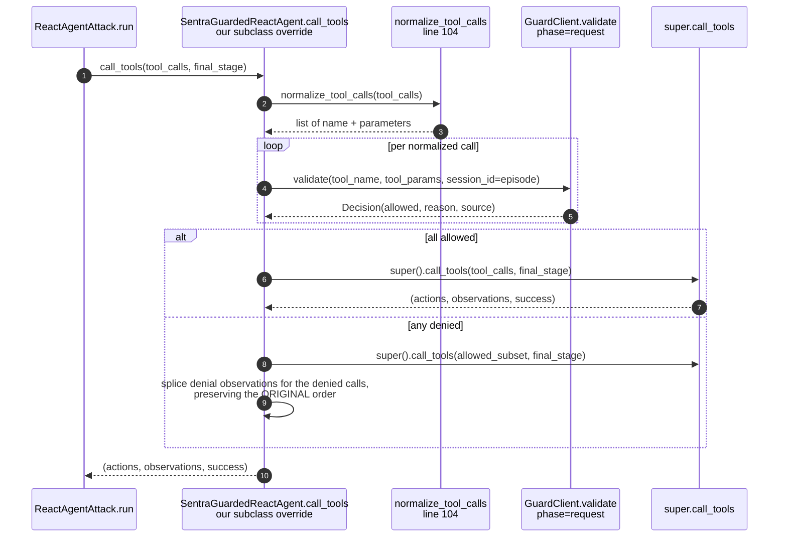

# WS-F: The ASB Adapter — and the FR-14.1 Extensibility Proof

**Parent LLD**: [lld/41-benchmark-harness.md](../../lld/41-benchmark-harness.md) §6 (all), §4.2 (the extensibility test), §17 M4
**Status**: `SCOPE`
**Owner**: TBD
**Milestone covered**: M4

> **⚠️ M4 IS THE LARGEST MILESTONE OF THE FOUR.** Planning it as "the same again, for a second benchmark" **under-scopes it by roughly double** (LLD §6.3, §17). ASB requires a **subclass coupled to an internal method signature**, is exposed to upstream drift in a way AgentDojo is not, needs a **second LLM provider** (OpenAI by default), and spans **four attack families across three phases**.
>
> **This workstream is simultaneously the deliverable and the test.** G4 says "benchmark #2 costs one adapter and **zero** core changes". That claim is proven here, by a `git diff`, or it is not proven at all.

## Dependencies

- **Depends on**: **WS-A** (`BenchmarkCase`, `BenchmarkAdapter`, `RunContext`, manifest, `cases.jsonl`) · **WS-B** (`enforce()`) · **WS-C** (the readiness contract; ASB is the only source of D3-shaped material) · **WS-D** (`GuardClient`) · **WS-E** (the Mode B rig, reused **unchanged**).
- **Blocks**: nothing. It is last by design (sub-PRD §4.1 — ASB lands **second, against a proven core**).
- **Shared contracts OWNED here**: `benchmark.seam_fingerprint` (manifest field).
- **Shared contracts CONSUMED here**: all four `BenchmarkAdapter` methods, `BenchmarkCase`, `RunContext`, `GuardClient`, `cases.jsonl`, `detector_readiness`, the Mode B rig.

---

## Model / read before coding

**Pinning:** checkout `/Users/ruchikkachaudhary/closed-source/ASB` at SHA **`1f561dccf92d55302368fa67679b4ba9d9c8fdc4`** (2026-04-17, **MIT** — AGI Research, 2024; LICENSE read from source 2026-07-27 per FR-14.7).

**ASB is the only clean, MIT-licensed source of D3-shaped material we have**, which is why FR-14.7's train-vs-eval line matters most here: **evaluation only**. Folding either corpus into detector training is a **separate license determination** (SEC-9), and `benchmarks/` writes only to `benchmarks/runs/`.

---

## Milestone F1 — the seam

### F1 — why `defense_type` is the WRONG hook, twice over

**Mechanically wrong.** `defense_type` is **not a registry** — it is branch conditions inside `pyopenagi/agents/react_agent_attack.py` at `:191`, `:265`, `:267`, `:273`, `:275`, `:286`, `:291`, `:497`, `:521`. Adding a value means **editing that file** — a fork or a monkey-patch, not configuration.

**Conceptually wrong.** Every shipped ASB defense is a **prompt transform** (`delimiters_defense`, `instructional_prevention`, `direct_paraphrase_defense`, `dynamic_prompt_rewriting`, `ob_sandwich_defense`, `pot_shuffling_defense`). **AegionAI Guard does not transform prompts; it governs the action.** Wiring in there would place us at the layer we explicitly do not compete at, and would **measure the wrong thing even if it worked**.

**Do NOT go near `defense_type`.** If a reviewer asks why the adapter doesn't "just use the defense hook", this section is the answer.

### F2 — the real seam: subclass `ReactAgentAttack.call_tools`

`call_tools(self, tool_calls, final_stage=False)` at **`react_agent_attack.py:140`** is the single place where a parsed tool call becomes an executed one. The adapter **subclasses that agent and overrides `call_tools`**, validating each normalized call before dispatch and substituting a denial observation for a denied one.



**Reuse ASB's own `normalize_tool_calls` (`react_agent_attack.py:104`)** — it already collapses ASB's **four tool-call encodings** (bare string; `{name, parameters}`; `{tool_name, parameters}`; `{function: {name, arguments}}`; `{tool_use: [...]}`) into one shape. **Do NOT write a fifth parser.**

A denial becomes an **observation string** in the same `observations` list the agent already consumes — OBQ-3's denial semantics expressed in **ASB's** channel instead of AgentDojo's. Entry points are `scripts/agent_attack.py` and `scripts/agent_attack_pot.py`.

**Footguns:**
- **Do NOT edit anything inside the ASB checkout.** Subclass, don't fork. An edit is invisible to the SHA pin and makes the run unreproducible.
- **Preserve the original call order when splicing denials.** A reordered `observations` list changes what the model sees next and therefore changes ASR.
- The return arity is `(actions, observations, success)` and it is **internal** — nothing upstream promises it. See F3.

### F3 — `seam_fingerprint`: the pin-and-diff obligation AgentDojo does not carry

**The coupling cost, stated plainly, because it drives the whole sequencing argument:**

| | AgentDojo | ASB |
|---|---|---|
| Insertion | **Composition** — two `BasePipelineElement`s in a documented slot AgentDojo's own `transformers_pi_detector` defense already uses | **Subclass/wrap** of a concrete agent class, overriding a method whose signature and return tuple are **internal** |
| Upstream contract | `BasePipelineElement.query(...) -> tuple` is a **documented public ABC** | `call_tools(self, tool_calls, final_stage=False) -> (actions, observations, success)` is **internal; nothing promises it** |
| Drift exposure | an upgrade changing the ABC breaks **loudly at import** and is a public-API break for everyone | an ASB upgrade that renames `call_tools`, changes its return arity, or moves the injection point at `:188` **SILENTLY CHANGES WHAT WE MEASURE** — the wrap may still run and mean something different |
| Fork required | **No** | **No fork, but a subclass coupled to internals** — strictly better than editing `defense_type`, strictly worse than composition |

**Therefore:** the manifest records the ASB SHA **and** a **sha256 of the exact `call_tools` source text**, and a **startup check** compares it. A mismatch **fails at startup** instead of silently changing the number.

```python
# benchmarks/adapters/asb/seam.py
import inspect
from pyopenagi.agents.react_agent_attack import ReactAgentAttack

EXPECTED_SEAM_SHA256 = "…"          # pinned; regenerated deliberately, never automatically

def verify_seam() -> str:
    src = inspect.getsource(ReactAgentAttack.call_tools)
    digest = sha256(src.encode()).hexdigest()
    if digest != EXPECTED_SEAM_SHA256:
        raise SeamDrift(f"ASB call_tools changed: {digest} != {EXPECTED_SEAM_SHA256}")
    return digest                    # -> manifest.benchmark.seam_fingerprint
```

**Footgun:** **do NOT auto-update `EXPECTED_SEAM_SHA256` on mismatch.** A self-healing pin is not a pin. A drift is a human decision: re-read `call_tools`, decide whether the semantics changed, then update the constant **and** note it in the run's disclosures.

**Unit tests — `benchmarks/tests/test_asb_seam.py`:**
- `test_seam_fingerprint_matches_pinned` — the live `inspect.getsource` digest equals the constant. **This test failing IS the upstream-drift alarm.**
- `test_seam_drift_raises_at_startup` — a monkeypatched source raises `SeamDrift` **before** any case runs, not mid-run.
- `test_fingerprint_lands_in_manifest` — `manifest.benchmark.seam_fingerprint` is the digest, and is `null` for the AgentDojo adapter.
- `test_normalize_tool_calls_is_reused_not_reimplemented` — spy asserts ASB's own function is called; parametrize over all **five** encodings to prove the delegation covers them.
- `test_denial_splice_preserves_original_order` — 3 calls with the middle denied ⇒ `observations` in positions 0,1,2 correspond to calls 0,1,2.
- `test_all_denied_skips_super_call` — `super().call_tools` is not invoked when every call is denied.
- `test_denial_observation_carries_real_reason` — the product's real reason string, per OBQ-3.

---

## Milestone F2 — phase mapping and the four attack families

### F4 — `benchmarks/adapters/asb/adapter.py` — `iter_cases()` + `tool_manifest()`

| ASB attack family | Config | Our `phase` | Detector exercised |
|---|---|---|---|
| Direct prompt injection (DPI) | `config/DPI.yml` | `request` | Cedar, Sigma, ML |
| Observation prompt injection (OPI) | `config/OPI.yml` | `content` | **D2** |
| Memory poisoning (MP) | `config/MP.yml` | `memory` | **D3** |
| Plan-of-thought backdoor (PoT) | `config/POT.yml` | trajectory → `request` sequence | **D1** |
| Combinations / controls | `DPI_OPI`, `DPI_MP`, `OPI_MP`, `mixed`, `clean` | mixed | all |

- DPI's `attack_types` are `fake_completion`, `escape_characters`, `naive`.
- `memory_db/` and `memory_defense/` at the ASB repo root hold the memory corpora that make the **MP → D3** mapping possible. **This is the only in-repo path to a real D3 number** — it is why ASB is worth the coupling cost.
- **`clean` is the negative source.** Emit it as `label=False` cases so `fp_rate` has a denominator (WS-C's `FP/(FP+TN)` guard clause returns `0.0` on an empty negative set — *no measurement at all*).

**Provider:** ASB's default LLM is **`gpt-4o-mini`**, with `claude-3-5-sonnet-20240620` and the `ollama/*` entries **commented out** in its config. **So ASB runs need an `OPENAI_API_KEY` by default** — a **different provider from AgentDojo's Anthropic path** — and the manifest records which. `OPENAI_API_KEY` is **never recorded by value** (SEC-2).

**Footguns:**
- **`case_id` must use ASB's own stable ids**, not row indices — a row index shifts when the config changes and silently makes every diff a full add/remove.
- The **PoT family is a trajectory attack**: it maps to a `request` **sequence**, not a single request. Model it as multiple cases sharing one `episode_id`, so D1 sees the sequence and the trust boundary is the episode.
- **Do not skip the `clean` control** to save spend. Without it there is no FP denominator and no gate.

**Unit tests — `benchmarks/tests/test_asb_adapter.py`:**
- `test_phase_mapping_per_family` — parametrized over DPI/OPI/MP/PoT ⇒ `request`/`content`/`memory`/`request`.
- `test_mp_cases_carry_content_text_and_memory_phase` — the D3 path.
- `test_pot_cases_share_one_episode_id` — a trajectory is one episode, several cases.
- `test_clean_family_emits_label_false_negatives`.
- `test_case_ids_stable_and_sorted_across_two_iterations`.
- `test_provider_recorded_as_openai` — and the key value never appears in the manifest.
- `test_no_output_phase_cases_constructed` — any ASB case that would score on final agent output raises `ExcludedPhase`, is **counted**, and appears in `manifest.corpus.excluded_by_phase`.

**Integration test — `benchmarks/tests/integration/test_asb_adapter_conformance.py`** *(shared contract: `BenchmarkAdapter` — all four methods, owned by WS-A)*: registers the ASB adapter into WS-A's `test_adapter_conformance.py` parametrization, then runs a **Mode A** pass over the OPI + MP + clean families asserting a `scored` D2 verdict **and** a **`scored` D3 verdict** — the first real D3 recall number the repo has ever produced (G2's deepest half).

---

## Milestone F3 — the G4 proof

### F5 — `test_extensibility.py`, unchanged and green

The FR-14.1 acceptance test is **mechanical, not prose** — and it is **scoped so it does not fail on its own documentation**. A naive raw-text scan fails immediately: an illustrative comment such as `# "agentdojo" | "asb" — the registry key` is a **docstring *about* the seam**, not a **dependency *on* a benchmark**. Banning the word from comments would push authors to write vaguer comments — a worse outcome than the leak the test exists to catch.

**So the test strips comments and string literals first, using the stdlib `tokenize` module — NOT a regex.**

```python
# benchmarks/tests/test_extensibility.py
_BANNED = ("agentdojo", "asb", "pyopenagi", "toolsexecutor", "reactagentattack")

def _code_only(path) -> str:
    """Source with COMMENT and STRING tokens removed — comments may name a benchmark
    illustratively; executable code may not. tokenize, not regex."""
    ...

def test_core_has_no_benchmark_specific_identifiers():
    """G4: 'a new benchmark = one adapter, zero core change'. Enforced, not asserted."""
    for path in glob("benchmarks/core/*.py") + glob("benchmarks/rigs/*.py"):
        code = _code_only(path).lower()
        for token in _BANNED:
            assert token not in code, f"{path} names a specific benchmark in CODE: {token}"
```

Stripping **string literals as well as comments** is deliberate: a benchmark name in a string is almost always a docstring or an error message, while a **real** leak — a registry keyed on `"agentdojo"`, an `if benchmark == "asb"` — shows up as an **identifier or a dict-key expression the tokenizer keeps**.

**The residual** (a hard-coded string dispatch the test now misses) is covered by G4's **real** acceptance criterion below, which a `git diff` proves and no lint can.

**When the ASB adapter lands, this test passing UNCHANGED is the evidence for G4. When it fails, the fix is to move the leak into the adapter — never to weaken the test.**

*(This test is authored in WS-A/WS-C at M1; **WS-F's obligation is that it still passes, unmodified, after ASB lands.** If the file's `git log` shows an edit during M4, G4 is not proven.)*

### F6 — the zero-diff proof (**the actual G4 acceptance criterion**)

```bash
# From the merge-base of the ASB branch, after the adapter is complete:
git diff --stat <m3-merge-sha> HEAD -- benchmarks/core/ benchmarks/rigs/
# REQUIRED OUTPUT: empty.
```

**ASB must run end-to-end — Mode A and Mode B — with ZERO changes under `benchmarks/core/` and `benchmarks/rigs/`.**

If the diff is non-empty, the honest options, in order:
1. **Move the change into `benchmarks/adapters/asb/`** — usually possible, and usually reveals the core abstraction was fine and the adapter was being lazy.
2. If it genuinely belongs in core (a *generic* capability ASB happened to surface first), **land it, and record the diff in the M4 report as a partial G4 result** — "one adapter plus N core lines". **Do not quietly reclassify a core change as an adapter change.**
3. **Never** weaken `test_extensibility.py` to make the diff pass.

**Unit test — `benchmarks/tests/test_extensibility.py`** *(authored earlier; asserted unchanged here)*:
- `test_core_has_no_benchmark_specific_identifiers` — as above.
- `test_code_only_strips_comments_and_strings` — feed a fixture module containing the word `agentdojo` in a comment, a docstring and a plain string, plus **one real identifier leak**, and assert only the identifier is detected. **This is the test that keeps the test honest.**
- `test_tokenizer_not_regex` — a source string like `x = "not_agentdojo_but_a_string"` does **not** trip the scan, while `AGENTDOJO_REGISTRY = {}` does.

**Integration test — `benchmarks/tests/integration/test_asb_zero_core_diff.py`** *(shared contract: `BenchmarkAdapter` — the extensibility claim itself)*: runs `git diff --stat <baseline-sha> HEAD -- benchmarks/core/ benchmarks/rigs/` in a subprocess and asserts empty output, **and** runs a stubbed-LLM ASB Mode B episode end-to-end through **WS-E's unmodified rig** proving the adapter alone was sufficient. Skipped-with-reason before the baseline SHA is recorded; **never deleted**.

**Integration test — `benchmarks/tests/integration/test_asb_mode_b_stub_llm.py`** *(shared contracts: `GuardClient` (WS-D) + the Mode B rig (WS-E), consumed unchanged)*: one DPI episode and one MP episode through `SentraGuardedReactAgent` against a stubbed OpenAI client, asserting paired arms produce `RunScore`, denials appear as observations in original order, and `cases.jsonl` rows carry `deciding_source` + `trust_score_after`.

---

## Error model

| Condition | Response |
|---|---|
| `call_tools` source digest ≠ `EXPECTED_SEAM_SHA256` | **`SeamDrift` at startup**, before any case runs. Never auto-updated |
| ASB emits a tool-call encoding `normalize_tool_calls` does not handle | that is **upstream's** problem surfacing — record an `ERROR` row, count it, and let RES-1's 2% band decide whether to abort. **Do not add a fifth parser** |
| An ASB case would score on final agent output | `ExcludedPhase` → counted in `manifest.corpus.excluded_by_phase` → reported. **Never** as 100% blocked |
| `OPENAI_API_KEY` unset | Mode B ASB cannot run; Mode A ASB is unaffected and still produces the D2/D3 numbers |
| Non-empty core diff | G4 is **not** proven. Record it honestly as a partial result; do not reclassify |

---

## Acceptance criteria (whole workstream)

- [ ] The adapter **subclasses** `ReactAgentAttack` and overrides `call_tools` (`react_agent_attack.py:140`); **nothing inside the ASB checkout is edited**, and `defense_type` is untouched.
- [ ] `normalize_tool_calls` (`:104`) is **reused**, covering all five encodings; no parser is reimplemented.
- [ ] Denials are spliced as observations **in the original call order**, carrying the product's real reason string.
- [ ] `verify_seam()` runs at startup, compares against a **manually pinned** `EXPECTED_SEAM_SHA256`, raises `SeamDrift` on mismatch, and writes `manifest.benchmark.seam_fingerprint`.
- [ ] All four attack families map to the documented phases; PoT cases share one `episode_id`; the `clean` family supplies `label=False` negatives.
- [ ] The manifest pins the ASB SHA `1f561dccf92d55302368fa67679b4ba9d9c8fdc4` and records `provider: openai` with the key **never recorded by value**.
- [ ] **`test_extensibility.py` passes UNCHANGED** — verified by `git log` showing no edit to that file during M4.
- [ ] **`git diff --stat <m3-merge-sha> HEAD -- benchmarks/core/ benchmarks/rigs/` is EMPTY** — the actual G4 criterion. Any non-empty diff is recorded honestly in the M4 report as a partial result, never reclassified.
- [ ] ASB runs end-to-end in **both** rigs through WS-E's rig and WS-D's `GuardClient`, **unmodified**.
- [ ] **unit tests pass** — covering: seam fingerprint match, startup drift raise, manifest field, `normalize_tool_calls` reuse across five encodings, order-preserving splice, all-denied skip, real reason string; phase mapping per family, MP/D3 shape, PoT episode grouping, clean negatives, id stability/sorting, provider recording, output-phase exclusion; the tokenizer-scoped extensibility scan and its own comment/string/identifier discrimination test.
- [ ] **integration tests pass** — `test_asb_adapter_conformance.py` (WS-A's four-method contract + **the first real D3 recall number**), `test_asb_zero_core_diff.py` (**the G4 proof**), `test_asb_mode_b_stub_llm.py` (WS-D + WS-E contracts consumed unchanged).
- [ ] *(human, FR-14.7/SEC-9)* Re-affirmed in the M4 PR description: **evaluation only.** ASB is the only clean MIT source of D3-shaped material, and folding it into training is a **separate license determination** that this PR does not make.
- [ ] *(human, G4)* The M4 report states the extensibility result in one sentence — "one adapter, zero core lines" or the honest alternative.

---

## Cross-references

- **This WS's LLD sections**: §6.1 (why `defense_type` is wrong twice over), §6.2 (the real seam + the sequence), §6.3 (the coupling cost table and why it drives ordering), §6.4 (phase mapping, configs, provider, `memory_db/`), §4.2 (the tokenizer-scoped extensibility test), §17 M4.
- **Sibling WS docs sharing a contract**: [ws-a](ws-a-harness-core.md) (**the four-method `BenchmarkAdapter` this WS implements in full**; `manifest.benchmark.seam_fingerprint`) · [ws-b](ws-b-execution-isolation.md) (`enforce()`) · [ws-c](ws-c-mode-a-replay.md) (`detector_readiness` — ASB is the only path to a `scored` D3) · [ws-d](ws-d-engine-seams.md) (`GuardClient`, consumed unchanged) · [ws-e](ws-e-mode-b-agentdojo.md) (**the Mode B rig, consumed unchanged — that reuse IS the G4 proof**).
- **Upstream benchmark**: ASB @ `1f561dccf92d55302368fa67679b4ba9d9c8fdc4`, MIT (AGI Research, 2024; LICENSE read from source 2026-07-27).
- **Open**: **OP-1** (LLM budget — ASB adds an **OpenAI** line item on top of AgentDojo's Anthropic one).
- **Residual carried knowingly (sub-PRD OBQ-1):** AgentDojo and ASB are used as a **development target** (tuned against), so after a few loop cycles a rising score may reflect **fitting rather than real robustness**. Each newly-added benchmark gives **one clean, un-tuned-against read** before it too becomes a target. **This is an accepted trade for development speed, not an oversight** — and it becomes live again the moment results are published externally.
