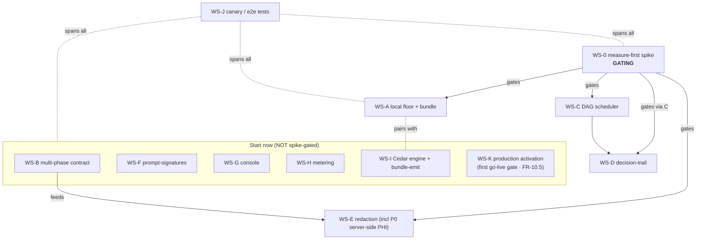

# Serverless Edition — Workstream Index

**Parent HLD**: [hld/serverless-edition.md](../../hld/serverless-edition.md) · **Sub-PRD**: [prd/serverless-edition.md](../../prd/serverless-edition.md)
**Status**: Approved 2026-06-29 (Gate-3) · **Last Updated**: 2026-06-29
**Overall**: Planned — 12 workstreams below. WS-0 is the gating spike; B/F/G/H/I/K can start now; A/C/D/E are **spike-gated** (do not decompose-to-build until WS-0's signed packet exists). First go-live gate = WS-K (FR-10.5 prod TENANCY_V2 activation).

> **Doc-role map (canonical order: HLD → LLD → tasks).** There is **one `ws-*.md` per workstream** here. Its content evolves through the pipeline: it starts as the workstream **SCOPE** (boundary, dependency edges, real `file:line` anchors, footguns, acceptance criteria); once that workstream's **implementation-grade LLD** (`lld/NN-*.md`) is approved, the same `ws-*.md` is **rewritten to carry the granular buildable tasks** generated *from* that LLD (milestones → granular tasks → acceptance-criteria checklist) — the LLD remains the source of truth. So a `ws-*.md` is either *scope-stage* (LLD not yet written) or *tasks-stage* (LLD approved, tasks generated); the "LLD" column below tracks which. LLDs are written **one at a time**, reviewed individually.
>
> **Stage so far:** WS-K → [lld/27](../../lld/27-serverless-production-activation.md) ✅ **BUILT + verified live 2026-06-30** (verification-only — DEV stacks ARE prod; K6 purge deferred, K2.5/K5 N-A) · WS-I → [lld/28](../../lld/28-cedar-policy-engine.md) ✅ **Group 1 BUILT + deployed 2026-06-30** (image milestone-89; Group 2 still spike-gated) · WS-E → [lld/29](../../lld/29-redaction.md) ✅ (LLD approved; tasks not yet generated) · all others = scope-stage.

## Workstreams

| WS | Doc | Scope (one line) | Owner | Blocking? |
|----|-----|------------------|-------|-----------|
| **WS-0** | [ws-0-measure-first-spike.md](ws-0-measure-first-spike.md) | The measure-first spike (HLD §8): escalation rate + escalated-path p99 + masked-vs-unmasked recall-delta on a real refund/payment agent → dated, founder-signed packet. | TBD | **GATING** — gates A, C, E (and D via C) |
| **A** | [ws-a-local-floor-bundle.md](ws-a-local-floor-bundle.md) | FR-1.7 local floor: signed policy bundle + stdlib in-process interpreter (closed non-Cedar subset), background poll, fail-closed staleness, revocation epoch, anti-rollback. | TBD | spike-gated |
| **B** | [ws-b-multiphase-contract.md](ws-b-multiphase-contract.md) | FR-3.4 multi-phase `/v1/validate` contract: additive `phase` enum + per-phase decorator + unknown→fail-secure DENY. | TBD | no — start now |
| **C** | [ws-c-dag-scheduler.md](ws-c-dag-scheduler.md) | FR-2.8 cost-annotated DAG scheduler: tier-0 short-circuit → tier-1 parallel (generalizes existing ML-last); replaces fixed sequential pipeline. | TBD | spike-gated → feeds D |
| **D** | [ws-d-decision-trail.md](ws-d-decision-trail.md) | Decision-trail: record what actually ran + not-run markers (gated by DENY/cost); deny-overrides unchanged; per-tenant full-tier mode. | TBD | spike-gated (via C) |
| **E** | [ws-e-redaction.md](ws-e-redaction.md) | FR-3.13 two-tier redactor: edge structured-token PII/PCI (P0 hard gate) + **server-side semantic PHI (P0, first-wave, BAA)**; ADR-032. | TBD | spike-gated |
| **F** | [ws-f-prompt-signatures.md](ws-f-prompt-signatures.md) | Prompt-signature growth with TP corpus + benign-FP corpus + CI gate as a prerequisite before any rule auto-grows. | TBD | no — start now |
| **G** | [ws-g-console.md](ws-g-console.md) | SOC console: tenant-scoped multi-tenant view + exhaustive decision/source view (FR-6.4 gap). | TBD | no — start now |
| **H** | [ws-h-metering.md](ws-h-metering.md) | Durable meter ledger + billing surface (metered validations, off the response path). | TBD | no — start now |
| **I** | [ws-i-cedar-engine.md](ws-i-cedar-engine.md) | Hosted Cedar engine + **bundle-emit**: emit the deterministic bundle from authoritative Cedar; own the interpreter↔`cedarpy` differential corpus. | TBD | no — start now (pairs with A) |
| **J** | [ws-j-canary-tests.md](ws-j-canary-tests.md) | Canary + e2e test harness spanning all workstreams (continuous green-and-correct gate). | TBD | no — spans all |
| **K** | [ws-k-production-activation.md](ws-k-production-activation.md) | FR-10.5 production activation: Cedar-authoritative + TENANCY_V2 enforcing in prod; the first go-live predecessor. | TBD | no — start now; **first go-live gate** |

## Dependency graph

Edges: WS-0 **gates** A, C, E (and D via C) · WS-C → WS-D · WS-A **pairs with** WS-I (bundle-emit ↔ interpreter, shared differential corpus) · WS-B **feeds** WS-E (the `phase` contract carries the content/output phases redaction acts on) · WS-J **spans all** · WS-K is the **prod-activation predecessor** (first go-live gate).

## THE ONE GATING RULE — the measure-first gate (HLD §8)

**A, C, D, E do NOT decompose-to-build until WS-0's dated, founder-signed spike packet exists.** The packet's three measurements on a real refund/payment agent — (a) escalation rate, (b) escalated-path p99, (c) recall on masked vs. unmasked content for exfiltration + indirect-injection — and its fallback decision (HLD §6.4 worst-quadrant rule) are the precondition. **The packet's completion date IS the gate date**, recorded here as the entry precondition for A/C/D/E:

> **Gate date: _________ (WS-0 packet signed by founder; fill on completion).**

Until that date is filled, A/C/D/E stay at LLD-planning only — no build tasks open. B/F/G/H/I/K are unaffected and proceed in parallel.

## Build order

1. **Now (parallel):** WS-0 spike **+** WS-B, WS-F, WS-G, WS-H, WS-I, WS-K (none spike-gated).
2. **On signed spike packet (gate date filled):** open WS-A, WS-C, WS-E.
3. **After WS-C:** WS-D (decision-trail rides the scheduler).
4. **Throughout:** WS-J (canary/e2e) runs continuously across every workstream.
5. **Go-live:** FR-10.5 prod activation via WS-K (Cedar-authoritative + TENANCY_V2 enforcing in prod) — the first go-live gate.

## Shared conventions (all workstreams)

- **AWS:** account `531109575379`, profile `sentra`, region `us-east-1`. Heed production-safety: read/describe/list over modify/delete; never destroy resources without explicit confirmation.
- **SDK is stdlib-only** (`dependencies=[]`): the in-process bundle interpreter (WS-A) adds **no** native dep — no `cedarpy` in-process (LLD 23 §2 vendor-unchanged). The `identity` extra is the only allowed addition (PyJWT[crypto] for ES256).
- **Fail-secure / deny-by-default everywhere:** unknown phase, stale bundle, unreachable controller, missing input, out-of-subset Cedar construct → DENY/escalate, never fail-open.
- **Cedar + TENANCY_V2 are DONE and enforcing on dev.** Production activation is founder-gated (WS-K / FR-10.5); the legacy engine is retired (DENY if ever reached).
- **Honor sub-PRD §5 status:** do **not** re-task DONE work; scope PARTIAL to its named gap only. The §5 evidence table (`file:line`) is the build-vs-built ledger.
- **Each WS's next step is an implementation-grade LLD** (per the HLD §8 anchor-LLD column) — not direct coding. `plan-workstreams`/`write-lld` start from the approved HLD option and do not re-litigate it.

## Cross-references
- Implements: FR-1.7, FR-2.8, FR-3.4, FR-3.13, FR-6.4, FR-10.5 (sub-PRD)
- Upstream: [hld/serverless-edition.md](../../hld/serverless-edition.md) §6 (the four benders + redaction + console + metering + Cedar mode), §8 (LLD hand-off), §6.4 (the measure-first / combined GA-gate)
- Decisions: ADR-029 (local-floor bundle), ADR-030 (DAG scheduler), ADR-032 (two-tier redactor), AD-2 (Cedar), AD-3 (phase contract), AD-6 (editions/data-boundary), AD-7 (verified identity / TENANCY_V2)
- Shared contracts: `POST /v1/validate`, signed policy bundle + stdlib interpreter subset, deny-overrides combiner, decision-trail run record
