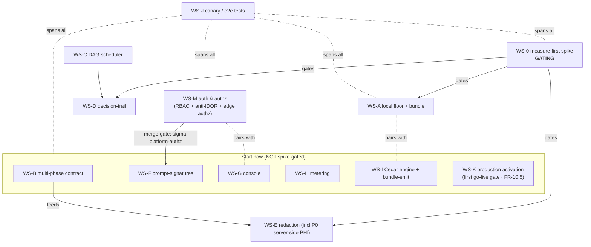

# Serverless Edition — Workstream Index

**Parent HLD**: [hld/serverless-edition.md](../../hld/serverless-edition.md) · **Sub-PRD**: [prd/serverless-edition.md](../../prd/serverless-edition.md)
**Status**: Approved 2026-06-29 (Gate-3) · **Last Updated**: 2026-07-02
**Overall**: Planned — 13 workstreams below (WS-M auth/authz added 2026-07-03 — P0-security, NOT spike-gated, start-now). WS-0 (the gating spike) is 🟢 **SIGNED 2026-07-02** (packet `9e31dca`; gate date filled) — a/b/c measured on real Bedrock+WAN, both kills adjudicated (neither fires), thresholds pre-registered `28581a2`. **→ WS-A and WS-E decomposition-to-build are now UNBLOCKED.** B/F/G/H/I/K were always start-now. **WS-C, WS-D, WS-E also had their WS-0 gate independently OVERRIDDEN (C 2026-07-01; D 2026-07-02; E 2026-07-01).** **Shipped to `main`:** WS-B (`9a8074a`), WS-C (`720d87a`, deployed), WS-D (`42bcaeb`). First go-live gate = WS-K (FR-10.5 prod TENANCY_V2 activation). **GA positioning ratified at sign-off:** money-movement routes to the in-VPC edition (Serverless deep tier is for non-money-movement / latency-tolerant flows) — the escalated p99 ≈ 3s blows NFR-2.

> **Doc-role map (canonical order: HLD → LLD → tasks).** There is **one `ws-*.md` per workstream** here. Its content evolves through the pipeline: it starts as the workstream **SCOPE** (boundary, dependency edges, real `file:line` anchors, footguns, acceptance criteria); once that workstream's **implementation-grade LLD** (`lld/NN-*.md`) is approved, the same `ws-*.md` is **rewritten to carry the granular buildable tasks** generated *from* that LLD (milestones → granular tasks → acceptance-criteria checklist) — the LLD remains the source of truth. So a `ws-*.md` is either *scope-stage* (LLD not yet written) or *tasks-stage* (LLD approved, tasks generated); the "LLD" column below tracks which. LLDs are written **one at a time**, reviewed individually.
>
> **Stage so far (LLDs, each: write → review-lld → grill → revise → render):**
> - **WS-K → [lld/27](../../lld/27-serverless-production-activation.md)** — LLD ✅ (review-lld; grill not run — pre-standing-gate); **CODE ✅ BUILT + verified live 2026-06-30** (verification-only, DEV stacks ARE prod; K6 purge deferred, K2.5/K5 N-A).
> - **WS-I → [lld/28](../../lld/28-cedar-policy-engine.md)** — LLD ✅ (review-lld; grill not run — pre-standing-gate); **CODE 🟡 Group-1 BUILT + deployed 2026-06-30** (image milestone-89; Group-2 spike-gated, not started).
> - **WS-E → [lld/29](../../lld/29-redaction.md)** (+ [lld/29a](../../lld/29a-redaction-format-spec.md) format spec) — LLD ✅ **grilled** (compliance F1–F4 closed). **CODE ✅ DONE + DEPLOYED to prod (2026-07-02)**, WS-0 gate founder-overridden 2026-07-01, built in 3 staged slices via code-loop + adversarial verify: **Tier-1 SDK edge redactor** (normalize-then-detect, `44947ea`) live in all 3 acme connectors (payments Lambda + identity/telecom Azure funcs); **Tier-2 server** — F1 NER barrier as a DAG entry node + NO-RAW-PHI audit guard (strict fail-secure, milestone-95 `1339174`) + persist-gate + image-mode router + feedback-store write/DSAR logic + metrics (`a2a2553`). Live-verified: 0 audit-drops fleet-wide, `AEGR:` tokens flowing. **HELD (built + synth-verified, NOT deployed — GA-gated on WS-0 recall + counsel BAA):** the `phi-ner` Fargate service + feedback-store DDB table (`3ae42e8`). Open: F7 frame-local assertion; persist-gate heavy-reclassifier (stage-2 stub); FR-2.9 egress (WS-A dep); E8.5 recall + LIVE e2e (WS-0/deploy-gated). Deploy milestones 93→94→95.
> - **WS-B → [lld/30](../../lld/30-multiphase-contract.md)** — LLD ✅ **grilled + reconciled** (unknown→422 flip propagated across HLD/lld29/ws-b/ws-l; 5/5 consistency gate pass 2026-07-01); **tasks-stage doc ✅** (B1–B4, 31 named unit + 6 integ tests, Phase-3 shared-contract sweep 6/6 PASS); **CODE ✅ DONE + merged/pushed to `main` @ `9a8074a` (2026-07-01)** via code-loop (4 build/review rounds) — server phase surface + SDK per-phase decorators + `TransportError.status_code`/`BadRequest`; SDK 74 / server 495 / integ 20 green; **NOT deployed** (deferred to land once with WS-E redaction over this contract). 4 residuals unchecked by design (WS-L handlers, WS-E reconcile, 4XX metric, accepted valid-but-wrong-phase).
> - **WS-C → [lld/31](../../lld/31-dag-scheduler.md)** — LLD ✅ **grilled + reconciled** (Option A full runner; flag+legacy removed → recorded-golden-baseline equivalence; error model = 5xx-on-inability + PEP fail-secure default; ML brought out of shadow / `ml_classifier_shadow_mode` removed; WS-A→WS-B + WS-D/WS-L letter drift reconciled); **tasks-stage doc ✅** (C1–C8, 27 named unit + 6 integ tests, Phase-3 shared-contract sweep clean; founder-requested `ml_classifier_enabled:true` task in C7); **CODE ✅ CODE-DONE + DEPLOYED — all milestones C1–C8 complete; promoted to `main` @ `ed780c3` (code) + `66be5f5` (C7.2 yamls / C8.1–C8.2 propagations) + `720d87a` (HLD/ADR-031 evaluate_all-scope reconcile), and DEPLOYED to prod 2026-07-02 (image `milestone-91`, task-def `:56`, ML enforcing + `DAG_RUN_MODE=fail_fast`, verified serving). Controller 649 pass / SDK 197 pass.** **WS-0 gate OVERRIDDEN for WS-C 2026-07-01 per founder; C3 chain-runner is the accepted WS-0-contingent residual** (built + fixture-tested; no live consumer until WS-L's D1–D7 land, which stay WS-0-gated).
> - **WS-D → [lld/33](../../lld/33-decision-trail.md)** — LLD ✅ **grilled + reconciled** (PDF-comment pass: display-names + `/trail` API added; consistency sweep against landed WS-C/WS-B/LLD-17 clean — high-assurance = `evaluate_all` full-frontier, `NotRunMarker` separate type, recompute-on-read, no HEADER row / no `gated_by`); **tasks-stage doc ✅** (D1–D5, 24 named tests: T-TRAIL-01..23 + 14b, + 1 integ; Phase-3 shared-contract sweep clean 2026-07-02); **CODE ✅ CODE-DONE + PROMOTED to `main` @ `42bcaeb` (2026-07-02)** via code-loop + a fix/verify workflow — all D1–D5 built; controller 779 pass / integration 1 pass (`RUN_INTEGRATION=1`) / cdk `test_api_stack` 25 pass; `DenyOverrides.combine()`+`Signal` byte-unchanged (verified); D3 field resolved = `high_assurance_trail: bool = False` on the `Tenant` dataclass. **WS-0 gate OVERRIDDEN by founder 2026-07-02** (autopilot; mirrors WS-C/WS-E) — independent of the packet. (WS-0's packet is now **SIGNED 2026-07-02** at `9e31dca`, so the gate is doubly satisfied for WS-D — though WS-D never depended on the signature, its gate being overridden.) Two integration-sentinel green≠correct findings closed pre-promote: `/trail` wired into `api_stack.py` (was FastAPI-only → 403 in prod) + read-recompute fallback hardened to fail-secure. **Correction:** the per-request `mode` seam WS-C owed was already LIVE (`run_dag(mode:str)`) so D3.2 is a real path; the pure `coverage_sources(phase)` accessor is still absent → D1.3 uses `STATIC_FALLBACK_ORDER` (documented degrade, not a blocker).
> - **WS-L → [lld/32](../../lld/32-detection-depth.md)** — LLD ✅ (design-loop converged R1–R5 + founder comment passes through §5.6; distilled=live-front-runner, all layer designs inline, §14 observability, D1-corpus-light, D4/D6 research folded); **tasks-stage doc ✅ (2026-07-03) — SCOPED TO D1+D2+D3 as P0 (+ distilled WIRING) ONLY** per founder directive; D4/D5/D6/D7/D8 explicitly **NOT built** (each has a named blocker — see the ws doc §8). 6 milestones (M1 shared scaffold → M2 D2/content → M3 D3/memory → M4 D1/request LLM-judge v1 → M5 observability → **M6 distilled = LIVE front-runner, short-circuit ON, NO shadow** — node+chain+logic built ON, only the real §8 artifact deferred behind the same interface; founder 2026-07-03), ~29 tasks, ~55 named UT+INTEG tests. **CODE ⬜ not started** (spike-gated; WS-0 signed verbally 2026-07-02). Gate 3b (LLD approval) still owed before code-loop.
> - **all others (WS-0/A/F/G/H/J)** = scope-stage.
> **Grill is now a standing gate on every LLD going forward** (no back-fill on 27/28). See the per-workstream table's LLD/Code columns for the authoritative status.

## Workstreams

**Status legend** — **LLD:** ✅ done (reviewed+grilled+rendered) · ✍️ scope-only (LLD not authored) · —. **Code:** ✅ done/deployed · 🟡 partial · ⬜ not started.

| WS | Doc | Scope (one line) | LLD | Code | Blocking? |
|----|-----|------------------|-----|------|-----------|
| **WS-0** | [ws-0-measure-first-spike.md](ws-0-measure-first-spike.md) | The measure-first spike (HLD §8): escalation rate + escalated-path p99 + masked-vs-unmasked recall-delta on a real refund/payment agent → dated, founder-signed packet. | ✍️ scope (methodology [lld/34](../../lld/34-measure-first-spike-methodology.md)) | 🟢 **SIGNED 2026-07-02** (packet `9e31dca`; gate date filled). a3=0.67 · escalated p99 ~3s (blows NFR-2) · masking does NOT blind (exfil Δ−0.5%/indirect Δ−3.6%) · both kills do-NOT-fire · A/C/D/E all COMMIT | **DONE — gate satisfied; A + E unblocked** |
| **A** | [ws-a-local-floor-bundle.md](ws-a-local-floor-bundle.md) | FR-1.7 local floor: signed policy bundle + stdlib in-process interpreter (closed non-Cedar subset), background poll, fail-closed staleness, revocation epoch, anti-rollback. | ✍️ scope | ⬜ | spike-gated |
| **B** | [ws-b-multiphase-contract.md](ws-b-multiphase-contract.md) | FR-3.4 multi-phase `/v1/validate` contract: additive `phase` enum + per-phase decorator; unknown/typo → 422 validation error, known-but-unbuilt → fail-secure DENY. | **✅ [lld/30](../../lld/30-multiphase-contract.md)** | ✅ **CODE-DONE** — merged/pushed `main` @ `9a8074a` (2026-07-01); SDK 74/server 495/integ 20 green; **not deployed** (deferred w/ WS-E) | no — done |
| **C** | [ws-c-dag-scheduler.md](ws-c-dag-scheduler.md) | FR-2.8 cost-annotated DAG scheduler: tier-0 short-circuit → tier-1 parallel (generalizes existing ML-last); replaces fixed sequential pipeline. | **✅ [lld/31](../../lld/31-dag-scheduler.md)** | ✅ **CODE-DONE + DEPLOYED** (`main` @ `720d87a`; prod `milestone-91`/`:56`, ML enforcing; C1–C8 all done, 649/197 tests green) | OVERRIDDEN (founder 2026-07-01) — done; feeds D/L |
| **D** | [ws-d-decision-trail.md](ws-d-decision-trail.md) | Decision-trail: record what actually ran + not-run markers (gated by DENY/cost); deny-overrides unchanged; per-tenant full-tier mode. | **✅ [lld/33](../../lld/33-decision-trail.md)** | ✅ **CODE-DONE + DEPLOYED to prod 2026-07-02** (`main` @ `42bcaeb`; all 15 tasks D1.1–D5.3; controller 780 / integ 1 / cdk-api 35 green; combine()+Signal byte-unchanged). **DEPLOYED:** controller image `milestone-96` (digest `a6139b37`) force-rolled onto the ECS service + `Sentra-DEV-API-Stack` deployed with the +5 routes; verified live — `GET /v1/sessions/{id}/trail` → 200 real envelope (422 w/o request_id), signals/metrics 200, rollback-conversation 400, feedback-delete 404. **APIG follow-up @ `6a4ec89`:** method-level synth gate + 5 newly-wired routes. | OVERRIDDEN (founder 2026-07-02) — done + deployed |
| **E** | [ws-e-redaction.md](ws-e-redaction.md) | FR-3.13 two-tier redactor: edge structured-token PII/PCI (P0 hard gate) + **server-side semantic PHI (P0, first-wave, BAA)**; ADR-032. | **✅ [lld/29](../../lld/29-redaction.md)** + [29a](../../lld/29a-redaction-format-spec.md) | ✅ **CODE-DONE + DEPLOYED** — Tier-1 edge (all 3 acme connectors) + Tier-2 server barrier/no-raw-guard/persist-gate/feedback-logic/image-router live on prod (`44947ea`/`a2a2553`/milestone-95 `1339174`); `phi-ner` container + feedback DDB table BUILT+synth-verified but HELD (GA-gated on WS-0 recall + counsel BAA) | WS-0 override (founder 2026-07-01); done exc. GA-gated phi-ner |
| **F** | [ws-f-prompt-signatures.md](ws-f-prompt-signatures.md) | Prompt-signature growth with TP corpus + benign-FP corpus + CI gate as a prerequisite before any rule auto-grows. | ✍️ scope | ⬜ | no — start now |
| **G** | [ws-g-console.md](ws-g-console.md) | SOC console: tenant-scoped multi-tenant view + exhaustive decision/source view (FR-6.4 gap). | ✍️ scope | ⬜ | no — start now |
| **H** | [ws-h-metering.md](ws-h-metering.md) | Durable meter ledger + billing surface (metered validations, off the response path). | ✍️ scope | ⬜ | no — start now |
| **I** | [ws-i-cedar-engine.md](ws-i-cedar-engine.md) | Hosted Cedar engine + **bundle-emit**: emit the deterministic bundle from authoritative Cedar; own the interpreter↔`cedarpy` differential corpus. | **✅ [lld/28](../../lld/28-cedar-policy-engine.md)** | 🟡 **Group-1 done** (deployed 2026-06-30, image `milestone-89`); Group-2 spike-gated | no — start now (pairs with A) |
| **J** | [ws-j-canary-tests.md](ws-j-canary-tests.md) | Canary + e2e test harness spanning all workstreams (continuous green-and-correct gate). | ✍️ scope | ⬜ | no — spans all |
| **K** | [ws-k-production-activation.md](ws-k-production-activation.md) | FR-10.5 production activation: Cedar-authoritative + TENANCY_V2 enforcing in prod; the first go-live predecessor. | **✅ [lld/27](../../lld/27-serverless-production-activation.md)** | ✅ **done (verification-only, 2026-06-30, live)** — K6 purge deferred per founder; K2.5/K5 N-A | no — start now; **first go-live gate** |
| **L** | [ws-l-detection-depth.md](ws-l-detection-depth.md) | **Detection depth — SCOPED to D1+D2+D3 as P0 (+ distilled = LIVE front-runner M6: node+chain+short-circuit ON, only real §8 artifact deferred)** per founder 2026-07-03. D2 (indirect-injection/content), D3 (memory-integrity/memory), D1 (trajectory/request LLM-judge v1); shared scaffold for all 8 layers (Source constants + priorities + per-phase node-set builder + metrics). **D4/D5/D6/D7/D8 explicitly NOT built** (each blocked — see ws doc §8). Consolidates LLD 19+20 as build-of-record; layers register as nodes into WS-C's DAG. | **TASKS-DONE → lld/32** (2026-07-03) | ⬜ | spike-gated (WS-0 signed 2026-07-02); Gate 3b owed |
| **M** | [ws-m-authz.md](ws-m-authz.md) | **Auth & authz (control-plane RBAC + anti-IDOR + edge authorizer):** close BUG-1 (policy-CRUD + agent-policy-bind + credential/connection CRUD get `require_role` + anti-IDOR tenant-ownership assert; drop spoofable `X-Operator-Email`) + **platform-operator gate on the `PATCH /sigma-rules` retire path (WS-F merge-gate)**; own `require_role` coverage across all mutating `routes.py` routes; ADR-036 edge authorizer / shared-key replacement; AD-7 GA-gate adjudication. Consumes the ADR-035 seam (does **not** swap the IdP). | ✍️ scope (→ lld/36) | ⬜ | **no — start now (NOT spike-gated); P0-security (BUG-1 live prod IDOR); merge-gate predecessor of WS-F** |

## Dependency graph

Edges: WS-0 **gates** A, E, D · WS-C → WS-D (WS-D rides on WS-C's scheduler) · **WS-C's WS-0 gate is overridden (founder 2026-07-01); it builds now** · WS-A **pairs with** WS-I (bundle-emit ↔ interpreter, shared differential corpus) · WS-B **feeds** WS-E (the `phase` contract carries the content/output phases redaction acts on) · **WS-M is the merge-gate predecessor of WS-F** (it lands the platform-operator gate on the `PATCH /sigma-rules` retire path that WS-F's CI assertion requires) and **pairs with WS-G** (WS-M owns the server-side `require_role` boundary; WS-G owns the client render-gate + the ADR-035 federation seam) · WS-J **spans all** · WS-K is the **prod-activation predecessor** (first go-live gate).

## THE ONE GATING RULE — the measure-first gate (HLD §8)

**A, D, E do NOT decompose-to-build until WS-0's dated, founder-signed spike packet exists.** *(WS-C's WS-0 code-merge gate is OVERRIDDEN per the founder 2026-07-01, mirroring the WS-E override — WS-C builds/merges now; the C3 chain-runner is the accepted WS-0-contingent residual since WS-L stays gated.)* The packet's three measurements on a real refund/payment agent — (a) escalation rate, (b) escalated-path p99, (c) recall on masked vs. unmasked content for exfiltration + indirect-injection — and its fallback decision (HLD §6.4 worst-quadrant rule) are the precondition. **The packet's completion date IS the gate date**, recorded here as the entry precondition for A/D/E (not WS-C — overridden):

> **✅ MEASURED + SIGNED 2026-07-02 (packet `9e31dca`, signed `bf78613`).** Findings: a1/a2 = 45%/55% · a3 = 0.67 · escalated p99 ≈ 3.0–3.5s (**blows NFR-2**) · masked-recall Δ exfil −0.5% / indirect −3.6% (masking does **not** blind; redaction GA gate FR-3.13/NFR-7 **unblocked**) · **worst-quadrant kill does NOT fire** (slow-but-not-blind → route money-movement to in-VPC, fallback ii — ratified) · **AgentCore kill does NOT fire** → WS-A **COMMIT**. Per-row: A/C/D/E all COMMIT.
>
> **Gate date: 2026-07-02 (WS-0 packet SIGNED by founder — Shashank Gupta). ✅**

The gate date is filled → **WS-A and WS-E decomposition-to-build are now UNBLOCKED.** (WS-C/WS-D were already founder-overridden.) WS-L stays behind its own dependency on WS-C's node-registry contract. B/F/G/H/I/K were always unaffected and proceed in parallel.

> **WS-L authoring order (added 2026-07-01).** WS-L (detection depth) is **P0 build-wave priority** but its **layer nodes plug into WS-C's scheduler node-registry / cost-tier / dependency-edge contract** — so WS-C's LLD is authored **before** WS-L's, or WS-L guesses a contract it doesn't own. WS-L consolidates **LLD 19** (tiered models) + **LLD 20** (D1–D7) as the Serverless build-of-record (those two are marked superseded-for-Serverless with a forward pointer, retained as origin design). "Everything P0" = build-wave priority; the honest **authoring queue** is: non-spike-gated LLDs (H, G, F) → then the spike-gated cluster **WS-C → WS-L → WS-D** (ideally after the WS-0 packet signs, since the AgentCore kill-check can reshape the deep-tier thesis).

## Build order

1. **Now (parallel):** WS-0 spike **+** WS-B, WS-F, WS-G, WS-H, WS-I, WS-K, **WS-M** (none spike-gated; WS-M is P0-security and the WS-F merge-gate predecessor — land its sigma platform-gate before WS-F merges) **+ WS-C** (its WS-0 code-merge gate is OVERRIDDEN per the founder 2026-07-01, mirroring WS-E — buildable/mergeable now).
2. **✅ Spike packet SIGNED 2026-07-02 (gate date filled) → WS-A and WS-E are now OPEN for decomposition-to-build.** (WS-C/WS-D never waited on this — overridden.)
3. **After WS-C:** WS-D (decision-trail rides the scheduler; WS-D itself stays WS-0-gated).
4. **Throughout:** WS-J (canary/e2e) runs continuously across every workstream.
5. **Go-live:** FR-10.5 prod activation via WS-K (Cedar-authoritative + TENANCY_V2 enforcing in prod) — the first go-live gate.

## Shared conventions (all workstreams)

- **AWS:** account `531109575379`, profile `sentra`, region `us-east-1`. Heed production-safety: read/describe/list over modify/delete; never destroy resources without explicit confirmation.
- **SDK is stdlib-only** (`dependencies=[]`): the in-process bundle interpreter (WS-A) adds **no** native dep — no `cedarpy` in-process (LLD 23 §2 vendor-unchanged). The `identity` extra is the only allowed addition (PyJWT[crypto] for ES256).
- **Fail-secure / deny-by-default everywhere:** unknown phase, stale bundle, unreachable controller, missing input, out-of-subset Cedar construct → DENY/escalate, never fail-open.
- **Cedar + TENANCY_V2 are DONE and enforcing on dev.** Production activation is founder-gated (WS-K / FR-10.5); the legacy engine is retired (DENY if ever reached).
- **Honor sub-PRD §5 status:** do **not** re-task DONE work; scope PARTIAL to its named gap only. The §5 evidence table (`file:line`) is the build-vs-built ledger.
- **Each WS's next step is an implementation-grade LLD** (per the HLD §8 anchor-LLD column) — not direct coding. `plan-workstreams`/`write-lld` start from the approved HLD option and do not re-litigate it.

## Cross-references
- Implements: FR-1.7, FR-2.8, FR-3.4, FR-3.13, FR-6.4, FR-6.8, FR-10.1, FR-10.5, FR-13.1, FR-13.3, NFR-10 (sub-PRD)
- Upstream: [hld/serverless-edition.md](../../hld/serverless-edition.md) §6 (the four benders + redaction + console + metering + Cedar mode + §6.2(f)/§6.3 auth), §8 (LLD hand-off), §6.4 (the measure-first / combined GA-gate)
- Decisions: ADR-029 (local-floor bundle), ADR-030 (DAG scheduler), ADR-031 (record-what-ran decision-trail), ADR-032 (two-tier redactor), ADR-034 (non-disableable floor → sigma retire = platform-authz), ADR-035 (console federation seam), **ADR-036 (WS-M — edge authorizer / shared-key replacement)**, AD-2 (Cedar), AD-3 (phase contract), AD-6 (editions/data-boundary), AD-7 (verified identity / TENANCY_V2), AD-8 / ADR-019 (console RBAC)
- Shared contracts: `POST /v1/validate`, signed policy bundle + stdlib interpreter subset, deny-overrides combiner; **decision-trail (WS-D, [lld/33](../../lld/33-decision-trail.md)):** `GET /v1/sessions/{session_id}/trail?request_id=…` read endpoint · `NotRunMarker` record type (`record_type ∈ {not_run,abstain,error}`, no `decision`) · `SignalStoreWriter.write_not_run_markers`/`_build_marker_item` · `phase` shared attribute on ran+marker rows · `_fail_secure_deny` `source=Source.SENTRA_POLICY` stamp + frozen `winning_source=sentra.policy` `POLICY_NOT_MIGRATED` baseline (shared w/ WS-C) · `STEP_LABEL_TO_SOURCE` + `STATIC_FALLBACK_ORDER` + `SOURCE_DISPLAY_NAMES` + `STATE_DISPLAY_NAMES` (in `combiners/sources.py`) · `TrailPersistFailures` metric. **WS-C→WS-D seams owed in lld/31:** pure `coverage_sources(phase)` accessor + per-request `mode` seam.
