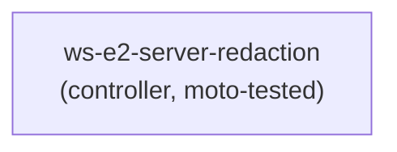

# WS-E Stage 2 (server-side redaction) — scoped build index

**Status**: Build stage 2 of the staged WS-E build · **Created** 2026-07-01
**Parent**: [../ws-e-redaction.md](../ws-e-redaction.md) · **LLD**: [../../../lld/29-redaction.md](../../../lld/29-redaction.md) §4/§5/§6
**Prereq**: Stage 1 (Tier-1 SDK edge redactor) merged to `main` — this stage builds on the contract it lands (`redaction_nonce`, `redacted=True`, the `⟦AEGR:{nonce}:TYPE[:meta]⟧` token grammar, client-side `phase`).

## What this stage is

The **server-side application code** of the two-tier redactor — everything hermetically testable with `moto` (mocked DynamoDB), **no live AWS, no Fargate deploy, no Docker build**:
- accept + validate the `phase` field on `ValidationRequest`;
- the **F1 happens-before barrier** (Tier-2 NER completes before deep-detector read / audit write / feedback write);
- the **NO-RAW-PHI invariant (I-1)** — clean the live raw-logging surface in `audit_logger.py`, add the redaction-state guard + content-aware persist-gate + frame-local/APM control;
- the **opt-in redacted feedback store** write path + eval-gate + DSAR endpoint (against a moto table using the stage-3 schema as the contract);
- the **server-side image mode router** (`evaluate|redact|block`) + `image_mode` policy field;
- **FR-2.9 egress-policy reuse** for destination control;
- redaction **metrics** + the **NO-RAW negative-control** + **feedback-store** unit tests.

The Tier-2 NER model itself is abstracted behind a client interface with a **stub/reference NER in tests**; the real model-serving container is stage 3.

## Workstreams

| ID | Doc | Scope | Blocking |
|----|-----|-------|----------|
| **ws-e2-server-redaction** | [ws-e2-server-redaction.md](ws-e2-server-redaction.md) | Server-side redaction: phase-accept, F1 barrier, no-raw audit + guard + persist-gate + frame-local control, feedback store write/eval-gate/DSAR, image mode router, egress reuse, metrics, hermetic tests. | yes |

## Dependency graph

Single self-contained workstream. **Depends on:** stage 1 merged to `main`; the stage-3 feedback-store table schema (defined here as the shared contract, implemented as CDK there).

## Build order (waves)

1. **Wave 1:** `ws-e2-server-redaction`

## Shared conventions (every task MUST honor)

- **Fail-secure, deny-by-default:** an un-flagged field (`redacted != True`) is **dropped** from any log/persist + alarmed (`RawContentBlockedFromLog`) — never written raw. A redaction/NER error on a PHI path **holds** that content (E3 egress-fail-closed), never forwards raw. Opt-in defaults **OFF** (an accidental default-ON is a consent breach — mirrors LLD 27's absent-key conservative-off trap).
- **The persist-gate is a STRONGER INDEPENDENT detector, not the flag** (F2/F3): the admission gate re-scans the **whole would-be-persisted record** (payload + reason + winning_source + detector_outcomes) with a detector independent of / at least as sensitive as the Tier-2 primary. Re-running the primary redactor as the gate is circular — forbidden.
- **Match the controller's idioms:** validators are async, `@stamps(Source.*)`-decorated, return `ValidationResult`; audit is dual-write (`_fire_and_forget(self.audit_logger.log_signals(...))`); config is `pydantic BaseSettings` with `Field(validation_alias=...)`; tests use `moto` + async fixtures (see `tests/test_tenancy_v2.py`).
- **Additive contract changes only:** `phase` on `ValidationRequest` is additive + defaulted (`"request"`) + validated (unknown → 422/DENY, never silent accept). No breaking field re-cuts an SDK/connector.
- **Off the response path:** feedback writes + metrics are fire-and-forget — a telemetry failure never blocks a verdict. These are NOT the billing ledger (WS-H) and NOT the audit signal store (LLD 17).
- **Tests are the arbiter, non-vacuous:** the NO-RAW negative-control test MUST fail if a "skip-store but forward raw" or "logs raw body" variant is introduced (proves it isn't vacuous).

## Explicitly OUT of this stage

- **Stage 3** (`docker/Dockerfile.phi-ner`, `cdk/cdk_constructs/phi_ner_service_construct.py`, `cdk/cdk_constructs/feedback_store_table_construct.py`, the served phi-ner FastAPI endpoint, F4 in-container isolation) — code + `cdk synth` only, built next.
- **E8.5** fuzzy recall harness (WS-0-gated number — harness ships, threshold gated), **E8.6** LIVE e2e (needs deployed infra = prod), and **any deploy**.
- Release-gate items (counsel BAA sign-off, ADR-032 recording, WS-0 recall number).