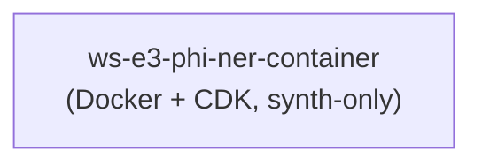

# WS-E Stage 3 (phi-ner container + CDK infra) — scoped build index

**Status**: Build stage 3 of the staged WS-E build · **Created** 2026-07-01
**Parent**: [../ws-e-redaction.md](../ws-e-redaction.md) · **LLD**: [../../../lld/29-redaction.md](../../../lld/29-redaction.md) §4 / §9.3 Option A / §9.6 / §6.2 / §12
**Prereq**: Stage 2 merged to `main` (the phi_ner client interface + feedback-store schema contract this infra serves/provisions).

## What this stage is

The **infrastructure-as-code** of the two-tier redactor — everything verifiable by `cdk synth` + unit assertions, **NO deploy, NO image push, NO live AWS**:
- the **`phi-ner` model-serving container** (`docker/Dockerfile.phi-ner`) — a separate service from `security-controller`, baking Presidio + a distilled PHI-NER ONNX-int8 model + the Tesseract binary; its served FastAPI endpoint (`app/redaction/phi_ner.py` service side);
- the **CDK construct** for the `phi-ner` Fargate service (`cdk/cdk_constructs/phi_ner_service_construct.py`) — warm min≥1, autoscale, CloudMap `phi-ner.sentra.internal`, circuit-breaker;
- the **F4 in-container tenant-isolation** invariants (per-request buffer zeroing, NER-framework input-logging OFF, no crash-dump raw, no data-egress IAM);
- the **feedback-store CDK construct** (`cdk/cdk_constructs/feedback_store_table_construct.py`) — the table stage 2's write path targets (TTL on, PITR **off**, `subject_locator` GSI).

## Workstreams

| ID | Doc | Scope | Blocking |
|----|-----|-------|----------|
| **ws-e3-phi-ner-container** | [ws-e3-phi-ner-container.md](ws-e3-phi-ner-container.md) | The phi-ner Dockerfile + served endpoint + F4 isolation, its Fargate CDK construct, and the feedback-store table CDK construct. Verified via `cdk synth` + construct unit assertions. | yes |

## Dependency graph

Single self-contained workstream. **Depends on:** stage 2 merged (phi_ner client contract + feedback-store schema).

## Build order (waves)

1. **Wave 1:** `ws-e3-phi-ner-container`

## Shared conventions (every task MUST honor)

- **Verify by synth, never deploy:** the acceptance test is `cd cdk && cdk synth` producing valid CloudFormation for the new construct(s) + Python unit assertions on the construct (via `aws_cdk.assertions.Template`). **No `cdk deploy`, no `build_and_push_images.sh`, no live AWS** in this stage — that is the single combined-deploy step, gated on founder go-ahead (dev-stack = prod).
- **Follow the existing patterns exactly:** the Fargate service mirrors `compute_stack.py:1651` (`FargateTaskDefinition`) / `:1725` (`FargateService`); the feedback table mirrors `signal_store_table_construct.py` shape with the TTL+PITR deltas. Reuse before rebuild.
- **Warm pool, never cold:** `phi-ner` `desired_count`/`min_capacity ≥ 1` with utilization autoscale — `min_capacity=0` is the cold-model-load footgun the warm pool exists to prevent. Model artifact baked-in or pulled at boot, never lazy-per-request.
- **Self-host = no new subprocessor:** the container self-hosts the NER model (raw PHI stays inside AegionAI's own BAA boundary). A managed de-id API (Comprehend Medical / Google DLP / Nightfall) would make a third party our subprocessor and push raw PHI out — forbidden as the default; Comprehend Medical is fallback-only.
- **PITR OFF on the feedback table:** a PITR snapshot would retain a DSAR-deleted subject past deletion — explicitly `point_in_time_recovery=False`, do not inherit the signal store's setting. `RemovalPolicy.RETAIN` deliberate.
- **Stateless fleet, F4 isolation:** no per-tenant sticky routing; per-request raw buffers zeroed; NER-framework debug/input-logging OFF in prod; the provable cross-tenant boundary (Nitro/CVM enclave, §4.5) is a **named deferred residual**, NOT claimed present.

## Explicitly OUT of this stage

- **The combined deploy + LIVE e2e (E8.6)** — image push + `cdk deploy` + the real-infra e2e test. That is the final step, run once for all three stages together, and **needs explicit founder authorization** (dev-stack = prod).
- Model **selection lock / GA gate** (WS-0 recall number), the fuzzy recall threshold (E8.5), release-gate items (counsel BAA, ADR-032).