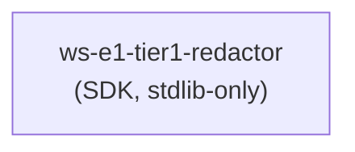

# WS-E Tier-1 (edge deterministic redactor) — scoped build index

**Status**: ✅ **DONE + PROMOTED to main 2026-07-02** (commit `44947ea`; **411 SDK tests green**, verified non-vacuous on a clean checkout). Reconciled to WS-B's `content_text`/`KNOWN_PHASES` contract; the ENTIRE separator-leak class closed by the normalize-then-detect rewrite (per [lld/29a](../../../lld/29a-redaction-format-spec.md)); PII-keyed-dict arity preserved. 2 residuals filed for follow-up (MEDIUM: ReDoS in `_EMAIL` regex on long non-email runs; LOW: SSN over-long-run tail) — neither a raw-PII leak.

**(history)** 🔄 **REBUILD (reconcile to WS-B) — 2026-07-01.** An earlier build merged (268 tests green; 4 raw-value leaks found+fixed — C1 separated-PAN, C2 SAD+dot-PAN, H1 hex-secret, IPv6) but was **reverted** because its `phase` wiring diverged from the WS-B/LLD-30 contract. WS-B has since landed on main (`KNOWN_PHASES`/`content_text`/`_CONTENT_FIELD`/`@guard.*` decorators/422-routing). This rebuild REUSES the sound redaction logic (matchers/grammar/fail-secure/PCI corpus, preserved on branch `codeloop/ws-e1-tier1-redactor`) and re-hooks it onto WS-B's `_build_request` `content_text` seam. · Build stage 1 of the staged WS-E build · **Created** 2026-07-01
**Parent**: [../ws-e-redaction.md](../ws-e-redaction.md) · **LLD**: [../../../lld/29-redaction.md](../../../lld/29-redaction.md) §3
**Why this scoped index exists**: WS-E spans four surfaces (stdlib SDK · server controller · CDK/Fargate · Docker) and a live-infra e2e test. Per the founder's staged-build decision (2026-07-01), **stage 1 = the Tier-1 edge redactor only** — the part that is pure, stdlib-only, hermetically testable, and touches **no** AWS/prod surface. The server-side (E3/E4/E5/E6.2), the `phi-ner` container + CDK (E2), and the live e2e (E8.6) are later stages, built + verified separately (E8.6 needs deployed infra = prod).

> **Gate note (carried, not re-litigated):** the parent WS-E is spike-gated on WS-0's signed recall-delta packet, which does **not** exist. The founder chose to build anyway (see memory `ws0-gate-overridden-for-wse`). Tier-1's correctness (deterministic PAN/SAD 0-miss) is **not** what WS-0 measures (WS-0 measures whether masking degrades deep-tier recall), so Tier-1 is the safest slice to build ahead of the gate.

## Workstreams

| ID | Doc | Scope | Blocking |
|----|-----|-------|----------|
| **ws-e1-tier1-redactor** | [ws-e1-tier1-redactor.md](ws-e1-tier1-redactor.md) | Tier-1 edge deterministic PII/PCI redactor in the stdlib-only SDK: the frozen ordered matcher set → typed-token grammar `⟦AEGR:{nonce}:TYPE[:meta]⟧`, run on every egressing phase in `_build_request` before `_send`, fail-secure to DENY, edge image-tagging, URL query-secret strip. Plus the Tier-1 unit suite and the release-blocking hard PCI SAD/PAN 0-miss test. | yes |

## Dependency graph

No cross-workstream edges — this scoped stage is a single, self-contained workstream in the SDK package.

**Depends on:** nothing in this scoped index (the SDK `guard.py`/`context.py`/`config.py`/`pyproject.toml` it edits already exist on `main`).

## Build order (waves)

1. **Wave 1:** `ws-e1-tier1-redactor`

## Shared conventions (every task in this scope MUST honor)

- **STDLIB-ONLY, non-negotiable:** the redactor uses only `re`, `math`, `unicodedata`, `secrets`. **`pyproject.toml` runtime `dependencies == []` stays unchanged** — the SDK vendors unchanged into a Lambda zip / Azure Function (LLD 23 §2). A test asserts this. Test-only deps (`pytest`) live in the `dev` extra, never in runtime `dependencies`.
- **Fail-secure, always:** any redactor exception on any field → the guard returns a **DENY** `Decision` (reason `redaction_failed`); the raw payload is **never** sent. Failing open (send-unredacted-on-error) is the clause-(a) breach — forbidden.
- **Typed-token grammar is a security control:** the wire grammar is `⟦AEGR:{nonce}:TYPE[:meta]⟧` with a per-call `secrets.token_hex(8)` nonce. A bare `<CARD>` is descriptive/UI-only, **never** the wire token — a bare token any input could spoof re-opens M-4. `_neutralize_planted_tokens` runs first so an attacker can't forge a marker.
- **Matcher ORDER is a security control:** the frozen `_ORDERED_MATCHERS` runs highest-harm/most-specific first (SAD → PAN → format-anchored IDs → generic → SECRET-entropy last). PAN must precede any bare-numeric matcher; SECRET-entropy is last (broadest, lowest precedence).
- **`<CARD:6:4>` = first6/last4 ONLY** (middle digits gone); **`<SAD>` carries NO meta** (CVV/track/PIN never-store). Never emit a full PAN, even tokenized.
- **Match the SDK's idioms:** this is the `aegion_guard` package (see `guard.py`, `context.py`, `config.py`, `exceptions.py`). New code matches its style, typing, and docstring density.
- **BUILD AROUND WS-B / LLD-30 — this is non-negotiable (the reverted mistake).** The `phase` contract is OWNED by WS-B (landed on main): `phase` flows as a **`_build_request` parameter** set by the `@guard.tool/content/output/memory` decorators (NOT via `RequestContext`); the egressing content lives in the single **`content_text`** field disambiguated by `phase` (WS-B's `_CONTENT_FIELD` map, `KNOWN_PHASES` frozenset); an unknown phase is a **422** server-side. WS-E **consumes** these canonical names and re-hooks redaction onto WS-B's `content_text` seam. Do NOT introduce `_VALID_PHASES`, a `RequestContext.phase` field, per-phase content fields, or ConfigError-on-unknown — those were the divergence that got reverted.
- **Tests are the arbiter, non-vacuous:** the hard PCI 0-miss test is **release-blocking** — a single missed Luhn-valid PAN or SAD fails it. The no-forgery + fail-secure tests must FAIL if the control is reverted (negative controls), proving they aren't vacuous.

## Explicitly OUT of this scoped stage (later WS-E stages)

- **E1.0 server-side `phase` — ALREADY DONE by WS-B** (on main: `KNOWN_PHASES`, `content_text`, `_CONTENT_FIELD`, the `phase` Literal + 422-on-unknown routing in `routes.py`, the `@guard.*` decorator surface, `TransportError.status_code`). This stage CONSUMES that contract; it does NOT build or re-decide any of it.
- **E2** (`phi-ner` container + Dockerfile + CDK construct), **E3/E4/E5** (server-side barrier / no-raw audit / feedback store), **E6.2/E6.3** (server-side image mode router + Cedar `image_mode`), **E7.1** (FR-2.9 egress policy reuse).
- **E8.3/E8.4/E8.5/E8.6/E8.7** (server-side no-raw test, feedback-store tests, fuzzy recall harness [WS-0-gated], LIVE e2e [needs deployed infra = prod], metrics).
- All **release-gate** items (counsel BAA sign-off, ADR-032 recording, WS-0 recall number).