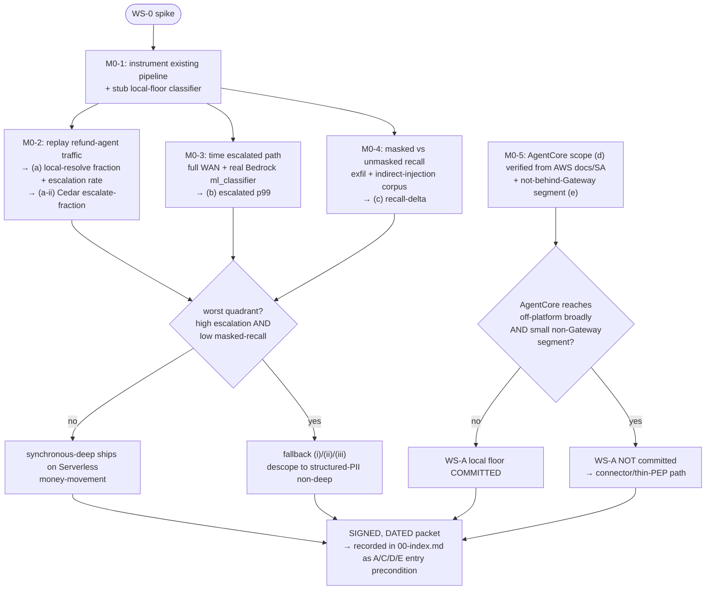

# WS-0 — Measure-First Spike (the GATING workstream)

> **Doc role:** This is the **workstream SCOPE** — boundary, dependencies, real `file:line` anchors, footguns, and acceptance criteria. It is an **INPUT to this workstream's implementation-grade LLD**, *not* the granular task breakdown. The granular, buildable tasks are generated **from the approved LLD** (canonical order: HLD → LLD → tasks). See [00-index.md](00-index.md) for the doc-role map.

**Parent HLD:** [hld/serverless-edition.md](../../hld/serverless-edition.md) — §8 **MEASURE-FIRST GATE** (the hand-off "MEASURE-FIRST GATE" block, lines ~683-688) + §6.4 (the combined GA-gate table, lines ~546-548) + §6.2(a)(ii) (the measured escalate-fraction, Appendix C invariant (ii)).
**Status:** 🟢 **SIGNED 2026-07-02 (founder — Shashank Gupta) — gate CLOSED, WS-A + WS-E unblocked.** All a/b/c measured 2026-07-02 on real Bedrock + real WAN (never mocked); both kills adjudicated (neither fires); thresholds pre-registered before the runs (`28581a2`); GA call ratified (route money-movement to in-VPC). See §6 checklist (11/11) + [ws-0-result-packet.md](ws-0-result-packet.md) sign-off block.
**Owner:** **founder — Shashank Gupta** (accountable owner-of-record AND the single named sign-off; a one-person spike has no second to escalate to, so this owner is non-delegable for the sign-off).
**Implements / gates:** the conditional-freeze rows **(a) FR-1.7**, **(c) FR-2.8**, **(e) FR-3.13 / NFR-7**; owns **residual #5** (masked-recall delta) and **residual #6** (local-resolve fraction + escalated-p99); resolves the **Appendix B** AgentCore kill-checks. ADRs touched (validated, not authored here): **ADR-029, ADR-030, ADR-032**.

> **This is NOT a production build.** WS-0 is a **throwaway, instrumented measurement harness** on the **existing** hosted engine plus a **STUB** local floor. It produces a **dated, founder-signed result packet** — and nothing else. Its sole product is the §6.4 combined table + two kill-check answers. No code from this WS ships to `main` as product.

> **Next step:** unlike A/C/D/E, WS-0 does **not** hand off to an implementation-grade LLD — it gates *whether those LLDs get written at all*. The packet it produces is the **entry precondition** that unblocks (or kills/pivots) the local-floor / redactor / scheduler / deep-tier LLDs. If WS-0 kills a row, the corresponding LLD is never commissioned.

---

## 1. Why this workstream exists (the gate, in one paragraph)

Three architecture rows are **conditionally frozen** at Gate 3 (HLD §6.6, lines ~627): the local-floor topology **(a)** and the DAG depth claim **(c)** are conditional on the **escalation rate + escalated-path p99** (residual #6); the redaction GA gate **(e)** is conditional on the **masked-vs-unmasked recall-delta** (residual #5). The §1 freeze rule reserves the right to **reopen** these on a CRITICAL soundness result — but that reopening is **impossible if the numbers only arrive after the SDK/redactor/scheduler are built**, because sunk cost makes the honest "route money-movement to in-VPC" / "don't build the local floor" calls un-makeable. So the gate's teeth are **sequencing, not a date**: `plan-workstreams` MUST NOT decompose WS-A (local floor), WS-C (redactor), WS-D (scheduler), or WS-E (deep tier) to build until a **dated, founder-signed packet** exists. **The packet's completion date IS the gate date**, recorded in `tasks/serverless-edition/00-index.md` as the entry precondition for A/C/D/E.

---

## 2. Dependencies

- **Depends on:** nothing in this LLD set — WS-0 runs **before** any build WS is decomposed. It depends only on what is **already shipped**: the hosted PDP pipeline ([validation_service.py](../../src/security-controller/app/services/validation_service.py)), the Bedrock `ml_classifier` ([ml_classifier.py](../../src/security-controller/app/validators/ml_classifier.py)), Cedar authoritative-on-dev ([dev.yaml:64/70](../../cdk/config/dev.yaml)), the SDK ([guard.py](../../demo-agents/sdk/aegion-guard-python/src/aegion_guard/guard.py)), and the real refund agent ([demo-agents/aws-payments-agent](../../demo-agents/aws-payments-agent)).
- **Blocks (HARD):** **WS-A** (FR-1.7 local floor / signed bundle), **WS-C** (FR-3.13 edge redactor), **WS-D** (FR-2.8 DAG scheduler), **WS-E** (D1–D7 deep tier). None may be decomposed-to-build until WS-0's packet is signed + dated. Does **not** block WS-B (multi-phase contract), WS-F (console), WS-G (metering) — those are settled-preference rows (HLD §6.6), not contingent on this measurement.
- **Shared files (read-only — WS-0 instruments, it does not modify product code):**
  - `src/security-controller/app/services/validation_service.py` — the pipeline to time + capture from.
  - `src/security-controller/app/validators/ml_classifier.py` — the Bedrock call whose latency dominates the escalated path.
  - `src/security-controller/app/validators/cedar/` — the real Cedar policies whose escalate-fraction must be measured.
  - `demo-agents/aws-payments-agent/` — the ONE real refund/payment agent the table is produced on.
  - `demo-agents/traffic/attack_prompts/{injection.txt,ml_injection.txt}` + `demo-agents/eval/labeled_prompts.jsonl` — existing labeled corpora to seed the recall test.

---

## 3. Model / read before coding (the invariants the measurement must honor)

1. **Two numbers, not one (HLD §6.4, line ~542).** The latency win concentrates on benign traffic that least needed it; the security-relevant requests (borderline, multi-turn, injection-suspect) are *by construction* the ones that escalate. So the harness MUST report **both** the locally-resolvable fraction **and the p99 of the escalated path** — the headline "fast enough to leave on synchronously" thesis is **unfalsifiable without the second number**.
2. **The escalated path is the full WAN leg + a remote Bedrock inference.** `ml_classifier` is a remote Bedrock Converse call (the Bedrock client is constructed at [ml_classifier.py:82-99](../../src/security-controller/app/validators/ml_classifier.py#L82); the model-tiering docstring is at [:8-13](../../src/security-controller/app/validators/ml_classifier.py#L8)). The escalated-p99 measurement MUST include the real WAN round-trip + real Bedrock inference — **not** a mocked classifier. NFR-2's ≤900 ms fast-ML ceiling is **NOT** asserted satisfied on the escalated Serverless path; it is held only to the ≤2.5 s deep ceiling, and even that is **measured here, not asserted** (HLD §6.4, line ~544).
3. **The shared hidden variable: escalate-fraction of real Cedar policies (HLD §6.2(a)(ii) / Appendix C invariant (ii), line ~786).** A local floor that only locally-evaluates the trivial allow/deny subset while every *interesting* policy escalates is a far smaller win than §1 sells. The stub interpreter MUST classify each real Cedar policy as "in the closed subset (locally resolvable)" vs "out-of-subset → escalate," and report **the fraction that forces escalate**. This sets *both* the latency win in (a) AND how much of NFR-1 the local floor actually closes.
4. **Masking degrades the deep tier — measure it BEFORE locking the redaction gate (HLD §6.2(e), line ~404).** The redactor and the deep tier pull against each other: scrubbing values removes the very values the deep detectors would read. The recall-delta on masked vs unmasked content for **exfiltration + indirect-injection** is a **precondition of locking the redaction GA gate**, not a residual to defer past it.
5. **Worst-quadrant kill (HLD §6.4, line ~546 + §8, line ~687).** If escalation is HIGH **and** masked-recall is LOW (slow *and* shallow on the requests that matter), GA does **not** ship the unconditional "leave-it-on-synchronously + deep" claim for money-movement. Fallbacks (i) raise local-floor coverage, (ii) route money-movement to in-VPC (deep tier sees unmasked content in-boundary), (iii) **reversible-only** escalate-async. **escalate-async is FORBIDDEN for irreversible/financial/money-movement actions** (HLD §6.4, line ~548) — money-movement is hard fail-closed.
6. **Second, independent kill — the differentiator, not the tuning (HLD §8, line ~687 + Appendix B, lines ~772-778).** If **(d)** AgentCore is *verified* to govern customer-owned / off-AWS agents broadly **AND (e)** the not-behind-Gateway segment is small, the **local-floor / signed-bundle workstream (WS-A) is NOT committed at all** — re-implementing off-platform what a hyperscaler reaches in-platform is a poor bet; the slice falls back to the connector/SDK-as-thin-PEP path against the hosted PDP. The numeric quadrant gates *synchronous-deep*; this gate decides whether the local floor is *built*.
7. **Throwaway, not product.** The stub local floor is a measurement instrument. Do **not** harden it, do **not** add the signed bundle / JWT / staleness machinery (that is WS-A's job *if WS-A survives this gate*). A stub that over-engineers toward production biases the schedule pressure this gate exists to resist.

---

## 4. Milestones → tasks

### Milestone M0-1 — Build the instrumented harness (throwaway)

- **Implements:** the measurement substrate for residuals #5/#6 | contracts touched (read-only): the existing pipeline, the SDK, the Bedrock classifier.
- **Subject under test:** the real refund agent at [demo-agents/aws-payments-agent/tools/lambda_handler.py:36](../../demo-agents/aws-payments-agent/tools/lambda_handler.py#L36) (`guard = AegionGuard(agent_id=..., platform="bedrock", ...)`) — it is already wired through the SDK and the Bedrock connector, so it exercises the real WAN + real PDP path. Do **NOT** invent a new agent.

**Task M0-1.1 — Stand up the timing harness around the existing pipeline.**
- Capture per-request timing at the existing pipeline boundaries. The pipeline entry is `_run_validation_pipeline` at [validation_service.py:220](../../src/security-controller/app/services/validation_service.py#L220); the short-circuit "first DENY stops the chain" is at [:172](../../src/security-controller/app/services/validation_service.py#L172) and [:274](../../src/security-controller/app/services/validation_service.py#L274); the per-result capture is `_capture(result)` at [:239](../../src/security-controller/app/services/validation_service.py#L239); the Cedar cutover branch is at [:300](../../src/security-controller/app/services/validation_service.py#L300); error→DENY at [:667](../../src/security-controller/app/services/validation_service.py#L667).
- Record, per request: `request_id`, `tool_name`, `phase` (today always `request` — there is NO `phase` field on `ValidationRequest` yet, [models.py:17](../../src/security-controller/app/api/models.py#L17); WS-B adds it, do NOT add it here), wall-clock at pipeline entry, wall-clock at each validator boundary, the deciding `winning_source` ([deny_overrides.py](../../src/security-controller/app/combiners/deny_overrides.py) `metadata['winning_source']`), and whether the request reached the ML/deep tier.
- **FOOTGUN:** do NOT measure on the dev controller behind a co-located test client — that hides the WAN leg. The escalated-p99 (M0-3) MUST traverse the same network path a real Serverless customer's SDK does (SDK `_send` POST at [guard.py:391](../../demo-agents/sdk/aegion-guard-python/src/aegion_guard/guard.py#L391)). Co-located timing under-reports p99 and makes the headline thesis look true when it is not.

**Task M0-1.2 — Build the STUB local-floor classifier (resolve-or-escalate, no enforcement).**
- The stub answers ONE question per request: *would the closed-subset local floor resolve this locally, or escalate it to the hosted PDP?* It does NOT enforce, does NOT sign a bundle, does NOT cache — it is a classifier.
- The closed subset it models is exactly HLD Appendix C invariant (i) (line ~786): **literal tool allow/deny sets · numeric/string parameter bounds · single-session sequence rule · prompt-signature patterns · literal egress destination/host/path/port matching** (egress is IN the subset — grow branch, HLD Appendix C line ~788). Anything outside that subset → **escalate**.
- Read the real Cedar policies from [src/security-controller/app/validators/cedar/](../../src/security-controller/app/validators/cedar/) (the agent's resolved policy set on dev). For each policy construct, classify in-subset vs out-of-subset.
- **FOOTGUN:** the stub MUST fail-closed-escalate on ANY construct it does not recognize (invariant (ii)) — never "locally allow" an un-modeled rule. A stub that locally-resolves an unrecognized construct inflates the local-resolve fraction and corrupts the whole gate. Model the **allowlist** (escalate-by-default), not a denylist.
- **FOOTGUN:** do NOT embed `cedarpy` in the stub to "be accurate" — `cedarpy` is native-wheel-only (HLD FAQ line ~726) and the point of the measurement is what the *stdlib-only* interpreter can resolve. The stub is pure-Python by design, like the real WS-A interpreter would be.

### Milestone M0-2 — Measure (a): local-resolve fraction + escalation rate + Cedar escalate-fraction

- **Implements:** residual #6 part 1 + HLD §6.2(a)(ii) escalate-fraction.

**Task M0-2.1 — Replay realistic refund-agent traffic through the stub classifier.**
- Source traffic from the refund agent's real action mix: refund/order tool calls with varied parameters (in-bound + out-of-bound amounts), plus the injection/benign mix in [demo-agents/traffic/attack_prompts/](../../demo-agents/traffic/attack_prompts/) and [demo-agents/eval/labeled_prompts.jsonl](../../demo-agents/eval/labeled_prompts.jsonl). The traffic mix MUST reflect a money-movement agent (refunds, payments), not a generic chat agent — this is the segment the gate decides.
- Report: **local-resolve fraction** (% classified resolvable in-subset) and its complement, the **escalation rate** (% that escalate to the hosted PDP).

**Task M0-2.2 — Measure the Cedar escalate-fraction (the shared hidden variable).**
- Independently of traffic, report the **fraction of the real Cedar policy set that contains at least one out-of-subset construct** — i.e. the policies that would force escalate *regardless of input*. This is the ceiling on the local floor's coverage (Appendix C invariant (ii)).
- **FOOTGUN:** a high local-resolve fraction on benign traffic + a high Cedar escalate-fraction is a contradiction that means the benign traffic simply never triggers the complex policies — report BOTH so the contradiction is visible, do not average them into one rosy "coverage" number (HLD §3 #3, the security-relevant cases are the ones that escalate).

### Milestone M0-3 — Measure (b): escalated-path p99 (full WAN + real Bedrock inference)

- **Implements:** residual #6 part 2 (the falsifiability number).

**Task M0-3.1 — Time the full escalated path under load.**
- For requests the stub classifies as "escalate," drive them through the real SDK→hosted-PDP→Bedrock path and record end-to-end latency. The escalated path = SDK `_send` WAN POST ([guard.py:391](../../demo-agents/sdk/aegion-guard-python/src/aegion_guard/guard.py#L391)) → pipeline → real Bedrock `ml_classifier` inference ([ml_classifier.py:82-99](../../src/security-controller/app/validators/ml_classifier.py#L82) client).
- Report **p50 / p95 / p99** of the escalated path. The headline number is **escalated p99**.
- **FOOTGUN:** do NOT mock or stub the Bedrock call to "save cost." The whole point (HLD §6.4 line ~542) is that the escalated path keeps full WAN cost **plus** real model latency. A mocked classifier produces a fictional p99 and defeats the gate. Use the real `aegionai-ml-classifier` inference profile (LLD 19 §2.4, referenced in the [ml_classifier.py:8-13](../../src/security-controller/app/validators/ml_classifier.py#L8) docstring).
- **FOOTGUN:** measure under representative concurrency, not single-shot serial calls — p99 under load is the SLA-relevant figure; a warm single-call latency understates it.

### Milestone M0-4 — Measure (c): masked-vs-unmasked recall delta

- **Implements:** residual #5 (the precondition for locking the redaction GA gate, HLD §6.2(e) line ~404).

**Task M0-4.1 — Build a stub structured-token redactor (throwaway).**
- Apply the HLD §6.2(e) typed-token convention: replace sensitive *values* with structure-preserving typed tokens `<CARD>`/`<SSN>`/`<EMAIL>`/`<SECRET>` (regex + Luhn for card numbers + entropy for secrets). This is a measurement stub — NOT the production edge redactor (that is WS-C *if it survives*).
- **FOOTGUN:** the stub MUST namespace/escape any pre-existing token-shaped substring in the input before emitting its own tokens (HLD §6.3 line ~535, token-confusion hazard) — otherwise attacker text containing a literal `<SECRET>` spoofs the measurement. Even in a throwaway, this affects the recall number.

**Task M0-4.2 — Run the deep tier on masked vs unmasked content for the two attack classes.**
- Two attack corpora: **exfiltration** and **indirect-injection**. Seed from [demo-agents/traffic/attack_prompts/injection.txt](../../demo-agents/traffic/attack_prompts/injection.txt) + [ml_injection.txt](../../demo-agents/traffic/attack_prompts/ml_injection.txt) + [demo-agents/eval/labeled_prompts.jsonl](../../demo-agents/eval/labeled_prompts.jsonl), and **augment with obfuscated + non-US variants** (HLD §6.3 line ~535: spaced/punctuation-broken digits, base64/hex-encoded, non-US formats) so the recall number is not canonical-only.
- For each corpus, run the deep tier (today = `ml_classifier` + prompt-signature engine [sigma_engine.py:340](../../src/security-controller/app/validators/sigma_engine.py#L340) `match_rules`) on (1) unmasked content and (2) masked content. Report **recall on unmasked**, **recall on masked**, and the **delta**.
- **FOOTGUN:** report recall separately per attack class — masking may barely hurt structural indirect-injection detection while gutting value-dependent exfiltration detection. Averaging the two hides exactly the worst-quadrant signal the gate needs (HLD §6.4 line ~546).

### Milestone M0-5 — The two NON-numeric kill checks (the differentiator)

- **Implements:** the Appendix B AgentCore kill-checks (lines ~772-778) — the second, independent kill that decides whether WS-A is built at all.

**Task M0-5.1 — (d) AgentCore interception scope — VERIFIED, not assumed.**
- Produce a **verified** statement of exactly what AgentCore Gateway/Policy can and cannot intercept on **customer-owned / off-Bedrock / off-AWS** infra — specifically: can AgentCore govern an agent making **direct tool calls NOT routed through AgentCore Gateway**, on the customer's own EC2/EKS/on-prem/off-AWS infra?
- **Source discipline (research-evidence rule):** resolve from AWS docs and/or a named AWS solutions-architect — `[FACT]` with a dated citation. The HLD Appendix B already establishes the partial-verified state (line ~774: "the docs do NOT state whether enforcement can bind to an agent making tool calls *directly* … UNVERIFIED from public docs") — WS-0 must CLOSE that unknown, citing the doc URL + fetch date. Use the `aws-core:amazon-bedrock` skill / `ReadInternalWebsites` / AWS docs MCP, not memory.
- **FOOTGUN:** do NOT mark this "verified" off a marketing page ("Any framework, any model" — HLD line ~773 already shows that line does NOT speak to the call-path boundary). The load-bearing fact is the **call path** (Gateway vs direct tool call), not the framework. An asserted-not-proven answer fails the gate.

**Task M0-5.2 — (e) Not-behind-Gateway segment size (the GTM number).**
- Size the genuinely-not-behind-AgentCore-Gateway agent fleet — multi-cloud, off-AWS, or AWS-but-direct-tool-call. This is the GTM number the HLD explicitly does not own (Appendix B line ~778 (1)).
- `[FACT]`/`[ESTIMATE]` labeled with its assumption shown (research-evidence rule). It need not be precise — it must be defensible enough to answer "is the wedge a sliver or a market?"

### Milestone M0-6 — Adjudicate the gates + assemble the signed packet

**Task M0-6.1 — Apply the worst-quadrant numeric kill (gates synchronous-deep).**
- Decision rule (HLD §6.4 line ~546 + §8 line ~687): if **escalation rate is HIGH AND masked-recall is LOW**, the unconditional "leave-it-on-synchronously + deep" claim does **NOT** ship for money-movement on Serverless. Record which fallback is taken: (i) raise local-floor coverage, (ii) route money-movement to in-VPC, (iii) **reversible-only** escalate-async — and descope Serverless money-movement to **structured-token-PII non-deep-tier customers** until a later coverage milestone.
- The packet MUST state the concrete thresholds used for "HIGH" / "LOW" so the adjudication is reproducible — these thresholds are a founder decision recorded IN the packet, not hidden.
- **FOOTGUN:** escalate-async (fallback iii) MUST be recorded as **unavailable for irreversible/financial/money-movement actions** (HLD §6.4 line ~548) — money-movement takes the synchronous block-before-execute fail-closed path. Do not record escalate-async as a money-movement fallback.

**Task M0-6.2 — Apply the AgentCore kill (gates whether WS-A is built).**
- Decision rule (HLD §8 line ~687): if **(d) AgentCore governs customer-owned/off-AWS agents broadly AND (e) the not-behind-Gateway segment is small**, then **WS-A (local-floor / signed-bundle) is NOT committed** — fall back to connector/SDK-as-thin-PEP against the hosted PDP for the non-AgentCore-reachable fleet. Otherwise WS-A is committed.

**Task M0-6.3 — Assemble + sign the dated packet, record the gate date in 00-index.**
- The packet contains: the §6.4 combined table (a/b/c), the Cedar escalate-fraction, the (d)/(e) kill-check answers with citations, the two kill adjudications (M0-6.1, M0-6.2) with thresholds, and the per-row disposition for A/C/D/E (committed / pivoted / not-committed).
- **Single named sign-off: founder (Shashank Gupta).** The packet carries a completion **date** — and **that date IS the gate date**.
- Record the gate date + each row's disposition in `tasks/serverless-edition/00-index.md` (created by `plan-workstreams`) as the **entry precondition** for decomposing WS-A/C/D/E.
- **FOOTGUN:** "no date" must not become "indefinite build-anyway." If the founder cannot own the spike in the build window, the gate does **NOT** waive (HLD §8 line ~686) — the local-floor build does not start. There is no auto-pass on timeout.

---

## 5. Error / inconclusive model

| Condition | Required handling (the gate does not silently pass) |
|---|---|
| Bedrock `ml_classifier` unavailable during M0-3 | Escalated-p99 is **inconclusive** → gate is NOT met (escalated-p99 is mandatory). Do NOT substitute a mocked latency and sign. |
| Attack corpus too small to be statistically meaningful for recall-delta | Record the corpus size + confidence as a caveat IN the packet; if the delta cannot be distinguished from noise, treat masked-recall as **LOW** (fail-secure toward the worst quadrant), not HIGH. |
| AgentCore call-path scope (d) cannot be verified from docs/SA | (d) is **UNRESOLVED** → the AgentCore kill cannot be adjudicated → the packet is **incomplete** and WS-A stays blocked. An unverified "probably narrow" does not unblock WS-A. |
| Stub classifier meets an unrecognized Cedar construct | **Escalate** (count it toward the escalate-fraction) — never count it as locally-resolved (invariant (ii)). |
| Founder unavailable to sign in the build window | Gate does **not** waive; A/C/D/E stay blocked (HLD §8 line ~686). No timeout auto-pass. |

---

## 6. Acceptance criteria (the one checklist for WS-0)

**Status: 11 / 11 done — SIGNED 2026-07-02 (founder — Shashank Gupta); gate CLOSED (packet `9e31dca`).** Harness: [harness/ws0/](../../harness/ws0/). Deviation-from-plan (all improvements, recorded honestly): (i) the local-floor classifier IS a stub (Stub A, [cedar_escalate_fraction.py](../../harness/ws0/cedar_escalate_fraction.py) + [local_resolve_fraction.py](../../harness/ws0/local_resolve_fraction.py)) but the **redactor is the REAL production WS-E Tier-1** (`aegion_guard.redaction.redact`), not a stub — a stronger instrument (founder call 2026-07-02); (ii) (b) required a throwaway `acme-payments-agent` kid because prod runs identity=enforce — the 3 real acme keys were untouched and the throwaway creds were cleaned up post-run; (iii) a1/a2 are `[ESTIMATE]` from a documented action mix (no live traffic capture exists for these agents).

- [x] An **instrumented throwaway harness** runs the **real refund/payment agent** through the **existing** hosted pipeline + a **stub** local-floor classifier (no production build, no signed bundle). — [harness/ws0/](../../harness/ws0/), throwaway (gitignored corpus/results/key), NOT in CDK.
- [x] **(a)** Local-resolve fraction **and** escalation rate reported as **two separate numbers** on money-movement traffic. — a1=**45%** / a2=**55%** (`[ESTIMATE]`, [local_resolve_fraction.py](../../harness/ws0/local_resolve_fraction.py)).
- [x] **§6.2(a)(ii)** The **fraction of real Cedar policies that force escalate** is reported, distinct from the traffic escalation rate. — a3=**2 of 3 = 0.67** (deterministic, [cedar_escalate_fraction.py](../../harness/ws0/cedar_escalate_fraction.py)).
- [x] **(b)** Escalated-path **p99** over the **full WAN leg + real (not mocked) Bedrock** inference, representative concurrency. — e2e p99 **≈2992ms@c5 / 3454ms@c20** (300 real WAN→Bedrock calls, 2 bands, [latency_p99.py](../../harness/ws0/latency_p99.py)); **BLOWS NFR-2** (≤900ms/≤2.5s).
- [x] **(c)** Masked-vs-unmasked **recall delta** for **exfiltration** and **indirect-injection** **separately**, obfuscated+non-US variants, namespacing-safe redactor. — exfil Δ**−0.5%** / indirect Δ**−3.6%** (both CIs overlap → masking does NOT blind; [recall_scorer.py](../../harness/ws0/recall_scorer.py), real WS-E redactor).
- [x] **(d)** AgentCore interception scope **verified from AWS docs** with dated citations — `[FACT]`, not assumed. — Gateway-bound only; adversarial verdict CONFIRMED (packet §8).
- [x] **(e)** The not-behind-Gateway segment size stated as a defensible `[FACT]`/`[ESTIMATE]` with its assumption shown. — band 55/75/90%, carried SINGLE_SOURCE (packet §8).
- [x] The **worst-quadrant numeric kill** (M0-6.1) is adjudicated with **explicit pre-registered HIGH/LOW thresholds** (`28581a2`, BEFORE the runs); fallback named; **escalate-async recorded unavailable for money-movement**. — **does NOT fire** ("slow but NOT blind"); fallback (ii) route-to-in-VPC indicated by the p99 (packet §4).
- [x] The **AgentCore kill** (M0-6.2) is adjudicated: WS-A recorded **committed** with the (d)+(e) rationale. — **committed** (both §9.2 conditions fail); DEFER-not-DELETE overlay (packet §4).
- [x] A **dated, founder-signed result packet** exists (§6.4 table + Cedar escalate-fraction + (d)/(e) + both kills + A/C/D/E disposition). — **SIGNED 2026-07-02** (founder — Shashank Gupta), [ws-0-result-packet.md](ws-0-result-packet.md) sign-off block.
- [x] The packet's **completion date is recorded in `00-index.md`** as the A/C/D/E entry precondition. — **gate date = 2026-07-02** filled at [00-index.md:80](00-index.md); **WS-A + WS-E decomposition now UNBLOCKED**.
- [x] Each of the **two kill checks is RESOLVED** (numeric quadrant + AgentCore scope) — neither left "inconclusive". — both resolved (packet §4).

---

## 7. Cross-references

- **HLD:** [hld/serverless-edition.md](../../hld/serverless-edition.md) §8 MEASURE-FIRST GATE (lines ~683-688), §6.4 combined GA-gate table + escalate-async fence (lines ~542-548), §6.2(a)(ii) escalate-fraction + Appendix C invariant (ii) (line ~786), §6.2(e) redaction recall-delta precondition (line ~404), §6.3 token-confusion + leak-corpus hazards (line ~535), Appendix B AgentCore comparison + kill-checks (lines ~770-778), §8 residual #5 (recall-delta), residual #6 (local-resolve + escalated-p99), residual #7 (Serverless = revenue edition).
- **Sub-PRD:** [prd/serverless-edition.md](../../prd/serverless-edition.md) §5 status — FR-1.7 NOT-DONE (:117), FR-2.8 NOT-DONE (:128), FR-3.13 NOT-DONE (:150), FR-3.2 PARTIAL/built-off-by-default (:139), FR-2.9 NOT-FOUND (:129); §11.3 (redaction GA-gate question), §11.4 (verified-identity GA gate).
- **Sibling WS docs (this WS GATES):** WS-A (FR-1.7 local floor / signed bundle), WS-C (FR-3.13 edge redactor), WS-D (FR-2.8 DAG scheduler), WS-E (D1–D7 deep tier). Does not gate WS-B (multi-phase contract), WS-F (console), WS-G (metering).
- **Related LLDs (extended only if a row survives):** LLD 19 (ML classifier — the escalated tier), LLD 20 (D1–D7 — the deep tier), LLD 23 (SDK — local floor + edge redactor), LLD 24 (latency), and the **new Cedar LLD** (bundle-emit from authoritative Cedar). None of these LLDs may be commissioned for the gated rows until WS-0's packet is signed.
- **Code anchors (read-only):** [validation_service.py:220/172/274/239/300/667](../../src/security-controller/app/services/validation_service.py#L220), [ml_classifier.py:8-13/82-99](../../src/security-controller/app/validators/ml_classifier.py#L82), [guard.py:391](../../demo-agents/sdk/aegion-guard-python/src/aegion_guard/guard.py#L391), [sigma_engine.py:340](../../src/security-controller/app/validators/sigma_engine.py#L340), [demo-agents/aws-payments-agent/tools/lambda_handler.py:36](../../demo-agents/aws-payments-agent/tools/lambda_handler.py#L36), [demo-agents/traffic/attack_prompts/](../../demo-agents/traffic/attack_prompts/), [demo-agents/eval/labeled_prompts.jsonl](../../demo-agents/eval/labeled_prompts.jsonl), [src/security-controller/app/validators/cedar/](../../src/security-controller/app/validators/cedar/).
