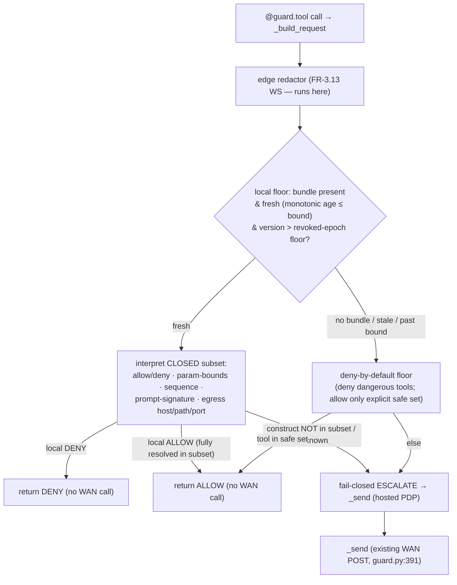

# WS-A — In-process local floor + signed-bundle distribution

> **Doc role:** This is the **workstream SCOPE** — boundary, dependencies, real `file:line` anchors, footguns, and acceptance criteria. It is an **INPUT to this workstream's implementation-grade LLD**, *not* the granular task breakdown. The granular, buildable tasks are generated **from the approved LLD** (canonical order: HLD → LLD → tasks). See [00-index.md](00-index.md) for the doc-role map.

**Parent HLD:** [hld/serverless-edition.md](../../hld/serverless-edition.md) — §8 hand-off row 1 (FR-1.7 local floor), §6.2(a) (*Making validation fast — running checks inside the agent*) + *How the policy bundle gets updated*, **Appendix C** (*Why the bundle interpreter is safe*), **Appendix D** (*Signing-key lifecycle*).
**Status:** Not started
**Owner:** TBD
**Implements:** FR-1.7 (in-process local enforcement) · ADR-029 (signed-bundle background poll + fail-closed staleness + revocation epoch + key lifecycle + anti-rollback). Touches FR-2.9 (egress is in the closed subset, GROW branch) and AD-2 (interprets a *derived bundle*, not the native Cedar engine).

> **Next step: an implementation-grade LLD.** This WS doc scopes the build (what to build, in which file, with which invariants and footguns). It does **not** replace the LLD: concrete schemas, function signatures, exact file diffs, the interpreter↔`cedarpy` differential corpus, and test cases are the LLD's job. Per the owner directive, the implementation-grade LLD extends **LLD 23** (SDK — interpreter must NOT add a native dep), **LLD 24** (latency), and the **new Cedar policy-engine LLD** (hosted-side bundle-emit + the differential corpus). Build from *this* doc; the LLD details it.

---

## 0. Gating — DO NOT START until WS-0 signs off

**This workstream is HARD-GATED by WS-0 (the measure-first spike).** Per HLD §8 MEASURE-FIRST GATE, `plan-workstreams`/this build **must not** be decomposed into code until a **dated, written, founder-signed spike-result packet** exists carrying: the §6.4 combined GA-gate table (local-resolve fraction + escalation rate, escalated-path p99), the §6.2(a)(ii) **measured fraction of real Cedar policies that force escalate**, and the two non-numeric kill checks ((d) verified AgentCore interception scope on customer-owned/off-AWS infra, (e) the not-behind-Gateway segment size).

Two independent kill outcomes block this WS entirely:
- **Numeric quadrant kill** (high escalation AND low masked-recall) → money-movement does not ship synchronous-deep on Serverless; pivot per §6.4 fallbacks. *(This gates synchronous-deep, not the local floor itself.)*
- **Differentiator kill** — if (d) shows AgentCore governs customer-owned/off-AWS agents broadly **AND** (e) the not-behind-Gateway segment is small → **the local-floor / signed-bundle workstream is NOT committed at all**; the slice falls back to connector/SDK-as-thin-PEP against the hosted PDP.

**Do NOT begin Milestone A1 until the WS-0 packet is signed.** No signed dated packet → no local-floor decomposition.

---

## 1. Dependencies

- **Depends on:** **WS-0** (measure-first spike — hard gate, §0). **WS-I** (hosted bundle-emit + differential corpus): WS-A *consumes* the bundle artifact + manifest format and the signing-pubkey distribution that WS-I produces. The interpreter (WS-A, SDK side) and the emitter (WS-I, hosted side) **share one closed-subset grammar** — they must be co-specified in the LLD or they will diverge into a silent fail-open.
- **Blocks:** WS-I cannot be conformance-validated without WS-A's interpreter (the differential test `interpreter ≡ cedarpy` runs the WS-A interpreter against WS-I's emitter output). WS-K (activation) verifies the bundle-poll path is live before flip.
- **Shared files / contracts:**
  - `demo-agents/sdk/aegion-guard-python/src/aegion_guard/guard.py` — the `tool()` decorator and `_send` hot path; WS-A inserts the local-floor short-circuit *before* `_send`. Shared with the FR-3.4 multi-phase WS (decorator surface) and FR-3.13 redactor WS (edge redactor runs before egress in the same `_build_request`/`_send` seam).
  - `demo-agents/sdk/aegion-guard-python/pyproject.toml:23-26` (`dependencies = []`) — shared invariant with **every** SDK WS: the runtime core stays stdlib-only.
  - The **bundle artifact + JWT manifest format** — shared contract with WS-I (emitter). Canonical grammar = the closed non-Cedar subset (Appendix C).
  - The **revocation-epoch DDB item** — reuses LLD 26 §3.6 `revoked-since` pattern (shared with the tenancy/identity path).

---

## 2. Model — read before coding

The invariants below are load-bearing. A violation of any of them is a **silent fail-open** (the edge ALLOWs what the server would DENY) — the single worst failure this design exists to prevent.

1. **Two evaluators, one policy.** The hosted PDP runs the authoritative `cedarpy` engine ([validation_service.py:300](../../src/security-controller/app/services/validation_service.py#L300)). The SDK edge runs a **pure-Python, stdlib-only interpreter of a derived data bundle** — it re-derives the bundle's rules from data; it does **NOT** load `cedarpy` in-process. `cedarpy==4.8.4` ships only native per-platform wheels (no `py3-none-any`) — embedding it breaks the `dependencies = []` SDK contract (LLD 23 §2). The interpreter is a **closed lookup table, not a second Cedar engine** (Appendix C).
2. **Closed subset (the only thing the interpreter understands):** literal tool allow/deny sets · numeric/string parameter bounds · the single-session sequence rule · prompt-signature patterns · **literal egress destination/host/path/port matching** (egress is IN the subset — GROW branch, resolved, honoring sub-PRD FR-1.7). Provably **not** full Cedar — no `forbid`-overrides-permit resolution, no partial eval, no `has`-guards, no set/record operators, no unknowns.
3. **Allowlist, not denylist (the structural soundness guarantee — stronger than the differential test).** The *emitter* (WS-I) is an explicit enumerated allowlist of supported Cedar constructs; it emits a bundle rule **only** for an allowlisted construct and **fail-closed-escalates everything else by default**. So a construct nobody anticipated ≡ "not allowlisted" ≡ "escalate" — caught even if the test corpus misses it. WS-A's interpreter is the consuming half: on **any unrecognized bundle construct it fails CLOSED → escalates to the hosted PDP. It NEVER locally-ALLOWs an un-interpretable rule.**
4. **Stale policy fails CLOSED, not open.** Past the max-staleness bound the local floor stops trusting the cache and reverts to deny-by-default (deny dangerous tools; allow only an explicit safe set). The staleness age is computed from a **monotonic clock** (`time.monotonic`), never the wall clock.
5. **Fail-secure default is already True** ([config.py:167](../../demo-agents/sdk/aegion-guard-python/src/aegion_guard/config.py#L167), `SENTRA_FAIL_SECURE` default True; `fail_secure` property [guard.py:156-157](../../demo-agents/sdk/aegion-guard-python/src/aegion_guard/guard.py#L156)). The existing `_send` already DENYs on transport error ([guard.py:396](../../demo-agents/sdk/aegion-guard-python/src/aegion_guard/guard.py#L396)) and on unrecognized decision ([guard.py:416](../../demo-agents/sdk/aegion-guard-python/src/aegion_guard/guard.py#L416)). The local floor must preserve this posture — it is an *addition before* `_send`, not a replacement.
6. **Crypto-extra is REQUIRED for money-movement.** Hash-only is not edge-cache-safe (TLS terminates at the CDN; a tampered bundle with a self-consistent hash passes). Verify-only ES256 is needed. The portable pure-Python verifier (`ecdsa==0.19.2`, verify-only, vendorable) vs. per-platform packaging is an **LLD deliverable** — do not pre-decide it here.

**Today's state (NOT-DONE):** every `@guard.tool` call is a blocking WAN POST via `_send` ([guard.py:391](../../demo-agents/sdk/aegion-guard-python/src/aegion_guard/guard.py#L391)). Sub-PRD §5 FR-1.7 = **NOT-DONE** ([prd/serverless-edition.md:117](../../prd/serverless-edition.md#L117)). There is no local floor and no bundle poll. Build all of it. *(Reuse: `_time.py` exists in the SDK — check it for an injectable clock before adding one; the `identity` extra already pulls `PyJWT[crypto]` — reuse that pattern for the optional crypto-extra, do not invent a new extra.)*

---

## 3. Decision flow (request-time short-circuit)



```mermaid
sequenceDiagram
  participant T as background poll timer
  participant CP as control plane (bundle CDN)
  participant SDK as SDK bundle store
  T->>CP: conditional GET (If-None-Match: <ETag>)
  CP-->>T: 304 Not Modified  (cheap, no body)
  Note over T,SDK: OR — new bundle available:
  CP-->>T: 200 + bundle + JWT manifest + new ETag
  T->>SDK: verify JWT sig (pinned pubkey) → per-file SHA-256 → bundle_version > highest-seen → nbf/iat ok
  SDK->>SDK: atomic swap (only if ALL checks pass); else keep-last-good
  T->>CP: read revocation-epoch item (≤ once / short interval)
  SDK->>SDK: any cached bundle < current epoch → invalidate
```

---

## 4. Milestones → tasks

### Milestone A1 — the stdlib-only bundle interpreter (closed subset)

- **Implements:** FR-1.7 (deterministic-tier in-process eval) | contract: the closed non-Cedar subset (Appendix C); the bundle/manifest format shared with WS-I.
- **A1.1 — New module `aegion_guard/local_floor.py`** (stdlib-only). Holds the interpreter + the in-memory bundle store. **Touches (new file):** `demo-agents/sdk/aegion-guard-python/src/aegion_guard/local_floor.py`. **FOOTGUN:** do NOT `import cedarpy`, `import cryptography`, `import jwt`, or any non-stdlib name at module top level of the *runtime* path — it breaks `pyproject.toml:23-26 dependencies = []` and the Lambda/Azure-Function vendor-unchanged invariant (LLD 23 §2). Crypto verify lives behind the optional extra (A4), imported lazily.
- **A1.2 — Interpreter primitives (the closed subset, each a finite lookup, non-Turing):**
  - tool allow/deny (literal sets) ·
  - parameter bounds (numeric `<=`/`>=`/range, string membership) ·
  - single-session sequence rule (required-prior-steps; reuse the existing server-side semantics — see `app/validators` context_validator for the shape) ·
  - prompt-signature patterns (the WS-Sigma rename dialect — regex+condition, NOT substring; align with the prompt-signature WS) ·
  - **egress destination/host/path/port matching** (GROW branch — a finite match-table, not a general matcher).
  - **FOOTGUN:** do NOT implement `forbid`-overrides-permit resolution, partial evaluation, `has`-guards, set/record operators, or unknown-handling — that is re-implementing Cedar and *will* diverge from `cedarpy` (silent fail-open). The interpreter reduces a lookup table; it does not evaluate a policy language.
- **A1.3 — Unrecognized-construct handling.** Any bundle construct the interpreter does not recognize → return an **ESCALATE** verdict (route to `_send`/hosted PDP). **FOOTGUN:** never treat an un-interpretable rule as local-ALLOW. ESCALATE is the only safe disposition. (Pairs with WS-I's emitter allowlist — Model §3.)
- **A1.4 — Verdict contract.** The interpreter returns one of `{LOCAL_ALLOW, LOCAL_DENY, ESCALATE, DENY_BY_DEFAULT}`. Map `LOCAL_DENY`/`DENY_BY_DEFAULT`→ the existing `Decision(decision="DENY", ...)` shape ([guard.py](../../demo-agents/sdk/aegion-guard-python/src/aegion_guard/guard.py) `Decision`); `ESCALATE`→ fall through to `_send`. **FOOTGUN:** reuse the existing `Decision` dataclass — do not invent a parallel verdict type that the hook/audit path can't read.

### Milestone A2 — wire the short-circuit into the hot path

- **Implements:** FR-1.7 | contract: the `@guard.tool` request path.
- **A2.1 — Insert local-floor evaluation in `guard.py` between request-build and `_send`.** **Touches:** `demo-agents/sdk/aegion-guard-python/src/aegion_guard/guard.py` — after `_build_request` ([:325](../../demo-agents/sdk/aegion-guard-python/src/aegion_guard/guard.py#L325) / params assembled [:373-389](../../demo-agents/sdk/aegion-guard-python/src/aegion_guard/guard.py#L373)), before `_send` ([:391](../../demo-agents/sdk/aegion-guard-python/src/aegion_guard/guard.py#L391)).
  - Pseudo-code (real names):
    ```python
    payload = self._build_request(...)          # guard.py:325 (redactor already ran)
    verdict = self._local_floor.evaluate(payload)   # NEW — A1
    if verdict is LOCAL_ALLOW:
        return Decision(decision="ALLOW", request_id=payload["request_id"], reason="local_floor_allow")
    if verdict in (LOCAL_DENY, DENY_BY_DEFAULT):
        return Decision(decision="DENY", request_id=..., reason=verdict.reason)  # NO WAN call
    return self._send(payload)                   # ESCALATE — existing guard.py:391 path
    ```
- **A2.2 — Ordering vs. redactor (FR-3.13 WS).** The edge redactor runs *before* the local floor (and before any egress), inside `_build_request`/the `_send` seam ([:373-389](../../demo-agents/sdk/aegion-guard-python/src/aegion_guard/guard.py#L373)). **FOOTGUN:** the local floor must evaluate the **same payload that would egress** — coordinate the insertion point with the redactor WS so redaction is not skipped on the ESCALATE path. Raw `tool_params`/`user_input` must never reach `_send` unredacted.
- **A2.3 — Preserve the existing fail-secure posture.** Do not weaken [guard.py:396](../../demo-agents/sdk/aegion-guard-python/src/aegion_guard/guard.py#L396) (transport-error→DENY) or [:416](../../demo-agents/sdk/aegion-guard-python/src/aegion_guard/guard.py#L416) (unknown decision→DENY). The local floor adds a faster-DENY/faster-ALLOW path; the ESCALATE path is still the existing `_send`.

### Milestone A3 — background poll refresh (out-of-band)

- **Implements:** FR-1.7 / tenet C (refresh out-of-band, decide in-process) | contract: conditional-GET/ETag, keep-last-good, monotonic staleness bound, revocation epoch.
- **A3.1 — Background poll timer.** A non-blocking background refresher (thread/timer) that **never runs on the validate path**. **Touches:** `local_floor.py` (or a sibling `bundle_poll.py`). **FOOTGUN:** do NOT poll synchronously inside `tool()`/`evaluate` — tenet 1 (control plane never on the action path).
- **A3.2 — Conditional GET / 304.** Send `If-None-Match: <ETag>`; on `304 Not Modified` do nothing (cheap). On `200` proceed to verify+swap (A4). Use stdlib HTTP (the SDK already has a transport `client.py` — reuse it, do not add `requests`).
- **A3.3 — Keep-last-good.** On any fetch failure (transport, non-200/304, verify failure), **retain the last-good bundle**. Do not clear the cache on a transient failure.
- **A3.4 — Monotonic max-staleness bound.** Track last-successful-refresh time via `time.monotonic()` (check `_time.py` for an existing injectable clock first). When `monotonic_now - last_good_refresh > MAX_STALENESS_BOUND`, the local floor reverts to **deny-by-default** until refreshed. **FOOTGUN:** do NOT compute staleness from `time.time()`/wall clock — an NTP rewind or host-clock manipulation would silently extend the trusted window of a stale bundle (Appendix D, *Staleness clock source*).
- **A3.5 — Revocation epoch.** Read a single small **revocation-epoch DDB item** at most once per short interval (NOT per request) — reuse the LLD 26 §3.6 `revoked-since` pattern ([lld/26-multi-tenancy.md:250](../../lld/26-multi-tenancy.md#L250)). Any bundle cached before the current epoch is invalidated. This tightens the revocation bound below the poll interval. **FOOTGUN:** do not read the epoch on the hot path; it is a background read like the poll.
- **A3.6 — Pin the two knobs (LLD-binding, §6.4).** `MAX_STALENESS_BOUND` and the **refresh cadence** are *safety* mechanisms, not freshness niceties. The LLD must pin both numbers + the control-plane availability target behind them (Appendix H). This WS leaves them as named config with conservative defaults; the LLD sets the values.

### Milestone A4 — signed-bundle integrity (verify-before-swap)

- **Implements:** FR-1.7 / FR-2.5 (signing) | contract: JWT-signed manifest of per-file SHA-256.
- **A4.1 — Manifest verify.** The bundle ships with a **JWT-signed manifest of per-file SHA-256 hashes** (detached-signature, OPA-bundle style). On a `200` fetch: (1) verify the JWT signature against the **pinned signing pubkey**; (2) recompute each file's SHA-256 and match the manifest; (3) only then atomic-swap. **FOOTGUN:** verify **before** swap — never swap then verify. A tampered or unsigned bundle is rejected (keep-last-good).
- **A4.2 — Crypto-extra (verify-only).** Signature verify needs asymmetric crypto, which is non-stdlib. Gate it behind an **optional extra**, mirroring the existing `identity = ["PyJWT[crypto]>=2.8.0"]` pattern ([pyproject.toml:33-35](../../demo-agents/sdk/aegion-guard-python/pyproject.toml#L33)). **Crypto-extra is REQUIRED for money-movement tenants** (hash-only is not edge-cache-safe — Appendix D). **FOOTGUN:** do NOT add crypto to the runtime `dependencies = []`; import it lazily inside the verify function so a non-crypto install still imports the SDK.
- **A4.3 — Portable-verifier vs per-platform-packaging (LLD DELIVERABLE — do not decide here).** Appendix D confirms `ecdsa==0.19.2` (verify-only, `py2.py3-none-any`, only `six` runtime dep, secp256r1/ES256) **exists and is maintained** — a pure-Python verify path that preserves vendor-unchanged install. The LLD must EITHER (2a) validate `ecdsa`/equivalent for verify-only (pin version, vendor it, record the verify-only/no-secret-on-edge rationale) OR (2b) fall back to per-platform packaging (vendored compiled `cryptography` per CPython×OS×arch / Lambda-layer) and cost it. **FOOTGUN:** hand-rolling a from-scratch ES256 implementation is OFF THE TABLE — reuse the maintained verifier. The caveat to own: `ecdsa` warns "not for production security settings" / no side-channel protection — acceptable for **verify-with-no-secret-material-on-edge**, must be recorded.

### Milestone A5 — key lifecycle (Appendix D — ADR-029)

- **Implements:** ADR-029 | contract: signing-key rotation, per-tenant keys, compromise path.
- **A5.1 — Rotation + dual-sign overlap window.** The signing key rotates on a fixed cadence with a **dual-sign overlap window sized explicitly BELOW the max-staleness bound** (A3.4) — so a routine rotation never fleet-degrades the way a signing outage would. During overlap the SDK trusts the union of `{old, new}` pubkeys; outside it, only the current key. **FOOTGUN:** if overlap ≥ staleness bound, a rotation can strand agents on a no-longer-trusted key → mass deny-by-default; keep overlap < bound.
- **A5.2 — Pinned signing pubkey, DISTINCT from the per-agent `kid`-LRU.** The bundle-signing pubkey is a **different keypair** from the per-agent-identity `kid`-LRU ([lld/26-multi-tenancy.md:250](../../lld/26-multi-tenancy.md#L250)). The SDK obtains + **PINS** the bundle-signing pubkey at SDK build/install time (bootstrap trust anchor), rotated forward via the overlap window. **FOOTGUN:** do NOT conflate the two keypairs — agent-identity keys (who the agent is) and bundle-signing keys (is this policy authentic) are independent trust roots.
- **A5.3 — Per-tenant signing keys (blast radius).** Sign bundles with **per-tenant (or per-tenant-group) keys** so one leaked key is contained, not fleet-wide. If a deployment must use a global key, ADR-029 states the accepted risk + compromise-response runbook explicitly. *(Emit side is WS-I; WS-A's job is to verify against the right per-tenant pinned key.)*
- **A5.4 — Key-compromise response path.** The revocation epoch (A3.5) invalidates *stale* bundles — it does NOT stop a maliciously-signed *fresh* one. A distinct compromise path: rotate the signing key, force-rotate the pinned pubkey via the overlap window, and **reject the compromised `kid` at the SDK**. Separate from bundle-version revocation. **Upstream authoring control (defense-in-depth — [ws-m-authz.md](ws-m-authz.md) M-M1):** A5.4 handles a *leaked signing key* (crypto response, WS-A-owned); the complementary control is **WS-M's RBAC + anti-IDOR on the policy-CRUD routes**, which stops an unauthorized operator from authoring a malicious policy that WS-I would then legitimately compile + sign into a *validly-signed, current-version* bundle in the first place. Neither the signature, per-file hash, nor anti-rollback version check (A4/A6) catches a bundle that was maliciously *authored at source* — that gap is closed upstream by WS-M, not here.

### Milestone A6 — anti-rollback / downgrade-replay

- **Implements:** ADR-029 (anti-rollback).
- **A6.1 — Monotonic version + freshness INSIDE the signed payload.** A signed hash-manifest alone has no monotonic version, so an old-but-validly-signed bundle replayed by a TLS-terminating proxy / compromised CDN passes signature + hash verify. Bake a **monotonic `bundle_version` (sequence counter) AND `nbf`/`iat` INSIDE the JWT-signed payload** — not just the hash manifest. **FOOTGUN:** version outside the signed payload is forgeable — it MUST be inside the signature.
- **A6.2 — Reject on version regression / bad freshness.** The SDK **rejects any bundle whose `bundle_version <= highest-seen`**, and rejects `nbf`-in-future / too-old `iat`. **FOOTGUN — keep-last-good interaction:** keep-last-good (A3.3) is bounded by the monotonic version — the SDK **never accepts an older version even as "last good" once a newer version has been seen**. Persist highest-seen across the keep-last-good cache.

---

## 5. Error model

| Condition | Local-floor response |
|---|---|
| Bundle present, fresh, request fully resolved in closed subset → allow | `LOCAL_ALLOW` — no WAN call |
| Bundle present, fresh, rule matches a deny | `LOCAL_DENY` — no WAN call |
| Request hits a construct NOT in the closed subset / unrecognized | `ESCALATE` → `_send` (hosted PDP) — never local-ALLOW |
| No bundle yet (cold start, never fetched) | `DENY_BY_DEFAULT` (deny dangerous tools; allow only explicit safe set) → ESCALATE for non-safe-set |
| Bundle stale: `monotonic_now − last_good > MAX_STALENESS_BOUND` | revert to `DENY_BY_DEFAULT` until refreshed |
| Fetch fails (transport / non-200/304) | keep-last-good; if past staleness bound → `DENY_BY_DEFAULT` |
| JWT signature invalid / per-file hash mismatch | reject bundle, keep-last-good (a tampered bundle is never swapped in) |
| `bundle_version <= highest-seen` OR `nbf` in future / `iat` too old | reject bundle (anti-rollback), keep-last-good |
| Revocation epoch advanced past cached bundle's epoch | invalidate cache → `DENY_BY_DEFAULT` until a fresh valid bundle arrives |
| Crypto extra not installed on a money-movement tenant | **hard error / refuse to run money-movement** (hash-only not permitted for money-movement — Appendix D) |
| Signing `kid` marked compromised | reject any bundle signed by that `kid` |

---

## 6. Acceptance criteria

- [ ] **WS-0 gate honored:** no code in this WS was authored before the dated, founder-signed WS-0 spike packet existed and cleared both kill checks (numeric quadrant + AgentCore-differentiator).
- [ ] The SDK runtime core still installs and imports with **zero non-stdlib runtime deps** (`pip install` of the base package with no extras; `pyproject.toml` `dependencies = []` unchanged; no top-level `import cedarpy`/`cryptography`/`jwt` on the runtime path).
- [ ] `local_floor.evaluate()` returns `LOCAL_ALLOW`/`LOCAL_DENY` and **issues no network call** for requests resolvable in the closed subset (assert `_send` not invoked).
- [ ] Any bundle construct outside the closed subset → `ESCALATE` (routes to `_send`); a unit test proves an unrecognized construct **never** yields `LOCAL_ALLOW`.
- [ ] The closed subset covers exactly: literal tool allow/deny, parameter bounds, single-session sequence, prompt-signature patterns, **and egress destination/host/path/port** — and no more (a test asserts a `forbid`/`has`-guard/set-operator construct escalates, not interprets).
- [ ] Background poll uses conditional GET; a `304` performs no swap and costs no body fetch (asserted).
- [ ] On fetch failure the last-good bundle is retained; once `monotonic_now − last_good > MAX_STALENESS_BOUND` the floor reverts to deny-by-default (test with an injected monotonic clock).
- [ ] Staleness is computed from a **monotonic** clock — a simulated wall-clock rewind does **not** extend the trusted window (test).
- [ ] Revocation-epoch advance invalidates a cached bundle (test); the epoch is read off the hot path.
- [ ] A bundle is verified (JWT signature against pinned pubkey + per-file SHA-256) **before** swap; a tampered file or bad signature is rejected and last-good retained (test each).
- [ ] **Anti-rollback:** a validly-signed bundle with `bundle_version <= highest-seen` is rejected even as "last good" (test); `bundle_version`/`nbf`/`iat` are read from inside the signed payload, not an unsigned envelope.
- [ ] Crypto-extra is **required** for a money-movement tenant (hash-only refused); a non-money-movement install can run hash-only under the accepted-risk note.
- [ ] Bundle-signing pubkey is pinned at install and is a **distinct keypair** from the per-agent `kid`-LRU (no code conflates them).
- [ ] Dual-sign overlap window is configured **strictly below** `MAX_STALENESS_BOUND` (config validation rejects overlap ≥ bound).
- [ ] **LLD deliverable flagged (not built here):** the portable-verifier-vs-packaging pick (A4.3) and the interpreter↔`cedarpy` differential conformance corpus (shared with WS-I) are named as LLD work, not silently assumed.

---

## 7. Cross-references

- **HLD:** [hld/serverless-edition.md](../../hld/serverless-edition.md) §6.2(a) + *How the policy bundle gets updated*; §6.3 (SDK→bundle trust boundary); §6.4 (the local-resolve fraction vs escalated-path p99 — WS-0 measures); §8 hand-off row 1; **Appendix C** (interpreter soundness — allowlist/closed-subset/egress-GROW); **Appendix D** (key lifecycle, crypto-extra, `ecdsa` feasibility, anti-rollback, monotonic clock).
- **Sub-PRD:** [prd/serverless-edition.md:117](../../prd/serverless-edition.md#L117) (FR-1.7, status NOT-DONE; local-floor scope incl. egress); FR-2.5 ([:126](../../prd/serverless-edition.md#L126), signing P1); FR-2.9 ([:129](../../prd/serverless-edition.md#L129), egress = grown local-floor primitive).
- **Sibling WS:** **WS-0** (spike — hard gate); **WS-I** (hosted bundle-emit + differential corpus — shared closed-subset grammar + per-tenant signing); the FR-3.4 multi-phase WS (shares the `@guard.tool` decorator surface); the FR-3.13 edge-redactor WS (runs before the local floor in the same egress seam); WS-K (verifies the poll path is live before activation).
- **LLDs to extend (implementation-grade):** [LLD 23](../../lld/23-sentra-guard-sdk.md) (SDK — interpreter must add NO native dep, §2 vendor-unchanged), [LLD 24](../../lld/24-latency-optimization.md) (latency — local floor closes the deterministic WAN leg), **new Cedar policy-engine LLD** (hosted-side bundle-emit allowlist + the interpreter↔`cedarpy` differential corpus), [LLD 26 §3.6](../../lld/26-multi-tenancy.md#L250) (revocation-epoch `revoked-since` pattern — reused).
- **Code touch-points:** [guard.py:325/373-389/391/396/416](../../demo-agents/sdk/aegion-guard-python/src/aegion_guard/guard.py#L391) (hot path), [config.py:167](../../demo-agents/sdk/aegion-guard-python/src/aegion_guard/config.py#L167) (`SENTRA_FAIL_SECURE` default True), [pyproject.toml:23-26,33-35](../../demo-agents/sdk/aegion-guard-python/pyproject.toml#L23) (`dependencies = []` + `identity` extra pattern), `_time.py`/`client.py` (reuse for clock + transport), [validation_service.py:300](../../src/security-controller/app/services/validation_service.py#L300) (authoritative `cedarpy` — the differential reference).
- **ADRs:** ADR-029 (this WS's decision; adr.md sync writes 029…035 per HLD §8 — do not reuse reserved 023–028). AD-2 join-key text tightening ([lld/ARCHITECTURE.md:327](../../lld/ARCHITECTURE.md#L327)): "embeddable on the server host; the SDK local tier interprets a derived signed bundle, not the native engine."
