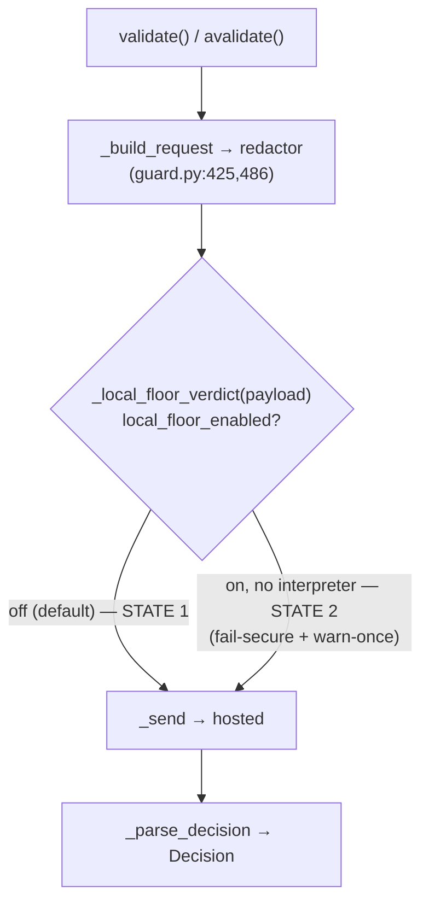

# WS-A (ship-now) — SDK 0.2.0 release + no-op local-floor seam

> **Doc role:** This is the **tasks-stage** doc (milestones → buildable tasks with mandatory tests), generated from the approved LLD. **Build straight from this doc** — the LLD is the source of truth for *why*; this is the *what to code*.

**Parent LLD:** [lld/36-sdk-release-and-local-floor-seam.md](../../lld/36-sdk-release-and-local-floor-seam.md) (approved Gate-3 2026-07-03, founder comments applied `8bca748`).
**Status:** CODE-DONE — promoted to `main` 2026-07-03 (`42e0207`, SDK 0.2.0 seam) + bare-`@guard.output` bypass fix 2026-07-04 (`cae0180`). SDK suite **435 pass / 2 skip** verified by direct run on committed main (the code-loop gate ran the wrong top-level suite; re-verified against the SDK suite by hand). **NOT deployed** (release/re-vendor only; edge agents pick up 0.2.0 on next deploy via the `azure.yaml`/`build_zip` vendor hooks).
**Owner:** TBD
**Implements:** FR-1.7 (**the SEAM ONLY** — the caching that fills it is [lld/37](../../lld/37-sdk-local-floor-caching.md)), FR-3.4 (phase surface — release vehicle), FR-3.13 (Tier-1 redactor — release vehicle), NFR-4 (fail-secure).

> **This is a RELEASE + a PLUG, not a feature build.** Most of the SDK code (phase decorators, Tier-1 redactor, trail passthrough) is **already merged** — this workstream *releases* it (version bump + re-vendor) and adds a **typed no-op seam** (flag off = route to hosted = today's behavior). **NO interpreter, NO bundle, NO caching, NO crypto** — a reviewer who finds any of those has found scope creep into [lld/37](../../lld/37-sdk-local-floor-caching.md).

---

## Dependencies

- **Depends on:** WS-B (phase surface — MERGED `9a8074a`), WS-E (Tier-1 redactor — MERGED, deployed), WS-D (trail — MERGED `42bcaeb`), WS-L (content/memory phase handlers — LIVE server-side, [routes.py:98-118](../../src/security-controller/app/api/routes.py#L98)). All predecessors already landed; this releases them.
- **Blocks:** [lld/37](../../lld/37-sdk-local-floor-caching.md) (the caching that fills this seam codes against the frozen `LocalFloorVerdict` enum + `local_floor_enabled` flag), WS-J (differential runner codes against the frozen enum), WS-H (metering names the seam as its heartbeat point).
- **Shared contracts this ws OWNS (frozen here — join keys):** `LocalFloorVerdict` enum, `local_floor_enabled` flag semantics, `_local_floor_verdict(self, payload)` hook.
- **Shared contracts this ws CONSUMES (do not redefine):** `phase`/`content_text`/`KNOWN_PHASES` ([lld/30](../../lld/30-multiphase-contract.md)); `redact`/`redact_params`/`redaction_nonce` ([lld/29](../../lld/29-redaction.md)); `Decision`/`winning_source` via `Decision.raw` ([lld/33](../../lld/33-decision-trail.md)); `local_floor_enabled` semantics ([lld/28:394-397](../../lld/28-cedar-policy-engine.md)).

---

## Read before coding (invariants the implementer must hold)

1. **The seam is fail-secure by construction.** Every state routes to hosted `_send` or DENYs — **never** local-allow, never skip-validation, never deny-all. `local_floor_enabled=off` ≡ today's behavior.
2. **`interceptor` ≠ `interpreter`.** The `@guard.*` decorators (interceptors/PEP) ship and still intercept. The *interpreter* (bundle-evaluator) is [lld/37](../../lld/37-sdk-local-floor-caching.md); lld/36 ships **no interpreter**.
3. **The async path stays BYTE-IDENTICAL.** The seam is a pre-check *above* the unchanged `return await asyncio.to_thread(ctx.run, self._send, payload)` ([guard.py:388](../../demo-agents/sdk/aegion-guard-python/src/aegion_guard/guard.py#L388)). **Do NOT introduce a `_dispatch` closure** (that is lld/37's, with its own contextvars/exception-ordering tests). A closure on every async call in a "zero-change" release is the #1 regression risk.
4. **`_local_floor_verdict` returns `Optional[Decision]`, NEVER a bare `LocalFloorVerdict`.** In lld/36 it returns ONLY `None`. An escaped `str`-Enum reads truthy → fail-OPEN.
5. **Base `dependencies = []` stays unchanged.** `enum` is stdlib. **No `[local-floor]` extra declared or stubbed** (that's lld/37).
6. **`DenyOverrides.combine()` is byte-for-byte read-only** (ADR-031). The SDK cannot import `app.combiners` — the seam mints no `Signal`.
7. **Only `@guard.output` deny-alls** — content/memory are LIVE ([routes.py:98-118](../../src/security-controller/app/api/routes.py#L98)); gate ONLY output.

---

## Milestone A1 — Version bump + release surface ✅ DONE (`42e0207`)

**Implements:** S3 (release the merged surface) | contract: `__version__`/`__contract__`

### A1.1 — Bump the SDK version 0.1.0 → 0.2.0 (two sites, kept in sync) ✅ DONE
- **Touches:** [`src/aegion_guard/__init__.py:43`](../../demo-agents/sdk/aegion-guard-python/src/aegion_guard/__init__.py#L43) (`__version__ = "0.1.0"` → `"0.2.0"`), [`pyproject.toml:7`](../../demo-agents/sdk/aegion-guard-python/pyproject.toml#L7) (`version = "0.1.0"` → `"0.2.0"`).
- `__contract__` at [`__init__.py:51`](../../demo-agents/sdk/aegion-guard-python/src/aegion_guard/__init__.py#L51) **stays `"v1"`** — the wire contract is unchanged (bare string `"v1"`, not `"/v1"`). The `User-Agent` `aegion-guard/{__version__}` ([guard.py:157](../../demo-agents/sdk/aegion-guard-python/src/aegion_guard/guard.py#L157)) picks up the new value automatically.
- **Footgun:** the two version sites drift silently if edited separately — a release-gate test asserts they match.
- **Unit tests:** `test_version_and_contract_pin` in `tests/test_config.py` — asserts `aegion_guard.__version__ == "0.2.0"`, the `pyproject.toml` `version` parses to the same string, and `__contract__ == "v1"`. *(no other UT — pure constant.)*
- **Integration test:** covered by A1.2's `test_contract_live` tie-in (the `User-Agent` reaching the server carries `0.2.0`).

### A1.2 — Confirm `dependencies = []` holds + no `[local-floor]` extra ✅ DONE
- **Touches:** [`pyproject.toml:26`](../../demo-agents/sdk/aegion-guard-python/pyproject.toml#L26) (`dependencies = []` — unchanged), [`pyproject.toml:33`](../../demo-agents/sdk/aegion-guard-python/pyproject.toml#L33) (`identity` extra remains the ONLY optional extra).
- **Footgun:** do NOT add a `[local-floor]` extra (crypto is lld/37). This task is a guard, not an add.
- **Unit tests:** extend existing [`tests/test_stdlib_only.py`](../../demo-agents/sdk/aegion-guard-python/tests/test_stdlib_only.py) — `test_stdlib_only_holds` asserts (a) no non-stdlib runtime import is introduced by the seam (walk `local_floor.py` + the seam edits; `enum`/`typing` are stdlib), (b) `pyproject` `dependencies == []`, (c) `[project.optional-dependencies]` has NO `local-floor` key. *(no integ — build-config assertion.)*

---

## Milestone A2 — The frozen verdict enum (`local_floor.py`) ✅ DONE (`42e0207`)

**Implements:** S2 (frozen contract) | contract: `LocalFloorVerdict` (**owned here**)

### A2.1 — Create `local_floor.py` with the frozen `LocalFloorVerdict` enum ✅ DONE
- **Touches:** NEW file [`src/aegion_guard/local_floor.py`](../../demo-agents/sdk/aegion-guard-python/src/aegion_guard/local_floor.py); export from [`__init__.py`](../../demo-agents/sdk/aegion-guard-python/src/aegion_guard/__init__.py) `__all__` ([:53](../../demo-agents/sdk/aegion-guard-python/src/aegion_guard/__init__.py#L53)).
- **Content (lld/36 §4.2.1):**
  ```python
  from enum import Enum
  class LocalFloorVerdict(str, Enum):
      LOCAL_ALLOW     = "LOCAL_ALLOW"
      LOCAL_DENY      = "LOCAL_DENY"
      ESCALATE        = "ESCALATE"
      DENY_BY_DEFAULT = "DENY_BY_DEFAULT"
  ```
- **Footgun:** this is the ONLY thing `local_floor.py` contains in lld/36 (no interpreter). It is a public export so [lld/37](../../lld/37-sdk-local-floor-caching.md) + WS-J code against a stable name. `str`-Enum so the value serializes as a plain string.
- **Unit tests:** `test_verdict_enum_frozen` in NEW `tests/test_local_floor_seam.py` — asserts `LocalFloorVerdict` has **exactly** the four members with their exact string values (a member added/renamed fails the test — freezes the contract for lld/37 + WS-J). *(no integ — a pure type; its seam behavior is tested in A3.)*

---

## Milestone A3 — The no-op seam (config flag + hook) ✅ DONE (`42e0207`)

**Implements:** S2 (the seam) | contract: `local_floor_enabled`, `_local_floor_verdict` (**owned here**)



### A3.1 — Add the `local_floor_enabled` config flag (default False) ✅ DONE
- **Touches:** [`config.py:20-33`](../../demo-agents/sdk/aegion-guard-python/src/aegion_guard/config.py#L20) (add `ENV_LOCAL_FLOOR = "SENTRA_LOCAL_FLOOR_ENABLED"` to the env-var block), the `GuardConfig` `@dataclass(frozen=True)` ([config.py:87](../../demo-agents/sdk/aegion-guard-python/src/aegion_guard/config.py#L87)) — add field `local_floor_enabled: bool = False`, `resolve()` ([config.py:112](../../demo-agents/sdk/aegion-guard-python/src/aegion_guard/config.py#L112)) — add a keyword `local_floor_enabled: Optional[bool] = None` and resolve it via the existing `_env_bool(ENV_LOCAL_FLOOR, False)` ([config.py:45](../../demo-agents/sdk/aegion-guard-python/src/aegion_guard/config.py#L45)).
- **Footgun:** reuse `_env_bool` — it **raises `ConfigError` on an unparseable value** (fail-closed at construction). Do NOT silently coerce an invalid value to `False`. Default MUST be `False` (a `True` default routes at a floor that doesn't exist).
- **Unit tests:** in `tests/test_config.py` / extend [`tests/test_config_env_branches.py`](../../demo-agents/sdk/aegion-guard-python/tests/test_config_env_branches.py) — `test_invalid_flag_value_fails_closed` (`SENTRA_LOCAL_FLOOR_ENABLED=maybe` → `ConfigError` at `GuardConfig.resolve()`, no guard built); `test_local_floor_flag_default_false` (unset env → `config.local_floor_enabled is False`). *(no integ — config resolution; the routing behavior is A3.2/A3.3.)*

### A3.2 — Add the `_local_floor_verdict` hook + wire the sync path ✅ DONE
- **Touches:** [`guard.py`](../../demo-agents/sdk/aegion-guard-python/src/aegion_guard/guard.py) — new method `_local_floor_verdict(self, payload) -> Optional[Decision]`; wire into `validate()` replacing the direct `return self._send(payload)` at [guard.py:358](../../demo-agents/sdk/aegion-guard-python/src/aegion_guard/guard.py#L358); init `self._floor_absent_warned = False` in `AegionGuard.__init__` ([guard.py:89](../../demo-agents/sdk/aegion-guard-python/src/aegion_guard/guard.py#L89)).
- **Pseudo-code (lld/36 §4.2.3):**
  ```python
  # __init__: self._floor_absent_warned = False   # NEW instance attr (frozen GuardConfig can't hold it)

  # validate() @ :358 — replaces `return self._send(payload)`:
  verdict = self._local_floor_verdict(payload)
  if verdict is None:            # not handled locally → hosted (today's behavior)
      return self._send(payload)
  return verdict                 # lld/36: never taken; lld/37 returns a local Decision

  def _local_floor_verdict(self, payload) -> Optional[Decision]:
      if not self._config.local_floor_enabled:
          return None                         # STATE 1 (default) → hosted
      if not self._floor_absent_warned:       # STATE 2: flag on, no interpreter
          logger.warning("local_floor_enabled=True but no local floor installed "
                         "(lld/37 not built); routing every call to hosted PDP "
                         "(fail-secure). Edge enforcement is NOT active.")
          self._floor_absent_warned = True
      return None                             # STATE 2 → hosted (fail-secure)
  ```
- **Footguns:** the WARNING line is **static** (no payload/PII interpolated — it's on the redacted-payload hot path). `self._floor_absent_warned` MUST be initialized in `__init__` or the first read `AttributeError`s. Return type is `Optional[Decision]` — **never** the bare enum.
- **Unit tests:** in NEW `tests/test_local_floor_seam.py` — `test_seam_off_routes_to_send` (flag off → `_local_floor_verdict` returns `None`, `_send` reached exactly once, via a spy); `test_seam_on_without_interpreter_fails_secure_to_hosted` (flag on, no interpreter → routes to `_send`, never skips/local-allows/deny-alls); `test_floor_absent_warns_once_per_guard` (N guards flag-on → WARNING fires **once per guard**, log record carries NO payload substring); `test_seam_returns_decision_or_none` (the type contract — `_local_floor_verdict` returns `Decision` or `None`, never a `LocalFloorVerdict`). *(integ: A3.4.)*

### A3.3 — Wire the async path (BYTE-IDENTICAL — pre-check only) ✅ DONE
- **Touches:** `avalidate()` — insert the same pre-check ABOVE the unchanged [guard.py:388](../../demo-agents/sdk/aegion-guard-python/src/aegion_guard/guard.py#L388) `return await asyncio.to_thread(ctx.run, self._send, payload)`.
- **Pseudo-code:**
  ```python
  verdict = self._local_floor_verdict(payload)   # no-op in lld/36
  if verdict is not None:                          # lld/36: never taken
      return verdict
  return await asyncio.to_thread(ctx.run, self._send, payload)   # UNCHANGED line
  ```
- **Footgun (LOAD-BEARING):** do **NOT** introduce a `_dispatch` closure or move the seam inside the `to_thread` worker — that is lld/37's restructure (it owns the contextvars/exception-ordering equivalence proof). The `to_thread(ctx.run, self._send, payload)` line stays literally today's.
- **Unit tests:** `test_seam_off_routes_to_send_async` in NEW `tests/test_local_floor_seam.py` (extend patterns from [`tests/test_async.py`](../../demo-agents/sdk/aegion-guard-python/tests/test_async.py)) — a spy proves `avalidate` traverses `_local_floor_verdict` **exactly once, before `_send`, inside the `to_thread` worker**, including under an exception raised between the two calls; `test_seam_on_without_interpreter_fails_secure_to_hosted` also asserted on `avalidate`. *(integ: A3.4.)*

### A3.4 — Structural guards (no-`_send`-outside-seam, no-Signal-mint) ✅ DONE
- **Unit tests (structural):**
  - `test_no_send_outside_seam` — **AST dominator** assertion (NOT a `grep 'self._send('`; the async site is a bare reference `to_thread(ctx.run, self._send, payload)` with no `(`): every reference to `_send` in `guard.py` — call form `self._send(...)` and bare-attribute form — is dominated by a `_local_floor_verdict` reference in the same function/closure. If expressed as a regex it MUST be `self\._send\b` (word-boundary).
  - `test_seam_mints_no_signal` — import-graph assertion: the `aegion_guard` package has **no import path to `app.combiners`**, so no `LocalFloorVerdict` can leak into `DenyOverrides.combine()` (ADR-031 boundary frozen before lld/37 wires a producer).
- **Integration test:** `test_seam_end_to_end_routes_to_hosted` in `tests/test_async.py` (or a new integ file) — with a stub hosted endpoint, both `validate` and `avalidate` (flag off, and flag on-without-interpreter) reach the stub and return its Decision — proves the seam does not intercept the real request path. *(This is the shared-contract seam for `_local_floor_verdict`.)*

---

## Milestone A4 — `@guard.output` fails fast at decoration time ✅ DONE (`cae0180`)

**Implements:** §4.1(a-out) (booby-trap fix) | contract: `@guard.output` (nuance propagated to [lld/30](../../lld/30-multiphase-contract.md))

### A4.1 — Make `@guard.output` raise `FeatureNotAvailable` at decoration time ✅ DONE (parens + bare forms, `cae0180`)
- **Touches:** [`guard.py:249`](../../demo-agents/sdk/aegion-guard-python/src/aegion_guard/guard.py#L249) (`def output`); a new `FeatureNotAvailable` exception in [`exceptions.py`](../../demo-agents/sdk/aegion-guard-python/src/aegion_guard/exceptions.py) (subclass `AegionGuardError`, alongside the existing types at [:29-123](../../demo-agents/sdk/aegion-guard-python/src/aegion_guard/exceptions.py#L29)); export it in `__init__.py __all__`.
- **Behavior:** `@guard.output` raises `FeatureNotAvailable("@guard.output: the output phase is not yet enforced (WS-L D5 unbuilt); do not wire it to a production path — use @guard.tool for action validation")` **when the decorator is APPLIED** (decoration time / import), not at first call. `@guard.tool`, `@guard.content`, `@guard.memory` decorate normally (content/memory have LIVE server handlers, [routes.py:98-118](../../src/security-controller/app/api/routes.py#L98)).
- **Footgun:** raise at **decoration** (developer-actionable at wire time), NOT a per-call prod DENY. Only `output` — do NOT gate content/memory.
- **Unit tests:** `test_output_decorator_fails_fast` in `tests/test_guard_sync.py` — `@guard.output(...)` applied to a fn raises `FeatureNotAvailable` at decoration; `@guard.tool/content/memory` decorate without raising; `test_phase_decorators_carry_phase` (regression) updated so it only exercises tool/content/memory carrying the right `phase`+`content_text`. *(integ: A4.2.)*

### A4.2 — Propagate the `@guard.output` nuance into lld/30 (sibling reconcile) ✅ DONE
- **Touches:** [lld/30-multiphase-contract.md](../../lld/30-multiphase-contract.md) — add a one-line note on the `@guard.output` decorator: "ships in SDK 0.2.0 but raises `FeatureNotAvailable` at decoration until WS-L D5 lands (see lld/36 §4.1(a-out))."
- **Footgun:** this is a doc reconcile (WS-B owns the decorator contract) — do NOT silently change the decorator without the lld/30 note.
- **Integration test:** `test_output_phase_still_deny_alls_server_side` — a live `@guard.tool`-shaped request with `phase="output"` to the server returns `phase_handler_not_implemented:output` (the server-side contract the SDK gate mirrors; guards against the SDK gate drifting from server behavior). *(This is the cross-doc/cross-tier seam for the `output` phase.)*

---

## Milestone A5 — Re-vendor all three `acme-*` agents (CI-blocking checksum gate) ✅ DONE (`42e0207`)

**Implements:** S4 (re-vendor) | contract: the vendored-copy ≡ released-source equality

> The three live agents: **`acme-payments-agent`** (AWS Lambda, dir `demo-agents/aws-payments-agent/`), **`acme-telecom`** (Azure Function, `demo-agents/azure-telecom-agent/`), **`acme-identity`** (Azure Function, `demo-agents/azure-identity-agent/`). Both Azure agents currently vendor **11 modules** — the release adds `local_floor.py` → **12** and mutates `config.py`/`guard.py`.

### A5.1 — Re-vendor the two Azure Function agents (manual byte-copy) ✅ DONE (build-time `azure.yaml cp -r`)
- **Touches:** [`demo-agents/azure-telecom-agent/tools/aegion_guard/`](../../demo-agents/azure-telecom-agent/tools/aegion_guard/) and [`demo-agents/azure-identity-agent/tools/aegion_guard/`](../../demo-agents/azure-identity-agent/tools/aegion_guard/) — copy the full 12-module package from `src/aegion_guard/` (the 11 current + NEW `local_floor.py`; `config.py`/`guard.py` re-baselined).
- **Footgun:** a full copy that **omits `local_floor.py`** ships a `guard.py` that `import`s an absent module → `ImportError` = hard-down connector. The gate treats a missing manifest member as FAIL, not an ignored-file pass.
- **Unit test:** covered by A5.3's `test_revendor_manifest.py::test_azure_hook_revendors_whole_package` (asserts the deploy hook copies the whole package). *(no logic here — a deploy-hook, not a checked-in copy.)*

### A5.2 — Confirm the payments Lambda re-vendors on build; Azure subset stays a subset ✅ DONE
- **Touches:** [`demo-agents/aws-payments-agent/deploy/deploy_payments_agent.py:35,51,64`](../../demo-agents/aws-payments-agent/deploy/deploy_payments_agent.py#L35) — `build_zip()` copies from `SDK_SRC` automatically; a rebuild after the bump re-vendors. The Azure Function **`tool_interceptor` subset** ([`src/connectors/azure_foundry/azure_function/tool_interceptor/aegion_guard/`](../../src/connectors/azure_foundry/azure_function/tool_interceptor/aegion_guard/)) stays **exactly `{redaction.py, exceptions.py, __init__ shim}`** — it does NOT vendor `guard.py`/`config.py`/`local_floor.py` (absent-by-design; the seam is a no-op it never reaches).
- **Footgun (TOCTOU):** `build_zip()` must vendor from the **released-tag** `SDK_SRC` (pin the tag or emit a `sha256` manifest into the zip) — a green test on a fresh tree does not prove the deployed zip was built from that tree.
- **Unit test:** `test_azure_subset_is_exactly_three_modules` — asserts the `tool_interceptor` subset is exactly `{redaction.py, exceptions.py, __init__.py}` and does NOT contain `guard.py`/`config.py`/`local_floor.py` (absent-by-design, not un-compared). *(integ: A5.4.)*

### A5.3 — The CI-blocking per-agent checksum gate ✅ DONE (`test_revendor_manifest.py`)
- **Touches:** a release-gate test, e.g. `tests/test_revendor_manifest.py` (SDK suite) or a CI job wired as a **required** check on the release tag.
- **Unit test:** `test_revendor_manifest.py` (6 tests) — asserts the **hook MECHANISM**, not a diff of the git-ignored vendored dirs: `test_released_sdk_has_the_twelve_module_manifest` (src = exactly 12 modules incl. `local_floor.py`); `test_azure_hook_revendors_whole_package` (parametrized over both Azure agents — the `azure.yaml prepackage` hook does `rm -rf` + whole-dir `cp -r`, so a narrowed copy that drops `local_floor.py` → `ImportError` FAILS); `test_payments_lambda_revendors_whole_package` (`build_zip` rglobs the whole pkg); `test_azure_subset_is_exactly_three_modules` + `test_azure_subset_is_byte_identical_to_source` (tracked subset exactly `{__init__ shim, exceptions, redaction}`, byte-identical to src, guard/config/local_floor absent-by-design). **No agent silently left on the old copy** — the mechanism (whole-dir hook) guarantees every deploy re-vendors the current 0.2.0 source by construction.
- **Footgun:** do NOT make this an "ignore missing files" diff — a missing `local_floor.py` must FAIL.

### A5.4 — Azure connector redaction tie-in (integration) ✅ DONE
- **Integration test:** `test_azure_connector_redaction_tie_in` — the Azure Function `tool_interceptor` redacts via the vendored subset **identically** to the released SDK on a shared PAN/SSN fixture (proves the re-vendored redactor matches the source after the bump). *(This is the shared-contract seam where the vendored copy meets the released source.)*

---

## Error model

| Condition | Response |
|---|---|
| `local_floor_enabled` unparseable (e.g. `=maybe`) | `ConfigError` at `GuardConfig.resolve()` — fail-closed, no guard built |
| `local_floor_enabled=True`, no interpreter (lld/36 always) | route to hosted `_send` (fail-secure) + one-time WARNING per guard |
| `@guard.output` applied | `FeatureNotAvailable` at decoration time |
| Transport 5xx/timeout (unchanged) | fail-secure DENY (`validation_unavailable`) when `fail_secure=True` |
| Non-ALLOW/DENY body (unchanged) | default-DENY ([guard.py:590](../../demo-agents/sdk/aegion-guard-python/src/aegion_guard/guard.py#L590)) |
| Vendored copy drifts from released source | release-gate FAIL — do NOT deploy |

---

## Acceptance criteria (whole workstream)

- [x] `__version__ == "0.2.0"` at both sites; `__contract__ == "v1"` (A1.1) — verified on main `cae0180`
- [x] `dependencies == []`; NO `[local-floor]` extra declared (A1.2)
- [x] `LocalFloorVerdict` enum frozen with exactly the four members (A2.1)
- [x] `local_floor_enabled` flag defaults False; invalid value fails closed (A3.1)
- [x] Seam is a true no-op: flag off → `_send` reached (sync + async), byte-identical async `to_thread` line (A3.2/A3.3)
- [x] Flag on without interpreter → fail-secure to hosted, never skip/local-allow/deny-all; warns once per guard (A3.2)
- [x] `_local_floor_verdict` returns `Optional[Decision]`, never a bare enum; no `_send` outside the seam (AST); SDK cannot import `app.combiners` (A3.2/A3.4)
- [x] `@guard.output` raises `FeatureNotAvailable` at decoration for BOTH parens `@guard.output()` AND bare `@guard.output` forms; tool/content/memory decorate normally (A4.1, bare-form bypass fixed `cae0180`); lld/30 reconciled (A4.2)
- [x] All three `acme-*` agents re-vendor the 12-module 0.2.0 package via build-time hooks (Azure `azure.yaml` prepackage `cp -r`, payments `build_zip` rglob) incl. `local_floor.py`; Azure subset stays exactly 3 modules (A5.1/A5.2) — gated by `test_revendor_manifest.py` (non-vacuous)
- [x] **unit + full SDK suite pass** — verified by direct run on committed main: **435 passed / 2 skipped** (SDK suite `demo-agents/sdk/aegion-guard-python/`; covers version/contract pin, stdlib-only, enum frozen, flag default+invalid, seam off sync+async, on-without-interpreter fail-secure, warn-once, type contract, no-send-outside-seam AST, no-Signal-mint, output fail-fast parens+bare, per-agent revendor manifest, azure subset byte-identity)
- [x] **integration tests pass** (SDK-local: seam end-to-end routes to hosted `tests/test_async.py`; azure connector redaction tie-in `test_revendor_manifest.py::test_azure_connector_redaction_tie_in`). Live-service e2e suites (`tests/integration/test_e2e_agents.py` etc.) are skip-gated when no controller is reachable (`requires_services`) — unrelated to WS-A.
- [x] the full SDK suite stays green — **435 pass / 2 skip across 15 test files** (was "216 functions/14 files" in the plan — updated to the actual collected count on main; run `env -u AWS_PROFILE python -m pytest` from `demo-agents/sdk/aegion-guard-python/`)

---

## Cross-references

- **This ws's LLD:** [lld/36-sdk-release-and-local-floor-seam.md](../../lld/36-sdk-release-and-local-floor-seam.md) (§4.1 released surface, §4.2 the seam, §4.3 versioning, §4.4 re-vendor, §9 test plan).
- **Sibling LLDs/WS docs that share a contract (sweep targets):**
  - [lld/30](../../lld/30-multiphase-contract.md) — `phase`/`content_text`/decorators; the `@guard.output` fail-fast nuance is reconciled INTO it (A4.2).
  - [lld/29](../../lld/29-redaction.md) — `redact`/`redaction_nonce`; the redactor-before-seam ordering + the re-vendored redactor tie-in (A5.4).
  - [lld/33](../../lld/33-decision-trail.md) — `Decision`/`winning_source` via `Decision.raw` passthrough.
  - [lld/28](../../lld/28-cedar-policy-engine.md) — owns the `local_floor_enabled` off=network-required semantics this mirrors.
  - [lld/37](../../lld/37-sdk-local-floor-caching.md) — **fills this seam** (consumes the frozen `LocalFloorVerdict` + flag + hook).
  - [lld/23](../../lld/23-sentra-guard-sdk.md) — the SDK design this releases (supersede-banner applied).
  - WS-J (differential runner — codes against the frozen enum), WS-H (metering heartbeat — deferred to lld/37).
- **Related:** [tasks/serverless-edition/ws-a-local-floor-bundle.md](ws-a-local-floor-bundle.md) is the **deferred lld/37 caching scope** (NOT this ws).
