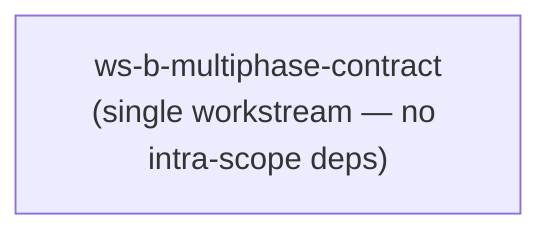

# WS-B Multi-phase Contract — Build Index (code-loop scope)

**Parent HLD**: [hld/serverless-edition.md](../../../hld/serverless-edition.md) §6.2(b) · **LLD**: [lld/30-multiphase-contract.md](../../../lld/30-multiphase-contract.md) (Approved) · **Sub-PRD**: FR-3.4 (PARTIAL)
**Status**: Ready to build · **Scope**: WS-B ONLY (this is a single-workstream build manifest carved out of the 12-workstream [serverless index](../00-index.md) so `code-loop` builds exactly WS-B).

> **Why this scoped index exists.** The full `tasks/serverless-edition/00-index.md` lists 12 workstreams; pointing `code-loop` at it would try to build all of them (most are scope-only, spike-gated, or already done). This manifest contains only WS-B so the build is scoped to the multi-phase `/v1/validate` contract.

## Workstreams

**Status legend** — **LLD:** ✅ done · **Code:** ⬜ not started.

| WS | Doc | Scope (one line) | LLD | Code | Blocking? |
|----|-----|------------------|-----|------|-----------|
| **ws-b-multiphase-contract** | [tasks/serverless-edition/ws-b-multiphase-contract.md](tasks/serverless-edition/ws-b-multiphase-contract.md) | FR-3.4 multi-phase `/v1/validate` contract: additive optional `phase` enum + `content_text` on `ValidationRequest`; server routing (unknown/typo → HTTP 422, known-but-unbuilt {content,output,memory} → fail-secure 200 DENY `phase_handler_not_implemented`); per-phase SDK decorators (`@guard.content/output/memory`) threading `phase` as an arg; SDK `TransportError.status_code` + `BadRequest` (422 halts before fn; 5xx/timeout → fail-secure DENY). | ✅ [lld/30](../../../lld/30-multiphase-contract.md) | ⬜ **tasks ready** (B1–B4) | no — greenfield, build now |

## Dependency graph

Edges: none within this scoped build. (In the full program WS-B **feeds** WS-E redaction, but WS-E is a separate, subsequent build — it forks off WS-B's landed contract, per the founder's sequencing.)

## Build order

1. **Wave 1 (only wave):** `ws-b-multiphase-contract`.

## Shared conventions (this build)

- **Greenfield base — do NOT reconcile.** The build base (`main` @ `521af11`) has been reverted to a state with **zero `phase` surface** in both the server (`app/api/models.py`, `app/api/routes.py`) and the SDK (`aegion_guard/guard.py`, `context.py`, `redaction.py`). Build the LLD-30 **canonical** contract from scratch; there is no prior WS-E `phase` code to refactor. (The earlier divergent WS-E copy is preserved on branch `integration/ws-e1-tier1-redactor`; WS-E will rebuild redaction OVER this canonical contract afterward.)
- **Two packages, one contract.** WS-B touches **both** the server `src/security-controller/` (Pydantic model + FastAPI route guard, in-process `TestClient` seams) **and** the stdlib-only SDK `demo-agents/sdk/aegion-guard-python/` (decorators + client). Honor each package's idioms.
- **SDK stays stdlib-only** — `pyproject.toml` `[project].dependencies` MUST remain `[]` (there is a test asserting this). Add no runtime dependency.
- **`RequestContext` gains NO `phase` field** (LLD-30 §6). `phase` is a decorator/`_build_request` **argument**, never ambient state on the context object. This is the canonical shape; do not read `active.phase`.
- **Canonical names (exact spellings — the join keys WS-E will index):** `KNOWN_PHASES` (server module-scope frozenset, the single source of truth), `_CONTENT_FIELD` (server map `{content,output,memory} → "content_text"` — ONE content field, not per-phase `*_body`), `content_text` (the single additive content field), `_phase_not_implemented_deny` (the server DENY helper — NEVER `_phase_deny`), `violation_type="PHASE_UNHANDLED"`, reason prefix `phase_handler_not_implemented:`. Do not introduce `HANDLED_PHASES` / `unhandled_phase` / an "unknown→DENY" polarity (LLD-30 flags those as drift).
- **Fail-secure / deny-by-default:** unknown phase → 422 at the edge (a validation error, NOT a metered verdict); known-but-unbuilt phase → 200 DENY (audited + metered); SDK transport 5xx/timeout (`status_code` 5xx or `None`) → fail-secure DENY `validation_unavailable`; **only** `status_code == 422` raises `BadRequest`.
- **The `@guard.tool` no-op guarantee is load-bearing:** a `request`-phase payload must be **byte-identical** to today — emit `phase`/`content_text` on the wire ONLY when `phase != "request"`. The deny-overrides combiner (`deny_overrides.py:28`) and `context_validator` (FR-2.3 sequence) are **unmodified** by this WS.

## Cross-references
- Implements: FR-3.4, FR-1.7 (SDK decorator surface); FR-2.3 named unchanged-within-`request`.
- Decisions: AD-3 (one endpoint, branch on `phase` — refined, not re-opened).
- Shared contracts: `POST /v1/validate` (+ `phase`/`content_text` fields), `KNOWN_PHASES`, `_CONTENT_FIELD`, `@guard.{tool,content,output,memory}`, `_phase_not_implemented_deny`, `PHASE_UNHANDLED`, `TransportError.status_code`, `BadRequest`.
- Upstream: [lld/30-multiphase-contract.md](../../../lld/30-multiphase-contract.md); HLD §6.2(b) Option A; task doc [../ws-b-multiphase-contract.md](../ws-b-multiphase-contract.md).
- Sibling refs: WS-E / [lld/29-redaction.md](../../../lld/29-redaction.md) (downstream consumer — imports `_CONTENT_FIELD`, reads `phase`; reconciles to this contract on its own subsequent build).
