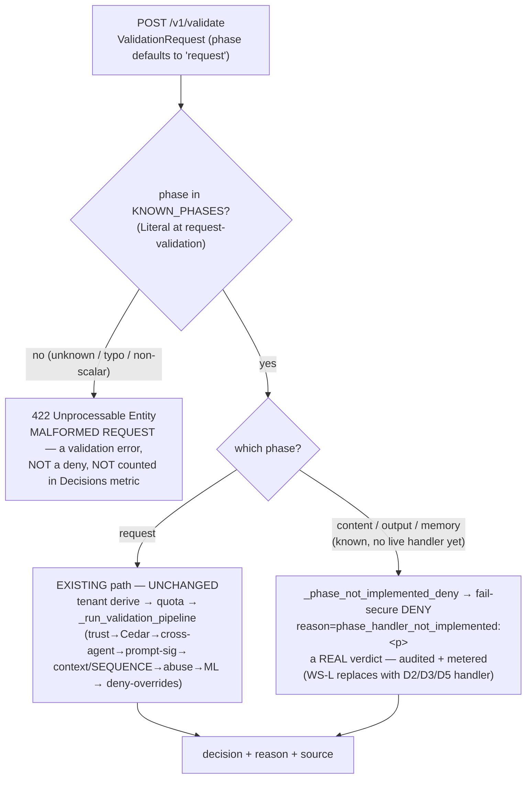

# WS-B — Multi-phase `/v1/validate` contract (`phase` enum + per-phase decorators)

**Workstream:** WS-B (Serverless Edition — the additive multi-phase `/v1/validate` contract). *(Single canonical workstream doc: scope + dependencies + granular buildable tasks; the design lives in the LLD below.)*
**Derived from (SOURCE OF TRUTH):** [lld/30-multiphase-contract.md](../../lld/30-multiphase-contract.md) (APPROVED — grilled + reconciled, 11 sections). **When this doc and the LLD disagree, the LLD wins** — this file is the buildable projection of it; do not re-decide anything here.
**Status:** **Not started** (code). Its LLD (lld/30) is **approved + grilled + reconciled**. FR-3.4 = **PARTIAL** (sub-PRD §5): the `request` phase is **LIVE** end-to-end and multi-tenant on dev — this WS builds only the *not-built* delta (the additive `phase` field + `content_text` + `_CONTENT_FIELD` + `KNOWN_PHASES` + the per-phase decorator surface + the unknown→422 / known-but-unbuilt→DENY routing + the SDK `TransportError.status_code` / 422 branch).
**Owner:** TBD.
**Implements:** FR-3.4 (multi-phase validation surface). **Refines** AD-3 (one endpoint, branch on `phase` — no new ADR; AD-3 already names the field, this fixes its handled values + the decorator surface + the phase-error split: unknown/typo → 422 validation error, known-but-unbuilt → fail-secure DENY).
**Spike-gated?** **NO.** WS-B is the additive central-contract change; it is *not* one of the spike-gated workstreams (local floor / redactor / DAG scheduler / deep tier). It may be built before the §8 measure-first spike packet is signed.

> **This WS ships the CONTRACT + routing skeleton + decorator surface — NOT the detection handlers.** The `content`/`output`/`memory` **detection handlers** (D2 second-order injection, D3 memory-integrity, D5 DLP/exfil) are **owned by WS-L**, built as nodes in WS-C's scheduler; WS-B leaves a fail-secure DENY stub in their place so a WS-L handler lands *additively* later (see Dependencies → Blocks). The live `request` pipeline — `context_validator` FR-2.3 sequence check included — is **untouched**.

---

## 1. Dependencies

- **Depends on:** nothing blocking — WS-B operates entirely on the shipped, live `request`-phase code. (TENANCY_V2 + Cedar are already enforcing on dev; design *against* them, do not touch them.)
- **Blocks:**
  - **WS-L (detection depth)** — WS-L **owns** the `content`/`output`/`memory` detection handlers (content=**D2** P0, memory=**D3** P0, output=**D5** later) that replace this WS's §3.2 fail-secure DENY stub. The moment WS-L replaces the stub line for a phase, that phase's "known-but-unbuilt → DENY" becomes a real verdict — **no contract / endpoint / SDK / decorator change**. Hand-off, not a WS-B task.
  - **WS-E (redaction)** — WS-E's redactor must run on **every egressing phase** and branches on `phase` to know which field carries content; it **consumes** `ValidationRequest.phase` + the `_CONTENT_FIELD` map WS-B owns. WS-E cannot land its per-phase redaction until this field + map exist (LLD §6).
- **Shared files (coordinate edits) — the contracts WS-B OWNS:**
  - [src/security-controller/app/api/models.py:17](../../src/security-controller/app/api/models.py#L17) — `ValidationRequest` (adds `phase`, `content_text`, `KNOWN_PHASES`, `_CONTENT_FIELD`). WS-E may add redaction-marker fields here too.
  - [src/security-controller/app/api/routes.py:56](../../src/security-controller/app/api/routes.py#L56) — `validate_tool_call` (the top-of-handler phase guard + `_phase_not_implemented_deny`). WS-A (local floor), WS-C (scheduler dispatch), WS-D (full-trail) also touch this handler / the pipeline entry — WS-B's edit is confined to the phase guard + helper; it does **not** touch `deny_overrides.py` or `_run_validation_pipeline` internals.
  - [demo-agents/sdk/aegion-guard-python/src/aegion_guard/guard.py:212](../../demo-agents/sdk/aegion-guard-python/src/aegion_guard/guard.py#L212) — `Guard` decorators + `_build_request` + `_send` (WS-E adds the redactor in the same `_build_request`; WS-A local floor wraps the same call path).
  - [demo-agents/sdk/aegion-guard-python/src/aegion_guard/client.py:35](../../demo-agents/sdk/aegion-guard-python/src/aegion_guard/client.py#L35) — `TransportError` (adds `status_code`).

**Shared contracts this WS OWNS (canonical names — join keys):** `ValidationRequest.phase` (additive optional `Literal["request","content","output","memory"]`, default `"request"`; unknown → 422) · `ValidationRequest.content_text` (additive optional content carrier, default `None`) · `KNOWN_PHASES` (frozenset SSoT + the enum-narrowing set) · `_CONTENT_FIELD` (phase→content-field map, **consumed by WS-E**) · `POST /v1/validate` branch-on-`phase` (AD-3) · `@guard.tool`/`@guard.content`/`@guard.output`/`@guard.memory` (SDK decorator surface) · reason `phase_handler_not_implemented:<p>` + `violation_type=PHASE_UNHANDLED` (known-but-unbuilt DENY) · `_phase_not_implemented_deny` (the **exact** helper name — do NOT introduce `_phase_deny`) · `TransportError.status_code` (SDK — distinguishes a 422 from a 5xx) · the **422-vs-DENY** routing behavior.

---

## Read before coding — the invariants/footguns you must hold

These are the LLD's load-bearing tie-breakers (lld/30 §1.2). Hold all of them; violating any is a defect, not a style nit.

1. **Additive + defaulted = zero-break (Tie-breaker A + the no-op guarantee, §1.4).** Every existing caller sends **no** `phase` and **no** `content_text`. `ValidationRequest.phase` defaults to `"request"`, `content_text` to `None`. Every current SDK `@guard.tool` call, both Bedrock + Azure connectors, and every existing test must behave **byte-identically on the wire and behaviorally identically** after this change. Do NOT make either field required; do NOT change the defaults; do NOT reorder/rename existing fields.
2. **Two not-permitting cases, and they are DIFFERENT (§2.1, §3.1).** The field **IS** enum-narrowed (a `Literal` over `KNOWN_PHASES`) **on purpose**. An **unknown/typo** value (`"reqest"`, `"plan"`, a non-scalar) is a **malformed request → 422 (a validation error, NOT a verdict)** — it must NOT be counted in the `Decisions`/`ValidationsTotal` deny metric, because a client typo must not corrupt `Decisions`. A **known-but-unbuilt** phase (`content`/`output`/`memory` today) is the ONLY phase case that stays a real **fail-secure DENY**. *(This REVERSES the earlier plain-`str`/DENY-on-unknown stance — owner-confirmed, propagated up to HLD §6.2(b) Option A + the "Refines AD-3" note. Any code/test still reading `HANDLED_PHASES` / `unhandled_phase:<x>` / "unknown → DENY" is residual drift.)*
3. **Fail secure, never fail open (Master tenet 2).** A known-but-unbuilt phase **DENYs**, never a silent route to the `request` handler, never a permissive default, **never ALLOW**. "We don't know how to check this committed moment" fails closed. A stub that ALLOWs is the worst bug in this WS — it opens an ungoverned surface the instant a customer adopts `@guard.content`.
4. **Do NOT default unknown → request (§3.2 footgun).** With the `Literal` an unknown value can't reach the handler at all (it 422s). Do NOT add a fallback that coerces a stray value to `request` — that silently mis-routes a typo'd intent and re-introduces the fail-open the enum closed.
5. **The 422 must NOT become a fail-open in the SDK (§3.6, B4 footgun).** ONLY `exc.status_code == 422` takes the developer-actionable `BadRequest` raise branch. A `None` status (timeout/connection error) or a 5xx MUST stay on the existing fail-secure DENY path. A truthiness/coercion refactor (`if exc.status_code:` / `int()` coercion) that lets a 5xx skip fail-secure is the catastrophe — it fails *open* on an outage.
6. **Phases are independent surfaces, NOT a fixed sequence (§3.5).** `content`/`output`/`memory` are *not* "steps 2/3/4" of `request`. But **single-session sequence enforcement (FR-2.3) still applies WITHIN the `request` phase** — `context_validator.validate_sequence` ([context_validator.py:93](../../src/security-controller/app/validators/context_validator.py#L93)) stays exactly as-is inside `_run_validation_pipeline`. Do NOT extend sequence enforcement across phases, do NOT thread `phase` into it (cross-phase detector state is HLD Appendix E, a separate LLD deliverable).
7. **SDK is stdlib-only by design (§4.1 footgun).** [pyproject.toml](../../demo-agents/sdk/aegion-guard-python/pyproject.toml) `dependencies = []` (LLD 23 §2 — vendors ship the SDK unchanged into a Lambda zip / Azure Function). Adding `@guard.content/output/memory` and the 422 branch must add **no runtime dependency** — they are pure refactors of existing stdlib code. `pip install` of the base package must still pull nothing.
8. **One endpoint (AD-3, §3.2).** Do NOT create `/v1/validate/content` etc. (HLD Option B, rejected). One handler, branch on `phase`.
9. **The membership guard is the FIRST statement of the routing block, ahead of the `!= request` compare (§3.2).** The `Literal` is the primary narrowing; a `if phase not in KNOWN_PHASES: raise 422` placed *first* is belt-and-suspenders that keeps a bypass path (a hand-built `ValidationRequest`, a `model_construct`, a future internal call) from ever minting a phantom DENY. Ordering is load-bearing, not cosmetic.

---

# Milestones → tasks

Milestone spine derives from lld/30's sections. **Every behavior-changing task carries BOTH a named unit test (real `test_<name>` in a real file) AND an integration test exercising the cross-component seam WS-B owns.** Server-side UTs land in `src/security-controller/tests/test_multiphase_contract.py` (new); SDK UTs extend `demo-agents/sdk/aegion-guard-python/tests/`; the live seam extends `demo-agents/sdk/aegion-guard-python/tests/test_contract_live.py`.

## Milestone B1 — the contract fields on `ValidationRequest` (server-side, additive) — LLD §2

- **Implements:** FR-3.4 | contracts: `ValidationRequest.phase`, `ValidationRequest.content_text`, `KNOWN_PHASES`, `_CONTENT_FIELD`
- **Touches:** [src/security-controller/app/api/models.py:17](../../src/security-controller/app/api/models.py#L17) (`ValidationRequest` — there is **no `phase` field today**; current fields are `request_id/session_id/agent_id/tool_name/tool_params/user_input/timestamp/operation_type/context/platform/cloud_region`) + module-scope constants.

### B1.1 — add the `phase` field (enum-narrowed, defaulted) — §2.1
- **Change:** add to `ValidationRequest` **after `operation_type`** (≈ [models.py:33](../../src/security-controller/app/api/models.py#L33)), before the cross-cloud `platform`/`cloud_region` block, so the additive grouping reads clearly:
  ```python
  # models.py — ValidationRequest, after operation_type.
  # A Literal/Enum over KNOWN_PHASES is PREFERRED here precisely because we WANT an
  # unknown value to 422 at the edge (§3.1) — an unknown phase is a client contract
  # error, not a security verdict.
  phase: Literal["request", "content", "output", "memory"] = Field(
      "request",
      description="Validation phase: request | content | output | memory (default request). "
                  "An unknown value is a malformed request → 422 (a validation exception), "
                  "NOT a policy DENY. A known-but-unbuilt phase fails secure at the handler (§3).",
  )
  ```
  (`Literal` is already importable via `from typing import ...` in this module — add it to the existing import line; no new dependency.)
- **FOOTGUN — do NOT make it required or drop the default.** Every existing caller omits `phase`; a required field 422s every one of them (breaks the no-op guarantee, invariant 1). `Field("request", ...)` supplies the default; a request omitting `phase` deserializes to `phase == "request"`.
- **FOOTGUN — do NOT catch the `Literal`'s 422 and convert it to a DENY** (invariant 2). An unknown phase is a client contract error the developer fixes; counting it as a deny corrupts `Decisions` with client typos.
- **UT** (`test_multiphase_contract.py`):
  - **`test_phase_defaults_to_request`** — a `ValidationRequest` built with no `phase` has `phase == "request"` and `content_text is None`. Asserts the default (invariant 1).
  - **`test_unknown_phase_422_at_validation`** — constructing / POSTing a `ValidationRequest` with `phase="reqest"` raises Pydantic `ValidationError` (model level) / returns **HTTP 422** (over the app via `TestClient`); asserts the body is **not** a verdict (`decision` absent or not `"DENY"`). Must fail if the `Literal` narrowing is removed. Pins §2.1.
  - **`test_existing_caller_no_phase_unchanged`** — a `ValidationRequest` built from a today-shaped payload (no `phase`/`content_text` keys) round-trips to the same field set + values as before, and `model_dump(exclude_defaults=True)` carries no `phase`/`content_text` keys — proving additivity is byte-clean on the wire.
- **INTEG** (extend `test_contract_live.py` / a real `TestClient` over `app`): a real `POST /v1/validate` with **no** `phase` field runs the **request pipeline unchanged** and returns the same ALLOW/DENY verdict shape as today (regression — the no-op guarantee at the seam).

### B1.2 — `KNOWN_PHASES` single source of truth — §2.2
- **Change:** add a module-scope constant in `app/api/models.py` (or `app/api/phases.py` if it grows) so the `phase` `Literal`, the handler, tests, and future-handler code all read the same set:
  ```python
  # app/api/models.py (module scope)
  KNOWN_PHASES = frozenset({"request", "content", "output", "memory"})
  # BOTH the set the `phase` Literal narrows to (an out-of-set value 422s at the edge,
  # §3.1) AND the set the handler routes on. Only "request" has a LIVE handler today;
  # content/output/memory are known-but-unbuilt → fail-secure DENY (§3.2).
  ```
- **UT:** **`test_known_phases_is_single_source`** — importing `KNOWN_PHASES` and asserting the `phase` `Literal` accepts **exactly** its members (a value in the set constructs; a value outside 422s). Proves §2.2 is the one registration point and §5's additivity (adding a string to the set + `Literal` flips that value from 422-unknown to a routed known-but-unbuilt DENY).
- **INTEG:** covered by B2's seam tests (the handler imports and routes on this exact set).

### B1.3 — add `content_text` + the `_CONTENT_FIELD` map (the WS-E / WS-L join key) — §2.3
- **Change:** add `content_text` as an **additive optional** field alongside `phase` (default `None`, so the `request` phase never carries it and the wire stays byte-identical for existing callers), plus the canonical phase→content-field map at module scope next to `KNOWN_PHASES`:
  ```python
  # models.py — ValidationRequest, alongside phase.
  content_text: Optional[str] = Field(
      None,
      description="Phase-specific content for content/output/memory phases "
                  "(the ingested doc / emitted output / memory-write payload). "
                  "Absent on the request phase.",
  )

  # app/api/models.py (module scope) — canonical phase → content-field map (WS-E consumes this).
  _CONTENT_FIELD = {
      "content": "content_text",
      "output":  "content_text",
      "memory":  "content_text",
  }
  ```
- **FOOTGUN — do NOT make `content_text` required or default it to `""`** — that changes the `@guard.tool` wire for every existing caller (breaks the no-op guarantee). Default `None`; the SDK emits it only for the egressing phases (B3.4).
- **FOOTGUN — do NOT invent per-phase content fields** (`content_body`/`output_body`/`memory_body`). One `content_text` field + `_CONTENT_FIELD` disambiguated by `phase` is the canonical contract WS-E and WS-L join on (§2.3 design note); a second spelling is residual drift.
- **UT** (`test_multiphase_contract.py`):
  - **`test_content_text_defaults_none_and_additive`** — a `ValidationRequest` with no `content_text` has `content_text is None` and it is absent from `model_dump(exclude_defaults=True)` (additive, invariant 1).
  - **`test_content_field_map_is_canonical`** — `_CONTENT_FIELD` maps each of `content`/`output`/`memory` → `"content_text"`, has exactly those keys, and every value names a real field on `ValidationRequest` (guards against a typo'd field name / a per-phase `*_body` drift).
- **INTEG:** exercised by B3.4's SDK↔controller round-trip (a `@guard.content` call populates the field named by `_CONTENT_FIELD["content"]` and the controller reads it).

## Milestone B2 — handler routing (unknown → 422 first, then known-but-unbuilt → DENY) — LLD §3

- **Implements:** FR-3.4, AD-3 | contract: `POST /v1/validate` branch-on-`phase`, `_phase_not_implemented_deny`
- **Touches:** [src/security-controller/app/api/routes.py:56](../../src/security-controller/app/api/routes.py#L56) (`validate_tool_call`); model the new DENY helper on `_identity_deny` at [routes.py:161](../../src/security-controller/app/api/routes.py#L161).

### B2.1 — the membership guard + phase branch at the TOP of `validate_tool_call` — §3.2
- **Change:** the routing block is the **first thing after the `source_ip` capture** (≈ [routes.py:77](../../src/security-controller/app/api/routes.py#L77)) and **before** tenant derivation / pipeline entry, so a known-but-unbuilt phase is denied cheaply and never touches the pipeline, combiner, or Cedar:
  ```python
  # routes.py — inside validate_tool_call, immediately after the source_ip block,
  # BEFORE resolve_tenant_from_jwt / validation_service.validate_tool_call.
  from app.api.models import KNOWN_PHASES  # {request, content, output, memory}

  phase = request.phase  # normally already narrowed to KNOWN_PHASES by the Literal (B1.1).

  # GUARD 1 (FIRST statement — belt-and-suspenders, AHEAD of the != request compare):
  # a value outside KNOWN_PHASES that bypassed the Literal (hand-built request /
  # model_construct / future internal call) re-raises the SAME 422 — a malformed
  # request, NEVER a deny. Placing this FIRST keeps a typo from ever falling into the
  # DENY path and polluting Decisions.
  if phase not in KNOWN_PHASES:
      raise HTTPException(status_code=422, detail=f"unknown phase: {phase}")

  # GUARD 2 (only reached with phase IN KNOWN_PHASES):
  if phase != "request":
      # content/output/memory: known phase, no live handler yet → fail-secure DENY.
      # WS-L replaces this line with the real D2/D3/D5 handler when it ships.
      return await _phase_not_implemented_deny(request, reason=f"phase_handler_not_implemented:{phase}")

  # phase == "request": fall through to the EXISTING path, byte-for-byte unchanged —
  # tenant derivation, quota, _run_validation_pipeline (incl. the FR-2.3 sequence
  # check in context_validator). WS-B adds NOTHING to this branch.
  ```
- **FOOTGUN — do NOT default unknown → request** (invariant 4). **FOOTGUN — do NOT turn the unknown-phase 422 into a DENY** (invariant 2). The membership guard is FIRST for the reason in invariant 9.
- **UT** (`test_multiphase_contract.py`):
  - **`test_request_phase_pipeline_unchanged`** — `phase="request"` (and absent) reaches `validation_service.validate_tool_call` / `_run_validation_pipeline` (assert the service is called via a spy/mock); assert the sequence check (`context_validator`) still runs within it. Pins §3.5 + the no-op guarantee.
  - **`test_unknown_phase_not_counted_in_deny_metrics`** — after a `phase="reqest"` 422, assert the `Decisions`/`ValidationsTotal` metric-publish path was **not** invoked (spy on `publish_validation_metrics`). Pins §9 (a 4XX is not a metered verdict).
- **INTEG** (`TestClient` over `app`): `POST /v1/validate {phase:"reqest"}` → **HTTP 422**, and `validation_service.validate_tool_call` was **not** called (spy) — an unknown phase is rejected at the edge, never routed. Complements B2.2's `phase="content"` seam test.

### B2.2 — `_phase_not_implemented_deny`: fail-secure DENY for a known-but-unbuilt phase — §3.2
- **Change:** add a new helper modeled on `_identity_deny` ([routes.py:161](../../src/security-controller/app/api/routes.py#L161)) — the **exact** same DENY response shape (the keys the SDK's `_parse_decision` reads: `decision="DENY"`, `reason`, `session_id`, `trust_score`, `latency_ms`, `violation_type`) plus the same best-effort audit + metric emission, so a known-but-unbuilt-phase DENY is observable in the same CloudWatch/audit streams as any other verdict:
  ```python
  # routes.py — new helper, modeled on _identity_deny. Name is EXACT.
  async def _phase_not_implemented_deny(request: "ValidationRequest", reason: str) -> Dict:
      """Fail-secure DENY for a known-but-not-yet-handled phase (§3.1, right column).
      ONLY for phases in KNOWN_PHASES with no live handler — an unknown/typo phase
      422s at the edge (B2.1 GUARD 1) and never reaches here."""
      try:
          await AuditLogger().log_decision(
              decision="DENY",
              request=request.model_dump(),
              session={"session_id": request.session_id, "agent_id": request.agent_id,
                       "trust_score": 0.0},
              validation_result={"reason": reason, "violation_type": "PHASE_UNHANDLED"},
              latency_ms=0.0,
          )
      except Exception:  # noqa: BLE001 — audit is best-effort; the DENY still returns
          logger.warning("phase-DENY audit failed", exc_info=True)
      return {
          "decision": "DENY", "reason": reason, "trust_score": 0.0,
          "session_id": request.session_id, "latency_ms": 0.0,
          "violation_type": "PHASE_UNHANDLED",
      }
  ```
- **Helper name — use `_phase_not_implemented_deny` consistently.** Do NOT introduce a second spelling like `_phase_deny` in code or tests (LLD §11 canonical join key). Reuse `_identity_deny`'s body/emission pattern; do not invent a new response shape.
- **FOOTGUN — do NOT return ALLOW for a known-but-unbuilt phase** (invariant 3). This is the worst bug in the WS.
- **FOOTGUN — the DENY MUST flow through the metric-publish path** (mirroring `_identity_deny` at [routes.py:186](../../src/security-controller/app/api/routes.py#L186)) so it appears in `Decisions` as a DENY — **not** as a phantom traffic drop (§9). This is the exact opposite of the unknown-phase 422 (which must NOT be metered).
- **UT** (`test_multiphase_contract.py`):
  - **`test_known_unbuilt_phase_denies`** — `phase="content"` → **200**, `decision=="DENY"`, `reason.startswith("phase_handler_not_implemented:")`, `violation_type=="PHASE_UNHANDLED"`; assert `validation_service.validate_tool_call` was **not** called (routed-but-stubbed) and asserts **not** ALLOW. Must fail if the guard is removed or the phase is routed to `request` / allowed. Pins §3.2 + the tenet-2 footgun.
  - **`test_phase_deny_body_shape`** — the DENY dict has exactly the keys `_parse_decision` reads (`decision`, `reason`, `session_id`, `trust_score`, `latency_ms`, `violation_type`) — so the SDK parses it as a clean DENY, not a default-DENY fallback. Guards contract drift against the SDK seam.
  - **`test_known_unbuilt_phase_is_metered_as_a_deny`** — the `phase="content"` DENY **does** flow through the metric-publish path (spy on `publish_validation_metrics`) — contrast `test_unknown_phase_not_counted_in_deny_metrics`. Pins §9's split.
  - **`test_known_but_unbuilt_vs_unknown_are_distinct`** — `phase="content"` → 200 DENY `phase_handler_not_implemented:content`; `phase="reqest"` → 422 (no verdict); neither ALLOWs. Pins §3.1.
- **INTEG** (`TestClient` / live): `POST /v1/validate {phase:"content"}` → **200** with `decision:"DENY"`, `reason` starting `phase_handler_not_implemented:`, `violation_type=PHASE_UNHANDLED`; `POST {phase:"reqest"}` → **422** and does **not** appear as a decision in the audit trail / is not counted in `Decisions`. Exercises the 422-vs-DENY seam WS-B owns end-to-end over the real app.

### B2.3 — routing flow diagram


## Milestone B3 — per-phase SDK decorator surface (stdlib-only) — LLD §4

- **Implements:** FR-3.4, FR-1.7 (same call path) | contract: `@guard.content` / `@guard.output` / `@guard.memory`
- **Touches:** [guard.py:212](../../demo-agents/sdk/aegion-guard-python/src/aegion_guard/guard.py#L212) (`tool()`), [guard.py:325](../../demo-agents/sdk/aegion-guard-python/src/aegion_guard/guard.py#L325) (`_build_request`).

### B3.1 — refactor `tool()` into `_phase_decorator` and add the three surfaces — §4.1
- **Change:** move the existing `tool()` body verbatim into a private `_phase_decorator(self, phase, name=None, operation_type="auto")` that threads a `phase` string into `_build_request` via its wrappers; the four public surfaces are thin delegators:
  ```python
  def tool(self, name=None, operation_type="auto"):     # = phase "request" — UNCHANGED public surface
      return self._phase_decorator("request", name, operation_type)
  def content(self, name=None, operation_type="READ"):  # untrusted data the agent INGESTS (D2)
      return self._phase_decorator("content", name, operation_type)
  def output(self, name=None, operation_type="READ"):   # data the agent EMITS (D5)
      return self._phase_decorator("output", name, operation_type)
  def memory(self, name=None, operation_type="WRITE"):  # a WRITE to the agent's memory store (D3)
      return self._phase_decorator("memory", name, operation_type)
  ```
  `_validate_or_raise` / `_avalidate_or_raise` / `validate` / `avalidate` each gain a `phase: str = "request"` keyword-only param passed straight to `_build_request`; the default keeps their existing call sites unchanged. `tool()`'s **public signature is unchanged** — a pure internal refactor.
- **FOOTGUN — no new dependency** (invariant 7). The new decorators reuse `_bind_params`, the sync/async wrapper selection, `_validate_or_raise`/`_avalidate_or_raise`, `_send`, `_raise_if_blocked`, `fail_secure` unchanged — the only new thing flowing through is the `phase` string.
- **FOOTGUN — the not-yet-handled phases raise `ToolDenied` today (§4.4), and that is correct.** Because the server denies `content`/`output`/`memory` fail-secure (B2.2), a `@guard.content` call **today** raises `ToolDenied` via `_raise_if_blocked` → `fail_secure`. Document this on each new decorator's docstring; do NOT special-case them to allow. When WS-L lands the handler, the same decorator starts returning real verdicts — no SDK change.
- **UT** (`test_guard_sync.py` / `test_async.py`):
  - **`test_guard_tool_still_request`** — `@guard.tool` still produces a payload with **no** `phase` key and behaves identically to before (regression against the refactor).
  - **`test_new_decorators_reuse_tool_machine`** — a `@guard.content` on a DENY response raises `ToolDenied` (same `_raise_if_blocked` path as `@guard.tool`); on an ALLOW it runs the wrapped fn. Covers §4.4.
- **INTEG:** covered together with B3.4 (a `@guard.content` decorated fn round-trips through the real `_build_request`/`_send` path to the controller).

### B3.2 — thread `phase` + `content_text` through `_build_request` (emit only when not `request`) — §4.2
- **Change:** `_build_request` ([guard.py:325](../../demo-agents/sdk/aegion-guard-python/src/aegion_guard/guard.py#L325)) gains `phase: str = "request"` and, after the existing payload dict is assembled (≈ [guard.py:373-389](../../demo-agents/sdk/aegion-guard-python/src/aegion_guard/guard.py#L373)), before `return payload`, emits `phase` (and `content_text` for the egressing phases) **only when not `"request"`**:
  ```python
  # guard.py _build_request(..., phase="request") — after the existing payload dict.
  if phase != "request":
      payload["phase"] = phase
      # content/output/memory carry their content in content_text (§2.3, _CONTENT_FIELD).
      # WS-E (lld/29 §3.5) redacts this field before _send; WS-B only PLACES it.
      # Sourced from the resolved input the decorator already has (session user_input /
      # bound params) — a richer per-phase capture arg is WS-L's concern; WS-B
      # guarantees the field EXISTS and is populated, not its richest source.
      payload["content_text"] = resolved_input
  ```
- **FOOTGUN — do NOT always emit `"phase": "request"`** (invariant 1). Emitting it on every call changes the wire bytes for every existing `@guard.tool` caller — perturbing snapshot/golden tests + the connectors' payloads. Emit `phase`/`content_text` **only** for the three new phases; let the server default the absent field.
- **FOOTGUN — `phase` flows as the `_build_request` argument, NOT via `RequestContext`.** [context.py](../../demo-agents/sdk/aegion-guard-python/src/aegion_guard/context.py) (`RequestContext`) is **unchanged** by WS-B — no `phase` field added there (one session may guard both an action and a content-ingest). WS-E reads `phase` from the payload being built / the same argument, not from `active.phase` (§6 names this the drift WS-E reconciles).
- **B3.3 — `operation_type` defaults per phase (§4.3):** `content`/`output` default `READ`, `memory` defaults `WRITE` (set in the wrappers, B3.1), keeping `"auto"` inference available. These feed the **existing** `operation_type` field — no new field, no change to `infer_operation_type` ([guard.py:54](../../demo-agents/sdk/aegion-guard-python/src/aegion_guard/guard.py#L54)).
- **UT** (`test_guard_sync.py`):
  - **`test_guard_content_sets_phase_and_content_text`** — a `@guard.content` call's built payload has `phase == "content"` and `content_text` populated (inspect via a `FakeClient`/capture); parametrized for `output`/`memory` with the right `operation_type` default (B3.3).
  - **`test_tool_payload_has_no_phase_key`** — a `@guard.tool` payload has **no** `phase` and **no** `content_text` key. Pins §2.4 byte-identity / the §4.2 footgun.
  - **`test_build_request_phase_default_backcompat`** — `_build_request(...)` called with no `phase` behaves as `phase="request"` (no key emitted) — the added param didn't change existing call sites.
  - **`test_sdk_has_no_runtime_dependency`** — read + parse `pyproject.toml`, assert `[project].dependencies == []` (mirrors the LLD 23 zero-dep invariant test).
- **INTEG** (`test_contract_live.py`): a `@guard.content`-decorated function invoked against a running controller round-trips with `phase="content"` **and** a populated `content_text` on the wire, and the controller sees them (the DENY reason is `phase_handler_not_implemented:content`). Exercises the SDK↔controller `phase`/`content_text` seam WS-B owns.

## Milestone B4 — SDK distinguishes a 422 (bad request) from a 5xx outage — LLD §3.6

- **Implements:** FR-3.4 (the SDK half of the unknown→422 / known-but-unbuilt→DENY split) | contract: `TransportError.status_code`
- **Touches:** [client.py:35](../../demo-agents/sdk/aegion-guard-python/src/aegion_guard/client.py#L35) (`TransportError.__init__` — today `(message, *, retryable, cause)`, **no `status_code`**), [client.py:151-157](../../demo-agents/sdk/aegion-guard-python/src/aegion_guard/client.py#L151) (the `HTTPError` catch — non-2xx is today interpolated into the message string only), and [guard.py:391-409](../../demo-agents/sdk/aegion-guard-python/src/aegion_guard/guard.py#L391) — the `except TransportError` block **in `_send` at [guard.py:395](../../demo-agents/sdk/aegion-guard-python/src/aegion_guard/guard.py#L395)** (NOT `_parse_decision` — a non-2xx never reaches `_parse_decision`; `client.post` raises `TransportError`, caught in `_send`).

**Why load-bearing:** today a 422 bad-phase and a 5xx/timeout outage both collapse into one opaque fail-secure DENY — the developer never learns their `phase` string was wrong. `_parse_decision`'s default-DENY (the 2xx-body backstop, [guard.py:416](../../demo-agents/sdk/aegion-guard-python/src/aegion_guard/guard.py#L416)) stays **unchanged** by this WS.

### B4.1 — add `status_code` to `TransportError` — §3.6
- **Change:** add `status_code: Optional[int] = None` to `TransportError.__init__` ([client.py:35](../../demo-agents/sdk/aegion-guard-python/src/aegion_guard/client.py#L35) — preserve the keyword-only `retryable`/`cause` signature) and set it from `exc.code` in the `HTTPError` catch ([client.py:151-157](../../demo-agents/sdk/aegion-guard-python/src/aegion_guard/client.py#L151)). A timeout / connection failure (no HTTP response) leaves it `None`:
  ```python
  # client.py — TransportError.__init__ (keep keyword-only retryable/cause)
  def __init__(self, message, *, retryable, cause=None, status_code=None):
      super().__init__(message)
      self.retryable = retryable
      self.cause = cause
      self.status_code = status_code       # NEW: None for a timeout/connection error
  # client.py — the HTTPError catch (:151-157), set it from the HTTP status
  raise TransportError(f"validate returned HTTP {exc.code}", retryable=..., cause=exc,
                       status_code=exc.code)     # NEW
  ```
- **UT** (SDK client tests): **`test_transport_error_carries_status_code`** — a `TransportError` raised from a non-2xx `HTTPError` sets `status_code` from `exc.code`; a timeout/connection error leaves it `None`.

### B4.2 — branch `_send` on `status_code`: 422 → `BadRequest` (halts before `fn`), else fail-secure DENY — §3.6
- **Change:** inside the `except TransportError` block of `_send` ([guard.py:395](../../demo-agents/sdk/aegion-guard-python/src/aegion_guard/guard.py#L395)), branch on `exc.status_code` **before** the existing `fail_secure` DENY:
  ```python
  # guard.py _send — inside the existing `except TransportError as exc:` block,
  # BEFORE the `if self._config.fail_secure:` DENY.
  if exc.status_code == 422:
      # developer-actionable, NON-recoverable raise — halts the wrapper BEFORE fn runs.
      raise BadRequest(str(exc)) from exc
  # status_code None (timeout/connection) / 5xx / any non-422 → EXISTING fail-secure path:
  if self._config.fail_secure:
      decision = Decision(decision="DENY", request_id=request_id,
                          reason="validation_unavailable", raw={"error": str(exc)})
      self._fire_hook(decision)
      return decision
  raise SentraUnavailable(str(exc), cause=exc.cause or exc) from exc
  ```
  `BadRequest` is a new developer-facing exception in the SDK's error module (a `ValueError`/SDK-error subclass — *"malformed request — check your `phase` value"*), stdlib-only.
- **Invariant (pin):** a 422 → a hard, non-recoverable raise (`BadRequest`) that halts the wrapper **before `fn` runs** — never an allow-shaped `Decision` return, never swallowed into a proceed.
- **FOOTGUN — ONLY `exc.status_code == 422` takes the raise branch** (invariant 5). A 403/500/502/504 or a `None` (timeout/connection) MUST stay fail-secure DENY. Branch on the strict equality `== 422`; a truthiness/coercion refactor (`if exc.status_code:` / `int()` coercion) that lets a 5xx/`None` skip fail-secure fails *open* on an outage — the catastrophe.
- **UT** (SDK guard tests):
  - **`test_422_raises_bad_request_AND_fn_never_ran`** — a `@guard.content`-wrapped fn whose transport returns **422** raises `BadRequest` (not `ToolDenied`/`validation_unavailable`), **and** the wrapped `fn` never ran (a spy/flag on the wrapped function is untouched) — the raise happens in `_send` before the wrapper calls `fn`. Pins §3.6 invariant.
  - **`test_status_code_none_fails_secure_deny`** — a `TransportError` with `status_code is None` (timeout/connection) yields the fail-secure DENY `validation_unavailable`, **not** `BadRequest`.
  - **`test_5xx_fails_secure_deny`** — a `TransportError` with `status_code=502`/`500`/`503` yields the fail-secure DENY, **not** `BadRequest`. Together these two pin "only 422 raises; everything else fails secure" — must fail if a coercion refactor lets `None`/5xx skip fail-secure.
- **INTEG** (`test_contract_live.py`): a **live 422** from the controller (raw client POST `phase="reqest"`, and a `@guard`-wrapped call whose server returns 422) surfaces as `BadRequest` at the SDK with the tool **not run**; a **simulated 5xx / outage** (controller unreachable or 503) → fail-secure DENY `validation_unavailable` with the tool **not run**. Exercises the `TransportError.status_code` seam end-to-end.

---

## Error model

| Condition | Kind | Server response | Counted in deny metrics? | SDK behavior |
|---|---|---|---|---|
| `phase` absent | default | treated as `"request"`; full pipeline | as the verdict is | `@guard.tool` — no `phase`/`content_text` on the wire (unchanged) |
| `phase == "request"` | verdict | full pipeline, unchanged (incl. FR-2.3 sequence) | as the verdict is | `@guard.tool` (unchanged) |
| `phase ∈ {content, output, memory}` (known, no live handler) | **verdict** | **DENY** `reason=phase_handler_not_implemented:<p>`, `violation_type=PHASE_UNHANDLED` (via `_phase_not_implemented_deny`) | **Yes** — a real deny, audited + metered | decorator raises `ToolDenied` (fail-secure — documented, §4.4) |
| `phase` unknown / typo / non-scalar (not in `KNOWN_PHASES`) | **validation error** | framework **422 Unprocessable Entity** (from the `phase` `Literal`, §2.1; re-raised by GUARD 1 on a bypass path) — **not** a deny, **not** routed to `request` | **No** — a client 4XX, must NOT increment `Decisions`/`ValidationsTotal` | SDK raises a developer-facing `BadRequest` (once `status_code` lands, B4), tool NOT run — **not** a silent fail-secure DENY |
| transport failure / 5xx (unrelated to phase) | outage | (no / non-2xx response) | n/a | fail-secure DENY `validation_unavailable` ([guard.py:400](../../demo-agents/sdk/aegion-guard-python/src/aegion_guard/guard.py#L400)) — unchanged |

Two invariants across the rows: (1) **no phase value, malformed or unknown, ever yields ALLOW or a silent route to `request`** — an unknown phase 422s, a known-but-unbuilt phase DENYs, both non-permitting; and (2) **an unknown/typo phase is a validation error, not a verdict — it never lands in the deny metrics**; only the `phase_handler_not_implemented` case does.

---

## Acceptance criteria

> **CODE-DONE — verified green on `main` @ `9a8074a` (2026-07-01).** Built via code-loop (4 build/review rounds, no escalations) + one hand-finished async coverage gap; promoted to `main` after a full-suite re-check. Every build box below is ticked against a **named, passing test** (server `tests/test_multiphase_contract.py` = 18 tests; SDK `test_guard_sync.py`/`test_async.py`/`test_client_retry.py`). Final suite: SDK 74 pass, server 495 pass (hermetic subset), integ 20 pass. The 4 **Residual / open items** below stay unchecked **by design** — they are hand-offs (WS-L, WS-E), a carried observability metric, and one explicitly-accepted non-P0 residual; none are WS-B's to close.

- [x] `ValidationRequest` has an optional `phase` field defaulting to `"request"` ([models.py:17](../../src/security-controller/app/api/models.py#L17)); it is **not** required and **IS** enum-narrowed (a `Literal` over `KNOWN_PHASES`) so an unknown value 422s at the edge. *(test_phase_defaults_to_request, test_unknown_phase_422_at_validation)*
- [x] A request omitting `phase` produces a byte-identical wire payload and a behaviorally identical pipeline path + verdict to today (regression: existing `request`-phase tests + connector tests pass unchanged, no assertion edits). *(test_existing_caller_no_phase_unchanged; full regression suite green)*
- [x] A request with `phase="request"` routes to `_run_validation_pipeline` ([validation_service.py:220](../../src/security-controller/app/services/validation_service.py#L220)) — sequence enforcement (`context_validator.validate_sequence`, FR-2.3) still runs within it, untouched. *(test_request_phase_pipeline_unchanged)*
- [x] A request with an **unknown** `phase` (`"reqest"`, `"plan"`, a non-scalar) returns **HTTP 422** — verified it is **NOT** a DENY, **NOT** counted in `Decisions`/`ValidationsTotal`, and **NOT** routed to the `request` pipeline (the service was not called). *(test_unknown_phase_422_at_validation, test_unknown_phase_not_counted_in_deny_metrics, test_out_of_set_phase_bypassing_literal_422s_never_denies)*
- [x] A request with `phase ∈ {content,output,memory}` returns **200 DENY** with `reason` starting `phase_handler_not_implemented:` (`violation_type=PHASE_UNHANDLED`, via `_phase_not_implemented_deny`, routed-but-stubbed, fail-secure) — verified NOT ALLOW, and that it **IS** audited + metered as a real deny (contrast the unknown-phase 422). *(test_known_unbuilt_phase_denies, test_known_unbuilt_phase_is_metered_as_a_deny, test_known_but_unbuilt_vs_unknown_are_distinct)*
- [x] The DENY body has exactly the keys the SDK `_parse_decision` reads, so the SDK parses it as a clean DENY (not a default-DENY fallback). *(test_phase_deny_body_shape)*
- [x] `KNOWN_PHASES` is the single source of truth read by the `phase` `Literal` + handler + tests; adding a string to it + the `Literal` is the only change to "register" a future phase (flipping it from a 422-unknown to a routed known-but-unbuilt DENY). *(test_known_phases_is_single_source)*
- [x] `ValidationRequest` has an additive optional `content_text: Optional[str]` field defaulting to `None`; it is absent on the `request` phase (a `@guard.tool` payload carries no `content_text` key). *(test_content_text_defaults_none_and_additive)*
- [x] `_CONTENT_FIELD` (`{content,output,memory}→"content_text"`) exists at module scope, names only real `ValidationRequest` fields, and is the single canonical spelling WS-E indexes as `_CONTENT_FIELD[phase]` — one content field (`content_text`), not per-phase `*_body` fields. *(test_content_field_map_is_canonical)*
- [x] `Guard` exposes `@guard.content`/`@guard.output`/`@guard.memory` alongside `@guard.tool`; all four reuse the same `_phase_decorator`/`_build_request`/`_send` path; `tool()`'s public signature is unchanged. *(test_guard_sync.py decorator-surface tests; test_async_content_decorators_thread_phase over all 3)*
- [x] The SDK emits `"phase"` **and** `"content_text"` on the wire **only** for the three new phases (both absent for `@guard.tool`) — verified by inspecting a `@guard.tool` payload vs a `@guard.content` payload; `RequestContext` gains no `phase` field. *(test_tool_payload_has_no_phase_key, test_guard_content_sets_phase_and_content_text)*
- [x] `TransportError` carries a `status_code: Optional[int]` set from the HTTP status on a non-2xx ([client.py:35](../../demo-agents/sdk/aegion-guard-python/src/aegion_guard/client.py#L35), [:151-157](../../demo-agents/sdk/aegion-guard-python/src/aegion_guard/client.py#L151)); a timeout/connection error leaves it `None`. *(test_transport_error_carries_status_code)*
- [x] In `_send`, a **422** raises a developer-facing `BadRequest` (actionable "fix your `phase`") that halts the wrapper **before `fn` runs** (verified: the wrapped fn never executed), **not** a fail-secure DENY; a **5xx / timeout / connection error** (`status_code` 5xx or `None`) still yields the fail-secure DENY `validation_unavailable` — both branches verified, only `== 422` raises. *(test_422_raises_bad_request_AND_fn_never_ran, test_status_code_none_fails_secure_deny, test_5xx_fails_secure_deny)*
- [x] The SDK adds **no** runtime dependency — `pyproject.toml` `dependencies` stays `[]`; `pip install` of the base package still pulls nothing. *(test_sdk_has_no_runtime_dependency)*
- [x] The deny-overrides combiner ([deny_overrides.py:28](../../src/security-controller/app/combiners/deny_overrides.py#L28)) and `context_validator` are **unmodified** by this WS. *(unchanged on the diff; full validator suite green)*
- [x] **unit tests pass** (covering: `phase`/`content_text` defaults + additivity; unknown→422 at validation; `KNOWN_PHASES` single-source + `_CONTENT_FIELD` canonicality; request-phase pipeline unchanged; known-but-unbuilt→DENY body shape + metered; unknown-not-metered; decorator surfaces set phase/content_text + `@guard.tool` unchanged + stdlib-only; `TransportError.status_code`; 422→`BadRequest`-fn-never-ran; `None`/5xx→fail-secure DENY). *(SDK 74 pass, server 495 pass on `main`)*
- [x] **integration tests pass** (covering the phase-contract seams: real `POST /v1/validate` no-phase → request pipeline unchanged; `phase="content"` → 200 DENY `phase_handler_not_implemented` audited+metered; `phase="reqest"` → 422 not-routed not-metered not-in-audit-trail; SDK `@guard.content` round-trips `phase`+`content_text` to the controller; a live 422 → `BadRequest` at the SDK with the tool not run; a simulated 5xx → fail-secure DENY with the tool not run). *(test_multiphase_contract.py 20 pass; SDK live test self-skips without RUN_INTEGRATION)*

**Residual / open items carried (from LLD 30) — NOT WS-B's to close (left unchecked by design):**
- [ ] **WS-L handlers replace the stubs** — the `content`/`output`/`memory` detection handlers (D2/D3/D5) are owned by WS-L, built as nodes in WS-C's scheduler; the §3.2 fail-secure DENY stub becomes a real verdict when WS-L lands each handler (no WS-B change). Hand-off, not a WS-B task.
- [ ] **The 4XX observability metric (§9)** — a dedicated `ValidateClientErrors4XX` CloudWatch counter (dimensioned by `status_code`, coarse reason `unknown_phase`) + a 4XX-anomaly alarm on `POST /v1/validate`, explicitly a **different** namespace from `Decisions` (never routed into it). Keeps the deny metric clean while making a 422 storm observable. *(Owner: the metering/observability line — carried, not built by the core routing tasks; wire it when the metrics surface is touched.)*
- [ ] **The valid-but-wrong-phase residual (§8)** — the `Literal` catches an *invalid enum member*, not a *valid-but-wrong* phase: a caller can route content through `@guard.tool` (or omit `phase`) and it runs the *action* pipeline, dodging the *intended* content/output/memory handler for that moment. Consistent with §4.5 (the SDK does NOT auto-classify; the developer chooses the decorator). The phase label is an **asserted routing hint, not a verified property** — this residual is **accepted** (auto-classification is a named non-P0 ergonomic), not closed by this WS.
- [ ] **WS-E reconciliation of lld/29 §3.5** — WS-E's redactor snippet reads `phase` from `active.phase`; the canonical contract is the `phase` argument threaded through `_build_request` (`RequestContext` gains no `phase`). A `propagate-change` target on WS-E landing (join key: `_CONTENT_FIELD` + the `_build_request(phase=...)` argument); WS-B names the drift, WS-E resolves it.

---

## Cross-references

- **Implements:** FR-3.4 (multi-phase validation surface — PARTIAL: `request` live; this WS adds the field + 3 decorator surfaces + the unknown→422 / known-but-unbuilt→DENY split). Touches FR-1.7 (same SDK call path), FR-2.3 (in-`request` sequence enforcement — unchanged).
- **Decisions:** **AD-3** (one endpoint, branch on `phase`) — *refined* (known-phase enum + decorator surface + the unknown→422 vs known-but-unbuilt→fail-secure-DENY rule), **no new ADR** (HLD §6.2(b) + §8 row 2).
- **Shared contracts (canonical names — join keys, OWNED by WS-B):** `ValidationRequest.phase` · `ValidationRequest.content_text` · `KNOWN_PHASES` · `_CONTENT_FIELD` (consumed by WS-E) · `POST /v1/validate` branch-on-`phase` (AD-3) · `@guard.tool`/`@guard.content`/`@guard.output`/`@guard.memory` · reason `phase_handler_not_implemented:<p>` + `violation_type=PHASE_UNHANDLED` · `_phase_not_implemented_deny` (exact helper name) · `TransportError.status_code` · the 422-vs-DENY routing behavior.
- **Upstream:** HLD [hld/serverless-edition.md](../../hld/serverless-edition.md) §6.2(b) (Option A + recommendation) + §8 hand-off row 2.
- **Sub-PRD:** [prd/serverless-edition.md](../../prd/serverless-edition.md) §5 (FR-3.4 = PARTIAL), §4 FR-3.4, FR-2.3.
- **Sibling workstreams:**
  - **WS-L (detection depth)** — **owns** the `content`/`output`/`memory` detection handlers (content=D2, memory=D3 at P0; output=D5 later) that replace the §3.2 fail-secure stub; built as nodes in WS-C's scheduler. WS-B ships the contract; WS-L ships the handlers.
  - **WS-E / [lld/29](../../lld/29-redaction.md)** [ws-e-redaction.md](ws-e-redaction.md) — consumes `ValidationRequest.phase` + `_CONTENT_FIELD` to redact on every egressing phase (§6); the lld/29 §3.5 `active.phase` snippet is a `propagate-change` target to reconcile to the `_build_request(phase=...)` argument on WS-E landing.
  - **WS-A (local floor)**, **WS-C (DAG scheduler)**, **WS-D (full-trail)** — share `routes.py` / the pipeline entry; coordinate edits to `validate_tool_call`. WS-B's edit is confined to the top-of-handler phase guard + `_phase_not_implemented_deny`; it does **not** touch `deny_overrides.py` or `_run_validation_pipeline` internals.
- **Related LLDs:** [LLD 23](../../lld/23-sentra-guard-sdk.md) (the stdlib-only SDK the per-phase decorators extend — must add no runtime dep) · [LLD 28](../../lld/28-cedar-policy-engine.md) (the Cedar bundle the `request`-phase pipeline evaluates — unchanged; the phase guard runs before it) · [LLD 29](../../lld/29-redaction.md) (the per-phase redactor that consumes `phase` + `_CONTENT_FIELD`).
- **Code anchors:** [models.py:17](../../src/security-controller/app/api/models.py#L17) (add `phase` `Literal` + `content_text` + `KNOWN_PHASES` + `_CONTENT_FIELD`) · [routes.py:56](../../src/security-controller/app/api/routes.py#L56) (`validate_tool_call` — add the phase guard), [routes.py:161](../../src/security-controller/app/api/routes.py#L161) (`_identity_deny` — the DENY-shape pattern `_phase_not_implemented_deny` mirrors), [routes.py:186](../../src/security-controller/app/api/routes.py#L186) (the `_identity_deny` metric-emit path the phase-DENY mirrors) · [client.py:35](../../demo-agents/sdk/aegion-guard-python/src/aegion_guard/client.py#L35) (`TransportError` — add `status_code`), [client.py:151-157](../../demo-agents/sdk/aegion-guard-python/src/aegion_guard/client.py#L151) (non-2xx → set `status_code` from `exc.code`) · [guard.py:212](../../demo-agents/sdk/aegion-guard-python/src/aegion_guard/guard.py#L212) (`tool()` → `_phase_decorator`), [guard.py:325](../../demo-agents/sdk/aegion-guard-python/src/aegion_guard/guard.py#L325) (`_build_request` — thread `phase`/`content_text`), [guard.py:391-409](../../demo-agents/sdk/aegion-guard-python/src/aegion_guard/guard.py#L391) (`_send` — the `except TransportError` block at [:395](../../demo-agents/sdk/aegion-guard-python/src/aegion_guard/guard.py#L395) is where the 422→`BadRequest` branch is added, keyed on `exc.status_code==422`, ahead of the `validation_unavailable` fail-secure DENY), [guard.py:416](../../demo-agents/sdk/aegion-guard-python/src/aegion_guard/guard.py#L416) (`_parse_decision` — the 2xx-body default-DENY backstop, **unchanged**) · [context.py](../../demo-agents/sdk/aegion-guard-python/src/aegion_guard/context.py) (`RequestContext` — **unchanged**, no `phase` field) · [context_validator.py:93](../../src/security-controller/app/validators/context_validator.py#L93) (FR-2.3 sequence — unchanged, stays inside `request`) · [validation_service.py:220](../../src/security-controller/app/services/validation_service.py#L220) (`_run_validation_pipeline`) · [deny_overrides.py:28](../../src/security-controller/app/combiners/deny_overrides.py#L28) (combiner — unmodified). **New test files:** `src/security-controller/tests/test_multiphase_contract.py`; extend `demo-agents/sdk/aegion-guard-python/tests/test_guard_sync.py`, `test_async.py`, the SDK client tests, and `test_contract_live.py`.
- **Skills:** `sentra:threat-taxonomy` (the detector contract the future WS-L per-phase handlers feed) · `sentra:cedar-policy-patterns` (Cedar decides `request`-phase policy — unchanged by the phase guard).
