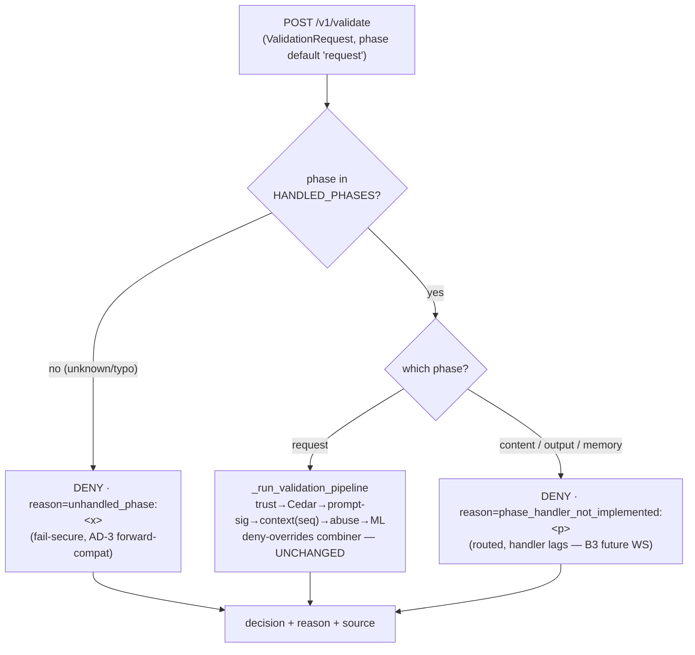

# WS-B — Multi-phase `/v1/validate` contract (`phase` enum + per-phase decorators)

> **Doc role:** This is the **workstream SCOPE** — boundary, dependencies, real `file:line` anchors, footguns, and acceptance criteria. It is an **INPUT to this workstream's implementation-grade LLD**, *not* the granular task breakdown. The granular, buildable tasks are generated **from the approved LLD** (canonical order: HLD → LLD → tasks). See [00-index.md](00-index.md) for the doc-role map.

**Parent HLD**: [hld/serverless-edition.md](../../hld/serverless-edition.md) §6.2(b) (the `phase` design + Options A/B/C) and §8 hand-off table, row 2 (`FR-3.4 contract → Additive phase enum + per-phase decorator + unknown→fail-secure DENY → AD-3 → LLD 23 + the /v1/validate contract (LLD 03/API)`).
**Status**: Not started
**Owner**: TBD
**Implements**: FR-3.4 (multi-phase validation surface). **Refines** AD-3 (one endpoint, branch on `phase` — no new ADR; AD-3 already names the field, this fixes its handled values + the decorator surface + the unknown→fail-secure rule).
**Spike-gated?** **NO.** WS-B is the additive central-contract change; it is *not* one of the four spike-gated workstreams (local floor / redactor / DAG scheduler / deep tier). It may be decomposed and built before the §8 measure-first spike packet is signed.

> **Next step: an implementation-grade LLD.** This WS doc *scopes* the build (what changes, where, the invariants). The concrete schemas, function signatures, exact field-by-field diffs, and per-case test tables are an **implementation-grade LLD** that extends **LLD 23** ([lld/23-sentra-guard-sdk.md](../../lld/23-sentra-guard-sdk.md) — per-phase decorators) and the **`/v1/validate` contract / API LLD** (LLD 03 / [src/security-controller/app/api/](../../src/security-controller/app/api/)). Owner directive: LLDs go to implementation level per workstream.

---

## 1. Status honesty (sub-PRD §5)

[prd/serverless-edition.md](../../prd/serverless-edition.md) §5 row **FR-3.4 = PARTIAL**: *"`request` live; no `phase` field on `ValidationRequest` — [models.py:17](../../src/security-controller/app/api/models.py#L17)"*.

**DONE today — do NOT rebuild (note as existing):**
- The `request` phase is the only thing that runs, end-to-end and multi-tenant on dev. The handler [routes.py:55](../../src/security-controller/app/api/routes.py#L55) `validate_tool_call`, the pipeline [validation_service.py:220](../../src/security-controller/app/services/validation_service.py#L220) `_run_validation_pipeline`, and the SDK `@guard.tool` decorator [guard.py:212](../../demo-agents/sdk/aegion-guard-python/src/aegion_guard/guard.py#L212) are live. **They stay unchanged in behavior** — adding `phase` defaulting to `request` must be a no-op for every existing caller.

**This WS builds only the gap (scope, exactly):**
1. Add an **additive, optional, validated** `phase` enum field to `ValidationRequest` ([models.py:17](../../src/security-controller/app/api/models.py#L17)), default `"request"`.
2. Reject an **unknown / out-of-enum** `phase` value at the handler **fail-secure (DENY)** — never mis-route, never silently bypass.
3. Define the **decorator surface** for 3 new SDK phases: `@guard.content` / `@guard.output` / `@guard.memory` (alongside existing `@guard.tool` = `request`). **Decorator surface only** — the `content`/`output`/`memory` **server-side handlers may lag** and are NOT in scope here.

**Explicitly OUT of this WS (named, not silently dropped):**
- The `content` / `output` / `memory` **detection handlers** (what actually validates a content read, an output, a memory write). They are downstream of this contract; this WS only ships the field + routing skeleton + decorator surface so they can land additively later.
- Redaction on egressing phases (that is **WS-E**; WS-B only guarantees the `phase` field exists so WS-E can branch on it).
- The DAG scheduler / full-trail combiner changes (WS-C / WS-D).

---

## 2. Dependencies

- **Depends on:** nothing blocking — operates on shipped `request`-phase code. (TENANCY_V2 + Cedar are already enforcing on dev; design *against* them, do not touch them.)
- **Blocks:** **WS-E (redaction)** — the redactor must run on *every egressing phase*; it branches on `phase`, so the field must exist first. The three new handlers (future workstreams) also depend on the routing skeleton landing here.
- **Shared files (coordinate edits):**
  - `src/security-controller/app/api/models.py` — `ValidationRequest` (WS-E may add redaction-marker fields here too).
  - `src/security-controller/app/api/routes.py` — `validate_tool_call` handler (WS-C scheduler dispatch and WS-D trail also touch the handler/pipeline entry).
  - `demo-agents/sdk/aegion-guard-python/src/aegion_guard/guard.py` — `Guard` class / decorators (WS-E adds the redactor in `_build_request`/`_send`; WS-A local floor wraps the same call path).

---

## 3. Model / read before coding

Hold these invariants. They are the whole point of Option A (HLD §6.2(b)).

1. **Additive + defaulted = zero-break.** Existing callers send no `phase`. `ValidationRequest.phase` defaults to `"request"`. Every current SDK call, connector call, and test must behave **identically** after this change. Do NOT make `phase` required; do NOT change the default; do NOT reorder/rename existing fields.
2. **Forward-compatible, not frozen-shut.** The enum is `{request, content, output, memory}` **today**, but a *future* 5th phase (e.g. `plan`/`delegation`) must be addable **without re-cutting the contract**. So: validate the value against the *handled* set at the **handler**, and DENY an unknown value — do **not** make `phase` a Python `Enum` type that 422s at the Pydantic layer for an unknown string (that would make adding a phase a *breaking* schema re-cut, and would surface as a type error, not a fail-secure DENY). Accept the string, validate it in handler logic, DENY-fail-secure if unhandled. (This is exactly why HLD §6.2(b) rejects Option C free-string *and* a hard frozen enum: validate-then-fail-secure is the middle path.)
3. **Unknown phase → DENY, never bypass.** Tenet 5 (fail-secure / deny-by-default). An unhandled `phase` is a *deny*, with a clear reason code, not a 422 and not a silent route to the `request` handler. Mirror the SDK's existing default-DENY discipline ([guard.py:416](../../demo-agents/sdk/aegion-guard-python/src/aegion_guard/guard.py#L416) `unrecognized decision → DENY`).
4. **Phases are independent surfaces, NOT a fixed sequence.** `content`/`output`/`memory` are *not* "steps 2/3/4" of `request`. But **single-session sequence enforcement (FR-2.3) still applies WITHIN the `request` phase** — `context_validator.validate_sequence` ([validators/context_validator.py:93](../../src/security-controller/app/validators/context_validator.py#L93)) is a `request`-phase check and stays exactly as-is. Do NOT extend sequence enforcement across phases here (cross-phase detector state is HLD Appendix E, a separate LLD deliverable).
5. **SDK is stdlib-only by design.** [pyproject.toml dependencies=[]](../../demo-agents/sdk/aegion-guard-python/pyproject.toml) (LLD 23 §2 — vendors ship the SDK unchanged into a Lambda zip / Azure Function). Adding `@guard.content/output/memory` must add **no runtime dependency**. The new decorators reuse the existing `tool()` machinery ([guard.py:212](../../demo-agents/sdk/aegion-guard-python/src/aegion_guard/guard.py#L212)).
6. **One endpoint (AD-3).** Do NOT create `/v1/validate/content` etc. (HLD Option B, rejected). One handler, branch on `phase`.

---

## 4. Milestones → tasks

### Milestone B1 — `phase` field on the contract (server-side, additive)

- **Implements:** FR-3.4 | contract: `ValidationRequest.phase`
- **Touches:** [src/security-controller/app/api/models.py:17](../../src/security-controller/app/api/models.py#L17) (`ValidationRequest`)

**B1.1 — Add the `phase` field.** Add to `ValidationRequest` (after `operation_type`, before the cross-cloud block so the additive grouping is clear):

| attr | type | notes |
|---|---|---|
| `phase` | `Optional[str]` | default `"request"`; description: `"validation phase: request | content | output | memory (default request)"`. **NOT** required; **NOT** a `pydantic` Enum/Literal that 422s — a plain `str` so an unknown value reaches handler-level fail-secure logic (see Model invariant 2). |

- Pseudo-code (real names):
  ```python
  # models.py — ValidationRequest, after operation_type (≈ :30)
  phase: Optional[str] = Field(
      "request",
      description="validation phase: request | content | output | memory (default request)",
  )
  ```
- **FOOTGUN:** do **NOT** type this as `Literal["request","content","output","memory"]` or a `str, Enum`. That makes Pydantic 422 on an unknown value (a breaking error path, not a fail-secure DENY) and makes adding a 5th phase a schema re-cut — breaks Model invariant 2. Keep it a defaulted `str`; validate downstream.
- **FOOTGUN:** do **NOT** make it required or remove the default — every existing caller omits it and must keep working (Model invariant 1).

**B1.2 — Define the handled-phase set as a single source of truth.** Add a module-level constant (e.g. in `app/api/models.py` or a small `app/constants.py`) so handler + tests + future-handler code all read the same set:
```python
HANDLED_PHASES = frozenset({"request", "content", "output", "memory"})
# Today only "request" has a live detection handler; the other three are
# routed-but-stubbed (B2). A 5th phase is added by appending here + a handler.
```

### Milestone B2 — handler routing + unknown→fail-secure DENY

- **Implements:** FR-3.4, AD-3 | contract: `POST /v1/validate` branch-on-`phase`
- **Touches:** [src/security-controller/app/api/routes.py:55](../../src/security-controller/app/api/routes.py#L55) (`validate_tool_call`); reuse the existing `_identity_deny` DENY-shape helper at [routes.py:161](../../src/security-controller/app/api/routes.py#L161) as the pattern for an early fail-secure deny.

**B2.1 — Validate `phase` at the top of the handler, before the pipeline.** After the IP-capture block (≈ [routes.py:77](../../src/security-controller/app/api/routes.py#L77)) and the tenant-derivation, branch:

```python
# routes.py — inside validate_tool_call, before _run_validation_pipeline
phase = request.phase or "request"
if phase not in HANDLED_PHASES:
    # Unknown/unhandled phase → fail-secure DENY (NOT 422, NOT silent route).
    return _phase_deny(request, reason=f"unhandled_phase:{phase}")
if phase == "request":
    ...  # existing path — UNCHANGED
else:
    # content / output / memory: routed but handler not yet built (B3).
    return _phase_not_implemented_deny(request, phase)   # see B2.3
```

- `_phase_deny` mirrors the DENY response shape produced by `_identity_deny` ([routes.py:161](../../src/security-controller/app/api/routes.py#L161)) — same keys the SDK's `_parse_decision` expects (`decision="DENY"`, `reason`, `request_id`). Reuse that helper's body; do not invent a new response shape.
- **FOOTGUN:** do **NOT** route an unknown phase into the `request` pipeline ("default to request"). That silently mis-routes (e.g. a typo'd `"reqest"` would validate as a tool action that may not exist) and violates fail-secure. DENY it.
- **FOOTGUN:** do **NOT** raise `HTTPException(422)`. The contract is "unknown phase → DENY" so the PEP enforces a deny verdict, not an error the caller might treat as retryable / non-blocking. (The SDK already maps a non-ALLOW/DENY body to DENY at [guard.py:416](../../demo-agents/sdk/aegion-guard-python/src/aegion_guard/guard.py#L416), but the *server* must emit an explicit DENY, not lean on that.)

**B2.2 — `request`-phase path is untouched.** The `phase == "request"` branch calls the same `validation_service` and `_run_validation_pipeline` ([validation_service.py:220](../../src/security-controller/app/services/validation_service.py#L220)) it does today. Sequence enforcement (`context_validator`, FR-2.3) stays inside that path (Model invariant 4). **Do not** thread `phase` into the combiner ([deny_overrides.py:28](../../src/security-controller/app/combiners/deny_overrides.py#L28)) — the deny-overrides algorithm is unchanged by WS-B (that is WS-D's full-trail concern).

**B2.3 — `content`/`output`/`memory`: routed-but-stubbed.** For the three not-yet-built phases, return a deterministic fail-secure DENY with a *distinct* reason (so it's observable in audit/metrics that these were *called* but have no handler — distinguishes "future phase exercised" from "unknown typo"):
- `_phase_not_implemented_deny(request, phase)` → DENY, `reason=f"phase_handler_not_implemented:{phase}"`.
- **Rationale:** fail-secure default until the handler ships; a caller using `@guard.content` today gets a clean DENY, never a silent allow. The future-handler workstream replaces this stub with the real per-phase pipeline.
- **FOOTGUN:** do **NOT** return ALLOW for an unhandled-but-known phase. Until a detection handler exists, "we don't know how to check this" must fail closed (tenet 5).

**B2.4 — Routing flow diagram.**


### Milestone B3 — SDK per-phase decorator surface (stdlib-only)

- **Implements:** FR-3.4, FR-1.7 (same call path) | contract: `@guard.content` / `@guard.output` / `@guard.memory`
- **Touches:** [demo-agents/sdk/aegion-guard-python/src/aegion_guard/guard.py:212](../../demo-agents/sdk/aegion-guard-python/src/aegion_guard/guard.py#L212) (`tool()`), [guard.py:325](../../demo-agents/sdk/aegion-guard-python/src/aegion_guard/guard.py#L325) (`_build_request`)

**B3.1 — Thread `phase` through `_build_request`.** Add a `phase: str = "request"` arg to `_build_request` ([guard.py:325](../../demo-agents/sdk/aegion-guard-python/src/aegion_guard/guard.py#L325)) and include it in the payload **only when not `"request"`** (keeps the wire format byte-identical for existing `@guard.tool` callers — additive, Model invariant 1):
```python
# guard.py _build_request — after the existing payload dict (≈ :373-389)
if phase != "request":
    payload["phase"] = phase
```
- **FOOTGUN:** do **NOT** always emit `"phase": "request"` — that changes the bytes on the wire for every existing caller (breaks the no-op guarantee; could perturb golden/snapshot tests). Emit it only for the new phases; the server defaults the absent field to `request`.

**B3.2 — Add the three decorators by parameterizing the existing factory.** Refactor `tool()` to delegate to a private `_phase_decorator(phase, name, operation_type)` that holds the current `tool()` body (the `def`/`async def` wrappers at [guard.py:228+](../../demo-agents/sdk/aegion-guard-python/src/aegion_guard/guard.py#L228)), passing `phase` down to `_build_request`. Then:
```python
def tool(self, name=None, operation_type="auto"):      # = phase "request" (unchanged surface)
    return self._phase_decorator("request", name, operation_type)
def content(self, name=None, operation_type="READ"):   # reading untrusted data in
    return self._phase_decorator("content", name, operation_type)
def output(self, name=None, operation_type="READ"):    # producing output
    return self._phase_decorator("output", name, operation_type)
def memory(self, name=None, operation_type="WRITE"):   # writing to agent memory
    return self._phase_decorator("memory", name, operation_type)
```
- Reuse the existing session-context resolution, `_ensure_json_serializable`, `_avalidate_or_raise`/`_validate_or_raise`, `fail_secure` ([guard.py:156](../../demo-agents/sdk/aegion-guard-python/src/aegion_guard/guard.py#L156)), and `_send` ([guard.py:391](../../demo-agents/sdk/aegion-guard-python/src/aegion_guard/guard.py#L391)) machinery unchanged. The only new thing flowing through is the `phase` string.
- **FOOTGUN:** do **NOT** add a dependency or import a non-stdlib module to implement the new decorators (Model invariant 5; [pyproject.toml dependencies=[]](../../demo-agents/sdk/aegion-guard-python/pyproject.toml)). They are pure refactors of existing stdlib code.
- **FOOTGUN:** the `content`/`output`/`memory` server handlers are stubbed (B2.3) → these decorators will currently **raise on DENY** (via `_raise_if_blocked` / `fail_secure`). That is correct and intended (fail-secure). Document it on the decorator docstrings so an SDK user isn't surprised; do NOT special-case them to allow.

**B3.3 — `operation_type` defaults per phase.** `content`/`output` are reads, `memory` is a write — set sensible defaults (above) but keep `"auto"` inference available. These feed the existing `operation_type` field; no new field.

---

## 5. Error model

| Condition | Server response | SDK behavior |
|---|---|---|
| `phase` absent | treated as `"request"` (default) | unchanged — no `phase` on wire |
| `phase == "request"` | full pipeline (unchanged) | `@guard.tool` (unchanged) |
| `phase ∈ {content,output,memory}` (handler not yet built) | **DENY**, `reason=phase_handler_not_implemented:<p>` | decorator raises (fail-secure) — known, documented |
| `phase` unknown / typo (not in `HANDLED_PHASES`) | **DENY**, `reason=unhandled_phase:<x>` — NOT 422, NOT routed to request | decorator raises (fail-secure) |
| malformed body (non-str `phase`, etc.) | Pydantic coerces to str or 422 on a genuinely malformed body | SDK only ever sends a valid string; a malformed proxy-injected body → DENY at [guard.py:416](../../demo-agents/sdk/aegion-guard-python/src/aegion_guard/guard.py#L416) |

---

## 6. Acceptance criteria

- [ ] `ValidationRequest` has an optional `phase: str` field defaulting to `"request"` ([models.py:17](../../src/security-controller/app/api/models.py#L17)); it is **not** required and **not** a Pydantic Enum/Literal.
- [ ] A request omitting `phase` produces a byte-identical pipeline path and verdict to today (regression: existing `request`-phase tests pass unchanged).
- [ ] A request with `phase="request"` routes to `_run_validation_pipeline` ([validation_service.py:220](../../src/security-controller/app/services/validation_service.py#L220)) — sequence enforcement (`context_validator.validate_sequence`) still runs within it.
- [ ] A request with an **unknown** `phase` (e.g. `"reqest"`, `"plan"`) returns **DENY** with `reason` starting `unhandled_phase:` — verified it is NOT a 422 and NOT routed to the `request` pipeline.
- [ ] A request with `phase ∈ {content,output,memory}` returns **DENY** with `reason` starting `phase_handler_not_implemented:` (routed, stubbed, fail-secure) — verified it is NOT ALLOW.
- [ ] `HANDLED_PHASES` is the single source of truth read by handler + tests; adding a string to it is the only change needed to "register" a future phase's routing.
- [ ] `Guard` exposes `@guard.content`, `@guard.output`, `@guard.memory` alongside `@guard.tool`; all four reuse the same `_build_request`/`_send` path.
- [ ] The SDK emits `"phase"` on the wire **only** for the three new phases (absent for `@guard.tool`) — verified by inspecting a `@guard.tool` payload (no `phase` key) vs a `@guard.content` payload (`phase: "content"`).
- [ ] The SDK adds **no** runtime dependency — `pyproject.toml` `dependencies` stays `[]`; `pip install` of the base package still pulls nothing.
- [ ] The deny-overrides combiner ([deny_overrides.py:28](../../src/security-controller/app/combiners/deny_overrides.py#L28)) and `context_validator` are **unmodified** by this WS.

---

## 7. Cross-references

- **HLD:** [hld/serverless-edition.md](../../hld/serverless-edition.md) §6.2(b) (phase design, Options A/B/C, recommendation), §8 hand-off row 2 (FR-3.4), §6.2(c) (the DAG scheduler that the `request` branch will later route into — WS-C), Appendix E (cross-phase detector state — out of scope here).
- **Sub-PRD:** [prd/serverless-edition.md](../../prd/serverless-edition.md) §5 (FR-3.4 = PARTIAL), §4 FR-3.4 (P0 contract / handlers may lag), FR-2.3 (in-`request` sequence enforcement).
- **ADR:** AD-3 (one endpoint, branch on `phase`) — *refined*, no new ADR.
- **Sibling WS:** **WS-E (redaction)** — consumes `ValidationRequest.phase` to redact on every egressing phase (blocked-by WS-B). **WS-A (local floor)**, **WS-C (DAG scheduler)**, **WS-D (full-trail)** — share `routes.py`/the pipeline entry; coordinate edits to `validate_tool_call`.
- **LLDs to extend (implementation-grade):** [LLD 23](../../lld/23-sentra-guard-sdk.md) (per-phase decorators, stdlib-only) + LLD 03 / the `/v1/validate` contract LLD (the `phase` field + handler routing + the future per-phase handlers).
- **Code anchors:** [models.py:17](../../src/security-controller/app/api/models.py#L17) · [routes.py:55](../../src/security-controller/app/api/routes.py#L55),[:161](../../src/security-controller/app/api/routes.py#L161) · [validation_service.py:220](../../src/security-controller/app/services/validation_service.py#L220) · [guard.py:212](../../demo-agents/sdk/aegion-guard-python/src/aegion_guard/guard.py#L212),[:325](../../demo-agents/sdk/aegion-guard-python/src/aegion_guard/guard.py#L325),[:391](../../demo-agents/sdk/aegion-guard-python/src/aegion_guard/guard.py#L391),[:416](../../demo-agents/sdk/aegion-guard-python/src/aegion_guard/guard.py#L416) · [deny_overrides.py:28](../../src/security-controller/app/combiners/deny_overrides.py#L28) · [context_validator.py:93](../../src/security-controller/app/validators/context_validator.py#L93).
