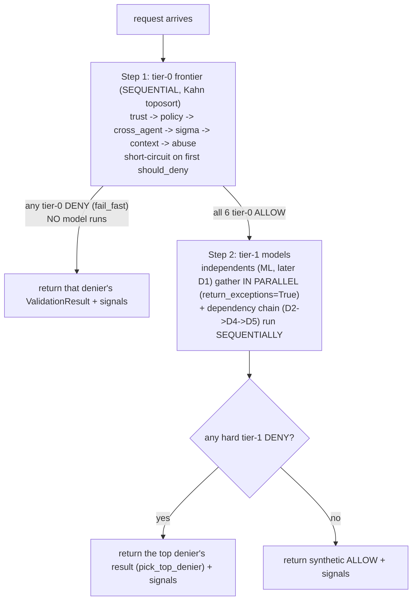

# WS-C — Cost-annotated DAG scheduler (FR-2.8 / ADR-030)

> **Doc role:** This is the **TASKS-STAGE build breakdown**, generated from the approved LLD [lld/31-dag-scheduler.md](../../lld/31-dag-scheduler.md) (the LLD remains the source of truth). Milestones → granular tasks, each with real `file:line` anchors, conceptual pseudo-code using real identifiers, named footguns, and **mandatory named unit + integration tests**. A coding agent should build straight from this doc without re-reading the whole LLD. See [00-index.md](00-index.md) for the doc-role map.

**Parent LLD:** [lld/31-dag-scheduler.md](../../lld/31-dag-scheduler.md) (Option A — cost-annotated DAG, tier-0 short-circuit then tier-1 parallel-gather; ADR-030). **Parent HLD:** [hld/serverless-edition.md](../../hld/serverless-edition.md) §6.2(c) + §8 hand-off row *"FR-2.8 scheduler"*.
**Status:** Tasks ready — buildable and mergeable now. **WS-0 code-merge gate OVERRIDDEN for WS-C (founder decision 2026-07-01, mirroring the WS-E override)** — WS-C builds and merges without waiting for the signed WS-0 spike packet; see Dependencies for the accepted residual (C3 chain-runner).
**Owner:** TBD
**Implements:** FR-2.8 (parallel-gather scheduler over a cost-annotated dependency graph). **Decision:** ADR-030 (cost-annotated DAG replaces the fixed-sequential pipeline). Realizes **AD-4** (deterministic-first, parallel models).

> **What changed from the SCOPE stage (read once, then delete from memory).** The old scope-stage C1/C2/C3 are **superseded** by the approved LLD. Three scope-era assumptions are now WRONG and MUST NOT be built:
> - **No `dag_scheduler_enabled` feature flag.** The DAG is the only pipeline; the old fixed-sequential body is **deleted**, not retained behind a flag. Rollback is git-revert + redeploy — prod is **pre-launch (dev IS prod, no customer traffic yet)**, so there is no live customer traffic that needs an instant config-flip. (LLD §1, §14.)
> - **No retained legacy branch.** Equivalence is proven against a **recorded golden baseline** captured once before deletion — not against a live dual path. (LLD §3.)
> - **ML is out of shadow.** `ml_classifier_shadow_mode` is **removed** entirely; the `sentra.ml_classifier` node **always enforces**. This is the one deliberate verdict change riding on the refactor, kept provably separate from it. (LLD §6.5.)

---

## Milestone map

| ID | Milestone | Tasks |
|---|---|---|
| **C1** | Node registry + cost-tier data model (built ONCE, static) | 3 |
| **C2** | The scheduler run: tier-0 topological short-circuit → tier-1 gather | 3 |
| **C3** | Dependency-chain runner (the full Option-A runner) | 2 |
| **C4** | ML out of shadow + the shared ranking helper | 4 |
| **C5** | Error model: 5xx on inability-to-evaluate, not fabricated 200-DENY | 2 |
| **C6** | Golden-baseline differential equivalence + the full test suite | 3 |
| **C7** | Config + activation (`dag_run_mode` Field; `ml_classifier_enabled: true`) | 2 |
| **C8** | Doc/consistency propagation (carried, not silent) | 4 |

---

## Model / read before coding (the invariants that make this a REFACTOR, not a behavior change)

Hold these before touching code:

1. **The combiner is order-independent — the load-bearing fact that makes parallel-gather correct.** `DenyOverrides.combine(signals)` ([deny_overrides.py:28](../../src/security-controller/app/combiners/deny_overrides.py#L28)) ranks the *entire* `Signal[]` set by the key `(s.priority, s.confidence or 0.0, _neg_source(s.source))` ([deny_overrides.py:39](../../src/security-controller/app/combiners/deny_overrides.py#L39)); the winner is deterministic **regardless of append order**. So gathering tier-1 nodes concurrently and appending signals in completion order cannot change the verdict. **The combiner is READ-ONLY to WS-C** — the ONLY permitted edit is the *additive* `pick_top_denier` extraction (C4).
2. **Verdict-equivalence is the acceptance bar** — the tuple **`(decision, should_deny, winning_source)`**, NOT full `signals[]` equality (a cheap tier-0 DENY legitimately never invokes ML, so its signal legitimately disappears — [LLD 24 §9:227](../../lld/24-latency-optimization.md#L227)). The baseline is captured **with ML enforcing**.
3. **Two tiers, two latency laws.** tier-0 = cheap deterministic (~1–5 ms each): trust, policy, cross_agent, sigma, context, abuse — run **first, sequentially, with short-circuit**. tier-1 = expensive models (~600 ms ML; D1–D7 later) — **gathered in parallel** for tier-0 survivors only.
4. **Latency = `max(independent parallel nodes, longest dependency chain)`** — NOT a flat max. A real chain (D2 taint → D4 IFC → D5 output-DLP) runs **sequentially and SUMS**; only independent tier-1 nodes parallel-gather.
5. **`_capture` / `_stamp` / `_timed` are REUSED, not replaced** (LLD §6.6): `_capture` ([:272](../../src/security-controller/app/services/validation_service.py#L272)) appends the node's `Signal` (abstain → no signal); `_stamp` ([:380](../../src/security-controller/app/services/validation_service.py#L380)) attaches `platform`/`cloud_region` from the policy result; `_timed` wraps each node so `validation.timing` still emits per-validator ms.
6. **`_run_validation_pipeline` returns `(ValidationResult, list[Signal])`** ([:253](../../src/security-controller/app/services/validation_service.py#L253)); the caller `validate_tool_call` at [:200](../../src/security-controller/app/services/validation_service.py#L200) and its `should_deny` dispatch at [:205](../../src/security-controller/app/services/validation_service.py#L205) are UNCHANGED. `run_dag` preserves this contract byte-for-byte.

---

## Milestone C1 — Node registry + cost-tier data model (built ONCE, static)

The static graph is built once at module load, cached per phase — NOT per request. `ValidatorNode` is `frozen=True`; per-tenant differences are policy **data** evaluated inside the `sentra.policy` node, not differences in graph shape (LLD §4.1, §5.2).

### Task C1.1 — Define the node descriptor + cost tiers

New module `src/security-controller/app/services/scheduler/node.py` (+ `scheduler/__init__.py`).

```python
from dataclasses import dataclass
from enum import Enum
from typing import Awaitable, Callable

# Cost tiers — LLD 20 §3.4. tier-0 = short-circuit frontier; tier-1 = parallel models.
class CostTier(str, Enum):
    DETERMINISTIC = "tier-0"    # ~1-5ms: trust, policy, cross_agent, sigma, context, abuse
    EXPENSIVE_MODEL = "tier-1"  # ~600ms ML; D1-D7 (added by WS-L)

@dataclass(frozen=True)
class ValidatorNode:
    source: str          # canonical Source.SENTRA_* string (combiners/sources.py) — the join key
    cost_tier: CostTier
    run: Callable[["ValidationRequest", dict], Awaitable["ValidationResult"]]  # awaitable
    depends_on: tuple[str, ...] = ()   # source names that MUST complete (ALLOW) before this node runs
```

- **FOOTGUN — `source` MUST be the exact `Source.SENTRA_*` string** from [combiners/sources.py:22-28](../../src/security-controller/app/combiners/sources.py#L22) (`sentra.trust`, `sentra.policy`, `sentra.sigma`, `sentra.ml_classifier`, `sentra.context`, `sentra.abuse`, `sentra.cross_agent`). A new name silently breaks (a) the combiner tie-break (`default_priority` returns **0** for an unknown source, [sources.py:62-68](../../src/security-controller/app/combiners/sources.py#L62)) and (b) the WS-D/audit trail join. Reference `Source.SENTRA_*` constants — never spell literals.
- **FOOTGUN — do not add any NEW `sentra`-named identifier.** WS-C introduces ZERO new `sentra` names (LLD §5). `ValidatorNode`/`CostTier`/`pick_top_denier`/`dag_run_mode`/`scheduler/` are all clean.

**Unit tests** (`src/security-controller/tests/test_scheduler_node.py` — new file):
- `test_validator_node_is_frozen` — asserts `ValidatorNode(...)` raises `dataclasses.FrozenInstanceError` on attribute assignment (the static graph cannot be mutated per-request).
- `test_cost_tier_values` — asserts `CostTier.DETERMINISTIC == "tier-0"` and `CostTier.EXPENSIVE_MODEL == "tier-1"` (string enum, stable wire values).

*No integration test at C1.1 — pure data model; the seam is exercised by C1.2 + C6.*

### Task C1.2 — `build_dag(phase)` registry: map the 7 existing validators to nodes

New module `src/security-controller/app/services/scheduler/registry.py`. `build_dag(phase)` returns the node set for a phase, called ONCE at module load and cached as a per-phase constant `DAG_BY_PHASE` (see C1.3). Register the 7 live validators. Each node's `run` wraps the EXACT call today's sequential step makes; the `sentra.policy` node encapsulates the Cedar cutover/shadow/legacy branch (Task C1.2b).

| Node `source` (constant) | Cost tier | `depends_on` | Maps to today (live line) |
|---|---|---|---|
| `Source.SENTRA_TRUST` | tier-0 | `()` | STEP 1 `trust_checker.check` ([:306](../../src/security-controller/app/services/validation_service.py#L306)) |
| `Source.SENTRA_POLICY` | tier-0 | `(SENTRA_TRUST,)` | STEP 2 Cedar/legacy ([:337](../../src/security-controller/app/services/validation_service.py#L337)) |
| `Source.SENTRA_CROSS_AGENT` | tier-0 | `(SENTRA_POLICY,)` | STEP 2.5 `cross_agent_validator.validate` ([:392](../../src/security-controller/app/services/validation_service.py#L392)) |
| `Source.SENTRA_SIGMA` | tier-0 | `(SENTRA_POLICY,)` | STEP 3 `sigma_engine.match_rules` ([:399](../../src/security-controller/app/services/validation_service.py#L399)) |
| `Source.SENTRA_CONTEXT` | tier-0 | `(SENTRA_POLICY,)` | STEP 4 `context_validator.validate_sequence` ([:406](../../src/security-controller/app/services/validation_service.py#L406)) |
| `Source.SENTRA_ABUSE` | tier-0 | `(SENTRA_POLICY,)` | STEP 5 `abuse_detector.check_rate_limit` ([:415](../../src/security-controller/app/services/validation_service.py#L415)) |
| `Source.SENTRA_ML_CLASSIFIER` | tier-1 | `(SENTRA_POLICY,)` | STEP 6 ML-last `ml_classifier.validate` ([:431](../../src/security-controller/app/services/validation_service.py#L431)) |

- The `trust → policy → {cross_agent, sigma, context, abuse}` edges reproduce today's step order (trust before policy; everything after policy because `_stamp` needs `policy_result.platform`/`cloud_region` — LLD §6.6). The four post-policy tier-0 nodes are mutually independent (no edges between them); their relative order is a pinned tie-break (C2.1), not parallelism.
- **`sentra.ml_classifier` is the ONLY tier-1 node WS-C ships.** D1–D7 tier-1 nodes are WS-L's deliverable (they append `ValidatorNode(...)` entries + declare the D2→D4→D5 edges without editing the scheduler core).
- **FOOTGUN — the abuse node's `run` still calls `get_agent_policy` today's way.** STEP 5 does `policy = get_agent_policy(agent_id)` ([:414](../../src/security-controller/app/services/validation_service.py#L414)) before `check_rate_limit`. Do NOT thread a policy through a new per-request context object: the F3 policy cache (`resolve_policy_bundle`, `policy_cache_ttl_seconds`) already makes the second resolution a cache hit, and on the Cedar cutover path `sentra.policy` returns a `ValidationResult`, never the `get_agent_policy` dict — so threading is not even implementable without a shape reconcile (LLD §11). The abuse node's `run` = the exact `(get_agent_policy → check_rate_limit)` pair from today.

**Unit tests** (`test_scheduler_registry.py` — new file):
- `test_build_dag_request_phase_node_set` — asserts `{n.source for n in build_dag("request")}` equals the exact 7 `Source.SENTRA_*` names above, with the correct `cost_tier` per node (6 tier-0 + 1 tier-1) and the `depends_on` edges above.
- `test_build_dag_edges_reproduce_step_order` — asserts `sentra.policy.depends_on == (sentra.trust,)` and each of `{cross_agent, sigma, context, abuse, ml_classifier}.depends_on == (sentra.policy,)`.

*Integration seam covered in C6 (real validators run through the registry).*

### Task C1.2b — `sentra.policy` node encapsulates the Cedar branch (do NOT flatten)

The `sentra.policy` node's `run` callable is the STEP 2 block **lifted verbatim** from [validation_service.py:333-369](../../src/security-controller/app/services/validation_service.py#L333):
- **cutover** (`cedar is not None and settings.cedar_enabled and not settings.cedar_shadow_mode`, [:334](../../src/security-controller/app/services/validation_service.py#L334)) → `cedar.validate(request)`; on `is_abstain`, fail-secure DENY if `settings.legacy_retired` ([:339](../../src/security-controller/app/services/validation_service.py#L339)) else legacy fallback `policy_engine.validate(request)` ([:361](../../src/security-controller/app/services/validation_service.py#L361));
- **shadow** (`cedar_shadow_mode`) → legacy decides, `_cedar_shadow_compare(request, policy_result)` runs side-effect-only ([:368-369](../../src/security-controller/app/services/validation_service.py#L368));
- **disabled** → legacy `policy_engine.validate(request)` ([:363](../../src/security-controller/app/services/validation_service.py#L363)).

- **FOOTGUN — do NOT flatten the Cedar selection into the scheduler.** The scheduler must stay policy-engine-agnostic; it never sees Cedar. WS-K already has `cedar_enabled=true`/`cedar_shadow_mode=false` in prod ([cdk/config/prod.yaml:30-31](../../cdk/config/prod.yaml)); WS-C does not touch it.
- **FOOTGUN — a Cedar evaluator error is a 200-DENY VERDICT, not a 5xx.** `cedar.validate` returns a `POLICY_ERROR` DENY (its own designed fail-secure) — that is a *node verdict*, not a *processing failure*, so it stays a 200-DENY. Do not conflate it with C5's 5xx path (LLD §7 SEC-2).

**Unit test** (`test_scheduler_registry.py`):
- `test_policy_node_encapsulates_cedar_branch` — with `cedar_enabled=True, cedar_shadow_mode=False` (cutover) a spy asserts the policy node's `run` calls `cedar.validate` and NOT `policy_engine.validate`; with `cedar_enabled=False` asserts the reverse. Pins that the branch lives in the node, not the scheduler.

*Integration: the Cedar-cutover-DENY and shadow-compare seams are two of the five REQUIRED corpus cases in T-EQUIV (C6).*

### Task C1.3 — `DAG_BY_PHASE` cache-once + acyclicity assertion

In `registry.py`, build the per-phase graphs ONCE at module import and cache as a module constant:

```python
def build_dag(phase: str) -> tuple[ValidatorNode, ...]:
    nodes = _NODES_BY_PHASE.get(phase, _NODES_BY_PHASE["request"])   # degrade unknown → request
    _assert_acyclic(nodes)   # raise at STARTUP on a cycle — programming error, not request-time
    return nodes

DAG_BY_PHASE: dict[str, tuple[ValidatorNode, ...]] = {
    phase: build_dag(phase) for phase in ("request",)   # WS-B/WS-L add content/output/memory
}
```

- **FOOTGUN — build ONCE, not per request.** `_run_validation_pipeline` selects via `DAG_BY_PHASE[...]` (a dict lookup), never calls `build_dag` per request. `build_dag` is idempotent and pure; rebuilding per request would re-run acyclicity + allocation on the hot path.
- `_assert_acyclic` runs a Kahn pass and raises `ValueError` if any node never reaches zero in-degree (a cycle). This is a construction-time guard (SEC-4).

**Unit tests** (`test_scheduler_registry.py`):
- `test_build_dag_acyclicity_raises_on_cycle` — construct a node set with a cycle (`A depends_on B`, `B depends_on A`) and assert `_assert_acyclic` (or `build_dag` over it) raises `ValueError`.
- `test_dag_by_phase_cache_once` — assert `DAG_BY_PHASE["request"] is DAG_BY_PHASE["request"]` returns the SAME object across two accesses (cached, not rebuilt); assert an unknown phase key degrades to the request node set (via the selection helper, see C2).

*Integration: cache-once wiring is exercised end-to-end in C6.*

---

## Milestone C2 — The scheduler run: tier-0 topological short-circuit → tier-1 gather

New module `src/security-controller/app/services/scheduler/run.py`. This is where `_run_validation_pipeline`'s body is replaced.



### Task C2.1 — `run_dag`: Kahn toposort of tier-0 with short-circuit

```python
async def run_dag(nodes, request, session, capture, stamp, *, mode):
    """Verdict-equivalent DAG execution. Returns (ValidationResult, list[Signal])
    — the SAME contract _run_validation_pipeline returns today. mode in
    {fail_fast, evaluate_all}. NEVER calls combine() (that stays downstream)."""
    signals = []                              # capture() appends into this reused list
    tier0 = [n for n in nodes if n.cost_tier == CostTier.DETERMINISTIC]
    tier1 = [n for n in nodes if n.cost_tier == CostTier.EXPENSIVE_MODEL]

    first_deny = None
    for node in _toposort(tier0):             # trust -> policy -> cross_agent -> sigma -> context -> abuse
        result = capture(await _timed(node.source, node.run(request, session)))
        result = stamp(result)                # NO-OP until policy has populated platform/cloud_region
        if result.should_deny:
            if mode == "fail_fast":
                return result, signals        # short-circuit BEFORE any model (tenet 5)
            first_deny = first_deny or result # evaluate_all: remember, keep going

    if first_deny is None or mode == "evaluate_all":
        tier1_results = await _run_tier1_with_edges(tier1, request, session, stamp)   # C3
        for r in tier1_results:
            capture(r)                        # already _stamp'd inside the runner
            if r.should_deny and _is_hard_deny(r):   # _is_hard_deny — C4
                first_deny = first_deny or r

    if first_deny is not None:
        return first_deny, signals            # verdict = the denier (no combine() on hot path)
    return _all_allow_result(stamp), signals  # reproduces the synthetic ALLOW at :442
```

- **`_toposort(tier0)`** is a standard **Kahn topological sort** (remove zero-in-degree nodes; break ties by a pinned stable order). Yields `trust → policy → {cross_agent, sigma, context, abuse}`.
- **FOOTGUN — the tie-break is a pinned `order_key` (legacy step index), NOT alphabetical.** On a multi-tier-0-DENY, `fail_fast` returns the **first denier's OWN `ValidationResult` object** (its `reason` is operator/SOC-console-facing). The four post-policy nodes have no edges between them, so `_toposort` alone would leave their order to the sort's default. Pin the tie-break to `trust → policy → cross_agent → sigma → context → abuse` (steps :306/:337/:392/:399/:406/:415) so a two-way tie (e.g. `cross_agent` + `abuse`) returns `cross_agent`'s result — an alphabetical sort would wrongly return `abuse` and flip the operator-facing reason (LLD §6.2).
- **FOOTGUN — keep `_timed` per node.** Wrap each `node.run` in `_timed(node.source, ...)` or the `validation.timing` per-step breakdown ([:227-235](../../src/security-controller/app/services/validation_service.py#L227)) blinds LLD 24's re-baseline.
- `_all_allow_result(stamp)` reproduces the synthetic ALLOW at [validation_service.py:442](../../src/security-controller/app/services/validation_service.py#L442) (`decision="ALLOW"`, `should_deny=False`, carrying `platform`/`cloud_region` from the policy result).

**Unit tests** (`test_scheduler_run.py` — new file):
- `test_dag01_tier0_deny_short_circuits_no_ml` (**T-DAG-01**) — inject a tier-0 (Cedar policy) DENY; a spy/mock on the `sentra.ml_classifier` node's `run` (or `ml_classifier.validate`) asserts it was **never awaited**; assert the returned result is the policy denier's.
- `test_toposort_order_pinned_to_step_order` — assert `[n.source for n in _toposort(tier0)] == [trust, policy, cross_agent, sigma, context, abuse]` (pinned, NOT alphabetical — which would place `abuse` before `context`/`cross_agent`).

*Integration: C6's differential harness exercises the full tier-0 short-circuit against real validators.*

### Task C2.2 — Replace the body of `_run_validation_pipeline` to delegate to `run_dag`

Replace the body of `_run_validation_pipeline` ([validation_service.py:253](../../src/security-controller/app/services/validation_service.py#L253)) — the OLD fixed-sequential body (STEP 1–6, :297-448) is **DELETED**, no flag, no retained branch:

```python
async def _run_validation_pipeline(self, request, session):
    signals = []
    def _capture(result): ...   # KEEP verbatim (:272-295) — abstain handling load-bearing
    # (policy-result capture + _stamp closure move inside the policy node's run / a shared helper)
    nodes = DAG_BY_PHASE.get(getattr(request, "phase", "request"), DAG_BY_PHASE["request"])
    return await run_dag(
        nodes, request, session, _capture, _stamp,
        mode=settings.dag_run_mode,          # C7 — default "fail_fast"
    )
```

- **Preserve the `(ValidationResult, list[Signal])` return contract** the caller at [:200](../../src/security-controller/app/services/validation_service.py#L200) expects. The outer `validate_tool_call` dispatch ([:174](../../src/security-controller/app/services/validation_service.py#L174), `should_deny` branch [:205](../../src/security-controller/app/services/validation_service.py#L205)) and `validation.timing` log ([:227](../../src/security-controller/app/services/validation_service.py#L227)) are UNCHANGED.
- **FOOTGUN — `_capture`, `_stamp`, `_timed` are reused, not reimplemented.** `_capture`'s abstain→no-signal handling ([:280-281](../../src/security-controller/app/services/validation_service.py#L280)) is what the Bedrock-outage ML fallback relies on; deleting it breaks RES-4. `_stamp` is only *defined* after policy captures `platform_from_policy`/`cloud_region_from_policy` — preserve that ordering (why policy precedes the other tier-0 nodes).
- **Note — `request.phase` already exists.** WS-B / [lld/30](../../lld/30-multiphase-contract.md) landed `phase` as a `Literal` on `ValidationRequest` ([api/models.py:77](../../src/security-controller/app/api/models.py#L77)) + `_CONTENT_FIELD`. The `getattr(request, "phase", "request")` degrade is now belt-and-suspenders (still correct); do not depend on WS-B being absent.

**Unit test** (`test_validation_service.py` — existing file):
- `test_pipeline_delegates_to_run_dag_same_contract` — call `_run_validation_pipeline(request, session)` on an all-ALLOW request and assert it returns a `(ValidationResult, list)` tuple; assert `validation_result.should_deny` is `False`. Pins the return-contract shape after the body swap.

**Integration test** (`test_validation_service.py`): part of C6's differential harness — `test_equiv_golden_baseline` exercises the whole `validate_tool_call → _run_validation_pipeline → run_dag` seam against real validators.

### Task C2.3 — `_toposort` + acyclic helpers in `run.py`

Implement `_toposort(nodes)` (Kahn, pinned tie-break by `order_key`) and the `_step(node)` timing-label helper used by `_timed`. `_toposort` shares the acyclicity check with `build_dag` (C1.3) — factor `_assert_acyclic` so both use one implementation.

- **FOOTGUN — a cycle must raise at build time (C1.3), not silently drop a node at request time.** `_toposort` assumes an already-validated acyclic set; if it ever encounters a residual-in-degree node it must raise, not skip (skipping = a validator silently not running = fail-open).

**Unit test** (`test_scheduler_run.py`):
- `test_toposort_raises_on_residual_cycle` — feed `_toposort` a cyclic node set and assert it raises (never returns a partial order that drops a node).

*Integration: covered transitively by C6.*

---

## Milestone C3 — Dependency-chain runner (the full Option-A runner)

WS-C ships the **runner + the `depends_on` contract**; the D2/D4/D5 node + edge **declarations** are WS-L's. This is the milestone that distinguishes the DAG from a flat two-phase split (HLD §6.2(c) rejected Option B because it cannot carry D1–D7 dependencies).

### Task C3.1 — `_run_tier1_with_edges`: gather independents, sequence chains

In `run.py`:

```python
async def _run_tier1_with_edges(tier1, request, session, stamp):
    t1_names = {n.source for n in tier1}
    independent = [n for n in tier1 if not (set(n.depends_on) & t1_names)]
    chains      = _build_chains([n for n in tier1 if set(n.depends_on) & t1_names])

    async def run_independent(node):
        return stamp(await _timed(node.source, node.run(request, session)))

    async def run_chain(chain):                # e.g. D2 -> D4 -> D5, SEQUENTIAL
        ctx = {}                               # chain-LOCAL; not shared across the gather
        for node in chain:                     # ordered by depends_on
            r = stamp(await _timed(node.source, node.run(request, {**session, **ctx})))
            if r.is_abstain:                   # upstream missed -> downstream fails to floor
                return _abstain_chain_remainder(chain, node)
            ctx[node.source] = r               # write-once per source: thread upstream result forward
        return r

    coros = [run_independent(n) for n in independent] + [run_chain(c) for c in chains]
    settled = await asyncio.gather(*coros, return_exceptions=True)
    return _flatten_and_isolate_failures(settled)   # exception -> abstain (no signal), never ALLOW
```

- **Independent tier-1 nodes gather in parallel** → wall-time = `max(node latencies)`. Today's request phase has ONE tier-1 node (`sentra.ml_classifier`), so this is a single `await`; the machinery pays off when WS-L adds D1 alongside ML.
- **Chains run sequentially and SUM.** The real chain is **D2 taint → D4 IFC → D5 output-DLP**: D4 reads the per-session taint label D2 sets; D5 consumes D4's IFC verdict. `run_chain` threads the upstream result into `ctx` via a FRESH `{**session, **ctx}` per node.
- **FOOTGUN — bare `gather` (no `return_exceptions`) discards the whole results array on the first exception** (the awaiter sees the raised exception; peers run to completion but their return values are lost). Always `return_exceptions=True` so survivors' verdicts are harvested and the failed node is isolated to an abstain. **`asyncio.TaskGroup` is NOT a substitute** — it *cancels* sibling tasks on the first failure, defeating isolate-and-abstain.
- **FOOTGUN — the D2→D4→D5 chain is a REAL data dependency, not an ordering preference.** Gathering D4 before D2's taint label exists → D4 reads a stale/missing label → it abstains → fails to the deterministic floor = a silent detection weakening (HLD §A invariant 2). The chain MUST be sequential.

**Unit tests** (`test_scheduler_run.py`):
- `test_isolate_tier1_exception_abstains_peers_survive` (**T-ISOLATE**) — two independent tier-1 nodes under `gather`; one raises → it abstains (no signal), the peer's verdict is still returned; assert NO silent ALLOW and the exception did not propagate out of `_run_tier1_with_edges`.
- `test_chain_upstream_abstain_fails_downstream_to_floor` — a 2-node fixture chain where the upstream node abstains; assert the downstream node abstains (does not run against a missing `ctx` key, does not treat missing as clean).

*Integration: **T-CHAIN** lands with WS-L (real D2/D4/D5); WS-C exercises the runner with a fixture chain here.*

### Task C3.2 — ctx-threading isolation (the fresh-dict-per-node contract)

`run_chain` merges `{**session, **ctx}` — a FRESH top-level dict per node — so a node rebinding a top-level key cannot leak across gathered coroutines. `ctx` keys are upstream **source names** (never real session keys), so the merge cannot shadow a session field a node depends on.

- **FOOTGUN — a shallow copy protects only TOP-LEVEL keys.** A node that mutates a NESTED value in place (`session["agent"][...] = x`) WOULD still race a peer. Verified 2026-07-01: the only in-place session writer is tier-0 `abuse_detector.py:99` (rebinds the top-level `abuse_counters` key), which runs sequentially, never under this gather — so the shallow copy is sufficient TODAY. **CONTRACT for WS-L:** tier-1 (gathered) nodes are READ-ONLY on session; a node that must mutate a nested session subtree must deep-copy that subtree first.

**Unit tests** (`test_scheduler_run.py`):
- `test_ctx_iso_nested_and_toplevel_mutation` (**T-CTX-ISO**) — two independent tier-1 nodes run concurrently under `gather`; one node mutates a NESTED session value (`session["agent"]["x"]=...`) AND rebinds a top-level key; assert the peer observes **neither** (top-level rebind isolated by the fresh-dict merge; the nested-mutation assertion pins the WS-L read-only/deep-copy contract).
- `test_ctx_thread_upstream_into_downstream` — a fixture chain `A→B`; A returns a result, assert B's `run` receives `ctx["<A.source>"] == A_result` in its session-merge (upstream threaded forward, write-once).

*Integration: covered by T-CHAIN (WS-L) + the C6 harness.*

---

## Milestone C4 — ML out of shadow + the shared ranking helper

The ONE deliberate verdict change, kept provably separate from the refactor (LLD §6.5), plus the shared ranking helper that keeps the tier-1 multi-DENY pick aligned with the downstream combiner.

### Task C4.1 — Delete `ml_classifier_shadow_mode` and the shadow wrapper

- Delete `ml_classifier_shadow_mode` from [config.py:235](../../src/security-controller/app/config.py#L235) (and its comment block :230-234).
- Delete the shadow guard + the decision-rewrite-to-ALLOW: the `if ml_result.should_deny and not settings.ml_classifier_shadow_mode:` guard at [validation_service.py:436](../../src/security-controller/app/services/validation_service.py#L436) is DELETED with the fixed-sequential body (C2.2). There is no `should_deny=False` rewrite and no `decision→"ALLOW"` rewrite any more — those were shadow-only machinery.
- **FOOTGUN — removing the shadow flag alone does NOT make ML block.** The separate `ml_classifier_enabled` ([config.py:229](../../src/security-controller/app/config.py#L229), **default `False`**) controls whether the ML detector runs *at all*; it stays and must be `True` for ML to run (see C7). The classifier itself is unchanged — `_to_validation_result` ([ml_classifier.py:327-347](../../src/security-controller/app/validators/ml_classifier.py#L327)) still returns `should_deny=is_deny` with `decision="DENY"` + `model_used`/`model_id` metadata.

**Unit test** (`test_config.py` or `test_validation_service.py`):
- `test_ml_classifier_shadow_mode_removed` — assert `hasattr(settings, "ml_classifier_shadow_mode") is False` (the flag no longer exists on the settings object).

### Task C4.2 — ML node `run` wrapper stamps `metadata["enforce"]=True` unconditionally

In `registry.py`, the `sentra.ml_classifier` node's `run` wrapper calls `ml_classifier.validate(request)` and unconditionally stamps `metadata["enforce"]=True` on the result (ML has graduated out of shadow — it is the first tier-1 node permanently enforcing).

- Keep the generic `_is_hard_deny` gate (C4.3) — ML sets `enforce=True`; a future WS-L D-node still in shadow does not (per-detector graduation, fail-safe: no `enforce` metadata ⇒ advisory).
- **`metadata["enforce"]` is a NEW reserved key** — verified benign: it rides through `to_signal()` ([models.py:237-275](../../src/security-controller/app/api/models.py#L237)) into `Signal.metadata`; no downstream consumer reads an arbitrary metadata key as decision-load-bearing (only `winning_source`, `model_used`/`model_id`, `abstain` are read). It is read ONLY by the scheduler's `_is_hard_deny` on the hot path.

**Unit tests** (`test_scheduler_run.py`):
- `test_ml_enforce_blocks_on_all_tier0_allow` (**T-ML-ENFORCE**) — tier-0 all-ALLOW + a LIVE `ml_classifier` DENY → `run_dag` returns **DENY**; downstream `combine(signals)` yields `winning_source == 'sentra.ml_classifier'`. (Replaces the retired T-SHADOW.)
- `test_ml_error_abstains_floor_decides` — an ML node that ERRORS (Bedrock outage) abstains (no signal) and the tier-0 floor verdict stands — asserts NOT a block, NOT a 5xx (enforcing ML changes DENY behavior, not abstain-on-error).

**Integration test** (`test_validation_service.py`): `test_ml_enforce_end_to_end_block` — with `ml_classifier_enabled=True`, an all-tier-0-ALLOW request whose ML verdict is DENY produces an end-to-end DENY response from `validate_tool_call` (the cross-config seam, ties to C7's yaml).

### Task C4.3 — `_is_hard_deny` — the generic tier-1 enforce gate (fail-safe to advisory)

In `run.py`:

```python
def _is_hard_deny(r: ValidationResult) -> bool:
    # A tier-1 DENY decides the verdict ONLY if the node explicitly asserts
    # enforce-mode (metadata["enforce"] is True). Absent/None metadata, or a node
    # that forgot the flag, defaults to ADVISORY (non-deciding) — a forgotten flag
    # under-blocks (missed detection, the safe direction), never a surprise HARD
    # DENY. metadata may be None (models.py:211 Optional[Dict]) so guard the .get.
    # Deterministic (tier-0) DENYs are always hard — this helper is tier-1-only.
    return r.should_deny and bool((r.metadata or {}).get("enforce", False))
```

- **FOOTGUN — guard `.get` against `metadata=None`** (`ValidationResult.metadata` is `Optional[Dict]`, [models.py:211](../../src/security-controller/app/api/models.py#L211)). `(r.metadata or {}).get(...)`.

**Unit test** (`test_scheduler_run.py`):
- `test_is_hard_deny_advisory_default` — a tier-1 result with `should_deny=True` and `metadata=None` (and one with `metadata={}`) → `_is_hard_deny` returns `False` (advisory, non-deciding — the WS-L graduation gate); with `metadata={"enforce": True}` → `True`.

*Integration: exercised via T-ML-ENFORCE (C4.2) and the C6 harness.*

### Task C4.4 — `pick_top_denier(signals) -> Source` shared ranking helper (additive to `combiners/`)

Add `pick_top_denier` to `combiners/` (additive to the READ-ONLY module's public surface; priorities unchanged). It picks the top DENY reusing `combine()`'s **verbatim** key:

```python
def pick_top_denier(signals):
    denies = [s for s in signals if <s is a DENY>]
    return max(denies, key=lambda s: (s.priority, s.confidence or 0.0, _neg_source(s.source))).source
```

- **FOOTGUN — REUSE the verbatim key from [deny_overrides.py:39](../../src/security-controller/app/combiners/deny_overrides.py#L39), NOT a fresh alphabetical `sorted()`.** Include the `confidence or 0.0` coalescing (a `None` confidence must coalesce to `0.0`, not raise or sort as absent) AND the same `_neg_source` ([deny_overrides.py:63](../../src/security-controller/app/combiners/deny_overrides.py#L63)) that inverts codepoints so the alphabetically-smaller source wins the tie. A fresh sort would silently diverge from `combine()` on the source/confidence tie-break — the exact bug this factoring prevents.
- `run_dag`'s tier-1 branch uses `pick_top_denier` (via `first_deny`) so the returned-result source == the downstream `combine()` `winning_source` **by construction**, not coincidence. The "never call `combine()` on the hot path" constraint is about not adding the *combining/synthesis* step — reusing the *ranking order* is required.

**Unit tests** (`test_combiner.py` — existing file):
- `test_multi_deny_pick_matches_combine` (**T-MULTI-DENY**) — feed ≥2 simultaneous tier-1 DENY signals; assert `pick_top_denier(signals) == DenyOverrides().combine(signals).source` (one ranking source of truth).
- `test_combiner_priorities_and_order_unchanged` (**T-COMBINER-CLEAN**) — assert `DEFAULT_PRIORITIES` is byte-for-byte the expected dict (trust 90, policy 80, sigma 70, ml 65, context 60, abuse 50, cross_agent 50 — [sources.py:42-56](../../src/security-controller/app/combiners/sources.py#L42)) AND the `combine` rank tuple/tie-break order `(priority, confidence or 0.0, _neg_source(source))` is unchanged. **NOT a literal `git diff --exit-code`** — the additive `pick_top_denier` legitimately edits the file, so a zero-diff gate would false-fail; gate on the priority table + ordering algebra instead.

*Integration: T-MULTI-DENY's scheduler-vs-downstream equality is re-asserted through `run_dag` in the C6 harness.*

---

## Milestone C5 — Error model: 5xx on inability-to-evaluate, not fabricated 200-DENY

A genuine *inability to evaluate* must surface as an HTTP **5xx processing error**, and the PEP/SDK converts that 5xx to a fail-secure DENY — NOT a fabricated 200-with-`decision=DENY`. This distinguishes a *verdict* ("we decided DENY") from a *processing failure* ("we could not evaluate at all"), which conflation would mask outages (LLD §7, §8).

### Task C5.1 — Required tier-0 raise / inability-to-evaluate → 5xx (retire the 200-DENY for the validate path)

- `run_dag` / `_run_validation_pipeline` has **no local try/except** for a required tier-0 node raising — the exception bubbles to `validate_tool_call`'s outer handlers: `except Exception` ([validation_service.py:245](../../src/security-controller/app/services/validation_service.py#L245)) and `except SessionUpdateError` ([:238](../../src/security-controller/app/services/validation_service.py#L238)) (a session-management failure is equally an inability-to-evaluate).
- Change both handlers to surface an **HTTP 5xx processing error** on the validate path — the current `_create_error_response` returns a **200-DENY dict** ([:724-731](../../src/security-controller/app/services/validation_service.py#L724): `{"decision": "DENY", ...}`), which is exactly the fabricated 200-DENY being retired. Raise/return so the API layer emits 5xx.
- **PRESERVE — a Cedar `POLICY_ERROR` DENY stays a 200-DENY VERDICT** (node decision, not processing failure — C1.2b, SEC-2).
- **PRESERVE — the SDK/PEP maps a 5xx → fail-secure DENY** when `fail_secure=True` (default, [config.py:167](../../demo-agents/sdk/aegion-guard-python/src/aegion_guard/config.py#L167)), or raises `SentraUnavailable` when `False` ([guard.py:505-514](../../demo-agents/sdk/aegion-guard-python/src/aegion_guard/guard.py#L505)). WS-C does NOT change the SDK; it relies on this existing contract. The end-to-end default outcome is still **block** — sourced at the client boundary where it already lives.
- **FOOTGUN — a tier-1 (model) node raising is NOT a 5xx and NOT a DENY.** It abstains (no signal), the tier-0 floor still decides. Only a genuine inability to produce ANY verdict is a 5xx. (Handled inside `_run_tier1_with_edges` via `return_exceptions=True` — C3.1.)

**Unit tests** (`test_validation_service.py`):
- `test_errormodel_tier0_raise_is_5xx_not_200_deny` (**T-ERRORMODEL**) — a required tier-0 node raising → `validate_tool_call` surfaces a **5xx** (not a 200-with-`decision=DENY`); assert the response is NOT the old `{"decision": "DENY", "violation_type": "SYSTEM_ERROR"}` 200 shape.
- `test_errormodel_tier1_raise_abstains_floor_verdict` — a tier-1/ML node raising → abstain, tier-0 floor verdict returned (NOT 5xx, NOT forced DENY).

### Task C5.2 — Integration: SDK converts a 5xx to fail-secure DENY (the cross-component seam)

**Integration test** — asserts the cross-component seam (controller 5xx → SDK fail-secure DENY):
- `test_sdk_5xx_maps_to_fail_secure_deny` (in the SDK suite `demo-agents/sdk/aegion-guard-python/tests/`, or a controller↔SDK integ home) — stub the controller to return a 5xx; assert the guard with `fail_secure=True` (default) returns a DENY, and with `fail_secure=False` raises `SentraUnavailable` ([guard.py:505-514](../../demo-agents/sdk/aegion-guard-python/src/aegion_guard/guard.py#L505)). No UT beyond the guard's own — this is the seam C5.1 relies on.

*This is a config/contract task on the SDK side (WS-C does not edit the SDK); the integ test proves the seam holds after C5.1 changes the controller to emit 5xx.*

---

## Milestone C6 — Golden-baseline differential equivalence + the full test suite

The differential harness lives in `src/security-controller/tests/test_validation_service.py` and is the **primary integration test** exercising the scheduler seam. The bar: `run_dag(fail_fast)` reproduces a frozen golden baseline (LLD §3).

### Task C6.1 — Capture + freeze the golden baseline (ML ENFORCING)

Capture the CURRENT fixed-sequential pipeline's `(decision, should_deny, winning_source)` over the full corpus (S1–S4 scenarios + `tests/`) with the ML classifier **enforcing** (shadow removed), **once**, and freeze as golden fixtures. For the two-simultaneous-DENY case, also record the returned result object's `source` + `reason`.

- **FOOTGUN — capture at the ENFORCING-ML config.** This holds ML's behavior fixed so T-EQUIV is a pure refactor proof (the DAG-vs-sequential comparison changes nothing about ML). The ML-shadow→enforce change is asserted separately by T-ML-ENFORCE (C4.2), never folded into the equivalence corpus.
- **REQUIRED corpus — the 5 real-validator seams** the fuzz test steps over (T-EQUIV-FUZZ uses fabricated verdicts, not real validators): (1) **Cedar-cutover DENY** (`cedar_enabled` & not shadow → `cedar.validate` denies), (2) **Cedar abstain → legacy fallback** (Cedar abstains, `legacy_retired=false`), (3) **shadow-Cedar compare** (`cedar_shadow_mode=true` → legacy decides, `_cedar_shadow_compare` side-effect-only), (4) **Bedrock-outage ML abstain** (ML abstains, tier-0 floor decides), (5) **rate-limit `sentra.abuse` DENY** (`check_rate_limit` over-limit).

*No standalone UT — this is fixture-capture tooling; its correctness is proven by T-EQUIV passing (C6.2).*

### Task C6.2 — T-EQUIV + T-DAG-02 + T-EQUIV-FUZZ (the equivalence suite)

**Integration/differential tests** (`test_validation_service.py`):
- `test_equiv_golden_baseline` (**T-EQUIV**) — assert `run_dag(mode=fail_fast)` reproduces the frozen baseline's `(decision, should_deny, winning_source)` for every corpus request; `winning_source` computed via the same untouched `DenyOverrides.combine(captured_signals)`. Does NOT assert full `signals[]` equality. **Includes a two-simultaneous-tier-0-DENY case** (`cross_agent` + `abuse`): asserts the DAG returns the **same denier's `ValidationResult` object — source AND `reason`** — the baseline recorded (pins the §6.2 step-order tie-break, not just `winning_source`). A divergence fails the build.
- `test_dag02_evaluate_all_verdict_neutral` (**T-DAG-02**) — `evaluate_all`: every tier-0 node ran despite an early DENY (all signals present); `fail_fast`: stopped at the first DENY. Returned tuple `(decision, should_deny, winning_source)` **identical in both modes** (verdict-neutral). Includes the tier-1-only-DENY case: tier-0 all-ALLOW + enforcing ML DENY → `evaluate_all` returns DENY (matching `fail_fast`). Characterizes the accepted `reason` divergence between modes as a KNOWN contract (§3.1).
- `test_equiv_fuzz_combiner_algebra` (**T-EQUIV-FUZZ**) — property/fuzz test over random per-node verdicts (ALLOW/DENY/abstain, incl. two equal-priority tier-0 DENYs `abuse`+`cross_agent` at 50, and multi-simultaneous-DENY) asserting `DAG(fail_fast) ≡ DAG(evaluate_all) ≡ baseline` on the tuple. **FOOTGUN — this proves ONLY the combiner-order algebra** (fabricated verdicts, not real validators); it does NOT reach the 5 real-code seams — those rest on T-EQUIV's corpus (C6.1).

### Task C6.3 — The remaining named tests (T-TIMING, T-PARALLEL)

- `test_timing_instrumentation_preserved` (**T-TIMING**, `test_validation_service.py`) — assert `validation.timing` still emits per-node ms after the swap; `_capture` abstain→no-signal and `_stamp` cross-cloud fields both preserved.
- `test_parallel_max_not_sum` (**T-PARALLEL**, `test_scheduler_run.py`) — all-tier-0-ALLOW with ≥2 independent tier-1 nodes (fixtures with sleeps) → measured tier-1 wall-time ≈ `max(node latencies)`, not the sum (reproduces LLD 20 §3.4:178).

**Integration seam covered by C6:** the differential harness in `test_validation_service.py` runs real validators through `validate_tool_call → _run_validation_pipeline → run_dag`, exercising the scheduler seam end-to-end (the 5 required corpus seams + tier-0 short-circuit + tier-1 gather + ML enforce).

---

## Milestone C7 — Config + activation

### Task C7.1 — Declare `dag_run_mode` Field in `config.py` (WS-C is the mechanism owner)

Add to `config.py` (co-located with `tenancy_v2_enabled` [:61](../../src/security-controller/app/config.py#L61), `ml_classifier_enabled` [:229](../../src/security-controller/app/config.py#L229), `cedar_enabled` [:244](../../src/security-controller/app/config.py#L244), `local_floor_enabled` [:262](../../src/security-controller/app/config.py#L262)):

```python
dag_run_mode: str = Field(
    default="fail_fast", validation_alias="DAG_RUN_MODE"
)  # {fail_fast, evaluate_all} — a runtime mode, NOT a DAG-vs-legacy rollback flag

@field_validator("dag_run_mode")
@classmethod
def _coerce_dag_run_mode(cls, v: str) -> str:
    return v if v in {"fail_fast", "evaluate_all"} else "fail_fast"
```

- **`dag_scheduler_enabled` is NOT added** (removed by the LLD — the DAG is the only pipeline).
- **FOOTGUN — a bare `str` Field does NOT enforce set-membership.** The `@field_validator` is net-new WS-C code (no existing config Field validates against a set) — it gives `dag_run_mode` its RES-6 guarantee (unknown → `fail_fast` at load).

**Unit test** (`test_config.py`):
- `test_dag_run_mode_default_and_coercion` — assert default is `"fail_fast"`; assert an unknown value (`"bogus"`) coerces to `"fail_fast"`; assert `"evaluate_all"` is preserved.

### Task C7.2 — Set `ml_classifier_enabled: true` in the environment yamls (FOUNDER-REQUESTED)

**THE FOUNDER-REQUESTED TASK.** Removing the shadow flag does NOT make ML enforce — `ml_classifier_enabled` must be `True`. It currently defaults `False` ([config.py:229](../../src/security-controller/app/config.py#L229)) and is **unset in both yamls** (verified 2026-07-01 — `grep` of `cdk/config/dev.yaml` and `cdk/config/prod.yaml` finds neither `ml_classifier_enabled` nor `dag_run_mode`). Add:

```yaml
# cdk/config/dev.yaml  AND  cdk/config/prod.yaml
ml_classifier_enabled: true
```

- **no UT — config only** for the yaml edit.
- **Ownership note:** WS-C **declares** the `dag_run_mode` Field (C7.1) **and sets both values** (`dag_run_mode: fail_fast`, `ml_classifier_enabled: true`) in the yamls as part of its own activation — this C7.2 task IS that edit. **Not a WS-K dependency:** WS-K (LLD 27) is done/shipped and explicitly does not touch feature flags beyond TENANCY_V2/Cedar ([lld/27:41](../../lld/27-serverless-production-activation.md) footgun guard); its runbook already sets `prod.yaml` via CDK, so WS-C's yaml keys ride the same deploy but are authored here, not deferred to WS-K. Prod IS dev (per MEMORY — the `Sentra-DEV-*` stacks are production, acct 531109575379), so both yamls are live; set both. Heed production-safety: this is a deploy to live stacks. **WS-0 gate OVERRIDDEN for WS-C (founder decision 2026-07-01, mirroring the WS-E override)** — WS-C builds and merges now; it is not blocked on the signed WS-0 spike packet. Safe because this environment is **pre-launch — prod IS dev (acct 531109575379) with no customer traffic onboarded yet**.
- **FOOTGUN — removing the shadow flag alone does NOT make ML block.** `ml_classifier_enabled` must be `true` or the ML node abstains (disabled) and never enforces.

**Integration assertion** (owed even though the yaml is config-only) — ties to T-ML-ENFORCE (C4.2): `test_ml_enforce_end_to_end_block` proves that with `ml_classifier_enabled=true` an ML DENY on an all-tier-0-ALLOW request actually blocks end-to-end through `validate_tool_call`. (No separate new test — this is the C4.2 integ test, cross-referenced here as C7's owed seam.)

---

## Milestone C8 — Doc/consistency propagation (carried, not silent)

The sweep items the LLD flagged. **No UT** — these are propagation tasks.

### Task C8.1 — Amend LLD 24 §1.2.1 (gather prohibition LIFTED inside the scheduler)

Amend [LLD 24 §1.2.1:37](../../lld/24-latency-optimization.md#L37) ("`asyncio.gather` prohibited across validators — deferred to the WS20.0 DAG") to record: **the cross-validator gather prohibition is LIFTED inside `_run_tier1_with_edges`**. Ad-hoc gathers in individual validators remain banned; the within-a-step fan-out-I/O allowance (parallel S3 GETs) is unchanged. (LLD §14.3.)

### Task C8.2 — Reconcile the stale "5-step" → "6-step" count

The real deterministic frontier is **6 steps** (trust, policy, cross_agent, sigma, context, abuse) — the stale "5-step" omits STEP 2.5 cross-agent. Reconcile 6 occurrences:
- **Code (4, all "5-step"):** module docstring [validation_service.py:4](../../src/security-controller/app/services/validation_service.py#L4), class docstring [:100](../../src/security-controller/app/services/validation_service.py#L100), caller comment [:195](../../src/security-controller/app/services/validation_service.py#L195) ("Run 5-step validation pipeline"), pipeline docstring [:259](../../src/security-controller/app/services/validation_service.py#L259) ("Execute 5-step validation pipeline").
- **Sub-PRD (2, "fixed sequential 5-step pipeline"):** [prd/serverless-edition.md:128](../../prd/serverless-edition.md) (FR-2.8 body) and [:274](../../prd/serverless-edition.md) (§5 gap-analysis row). The FR-3.4 row (:88) is **NOT** a target (verified — no "5-step" there).

### Task C8.3 — Reconcile the WS-C scope-doc's phase-field mis-citation

The old scope doc attributed `ValidationRequest.phase` to **WS-A**; the field is owned by **WS-B** ([lld/30](../../lld/30-multiphase-contract.md); the 00-index lists FR-3.4 under WS-B — WS-A owns FR-1.7 local-floor bundle). Also reconcile the pre-split "WS-D" D1–D7 node-registrant reference to **WS-L** (00-index lists D1–D7 detection-depth under WS-L). This rewrite already corrects both in Dependencies; C8.3 covers any residual sibling doc that still mis-cites.

### Task C8.4 — `sentra`-name-removal backlog item (NOT WS-C)

Record (do not perform) the backlog item: renaming the existing `Source.SENTRA_*` enum + its persisted `sentra.*` string values is a **separate cross-cutting data-migration workstream** (audit-record backfill + console change) — it would break the verdict-equivalence bar if done inside this refactor. WS-C introduces zero new `sentra` names; the rename is out of scope (LLD §5, §16).

---

## Error model

| Condition | Response |
|---|---|
| A required **tier-0** node raises / genuine inability to evaluate | Bubble → outer `except` ([:245](../../src/security-controller/app/services/validation_service.py#L245)/[:238](../../src/security-controller/app/services/validation_service.py#L238)) → **HTTP 5xx** (NOT a fabricated 200-DENY) → PEP/SDK maps to fail-secure DENY (`fail_secure=True` default) or raises `SentraUnavailable` |
| A **tier-1 / model** node raises | `gather(..., return_exceptions=True)` → node **abstains** (no signal), recorded failed; tier-0 floor decides. NOT 5xx, NOT DENY |
| **Chain-upstream miss** (D2 taint label absent) | downstream (D4/D5) **abstains → deterministic floor** (missing taint ≠ clean; HLD §A inv 2) |
| **Cedar `POLICY_ERROR`** (node's own fail-secure) | stays a **200-DENY VERDICT** (node decision, not processing failure) |
| **Unknown `phase`** | degrade to the **request-only** node set (`DAG_BY_PHASE["request"]`); never crash, never no-checks |
| **`dag_run_mode` unset/invalid** | default/coerce to **`fail_fast`** (the `@field_validator`) |

---

## Acceptance criteria (one checklist for the whole workstream — each objectively verifiable)

- [ ] **unit tests pass** covering: `test_validator_node_is_frozen`, `test_cost_tier_values`, `test_build_dag_request_phase_node_set`, `test_build_dag_edges_reproduce_step_order`, `test_policy_node_encapsulates_cedar_branch`, `test_build_dag_acyclicity_raises_on_cycle`, `test_dag_by_phase_cache_once`, `test_dag01_tier0_deny_short_circuits_no_ml` (T-DAG-01), `test_toposort_order_pinned_to_step_order`, `test_pipeline_delegates_to_run_dag_same_contract`, `test_toposort_raises_on_residual_cycle`, `test_isolate_tier1_exception_abstains_peers_survive` (T-ISOLATE), `test_chain_upstream_abstain_fails_downstream_to_floor`, `test_ctx_iso_nested_and_toplevel_mutation` (T-CTX-ISO), `test_ctx_thread_upstream_into_downstream`, `test_ml_classifier_shadow_mode_removed`, `test_ml_enforce_blocks_on_all_tier0_allow` (T-ML-ENFORCE), `test_ml_error_abstains_floor_decides`, `test_is_hard_deny_advisory_default`, `test_multi_deny_pick_matches_combine` (T-MULTI-DENY), `test_combiner_priorities_and_order_unchanged` (T-COMBINER-CLEAN), `test_errormodel_tier0_raise_is_5xx_not_200_deny` (T-ERRORMODEL), `test_errormodel_tier1_raise_abstains_floor_verdict`, `test_dag_run_mode_default_and_coercion`, `test_timing_instrumentation_preserved` (T-TIMING), `test_parallel_max_not_sum` (T-PARALLEL).
- [ ] **integration tests pass** covering: the **differential golden-baseline seam** (`test_equiv_golden_baseline` T-EQUIV + `test_dag02_evaluate_all_verdict_neutral` T-DAG-02 + `test_equiv_fuzz_combiner_algebra` T-EQUIV-FUZZ in `test_validation_service.py`), the **SDK 5xx→fail-secure seam** (`test_sdk_5xx_maps_to_fail_secure_deny`), and the **`ml_classifier_enabled` end-to-end block** (`test_ml_enforce_end_to_end_block`).
- [ ] **Verdict-equivalence green over the enforcing-ML golden baseline** — `(decision, should_deny, winning_source)` identical for every corpus request; the 5 required real-validator seams (Cedar cutover DENY / Cedar abstain→legacy / shadow-Cedar compare / Bedrock-outage ML abstain / rate-limit abuse DENY) are enumerated in the corpus.
- [ ] **ML enforces** — T-ML-ENFORCE green (an ML DENY on all-tier-0-ALLOW blocks and surfaces `winning_source='sentra.ml_classifier'`).
- [ ] **No flag, no legacy body remains** — `dag_scheduler_enabled` is not introduced; the fixed-sequential STEP 1–6 body of `_run_validation_pipeline` is deleted; `ml_classifier_shadow_mode` and its `:436` guard are removed.
- [ ] **Combiner clean except the additive `pick_top_denier`** — `DEFAULT_PRIORITIES` byte-for-byte unchanged; rank tuple/tie-break order unchanged (T-COMBINER-CLEAN; NOT a literal git-diff-zero gate).
- [ ] **`ml_classifier_enabled: true` set in BOTH `cdk/config/dev.yaml` and `cdk/config/prod.yaml`**; `dag_run_mode` Field declared in `config.py` with its `@field_validator`.
- [ ] **Propagations done** — LLD 24 §1.2.1 amended (C8.1); the 6 stale "5-step" occurrences reconciled to 6-step (C8.2); scope-doc phase-field WS-A→WS-B + node-registrant WS-D→WS-L reconciled (C8.3); `sentra`-rename backlog item recorded, not performed (C8.4).
- **WS-0 code-merge gate OVERRIDDEN for WS-C (founder decision 2026-07-01, mirroring the WS-E override)** — no longer an acceptance gate. WS-C builds and merges now; it is not blocked on the signed WS-0 spike packet. Accepted residual: the C3 chain-runner (`_run_tier1_with_edges`/ctx-threading) has no live consumer until WS-L's D1–D7 land, and WS-L is still WS-0-gated — so IF WS-0 later concludes the deep tier isn't worth its latency/cost, C3 was built for nothing (bounded dead-code waste, NOT a safety risk; the refactor + ML-enforce value stands regardless). See Dependencies.

---

## Dependencies

- **WS-0 gate OVERRIDDEN for WS-C (founder decision 2026-07-01, mirroring the WS-E override).** WS-C builds and merges now; it is **not** blocked on the signed WS-0 spike packet. Accepted residual: the C3 chain-runner (`_run_tier1_with_edges`/ctx-threading) has no live consumer until WS-L's D1–D7 land, and WS-L is still WS-0-gated — so IF WS-0 later concludes the deep tier isn't worth its latency/cost, C3 was built for nothing (bounded dead-code waste, NOT a safety risk; the refactor + ML-enforce value stands regardless). The WS-0 measure-first spike (HLD §8) still exists and still gates WS-L/A/D/E — only WS-C's code-merge gate is lifted.
- **Depends on — WS-B / [lld/30](../../lld/30-multiphase-contract.md)** (phase field; does NOT block): `ValidationRequest.phase` + `_CONTENT_FIELD` already landed ([api/models.py:77](../../src/security-controller/app/api/models.py#L77)). WS-C reads `phase` defensively (`getattr(..., "request")`) and degrades to the request-only node set if ever absent.
- **Blocks — WS-L** (D1–D7 detection-depth): registers D1–D7 tier-1 nodes into `build_dag()` + declares the D2→D4→D5 edges without editing the scheduler core.
- **Blocks — WS-D** (FR-6.8 decision trail): consumes `evaluate_all` mode + the `signals[]` run record (not-run markers are WS-D's).
- **Named residual dependency — WS-F** (benign-FP corpus + shadow→enforce CI gate; scope-only, NOT built): with `ml_classifier_shadow_mode` removed, an ML false positive now blocks a real action. **WS-F is now the PRIMARY safeguard against ML false-positives blocking real actions — the WS-0 code-merge gate that used to back it up has been removed for WS-C (founder override 2026-07-01), so WS-F is the main graduation gate that MUST exist before real customer traffic arrives.** Safe **today** because this environment is **pre-launch — prod IS dev (acct 531109575379) with no customer traffic onboarded yet**; a named residual risk / dependency, not a blocker for the pre-launch environment (LLD §6.5, §14.2).

**Shared contracts owned by WS-C:**
- `ValidatorNode{source, cost_tier, run, depends_on}` — the node descriptor WS-L populates.
- `CostTier{DETERMINISTIC="tier-0", EXPENSIVE_MODEL="tier-1"}`.
- `build_dag(phase) -> tuple[ValidatorNode, ...]` / `DAG_BY_PHASE` — the registry + per-phase cache.
- `run_dag(nodes, request, session, capture, stamp, *, mode) -> (ValidationResult, list[Signal])` — the scheduler entry.
- `dag_run_mode: str{fail_fast, evaluate_all}` — the one config Field WS-C declares **and sets** (C7; not deferred to WS-K, whose LLD-27 is shipped and does not carry it).
- `pick_top_denier(signals) -> Source` — the shared ranking helper (additive to `combiners/`, priorities unchanged).
- `ValidationResult.metadata["enforce"]: bool` — the reserved key a tier-1 node's `run` wrapper sets to assert enforce-mode (absent/None ⇒ advisory).

**Consumes (READ-ONLY):**
- `Source.SENTRA_*` node-name strings ([combiners/sources.py:22-28](../../src/security-controller/app/combiners/sources.py#L22)) — the join key for the combiner tie-break + WS-D trail.
- The deny-overrides combiner `DenyOverrides.combine()` / `Signal` / `DEFAULT_PRIORITIES` ([combiners/{deny_overrides,signal,sources}.py](../../src/security-controller/app/combiners/deny_overrides.py)) — algorithm + priorities byte-for-byte unchanged (only the additive `pick_top_denier` extraction is permitted).
- `request.phase` (WS-B / [lld/30](../../lld/30-multiphase-contract.md)).
- The SDK/PEP fail-secure boundary ([guard.py:505-514](../../demo-agents/sdk/aegion-guard-python/src/aegion_guard/guard.py#L505), [config.py:167](../../demo-agents/sdk/aegion-guard-python/src/aegion_guard/config.py#L167)) — WS-C relies on it for the 5xx→DENY mapping, does not change it.

---

## Cross-references

- **Parent LLD:** [lld/31-dag-scheduler.md](../../lld/31-dag-scheduler.md) (source of truth). **HLD:** [hld/serverless-edition.md](../../hld/serverless-edition.md) §6.2(c), §6.3, §8. **Deepens:** [LLD 20 §3.4](../../lld/20-defense-in-depth-layers.md), [LLD 03](../../lld/03-security-controller.md). **Amends:** [LLD 24 §1.2.1](../../lld/24-latency-optimization.md) (gather prohibition lifted inside the scheduler).
- **Implements:** FR-2.8. **Decision:** ADR-030. Realizes AD-4. Related: ADR-031 (`evaluate_all` = the mode it consumes).
- **Sibling WS:** WS-0 (measure-first spike; **its code-merge gate is OVERRIDDEN for WS-C per founder 2026-07-01** — still gates WS-L/A/D/E), WS-L (registers D1–D7 nodes), WS-B (phase field), WS-D (decision trail), WS-F (benign-FP graduation gate — now the **PRIMARY** safeguard against ML false-positives, since the WS-0 backstop was removed for WS-C; must exist before real customer traffic), WS-K (sets `dag_run_mode` + `ml_classifier_enabled` in the yamls).
- **Code touch-points:** `src/security-controller/app/services/validation_service.py` (`_run_validation_pipeline` :253 body replaced, fixed-sequential body deleted, ML-shadow guard :436 deleted, outer-except :245/:238 → 5xx); **new** `app/services/scheduler/{__init__,node,registry,run}.py`; `app/config.py` (+`dag_run_mode` Field/validator; `ml_classifier_shadow_mode` :235 removed); `cdk/config/{dev,prod}.yaml` (+`ml_classifier_enabled: true`). **READ-ONLY except additive `pick_top_denier`:** `app/combiners/{deny_overrides,signal,sources}.py`. **Tests:** `tests/{test_scheduler_node,test_scheduler_registry,test_scheduler_run,test_validation_service,test_combiner,test_config}.py`; SDK `demo-agents/sdk/aegion-guard-python/tests/`.
