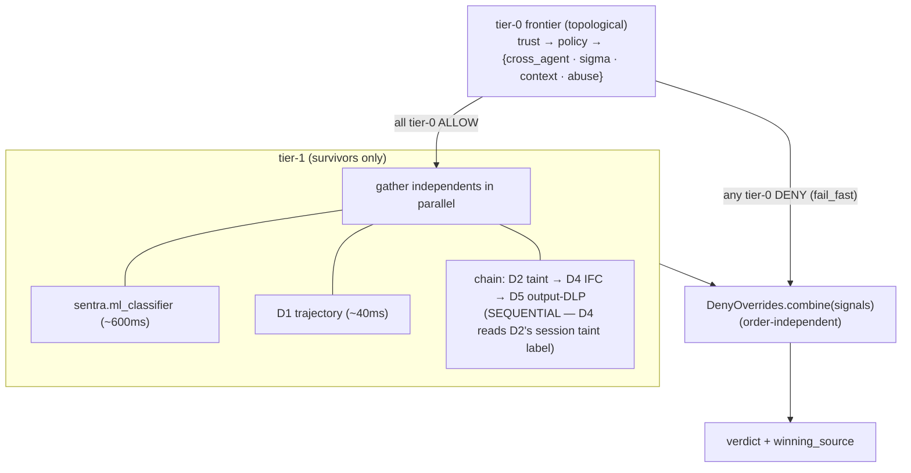

# WS-C — Cost-annotated DAG scheduler (FR-2.8 / ADR-030)

> **Doc role:** This is the **workstream SCOPE** — boundary, dependencies, real `file:line` anchors, footguns, and acceptance criteria. It is an **INPUT to this workstream's implementation-grade LLD**, *not* the granular task breakdown. The granular, buildable tasks are generated **from the approved LLD** (canonical order: HLD → LLD → tasks). See [00-index.md](00-index.md) for the doc-role map.

**Parent HLD:** [hld/serverless-edition.md](../../hld/serverless-edition.md) §6.2(c) "Running many detectors without getting slow" + §8 hand-off row *"FR-2.8 scheduler"*.
**Status:** Not started
**Owner:** TBD
**Implements:** FR-2.8 (parallel-gather scheduler). **Decision:** ADR-030 (cost-annotated DAG replaces the fixed-sequential pipeline). Realizes **AD-4** (deterministic-first, parallel models).
**Sub-PRD §5 status:** **FR-2.8 = NOT-DONE.** Today the pipeline is fixed-sequential and short-circuits on first DENY ([validation_service.py:220](../../src/security-controller/app/services/validation_service.py#L220) `_run_validation_pipeline`, docstring "Short-circuits on first DENY"). The ML-last reorder (STEP 6, [validation_service.py:368](../../src/security-controller/app/services/validation_service.py#L368)) is the *partial form* this WS generalizes — it is **placement**, not a scheduler. Build the scheduler; do not re-build the ML-last placement.

> **Next step: an implementation-grade LLD** (concrete node-registry schema, scheduler function signatures, the exact `_run_validation_pipeline` rewrite, per-node cost-tier table, the `fail_fast`/`evaluate_all` mode contract, test cases) — this WS doc scopes the build; the LLD details it. The LLD **extends [LLD 20 §3.4 / WS20.0](../../lld/20-defense-in-depth-layers.md) (the DAG design already exists there) + the controller-pipeline LLD (LLD 03)**. Do not invent a new DAG design — LLD 20 §3.4 already specifies the node model, the two run modes (`fail_fast`/`evaluate_all`), and the cost tiers; this WS productionizes it into the real pipeline.

---

## 1. Dependencies

- **Depends on (GATE):** **WS-0** — the measure-first spike (HLD §8 MEASURE-FIRST GATE). `plan-workstreams` MUST NOT start building this scheduler until WS-0's dated, signed spike packet exists (the §6.4 combined GA-gate table + the AgentCore-scope kill checks). The tier-1 parallel-gather only pays off if the escalated-path p99 / escalation-rate numbers say the deep tier is worth running at all. **Do not begin coding before the WS-0 packet is recorded in the index as the entry precondition.**
- **Depends on:** **WS20.0 framing** — the DAG node model + run modes are designed in [LLD 20 §3.4](../../lld/20-defense-in-depth-layers.md); this WS is the production landing of WS20.0. It ships and is regression-tested **before any new D1–D7 layer goes active** (LLD 20 §3.4 note at :190).
- **Blocks:** **WS-D** (D1–D7 deep-tier layers) — each new detector is a **node** registered into this scheduler's DAG; without the scheduler, seven sequential layers would *sum* latency (LLD 20 §3.4 at :80, :190). WS-D cannot land its layers until the node registry + parallel-gather exist.
- **Shared (must reconcile with WS-D):** both WS-C and WS-D govern **which/how layers run**. The boundary: **WS-C owns the scheduler mechanism** (the node registry, the cost-tier annotation, the topological run, the parallel-gather, the run-mode flag). **WS-D owns the layer nodes** (each D1–D7 validator + its declared cost tier + its dependency edges). The dependency-edge *vocabulary* (`depends_on`, `cost_tier`) is the shared contract — define it here, WS-D populates it. **FOOTGUN:** do not let WS-D hard-code `asyncio.gather` calls in its own validators — all parallelism is owned by the scheduler. A validator that gathers internally re-introduces the very `sum`-of-latencies WS-C exists to remove and bypasses the run-mode flag.
- **Shared files with WS-D, WS-B (trail), WS-K (config):**
  - `src/security-controller/app/services/validation_service.py` — `_run_validation_pipeline` ([:220](../../src/security-controller/app/services/validation_service.py#L220)) is rewritten here.
  - `src/security-controller/app/combiners/deny_overrides.py` + `combiners/signal.py` + `combiners/sources.py` — **READ-ONLY for this WS** (algorithm unchanged; see §3).
  - `cdk/config/prod.yaml` / `dev.yaml` — the run-mode flag (`dag_scheduler_enabled`, `dag_run_mode`) is set by WS-K; this WS only reads it via `settings`.

---

## 2. Model / read before coding

Hold these invariants before touching code — they are what make the rewrite SAFE rather than a behavior change:

1. **The combiner is order-independent — this is the load-bearing fact that makes parallel-gather correct.** `DenyOverrides.combine(signals)` ([deny_overrides.py:28](../../src/security-controller/app/combiners/deny_overrides.py#L28)) ranks the *entire* `Signal[]` set by `(priority, confidence, _neg_source)` ([:38-39](../../src/security-controller/app/combiners/deny_overrides.py#L38)) and the winner is deterministic regardless of the order signals were appended. So running tier-1 nodes in parallel and appending their signals in completion order does **NOT** change the verdict. **FOOTGUN:** do **not** "fix" the combiner to consider arrival order, and do **not** change source priorities ([sources.py:43-56](../../src/security-controller/app/combiners/sources.py#L43)) — the DAG must produce a byte-for-byte identical verdict to the sequential pipeline on the same signal set. The algorithm is OUT of scope (HLD §6.2(c) at :329: "Algorithm stays UNCHANGED — only the run model changes").

2. **Verdict-equivalence is the acceptance bar, not "it runs in parallel." The bar is the FINAL DECISION + `winning_source` — NOT signal-set equality.** The scheduler is a refactor: for any request, `DAG(request) == sequential(request)` on the final ALLOW/DENY decision and `metadata["winning_source"]`. Tier-0 short-circuit must reproduce the exact prefix-DENY semantics (first cheap DENY wins, no model invoked). Tier-1 parallel must reproduce the ML-last semantics (a tier-1 DENY only fires for tier-0 survivors; ML shadow-mode DENY still does NOT short-circuit — [validation_service.py:381](../../src/security-controller/app/services/validation_service.py#L381)). **FOOTGUN — do NOT assert full `signals[]`/audit-trail equality.** [LLD 24 acceptance at :227](../../lld/24-latency-optimization.md#L227) already established this: because a cheap-DENY (tier-0 short-circuit) legitimately never invokes ML, the `sentra.ml_classifier` signal *legitimately disappears* from that request's trail — a signal-set-equality assertion would throw false diffs on the exact ML-last behavior lld/24 shipped. The differential test asserts final `decision` + `should_deny` + `winning_source`, and the baseline must include ML-on traffic (per lld/24:227) — it does NOT compare the full captured signal set.

3. **Two tiers, two latency laws (HLD §6.2(c) at :304; LLD 20 §3.4 at :177-178).**
   - **Tier-0 = cheap deterministic** (`~1–5 ms` each): trust, Cedar/policy, cross-agent, prompt-signature (Sigma rename), context/sequence, abuse/rate. Run **first, with short-circuit** — any DENY here stops before any model (tenet 5).
   - **Tier-1 = expensive models** (`~600 ms` ML; D1–D7): **gathered in parallel** (`asyncio.gather`) only for tier-0 survivors. Latency = `max`, not `sum`.

4. **Latency is `max(independent parallel nodes, longest dependency chain)` — NOT a flat `max` of all nodes (HLD §6.3 at :550).** Where a dependency chain exists (**D2 taint → D4 IFC → D5 output-DLP**, the real D1–D7 ordering), those nodes run **sequentially and SUM**; only *independent* tier-1 nodes parallel-gather. The scheduler must respect `depends_on` edges via a topological run, not blindly `gather` everything. **FOOTGUN:** gathering D4 before D2's taint label exists produces a wrong/abstaining result — the chain D2→D4→D5 is a real data dependency (D4 reads the taint label D2 sets; HLD §A at :808).

5. **`asyncio.gather` across validators is CURRENTLY PROHIBITED — this WS is what lifts the prohibition.** [LLD 24 §1.2.1 at :44](../../lld/24-latency-optimization.md#L44) states the cross-validator gather is "**prohibited across validators in the decision pipeline (deferred to the WS20.0 DAG)**" — but **permitted for fan-out I/O *within* a single step** (parallel S3 GETs); the ML-last reorder is an *interim* frontier-first step "compatible with that future DAG" ([LLD 24 §1.3 Non-Goals at :48](../../lld/24-latency-optimization.md#L48)). **This WS *is* the WS20.0 DAG lld/24 defers to — no design conflict; it is the planned successor.** When this WS lands, update LLD 24 §1.2.1 to mark the cross-validator-gather prohibition LIFTED *inside the scheduler* (ad-hoc gathers in individual validators remain banned per the dependency note above; the within-a-step fan-out-I/O allowance is unchanged).

6. **`should_deny` short-circuit points today:** [validation_service.py:172](../../src/security-controller/app/services/validation_service.py#L172) (the dispatch `if validation_result.should_deny`) and the per-step `return …, signals` guards inside `_run_validation_pipeline` ([:274 trust](../../src/security-controller/app/services/validation_service.py#L274), :320 policy, :342 cross-agent, :350 sigma, :357 context, :364 abuse, :381 ML). The scheduler **replaces the per-step returns** with the tier-0 short-circuit + tier-1 gather; the **outer dispatch at :172 is unchanged** (it still branches on the final `validation_result.should_deny`).

7. **`_capture(result)` ([validation_service.py:239](../../src/security-controller/app/services/validation_service.py#L239)) and the `signals[]` list are reused, not replaced.** The scheduler still calls `_capture()` per node (abstain → no signal; stamped → append). The trail/not-run markers are **WS-B's** job (FR-6.8); WS-C only ensures `signals[]` contains every node that *actually ran*. **FOOTGUN:** do not delete `_capture` or its abstain handling — the ML classifier on Bedrock outage abstains and the combiner must treat absence as "not on path" (comment at [:228-235](../../src/security-controller/app/services/validation_service.py#L228)).

8. **`_stamp(result)` cross-cloud propagation ([validation_service.py:329](../../src/security-controller/app/services/validation_service.py#L329)) must survive the rewrite.** Tier-1 nodes (ML, D1–D7) that don't natively carry `platform`/`cloud_region` get them stamped from the policy result. The scheduler must apply `_stamp` to every tier-1 node's result before the combiner, exactly as the sequential code does at :342/:350/:357/:364.

---

## 3. Milestones → granular tasks

### Milestone C1 — Node registry + cost-tier annotation (the DAG data model)

Define the static graph once. Each validator becomes a **node** with a name (its `Source` constant), a callable, a cost tier, and `depends_on` edges. This is the WS20.0 "node with dependencies and a cost tier" ([LLD 20 §4.5 at :408](../../lld/20-defense-in-depth-layers.md)).

**Task C1.1 — Define the node descriptor.** New module `src/security-controller/app/services/scheduler/node.py`. Conceptual shape (REAL names):

```python
# Cost tiers — LLD 20 §3.4. tier-0 = short-circuit frontier; tier-1 = parallel models.
class CostTier(str, Enum):
    DETERMINISTIC = "tier-0"   # ~1-5ms; trust, policy, cross_agent, sigma, context, abuse
    EXPENSIVE_MODEL = "tier-1" # ~600ms; ml_classifier, D1-D7

@dataclass(frozen=True)
class ValidatorNode:
    source: str                 # Source.SENTRA_* from combiners/sources.py — the canonical name
    cost_tier: CostTier
    run: Callable[[ValidationRequest, dict], Awaitable[ValidationResult]]  # awaitable, returns ValidationResult
    depends_on: tuple[str, ...] = ()   # source names that MUST complete (ALLOW) before this node runs
```

- **FOOTGUN:** `source` MUST be the exact `Source.SENTRA_*` string from [combiners/sources.py:22-28](../../src/security-controller/app/combiners/sources.py#L22) (`sentra.trust`, `sentra.policy`, `sentra.sigma`, `sentra.ml_classifier`, `sentra.context`, `sentra.abuse`, `sentra.cross_agent`). The combiner's `_neg_source` tiebreak and the trail keying both join on it. Inventing a new node name breaks the audit join.

**Task C1.2 — Register the seven existing validators as nodes.** In a `build_dag()` function (new `scheduler/registry.py`). The tier-0 set maps 1:1 to today's STEP 1–STEP 5 + the cross-agent STEP 2.5; the tier-1 set is the ML classifier (STEP 6 today) — D1–D7 nodes are added by **WS-D**, not here.

| Node `source` | Cost tier | `depends_on` | Maps to today |
|---|---|---|---|
| `sentra.trust` | tier-0 | () | STEP 1 ([:272](../../src/security-controller/app/services/validation_service.py#L272)) |
| `sentra.policy` | tier-0 | (`sentra.trust`,) | STEP 2 Cedar/legacy ([:300](../../src/security-controller/app/services/validation_service.py#L300)) |
| `sentra.cross_agent` | tier-0 | (`sentra.policy`,) | STEP 2.5 ([:340](../../src/security-controller/app/services/validation_service.py#L340)) |
| `sentra.sigma` | tier-0 | (`sentra.policy`,) | STEP 3 ([:347](../../src/security-controller/app/services/validation_service.py#L347)) |
| `sentra.context` | tier-0 | (`sentra.policy`,) | STEP 4 ([:355](../../src/security-controller/app/services/validation_service.py#L355)) |
| `sentra.abuse` | tier-0 | (`sentra.policy`,) | STEP 5 ([:362](../../src/security-controller/app/services/validation_service.py#L362)) |
| `sentra.ml_classifier` | tier-1 | (`sentra.policy`,) | STEP 6 ML-last ([:368](../../src/security-controller/app/services/validation_service.py#L368)); LLD 20 §4.5 "policy edge" |

- **Note the Cedar branch:** the `sentra.policy` node's `run` callable encapsulates the cutover/shadow/legacy selection that lives at [validation_service.py:300-318](../../src/security-controller/app/services/validation_service.py#L300) today (cutover → `cedar.validate`; abstain → legacy fallback; shadow → legacy + `_cedar_shadow_compare`). **Do NOT flatten this into the scheduler** — keep it inside the policy node's callable so the DAG stays policy-engine-agnostic. WS-K already has `cedar_enabled:true`/`cedar_shadow_mode:false` set in prod ([cdk/config/prod.yaml:30-31](../../cdk/config/prod.yaml)) — this WS does not touch that.
- **FOOTGUN — the `abuse_policy_load` is a node prerequisite, not a node.** Today STEP 5 does `get_agent_policy` ([:363](../../src/security-controller/app/services/validation_service.py#L363)) before the abuse check. That policy load already happened inside the `sentra.policy` node; pass it through rather than re-loading (LLD 24 R4 "3× policy" — re-loading is a known latency bug, do not reintroduce it).

### Milestone C2 — The scheduler: tier-0 short-circuit then tier-1 parallel-gather

**Task C2.1 — Topological run of tier-0 with short-circuit.** New `scheduler/run.py::run_dag(nodes, request, session, capture, stamp)`. Run tier-0 nodes in dependency-topological order (`trust → policy → {cross_agent, sigma, context, abuse}`); call `_capture` on each; **on the first `result.should_deny`, return immediately with the prefix `signals[]`** — no tier-1 node runs. This reproduces today's STEP-1..5 short-circuit exactly.

```python
async def run_dag(nodes, request, session, capture, stamp, *, mode):
    signals = []
    # --- tier-0: cheap deterministic frontier, topological, short-circuit ---
    for node in _toposort(t0 := [n for n in nodes if n.cost_tier == CostTier.DETERMINISTIC]):
        result = capture(await node.run(request, session))
        if result.should_deny and mode == "fail_fast":
            return stamp(result), signals          # short-circuit BEFORE any model (tenet 5)
    # --- tier-1: parallel-gather survivors, respecting dependency chains ---
    t1 = [n for n in nodes if n.cost_tier == CostTier.EXPENSIVE_MODEL]
    results = await _run_tier1_with_edges(t1, request, session)   # gather independent; sum chains (C3)
    for r in results:
        capture(stamp(r))
    winner = combiner.combine(signals)             # order-independent (§2.1)
    return winner_to_result(winner), signals
```

- **FOOTGUN — ML shadow mode must NOT short-circuit.** In the sequential code the ML DENY only returns when `not settings.ml_classifier_shadow_mode` ([:381](../../src/security-controller/app/services/validation_service.py#L381)). In the DAG, ML is a tier-1 node; its signal is captured into `signals[]` either way, but **the verdict is decided by `combiner.combine(signals)` over the full set** — a shadow-mode ML DENY signal must not become the winner. Preserve this by either (a) not emitting a `should_deny` signal from the ML node in shadow mode, or (b) the combiner already handles it. Verify against [test for shadow mode] — do NOT let shadow ML start blocking.
- **FOOTGUN — `fail_fast` vs `evaluate_all`.** LLD 20 §3.4 ([:185](../../lld/20-defense-in-depth-layers.md)) defines two modes: `fail_fast` (default — stop at first DENY) and `evaluate_all` (run every layer despite an early DENY, for the full trail). The **default is `fail_fast`** (lowest latency + cost; production default). `evaluate_all` is the "run the full deterministic tier for the trail" mode WS-B exposes as a per-tenant setting (HLD §6.2(d) at :343). This WS implements BOTH modes; WS-K wires the flag; WS-B consumes `evaluate_all` for the trail. Do not hard-code `fail_fast`.

**Task C2.2 — Rewrite `_run_validation_pipeline` to delegate to `run_dag`.** Replace the body of [validation_service.py:220-389](../../src/security-controller/app/services/validation_service.py#L220) so it builds the DAG (C1.2), reads `mode` from `settings.dag_run_mode` (default `fail_fast`), and calls `run_dag(...)`, returning `(ValidationResult, signals)` — the **same return contract** the caller at [:168](../../src/security-controller/app/services/validation_service.py#L168) expects. The outer `validate()` dispatch ([:171-191](../../src/security-controller/app/services/validation_service.py#L171)) and the `validation.timing` log ([:193](../../src/security-controller/app/services/validation_service.py#L193)) are **unchanged**.

- **FOOTGUN — keep `_timed` instrumentation per node.** Each node's `run` must stay wrapped in `_timed("<step>", …)` so the `validation.timing` breakdown ([:193-201](../../src/security-controller/app/services/validation_service.py#L193)) still emits per-validator ms (LLD 24 M1). Losing this blinds the re-baseline LLD 24 depends on.

**Task C2.3 — Feature-flag the cutover (`dag_scheduler_enabled`).** Gate the new path behind `settings.dag_scheduler_enabled` (set by WS-K). Flag OFF → the existing sequential `_run_validation_pipeline` body runs unchanged (keep it behind the flag for one release as the rollback). Flag ON → `run_dag`. **This is a refactor with a behavior-equivalence guarantee — the flag exists to prove equivalence in shadow on dev before flipping, not because behavior changes.**

### Milestone C3 — Dependency-edge run for tier-1 chains (D2 → D4 → D5)

This is the milestone that distinguishes the DAG from a flat two-phase split (HLD §6.2(c) Option B rejected at :305 precisely because it can't carry D1–D7 dependencies).

**Task C3.1 — `_run_tier1_with_edges`: gather independents, sequence chains.** Within tier-1, partition nodes into (a) **independent** nodes (no `depends_on` among other tier-1 nodes) → `asyncio.gather` them; (b) **chains** (a `depends_on` edge to another tier-1 node) → run the chain **sequentially**, feeding the upstream result/label to the downstream node. Total tier-1 latency = `max(gather of independents, longest sequential chain)` (HLD §6.3 at :550).



- **FOOTGUN — the D2→D4→D5 chain is a REAL data dependency, not an ordering preference.** D4 (information-flow control) reads the **per-session taint label** D2 (indirect-injection) sets (HLD Appendix A at :808: D4 reasons over "did a tainted `content` event precede this `output`," answered from the session-label store, never from retained content). D5 (output-DLP) consumes D4's IFC verdict. Gathering them in parallel makes D4 read a stale/missing label → it must **abstain and fail to the deterministic floor** (HLD §A invariant 2 at :808), which silently weakens detection. The chain MUST run sequentially. The **node definitions for D2/D4/D5 are WS-D's deliverable** — WS-C only provides the chain-aware runner and the `depends_on` contract; WS-D declares the edges.
- **FOOTGUN — D2/D4/D5 run on different phases (content/output), not on `phase=request`** (LLD 20 latency note at :1116; HLD §A). The request-side per-turn path only carries `sentra.ml_classifier` (+ D1) in tier-1. The scheduler is per-phase: it builds the DAG from whichever nodes apply to the request's `phase`. **The `phase` field does not exist on `ValidationRequest` today** ([api/models.py:17](../../src/security-controller/app/api/models.py#L17) — no `phase` field) — it is added by **WS-A (the FR-3.4 contract WS)**, default `"request"`. This WS must read `request.phase` to select the per-phase node set; if WS-A has not landed, treat all traffic as `phase="request"` (only the request-side nodes — trust/policy/cross_agent/sigma/context/abuse/ml) and document the dependency. **Do not block on WS-A; degrade to request-only.**

---

## 4. Error model

| Condition | Scheduler response |
|---|---|
| A tier-0 node raises | Bubble to `_run_validation_pipeline`'s caller → the existing outer `except Exception` at [validation_service.py:215](../../src/security-controller/app/services/validation_service.py#L215) returns `_create_error_response` (fail-secure: error→DENY, [:667](../../src/security-controller/app/services/validation_service.py#L667) policy). **Do NOT swallow — fail secure.** |
| A tier-1 node raises inside `gather` | Use `asyncio.gather(..., return_exceptions=True)`; a node exception → that node **abstains** (no signal) and is recorded as failed, **never silently treated as ALLOW**. A failed *security-relevant* node on the deterministic floor escalates/fails-closed (HLD §A invariant 2). A failed ML node abstains (matches today's Bedrock-outage abstain, [:228](../../src/security-controller/app/services/validation_service.py#L228)). **FOOTGUN:** bare `gather` (no `return_exceptions`) cancels the other in-flight nodes on the first exception — losing their verdicts. Always pass `return_exceptions=True` and inspect each result. |
| A dependency-chain upstream node abstains/errors (e.g. D2 label missing) | Downstream chain node (D4/D5) **abstains and fails to the deterministic floor** — never treats missing taint as "clean" (HLD §A invariant 2 at :808). |
| `dag_scheduler_enabled` flag missing/false | Run the legacy sequential body (C2.3 rollback). |
| `dag_run_mode` unset | Default to `fail_fast` (LLD 20 §3.4 production default). |

---

## 5. Acceptance criteria

- [ ] **Verdict-equivalence (the bar):** a differential test runs the legacy sequential pipeline and the DAG (`fail_fast`) over the full existing scenario corpus (S1–S4 + `tests/`) and asserts the final `decision`, `should_deny`, and `metadata["winning_source"]` are **identical** for every request. **It asserts ONLY those three — NOT full `signals[]`/audit-set equality** (a cheap-DENY legitimately drops the ML signal; asserting signal-set parity would false-fail on lld/24's shipped ML-last behavior — [lld/24:227](../../lld/24-latency-optimization.md#L227)). The baseline corpus MUST include ML-on traffic. A final-decision/winning_source divergence fails the build.
- [ ] Tier-0 short-circuit: a tier-0 DENY (e.g. Cedar policy DENY) returns **before** `sentra.ml_classifier.run` is awaited — asserted by a spy/mock confirming the ML node was never invoked (reproduces LLD 20 test **T-DAG-01** at :1134).
- [ ] Tier-1 parallel: for an all-tier-0-ALLOW request with ≥2 independent tier-1 nodes, measured tier-1 wall-time ≈ `max(node latencies)`, not their sum (reproduces the "`max` not `sum`" claim, LLD 20 §3.4 at :178).
- [ ] Dependency chain: D2→D4→D5 run sequentially; a test injects a tainted `content` event and asserts D4 sees the taint label (chain order honored); with the label absent, D4 abstains/escalates rather than ALLOWing (HLD §A invariant 2).
- [ ] `evaluate_all` mode: with `dag_run_mode=evaluate_all`, every tier-0 node runs despite an early DENY (reproduces LLD 20 test **T-DAG-02** at :1135); `fail_fast` stops at the first DENY.
- [ ] ML shadow mode preserved: with `ml_classifier_shadow_mode=true`, an ML DENY signal does **not** become the verdict winner (no behavior change vs [:381](../../src/security-controller/app/services/validation_service.py#L381)).
- [ ] Combiner untouched: `git diff` shows **no change** to `deny_overrides.py`, `signal.py`, `sources.py` (algorithm + priorities byte-for-byte unchanged).
- [ ] `_capture`, `_stamp`, `_timed` semantics preserved: per-node timing still emitted in `validation.timing`; abstain → no signal; cross-cloud fields stamped onto tier-1 results.
- [ ] Tier-1 node exception is isolated (`return_exceptions=True`), recorded as abstain/failed, and never silently ALLOWs; a tier-0 node exception fails secure to DENY.
- [ ] Flag rollback: `dag_scheduler_enabled=false` runs the legacy sequential body with identical behavior.
- [ ] **WS-D contract published:** the `ValidatorNode` descriptor (`source`, `cost_tier`, `run`, `depends_on`) and `build_dag()` registration point are documented so WS-D can add D1–D7 nodes without editing the scheduler core.
- [ ] **LLD 24 §1.2.1 updated:** the "`asyncio.gather` prohibited across validators" note ([LLD 24 :37](../../lld/24-latency-optimization.md)) is amended to record the prohibition is lifted *inside the scheduler* (ad-hoc validator gathers still banned).
- [ ] **WS-0 gate honored:** no scheduler code merged before the WS-0 spike packet is signed and recorded in the index.

---

## 6. Cross-references

- **HLD:** [hld/serverless-edition.md](../../hld/serverless-edition.md) §6.2(c) (DAG decision + ADR-030, :294-329), §6.2(d) (run-mode reconciliation with the trail, :337-354), §6.3 scaling (`max(parallel, chain)`, :550), §8 hand-off row "FR-2.8 scheduler" (:673), §8 MEASURE-FIRST GATE (WS-0, :676), Appendix A D2→D4→D5 seam (:808).
- **Implements:** FR-2.8. **Decision:** ADR-030 (new — to be written into [adr.md](../../adr.md)). Realizes AD-4.
- **Anchor LLDs to extend (per §8):** [LLD 20 §3.4 / WS20.0](../../lld/20-defense-in-depth-layers.md) (the DAG design — node model, `fail_fast`/`evaluate_all`, tests T-DAG-01/02) + the controller-pipeline LLD (LLD 03). Latency interim this supersedes: [LLD 24 §1.2.1](../../lld/24-latency-optimization.md) (the ML-last reorder + the gather prohibition this WS lifts).
- **Sibling WS docs:** **WS-0** (measure-first spike — GATE), **WS-D** (D1–D7 deep-tier layers — registers nodes into this DAG; shared `ValidatorNode`/`depends_on` contract), **WS-A** (FR-3.4 `phase` field — this WS reads `request.phase` for per-phase node selection), **WS-B** (FR-6.8 decision trail — consumes `evaluate_all` mode + the `signals[]` run record), **WS-K** (activation config — sets `dag_scheduler_enabled` / `dag_run_mode`).
- **Code touch-points:** `src/security-controller/app/services/validation_service.py` (`_run_validation_pipeline` :220 — rewritten), new `app/services/scheduler/{node,registry,run}.py`; READ-ONLY: `app/combiners/{deny_overrides,signal,sources}.py`.
