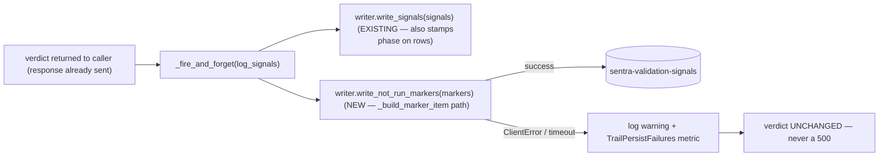

# WS-D — Record-what-ran decision trail (FR-6.8 / ADR-031)

> **Doc role:** This is the **TASKS-STAGE build breakdown**, generated from the approved LLD [lld/33-decision-trail.md](../../lld/33-decision-trail.md) (the LLD remains the source of truth). Milestones → granular tasks, each with real `file:line` anchors, conceptual pseudo-code using the LLD's exact identifiers, named footguns, and **mandatory named unit + integration tests** (reusing the LLD's canonical `T-TRAIL-*` ids). A coding agent should build straight from this doc without re-reading the whole LLD. See [00-index.md](00-index.md) for the doc-role map.

**Parent LLD:** [lld/33-decision-trail.md](../../lld/33-decision-trail.md) (Option A — "record-what-ran, force nothing extra"; ran / ran-ABSTAIN / ran-ERROR / not-run four-bucket taxonomy; ADR-031). **Parent HLD:** [hld/serverless-edition.md](../../hld/serverless-edition.md) §6.2(d) "Recording everything that ran" + §8 hand-off row 4 (`FR-6.8 → ADR-031 → LLD 17`).
**Status:** ✅ **CODE-DONE + DEPLOYED to prod `main` @ `42bcaeb`** (2026-07-02). **Deployed:** controller image `milestone-96` (digest `a6139b37`, built from `main` HEAD, force-rolled onto the ECS service task-def `:56`) + `Sentra-DEV-API-Stack` with the newly-wired routes; verified live through the gateway — `GET /v1/sessions/{id}/trail` returns a real trail envelope (200; 422 without `request_id`). *(Note: after the CFN deploy the served `prod` stage needed a fresh `create-deployment` to flush a stale route snapshot — the resources existed but 403'd until re-deployed.)* All milestones D1–D5 built; controller suite **779 passed / 11 skipped**, integration `test_pii_short_circuit_sigma_deny_one_query` **passed** (`RUN_INTEGRATION=1`), cdk `test_api_stack.py` **25 passed** (incl. the `/trail` route-presence gate). `DenyOverrides.combine()` + `Signal` byte-for-byte unchanged (verified — not in the diff). **WS-0 gate OVERRIDDEN by the founder 2026-07-02** (autopilot run, mirroring WS-C/WS-E precedent; WS-0's open numbers measure detection recall, not trail correctness) — and WS-0's result packet has since been **signed** on `main` (`9e31dca`), so the gate is doubly satisfied. Two integration-sentinel green≠correct findings were closed pre-promote: the `GET /v1/sessions/{id}/trail` route is wired into `api_stack.py` (was FastAPI-only → 403 in prod), and the read-time recompute fallback was **hardened to fail-secure** (silent-ALLOW → DENY-from-persisted-rows). See [00-index.md](00-index.md) WS-D row.
**Owner:** TBD
**Implements:** FR-6.8 (full decision-trail) + **NFR-10** (observability / full decision trail). **Decision:** ADR-031 (record-what-ran; `DenyOverrides.combine()` code byte-for-byte unchanged) + **KD-1** (NotRunMarker is a separate record type, founder-approved).

> **What changed from the SCOPE stage (read once, then delete from memory).** The scope-era WS-D doc is **superseded** by the approved LLD. Six scope-era assumptions are now WRONG and MUST NOT be built:
> - **NO `decision="NOT_RUN"` Signal value.** The scope doc stored not-run as a `Signal` row with a new `decision="NOT_RUN"`. **Replaced by `NotRunMarker`** — a **separate frozen record type** with `record_type ∈ {not_run, abstain, error}` and **NO `decision` field at all** (LLD §6.1, KD-1). A marker structurally cannot enter `combine()`.
> - **NO per-request trail HEADER row with aggregate counts.** Dropped (LLD §2.3 drop #1). `coverage_total`/`ran_count`/`not_run_count`/`abstain_count` are **DERIVED on read** from the ran + marker rows, never stored.
> - **NO "rides the `sentra.combined` row's metadata" summary.** That combined row **does not exist in DDB** (LLD §6.3) — `combine()` output only builds the CloudWatch event. `winning_source`/`block_point` are **recomputed-on-read** (LLD 17 §5.3 model).
> - **NO `metadata.gated_by` / `gated_by = winning_source` field.** Dropped (LLD §2.3 drop #2). `winning_source` (deciding source) and the not-run *reason* ("gated by earlier DENY" vs "skipped for cost/tier") are **separate concepts** carried separately.
> - **NO `scheduler.layers_for(phase)` and NO `DAG_BY_PHASE` lookup.** Both are wrong (LLD §5.1). The real seam is a **pure `coverage_sources(phase) -> list[str]` accessor WS-C must expose** (NOT YET BUILT). The live coverage-set source today is the `STATIC_FALLBACK_ORDER` list in `combiners/sources.py`.
> - **`phase` field is NOT owned by "the FR-3.4 WS".** It is owned by **WS-B / [lld/30](../../lld/30-multiphase-contract.md)** (`KNOWN_PHASES`, `_CONTENT_FIELD`), **merged**. WS-D consumes it read-only.
>
> **Net-new since scope (build these):** the **`GET /v1/sessions/{id}/trail` read API** (§9A); the **§7.1.1 `_fail_secure_deny` source stamp**; the **ran-ERROR fourth bucket**; the **`SOURCE_DISPLAY_NAMES`/`STATE_DISPLAY_NAMES` display maps**.

---

## Milestone map

| ID | Milestone | Tasks | Tests | Status |
|---|---|---|---|---|
| **D1** | Data model + coverage resolution (`NotRunMarker`, marker writer, `sources.py` constants, `coverage_set`) | 4 | T-TRAIL-06, -11, -12, -14, -15 | ✅ Done |
| **D2** | Run-model wiring + four-bucket classification (`build_trail`, §7.1.1 stamp, §7.1.2 pin, §7.1.3 reason, KD-4 call site) | 4 | T-TRAIL-01, -02, -03, -04, -05, -07, -13, -14b, -16, -17, -19 | ✅ Done |
| **D3** | High-assurance mode (WS-C `evaluate_all` per-request seam, escalate-only, NO-OP-if-absent) | 2 | T-TRAIL-08, -09, -18 | ✅ Done |
| **D4** | Persistence off the hot path + `TrailPersistFailures`/`CombinedEventPersistFailures` metrics | 2 | T-TRAIL-10 | ✅ Done |
| **D5** | Trail-read API `GET /v1/sessions/{id}/trail` (envelope, display-name derivation, recompute-on-read, tenant scoping, pagination) | 3 | T-TRAIL-20, -21, -22, -23 + integration | ✅ Done |

**All 15 tasks (D1.1–D5.3) COMPLETE + PROMOTED to `main` @ `42bcaeb`** (2026-07-02). Each `### Task` header below is stamped **✅ Done**. APIG follow-up (method-level synth test + wiring the read-family/`signals`/`metrics`/`rollback-conversation`/`feedback-delete` routes) landed separately @ `6a4ec89`.

23 numbered tests (T-TRAIL-01..23) + T-TRAIL-14b + 1 unnumbered integration test = the full §12 test plan. **Test files:** unit `src/security-controller/tests/unit/test_trail_builder.py`; integration `src/security-controller/tests/integration/test_decision_trail.py` (gated `RUN_INTEGRATION=1`).

---

## Model / read before coding (the invariants that make this a POST-PIPELINE CONSUMER, not a pipeline change)

Hold these before touching code. `build_trail` is a **pure post-pipeline consumer** of the stable `(signals[], _step_timings, verdict)` seam — it runs no validator and changes no pipeline `return` point (the ONE exception is the §7.1.1 producer stamp, which changes `combine()`'s *input* on one path, not its code).

**§3 invariants (i)–(vi) — carry verbatim:**

- **(i)** `abstain` (ran, no vote) ≠ `not-run` (never invoked) ≠ `error` (ran but no *usable* signal — an unstamped-`source` result or the fail-secure synthetic DENY). A not-run marker's **reason** names the *true* cause (gated-by-DENY vs skipped-for-cost/tier), **never** a single blanket phrase. → **T-TRAIL-03, T-TRAIL-13, T-TRAIL-17**
- **(ii)** A `NotRunMarker` **NEVER enters `combine()`'s list** — structurally, because it is a *separate type*, not a `Signal` (`Signal.decision` is a frozen `Literal["ALLOW","DENY"]` — [signal.py:22,47](../../src/security-controller/app/combiners/signal.py#L22)). → **T-TRAIL-07**
- **(iii)** `invoked` = the **`_step_timings` keyset** ([validation_service.py:34](../../src/security-controller/app/services/validation_service.py#L34)) **INTERSECTED with `coverage`** via `STEP_LABEL_TO_SOURCE`; the non-validator labels (`session`, `pipeline`, `handle`, `abuse_policy_load`, `policy_fallback`) are excluded. → **T-TRAIL-06**
- **(iv)** Recording forces **NO extra layer** on the DEFAULT `fail_fast` path — the trail is built **AFTER** the pipeline returns, from data it already produced. → **T-TRAIL-01, T-TRAIL-02**
- **(v)** **BOTH ALLOW and DENY** persist a full trail, within the §1.1 coverage (pre-pipeline identity/quota DENYs are recorded by their own path — AS-1). → **T-TRAIL-04, T-TRAIL-16**
- **(vi)** The verdict (`decision` + recomputed `winning_source`) is **byte-identical** with high-assurance mode ON vs OFF. → **T-TRAIL-08**

**AS-1 (numbered assumption).** Identity-gate DENYs (`IDENTITY_UNVERIFIED` [routes.py:155](../../src/security-controller/app/api/routes.py#L155) / `IDENTITY_MISMATCH` [routes.py:160](../../src/security-controller/app/api/routes.py#L160); `IDENTITY_TAMPERED` is produced in [deps.py:171](../../src/security-controller/app/api/deps.py#L171), not raised in `routes.py`) + `QUOTA_EXCEEDED` are decided in `routes.py` **before** `validate_tool_call` — they are **OUT of `build_trail`'s coverage set** and recorded by the `_identity_deny` `AuditLogger` write under the reserved `_unverified` tenant. → **T-TRAIL-16**

**Four-bucket algebra (§7.2) — the load-bearing set arithmetic:**
```
coverage    = coverage_set(phase)                                   # §5 — STATIC_FALLBACK_ORDER today
invoked     = {STEP_LABEL_TO_SOURCE[k] for k in step_timings if k in map} & set(coverage)
ran         = {s.source for s in signals}
denier      = {winning_source} if (is_deny and winning_source) else set()
ran_error   = (invoked & denier) - ran            # ran + decided verdict, NO Signal → ERROR
ran_abstain = invoked - ran - ran_error           # ran, genuinely abstained → ABSTAIN
not_run     = coverage - invoked                   # never invoked → NotRunMarker
```
The four sets are **disjoint by construction** (each source lands in exactly one) — this is what makes a same-SK collision impossible (§11.2). `_not_run_reason(src)` is **purely positional**: any DENY-voting ran source that **PRECEDES** `src` in `cov_order` → `"gated by earlier DENY"`, else `"skipped for cost/tier"`. **There is NO `is_deny` disjunct** — a DENY elsewhere on the request must not make a cost-skipped node *before* the denier read "gated".

**KD-4 contextvar-safety (load-bearing).** `_fire_and_forget` is a bare `asyncio.create_task(coro)` with **no `contextvars.copy_context()`** ([validation_service.py:104](../../src/security-controller/app/services/validation_service.py#L104), `create_task` at :109). So `build_trail` MUST run **synchronously on the request coroutine**, with `_step_timings` **snapshotted BY VALUE** and passed as the `step_timings` arg, **before** any `_fire_and_forget` handoff. If the invoked snapshot were read inside the create_task coroutine, a full-ALLOW request would resolve `invoked = ∅` and mis-classify **every** layer as not-run — the exact invariant-(i) conflation. → **T-TRAIL-19**

**READ-ONLY to WS-D:** `deny_overrides.py` + `signal.py` are byte-for-byte unchanged. `_run_validation_pipeline`'s body is UNTOUCHED (WS-C owns it — WS-D is a consumer of its outputs).

---

## Milestone D1 — Data model + coverage resolution

The record type, the marker writer, the `sources.py` constants, and the coverage accessor — the static substrate the run-model wiring (D2) classifies against. Nothing here touches the hot path.

### Task D1.1 — `NotRunMarker` frozen dataclass (§6.1, KD-1)  ✅ **Done**

New module `src/security-controller/app/services/trail_builder.py`. Define the record type FIRST — it is deliberately **not** a `Signal`:

```python
# app/services/trail_builder.py
from dataclasses import dataclass, field
from typing import Literal

@dataclass(frozen=True)
class NotRunMarker:
    """A coverage-set layer that was NEVER invoked (not_run), ran-but-abstained
    (abstain), or ran-and-errored (error). Deliberately NOT a Signal: no `decision`
    field, so it structurally cannot be passed to DenyOverrides.combine() — that is
    invariant (ii) enforced by the type system, not a runtime check."""
    source: str                                                     # coverage-set source
    record_type: Literal["not_run", "abstain", "error"] = "not_run" # row-type discriminator — NOT a decision
    reason: str = "gated by earlier DENY"                           # DERIVED (§7.1.3) — never a blanket lie
    phase: str = "request"
    metadata: dict = field(default_factory=dict)
```

- **FOOTGUN — `record_type` is NOT a decision value and does NOT widen `Signal.decision`.** A `NotRunMarker` has no `decision`, `priority`, or `confidence`; a `combine()` call on it raises at attribute access. Do **not** add a `decision` field "for symmetry" — its absence is the whole invariant-(ii) guarantee.
- **FOOTGUN — never resurrect `decision="NOT_RUN"`.** The scope-era design stored not-run as a `Signal` with a new decision value; that is the superseded approach. `NotRunMarker` is a distinct type on a distinct list.

**Unit tests** (`tests/unit/test_trail_builder.py`):
- `test_not_run_marker_has_no_decision_attr` — assert `hasattr(NotRunMarker(source="sentra.sigma"), "decision") is False`; assert `NotRunMarker` is frozen (attribute assignment raises `FrozenInstanceError`).

### Task D1.2 — Add the four constants to `combiners/sources.py` (§5.2 — additive, NO new file)  ✅ **Done**

Edit (additive) `src/security-controller/app/combiners/sources.py`, alongside the existing `Source` / `DEFAULT_PRIORITIES` / `default_priority()`. All four constants live in this **one existing file** — one source of truth shared by the trail builder, the scheduler-absent path, and the read API's display derivation.

```python
# app/combiners/sources.py — ADDED by WS-D (alongside DEFAULT_PRIORITIES)

STEP_LABEL_TO_SOURCE: dict[str, str] = {   # _step_timings label → coverage-set validator Source
    "trust":       Source.SENTRA_TRUST,
    "policy":      Source.SENTRA_POLICY,   # cedar OR legacy — SAME source
    "cross_agent": Source.SENTRA_CROSS_AGENT,
    "sigma":       Source.SENTRA_SIGMA,
    "context":     Source.SENTRA_CONTEXT,
    "abuse":       Source.SENTRA_ABUSE,
    "ml":          Source.SENTRA_ML_CLASSIFIER,
}
# DELIBERATELY UNMAPPED (plumbing, NOT detectors): session, pipeline, handle,
# abuse_policy_load, policy_fallback. policy_fallback is the legacy re-run after a
# Cedar abstain (validation_service.py:424) — the SAME logical policy layer, so
# mapping it would DOUBLE-COUNT policy as two invoked sources.

STATIC_FALLBACK_ORDER: list[str] = [       # request-phase coverage, pipeline order (WS-D coverage source TODAY)
    Source.SENTRA_TRUST, Source.SENTRA_POLICY, Source.SENTRA_CROSS_AGENT,
    Source.SENTRA_SIGMA, Source.SENTRA_CONTEXT, Source.SENTRA_ABUSE, Source.SENTRA_ML_CLASSIFIER,
]

SOURCE_DISPLAY_NAMES: dict[str, str] = {   # raw source → human label (§9A.2.2); raw string stays the join key
    Source.SENTRA_TRUST: "Trust score", Source.SENTRA_POLICY: "Policy (Cedar)",
    Source.SENTRA_SIGMA: "Prompt-signature rules", Source.SENTRA_ML_CLASSIFIER: "ML classifier",
    Source.SENTRA_CONTEXT: "Context integrity", Source.SENTRA_ABUSE: "Abuse / rate",
    Source.SENTRA_CROSS_AGENT: "Cross-agent",
}
STATE_DISPLAY_NAMES: dict[str, str] = {    # raw state → human label (§9A.2.2)
    "ran": "Ran", "ran_abstain": "Ran — abstained",
    "ran_error": "Ran — error (fail-secure)", "not_run": "Not run",
}
```

- **FOOTGUN — `_step_timings` labels are short (`"ml"`) while `Source` is dotted (`sentra.ml_classifier`).** The map bridges them; never spell `sentra.*` literals in `trail_builder.py` — reference the `Source.SENTRA_*` constants through these tables.
- **FOOTGUN — `policy_fallback` MUST stay unmapped.** Mapping it double-counts policy. The rollout-era double-fire (`policy` + `policy_fallback` both in `_step_timings`, [validation_service.py:424](../../src/security-controller/app/services/validation_service.py#L424)) must collapse to a **single** `sentra.policy` invoked source (§11.2). → pinned by T-TRAIL-06.
- **FOOTGUN — `sentra.sigma` → "Prompt-signature rules"** (the serverless narrative rename of "Sigma"); the **raw source string stays `sentra.sigma`** — a code rename would break the DDB SK + the `DenyOverrides` join key. An unknown `source` must fall through to the raw string (`.get(source, source)`), never crash — so a future WS-L D-layer renders as its raw name until its label is added.

**Unit tests** (`tests/unit/test_trail_builder.py`):
- `test_step_label_map_excludes_plumbing` (**T-TRAIL-06** — set half) — assert `session`/`pipeline`/`handle`/`abuse_policy_load`/`policy_fallback` are absent from `STEP_LABEL_TO_SOURCE`; feed `_step_timings` containing all of them + `policy` + `policy_fallback` and assert the derived invoked set contains **none** of the plumbing labels and maps `policy`+`policy_fallback` to a **single** `sentra.policy`.

### Task D1.3 — `coverage_set(phase)` accessor (§5.1, KD-3) — the WS-C seam is NOT YET BUILT  ✅ **Done**

In `trail_builder.py`, the coverage accessor tries WS-C's pure seam and falls back to the static list. **The WS-C seam genuinely does not exist yet** — `scheduler/__init__.py` exports only `CostTier`/`ValidatorNode`/`build_dag`/`run_dag`, and the landed `build_dag(service, phase, stamp_ctx)` is **service-coupled** (not a pure lookup).

```python
# app/services/trail_builder.py
def coverage_set(phase: str) -> list[str]:
    """Sources that COULD run for this phase, stable order.
    TODAY: STATIC_FALLBACK_ORDER (sources.py) — the LIVE coverage source, since
    WS-C's pure coverage_sources(phase) accessor is NOT YET BUILT (§5.1 / §13 gap#4)."""
    try:
        from app.services.scheduler import coverage_sources        # WS-C seam — NOT YET BUILT
        return coverage_sources(phase) or coverage_sources("request")
    except (ImportError, AttributeError, KeyError):
        from app.combiners.sources import STATIC_FALLBACK_ORDER
        return STATIC_FALLBACK_ORDER                                # the live path today
```

- **FOOTGUN — do NOT reference `scheduler.layers_for()` (scope doc — no such accessor) or `DAG_BY_PHASE` (a design *name* in lld/31 §5.2, not a built symbol; and the live `build_dag` mis-states its own signature as `build_dag(phase)`).** The ONLY correct target is the pure `coverage_sources(phase)`, and until WS-C lands it the `try` import fails and the static list is used.
- **FOOTGUN — a missing/unknown phase degrades to the request graph, never crashes** (SEC-4). The `coverage_sources("request")` fallback inside the `try`, and `STATIC_FALLBACK_ORDER` outside it, both cover this.

**Unit tests** (`tests/unit/test_trail_builder.py`):
- `test_coverage_set_falls_back_when_scheduler_absent` (**T-TRAIL-12**) — with `app.services.scheduler.coverage_sources` unimportable (monkeypatch the import to raise `ImportError`), assert `coverage_set("request") == STATIC_FALLBACK_ORDER`; assert high-assurance degrades to a documented NO-OP (prefix-only trail — cross-ref D3).

### Task D1.4 — `_build_marker_item` + `write_not_run_markers` on the EXISTING writer (§6.2, KD-7)  ✅ **Done**

Edit `src/security-controller/app/utils/signal_store_writer.py` — **NO new writer, NO new table.** Add a module-level `_build_marker_item(...)` **alongside** `_build_item` ([:90](../../src/security-controller/app/utils/signal_store_writer.py#L90)) and a `write_not_run_markers(markers)` method on `SignalStoreWriter`. Markers share the request partition so the console reads ran + not-run in **one Query**.

```python
# app/utils/signal_store_writer.py — ADDED by WS-D (alongside _build_item at :90)
def _build_marker_item(marker, *, timestamp_ms, timestamp_iso, expires_at, request_id, session_id):
    decision_date = timestamp_iso[:10]                   # SAME inline slice _build_item uses at :119 (no helper exists)
    item = {
        "PK": ..., "SK": f"{request_id}#{timestamp_ms}#{marker.source}",
        "record_type": marker.record_type,              # the row-type discriminator — NOT a decision
        "source": marker.source, "reason": marker.reason, "phase": marker.phase,
        "decision_date": decision_date,                 # GSI-2 membership (LLD 17 §5.2)
        "expires_at": expires_at,                       # TTL — caller-passed value (:207), reused not recomputed
        "timestamp_ms": timestamp_ms, "timestamp_iso": timestamp_iso,
    }
    assert "decision" not in item, "marker row MUST NOT carry a decision (invariant ii at storage)"
    return tenancy.stamp_signal_item(item)              # SAME shared helper as ran rows (:144) — tenant keys
```

- **FOOTGUN — markers do NOT go through `_build_item` as-is.** `_build_item` unconditionally reads `signal.decision`/`signal.priority` ([:113-114](../../src/security-controller/app/utils/signal_store_writer.py#L113)) — a marker has neither, so it would raise or (worse) stamp a stray `decision` that a reader mis-parses as a ran vote. The marker builder writes **only** `record_type`/`source`/`reason`/`phase` as marker-distinguishing attrs.
- **FOOTGUN — reuse, don't re-implement (KD-7).** `decision_date` is the same `timestamp_iso[:10]` inline slice `_build_item` uses at [:119](../../src/security-controller/app/utils/signal_store_writer.py#L119) (there is **no** standalone `decision_date` helper); `expires_at` is the **value** the caller computes once in `write_signals` ([:207](../../src/security-controller/app/utils/signal_store_writer.py#L207)); `tenancy.stamp_signal_item` ([:144](../../src/security-controller/app/utils/signal_store_writer.py#L144)) is the genuinely-shared tenant-key helper. So GSI-2 date, 90-day TTL, and tenant PK are **inherited**.
- **FOOTGUN — do NOT copy block-context depth onto markers (SEC / info-disclosure).** `_build_marker_item` must **NOT** copy `user_input[:200]`, `tool_params`, or `source_ip` (`_shared_attrs_from_request`). That depth lives on the ran rows + the `sentra.combined` CloudWatch event, read from the same partition; duplicating it onto up-to-6 marker rows multiplies the still-unredacted-pre-DLP content surface at zero audit value.
- The `assert "decision" not in item` is a guard, not a hope — the invariant-(ii) separation is enforced at persistence, not just at `combine()`.

**Unit tests** (`tests/unit/test_trail_builder.py`):
- `test_marker_row_no_decision_no_content` (**T-TRAIL-15**) — a persisted marker (via `_build_marker_item`) has `decision` **absent**, `record_type` present, and (for a `not_run` marker) none of `user_input`/`tool_params`/`source_ip`.
- `test_marker_row_decision_date_and_phase` (**T-TRAIL-11**) — every marker row has `decision_date == timestamp_iso[:10]` (GSI-2) and a `phase` attribute; assert the same holds for a paired ran row (both stamped via the shared computations). (Ran-row `phase` stamp is wired in D4.1.)
- `test_coverage_drift_guard_both_paths` (**T-TRAIL-14**) — (a) **fallback path (live today):** `set(STATIC_FALLBACK_ORDER)` **equals** the live request-phase pipeline's emitted validator sources **and** equals `set(STEP_LABEL_TO_SOURCE.values())` (minus non-request-phase sources); adding/removing/reordering a validator without updating `sources.py` fails the build. (b) **WS-C path (once the seam lands):** `set(coverage_sources("request")) == set(STATIC_FALLBACK_ORDER)` — skip-guard this half until the seam exists. (§13 gap #4/#5 tripwire.)

---

## Milestone D2 — Run-model wiring + four-bucket classification

`build_trail` (the classifier), the §7.1.1 producer stamp that repairs the dangerous fail-secure-DENY path, the §7.1.2 baseline pin, the §7.1.3 positional reason, and the KD-4 synchronous-by-value call site. This is where WS-D touches `validation_service.py` — **but never the pipeline body**.

### Task D2.1 — `build_trail(...)` four-bucket classifier (§7.1/§7.2)  ✅ **Done**

In `trail_builder.py`, the pure classification function over data the pipeline already produced:

```python
# app/services/trail_builder.py
def build_trail(*, signals, step_timings, coverage, winning_source, phase, is_deny) -> "TrailResult":
    """Classify coverage into ran / ran-abstain / ran-error / not-run. Pure function;
    runs no validator; changes no return point; never touches DenyOverrides.combine()'s code."""
    from app.combiners.sources import STEP_LABEL_TO_SOURCE
    cov_order = list(coverage); cov = set(cov_order)
    invoked = {STEP_LABEL_TO_SOURCE[k] for k in (step_timings or {})
               if k in STEP_LABEL_TO_SOURCE} & cov
    ran         = {s.source for s in signals}
    deny_sources = {s.source for s in signals if s.decision == "DENY"}
    denier      = {winning_source} if (is_deny and winning_source) else set()
    ran_error   = (invoked & denier) - ran            # decided verdict, no Signal → ERROR (backstop after §7.1.1)
    ran_abstain = invoked - ran - ran_error           # ran, genuinely abstained
    not_run     = cov - invoked                        # never invoked

    def _not_run_reason(src: str) -> str:              # §7.1.3 — PURELY POSITIONAL, no is_deny disjunct
        i = cov_order.index(src)
        return "gated by earlier DENY" if any(d in cov_order[:i] for d in deny_sources) else "skipped for cost/tier"

    markers = (
        [NotRunMarker(source=s, record_type="error",
                      reason="ran; decided verdict but emitted no signal (fail-secure/unstamped)", phase=phase) for s in ran_error]
        + [NotRunMarker(source=s, record_type="abstain", reason="ran; abstained (no vote)", phase=phase) for s in ran_abstain]
        + [NotRunMarker(source=s, record_type="not_run", reason=_not_run_reason(s), phase=phase) for s in not_run]
    )
    return TrailResult(markers=markers, summary={"phase": phase})
```

Also define `TrailResult` (a frozen dataclass: `markers: list[NotRunMarker]`, `summary: dict`).

- **FOOTGUN — `_not_run_reason` is purely positional; there is NO `is_deny` disjunct.** A DENY *elsewhere* on the request must not make a cost-skipped node that sits **before** the denier read "gated by earlier DENY" — that would overstate the gate (invariant i, tenet 8). Gate only if a DENY-voter **precedes** `src` in `cov_order`. → T-TRAIL-17(c).
- **FOOTGUN — a disabled-but-awaited layer can NEVER land in `not_run`.** `ml_classifier_enabled=false` still awaits ML (`_timed("ml", …)` fires → `sentra.ml_classifier ∈ invoked`) → it is **ran-ABSTAIN**, not not-run. The classifier derives `not_run` from `coverage − invoked`, and a disabled-but-awaited layer *is* in `invoked` — so it structurally cannot carry a misleading "gated" reason. → T-TRAIL-03, T-TRAIL-17(a).
- **Where `winning_source` comes from at the call site (§7.2 note):** the pipeline does NOT hand `build_trail` a pre-combined verdict (`combine()` runs off-path in `log_signals` and again at read time). So `build_trail` either (a) calls the **read-only** `DenyOverrides().combine(signals)` purely to *name* the denier (never to alter the verdict) or (b) takes `is_deny` from `ValidationResult.should_deny` and passes `winning_source=None`, letting §6.3's read-time recompute fill the durable copy. `block_point` is **not** a returned/stored field.

**Unit tests** (`tests/unit/test_trail_builder.py`):
- `test_allow_full_trail_zero_not_run` (**T-TRAIL-01**) — all coverage sources ran (Signal) or ran-ABSTAIN (disabled layer); **zero** not-run markers; assert no extra layer forced (invariant iv/v).
- `test_short_circuit_trust_deny_complement` (**T-TRAIL-02**) — trust DENYs; not-run complement `== coverage − {sentra.trust}`, each marker reason `"gated by earlier DENY"`; invoked == exact prefix.
- `test_conflation_trap_ml_disabled_vs_never_reached` (**T-TRAIL-03**) — `ml_classifier_enabled=false` + all-cheap-ALLOW → ML is `record_type="abstain"` (ran, consulted, declined), **not** not-run; a short-circuit case where ML is never reached → ML `record_type="not_run"`; assert the two are **distinct rows** (invariant i).
- `test_both_outcomes_persist_full_trail` (**T-TRAIL-04**) — one ALLOW + one DENY request both yield a full trail (ran + not-run) (invariant v).
- `test_block_context_depth_on_ran_deny_not_markers` (**T-TRAIL-05**) — ran DENY rows carry tool/params/agent→target/IP from `_shared_attrs_from_request` ([audit_logger.py:359](../../src/security-controller/app/utils/audit_logger.py#L359)); marker rows do **NOT**; recomputed `block_point == winning_source` from the ran DENY rows (§6.2/§6.3).
- `test_combine_never_called_with_marker` (**T-TRAIL-07**) — (a) `git diff` shows `combiners/deny_overrides.py` byte-unchanged; (b) a test double asserts `DenyOverrides.combine` is **never** invoked with a `NotRunMarker` in the list (invariant ii — passing one is a type error).
- `test_not_run_reason_derived_by_position` (**T-TRAIL-17**) — (a) disabled awaited layer → ran-ABSTAIN never not_run; (b) layer after denier → `"gated by earlier DENY"`, cost-skipped tier-1 on a full-ALLOW → `"skipped for cost/tier"`; (c) **positional guard:** a genuinely cost-skipped node **BEFORE** the denier reads `"skipped for cost/tier"`, NOT `"gated"` (no `is_deny` disjunct).

### Task D2.2 — §7.1.1 fix: `_fail_secure_deny` stamps `source=Source.SENTRA_POLICY` (the dangerous path)  ✅ **Done**

Edit `src/security-controller/app/services/validation_service.py`: **`_fail_secure_deny` ([:71](../../src/security-controller/app/services/validation_service.py#L71)) stamps `source=Source.SENTRA_POLICY`** so the fail-secure `POLICY_NOT_MIGRATED` DENY survives `_capture` as a real `Signal` and lands in `signals[]`. This is a **one-line producer-side change WS-D owns** — it touches the run model, NOT `combine()`'s code.

- **Why it matters (the dangerous case, §7.1).** On the `legacy_retired=True` + Cedar-abstain path ([:401](../../src/security-controller/app/services/validation_service.py#L401) → `_fail_secure_deny(violation_type=POLICY_NOT_MIGRATED, …)` at [:411](../../src/security-controller/app/services/validation_service.py#L411)), the policy layer **DENIES** but via an **unstamped** `ValidationResult` that never becomes a `Signal`. Without this stamp, the naïve `invoked − ran` classifies `sentra.policy` as **ran-ABSTAIN "ran; abstained (no vote)"** on a request the policy layer actually **blocked** — a reason-lie in the FR-6.8 compliance artifact (invariant i).
- **What the stamp repairs (three things at once):** (1) policy DENY appears in `signals[]` → classifier records `sentra.policy` as the ran **DENIER**, never ran-ABSTAIN; (2) `combine()` now *sees* the DENY → `winning_source` resolves to `sentra.policy` → §6.3's recomputed `block_point` is correct (it resolved to nothing before); (3) the `ran_error` bucket becomes a **belt-and-suspenders backstop** (keyed off `denier − ran`) that only fires if a *future* validator regresses into an unstamped denying result — surfacing the regression loudly instead of hiding it as an ABSTAIN.
- **FOOTGUN — state this as an ATTRIBUTION change, not "verdict unchanged".** `combine()`'s **code** is unchanged and `decision`/`should_deny` are unchanged (it was already a DENY). What changes is the **input** `combine()` sees on the `POLICY_NOT_MIGRATED` path: `winning_source` moves **none → `sentra.policy`** (a correction of a currently-blank attribution). Every other pipeline path is byte-for-byte unchanged (the stamp fires only in that branch). No downstream consumer regresses (metering keys off `violation_type`, not `winning_source`, and `POLICY_NOT_MIGRATED` stays AUDIT-ONLY / excluded from metered Decisions — [validation_service.py:641-647](../../src/security-controller/app/services/validation_service.py#L641)).

**Unit tests** (`tests/unit/test_trail_builder.py`):
- `test_fail_secure_deny_is_ran_denier_never_abstain` (**T-TRAIL-13**) — `legacy_retired=True` + Cedar-abstain → policy DENIES. Assert: (a) `_fail_secure_deny` stamps `source=sentra.policy` so a `Signal` lands in `signals[]`; (b) the trail records `sentra.policy` **ran-voted (DENIER)** with **zero** `record_type="abstain"` and **zero** `record_type="not_run"` rows for it; (c) recomputed `winning_source == sentra.policy` and `should_deny == True` (the **frozen post-stamp baseline** §7.1.2 owns); (d) `violation_type == "POLICY_NOT_MIGRATED"` distinguishes it from a genuine Cedar DENY. **Regression guard:** an unstamped denying result → `record_type="error"`, never ABSTAIN.

### Task D2.3 — §7.1.2 golden-baseline merge-ordering pin + T-TRAIL-14b except-path guard  ✅ **Done**

The §7.1.1 stamp changes the frozen `winning_source` on one WS-C golden scenario (none → `sentra.policy`), so the merge ordering must be pinned.

- **§7.1.2 contract — ✅ RESOLVED (verified 2026-07-02):** WS-D's merge **re-records the golden baseline for the `POLICY_NOT_MIGRATED` scenario** (before: `winning_source=None`; after: `sentra.policy`). WS-C's golden corpus **now carries the `legacy_retired=True` + Cedar-abstain case** so the change is caught by an equivalence test — see [test_dag_scheduler.py:540](../../src/security-controller/tests/test_dag_scheduler.py#L540) (`test_t_policy_node_cedar_abstain_legacy_retired_fail_secure_deny_through_dag`, `monkeypatch legacy_retired=True`). The earlier caveat (case "genuinely absent from WS-C's frozen corpus") is **no longer true** — WS-C added it. **The shared test that pins the post-stamp value is T-TRAIL-13 (WS-D-owned)**; the WS-C side now exists, so the reconciliation is two-sided. `decision`/`should_deny` are unchanged; only `winning_source` moves, only for this scenario.
- **T-TRAIL-14b (the ran-ERROR premise guard).** The ran-ERROR bucket rests on the fact that an unstamped (`source=None`) denying result **appends NO signal** — `_append_signal`'s `to_signal()` raises `ValueError` ([models.py:275](../../src/security-controller/app/api/models.py#L275)) and the `except ValueError` at [validation_service.py:98](../../src/security-controller/app/services/validation_service.py#L98) **only logs** — its comment reads "validator emitted unstamped result; signal dropped" ([validation_service.py:98-101](../../src/security-controller/app/services/validation_service.py#L98)); no signal is appended (verified in code). A maintainer who "fixes" that except-block to actually append a synthetic signal silently invalidates the premise (SEC threat 6).

**Unit tests** (`tests/unit/test_trail_builder.py`):
- `test_capture_except_path_appends_no_signal` (**T-TRAIL-14b**) — feed `_capture` an unstamped (`source=None`) denying `ValidationResult`; assert **no signal is appended** to `signals[]`. A maintainer appending a synthetic signal turns this red.

### Task D2.4 — KD-4 call site: `build_trail` synchronous, by-value, before `_fire_and_forget`  ✅ **Done**

Edit `validation_service.py`: call `build_trail(...)` **from `validate_tool_call`, synchronously, after `_run_validation_pipeline` returns** (pipeline call at [:325](../../src/security-controller/app/services/validation_service.py#L325)) and **BEFORE any `_fire_and_forget` handoff**, with `_step_timings` **snapshotted BY VALUE**. The pipeline body itself is UNTOUCHED (WS-C owns it).

```python
# validate_tool_call, after _run_validation_pipeline returns (:325), before the DENY/ALLOW dispatch:
result, signals = await self._run_validation_pipeline(request, session)   # WS-C runner — UNTOUCHED
step_timings_snapshot = dict(self._step_timings)                          # BY VALUE — KD-4
trail = build_trail(signals=signals, step_timings=step_timings_snapshot,
                    coverage=coverage_set(getattr(request, "phase", "request")),
                    winning_source=..., phase=getattr(request, "phase", "request"),
                    is_deny=result.should_deny)
# markers built (by value) BEFORE handoff; the marker WRITE rides _handle_deny/_handle_allow via log_signals (D4)
```

- **FOOTGUN — snapshot `_step_timings` BY VALUE on the request coroutine (KD-4).** `_fire_and_forget` is a bare `create_task` with **no `copy_context()`** ([:104](../../src/security-controller/app/services/validation_service.py#L104)/:109) — a scheduled coroutine is not guaranteed to observe the request's `_step_timings` contextvar. Reading it inside the background task on a **full-ALLOW** request could resolve `invoked = ∅` and mis-classify every layer as not-run. Build the markers list fully, by value, before handoff.
- **FOOTGUN — the marker WRITE (not the build) rides the existing handlers.** `_handle_deny` ([:579](../../src/security-controller/app/services/validation_service.py#L579) → `log_signals` at [:671](../../src/security-controller/app/services/validation_service.py#L671)) and `_handle_allow` ([:594](../../src/security-controller/app/services/validation_service.py#L594) → :737) already fire the audit dual-write off-path. WS-D extends `log_signals` (D4) to also write the markers — do NOT add a second fire-and-forget call.

**Unit tests** (`tests/unit/test_trail_builder.py`):
- `test_invoked_survives_fire_and_forget_boundary` (**T-TRAIL-19**) — `build_trail` is called synchronously with a by-value `_step_timings` snapshot **before** `_fire_and_forget`; assert a **full-ALLOW** request produces **zero** not-run markers (not the whole coverage set) even when the marker write executes on the background task — proving `invoked` was non-empty at classification time (snapshot captured on the request coroutine, KD-4).
- `test_identity_deny_out_of_coverage` (**T-TRAIL-16**) — an `IDENTITY_UNVERIFIED` request (returns from `routes.py` before `validate_tool_call`) produces **NO** trail rows AND the documented `_identity_deny` audit record under the `_unverified` tenant (AS-1, invariant v).

---

## Milestone D3 — High-assurance mode (opt-in Option C)

By default WS-D records the prefix + not-run complement and forces nothing. A regulated tenant can opt in to run the **whole frontier (tier-0 AND tier-1)** verdict-neutral via WS-C's `evaluate_all` — enriching the trail's ran-set without ever changing the verdict. **This couples to WS-C's per-request `mode` seam — which is now BUILT** (`run_dag(..., mode: str)`, [run.py:401](../../src/security-controller/app/services/scheduler/run.py#L401), threaded per-request from [validation_service.py:514-523](../../src/security-controller/app/services/validation_service.py#L514)). D3.2 is therefore a **live path, not a NO-OP**: today `mode` is sourced from the global `settings.dag_run_mode`; D3.2's job is to source it from `effective_high_assurance` per-request instead.

> **OPEN ITEM — RESOLVED (founder decision, 2026-07-02, autopilot WS-0 override run).** The per-tenant high-assurance field did not exist on the `Tenant` dataclass ([tenant_service.py:72-116](../../src/security-controller/app/services/tenant_service.py#L72)) — the LLD-sanctioned escalate-when-none-exists path applies. **Field name = `high_assurance_trail: bool = False`**, added to the `Tenant` dataclass as a deny-by-default boolean matching the existing `platform_read_consent` / `feedback_opt_in` / `local_floor_enabled` per-tenant fields (FR-10.4 tenant store; NOT `config.py`, NOT a global env flag, NOT the stale scope-era `trail_full_deterministic_tier`). Read at build time via `get_tenant_store().get(tenant_id).high_assurance_trail`; per-session override key `request.context["high_assurance_trail"]` (agent-supplied, untrusted → escalate-only per D3.1).

### Task D3.1 — Resolution: per-tenant / per-session, default OFF, escalate-only (§8.1)  ✅ **Done**

```
effective_high_assurance = tenant_setting OR session_override      # escalate-only (§8.1)
```

- **FOOTGUN — the session override can only ESCALATE, never downgrade.** `request.context` is agent-supplied and **untrusted** — a caller must not be able to thin its own audit by sending `override=off` when the tenant enabled the mode. Tenant-ON + session-off → **ON**; tenant-OFF + session-on → **ON**. High-assurance is a verdict-neutral recording knob (invariant vi), so escalate-only cannot affect a decision — it only prevents a self-serving reduction of a regulated tenant's record.
- Resolve the tenant setting from the tenant record (see OPEN ITEM), the override from `request.context` — never `config.py`.

**Unit tests** (`tests/unit/test_trail_builder.py`):
- `test_high_assurance_session_override_escalate_only` (**T-TRAIL-18**) — `tenant=ON` + `session_override=off` → effective **ON** (a request cannot turn off a tenant-mandated setting); `tenant=OFF` + `session_override=on` → **ON**.

### Task D3.2 — Mechanism: couple to WS-C `evaluate_all` per-request `mode` seam (§8.2, KD-5) + NO-OP-if-absent  ✅ **Done**

When `effective_high_assurance` is ON, thread `mode=evaluate_all` at the `_run_validation_pipeline → run_dag(mode=...)` call site (the DAG structure stays built-once; only the run-mode argument is per-request). The seam is **present** — [validation_service.py:514](../../src/security-controller/app/services/validation_service.py#L514) already computes `mode` locally and passes it to `run_dag(mode=mode)`; D3.2 replaces the global-only source (`settings.dag_run_mode`) with `EVALUATE_ALL if effective_high_assurance else settings.dag_run_mode`. `evaluate_all` "runs the WHOLE frontier despite an early DENY" and is **verdict-neutral** — the extra post-decider signals land in the trail's ran-set captured **advisory** (`_advisory_for_trail`, [run.py:118](../../src/security-controller/app/services/scheduler/run.py#L118)), never added to the list `combine()` sees.

- **RESOLVED — WS-C's `mode` IS per-request-switchable.** `run_dag(..., mode: str)` ([run.py:401](../../src/security-controller/app/services/scheduler/run.py#L401)) takes `mode` as a per-call argument; the DAG is built once but the run-mode is resolved per-request at [validation_service.py:514](../../src/security-controller/app/services/validation_service.py#L514) (the earlier "process-global, seam-not-built" note was stale — verified against live WS-C code 2026-07-02). D3.2 sources `mode` from `effective_high_assurance` at that call site; **do not add a new run_dag arg or a second runner.**
- **FOOTGUN — NEVER hand-roll a divergent second runner** (KD-5; the founder steer: what's in WS-C is correct, derive from the HLD). Reuse `EVALUATE_ALL`/`FAIL_FAST` constants already imported in `validation_service.py`. **Buyer-facing honesty:** the net-new artifact on a default request is the **honest not-run complement**; `evaluate_all` enrichment is the opt-in high-assurance upgrade on top of that floor.
- **FOOTGUN — `evaluate_all` verdict-neutrality is asserted, NOT "unchanged ML call count".** `evaluate_all` deliberately re-runs tier-1 (it doubles as the shadow-graduation mode — a shadow layer's lift can't be measured if a prior DENY hides it, LLD 20 §3.4). The test asserts the **verdict** is byte-identical, not that ML ran the same number of times.

**Unit tests** (`tests/unit/test_trail_builder.py`):
- `test_high_assurance_verdict_invariance_paired` (**T-TRAIL-08**) — same request ON vs OFF → `decision` + recomputed `winning_source` **byte-identical** (invariant vi); ON produces ≥ the ran-signals OFF produces.
- `test_evaluate_all_verdict_neutral_not_call_count` (**T-TRAIL-09**) — high-assurance ON (`evaluate_all`, tier-1 re-run) → `(decision, should_deny, winning_source)` byte-identical to `fail_fast` on the same request (lld/31 §6.7:421); the extra tier-1 signals are captured advisory. Asserts **verdict-neutrality**, NOT an unchanged ML call count.

---

## Milestone D4 — Persistence off the hot path + metrics

Extend the existing fire-and-forget audit dual-write to also persist the markers through the **same writer**, stamp `phase` on ran rows, and add the two observability metrics. A dropped trail must be visible and alarmable, and a trail-write failure must **never** turn a clean verdict into a 500.

### Task D4.1 — Extend `log_signals` to write markers + stamp `phase` on ran rows (§9.1, KD-4)  ✅ **Done**

Edit `src/security-controller/app/utils/audit_logger.py`: extend `log_signals` so that, alongside the existing `SignalStoreWriter.write_signals(signals)`, it also calls the new `write_not_run_markers(markers)` on the **same writer** (D1.4). Also stamp `phase` as a shared attribute on the **ran** rows (§6.3 — the one summary field that must be durable per-row). `combine()` at [:198](../../src/security-controller/app/utils/audit_logger.py#L198) is UNCHANGED.



- **FOOTGUN — no new writer, no new table, no new hot-path call.** The markers ride the same off-path `_fire_and_forget`, the same `SignalStoreWriter`, the same BatchWriteItem chunks, the same 200ms budget + `_BG_TASKS_SOFT_CAP` shed as the ran signals. Under backpressure markers shed first (more writes) while the single `sentra.combined` CloudWatch write lands — the intended degradation order is verdict > ran rows > markers (§11.5).
- **`winning_source`/`block_point` are NOT written** — they are recomputed on read (§6.3). Only `phase` is durable per-row (markers get it via `_build_marker_item`, ran rows via this `phase` stamp).

### Task D4.2 — `TrailPersistFailures` + `CombinedEventPersistFailures` metrics (§9.2)  ✅ **Done**

Edit (additive) `src/security-controller/app/utils/metrics_publisher.py`, mirroring the existing off-path swallowed `put_metric_data` ([:227](../../src/security-controller/app/utils/metrics_publisher.py#L227)):

```python
# app/utils/metrics_publisher.py — ADDED by WS-D
async def publish_trail_persist_failure(self, tenant_id: str = "", count: int = 1):
    """Off-path, swallowed. A silently-dropped trail thins the fast-read view
    (FR-6.8 / NFR-10) — makes it alarmable per-tenant. Never raises."""
    try:
        self.cloudwatch.put_metric_data(
            Namespace=self.namespace,                          # Sentra/SecurityController
            MetricData=[{"MetricName": "TrailPersistFailures", "Value": count,
                         "Dimensions": [{"Name": "tenant_id", "Value": tenant_id or "_unknown"}]}])
    except Exception as e:  # noqa: BLE001 — metrics never block validate
        logger.warning("TrailPersistFailures metric emit failed: %s", e)
```

- Add a **separate `CombinedEventPersistFailures`** metric (same off-path swallow pattern) for the `sentra.combined` CloudWatch write, so the compound "markers shed AND the reconstruction-of-record write also lost" case is observable, not silent (§9.2.1 — that is the only case where the reconstructable complement is actually lost).
- **FOOTGUN — the metric emit is off-path and swallowed; it MUST NOT raise into the verdict path.** `except Exception: # noqa: BLE001` per the existing pattern. Namespace is `Sentra/SecurityController`, dimension `tenant_id`.
- **Two alarms** (both mirror LLD 17 §12): `TrailPersistFailures` at **rate > 1%/5-min** (fleet) **and** a **per-tenant absolute-count** alarm on the same metric (so a chronic sub-1% thinning of one tenant is not silent).

**Unit tests** (`tests/unit/test_trail_builder.py`):
- `test_trail_persist_failure_metric_and_no_500` (**T-TRAIL-10**) — stub `write_not_run_markers` to raise → the `TrailPersistFailures` metric increments **and** the verdict still returns 200/clean (no 500). The write is off-path; a marker loss is bounded to a fast-read/observability gap, never a correctness/availability regression.

---

## Milestone D5 — Trail-read API `GET /v1/sessions/{id}/trail`

The READ endpoint WS-G (console) calls. It **extends the existing per-session read convention** — no new datastore, no new partition, no new auth surface. Reuses `get_session_signals`'s single-partition Query, classifies rows into the four buckets, recomputes `winning_source`, and derives display fields + counts on read.

### Task D5.1 — The endpoint + handler (§9A.1, reuse the existing read path)  ✅ **Done**

Edit `src/security-controller/app/api/routes.py` (add the route, `prefix="/v1"` at [:28](../../src/security-controller/app/api/routes.py#L28), alongside `/decisions` [:349](../../src/security-controller/app/api/routes.py#L349) + `/signals` [:365](../../src/security-controller/app/api/routes.py#L365)) and `src/security-controller/app/services/decisions_service.py`:

**`GET /v1/sessions/{session_id}/trail?request_id={request_id}`** — returns the full decision trail for one request.

- The handler **reuses** `get_session_signals(session_id, request_id=...)`'s single-partition Query ([decisions_service.py:93-98](../../src/security-controller/app/services/decisions_service.py#L93) — `KeyConditionExpression = "{pk} = :sid AND begins_with(sk, :rid)"`) and adds two things: (a) it includes the **marker rows** (rows carrying `record_type`, which `get_session_signals` returns but does not classify), and (b) it classifies every row into `ran` / `ran_abstain` / `ran_error` / `not_run` and derives the summary/counts.
- **Optional convenience alias `GET /v1/decisions/{request_id}/trail`** MAY be added — but it must first resolve `session_id` (via GSI-2 time-range read) then delegate to the session-scoped Query, so the session-scoped form stays the primary, cheapest contract.

- **FOOTGUN — primary form is session-scoped because the DDB PK is session-scoped** (`tenant_session_id`); a `request_id` alone is not a partition key. No new query, no new index.
- **FOOTGUN — `state` is derived from `decision`-present (ran) vs `record_type` on the row** (§6.2 partitioning rule) — the writer's classifier (§7.2) and the reader's `state` are the *same* four buckets, no second taxonomy.

### Task D5.2 — Response envelope, recompute-on-read, display-name derivation (§9A.2/§9A.2.2)  ✅ **Done**

The handler builds the envelope (§9A.2 worked example):

```json
{ "session_id":"...", "request_id":"...", "phase":"request",
  "winning_source":"sentra.policy", "winning_source_display":"Policy (Cedar)",
  "block_point":"sentra.policy", "decision":"DENY",
  "coverage":[ {"source":"sentra.trust","display_name":"Trust score","state":"ran","state_label":"Ran","decision":"ALLOW","reason":"...","latency_ms":1.2}, ... ],
  "coverage_total":7, "ran_count":2, "not_run_count":5, "abstain_count":1 }
```

- **`source` / `state` stay RAW machine values** (load-bearing: `source` is the DDB SK component + `DenyOverrides` join key; `state` is the four-bucket discriminator). The API **ADDS** `display_name` (from `SOURCE_DISPLAY_NAMES`) + `state_label` (from `STATE_DISPLAY_NAMES`), derived at read time — **not stored** (a stored label drifts the moment the map changes).
- **`winning_source` / `block_point` are recomputed-on-read** (§6.3) — the `source` of the deny-overrides winner among the ran `DENY` rows; `null` on an ALLOW. `block_point == winning_source` on a DENY. The durable copy lives on the `sentra.combined` CloudWatch event, not DDB.
- **Counts are DERIVED on read** from the `coverage` array — `coverage_total`/`ran_count`/`not_run_count`/`abstain_count` (and `ran_error_count` if any), never stored (consistent with LLD 17 §5.3 "no aggregated DDB row — recompute on read"; §2.3 drop #1).
- **Reconciliation invariant (testable):** `ran_count + ran_abstain_count + ran_error_count + not_run_count == coverage_total`; every coverage source appears exactly once, in coverage order (`STATIC_FALLBACK_ORDER` today).
- **FOOTGUN — an unknown `source` falls through to the raw string** as `display_name` (`.get(source, source)`) — a future WS-L D-layer renders as its raw name, never null, never a crash. The dashboard's existing `_SOURCE_BADGES` ([cross_cloud_demo.py](../../src/dashboard/components/cross_cloud_demo.py)) becomes a **presentation-only alias** of `SOURCE_DISPLAY_NAMES` (WS-G reconciliation, §13) — one source of truth for labels.
- **Deferred field — `prompt`** is NOT returned yet. `user_input` is stored RAW on the request phase; request-phase redaction is **WS-E's** deliverable ([lld/29](../../lld/29-redaction.md), in flight). The field is added (carrying the post-redaction view) once WS-E defines the request-phase redaction contract (WS-D→WS-E seam, §13).

### Task D5.3 — Tenant scoping + pagination (§9A.3/§9A.4)  ✅ **Done**

- **Tenant from the verified-JWT contextvar** via `resolve_tenant_from_jwt()` → `set_current_tenant` ([deps.py:111-178](../../src/security-controller/app/api/deps.py#L111)) — **NOT** the spoofable `X-Operator-Email` (that is control-plane mutations only, [deps.py:8-9](../../src/security-controller/app/api/deps.py#L8)). The read binds `(tenant_id, agent_id)` from the *verified* token, never the request body.
- **NO `require_role()`** on this data-plane read (correct — it is a read, not an operator mutation; the fix is a verified-JWT *tenant bind*, not RBAC). It does **NOT** share the `X-Operator-Email` control-plane-mutation IDOR ([[policy-crud-routes-no-authz]]).
- **⚠️ CORRECTED 2026-07-06 (lld/39 §2.2, code-verified) — the tenant bind was a GAP; ✅ BIND SHIPPED (WS-M M5.2, `codeloop/ws-m-authz`@62554012).** Earlier drafts of this section claimed the read "binds `resolve_tenant_from_jwt` → `set_current_tenant`" and is "structurally isolated by the tenant-composite PK." That was **not true in the deployed code**: `get_session_trail`/`get_session_signals` ([routes.py](../../src/security-controller/app/api/routes.py)) took NO auth dependency and resolved the partition from the ambient `tenancy.current_tenant()` (default `"default"`) — so for a non-enforcing tenant the rows co-mingled in the `default` partition and were cross-tenant-readable. **WS-M M5.2 shipped the fix:** both handlers now take `http_request: Request` and run the `DecisionsService` read inside `_dataplane_tenant_bind` — `resolve_tenant_from_jwt` verifies the agent JWT, denies (401) at enforce on a missing/invalid token, and binds `set_current_tenant(ctx.tenant_id)` in a `try/finally`. `/trail` is now tenant-isolated by the VERIFIED tenant, not the ambient `default`. (Still **NO `require_role`** — a data-plane read, Invariant 6.)
- **Pagination:** a single request's trail is small (~7 rows, up to ~14 with WS-L) → return the full trail in one response, `next_token: null` (single-partition Query, un-paged, matching `get_session_signals` [decisions_service.py:111](../../src/security-controller/app/services/decisions_service.py#L111)). Forward path (deferred): a `base64(timestamp_ms)` cursor if coverage ever exceeds one DDB page.

**Unit tests** (`tests/unit/test_trail_builder.py`):
- `test_trail_endpoint_four_buckets_counts` (**T-TRAIL-20**) — persist a short-circuit-DENY trail (ran prefix + ABSTAIN + not-run markers) then `GET /v1/sessions/{sid}/trail?request_id=R`: `coverage[]` has **one entry per source in coverage order** with the right `state`; `winning_source == block_point ==` the recomputed deny-overrides winner; reconciliation holds; `next_token == null`.
- `test_trail_read_tenant_isolation` (**T-TRAIL-21**) — a verified-JWT tenant A querying a request that belongs to tenant B → **zero coverage rows**. **✅ BIND SHIPPED (WS-M M5.2, `codeloop/ws-m-authz`@62554012)** — the read handler now binds the verified-JWT tenant (see the corrected D5.3 note above), so this assertion is run against the *bound* handler. WS-M's `test_dataplane_jwt_boundary.py::test_trail_read_binds_verified_tenant` / `::test_trail_enforce_missing_jwt_denies_not_default` are the sibling proofs that the bind (and the enforce-deny) actually landed.
- `test_trail_allow_null_winning_source` (**T-TRAIL-22**) — `GET /trail` for a full-ALLOW request → `decision == "ALLOW"`, `winning_source == null`, `block_point == null`, every source `ran` (or `ran_abstain` for a disabled-but-awaited layer), **zero** `not_run` rows.
- `test_trail_display_names_no_raw_leak` (**T-TRAIL-23**) — every `coverage[]` row has a non-empty `display_name` + `state_label`; `sentra.policy → "Policy (Cedar)"`, `sentra.sigma → "Prompt-signature rules"`, `ran_abstain → "Ran — abstained"`; `winning_source_display` matches the winner's label; an unknown `source` (simulated WS-L D-layer) falls through to the **raw string** (never null, never a crash).

**Integration test** (`tests/integration/test_decision_trail.py`, gated `RUN_INTEGRATION=1`):
- `test_pii_short_circuit_sigma_deny_one_query` (**unnumbered integration**) — POST a **PII-bearing `/v1/validate`** that short-circuits on a **sigma DENY** → the DDB partition Query returns the **ran prefix as `Signal` rows** + the **not-run complement as `record_type="not_run"` rows in ONE Query**, all carrying `phase=request`; the read-time recompute over the ran DENY rows yields `winning_source == sentra.sigma`, `block_point == sentra.sigma`.

---

## Error model

| Condition | Response |
|---|---|
| **Marker persist fails** (ClientError / timeout) | Swallow on the hot path (`_fire_and_forget`); emit `TrailPersistFailures` (+ `CombinedEventPersistFailures` for the combined-event write); verdict returns clean. **Never 500 a clean verdict on a trail-write failure.** RPO(trail row) = up to 1 write; RTO = none (§11.2). |
| **`combine()` somehow handed a marker** | `AttributeError` at attribute access (marker has no `decision`) — caught by T-TRAIL-07 in CI, **structurally impossible** in prod (separate type, §6.1). |
| **Missing / unknown `phase`** | Default to `"request"` (`getattr(request, "phase", "request")`); coverage = the request graph. Never error. |
| **WS-C pure `coverage_sources(phase)` accessor still absent** (verified 2026-07-02) | `coverage_set` falls back to `STATIC_FALLBACK_ORDER` (§5.2) — the live coverage source today; drift-guarded by T-TRAIL-14. Designed fallback, no crash. *(The per-request `mode` seam is NOT in this row — it IS built, so D3.2/high-assurance is a live path, not a NO-OP — §8.2, D3.2.)* |
| **`decision_date` missing on a marker row** | Cannot happen — `_build_marker_item` recomputes it from `timestamp_iso[:10]` (the same inline slice `_build_item` uses at [:119](../../src/security-controller/app/utils/signal_store_writer.py#L119)). |
| **Unstamped denying `ValidationResult`** (regression) | Recorded `record_type="error"` (ran DENIER), **never** a benign ABSTAIN (invariant i) — the belt-and-suspenders backstop after the §7.1.1 stamp. |
| **Pre-pipeline identity / quota DENY** | OUT of trail coverage (AS-1, §1.1); recorded by the `_identity_deny` / quota audit path under `_unverified`. A `/trail` call for such a request returns no coverage rows. |
| **Same-SK collision** (a source in two buckets) | Cannot occur — the four buckets are disjoint by construction and `policy_fallback` is unmapped, so the policy layer maps to a single `sentra.policy` invoked source (§11.2). |

---

## Acceptance criteria (one checklist for the whole workstream — each objectively verifiable)

- [x] **unit tests pass** (`tests/unit/test_trail_builder.py`) covering: `test_not_run_marker_has_no_decision_attr`, `test_step_label_map_excludes_plumbing` (**T-TRAIL-06**), `test_coverage_set_falls_back_when_scheduler_absent` (**T-TRAIL-12**), `test_marker_row_no_decision_no_content` (**T-TRAIL-15**), `test_marker_row_decision_date_and_phase` (**T-TRAIL-11**), `test_coverage_drift_guard_both_paths` (**T-TRAIL-14**), `test_allow_full_trail_zero_not_run` (**T-TRAIL-01**), `test_short_circuit_trust_deny_complement` (**T-TRAIL-02**), `test_conflation_trap_ml_disabled_vs_never_reached` (**T-TRAIL-03**), `test_both_outcomes_persist_full_trail` (**T-TRAIL-04**), `test_block_context_depth_on_ran_deny_not_markers` (**T-TRAIL-05**), `test_combine_never_called_with_marker` (**T-TRAIL-07**), `test_not_run_reason_derived_by_position` (**T-TRAIL-17**), `test_fail_secure_deny_is_ran_denier_never_abstain` (**T-TRAIL-13**), `test_capture_except_path_appends_no_signal` (**T-TRAIL-14b**), `test_invoked_survives_fire_and_forget_boundary` (**T-TRAIL-19**), `test_identity_deny_out_of_coverage` (**T-TRAIL-16**), `test_high_assurance_session_override_escalate_only` (**T-TRAIL-18**), `test_high_assurance_verdict_invariance_paired` (**T-TRAIL-08**), `test_evaluate_all_verdict_neutral_not_call_count` (**T-TRAIL-09**), `test_trail_persist_failure_metric_and_no_500` (**T-TRAIL-10**), `test_trail_endpoint_four_buckets_counts` (**T-TRAIL-20**), `test_trail_read_tenant_isolation` (**T-TRAIL-21**), `test_trail_allow_null_winning_source` (**T-TRAIL-22**), `test_trail_display_names_no_raw_leak` (**T-TRAIL-23**).
- [x] **integration test passes** (`tests/integration/test_decision_trail.py`, `RUN_INTEGRATION=1`): `test_pii_short_circuit_sigma_deny_one_query` — PII-bearing short-circuit sigma DENY → ran prefix (`Signal` rows) + not-run complement (`record_type="not_run"` rows) in ONE partition Query, all `phase=request`; recompute `winning_source == sentra.sigma`, `block_point == sentra.sigma`.
- [x] **`NotRunMarker` is a separate frozen record type** with `record_type ∈ {not_run, abstain, error}` and **no `decision` field** — a `combine()` call on one raises (invariant ii). **No `decision="NOT_RUN"` anywhere.**
- [x] **Four buckets disjoint** (ran / ran-ABSTAIN / ran-ERROR / not-run); an abstaining layer is **ran-ABSTAIN** never not-run; a fail-secure `POLICY_NOT_MIGRATED` DENY is the ran **DENIER** never ABSTAIN (T-TRAIL-03/13/17).
- [x] **`DenyOverrides.combine()` + `Signal` code byte-for-byte unchanged** (`git diff` zero on `deny_overrides.py`/`signal.py`); the §7.1.1 stamp changes `combine()`'s **input** on the `POLICY_NOT_MIGRATED` path only (`winning_source` none → `sentra.policy`), not its code (T-TRAIL-07/13).
- [x] **Counts + summary DERIVED on read**, never stored — no per-request header row, no `gated_by` field, no `sentra.combined` DDB row; `winning_source`/`block_point` recomputed-on-read from the ran DENY rows (§6.3, §2.3).
- [x] **`STEP_LABEL_TO_SOURCE` / `STATIC_FALLBACK_ORDER` / `SOURCE_DISPLAY_NAMES` / `STATE_DISPLAY_NAMES` all in `combiners/sources.py`** (additive, no new file); coverage drift-guard green on the fallback path (T-TRAIL-14).
- [x] **Persistence off the hot path** — markers ride the existing `log_signals` / `_fire_and_forget` through `write_not_run_markers`/`_build_marker_item`; a stubbed write failure emits `TrailPersistFailures` and never 500s a clean verdict (T-TRAIL-10).
- [x] **High-assurance is per-tenant/per-session, default OFF, escalate-only** (T-TRAIL-18) and verdict-neutral (T-TRAIL-08/09); the concrete tenant-record field name is **resolved at build time or escalated** (D3 OPEN ITEM), NOT a global flag, NOT `trail_full_deterministic_tier`.
- [x] **`GET /v1/sessions/{id}/trail`** returns the four buckets in coverage order with derived display names + counts + recomputed `winning_source`, tenant-scoped by verified-JWT + tenant-composite PK, no `require_role()`, `next_token: null` (T-TRAIL-20/21/22/23).
- **WS-0 GATE NOT OVERRIDDEN** — this remains an acceptance gate. WS-D does **not** decompose-to-build (merge) without WS-0's signed spike packet **unless the founder records an override** (00-index THE ONE GATING RULE). The tasks above are the plan; the code-merge gate is still closed.

---

## Dependencies

- **WS-0 GATE (NOT overridden as of last check).** WS-D is spike-gated by WS-0 (00-index THE ONE GATING RULE — A/D/E do not decompose-to-build until WS-0's signed packet exists). **Unlike WS-C, WS-D's gate has NOT been overridden by the founder.** Do not mark WS-D buildable/CODE without a recorded override; mirror how ws-c's doc records its override, but state honestly that no override exists here.
- **Depends on — WS-C ([lld/31](../../lld/31-dag-scheduler.md), CODE-DONE + deployed).** The C→D predecessor is satisfied (the DAG is the live pipeline). Of the two WS-C→WS-D seams originally owed (LLD §13 gap #4), status as of 2026-07-02: (a) the **per-request `mode` seam** at the `run_dag(mode=...)` call site is **✅ BUILT** ([run.py:401](../../src/security-controller/app/services/scheduler/run.py#L401) ← [validation_service.py:514](../../src/security-controller/app/services/validation_service.py#L514)) → D3.2 high-assurance is a live path; (b) the **pure `coverage_sources(phase) -> list[str]` accessor** is **still absent** (WS-C's landed `build_dag(service, phase, stamp_ctx)` is service-coupled, not a pure lookup; `DAG_BY_PHASE`/`layers_for()` are NOT the seam) → `coverage_set` uses `STATIC_FALLBACK_ORDER` (designed fallback, drift-guarded). **WS-C's golden corpus now carries the `legacy_retired=True` + Cedar-abstain (`POLICY_NOT_MIGRATED`) case** (§7.1.2) — ✅ present at [test_dag_scheduler.py:540](../../src/security-controller/tests/test_dag_scheduler.py#L540).
- **Depends on — WS-B ([lld/30](../../lld/30-multiphase-contract.md), merged).** `request.phase` / `KNOWN_PHASES` — consumed read-only; degrades to `"request"` if absent.
- **Depends on — LLD 17** (the validation-signal store WS-D extends — §5.2 writer, GSI-2, TTL, §5.3 recompute-on-read, §7 CloudWatch archive).
- **Blocks — WS-G (console).** FR-13.2 Decision-detail view consumes `GET /v1/sessions/{id}/trail` (WS-D owns the API contract; WS-G owns the rendering). WS-G→WS-D contract: unify the pipeline trail with the pre-pipeline identity/quota audit records (AS-1 boundary), and alias its `_SOURCE_BADGES` to `SOURCE_DISPLAY_NAMES`.
- **Seam — WS-E (redaction, [lld/29](../../lld/29-redaction.md), in flight).** The deferred `/trail` `prompt` field carries the post-redaction request-phase view once WS-E defines the request-phase redaction contract.

**Shared contracts OWNED by WS-D (LLD §13):**
- `GET /v1/sessions/{session_id}/trail?request_id=...` — the WS-D→WS-G read endpoint (envelope `coverage[]` + `winning_source`/`block_point` + derived counts, served by extending `decisions_service`'s single-partition read path — no new datastore).
- `NotRunMarker` record type (`record_type ∈ {not_run, abstain, error}`).
- `SignalStoreWriter.write_not_run_markers` / `_build_marker_item` — the decision-free, content-trimmed marker row shape on `sentra-validation-signals`.
- the `phase` shared attribute stamped on ran + marker rows.
- the `_fail_secure_deny` `source=Source.SENTRA_POLICY` stamp (§7.1.1) **and** the frozen post-stamp `winning_source=sentra.policy` baseline for the `POLICY_NOT_MIGRATED` scenario (§7.1.2, shared with WS-C).
- the derived not-run `reason` taxonomy (§7.1.3).
- `STEP_LABEL_TO_SOURCE` + `STATIC_FALLBACK_ORDER` (in `combiners/sources.py`).
- `SOURCE_DISPLAY_NAMES` + `STATE_DISPLAY_NAMES` (in `combiners/sources.py`).
- `TrailPersistFailures` (+ `CombinedEventPersistFailures`) metrics.

**Consumes (READ-ONLY):**
- `coverage_sources(phase)` — pure WS-C accessor (still NOT YET BUILT as of 2026-07-02 — §5.1; `coverage_set` uses `STATIC_FALLBACK_ORDER` until it lands).
- `evaluate_all` per-request `mode` seam — WS-C at the `run_dag(mode=...)` call site (✅ **BUILT** — [run.py:401](../../src/security-controller/app/services/scheduler/run.py#L401); §8.2, D3.2 consumes it live).
- `request.phase` / `KNOWN_PHASES` (WS-B / [lld/30](../../lld/30-multiphase-contract.md), merged).
- `DenyOverrides.combine` + `metadata['winning_source']` (**code READ-ONLY**; the §7.1.1 stamp changes only its input on one path).
- LLD 17 §5.3 recompute-on-read aggregate for `winning_source`.
- `SignalStoreWriter._build_item` + `_shared_attrs_from_request` (LLD 17).
- `_step_timings` + `_fire_and_forget` (`validation_service.py`).

---

## Cross-references

- **Parent LLD:** [lld/33-decision-trail.md](../../lld/33-decision-trail.md) (source of truth). **HLD:** [hld/serverless-edition.md](../../hld/serverless-edition.md) §6.2(d), §8 hand-off row 4.
- **Implements:** FR-6.8 + NFR-10. **Decision:** ADR-031 + KD-1 (NotRunMarker, founder-approved). The §7.1.1 `_fail_secure_deny` stamp is an attribution correction on the `POLICY_NOT_MIGRATED` path (not a `combine()` code change) — log via the `adr` skill if it warrants one beyond ADR-031.
- **Parent (extends):** [LLD 17](../../lld/17-validation-signal-store.md) (the signal store; §5.2 writer/GSI-2/TTL, §5.3 recompute-on-read, §7 CloudWatch archive). **Sibling WS:** WS-C ([lld/31](../../lld/31-dag-scheduler.md) — coverage + `evaluate_all` + the two not-yet-built seams + the §7.1.2 baseline reconciliation), WS-B ([lld/30](../../lld/30-multiphase-contract.md) — `phase`), WS-G (console — consumes `/trail`), WS-E ([lld/29](../../lld/29-redaction.md) — deferred `prompt` field), WS-L (D1–D7 — must extend `STEP_LABEL_TO_SOURCE` + the drift-guard set, §13 gap #5), WS-0 (spike gate, NOT overridden).
- **Competitive note (evidence discipline).** The buyer-facing value is a **correctness/honesty property of our audit** (ALLOW-and-DENY, ran-and-not-run per-decision record with derived skip reasons), NOT a standalone moat. Treat the not-run trail as table-stakes audit correctness; any "no competitor records what was skipped" claim needs a dated ≥2-competitor schema check before it is asserted.
- **Code touch-points:** **NEW** `src/security-controller/app/services/trail_builder.py` (`NotRunMarker`, `TrailResult`, `coverage_set`, `build_trail`, `_not_run_reason`); **EDIT (additive)** `app/combiners/sources.py` (+`STEP_LABEL_TO_SOURCE`/`STATIC_FALLBACK_ORDER`/`SOURCE_DISPLAY_NAMES`/`STATE_DISPLAY_NAMES`); **EDIT** `app/utils/signal_store_writer.py` (+`_build_marker_item`/`write_not_run_markers`), `app/utils/audit_logger.py` (extend `log_signals` dual-write + `phase` stamp; `combine()` :198 unchanged), `app/utils/metrics_publisher.py` (+`publish_trail_persist_failure`/`CombinedEventPersistFailures`), `app/services/validation_service.py` (§7.1.1 `_fail_secure_deny` :71 stamp + KD-4 `build_trail` call site after :325; pipeline body UNTOUCHED), `app/api/routes.py` (+`/trail` route), `app/services/decisions_service.py` (+trail handler over `get_session_signals`). **READ-ONLY:** `app/combiners/{deny_overrides,signal}.py`. **Tests:** `tests/unit/test_trail_builder.py`, `tests/integration/test_decision_trail.py`.
