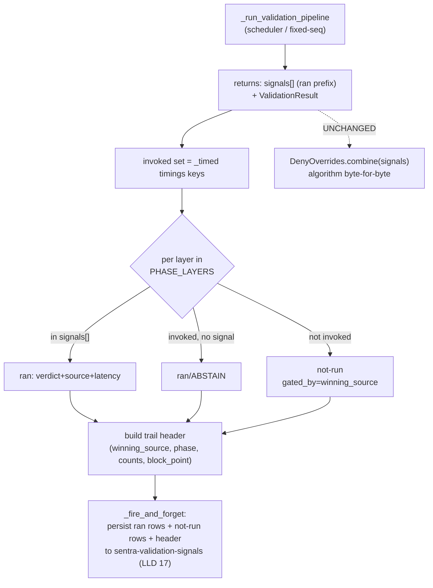

# WS-D — Record-what-ran decision trail (FR-6.8 / ADR-031)

> **Doc role:** This is the **workstream SCOPE** — boundary, dependencies, real `file:line` anchors, footguns, and acceptance criteria. It is an **INPUT to this workstream's implementation-grade LLD**, *not* the granular task breakdown. The granular, buildable tasks are generated **from the approved LLD** (canonical order: HLD → LLD → tasks). See [00-index.md](00-index.md) for the doc-role map.

**Parent HLD:** [hld/serverless-edition.md](../../hld/serverless-edition.md) §6.2(d) "Recording everything that ran" + the §8 hand-off row 4 ([§8 row, line 634](../../hld/serverless-edition.md#L634); blast-radius row [line 674](../../hld/serverless-edition.md#L674)).
**Status:** Not started
**Owner:** TBD
**Implements:** FR-6.8 (full decision-trail). **Decision:** ADR-031 (record-what-ran; DenyOverrides algorithm unchanged). Touches NFR-10 (full decision trail).
**Sub-PRD §5 status:** FR-6.8 = **PARTIAL** — "combiner records deciding source; short-circuits on first DENY so later layers don't run — no full-trail" ([prd/serverless-edition.md:299](../../prd/serverless-edition.md#L299), narrative [line 184](../../prd/serverless-edition.md#L184)). **This WS builds ONLY the missing part: the run-model + persisted-trail change.** The deciding-source attribution (`metadata.winning_source`) and the per-layer `Signal[]` collection already exist — do not rebuild them.

> **Next step: an implementation-grade LLD** (concrete schemas, function signatures, file changes, test cases) — this WS doc scopes the build; the LLD details it. **This WS extends [LLD 17](../../lld/17-validation-signal-store.md)** (the validation-signal store + trail shape); the implementation-grade LLD is an extension of LLD 17 §5.2.

---

## Dependencies

- **Depends on: WS-C (parallel-gather scheduler, HLD §6.2(c) / FR-2.8 / ADR-030).** WS-C and WS-D **define ONE execution model together** — this is the single most important reconciliation in the HLD ([§6.2(d) "In plain terms", line 337](../../hld/serverless-edition.md#L337)). WS-C decides *which* layers run (tier-0 short-circuit + tier-1 parallel-for-survivors); WS-D decides *what gets recorded* about the run (ran + not-run + verdicts). **WS-D must consume WS-C's notion of "the set of layers that COULD run for this phase" — it cannot compute coverage without it.** If WS-C lands the scheduler as a new module, WS-D's trail-builder hooks into that module's per-layer execution callback; if WS-C is not yet built, the trail-builder hooks the *current* fixed-sequential pipeline (`_run_validation_pipeline`, [validation_service.py:220](../../src/security-controller/app/services/validation_service.py#L220)) and the "coverage" set is the static ordered layer list. **Do not block on WS-C for the persistence + field work; block on it only for the dynamic coverage set.**
- **Blocks:** Console "Decision detail" panel (FR-13.2, [prd line 237](../../prd/serverless-edition.md#L237)) and Session-forensics view (FR-6.9) — both read the trail this WS persists.
- **Shared files / contracts:**
  - `src/security-controller/app/services/validation_service.py` — `_run_validation_pipeline` ([:220](../../src/security-controller/app/services/validation_service.py#L220)), `_capture` ([:239](../../src/security-controller/app/services/validation_service.py#L239)), `_timed` ([:34](../../src/security-controller/app/services/validation_service.py#L34)). **Shared with WS-C** (scheduler rewrites this function). Coordinate edits.
  - `src/security-controller/app/combiners/signal.py` (the `Signal` dataclass) and `sources.py` (the `Source` enum) — WS-D **reads** these, adds a new trail-record type alongside; **does not change** `Signal` semantics.
  - `src/security-controller/app/combiners/deny_overrides.py` — **READ-ONLY for this WS.** Algorithm is byte-for-byte unchanged (ADR-031).
  - LLD 17 signal-store table `sentra-validation-signals` (and tenant-scoped `*-v2`) — [construct](../../cdk/cdk_constructs/signal_store_table_construct.py), [schema LLD 17 §5.2](../../lld/17-validation-signal-store.md#L232). WS-D extends the persisted record; shares the table with WS that owns the store.
  - `phase` field on `ValidationRequest` ([models.py:17](../../src/security-controller/app/api/models.py#L17)) — **owned by the FR-3.4 multi-phase WS**; WS-D *consumes* it for trail field (4). If that WS hasn't added `phase` yet, WS-D defaults the trail's phase to `"request"` (see FOOTGUN below).

---

## Model — read before coding

Hold these invariants; they are what make the change correct and small:

1. **The seed already exists.** `_capture(result)` ([validation_service.py:239](../../src/security-controller/app/services/validation_service.py#L239)) already appends one `Signal` per validator that *ran and did not abstain*. On a short-circuit DENY, `signals[]` is "the prefix up to and including the denier"; on full ALLOW it is all six. **`signals[]` IS the run record — the change is recording the COMPLEMENT (what did NOT run) and persisting the union with verdict+source+latency+block-context.** ([docstring, validation_service.py:230-237](../../src/security-controller/app/services/validation_service.py#L230)).

2. **Abstain emits NO signal** (`if result.is_abstain: return` in `_capture`, [:248](../../src/security-controller/app/services/validation_service.py#L248)). The ML classifier abstains on Bedrock outage / disabled / very-low-confidence. **An abstaining layer DID run but produced no Signal — the trail must record it as `ran` with verdict `ABSTAIN`, NOT as `not-run`.** Conflating abstain with not-run is the central correctness trap of this WS.

3. **DenyOverrides is out of scope.** `DenyOverrides.combine()` ([deny_overrides.py:28](../../src/security-controller/app/combiners/deny_overrides.py#L28)) — any DENY wins → highest `priority` → higher `confidence` → alphabetical `source` — stays byte-for-byte ([ADR-031, HLD line 366](../../hld/serverless-edition.md#L366)). The `metadata["winning_source"]` it emits ([:51](../../src/security-controller/app/combiners/deny_overrides.py#L51)) is the deciding-source the PARTIAL status already credits; WS-D records it INTO the trail, does not recompute it.

4. **Per-layer latency already exists.** `_timed(label, coro)` ([:34](../../src/security-controller/app/services/validation_service.py#L34)) records each layer's elapsed ms into a per-request timings dict keyed by label (`"trust"`, `"policy"`, `"cross_agent"`, `"sigma"`, `"context"`, `"abuse"`, `"ml"`). Trail field (1) "latency per run layer" reads from this dict — **do not add a second timing mechanism.**

5. **Record what ran; force nothing extra (tie-breaker B).** Producing the trail must NOT make the scheduler run a layer it would otherwise skip ([HLD line 119](../../hld/serverless-edition.md#L119)). The default path records the prefix + marks the rest not-run. **Only** the opt-in high-assurance mode (per-tenant/per-session) re-runs the full deterministic tier *for the record's sake* (Option C as a setting, [HLD line 345](../../hld/serverless-edition.md#L345)).

6. **Both outcomes recorded.** The trail is NOT deny-only — an ALLOW request persists a full trail too ([field (3), HLD line 361](../../hld/serverless-edition.md#L361)).

7. **Persistence is off the hot path.** Today the audit dual-write of `signals[]` goes through `_fire_and_forget` ([validation_service.py:60](../../src/security-controller/app/services/validation_service.py#L60)) — fire-and-forget, swallows failures. The trail persists the same way (it is audit metadata, never on the action path). **Trail persistence failure must never turn a clean verdict into a 500.**

---

## Milestone D1 — Define the persisted trail record (extends LLD 17 §5.2)

The trail is a per-request record (not a per-signal row). The signal rows already exist in `sentra-validation-signals` keyed `PK=session_id` (or `tenant_session_id`), `SK=request_id#timestamp_ms#source` ([LLD 17 §5.2](../../lld/17-validation-signal-store.md#L232)). The trail adds (a) **not-run markers** as first-class rows alongside the ran-signal rows, and (b) a small per-request **trail-header** the console reads in one Query.

### D1.1 — Trail record fields (the four owner-asked fields, [HLD lines 358-362](../../hld/serverless-edition.md#L358))

The trail per validated request captures exactly:

| Field group | Content | Source today |
|---|---|---|
| **(1) coverage** | every detector that *could* run for this phase; which **ran** vs **not-run (gated by earlier DENY / cost)**; each run layer's `verdict` + `source` + `latency_ms` | run set = `signals[]`; coverage set = WS-C scheduler's layer list (fallback: static order); latency = `_timed` dict |
| **(2) block-point + why, with depth** | the layer that blocked + its reason; the **prompt** (`user_input`), the **tool + params** (`tool_name`/`tool_params`), **caller agent → target** (`agent_id` → target agent), **IP/source** where available | DENY `Signal.reason`; request fields on `ValidationRequest` ([models.py:17](../../src/security-controller/app/api/models.py#L17)); cross-agent caller→target from `cross_agent_validator` |
| **(3) both outcomes** | ALLOW *and* DENY persist a full trail | `validation_result.decision` |
| **(4) phase** | one of `{request\|content\|output\|memory}` | `request.phase` (default `"request"` until FR-3.4 WS lands the field) |

### D1.2 — Not-run marker: store as a Signal-shaped row with a new decision value

**FOOTGUN — do NOT invent a parallel table for not-run markers.** They share the request partition so the console reads ran + not-run in one `Query(PK, SK begins_with <request_id>)` (the O(K) access pattern LLD 17 §5.2 is built around, [line 264](../../lld/17-validation-signal-store.md#L264)). Write each not-run layer as a row in `sentra-validation-signals` with these attributes (delta over the [§5.2 schema](../../lld/17-validation-signal-store.md#L240)):

| attr | type | notes |
|---|---|---|
| `source` | string | the layer that did not run, e.g. `sentra.ml_classifier`, `sentra.context` — from `Source` enum ([sources.py](../../src/security-controller/app/combiners/sources.py)) |
| `decision` | string | **`NOT_RUN`** — a new value. **FOOTGUN:** the existing `Signal.decision` is `Literal["ALLOW","DENY"]` ([signal.py:25](../../src/security-controller/app/combiners/signal.py#L25)) and `DenyOverrides.combine` filters `s.decision == "DENY"`. A `NOT_RUN` row MUST NOT be fed to `combine()` — it would be silently treated as a non-DENY ALLOW-equivalent and skew nothing today, but if `ABSTAIN` were ever added the filter would need auditing. **Keep not-run rows OUT of the `signals[]` list passed to the combiner;** persist them on a separate list. |
| `reason` | string | the gating cause: `"not-run (gated by earlier DENY at <denier_source>)"` or `"not-run (cost-gated tier-1, no tier-0 survivor path)"` |
| `request_id` / `session_id` (or `tenant_session_id`) | string | same as the ran rows — same partition |
| `timestamp_ms` / `timestamp_iso` / `decision_date` / `expires_at` | per §5.2 | **FOOTGUN:** `decision_date` is a real stored attribute, not derived — `audit_logger` asserts its presence ([LLD 17 §5.2, line 280](../../lld/17-validation-signal-store.md#L280)). A not-run row missing it silently drops from GSI 2. |
| `metadata.gated_by` | string | the deciding source that caused the short-circuit (`winning_source`) — lets the console render "ML not run because policy denied" |

### D1.3 — Trail header (one per request, for the console's single-read render)

A per-request summary row (or the `sentra.combined` row's `metadata`, reusing the existing combined-signal write at [LLD 17 §5.2, line 286](../../lld/17-validation-signal-store.md#L286)) carrying:

| attr | type | notes |
|---|---|---|
| `winning_source` | string? | from `DenyOverrides.combine(...).metadata["winning_source"]` ([deny_overrides.py:51](../../src/security-controller/app/combiners/deny_overrides.py#L51)) — unchanged |
| `phase` | string | field (4) |
| `coverage_total` | number | count of layers that COULD run this phase |
| `ran_count` / `not_run_count` / `abstain_count` | number | reconcile: `ran_count + not_run_count == coverage_total`; `abstain_count ⊆ ran_count` |
| `block_point` | string? | the layer source that blocked (null on ALLOW) |
| `high_assurance` | bool | whether Option-C full-tier mode was active for this request (D3) |

**Acceptance for D1:** the union `{ran rows} ∪ {not-run rows}` for one `request_id` covers every layer in the phase's coverage set exactly once; abstaining layers appear as ran with an `ABSTAIN`-marked verdict, never as not-run.

---

## Milestone D2 — Wire the run model into the pipeline (build the trail; record not-run)

### D2.1 — Collect the not-run complement at each short-circuit

In `_run_validation_pipeline` ([validation_service.py:220](../../src/security-controller/app/services/validation_service.py#L220)), every short-circuit return today is `return <result>, signals` (e.g. trust DENY [:289](../../src/security-controller/app/services/validation_service.py#L289), policy DENY [:320](../../src/security-controller/app/services/validation_service.py#L320), cross-agent [:343](../../src/security-controller/app/services/validation_service.py#L343), sigma [:350](../../src/security-controller/app/services/validation_service.py#L350), context [:357](../../src/security-controller/app/services/validation_service.py#L357), abuse [:364](../../src/security-controller/app/services/validation_service.py#L364), ml [:385](../../src/security-controller/app/services/validation_service.py#L385)). Conceptually:

```python
# coverage set for this phase — from WS-C scheduler if present, else the static order:
PHASE_LAYERS = scheduler.layers_for(request.phase)  # ["trust","policy","cross_agent","sigma","context","abuse","ml"]

# after the pipeline returns (ran prefix + the denier, or full set):
ran_sources   = {s.source for s in signals} | {abstained layers}   # see D2.2
not_run = [layer for layer in PHASE_LAYERS if layer not in ran_sources]
gated_by = combined.metadata["winning_source"]   # the denier, or None on ALLOW
trail = build_trail(signals, not_run, gated_by, request, phase=request.phase)
```

**FOOTGUN — do NOT change the short-circuit `return` points to keep running.** Tie-breaker B: the scheduler still stops at first DENY. The not-run set is computed *after* the (early) return, from the difference between the coverage set and what ran. Changing the returns to run-through is Option B (rejected — blows latency, [HLD line 344](../../hld/serverless-edition.md#L344)).

### D2.2 — Distinguish abstain (ran, no signal) from not-run (didn't run)

A layer that abstained ran but produced no `Signal` (`_capture` drops it, [:248](../../src/security-controller/app/services/validation_service.py#L248)). To classify it as `ran/ABSTAIN` not `not-run`, the trail-builder needs the set of layers that were *invoked*. Two clean options for the LLD to pick between:

- (a) Have `_timed(label, coro)` already records *every invoked* layer's label in the timings dict ([:34](../../src/security-controller/app/services/validation_service.py#L34)) — **the timings-dict keyset is exactly the "invoked" set.** `ran/ABSTAIN` = `timings.keys()` − `{s.source ran}`. This is the recommended seam — no new bookkeeping.
- (b) Capture abstain explicitly in `_capture` by appending a lightweight `(source, "ABSTAIN")` marker to a separate list before the early `return`.

**FOOTGUN:** `_timed` labels are short (`"trust"`, `"ml"`) while `Signal.source` is the dotted taxonomy (`"sentra.trust"`, `"sentra.ml_classifier"`). The trail-builder needs a label→source map; put it in `sources.py` next to `DEFAULT_PRIORITIES`, do not scatter string literals.

### D2.3 — Persist ran + not-run + header off the hot path

The DENY/ALLOW handlers already receive `signals=signals` ([validation_service.py:178/188](../../src/security-controller/app/services/validation_service.py#L178)) and dual-write via `_fire_and_forget` ([:60](../../src/security-controller/app/services/validation_service.py#L60)). Extend that same fire-and-forget write to also persist the not-run rows + the trail header. **FOOTGUN:** the audit writer swallows failures (per CLAUDE.md "audit writes fire-and-forget"); that is correct for the hot path, but it means a silently-dropped trail looks identical to a healthy one — add a `TrailPersistFailures` ops metric (mirror `metrics_publisher.put_metric_data` fire-and-forget pattern, [metrics_publisher.py:129](../../src/security-controller/app/utils/metrics_publisher.py#L129)) so the gap is observable.

### Trail-build flow



---

## Milestone D3 — Tunable high-assurance mode (Option C as a per-tenant/per-session setting)

The default records the prefix + not-run markers. High-assurance tenants opt in to run the **full deterministic tier** (tier-0 layers) *even after a DENY* so the trail shows every cheap-layer verdict, not "not-run" ([HLD line 343/345](../../hld/serverless-edition.md#L343)).

### D3.1 — Config surface

- Per-tenant default + per-session override. Per-tenant config already exists as a requirement (FR-10.4, [prd line 226](../../prd/serverless-edition.md#L226)). Add `trail_full_deterministic_tier: bool` (default `false`). **FOOTGUN — do NOT make this a global env flag** like `cedar_enabled`; the owner ask is *per-tenant/per-session*, and a global flag would force the cost on every tenant (re-creating Option B). Resolve it from the tenant record / session, not `config.py`.
- Per-session override carried on the request context (`ValidationRequest.context`, [models.py:17](../../src/security-controller/app/api/models.py#L17)) or a session attribute, so a single high-stakes session (e.g. a money-movement run) can request the full trail without flipping the tenant default.

### D3.2 — Run-only-for-record semantics

When the mode is on **and** a tier-0 layer denies: the scheduler still returns the DENY verdict (the customer-facing decision is unchanged), but the remaining tier-0 deterministic layers are executed **record-only** — their `Signal`s are appended to the trail's ran-set but are **NOT fed to `DenyOverrides.combine`** for the live verdict. **FOOTGUN — the live verdict MUST be identical whether the mode is on or off.** Feeding the extra record-only signals into `combine()` could change `winning_source` (e.g. a higher-priority later DENY), silently altering the deciding source. Keep two lists: `verdict_signals` (the short-circuit prefix → combiner) and `record_only_signals` (the extra full-tier runs → trail only).

**FOOTGUN — high-assurance mode never re-runs the EXPENSIVE tier** (ML / D1–D7). Option C runs only the *cheap deterministic tier* for the record ([HLD line 345](../../hld/serverless-edition.md#L345)); ML stays gated. Running ML for the record would re-create the cost the scheduler exists to avoid (tenet 5).

---

## Error model

| Condition | Response |
|---|---|
| Trail persistence (DDB) write fails | Swallow on the hot path (`_fire_and_forget`); emit `TrailPersistFailures` ops metric; the verdict still returns. **Never 500 a clean decision on a trail-write failure.** |
| `phase` field absent on request (FR-3.4 WS not yet landed) | Default trail phase to `"request"`; the coverage set is the request-phase layer list. Do not error. |
| Coverage set unavailable (WS-C scheduler not built) | Fall back to the static ordered layer list for the fixed-sequential pipeline; trail still complete for the `request` phase. |
| A not-run row missing `decision_date` | Reject at write (audit_logger assertion, [LLD 17 §5.2](../../lld/17-validation-signal-store.md#L280)) — writer computes it from `timestamp_iso[:10]`; a bug here drops the row from GSI 2 silently. |
| `NOT_RUN` row accidentally passed to `DenyOverrides.combine` | Guarded against by keeping not-run rows on a separate list; add a unit test asserting `combine` is never called with a non-`{ALLOW,DENY}` decision. |

---

## Acceptance criteria

- [ ] For an **ALLOW** request, the persisted trail for the `request_id` contains a row for **every** layer in the phase coverage set, each with `decision ∈ {ALLOW, ABSTAIN}`, its `source`, and a `latency_ms` (from `_timed`). `not_run_count == 0`.
- [ ] For a **short-circuit DENY** at layer L, the trail contains: ran rows for the prefix up to and including L (verdict + source + latency); a `NOT_RUN` row for every later coverage-set layer with `reason` naming the gate and `metadata.gated_by == winning_source`. `ran_count + not_run_count == coverage_total`.
- [ ] An **abstaining** layer (e.g. ML on Bedrock-disabled) appears as a **ran** row with verdict `ABSTAIN` — **never** as `not-run`. Verified by a test that disables the ML classifier and asserts the ML row is `ran/ABSTAIN`.
- [ ] Trail records **both outcomes**: a passing ALLOW request persists a full trail (test asserts a trail row group exists for an ALLOW `request_id`).
- [ ] Trail field (2) block-context is present on a DENY: `block_point`, the `reason`, `tool_name`, `tool_params`, caller `agent_id` (+ target for cross-agent denials), and IP/source where the request carried it.
- [ ] Trail header records the correct `phase` from `request.phase` (or `"request"` default), and `winning_source` equals `DenyOverrides.combine(verdict_signals).metadata["winning_source"]`.
- [ ] **DenyOverrides unchanged:** `git diff` shows zero changes to `deny_overrides.py`; the existing combiner tests ([tests/test_combiner.py](../../src/security-controller/tests/) — `deny_overrides`) pass byte-for-byte. A test asserts `combine` is never invoked with a `NOT_RUN`-decision signal.
- [ ] **Verdict invariant under high-assurance mode:** for an identical request, the customer-facing `decision` + `winning_source` are byte-identical with `trail_full_deterministic_tier` ON vs OFF; only the trail's `ran_count` differs. Verified by a paired test.
- [ ] High-assurance mode is resolved **per-tenant/per-session** (not a global flag); ON re-runs only the cheap deterministic tier for the record, never the ML/deep tier (test asserts ML invocation count is unchanged when the mode is toggled on a tier-0 DENY).
- [ ] Trail persistence is off the hot path (`_fire_and_forget`); a forced DDB write failure emits `TrailPersistFailures` and does **not** change the HTTP verdict/status (test asserts 200/expected-status on a stubbed write failure).
- [ ] `decision_date` is populated on every ran and not-run row (GSI-2 membership verified).

---

## Cross-references

- **HLD:** [hld/serverless-edition.md](../../hld/serverless-edition.md) §6.2(d) ([line 333](../../hld/serverless-edition.md#L333)); tie-breaker B ([line 119](../../hld/serverless-edition.md#L119)); §8 hand-off row 4 ([line 634](../../hld/serverless-edition.md#L634)); ADR-031 ([line 650](../../hld/serverless-edition.md#L650)); blast-radius row ([line 674](../../hld/serverless-edition.md#L674)); shared-contracts decision-trail entry ([line 659](../../hld/serverless-edition.md#L659)).
- **Sub-PRD:** [prd/serverless-edition.md](../../prd/serverless-edition.md) FR-6.8 ([narrative line 184](../../prd/serverless-edition.md#L184), [status line 299](../../prd/serverless-edition.md#L299)); §4.6 exhaustive decision-trail ([line 173](../../prd/serverless-edition.md#L173)); FR-6.9 session forensics ([line 185](../../prd/serverless-edition.md#L185)); FR-13.2 Decision-detail dashboard ([line 237](../../prd/serverless-edition.md#L237)); FR-10.4 per-tenant config ([line 226](../../prd/serverless-edition.md#L226)).
- **Sibling WS:** WS-C (parallel-gather scheduler / FR-2.8 — shares the run model + `_run_validation_pipeline`); the FR-3.4 multi-phase WS (owns the `phase` field WS-D consumes); the console / dashboard WS (consumes the persisted trail for FR-13.2 / FR-6.9).
- **LLDs / code:** [LLD 17](../../lld/17-validation-signal-store.md) (signal store + trail shape — **the implementation-grade LLD extends §5.2**); `validation_service.py` `_run_validation_pipeline`/`_capture`/`_timed`; `combiners/{signal,sources,deny_overrides}.py`; [signal_store_table_construct.py](../../cdk/cdk_constructs/signal_store_table_construct.py); [metrics_publisher.py](../../src/security-controller/app/utils/metrics_publisher.py) (fire-and-forget metric pattern).
