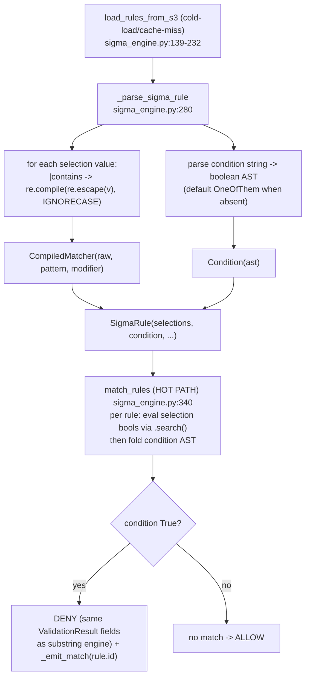
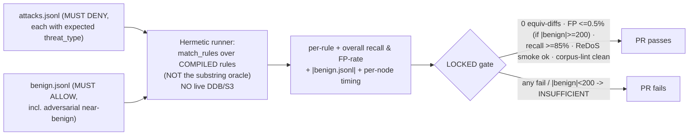
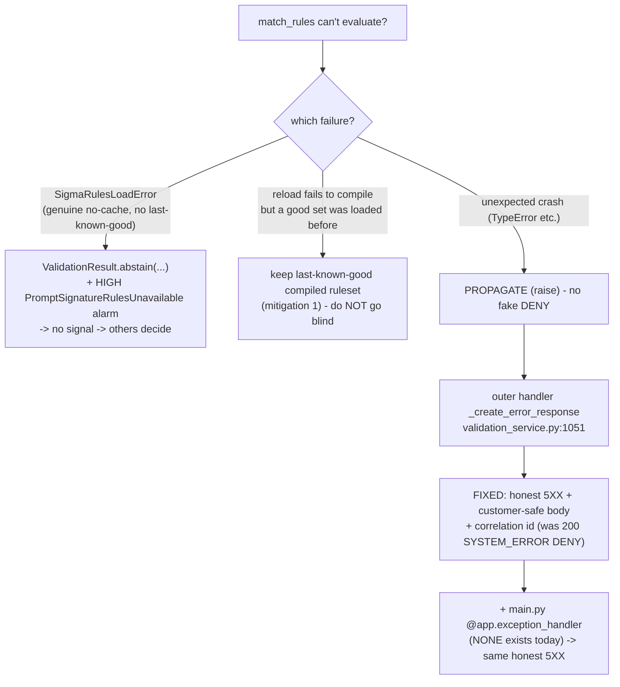

# WS-F — Prompt-signature rules (dialect migration + corpus + CI eval gate + honest error-contract)

**Parent LLD**: [lld/35-prompt-signatures.md](../../lld/35-prompt-signatures.md) (approved — the source of truth for this workstream)
**Status**: ✅ **CODE-DONE → main @ `5cef5d2` + DEPLOYED to prod @ milestone-100** (2026-07-05). F1–F8 built; 919 unit pass / 0 fail; integration-sentinel GO; live-verified on prod traffic (`prompt-signature rule matched … threat_type=PROMPT_INJECTION`, F7 remap + F6.7 server-only reason both live). Outage fail-mode = ABSTAIN (founder-signed as-built). **Pending items are NOT WS-F's** — see [What remains](#what-remains-not-ws-f-owned) at the bottom.
**Owner**: Autopilot (code-loop salvage + deploy, 2026-07-05)
**Implements**: FR-3.1 (existing substring engine — **DONE, do NOT rebuild**), FR-3.14 (real dialect + corpus + eval loop; the F5 runtime loop is **design-only** here).
**Decisions**: ADR-034 (Cedar + prompt-signature deterministic floor is **non-disableable** in every mode/edition), ADR-031 (`DenyOverrides` algorithm unchanged), ADR-030 (DAG scheduler).

> **Doc role.** This is the granular, buildable task breakdown generated from the approved LLD (canonical order HLD → LLD → tasks). It replaces the earlier Jul-1 SCOPE doc, which predated lld/35. Every task below carries real `file:line` touch-points, named footguns, and named tests. If a mechanism reads as under-specified, the answer is in the cited lld/35 §; but you should not need to open it to build.

---

## Dependencies

- **Depends on** (tracked; see the [Open threats → owning workstream](#open-threats--owning-workstream) table for status):
  - **WS-M** ([ws-m-authz.md](ws-m-authz.md), Milestone **M-M3**) — lands the **platform-operator `require_role`** gate on the sigma-mutating routes (`PATCH /sigma-rules/{rule_id}` + the `__sigma_version__` version-epoch write). **Tracked, NON-BLOCKING dependency (founder 2026-07-05, Option B)** — WS-F builds/merges ahead; the gate is a known WS-M build item. WS-F owns only the *CI assertion* (task F6.5, non-blocking WARNING) that checks for the gate; WS-M lands the gate itself (see the ✅ Resolved decision below).
  - **WS-I** ([ws-i-cedar-engine.md](ws-i-cedar-engine.md)) — owns the *Cedar/abuse* coverage of the 4 relocated param-rules (F8). WS-F hands WS-I a written, dated gap list; WS-I writes the enforcing (tested, deny-on-missing) Cedar policy. A relocation is only "closed" when WS-I's tested policy exists.
  - **WS-A** ([ws-a-local-floor-bundle.md](ws-a-local-floor-bundle.md)) — owns the stdlib-only SDK **bundle interpreter** and the **differential-conformance test** (co-owned with WS-I for the `cedarpy` corpus). WS-A is **spike-gated / not-started**. WS-F delivers only the LOCKED dialect spec (F2 output) as WS-A's input; conformance is **unproven until WS-A ships**. WS-F does NOT build the second evaluator.
- **Blocks**: nothing hard. The LOCKED dialect (F2) is WS-A's input spec — WS-A cannot start its interpreter until the dialect is frozen, so F2 is a soft predecessor of WS-A.
- **Shared contracts** (canonical join keys — unchanged by WS-F unless noted):
  - `Source.SENTRA_SIGMA` (`"sentra.sigma"`, priority **70**, display "Prompt-signature rules") — [sources.py:24,74,192](../../src/security-controller/app/combiners/sources.py#L24). **UNCHANGED.**
  - `SigmaEngine.match_rules(user_input: str) -> ValidationResult` — [sigma_engine.py:340](../../src/security-controller/app/validators/sigma_engine.py#L340), the DAG-node contract. **Signature UNCHANGED**; the only behavioral change is rule-load failure now returns `ValidationResult.abstain(...)` (§6a) instead of a `RULE_ENGINE_ERROR` DENY — audit/console consumers of that fake-DENY must expect an ABSTAIN (no signal) on a rule-store outage.
  - `PromptSignatureRule` closed dialect — matchers `{contains, re, all}`, conditions `{1 of them, all of them, and, or, not}` — the LOCKED spec (F2, Appendix A of lld/35). Includes the §6d **reject set**, not only match semantics.
  - Rule YAML schema (`id/title/status/tags/level/detection{selections+condition}/falsepositives/response`) — [sample-artifacts/sigma_rules/llm/](../../sample-artifacts/sigma_rules/llm/).
  - DDB table `sentra-sigma-rules-metadata`, S3 prefix `sigma_rules/llm/` — **UNCHANGED** (schema is opaque to the YAML dialect; additive fields only).

---

## Read before coding (invariants — short)

1. **FR-3.1 is DONE — do NOT rebuild it.** The substring engine works today: `SigmaEngine` ([sigma_engine.py:58](../../src/security-controller/app/validators/sigma_engine.py#L58)), `match_rules` ([:340](../../src/security-controller/app/validators/sigma_engine.py#L340)), the substring match `if pattern.lower() in user_input_lower` ([:358](../../src/security-controller/app/validators/sigma_engine.py#L358)), loaded hybrid DDB+S3 ([load_rules_from_s3:139](../../src/security-controller/app/validators/sigma_engine.py#L139)), wired at [registry.py:133-134 `_run_sigma`](../../src/security-controller/app/services/scheduler/registry.py#L133). WS-F upgrades the *dialect inside* the engine — it does NOT touch the node's position, `depends_on`, `order_key`, or the `Source.SENTRA_SIGMA` contract.
2. **The F1 migration must preserve EVERY verdict — bug-for-bug.** A migration that changes any verdict is a security change masquerading as a refactor. Mis-tagged `threat_type`s stay mis-tagged through migration (remapped only in F7). The 4 inert param-rules stay inert (relocated only in F8). Freeze the OLD verdicts as an oracle *first*, then prove 0 diffs.
3. **`re.escape` on every `|contains` value is MANDATORY (fail-secure, M2).** Live patterns carry regex metacharacters — `[SYSTEM]`, `<|im_end|>`, `'; DROP TABLE`, `\x`, `\u`, `---END SYSTEM---`, `OR 1=1--`. Without `re.escape`, `[SYSTEM]` becomes a char class and `\x` is an uncompilable escape → the rule silently stops matching = **fail-open**.
4. **Sigma is tier-0 (deterministic), not tier-1.** A sigma DENY short-circuits before ANY model runs ([run.py:456-481](../../src/security-controller/app/services/scheduler/run.py#L456)). Its priority (70) is the highest of any request-phase node. Do not change this.
5. **ABSTAIN, not fake-DENY.** When the engine cannot evaluate (rule-load failure), it ABSTAINs (emits no signal) — it does NOT fabricate a `RULE_ENGINE_ERROR` DENY. A genuine crash propagates to the outer handler (honest 5XX), it is not swallowed into a DENY.
6. **No `eval()` on rule-authored condition text.** The condition parses to a pure boolean AST (`And/Or/Not/Ref/OneOfThem/AllOfThem`); evaluation is a fold over the per-selection bools. Never `eval()`.
7. **All compilation happens at LOAD, never in `match_rules`.** A per-request `re.compile` blows the ≤500 ms deterministic-floor budget (NFR-1).

---

## ✅ Resolved decision — §3.3 CI assertion is a non-blocking WARNING (founder 2026-07-05)

lld/35 §3.3 as-written implied a build-FAILING CI assertion (which would make WS-M a hard merge-gate on WS-F). The **founder resolved this 2026-07-05: Option B** — WS-M is a **tracked, non-blocking dependency**, and the gate is **added as a known WS-M build item** so WS-M knows to land it:

- **WS-F's CI assertion (task F6.5) emits a non-blocking WARNING** if any sigma-mutating route (`PATCH /sigma-rules/*`, the `__sigma_version__` version-epoch write) lacks a platform-operator `require_role`. **WS-F ships/merges ahead** — it is *not* blocked.
- **WS-M owns landing the actual gate** — captured in [ws-m-authz.md](ws-m-authz.md) **M-M3** (platform-scope gate on `update_sigma_rule` + the version-epoch write, + the failing-then-passing 403 test). When M-M3 lands, WS-F's warning clears.
- **Interim exposure (accepted):** until M-M3 ships, the sigma-retire route stays ungated — a known, documented ADR-034-adjacent hole, accepted for velocity. Flipping the CI check to build-failing later (if desired) is a one-line change.

This supersedes lld/35 §3.3's "WS-F does not merge with this open" hard-gate wording.

---

## Open threats → owning workstream

> **WS-M DEPENDENCY (tracked, NON-BLOCKING — founder 2026-07-05, Option B; see the ✅ Resolved decision above).** WS-F **builds/merges ahead**; it does not wait on WS-M. WS-M (Milestone **M-M3**) lands a **PLATFORM-operator** `require_role` gate on the sigma retire path as a known build item, and WS-F's CI check (F6.5) is a non-blocking WARNING that clears when that gate lands. Exactly **THREE** lld/35 threats route to WS-M for the fix, and all three are **one call chain behind one missing door**: (1) the §3.3 unauthenticated `PATCH /sigma-rules/{rule_id}` retire path ([routes.py:1445](../../src/security-controller/app/api/routes.py#L1445) — no `require_role`, so any API-key / spoofable-`X-Operator-Email` holder can move a stable rule to `deprecated` and silently strip detection); (2) its platform-scope corollary (the sigma store `sentra-sigma-rules-metadata` + `sigma_rules/llm/` is **fleet-global / NOT tenant-partitioned**, so the gate must be **platform-operator** scope, not tenant — copying the tenant-scoped `delete_feedback_subject` pattern is the wrong-scope trap); and (3) the `__sigma_version__` version-epoch write it triggers, which is ALSO the primary control for the §6c/§12 **poisoned-but-compilable-reload** denial-of-detection vector — an unauthenticated version bump is the real attack. VERIFIED against [ws-m-authz.md](ws-m-authz.md): WS-M owns all three under **M-M3** (gates BOTH `update_sigma_rule` and the version-epoch write at platform scope; states the platform-not-tenant rationale; the failing-then-passing 403 test asserts BOTH an un-roled AND a merely-tenant-scoped caller gets 403). **Division of labor:** WS-M LANDS the gate + the 403 test; **WS-F OWNS a self-contained CI assertion (task F6.5, §3.3 item 4)** that checks its OWN build for the gate — so the invariant survives even if the WS-M fix later regresses. **More of lld/35's residual risk collapses when WS-M M-M3 ships than for any other single dependency.**

The rows below are grouped: **WS-M-dependent rows first** (visually together), then **WS-F-owned**, then **other-WS dependencies**, then **unowned tracked debt**, then **mitigated/closed**.

### Rows that depend on WS-M (grouped together)

| Threat | Owning WS | Status |
|---|---|---|
| §3.3 Unauthenticated `PATCH /sigma-rules/{rule_id}` retire path — no `require_role`; any API-key/spoofable-`X-Operator-Email` holder can move a stable rule to `deprecated` and strip detection (per-rule content kill-switch; defeats ADR-034 non-disableable floor) | **WS-M (M-M3)** | OPEN — merge-blocking dependency on WS-M |
| §3.3 Global blast radius — gate must be **PLATFORM-operator** scope, not tenant (sigma store is fleet-global / not tenant-partitioned; a tenant-scoped role on a fleet-global mutation is a cross-tenant coverage event) | **WS-M (M-M3)** | OPEN — merge-blocking dependency on WS-M |
| §4.6/§6c `__sigma_version__` version-epoch write must inherit the same platform-operator gate (an unauthenticated version bump is the real vector for the poisoned-but-compilable reload; retire PATCH + version write are one call chain behind one missing door) | **WS-M (M-M3)** | OPEN — merge-blocking dependency on WS-M |
| §6c/§12 Poisoned-but-compilable reload — attacker writes a well-formed but neutered ruleset + bumps version; set compiles cleanly, last-known-good does not trigger, detection silently downgraded fleet-wide with no error | **WS-M** (primary RBAC control) / **WS-F** (defense-in-depth delta alarm, task F6.4) | OPEN — primary control depends on WS-M M-M3; WS-F builds backstop alarm on `stable`→`deprecated` / rule-count-drop delta |

### Rows WS-F owns

| Threat | Owning WS | Status |
|---|---|---|
| §3.3 item 4 CI assertion — **non-blocking WARNING** (founder 2026-07-05, Option B) if any sigma-mutating route lacks a platform-operator `require_role`; WS-F ships ahead, warning clears when WS-M M-M3 lands the gate | **WS-F** (task F6.5) owns the check; **WS-M** (M-M3) owns the gate | OPEN — non-blocking; WS-M-tracked, not a merge-gate |
| §5 Migration 0-diff equivalence — the substring→regex migration must change ZERO verdicts (bug-for-bug, incl. mis-tagged `threat_type`s and inert param-rules); frozen oracle captures the OLD tuple per input, the new engine is diffed against it (gate: 0 diffs) | **WS-F** (F1) | OPEN — WS-F TODO |
| §4.2/§4.4/§6d In-layer fail-open guards — `re.escape` on every `|contains` value, no `eval()` on condition text, undefined-selection FAILS the load, `|re` validated as untrusted external data (compile-fail skip, ReDoS structural heuristic, 512-char length cap, matcher-count caps 200/rule 5000/ruleset) | **WS-F** (F1/F2/F6) | OPEN — WS-F TODO (dialect/loader correctness) |
| §6a Rule-load failure → fake 200-DENY (`RULE_ENGINE_ERROR` fabricated detection lie). Fix: `ValidationResult.abstain(...)` + HIGH `PromptSignatureRulesUnavailable` alarm | **WS-F** (F6) | OPEN — WS-F TODO (in-layer) |
| §6b Genuine engine crash swallowed into fake 200-DENY (bare `except` at [sigma_engine.py:394-403](../../src/security-controller/app/validators/sigma_engine.py#L394)). Fix: remove blanket swallow so a real crash propagates to the honest outer handler | **WS-F** (F6) | OPEN — WS-F TODO (in-layer) |
| §6f item 1 `_create_error_response` 200-body DENY (`SYSTEM_ERROR`) — every pipeline exception reported as a detection DENY at HTTP 200. Fix: honest 5XX + customer-safe body + correlation id | **WS-F** (F6) | OPEN — WS-F TODO (WS-F now OWNS items 1+2) |
| §6f item 2 `main.py` has NO FastAPI exception handler (verified) — unhandled paths fall back to fabricated 200-DENY or a leaked default-500 detail. Fix: registered `@app.exception_handler` → honest 5XX + sanitized body + correlation id | **WS-F** (F6) | OPEN — WS-F TODO (WS-F now OWNS items 1+2) |
| §6e Reason-text discipline — a signature DENY cites the indicator (`threat_type` + rule title), never the prompt verbatim (avoids prompt-echo / co-tenant content leak); matched pattern logged server-side at WARNING only | **WS-F** (F6) | CLOSED-IN-WS-F (already correct at [sigma_engine.py:369](../../src/security-controller/app/validators/sigma_engine.py#L369); keep + add a regression assert) |
| §6c/§12 Poisoned reload — bad/uncompilable body must NOT drop the engine to blind; keep last-known-good compiled ruleset; ABSTAIN only on genuine cold-start-no-cache (mitigation 1) | **WS-F** (F6) | OPEN — WS-F TODO |
| §12 Stale-pin — attacker pushes repeated compile-FAILING version bumps to freeze the floor on a stale ruleset indefinitely (visible today only as per-reload WARN logs). Control: alarm (page) at N consecutive failed reloads OR > T min since last good compile (defaults N=3 / T=30m) | **WS-F** (F6) | OPEN — WS-F TODO |
| §6c Denial-of-detection via induced ABSTAIN (signature-blind window) — attacker induces the load failure to blind the layer fleet-wide; bounded by last-known-good + a signatures-blind SLO/paging runbook. Residual ML backstop ~57–60% indirect-injection recall (WS-0) | **WS-F** (SLO/alarm/mitigations) / ~40% ML recall gap owned by **WS-L** | OPEN — WS-F TODO (mitigations); recall gap depends on WS-L |
| §7/§9.2 Threat-type multi-tag integrity — `_extract_threat_type` returns the FIRST `llm.<x>` tag by YAML order; rules with two `llm.` tags derive a `threat_type` a reformat/sort silently flips, zero test coverage. Fix: de-dup to single primary tag (F7) + F4 corpus-lint (`>1 llm. tag == 0`) + reorder-stable migration test | **WS-F** (F7) | OPEN — WS-F TODO |
| §7 `UNKNOWN_THREAT` corpus bug — a rule with no `llm.` tag derives `UNKNOWN_THREAT`; F4 gate fails on it (`== 0`). WS-F owns the F7 remap of off-enum tags to the 8-value enum, sequenced AFTER the §5 equivalence-frozen migration | **WS-F** (F7) | OPEN — WS-F TODO (after §5 migration) |
| §7 Downstream blast-radius of `threat_type` remap — the remap changes the emitted `threat_type` string; WS-F must grep+reconcile every consumer keyed on OLD off-enum strings (LLD-33 trail, console grouping `src/dashboard/`, scenario-test `expected_threat_type`, CloudWatch dimensions) as part of F7 | **WS-F** (F7) | OPEN — WS-F TODO (reconciliation, not an afterthought) |
| §8 Atomic / coverage-first sequencing — relocation of money-movement predicates MUST land before or atomically with the covering Cedar/abuse policy; no zero-coverage window on a financial-action agent; inert YAML stays until the tested Cedar coverage is live | **WS-F** (sequencing discipline) / **WS-I** (enforcing policy) | OPEN — WS-F owns sequencing; enforcing coverage depends on WS-I |
| §8 Disclosure-triage / coverage-gap incident — the 4 param controls were INERT in production and never fired. **RESOLVED (founder 2026-07-05): no live customer** ever had them presented as active → no external representation to remediate | **WS-F** files internal note only | RESOLVED — no live customer; WS-F relocates the rules (F8), no disclosure action |
| §10.5 FP-gate benign-corpus floor — the ≤0.5% FP gate is meaningless below ~200 benign lines (today ~22 seeds); below the floor the gate reports INSUFFICIENT. Because ADR-034 makes the floor non-disableable, an over-blocking rule is a product-breaking bug the customer cannot turn off. WS-F owns building `benign.jsonl` to ≥200 + the interim merge rule + the F4 gate | **WS-F** (F3/F4) | OPEN — WS-F TODO (hard dated deliverable) |

### Rows that depend on another workstream

| Threat | Owning WS | Status |
|---|---|---|
| §8 Cedar coverage of the **3 Cedar-surface** relocated param-rules (`suspicious_parameter_manipulation`, `excessive_refund_attempts`, `data_exfiltration` limit-cap) — WS-F files the per-rule gap list; the enforcing Cedar coverage is WS-I's. Closed only when a tested covering policy exists | **WS-I** | OPEN — dependency on WS-I (gap list handed over; coverage unproven) |
| §8 **Abuse-detector** coverage of the 4th relocated rule (`rate_limit_abuse`, sigma-llm-009) — a per-minute call-rate predicate belongs to the **abuse-detector** surface (`abuse_detector.check_rate_limit`, [registry.py:139-161](../../src/security-controller/app/services/scheduler/registry.py#L139)), **NOT** Cedar (WS-I has zero abuse/rate_limit scope). WS-F files the gap; the covering check has **no clear A-L owner** today | **abuse-detector surface (no A-L letter)** | OPEN — **unowned tracked debt**; flag for founder to assign |
| §8 Deny-on-missing fail-open on the relocated money-movement Cedar rule — `amount`/`fraud_risk` are agent-supplied; a cap-only forbid fails OPEN if the attacker omits `amount` (has-less forbid errors → Cedar drops it) and the deleted signature no longer backstops. Requires `cedar-policy-patterns` invariants 2+3 + a MISSING-`amount`-must-DENY acceptance test | **WS-I** | OPEN — dependency on WS-I (Cedar-authoring correctness half) |
| §4.5 Differential-conformance silent fail-open — the SDK bundle interpreter does NOT exist yet (no `bundle.py`); if the edge interpreter ships with different match semantics (`.fullmatch` vs `.search`, case-sensitivity) the drift produces a fleet-wide fail-open (vendored non-hot-updatable Lambda/Azure zips silently ALLOW inputs the server DENYs). Interpreter + differential test owned by WS-A (co-owned WS-I), spike-gated | **WS-A** (co-owned WS-I) | OPEN — dependency on WS-A (spike-gated; WS-F delivers only the locked spec) |
| §6c Denial-of-detection ML-recall residual — during a signature-blind window the enforcing ML classifier backstops prompt text but misses ~40% of indirect-injection (WS-0: ~57–60% recall). Closing that recall gap is depth work | **WS-L** ([ws-l-detection-depth.md](ws-l-detection-depth.md)) | OPEN — dependency on WS-L (D1–D7 depth) |

### Unowned tracked debt (WS-F scopes OUT; see the error-contract note below)

| Threat | Owning WS | Status |
|---|---|---|
| §6f item 3 `QUOTA_EXCEEDED` returns 200 not 429 ([routes.py:183-186](../../src/security-controller/app/api/routes.py#L183), validate route) — gateways/retry policies can't see the real status. Called out with `file:line`, NOT fixed by WS-F. (Contrast [routes.py:707](../../src/security-controller/app/api/routes.py#L707), which correctly raises `HTTPException(429)`.) | **UNOWNED** (no error-contract WS in A–L map) | OPEN — tracked debt, no owner (WS-F scopes out) |
| §6f item 4 Cedar `POLICY_ERROR` stays a 200-DENY ([validation_service.py:528-529,772](../../src/security-controller/app/services/validation_service.py#L528)) — flagged for a separate owner to decide whether a Cedar evaluator CRASH should surface as 5XX. Flagged, not asserted-wrong; NOT fixed by WS-F | **UNOWNED** | OPEN — tracked debt, no owner (WS-F scopes out) |
| §6f item 5 `run.py:349-354` docstring asserts 5XX the code doesn't deliver — divergence exists only because items 1+2 are unfixed; **fixing 1+2 (WS-F) makes the docstring true** | **UNOWNED** (auto-resolves when WS-F ships items 1+2) | OPEN — tracked debt, no owner (auto-resolves on WS-F items 1+2) |
| §14 F5 runtime continuous-improvement loop (FR-3.14) — redacted traffic → offline re-score → candidate rule edits → F4 gate → push. DESIGN-ONLY in WS-F; the re-score/retrain job does not exist and IS FR-3.14 (P2). WS-F delivers the design + the F4 gate-interlock; the runtime loop is a later F5 workstream | **WS-F** design-only / runtime loop = later F5 workstream (no A–L letter) | OPEN — deferred P2, runtime loop UNOWNED |

> **Error-contract items 3–5 = tracked debt (note).** WS-F **owns items 1+2** as milestone F6 (the `_create_error_response` 200-DENY and the missing `main.py` exception handler — folded in because WS-F is already inside that error path for the §6a ABSTAIN fix). **Items 3–5 are UNOWNED tracked debt** — no error-contract workstream exists in the A–L map today (WS-J is the canary/e2e harness, not an error-contract WS). They stay called out with `file:line` for a future owner. **Item 5 auto-resolves the moment F6 ships items 1+2** (the `run.py` docstring becomes true once the outer handler is honest). Items 3 and 4 need a real owner named (create a workstream, or fold into WS-J with founder sign-off); target: after WS-F, before the Serverless GA error-contract gate.

### Mitigated / accepted

| Threat | Owning WS | Status |
|---|---|---|
| §6d/§11 ReDoS residual — a catastrophic-backtracking author-supplied `|re` that evades the structural heuristic + F4 smoke-test hangs every request behind it (stdlib `re` has no timeout/step-budget; LLD-23 stdlib-only forecloses RE2). **Prospective only** — all 11 current rules are `|contains`-only, so the `|re` surface is EMPTY at launch | **WS-F** (4 controls) / `google-re2` escalation OUT of WS-F scope | MITIGATED — accepted chosen risk (4 controls: human-PR-only `|re`, F4 ReDoS smoke-test, load-time structural heuristic, 512-char cap; no runtime bound; empty `|re` surface at launch; pre-committed escalation trigger = first `|re` on a money-movement tenant → `google-re2`-for-that-edition evaluation) |

---

## Milestones & tasks

Milestone order is a hard sequence for **F1 → F7 → F8** (F7 remap and F8 relocation are deliberately AFTER the equivalence-frozen migration). **F2 depends on F1**; **F3/F4 can proceed in parallel with F2** once F1's data model lands; **F6 is independent** of the dialect work and can land first (it is the highest-severity honesty fix). **F5 is design-only.**

Test-run command (hermetic, moto-safe — from `src/security-controller/`):
```
env -u AWS_PROFILE AWS_ACCESS_KEY_ID=test AWS_SECRET_ACCESS_KEY=test AWS_DEFAULT_REGION=us-east-1 \
  venv/bin/python -m pytest tests/ -v
```
(The global `python3` has 3 collection errors — use `venv/bin/python`. A real `AWS_PROFILE` leaking in causes ~37 fake failures.) The F4 eval-gate runner is **offline/hermetic** — it loads fixture `.jsonl` directly, no live DDB/S3, per-PR.

---

### Milestone F1 — Mechanical migration: substring → dialect data model, 0-diff equivalence

**lld/35 refs:** §4 (data model §4.1–4.4), §5 (migration equivalence F1.4), Appendix A (EBNF), Appendix B (11-rule map).
**Goal:** replace the substring matcher with the additive `Selection`/`CompiledMatcher`/`Condition` data model, compile all matchers + parse the condition AST at LOAD, port `|contains` to `re.escape`+`IGNORECASE`+`.search()`, and prove ZERO verdict diffs against a frozen oracle of the OLD engine.

**FOOTGUN:** Do NOT "improve" any pattern into cleverer regex during F1. F1 is a strict port; improvements are F2+ and gated by F4. A migration that changes any verdict is a security change masquerading as a refactor.



- **F1.1 — Additive data model.** Add `CompiledMatcher`, `Selection`, `Condition` (per lld/35 §4.1 pseudo-code) to [sigma_engine.py](../../src/security-controller/app/validators/sigma_engine.py); grow `SigmaRule` ([:38-55](../../src/security-controller/app/validators/sigma_engine.py#L38)) additively to carry `selections: Dict[str, Selection]` + `condition: Condition`, keeping the raw strings for logging/console/trail. Do NOT remove the flat `patterns` shape until F1.5 confirms 0 diffs (keep both live during the migration).
  - *Unit:* `test_prompt_signature_migration.py::test_compiled_matcher_holds_raw_and_pattern` — asserts a `|contains` value produces a `CompiledMatcher` whose `.raw` is the original string and `.pattern` is a compiled `re.Pattern` with `IGNORECASE`.
- **F1.2 — Compile at LOAD, port `|contains`.** Extend `_parse_sigma_rule` ([:280](../../src/security-controller/app/validators/sigma_engine.py#L280), currently reads only `|contains` and drops `condition` at [:294-302](../../src/security-controller/app/validators/sigma_engine.py#L294)) to compile every `|contains` value via `re.compile(re.escape(v), re.IGNORECASE)`. Compilation happens ONLY here / in the [load_rules_from_s3:139-232](../../src/security-controller/app/validators/sigma_engine.py#L139) path — NEVER in `match_rules`.
  - *Unit:* `test_prompt_signature_migration.py::test_compile_is_load_time_only` — asserts `match_rules` performs no `re.compile` (spy `re.compile`, run a match, assert call-count 0).
- **F1.3 — `match_rules` evaluates the AST.** Rewrite the body of `match_rules` ([:340](../../src/security-controller/app/validators/sigma_engine.py#L340)) to, per rule: compute each selection bool (`any(m.pattern.search(text))`, or `all(...)` for `require_all`), then fold the condition AST over the selection-bool map. On a `True` condition, return a `DENY` with the **exact same** `ValidationResult` fields the substring engine returned (`decision/reason/violation_type/threat_type/matched_rule/severity/penalty/should_deny`) and the same `await self._emit_match(rule.id)` ([:323,366-376](../../src/security-controller/app/validators/sigma_engine.py#L323)). Keep the `@stamps(Source.SENTRA_SIGMA)` decorator ([:339](../../src/security-controller/app/validators/sigma_engine.py#L339)) unchanged. Single case-fold on the whole prompt once ([:353](../../src/security-controller/app/validators/sigma_engine.py#L353)).
  - *Unit:* `test_prompt_signature_migration.py::test_default_condition_is_one_of_them` — a rule with no `condition:` defaults to `OneOfThem` (any selection hit → DENY), matching the old any-hit semantics.
- **F1.4 — Freeze the OLD oracle FIRST.** In `test_prompt_signature_migration.py`, run the CURRENT substring `match_rules` over the equivalence corpus (§5.2: every `|contains` literal as input + a benign control set incl. each rule's `falsepositives:`) and freeze the `(decision, threat_type, matched_rule)` tuple per input. Capture BEFORE touching the engine (freeze the old behavior, not the new).
  - *Unit:* `test_prompt_signature_migration.py::test_oracle_frozen_from_substring_engine` — asserts the oracle is non-empty and was built from the substring path (a sanity guard so nobody rebuilds the oracle from the new engine, which would make the diff vacuous).
- **F1.5 — Prove 0 diffs.** Diff the NEW regex engine's verdicts against the frozen oracle across the whole equivalence corpus. **Gate: 0 diffs.**
  - *Unit:* `test_prompt_signature_migration.py::test_zero_equivalence_diffs` — asserts new-engine tuple == oracle tuple for every corpus input (0 diffs).
  - *Unit:* `test_prompt_signature_migration.py::test_inert_param_rules_stay_inert` — feeds inputs targeting `suspicious_parameter_manipulation`/`rate_limit_abuse`/`excessive_refund_attempts`/`unauthorized_tool_access`; asserts each still NEVER fires (zero `|contains` → zero matchers → never true). Bug-for-bug (§5.4, Appendix B).
  - *Unit:* `test_prompt_signature_migration.py::test_mistagged_threat_types_unchanged` — asserts the mis-tagged `threat_type`s (e.g. `SQL_INJECTION`, `AUTHORIZATION_BYPASS`) survive migration unchanged (they are remapped only in F7).
- **F1.6 — `re.escape` proof.** Dedicated test feeds the metacharacter-bearing live patterns as input and asserts the new engine still DENYs each (proving the literal survived escaping): `[SYSTEM]`, `<|im_end|>`, `'; DROP TABLE`, `\x`, `\u`, `---END SYSTEM---`, `OR 1=1--`, `[/SYSTEM]`.
  - *Unit:* `test_prompt_signature_migration.py::test_re_escape_metachars_still_deny` — parametrized over exactly those 8 strings; asserts DENY for each. This is the guard against re-introducing a fail-open during the "refactor."
- **Integration (the seam):** `tests/test_dag_scheduler.py::test_sigma_node_deny_still_short_circuits` — drives a known injection prompt through `run_dag` and asserts (a) `sentra.sigma` DENYs, (b) the tier-0 short-circuit fires so no tier-1 model node runs, (c) `winning_source == "sentra.sigma"`. Proves the migrated dialect preserves the node's DAG contract at [registry.py:133-134](../../src/security-controller/app/services/scheduler/registry.py#L133) / [run.py:456-481](../../src/security-controller/app/services/scheduler/run.py#L456).

---

### Milestone F2 — Real dialect: `|re` + `|all` matchers + condition AST evaluation

**lld/35 refs:** §4.2 (closed modifier set), §4.3 (condition grammar → boolean AST, no `eval()`), §4.5 (LOCKED spec for WS-A; conformance NOT verifiable today), §5.5 (new-dialect tests separate from equivalence), Appendix A (EBNF).
**Goal:** add the closed modifier set `{contains, re, all}` and the closed condition grammar `{1 of them, all of them, and, or, not}` parsed to a pure boolean AST — never `eval()`. Lock the dialect spec (Appendix A) as WS-A's input.

**FOOTGUN:** No `eval()` on condition text — arbitrary code execution. An undefined-selection reference must FAIL the rule LOAD, never silently evaluate false (a typo'd selection that "passes" is a disabled rule nobody notices = fail-open).

- **F2.1 — `|re` matcher.** Add `|re`: `re.compile(v, re.IGNORECASE)` at load, matched via `.search()`, validated as untrusted input per §6d (see task F6.3 for the validation itself — this task wires the modifier, F6.3 owns the reject logic). `|contains`/`|all` values are `re.escape`d so only `|re` is the untrusted-regex surface.
  - *Unit:* `test_prompt_signature_dialect.py::test_re_matcher_matches_and_not_matches` — positive + negative: a `|re` pattern matches an intended input and does NOT match a near-miss.
- **F2.2 — `|all` matcher.** Add `|all`: `require_all=True` — the selection is true only if EVERY value hits (multi-token attacks); each value compiled as `|contains` (escaped).
  - *Unit:* `test_prompt_signature_dialect.py::test_all_matcher_requires_all_values` — positive (all values present → selection true) + negative (partial → selection false).
- **F2.3 — Condition parser → boolean AST.** Parse the condition string to `And/Or/Not/Ref/OneOfThem/AllOfThem` nodes (precedence `not > and > or`, parenthesizable — Appendix A EBNF). Tokenize-then-build; evaluation is a pure fold over the per-selection bool map. Parse at LOAD; store the AST on the rule.
  - *Unit:* `test_prompt_signature_dialect.py::test_condition_and_or_not` — positive+negative for `<sel> and <sel>`, `<sel> or <sel>`, `not <sel>`.
  - *Unit:* `test_prompt_signature_dialect.py::test_condition_parenthesization_precedence` — asserts `a or b and c` binds as `a or (b and c)` and `(a or b) and c` differs.
  - *Unit:* `test_prompt_signature_dialect.py::test_condition_no_eval` — asserts a condition string containing Python code (e.g. `__import__('os')`) is a parse error, NOT executed (guards against any accidental `eval()` reintroduction).
- **F2.4 — Undefined-selection fails LOAD.** A `condition` referencing a selection name not defined in `detection` fails the rule load (skip + log), never silently false.
  - *Unit:* `test_prompt_signature_dialect.py::test_undefined_selection_fails_load` — a rule with `condition: foo and bar` where `bar` is undefined is dropped at load with a logged warning; the other rules still load.
- **F2.5 — Lock the dialect spec (WS-A input).** Confirm the implemented grammar is byte-identical to Appendix A (matchers, condition operators, case-folding, the reject set). This is the LOCKED spec handed to WS-A. **No conformance test is possible today** — the SDK bundle interpreter does not exist (no `bundle.py` in the SDK, verified). WS-F delivers only the spec + the §6d reject set; the differential-conformance test is WS-A's, spike-gated. Do NOT claim byte-identity is verified.
  - *Doc deliverable:* a short "dialect-lock note" appended to lld/35 Appendix A (or a linked `ws-f-dialect-lock.md`) stating the spec is frozen as of this milestone; hand to WS-A.

> **§5.5 interlock (hard):** No rule may USE a new-capability construct (`|re`, `|all`, or a condition that is not the old `1 of them`-equivalent) until its semantics are covered in `test_prompt_signature_dialect.py` (positive + negative). A construct without a test is a flagged gap, not a silent pass.

**Integration (the seam):** `tests/test_sigma_engine.py::test_dialect_rule_end_to_end_via_load` — seeds a rule using `|re` + a non-trivial `condition` through the real `load_rules_from_s3` path (moto-backed S3/DDB), then calls `match_rules` and asserts the AST-evaluated verdict. Proves the load-path compile + hot-path evaluation compose correctly.

---

### Milestone F3 — Corpus: curate public seeds + hand-author + offline agent build; grow `benign.jsonl` ≥ 200

**lld/35 refs:** §9 (corpus), §9.1 (schema), §9.2 (authoring principles + single-tag), §9.3 (provenance/licenses), §9.4 (offline agent generation), §10.5 (benign floor).
**Goal:** build `attacks.jsonl` + `benign.jsonl` from VERIFIED license-permissive PUBLIC datasets read OFFLINE + manual red-teaming of `acme-{payments,identity,telecom}` demo agents + an offline 3-role agent loop. **Grow `benign.jsonl` to ≥ 200 lines (hard dated deliverable).** Rules live as YAML under [sample-artifacts/sigma_rules/llm/](../../sample-artifacts/sigma_rules/llm/) (11 files exist).

**FOOTGUN:** Nothing is `pip install`ed or vendored into the runtime engine — stdlib-only holds (§1.2). Datasets are read OFFLINE as authoring inspiration only. Read the actual LICENSE file, not the HF/GitHub tag; quarantine any EHR/PHI-derived rows. There is NO permissive Lakera-Gandalf dataset — use HackAPrompt (MIT, gated) for the crowdsourced class.

- **F3.1 — Curate from verified public seeds (offline).** Extract the paraphrase-invariant sub-phrase of each attack class and hand-author matchers into the closed dialect. Sources (all license-verified per §9.3): InjecAgent / AgentDojo / BIPIA (MIT — **already vendored by WS-0** at `harness/ws0/corpus_src/`, reuse); deepset/prompt-injections (Apache-2.0); Meta CyberSecEval `prompt_injection` (MIT — vendor `CybersecurityBenchmarks/LICENSE`); NotInject/InjecGuard (MIT — the 339 benign over-defense probes, ideal FP near-miss seeds); verazuo/jailbreak_llms (MIT); HackAPrompt (MIT gated); NVIDIA garak (Apache-2.0). Not-yet-vendored ones are read offline per the WS-L corpus assessment.
- **F3.2 — Hand-author from live-agent red-teaming.** Manually red-team `acme-payments-agent`, `acme-identity-agent`, `acme-telecom-agent` (the real fleet, `policies.demo.yaml`). Every rule keeps exactly ONE primary `llm.<x>` tag and ships with its `falsepositives:` list.
- **F3.3 — For every attack matcher, author a benign near-miss.** A realistic line sharing surface tokens but legitimate (e.g. a support agent writing "ignore the previous email, here's the corrected invoice") → goes into `benign.jsonl`. This is what makes the FP gate exercise precision, not just recall.
- **F3.4 — Grow `benign.jsonl` ≥ 200 lines (HARD DATED DELIVERABLE).** Realistic + adversarially-near-benign lines (rationale: `1/200 = 0.5%`, the smallest set that can express the ≤0.5% FP gate). Sourced from each rule's `falsepositives:` + hand-authored near-benign + the NotInject probes.
  - *Unit:* `test_prompt_signature_dialect.py::test_benign_corpus_meets_floor` — asserts `len(benign.jsonl) >= 200` (the gate's precondition; below it F4 reports INSUFFICIENT).
- **F3.5 — Offline 3-role agent loop (bounded Bedrock spend).** Generator agents (attack strings, emphasis on indirect-injection where WS-0 measured the ~57–60% recall drop), benign-generator agents (a DIFFERENT persona than the rule author, fed the current corpus and tasked to false-positive against it), and an independent judge/labeler (second vote on each item's attack/benign label; disagreements quarantined for human spot-check, never auto-committed). Output = frozen `attacks.jsonl` + `benign.jsonl` fixtures that flow through the UNCHANGED F4 gate. NOT a per-PR CI step; never touches the runtime path.
  - *Unit:* `test_prompt_signature_dialect.py::test_corpus_fixtures_are_frozen_jsonl` — asserts both corpora are valid JSONL with the required per-line schema (`text`, `label`, and `expected_threat_type` for attacks).

> **Independence rule (§9.4):** the benign generator MUST be a different persona than the rule author AND be fed the current rule corpus to false-positive against it — a benign set written by the same mind that wrote the rules cannot surface that mind's blind spots.

**Integration (the seam):** `tests/integration/test_real_scenarios_validator.py` — seed the authored YAML corpus via [scripts/seed_all.py](../../scripts/seed_all.py) into a moto-backed DDB+S3, then load via `load_rules_from_s3` and assert every stable rule loads without a lint failure (single tag, compiles). Proves the authored corpus survives the real seed→load path.

---

### Milestone F4 — Eval / CI gate: hermetic runner over `attacks.jsonl` + `benign.jsonl` with LOCKED thresholds

**lld/35 refs:** §10 (§10.1 corpora, §10.2 runner, §10.3 LOCKED thresholds, §10.4 wiring, §10.5 benign floor, §10.6 FN limits).
**Goal:** an offline hermetic runner runs the ENGINE (not the frozen oracle) over both corpora, computes per-rule + overall recall & FP-rate, and a CI gate fails the PR on any regression. **The gate MUST exist before any rule auto-grows — this is the F5 interlock.**



- **F4.1 — The two corpora + runner.** Build the offline runner: loads fixture `.jsonl` directly (NO live DDB/S3 — non-hermetic is flaky), runs `match_rules` over the compiled rules, computes per-rule + overall recall (attacks caught / total) and FP-rate (benign wrongly DENYed / total). Emits a report naming misclassified lines + offending rule + `|benign.jsonl|` + per-node timing.
  - *Unit:* `test_prompt_signature_dialect.py::test_eval_runner_computes_recall_and_fp` — feeds a tiny known corpus; asserts computed recall & FP-rate match hand-computed values; asserts the report names the misclassified line.
- **F4.2 — LOCKED thresholds.** Wire the gate (§10.3): (a) migration-equivalence diffs **== 0**; (b) FP-rate **≤ 0.5%** valid ONLY at `|benign.jsonl| ≥ 200` else reported **INSUFFICIENT** (not pass); (c) recall **≥ 85%** (secondary — never traded against FP); (d) corpus-lint (`UNKNOWN_THREAT == 0`, exactly one primary `llm.<x>` tag per rule, `threat_type` stable under tag reorder).
  - *Unit:* `test_prompt_signature_dialect.py::test_fp_gate_insufficient_below_floor` — with `|benign| < 200`, the gate returns INSUFFICIENT, not pass (no silent green on a too-small set — that would be theater).
  - *Unit:* `test_prompt_signature_dialect.py::test_recall_gate_blocks_below_85` — a corpus with recall < 85% fails the gate.
  - *Unit:* `test_prompt_signature_dialect.py::test_corpus_lint_multitag_and_unknown` — a rule with 2 `llm.` tags fails lint even though `UNKNOWN_THREAT == 0`; a rule with no tag fails on `UNKNOWN_THREAT`.
- **F4.3 — `|re` ReDoS smoke-test (stdlib-only).** Run every `|re` in the corpus against a worst-case adversarial input (length-capped pathological string, e.g. `"a"*512 + "!"`, plus the known backtracking classes: nested quantifiers, overlapping/shared-prefix alternations) under a per-pattern wall-clock budget measured in the CI process; fail the PR if any exceeds it. Offline/CI only, never the hot path.
  - *Unit:* `test_prompt_signature_dialect.py::test_redos_smoke_fails_catastrophic_re` — a deliberately catastrophic `|re` (e.g. `(a+)+$`) trips the smoke budget and fails the gate; a linear `|re` passes.
- **F4.4 — Wiring per-PR.** Add the gate to the same CI gate as the other Serverless build-requirement scenario tests. **No rule (hand-authored OR F5-candidate) ships without passing this gate.**
  - *Note:* the interim merge rule (§10.5) applies below the floor: only the equivalence-frozen migration (F1) and benign-corpus growth may merge while `|benign| < 200`; a net-new/widened detection rule may not merge until the FP gate is live (corpus ≥ 200). A rule that genuinely must ship before the floor must show zero benign FPs on the full current benign set AND add ≥ N benign lines exercising its own match surface.

**Integration (the seam):** `tests/integration/` — a CI-shaped invocation of the gate over the committed fixtures asserting the gate exits nonzero on a seeded regression (an added benign FP) and zero on a clean corpus. Proves the gate is wired as a real PR blocker, not a library nobody calls.

---

### Milestone F5 — FR-3.14 corpus continuous-improvement loop (DESIGN-ONLY)

**lld/35 refs:** §14 (§14.1 loop design, §14.2 why runtime deferred/VERIFIED, §14.3 recall-delta caveat).
**Goal:** deliver the DESIGN of the loop + the F4 gate-interlock only. **No runtime code.** The runtime re-score/retrain job IS FR-3.14 (P2) and is the later F5 workstream.

- **F5.1 — Loop design doc.** Document the loop (§14.1): redacted feedback store (LLD 29) → offline re-score job (current engine + heavy classifier as the labeling instrument, NOT a training target) → FP/FN metrics → candidate signature edits → MUST pass the F4 gate → push to store/signed bundle. F5 grows RULES (`|contains` only), never ML weights. **Two constructs escalate to a human PR, never auto-ship:** (1) a new/changed `|re`; (2) any candidate that mutates an existing rule's `llm.<x>` tag set (a tag flip corrupts the YAML-order-fragile derived `threat_type` while leaving FP/recall unchanged).
- **F5.2 — State why runtime is deferred (VERIFIED).** Record the three verified reasons (§14.2): (a) the feedback table + phi-ner service are wired into NO deployed stack (constructs exist on main but not in `cdk/app.py`); (b) the Tier-2 PHI redactor still defaults to the stdlib stub ([phi_ner.py:16-21](../../src/security-controller/app/redaction/phi_ner.py#L16)); (c) no offline re-score/retrain job exists — and that job IS the deferred P2 work.
- **F5.3 — Recall-delta caveat (M6).** Document that signatures match raw `user_input` while the feedback store retains redacted `content_text` — so a re-score measures a recall-delta between raw-authored rules and redacted-re-scored traffic. F5 candidate rules must be authored against the redacted token forms where the target is a redacted class, or the delta is reported and accepted. State it, don't hide it (moat-tension residual #5).

*No unit/integration tests — this milestone ships design + the F4 gate-interlock (already tested in F4). The interlock is the only executable deliverable and is covered by F4.2/F4.4.*

---

### Milestone F6 — Honest error-contract: sigma-layer ABSTAIN + pipeline items 1+2 (honest 5XX)

**lld/35 refs:** §6 (§6a ABSTAIN, §6b propagate crash, §6c defense-in-depth, §6d untrusted `|re` validation, §6e reason discipline, §6f pipeline sites items 1-5).
**Goal:** fix the sigma-engine fake-200-DENY; propagate a genuine crash; and (WS-F now OWNS) fix pipeline error-contract items 1+2 to honest 5XX. Also §6d untrusted-`|re` validation + the resiliency mitigations (last-known-good, stale-pin alarm) + the §3.3 CI assertion.

**FOOTGUN:** ABSTAIN emits NO signal and must NOT short-circuit (abstain ≠ DENY) — the other tier-0 layers and the tier-1 ML backstop must still decide. Do NOT over-rotate one blind layer into a whole-request 5XX (a `fail_secure=False` client would treat a 5XX as "proceed un-validated" and bypass a valid Cedar DENY).



- **F6.1 — Sigma-layer ABSTAIN (§6a).** Replace the `except SigmaRulesLoadError` fake-DENY at [sigma_engine.py:384](../../src/security-controller/app/validators/sigma_engine.py#L384) with `return ValidationResult.abstain(...)` ([models.py:237](../../src/security-controller/app/api/models.py#L237)) + fire a HIGH CloudWatch alarm `PromptSignatureRulesUnavailable` (fire-and-forget). The stale-S3-cache serve already exists ([:240-252](../../src/security-controller/app/validators/sigma_engine.py#L240)) — ABSTAIN is reached only on genuine no-cache.
  - *Unit:* `tests/test_sigma_engine.py::test_load_failure_abstains_not_denies` — a `SigmaRulesLoadError` yields `result.is_abstain` (decision `None`, `should_deny` False), NOT a `RULE_ENGINE_ERROR` DENY.
  - *Unit:* `tests/test_alarms.py::test_rules_unavailable_fires_high_alarm` — the ABSTAIN path emits the `PromptSignatureRulesUnavailable` HIGH alarm.
- **F6.2 — Propagate a genuine crash (§6b).** Remove the bare `except Exception → fake-DENY` at [sigma_engine.py:394-403](../../src/security-controller/app/validators/sigma_engine.py#L394); an unexpected crash propagates out of `match_rules`.
  - *Unit:* `tests/test_sigma_engine.py::test_unexpected_crash_propagates` — inject a `TypeError` in the AST evaluator; assert `match_rules` raises (does NOT return a fabricated DENY).
- **F6.3 — Untrusted `|re` validation at LOAD (§6d).** In `_parse_sigma_rule`: (a) `re.compile` failure → skip the rule + log; (b) catastrophic-backtracking structural heuristic (nested unbounded quantifier `(a+)+`, `(a*)*`, unbounded alternation-in-repetition) → skip + log; (c) length cap (default 512) → skip + log; (d) matcher-count cap per rule (default 200) and per ruleset (default 5,000) → HARD reject (skip rule / reject ruleset) + log; (e) undefined-selection → fail the rule load. One bad rule never fails the whole set — serve the rest.
  - *Unit:* `test_prompt_signature_dialect.py::test_bad_re_skipped_rest_served` — a rule with an uncompilable `|re` is skipped; the other rules still load.
  - *Unit:* `test_prompt_signature_dialect.py::test_matcher_count_cap_hard_reject` — a rule exceeding 200 matchers is rejected at load (the fat-corpus DoS guard is a hard cap, not a soft review ceiling).
- **F6.4 — Resiliency: last-known-good + stale-pin alarm (§6c/§12).** (a) If the process has EVER loaded rules successfully, a subsequent reload that fails to compile keeps the previously-compiled ruleset (do NOT drop to blind) — ABSTAIN only on genuine cold-start-no-cache. (b) Alarm (page, not WARN-log) when the engine serves a last-known-good set across `N` consecutive failed reloads OR `> T` minutes since the last successful compile (defaults N=3 / T=30m). (c) Defense-in-depth backstop alarm on a `stable`→`deprecated` / rule-count-drop delta across a version bump (catches the poisoned-but-compilable reload whose primary control is WS-M's authz gate).
  - *Unit:* `tests/test_sigma_engine.py::test_poisoned_reload_keeps_last_known_good` — after a good load, a reload with an uncompilable body keeps the previous compiled ruleset (does not ABSTAIN).
  - *Unit:* `tests/test_alarms.py::test_stale_pin_pages_after_n_failures` — N consecutive failed reloads (or > T min) fires the stale-pin page alarm.
- **F6.5 — §3.3 CI assertion (see ✅ Resolved decision).** WS-F owns a CI assertion that inspects the route table and reports if any sigma-mutating route (`PATCH /sigma-rules/*` at [routes.py:1445](../../src/security-controller/app/api/routes.py#L1445), the version-epoch write) lacks a `Depends(require_role(...))` at a platform-operator scope. **Emits a non-blocking WARNING (founder 2026-07-05, Option B) so WS-F merges ahead of WS-M**; the gate itself is WS-M's M-M3 build item, and this warning clears when it lands. (Flipping the check to build-failing later is a one-line change if ever desired.) Contrast the correctly-gated `delete_feedback_subject` ([routes.py:832-834](../../src/security-controller/app/api/routes.py#L832), `Depends(require_role("admin"))`) as the pattern the sigma PATCH lacks (`require_role` imported at [routes.py:19](../../src/security-controller/app/api/routes.py#L19)).
  - *Unit:* `tests/test_sigma_engine.py::test_sigma_route_authz_ci_assertion` — the assertion detects the ungated `update_sigma_rule` route (and passes once WS-M gates it). As a WARNING today, the test asserts the warning is emitted; when flipped to blocking, it asserts a nonzero CI exit.
- **F6.6 — Pipeline error-contract items 1+2 (§6f — WS-F OWNS).** (1) Fix `_create_error_response` ([validation_service.py:1051](../../src/security-controller/app/services/validation_service.py#L1051); body [:1061-1068](../../src/security-controller/app/services/validation_service.py#L1061) returns a 200-serialized `{decision:DENY, violation_type:SYSTEM_ERROR}`) → return an honest **5XX** (500 for a crash) + a **customer-safe body** (never the internal exception/stack/host/query) + a correlation id; the PEP's `fail_secure` then decides. (2) Add a `@app.exception_handler` in [app/main.py:67-88](../../src/security-controller/app/main.py#L67) (NONE exists today — verified: `app = FastAPI(...)` at :68, `include_router(routes.router)` :85 + tenancy :88; no `app/api/main.py` exists) → the same honest 5XX + sanitized body + correlation id.
  - *Unit:* `tests/test_validate_endpoint.py::test_pipeline_exception_returns_5xx_not_200_deny` — a propagated pipeline exception surfaces as HTTP 5XX (NOT a 200 body DENY) with NO internal detail (exception/stack/host/query) in the body, plus a correlation id. **Failing-then-passing** (asserts today's 200-DENY behavior is gone).
  - *Unit:* `tests/test_validate_endpoint.py::test_exception_handler_sanitizes_body` — the `main.py` handler returns a customer-safe body for an unhandled exception (no leaked detail).
- **F6.7 — Reason-text discipline (§6e).** Keep the current behavior (a signature DENY's `reason` cites `threat_type` + `matched_rule=rule.title`, never the prompt verbatim; matched pattern logged server-side at WARNING only [sigma_engine.py:359-361,369](../../src/security-controller/app/validators/sigma_engine.py#L359)). Add a regression assert.
  - *Unit:* `tests/test_sigma_engine.py::test_deny_reason_never_quotes_prompt` — a DENY on an injection prompt has a `reason` that does NOT contain the prompt text verbatim.

> **Items 3–5 are NOT fixed here.** They stay called out with `file:line` for a separate owner: item 3 (`QUOTA_EXCEEDED`→200 not 429, [routes.py:183-186](../../src/security-controller/app/api/routes.py#L183)); item 4 (Cedar `POLICY_ERROR`→200-DENY, [validation_service.py:528-529](../../src/security-controller/app/services/validation_service.py#L528)); item 5 (`run.py:349-354` docstring — auto-resolves when F6.6 ships). See the [error-contract note](#unowned-tracked-debt-ws-f-scopes-out-see-the-error-contract-note-below) above.

**Integration (the seam):** `tests/integration/test_post_cutover_suite.py` (or `test_e2e_agents.py`) — drive a request that induces a rule-load failure (mock the store to raise) and assert the request still gets a real verdict from the other layers (the ABSTAIN did not short-circuit); then drive a request that induces a genuine pipeline crash and assert the HTTP response is 5XX with a sanitized body + correlation id, NOT a 200 DENY. Proves the ABSTAIN-vs-propagate split and the honest 5XX at the real request boundary.

---

### Milestone F7 — Threat-type vocabulary remap to the 8-value enum (AFTER migration)

**lld/35 refs:** §7 (threat-type alignment, remap table), §9.2 (single-tag lint), Appendix B (per-rule remap).
**Goal:** AFTER the equivalence-frozen migration (F1), remap each off-enum `llm.<x>` tag to the 8-value enum `{NONE, PROMPT_INJECTION, PII_EXPOSURE, DATA_THEFT, PRIVILEGE_ESCALATION, JAILBREAK_ATTEMPT, SYSTEM_EXTRACTION, OTHER}`, drop stray second tags, and reconcile downstream consumers. This is a **labeled change** (alters the DENY reason + console grouping), NOT part of the 0-diff migration.

**FOOTGUN:** `_extract_threat_type` ([sigma_engine.py:315-321](../../src/security-controller/app/validators/sigma_engine.py#L315)) uppercases the FIRST `llm.<x>` tag — YAML-order-fragile with 2 tags. A remap that "fixes" tags during F1 is a verdict/label change masquerading as a refactor — do it AFTER F1.

- **F7.1 — Apply the remap.** Per the §7 / Appendix B table: `system_prompt_extraction` `llm.prompt_leakage`→`SYSTEM_EXTRACTION`; `privilege_escalation` `llm.authorization_bypass`→`PRIVILEGE_ESCALATION`; `sql_injection` `llm.sql_injection`→`OTHER`; valid-already `llm.pii_exposure`→`PII_EXPOSURE`, `llm.data_theft`→`DATA_THEFT`. The relocated-rule tags (§8) are handled by F8.
- **F7.2 — Drop stray second tags.** `prompt_injection_basic`: drop `llm.jailbreak` (keep `llm.prompt_injection`). `jailbreak_attempts`: drop `llm.bypass` (keep `llm.jailbreak`→`JAILBREAK_ATTEMPT`). Move any secondary intent to a non-`llm.` descriptive tag or a separate rule.
  - *Unit:* `test_prompt_signature_migration.py::test_derived_threat_type_stable_under_tag_reorder` — for the two de-duped rules, assert the derived `threat_type` is stable regardless of tag order (so the oracle didn't freeze an arbitrary first-tag accident as "correct").
- **F7.3 — F7 enum assertion.** Assert every stable rule's derived `threat_type` is in the 8-value enum, `UNKNOWN_THREAT == 0`, and `>1 llm. tag == 0`.
  - *Unit:* `test_prompt_signature_dialect.py::test_all_rules_derive_in_enum_threat_type` — iterate the loaded corpus; assert each derived `threat_type` ∈ the 8-value enum, count of `UNKNOWN_THREAT` == 0, count of multi-`llm.`-tag rules == 0.
- **F7.4 — Reconcile downstream consumers.** `grep` and reconcile every consumer keyed on the OLD off-enum strings: LLD-33 decision-trail records/queries (any `threat_type` filter), console threat-type grouping/filters ([src/dashboard/](../../src/dashboard/)), existing scenario-test `expected_threat_type` assertions (a test asserting `SQL_INJECTION`/`AUTHORIZATION_BYPASS` goes stale → must assert the NEW enum value; scenario assertions key on the enum value, never `expected_reason_contains`), and any CloudWatch/metrics dimension carrying `threat_type`. A consumer left keyed on the old string silently mis-groups.
  - *Unit:* update the existing scenario-test `expected_threat_type` for the remapped rules to the new enum values; assert they pass (proves the reconciliation is complete).

**Integration (the seam):** `tests/integration/test_real_scenarios_validator.py::test_scenario_threat_types_post_remap` — run the scenario corpus and assert the emitted `threat_type` for each remapped rule equals the new enum value end-to-end (through the real validate path), catching any consumer left on the old string.

---

### Milestone F8 — Cedar/signature boundary: relocate 4 param-rules + coverage-gap incident

**lld/35 refs:** §8 (boundary, relocation table, coverage-gap incident, deny-on-missing), Appendix B, §3.3 (RBAC merge-gate + CI assertion).
**Goal:** relocate the 4 param/session-matching rules OUT of signatures to the Cedar/abuse surface; hand WS-I a written, dated gap list; file a coverage-gap disclosure incident to the founder. **3 of the 4 are already INERT** (zero `|contains` → never fire), so removing the dead YAML is harmless; `data_exfiltration` keeps its live `prompt|contains` half.

**FOOTGUN:** No new signature rule may match `tool_name`, `parameters.*`, `session.*`, or action sequence — the engine matches only `req.user_input` (§4.2). Never a silent drop of DENY intent — the gap list is load-bearing. And atomic/coverage-first sequencing: no window where the YAML rule is removed but Cedar/abuse has not picked it up (that window = zero coverage on a financial-action agent).

- **F8.1 — Write the per-rule gap list (WS-F deliverable → WS-I).** Per the §8 table: (1) `suspicious_parameter_manipulation` (sigma-llm-011, `parameters.amount|lt: 0`, `parameters.limit|gte: 1000` — inert) → Cedar param-bounds; (2) `rate_limit_abuse` (sigma-llm-009, `session.query_count|gte: 50`, `session.calls_per_minute|gte: 20` — inert) → abuse detector surface ([registry.py:129-151](../../src/security-controller/app/services/scheduler/registry.py#L129)); (3) `excessive_refund_attempts` (sigma-llm-006, `process_refund` + `parameters.amount|gte: 5000`, `session.refund_count|gte: 3` — inert) → Cedar amount-cap + sequence; (4) `data_exfiltration` (sigma-llm-003) → SPLIT: keep the `prompt|contains` half in signatures (`DATA_THEFT`), move `parameters.limit|gte: 500` to Cedar. Each row carries the exact predicate + whether a covering Cedar/abuse policy exists.
- **F8.2 — Per-money-predicate severity + required-by date.** `amount >= 0` on the money tools and the `process_refund` cap are **P0, required-by = before any relocation removes the YAML**. Rate/query-limit ceilings scored on their own risk. The gap list IS the dated coverage contract WS-I must satisfy.
- **F8.3 — "Closed" = tested covering policy exists (not a filed flag).** A P0 money-movement gap is closed ONLY when a concrete Cedar/abuse policy exists and is tested failing-then-passing (a request with `amount < 0` / over-cap refund is DENYed where it was not before) — AND satisfies `cedar-policy-patterns` invariants 2+3: `has`-guard both `context.amount` and `principal.max_refund_amount`, and an explicit deny-on-missing forbid so an omitted `amount` DENYs rather than dropping the guard. Until the test is green, the inert YAML STAYS (it changes nothing) — no zero-coverage window. *(The Cedar-authoring half is WS-I's; WS-F owns the sequencing discipline and the gap list.)*
- **F8.4 — Remove the dead YAML only after (or atomically with) the covering policy.** For the 3 inert rules, deleting the YAML is harmless — but a relocation is "done" only when WS-I's enforcing coverage is live and tested. For `data_exfiltration`, split the YAML: keep the `prompt|contains` selection, remove the dead `parameters.limit|gte`.
  - *Unit:* `test_prompt_signature_migration.py::test_data_exfiltration_prompt_half_survives_split` — after the split, the `prompt|contains` half still DENYs its inputs and the `parameters.limit` selection is gone; verdict on prompt-text inputs is unchanged from F1's frozen oracle.
- **F8.5 — File the coverage-gap disclosure incident to the founder.** These 4 controls (negative-amount block, refund cap, rate ceiling, query-limit cap) have been INERT in production and never fired — protections a customer/auditor could reasonably have believed were live. WS-F files the incident with per-rule inert-since evidence. The **representation/disclosure decision** (whether any demo/questionnaire/compliance-evidence/pitch ever presented these as active) is a **founder/GTM call** WS-F cannot self-close — WS-F's obligation is to surface the facts. **See [Open items](#open-items-for-the-founder).**

**Integration (the seam):** `tests/integration/test_policy_crud_e2e.py` / WS-I's Cedar tests — the closed-loop acceptance: a `process_refund` call with `amount < 0` DENYs (Cedar), AND a `process_refund` call with a MISSING `amount` param DENYs (deny-on-missing, not ALLOW). Both must be green before the P0 relocation removes the YAML. *(This test is co-owned with WS-I; WS-F asserts the sequencing gate — the YAML is not removed until this is green.)*

---

## Error model

| Condition | Layer behavior | Client response | lld/35 |
|---|---|---|---|
| Rule-load failure, genuine no-cache AND no last-known-good | `match_rules` returns `ValidationResult.abstain(...)` (no signal) + HIGH `PromptSignatureRulesUnavailable` alarm; other layers decide | 200 with the OTHER layers' verdict (sigma contributes nothing) | §6a |
| Reload fails to compile, but a good set was loaded before | Keep the last-known-good compiled ruleset (do NOT go blind) | unaffected | §6c mit-1, §12 |
| Repeated compile-FAILING version bumps (stale-pin) | Keep last-known-good; page alarm at N=3 consecutive fails OR > T=30m since last good compile | unaffected (but paged) | §12 |
| Well-formed but neutered ruleset + version bump | Compiles cleanly → mitigation-1 does NOT catch; **primary control = WS-M authz gate**; WS-F backstop = `stable`→`deprecated`/rule-count-drop delta alarm | unaffected until authz gate lands | §6c mit-1 note, §12 |
| Unexpected engine crash in `match_rules` (e.g. `TypeError` in AST eval) | PROPAGATE (raise) — no fabricated per-layer DENY | honest **5XX** (via fixed `_create_error_response` + `main.py` handler) + customer-safe body + correlation id | §6b, §6f |
| Any pipeline exception (total inability-to-evaluate) | Bubbles to the outer handler | honest **5XX** + customer-safe body (no internal detail) + correlation id; PEP `fail_secure` decides | §6f items 1+2 |
| Author `|re` uncompilable / ReDoS-heuristic / >512 chars / matcher-count over cap | Skip that rule at load + log; serve the rest | unaffected | §6d |
| `condition` references an undefined selection | Fail that rule's LOAD (skip + log); serve the rest | unaffected | §4.3, §6d |
| One bad rule in a ruleset | Skip it; the engine serves the rest — one bad rule never fails the whole set | unaffected | §6d, §12 |
| S3/DDB transient error WITH a usable cache | Serve the stale cache, log a warning | unaffected | §6a, §12 |
| Version-poll read fails | `_fetch_version` returns `-1` → keep the existing cache (no reload storm) | unaffected | §12 |
| Signature DENY (a real match) | DENY, `reason` cites `threat_type` + rule title, never the prompt verbatim | 200 with DENY verdict | §6e |
| RTO / RPO | N/A — stateless read over a cached, versioned rule set; durable state owned by LLD 17 / CRUD service | — | §12 |

---

## Acceptance criteria (whole workstream)

- [x] **FR-3.1 NOT rebuilt** — the substring engine, node wiring ([registry.py:133-134](../../src/security-controller/app/services/scheduler/registry.py#L133)), `Source.SENTRA_SIGMA` priority (70), and display string are untouched except the dialect inside `match_rules` and the §6a ABSTAIN change.
- [x] **F1 migration: 0 equivalence diffs** — the frozen OLD oracle vs the new regex engine, across every `|contains` literal + benign control set (§5). Inert param-rules stay inert; mis-tagged `threat_type`s stay unchanged (remapped only in F7). *(`test_zero_equivalence_diffs` + `test_oracle_frozen_from_substring_engine` green.)*
- [x] **`re.escape` proof green** — all 8 metacharacter-bearing live patterns still DENY (no fail-open reintroduced). *(`test_re_escape_metachars_still_deny`.)*
- [x] **F2 dialect: `|re`/`|all`/condition-AST work**, no `eval()`, undefined-selection fails load; the §5.5 interlock holds (no new-capability construct used without a `test_prompt_signature_dialect.py` test). Dialect spec LOCKED + handed to WS-A; conformance explicitly UNPROVEN (no second evaluator today). *(`test_condition_no_eval`, `test_undefined_selection_fails_load`, `test_compile_is_load_time_only` green.)*
- [x] **F3 corpus: `benign.jsonl` ≥ 200 lines** (hard dated deliverable); every attack matcher has a benign near-miss; every rule has exactly one primary `llm.<x>` tag; the offline 3-role loop's benign generator is a different persona fed the corpus. *(`benign.jsonl` = 220 lines; `test_benign_corpus_meets_floor` green.)*
- [~] **F4 gate live + wired per-PR** — gate LOGIC built + tested (0 equiv-diffs, FP≤0.5% valid only at `|benign|≥200` else INSUFFICIENT, recall≥85%, `|re` ReDoS smoke, corpus-lint), in `sigma_eval_gate.py` + `test_prompt_signature_dialect.py`. **Per-PR CI *wiring* is NOT done** — this repo has no live GitHub Actions runner today (tests run locally / in code-loop); wiring the gate as a real PR blocker (like `.github/workflows/eval-ml-classifier.yml`) is tracked debt, not a runtime gap. The F5 interlock (no rule ships un-gated) holds via the local gate.
- [x] **F5 delivered as design-only** — loop design + F4 interlock + the three verified deferral reasons + the recall-delta caveat; no runtime code. *(In `ws-f-deliverables.md` F5 section.)*
- [x] **F6 error-contract:** sigma-layer ABSTAIN (not fake-DENY) + HIGH alarm; genuine crash propagates; pipeline items 1+2 return honest 5XX + customer-safe body + correlation id; `app/main.py` exception handler added; last-known-good + stale-pin alarm; §6d `|re` validation; §3.3 CI assertion present as a non-blocking WARNING (founder 2026-07-05, Option B). *(`test_error_contract.py` no-leak e2e + `test_load_failure_abstains_not_denies` + `test_sigma_route_authz_ci_assertion` green; honest-5XX handler live in prod.)*
- [x] **F7 remap:** every stable rule's derived `threat_type` ∈ the 8-value enum, `UNKNOWN_THREAT == 0`, `>1 llm. tag == 0`, reorder-stable; downstream consumers reconciled (trail, console, scenario tests, CloudWatch dims). *(Live-verified in prod: `threat_type=PROMPT_INJECTION` on re-seeded sigma-llm-001; `test_all_rules_derive_in_enum_threat_type` green.)*
- [~] **F8 boundary (WS-F half done; Cedar half is WS-I):** gap list + dated per-money-predicate severities + coverage-gap disclosure incident all filed (`ws-f-deliverables.md` §F8); `data_exfiltration` split test green (`test_data_exfiltration_prompt_half_survives_split`); the 4 inert YAMLs correctly LEFT IN PLACE (no zero-coverage window). **Building the covering Cedar/abuse policies + the `amount<0`/deny-on-missing closed-loop = WS-I (and `rate_limit_abuse` needs a founder-assigned owner).** These are NOT WS-F's to close.
- [x] **unit tests pass** — 919 pass / 0 fail (covering frozen-oracle equivalence + 0-diff + `re.escape` + inert-rule + mis-tag of F1; `|re`/`|all`/condition-AST + no-`eval` + undefined-selection-fail + `|re`-validation/ReDoS/matcher-cap incl. the ruleset-wide cap of F2/F6.3; benign-floor + frozen-JSONL of F3; recall/FP/INSUFFICIENT/corpus-lint/ReDoS-smoke gate logic of F4; ABSTAIN-not-DENY + crash-propagate + last-known-good + stale-pin-alarm + honest-5XX + reason-discipline of F6; enum-derivation + reorder-stable of F7; data_exfiltration-split of F8).
- [x] **integration tests pass** (WS-F's: sigma-node DENY short-circuit through `run_dag`; dialect rule end-to-end through the real seed→load path; ABSTAIN-does-not-short-circuit + honest-5XX-not-200-DENY at the real request boundary; post-remap `threat_type` scenario reconciliation). **The `amount<0` DENY + MISSING-`amount` deny-on-missing Cedar closed-loop is co-owned with WS-I** and gates only the future P0 YAML removal — not WS-F's merge.

---

## What remains (NOT WS-F-owned)

WS-F is **complete and deployed** (milestone-100, live-verified). Everything below is a tracked dependency owned by another workstream — none blocked WS-F's merge or deploy:

| # | Item | Owner | Note |
|---|------|-------|------|
| 1 | Land the platform-operator `require_role` gate on `PATCH /sigma-rules/{rule_id}` + version-epoch write | **WS-M** (M-M3) | WS-F ships the non-blocking CI *warning* (F6.5, Option B); WS-M lands the actual gate. WS-F's warning clears when it does. |
| 2 | Build the covering **Cedar/abuse policies** for the 4 relocated param-rules + the `amount<0` / deny-on-missing closed-loop test | **WS-I** (Cedar); `rate_limit_abuse` needs a **founder-assigned** owner (no A-L home) | WS-F filed the dated gap list (`ws-f-deliverables.md` §F8). The 4 inert YAMLs stay in place until WS-I's coverage is green (no zero-coverage window). Only then does the P0 YAML removal happen. |
| 3 | Wire the **F4 eval gate as a per-PR CI blocker** (like `.github/workflows/eval-ml-classifier.yml`) | tracked debt (no live CI in this repo today) | The gate *logic* is built + tested (`sigma_eval_gate.py`); only the CI *runner wiring* is absent. F5 interlock holds via the local gate. |
| 4 | Error-contract items **3** (`QUOTA_EXCEEDED`→429) + **4** (Cedar `POLICY_ERROR`→200) | **unowned** — needs a named owner (new WS or fold into WS-J w/ sign-off) | WS-F fixed items 1+2 (the fake-200 crash path); 3–5 are separate tracked debt. Item 5 auto-resolved when F6.6 shipped. |
| 5 | Customer-facing **"Sigma"→"prompt-signature rules"** prose rename (docs/console surface) | **WS-G** + a `propagate-change` pass | Code symbols stay (`Source.SENTRA_SIGMA`); only prose/UI. Sequence before any external exposure. |

**Nothing in WS-F's own scope is pending.** F1–F8 are built, tested (919 pass / 0 fail), merged (`5cef5d2`), and deployed (milestone-100, live-verified). See the founder open items below for the two founder-adjudicated resolutions (§3.3, §8).

---

## Open items (for the founder)

1. **§3.3 CI assertion — RESOLVED (founder 2026-07-05): Option B, warning + WS-M owns the gate.** WS-F's CI check emits a **non-blocking WARNING** (not a build failure) if the sigma-retire route is ungated, so **WS-F ships ahead of WS-M** — the WS-M dependency is tracked, not a hard merge-gate. The gate itself is a **known, owned WS-M build item ([ws-m-authz.md](ws-m-authz.md) M-M3)**, so WS-M knows to land it; once it does, WS-F's warning clears. (No back-fill to lld/35 §3.3's hard-gate wording needed beyond noting the supersession — the task doc + WS-M are the operative artifacts.)
2. **§8 coverage-gap disclosure — RESOLVED (founder 2026-07-05): no live customer.** The 4 param-controls were inert in production, but **no live customer / demo / questionnaire / compliance package ever presented them as active** (founder confirmed), so there is **no representation to remediate**. WS-F still relocates the rules to the correct engine (F8) and files the internal coverage-gap note for the record; no external disclosure action.
3. **Error-contract items 3–5 have no owner.** WS-F fixes items 1+2; items 3 (`QUOTA_EXCEEDED`→429) and 4 (Cedar `POLICY_ERROR`→200) are unowned tracked debt (item 5 auto-resolves on F6.6). No error-contract workstream exists in the A–L map. Needs an owner named (new WS, or fold into WS-J with sign-off) before the Serverless GA error-contract gate.
4. **WS-A conformance gap is prospective, not present.** The SDK bundle interpreter does not exist; the differential-conformance test that would prove byte-identity is WS-A's, spike-gated. Until WS-A ships it, a future edge-interpreter drift is a fleet-wide silent fail-open risk — WS-F delivers only the LOCKED spec, not verified conformance. (Awareness, not a blocking WS-F decision.)

---

## Cross-references

- **Parent LLD:** [lld/35-prompt-signatures.md](../../lld/35-prompt-signatures.md) — F1 §4/§5/App A/B; F2 §4.2/§4.3/§4.5/§5.5; F3 §9/§9.1-9.4/§10.5; F4 §10; F5 §14; F6 §6/§6a-§6f; F7 §7/§9.2/App B; F8 §8/§3.3/App B.
- **Implements:** FR-3.1 (DONE, not rebuilt), FR-3.14 (real dialect + corpus + eval loop; F5 loop design-only).
- **Decisions:** ADR-034 (non-disableable floor), ADR-031 (`DenyOverrides` unchanged), ADR-030 (DAG scheduler). *(No standalone prompt-signature-loop ADR exists — the FR-3.14 loop was logged inside ADR-032's redaction-loop discussion; raise a new ADR if a material prompt-signature decision needs its own record.)*
- **Shared contracts:** `Source.SENTRA_SIGMA` (unchanged), `SigmaEngine.match_rules` (signature unchanged; ABSTAIN-on-load-failure behavior change), `PromptSignatureRule` closed dialect (LOCKED spec incl. reject set), rule YAML schema, DDB `sentra-sigma-rules-metadata` + S3 `sigma_rules/llm/` (unchanged).
- **Sibling task docs:**
  - [ws-m-authz.md](ws-m-authz.md) (M-M3) — owns the §3.3 platform-operator `require_role` gate on `PATCH /sigma-rules/{rule_id}` + the version-epoch write; the merge-blocking-per-lld/35 (table-only-per-founder) dependency. WS-F owns only the CI assertion (F6.5).
  - [ws-i-cedar-engine.md](ws-i-cedar-engine.md) — owns the Cedar/abuse coverage of the 4 relocated param-rules (F8); the deny-on-missing correctness half.
  - [ws-a-local-floor-bundle.md](ws-a-local-floor-bundle.md) — owns the stdlib-only SDK bundle interpreter + the differential-conformance test (the F2 dialect spec is its input; spike-gated / not-started).
  - [ws-g-console.md](ws-g-console.md) — keeps the client render-gate on the sigma retire path + coordinates the customer-facing "Sigma"→"prompt-signature rules" surface rename (§15).
  - [ws-l-detection-depth.md](ws-l-detection-depth.md) — owns the ~40% indirect-injection ML-recall gap (the §6c signature-blind-window residual).
  - [ws-j-canary-tests.md](ws-j-canary-tests.md) — canary/e2e harness (candidate future home for error-contract items 3-4 with founder sign-off; NOT an error-contract WS today).
- **Sibling design docs (LLDs):** LLD 31 (DAG scheduler — tier-0 node + tier-0 error-path), LLD 30 (multi-phase contract — `phase`/`content_text` the `<field>` prefix anticipates), LLD 33 (decision trail — ran/ran-ABSTAIN/ran-error classification; F6 moves sigma ran-DENIER→ran-ABSTAIN), LLD 29 (redaction/feedback store — F5 substrate + recall-delta), LLD 23 (SDK bundle interpreter — stdlib-only consumer of the dialect), LLD 28 (Cedar engine — the boundary + relocated rules), LLD 20 (defense-in-depth — signatures as one deterministic layer), LLD 19/LLD 32 (ML classifier / detection depth — the model boundary; F5 grows rules not weights).
- **Skills:** `sentra:threat-taxonomy` (the 8-value `threat_type` enum + ABSTAIN/reason discipline), `sentra:cedar-policy-patterns` (the deny-on-missing invariants F8 hands to WS-I).
- **Propagate-change (called out, NOT executed here):** the "Sigma"→"prompt-signature rules" *prose* rename across HLD/PRD/ARCHITECTURE/LLD-18/LLD-20 is one `propagate-change` pass; code symbols stay (§1.2). Customer-facing surfaces (console "Matches" column, shared docs) must show "prompt-signature rules" before any external exposure — sequenced with WS-G.
