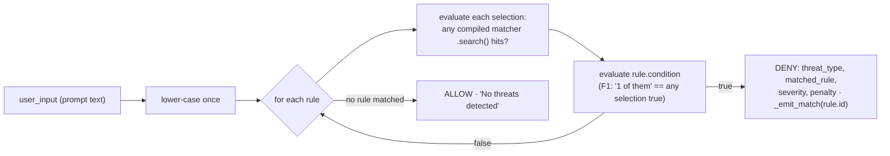

# WS-F — Prompt-signature rules (rename + real dialect + corpus + CI eval gate)

> **Doc role:** This is the **workstream SCOPE** — boundary, dependencies, real `file:line` anchors, footguns, and acceptance criteria. It is an **INPUT to this workstream's implementation-grade LLD**, *not* the granular task breakdown. The granular, buildable tasks are generated **from the approved LLD** (canonical order: HLD → LLD → tasks). See [00-index.md](00-index.md) for the doc-role map.

**Parent HLD:** [hld/serverless-edition.md](../../hld/serverless-edition.md) — §8 hand-off row 6 (`FR-3.14 prompt-signature`, line 676) + §6.2(e2) "Prompt-signature rules — an honest rename and a real dialect" (line 433).
**Status:** Not started
**Owner:** TBD
**Implements:** FR-3.1 (existing substring engine — DONE, do not rebuild), FR-3.14 (continuous improvement / real dialect + corpus + eval loop). **Decisions:** ADR-032 (the prompt-signature loop), ADR-034 (Cedar + prompt-signature deterministic floor is **non-disableable** in every mode/edition).
**Spike-gated:** No.

> **Next step: an implementation-grade LLD** — a dedicated **prompt-signature LLD** (concrete dialect grammar/EBNF, the `PromptSignatureRule`/`Selection`/`Condition` data model, function signatures for the matcher + condition evaluator, the migration map for the existing ~11 rules, the eval-corpus schema and the CI gate's exact thresholds, and the corpus-loop wiring via the feedback store / LLD 17). This WS doc **scopes the build**; the LLD details it. (Owner directive: LLDs go to implementation level per workstream.)

---

## Read before coding (model / invariants)

1. **What exists today is honest-but-thin.** The thing the code calls the "Sigma engine" ([sigma_engine.py:58](../../src/security-controller/app/validators/sigma_engine.py#L58)) is a **case-insensitive SUBSTRING matcher**: `match_rules(user_input)` lowercases the prompt and does `pattern.lower() in user_input_lower` for every pattern of every rule ([sigma_engine.py:340,353,358](../../src/security-controller/app/validators/sigma_engine.py#L340)). It is **not real Sigma** — no regex, no condition logic, no log-field matching. `_parse_sigma_rule` ([sigma_engine.py:280](../../src/security-controller/app/validators/sigma_engine.py#L280)) only understands the **`|contains`** modifier ([:300](../../src/security-controller/app/validators/sigma_engine.py#L300)) and **flattens every selection into one `patterns: List[str]`**, *discarding the `condition:` field entirely* ([:295-296](../../src/security-controller/app/validators/sigma_engine.py#L295) skips `condition`). So today `condition: 1 of them` is a no-op — any single substring hit DENYs. ~11 rules live as YAML, loaded hybrid from DynamoDB metadata + S3 content ([sigma_engine.py:139](../../src/security-controller/app/validators/sigma_engine.py#L139); sample rules in [sample-artifacts/sigma_rules/llm/](../../sample-artifacts/sigma_rules/llm/)).

2. **This WS does NOT rebuild FR-3.1 (it is DONE — sub-PRD §5 line 276/138).** Scope is the **dialect upgrade + corpus + eval gate** on top of the working engine. Milestone F1 (mechanical regex migration) **must preserve every current DENY** — substring `"ignore previous instructions"` becomes the escaped-literal regex `re.escape("ignore previous instructions")`, same case-insensitive match, zero behavioral change. **FOOTGUN: do NOT "improve" patterns into clever regex during the migration milestone — a migration that changes verdicts is a security change masquerading as a refactor.** Improvements come *after* the eval harness exists (F4+), gated by it.

3. **The doc/contract name changes; the code symbol may stay.** Throughout HLD/PRD/ARCHITECTURE the engine is **"prompt-signature rules"** (the *prompt-signature engine*), never "Sigma" (HLD §8 line 713). The Python module `sigma_engine.py`, class `SigmaEngine`, DDB table `sentra-sigma-rules-metadata` ([config.py:42](../../src/security-controller/app/config.py#L42)), S3 prefix `sigma_rules/llm/` ([config.py:219](../../src/security-controller/app/config.py#L219)), and `Source.SENTRA_SIGMA` ([sigma_engine.py:339](../../src/security-controller/app/validators/sigma_engine.py#L339)) **MAY keep their names** to avoid a churny rename of infra + the deciding-source enum. **FOOTGUN: renaming `Source.SENTRA_SIGMA` or the DDB table is OUT of scope — it ripples into the combiner's `winning_source` ([deny_overrides.py](../../src/security-controller/app/combiners/deny_overrides.py)), the audit trail, CloudWatch per-`RuleId` series, and CDK. The rename is a *contract/doc* rename, not a symbol rename.**

4. **Floor invariant (ADR-034).** The Cedar + prompt-signature deterministic floor is **non-disableable in every mode and every edition** (HLD line 513). Nothing this WS adds may introduce a path that turns the prompt-signature check off. The eval gate and corpus tooling are *offline / CI*; they never gate the runtime check.

5. **Detector boundary (do not cross).** Prompt-signatures cover the **prompt-text** threat surface only. The **infra-action surface** (an agent calling a cloud API) is **Cedar's job** (HLD line 447) — deterministic allow/deny + parameter bounds. **FOOTGUN: do NOT add rules that try to match tool names / parameters / action sequences — that is Cedar's surface and a signature there will drift into a duplicate, weaker authorization engine.**

6. **No third-party rule import.** Published SigmaHQ / online-HTTP rules are **field-matchers over structured logs** — useless on free prompt text (HLD line 447). **FOOTGUN: do NOT `pip install` a Sigma library or import SigmaHQ YAML — (a) the SDK floor is stdlib-only by design and a shared rule format that needs a compiled lib breaks that, and (b) those rules match log fields that prompt text does not have.** Build our own small-but-correct corpus by red-teaming.

7. **Threat-type vocabulary is fixed.** `threat_type` is derived from the rule's `llm.<x>` tags ([sigma_engine.py:315](../../src/security-controller/app/validators/sigma_engine.py#L315)); the live taxonomy is the 8-value enum (see the `sentra:threat-taxonomy` skill). New rules MUST tag a value in that enum — `UNKNOWN_THREAT` ([:321](../../src/security-controller/app/validators/sigma_engine.py#L321)) is the fail-open-naming hole; a rule that lands there is a corpus bug.

---

## Dependencies

- **Depends on:** nothing blocking — the engine, hybrid loader, and rule store all exist today. The corpus *loop* (F5, P2) depends on the **feedback store / audit substrate** (LLD 17 — [lld/17-validation-signal-store.md](../../lld/17-validation-signal-store.md)); until that exposes a redacted re-scoring read path, F5 is design-only.
- **Blocks:** nothing hard. F4 (eval CI gate) is a **prerequisite the rest of the FR-3.14 loop depends on** — no rule may auto-grow before the gate exists (HLD line 437).
- **Shared files / contracts:**
  - **WS that touches the pipeline scheduler** (FR-2.8 DAG, §6.2(c)) — shares the validator node `prompt-signature` (STEP "3/4" in the chain, [validation_service.py:265-381](../../src/security-controller/app/services/validation_service.py#L265)). This WS changes the *rule dialect inside* the node, **not** the node's position or its `Signal`/`Source.SENTRA_SIGMA` contract. Coordinate only on the rename wording.
  - **WS that emits the SDK signed bundle** (FR-1.7, §6.2(a)) — the local floor carries a **prompt-signature** rule set inside the bundle. If/when signatures are pushed to the edge, the bundle interpreter must evaluate the **same dialect** this WS defines. **The dialect must therefore be expressible in stdlib `re` + a tiny boolean condition evaluator** (no compiled deps) so the stdlib-only SDK can interpret it. Flag this constraint to that WS; it is the differential-conformance surface (HLD §6.4 line 564).
  - **The rename propagation** (HLD line 713) overlaps the master-PRD/ARCHITECTURE/LLD-18/20 doc edits — run it as one `propagate-change` pass, not piecemeal.

---

## Milestone F1 — Mechanical regex migration (no behavior change)

Goal: replace the substring matcher with a **regex matcher** that, on the existing ~11 rules, produces **identical verdicts**. This is the floor everything else builds on.

### F1.1 — Add a regex field to the rule model
- **Touches:** [sigma_engine.py:38-56](../../src/security-controller/app/validators/sigma_engine.py#L38) (`SigmaRule.__init__` / fields).
- Add a parallel representation: each pattern compiles to a `re.Pattern`. Keep the raw string for logging/console.
- Pseudo-code (REAL names):
```python
# SigmaRule now carries compiled matchers, compiled once at load (not per request)
class SigmaRule:
    def __init__(self, rule_id, title, selections, condition, severity, threat_type, action):
        self.id = rule_id
        self.selections = selections      # dict[selection_name] -> list[CompiledMatcher]
        self.condition = condition        # parsed Condition (F2); F1 default = "1 of them"
        # ... severity/threat_type/action unchanged
```
- **FOOTGUN: compile regex at load time inside `load_rules_from_s3`, NOT inside `match_rules`.** `match_rules` is on the hot path (every prompt); per-request `re.compile` would blow the ≤500 ms deterministic floor budget (NFR-1). The existing load path already runs only on cold-load / cache-miss ([sigma_engine.py:194](../../src/security-controller/app/validators/sigma_engine.py#L194)).

### F1.2 — `|contains` → escaped-literal regex in the parser
- **Touches:** [sigma_engine.py:280-313](../../src/security-controller/app/validators/sigma_engine.py#L280) (`_parse_sigma_rule`), specifically the `if "|contains" in field` branch at [:300](../../src/security-controller/app/validators/sigma_engine.py#L300).
- For a `|contains` field, each value `v` compiles to `re.compile(re.escape(v), re.IGNORECASE)` and matches via `.search()` (substring semantics preserved — `search`, not `match`).
- **FOOTGUN: use `re.escape` on EVERY migrated `|contains` value.** Several live patterns contain regex metacharacters that must stay literal — e.g. `"OR 1=1--"`, `"<|im_end|>"`, `"\\x"`, `"---END SYSTEM---"`, `"[SYSTEM]"`, `"'; DROP TABLE"` (all real, from [sample-artifacts/sigma_rules/llm/prompt_injection_basic.yaml](../../sample-artifacts/sigma_rules/llm/prompt_injection_basic.yaml)). Without `re.escape`, `[SYSTEM]` becomes a character class and `1=1` is fine but `\x` is an invalid escape → a rule that silently stops matching = **fail-open**.

### F1.3 — Replace the matcher loop
- **Touches:** [sigma_engine.py:340-385](../../src/security-controller/app/validators/sigma_engine.py#L340) (`match_rules`), the inner `if pattern.lower() in user_input_lower` at [:358](../../src/security-controller/app/validators/sigma_engine.py#L358).
- New: evaluate each rule's **condition** (F2) over its selections; on a rule match, keep the **exact same `ValidationResult`** (decision/reason/threat_type/matched_rule/severity/penalty/should_deny — [:367-378](../../src/security-controller/app/validators/sigma_engine.py#L367)) and the same `await self._emit_match(rule.id)` ([:365](../../src/security-controller/app/validators/sigma_engine.py#L365)).
- **FOOTGUN: do NOT change the `ValidationResult` shape or the `@stamps(Source.SENTRA_SIGMA)` decorator ([:339](../../src/security-controller/app/validators/sigma_engine.py#L339)).** The combiner ([deny_overrides.py](../../src/security-controller/app/combiners/deny_overrides.py)) keys `winning_source` off that Source; the console "Matches" column keys off the per-`RuleId` CloudWatch series from `_emit_match`. Change either and you break the deciding-source trail and the console silently.



### F1.4 — Migration-equivalence test (the proof for F1)
- **Touches:** new test under [src/security-controller/tests/](../../src/security-controller/tests/) (e.g. `test_prompt_signature_migration.py`).
- For the **current** ~11 rules: assert the new regex engine returns the **same decision** as the old substring engine on (a) every literal pattern as input, (b) a benign control set. The old behavior is the oracle.
- **FOOTGUN: snapshot the old verdicts BEFORE deleting the substring path** (run the old `match_rules` over the corpus, freeze the results, then diff). A migration whose only test is "the new engine DENYs X" can't prove it didn't *start* DENYing something benign.

---

## Milestone F2 — Real regex + condition dialect

Goal: a genuine pattern dialect over prompt text — regex matchers + a boolean `condition` over named selections.

### F2.1 — Selection matcher modifiers
- **Touches:** [sigma_engine.py:_parse_sigma_rule](../../src/security-controller/app/validators/sigma_engine.py#L280).
- Support, in the rule YAML, at minimum:
  - `prompt|contains` → escaped-literal regex `.search()` (F1, kept).
  - `prompt|re` → author-supplied regex, compiled `re.IGNORECASE`, `.search()`.
  - `prompt|all` (a selection where **all** its values must hit — for multi-token attacks).
- **FOOTGUN: validate every author-supplied `|re` at LOAD time and reject (skip rule + log) a pattern that fails `re.compile` or whose `.search` cost is unbounded.** A catastrophic-backtracking regex (e.g. `(a+)+$`) on the hot path is a ReDoS DoS on the floor. Add a compile-time guard: reject nested unbounded quantifiers; cap pattern length. Treat an author rule as **untrusted external data** (engineering rule: never trust external data).

### F2.2 — Condition evaluator
- **Touches:** `_parse_sigma_rule` (stop skipping `condition` — remove/replace [:295-296](../../src/security-controller/app/validators/sigma_engine.py#L295)) + new evaluator in `match_rules`.
- Parse and evaluate a **small, closed** condition grammar over selection names: `1 of them`, `all of them`, `<sel> and <sel>`, `<sel> or <sel>`, `not <sel>`. This is the **same closed dialect the SDK bundle interpreter must evaluate** (stdlib-only) — keep it tiny and enumerable.
- **FOOTGUN: do NOT use `eval()` on the condition string.** Parse to a tiny AST (tokens → boolean tree). `eval` on rule-authored text is arbitrary code execution.
- **FOOTGUN: a rule whose `condition` references an undefined selection name must FAIL the rule LOAD (skip + log), not silently evaluate to false** — a typo'd selection that "passes" is a disabled rule nobody notices = fail-open.

### F2.3 — Dialect spec (lives in the LLD)
- The exact grammar (EBNF), the closed modifier set, and the closed condition operators are **defined in the prompt-signature LLD**, because the SDK bundle interpreter must implement the identical subset (differential conformance, HLD §6.4 line 564). This task's deliverable is the *engine support*; the *spec authority* is the LLD.

---

## Milestone F3 — Our own red-teamed corpus (small but correct)

Goal: replace the ad-hoc ~11 rules' patterns with a curated, attributed corpus we author by red-teaming — *small but correct*, not large-and-noisy.

### F3.1 — Corpus layout
- **Touches:** [sample-artifacts/sigma_rules/llm/](../../sample-artifacts/sigma_rules/llm/) (rule YAML, authoritative source compiled into the DDB-metadata + S3 store via [scripts/seed_all.py](../../scripts/seed_all.py)).
- Each rule carries: `id`, `title`, `tags: [llm.<threat_type>]` (must map to the 8-value enum), `level`, `detection` (selections + `condition`), and **`falsepositives:`** (already present in the sample) — the benign cases that MUST stay ALLOW.
- **FOOTGUN: every new rule MUST tag exactly one `llm.<x>` from the live threat enum** ([sigma_engine.py:315](../../src/security-controller/app/validators/sigma_engine.py#L315) derivation). A rule with no `llm.` tag derives `UNKNOWN_THREAT` and pollutes the combiner reason / console grouping.

### F3.2 — Author rules by red-teaming, not import
- Source attacks from our own red-team runs against the demo agents (payment-agent / customer-query-agent) and known public injection taxonomies as *inspiration*, hand-authored into our dialect.
- **Corpus source (P1, reference only):** the public red-team / rule-authoring game lever (Lakera-Gandalf / HackAPrompt style) is a **separate P1 brief**, not scoped here (HLD line 697). Reference only.

---

## Milestone F4 — Eval / CI harness + gate (PREREQUISITE before any auto-grow)

Goal: a labeled true-positive corpus + a benign false-positive corpus + a CI gate. **This must exist before any rule auto-grows** (HLD line 437).

### F4.1 — Two labeled corpora
- **Touches:** new fixtures under [src/security-controller/tests/](../../src/security-controller/tests/) (e.g. `corpus/attacks.jsonl`, `corpus/benign.jsonl`).
- **attacks.jsonl** — prompts that MUST DENY, each labeled with the expected `threat_type`.
- **benign.jsonl** — realistic benign prompts (incl. the `falsepositives:` cases authors listed) that MUST ALLOW.
- **FOOTGUN: the benign corpus must include adversarially-*near* benign text** (e.g. a support agent legitimately saying "ignore the previous email, here's the corrected invoice"). A FP corpus of only obviously-clean text proves nothing about precision.

### F4.2 — Eval runner
- Run the **engine** (not the substring oracle) over both corpora → compute recall (attacks caught) and **false-positive rate** (benign wrongly DENYd) per rule and overall.
- Emit a report (counts + the specific misclassified lines) so a regression names the offending rule + prompt.

### F4.3 — CI gate
- **Touches:** CI config (the PR-gating test run referenced in HLD §6.4 line 564 — "exhaustive end-to-end scenario tests that run on every PR and gate the PR").
- Gate thresholds: **0 regressions on the migration-equivalence set (F1.4)**, recall ≥ target on attacks, FP-rate ≤ target on benign. Exact numbers → the LLD.
- **FOOTGUN: the FP-rate threshold is the load-bearing gate, not recall.** A signature engine that over-blocks benign prompts trains customers to disable it (and ADR-034 says it *can't* be disabled — so over-blocking is a product-breaking bug, not a tuning knob). Fail the PR on FP-rate regression even if recall improved.

### F4.4 — Wire into the PR suite
- Add the eval to the same gate as the other Serverless build-requirement scenario tests (HLD §6.4 line 564). It runs offline (no AWS) over fixture corpora — **do NOT** make the gate read the live DDB/S3 rule store (non-hermetic, flaky).

---

## Milestone F5 — Corpus continuous-improvement loop (FR-3.14, P2 — design-only here)

Goal: close the loop — redacted past traffic → offline re-score → FP/FN metrics → new/tuned signatures pushed back. **Design-only in this WS; the runtime loop is P2 and depends on the feedback store.**

- **Depends on:** LLD 17 feedback / re-scoring read path ([lld/17-validation-signal-store.md](../../lld/17-validation-signal-store.md)) — the redacted-record substrate that an offline classifier re-scores (HLD line 428).
- Deliverable here: the **design** of the loop (how a re-scoring run produces candidate signature edits, how they pass the F4 gate before merge, how they reach the rule store / signed bundle). The implementation is its own later WS.
- **FOOTGUN: a candidate signature from the auto-loop MUST pass the F4 gate before it ships** — the loop never writes a rule that bypasses the eval. The gate is the safety interlock on auto-growth.

---

## Error model

| Condition | Response |
|---|---|
| Rule YAML fails `re.compile` (`|re`) or has unbounded backtracking | Skip the rule at load, log a warning; engine continues with remaining rules (do not crash the loader). |
| `condition` references an undefined selection name | **Fail the rule load** (skip + log) — never evaluate the rule. |
| Rule store unreachable on cold load, no cache | `SigmaRulesLoadError` → the pipeline's error-path DENY ([validation_service.py:667](../../src/security-controller/app/services/validation_service.py#L667)); fail-secure (existing behavior, unchanged). |
| Stale cache usable on S3 error | Keep stale cache, log warning (existing behavior, [sigma_engine.py:242](../../src/security-controller/app/validators/sigma_engine.py#L242)). |
| Eval CI gate: FP-rate or recall regression | **Fail the PR.** Block merge. |
| `_emit_match` CloudWatch publish fails | Swallow (fire-and-forget) — never turn a DENY into an error (existing behavior, [sigma_engine.py:336](../../src/security-controller/app/validators/sigma_engine.py#L336)). |

---

## Acceptance criteria

- [ ] **F1:** `match_rules` no longer uses `pattern.lower() in user_input_lower`; it evaluates compiled `re.Pattern` matchers. Regexes are compiled at **load time**, not per request.
- [ ] **F1:** Migration-equivalence test (F1.4) shows the regex engine returns **identical verdicts** to the prior substring engine on every current rule pattern + a benign control set (0 diffs).
- [ ] **F1:** Every migrated `|contains` value is wrapped in `re.escape` (verified by a test that feeds metacharacter-bearing live patterns like `[SYSTEM]`, `<|im_end|>`, `'; DROP TABLE`).
- [ ] **F2:** `condition:` is parsed and evaluated (no longer skipped); `1 of them`, `all of them`, `and`/`or`/`not` over selection names all work, evaluated via a parsed AST (no `eval()`).
- [ ] **F2:** `|re` (author regex) and `|all` (all-values) modifiers supported; an uncompilable / unsafe author regex is rejected at load (rule skipped + logged), engine still serves the rest.
- [ ] **F2:** A `condition` referencing an undefined selection fails the rule load (does not silently evaluate false).
- [ ] **Contract/rename:** All HLD/PRD/ARCHITECTURE/LLD-18/LLD-20 references say "prompt-signature rules" (not "Sigma"); `Source.SENTRA_SIGMA`, the DDB table, the S3 prefix, and the module/class names are **unchanged**; combiner `winning_source` and the console "Matches" series still work.
- [ ] **F3:** The corpus is hand-authored (no SigmaHQ/online import; no new pip dependency added to the engine); every rule tags a value in the 8-value `llm.<threat_type>` enum (none derive `UNKNOWN_THREAT`).
- [ ] **F4:** Two labeled corpora exist (attacks → DENY, benign incl. near-benign → ALLOW); an offline, hermetic eval runner computes per-rule + overall recall and FP-rate.
- [ ] **F4:** A CI gate runs the eval on every PR and **fails the PR** on a migration-equivalence diff, a recall regression below target, or an FP-rate regression above target.
- [ ] **Floor invariant:** No code path introduced by this WS can disable the prompt-signature check at runtime (ADR-034 holds).
- [ ] **Boundary:** No rule matches tool names / parameters / action sequences (that surface stays Cedar's).
- [ ] **F5:** The continuous-improvement loop is **designed** (documented in the LLD), with the F4 gate as the interlock on any auto-grown rule; runtime implementation is explicitly deferred (P2, depends on LLD 17).

---

## Cross-references

- **HLD:** [hld/serverless-edition.md](../../hld/serverless-edition.md) §6.2(e2) (line 433), §8 row 6 (line 676), the rename note (line 713), the floor-non-disableable invariant (line 513 / ADR-034), the PR-gating scenario-test requirement (§6.4 line 564), the corpus-loop (line 428), the P1 game initiative (line 697).
- **Sub-PRD:** [prd/serverless-edition.md](../../prd/serverless-edition.md) — FR-3.1 DONE (line 138, §5 line 276), FR-3.14 NOT-DONE (line 151, §5 line 283).
- **ADRs:** ADR-032 (prompt-signature loop), ADR-034 (non-disableable floor) — see HLD §6.6 ADR table (line 654).
- **Code:** [sigma_engine.py](../../src/security-controller/app/validators/sigma_engine.py) (engine), [sigma_rules_service.py](../../src/security-controller/app/services/sigma_rules_service.py) (CRUD/admin), [config.py:42,219-224](../../src/security-controller/app/config.py#L42) (table/prefix/cache settings), [sample-artifacts/sigma_rules/llm/](../../sample-artifacts/sigma_rules/llm/) (rule YAML), [scripts/seed_all.py](../../scripts/seed_all.py) (seeds rules into the store).
- **Related LLDs:** [lld/18-deterministic-enforcement.md](../../lld/18-deterministic-enforcement.md), [lld/20-defense-in-depth-layers.md](../../lld/20-defense-in-depth-layers.md), [lld/17-validation-signal-store.md](../../lld/17-validation-signal-store.md) (feedback store for F5).
- **Sibling WS:** the FR-2.8 pipeline-DAG WS (shares the `prompt-signature` node + `Source.SENTRA_SIGMA` contract — no position change here); the FR-1.7 signed-bundle WS (must interpret the **identical closed dialect**, stdlib-only — differential-conformance surface).
- **Skills:** `sentra:threat-taxonomy` (the 8-value `threat_type` enum + ABSTAIN/reason discipline).
