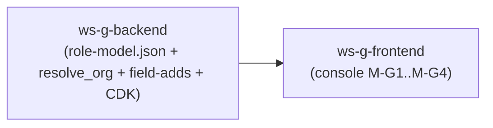

# WS-G build — code-loop sub-index (backend lane → frontend lane)

> **Orchestration index for `code-loop`.** WS-G ([ws-g-console.md](../ws-g-console.md)) spans **both** a
> Python/CDK backend and a React frontend, but `code-loop` runs **one coder domain per invocation**. This
> index splits WS-G into two build-lane workstreams with a dependency edge so each lane builds with the right
> coder, in the right order. It does NOT replace the canonical task doc — both lane docs reference it for all
> task detail, `file:line`, and test names.
>
> **Launch note:** run `code-loop` **twice**, once per lane, with `onlyWs` scoping and the matching `domain`:
> - `args:{ domain:'backend',  onlyWs:['ws-g-backend'],  ... }` — FIRST.
> - `args:{ domain:'frontend', onlyWs:['ws-g-frontend'], ... }` — AFTER the backend lane merges (it emits the
>   `role-model.json` fixture + `resolve_org` contract the frontend hard-depends on).
> A single whole-index run is NOT correct here (it would use one coder domain for both lanes).

## Workstreams

| Workstream | Doc | Domain | Scope | Blocking? |
|---|---|---|---|---|
| **ws-g-backend** | [ws-g-backend.md](ws-g-backend.md) | backend (Python + AWS CDK + pytest) | M-G0 prereqs (D13 shadow-bind, D14 `resolve_org`+`org.html`+ALB/nginx, platform rollup/paging), backend field-adds (compiled-policy, quarantine-origin, `winning_source`), the **D3 `role-model.json` generator**, and WS-G-owned backend regressions (G1.3, operator-id). CDK is coded + unit-tested; **no `cdk deploy`**. | yes — emits the fixture + contract the frontend lane depends on |
| **ws-g-frontend** | [ws-g-frontend.md](ws-g-frontend.md) | frontend (React 19 + TS + Tailwind v4 + Vite) | M-G1..M-G4 console: Vitest scaffold + navy retheme, cosmetic-tenant containment, RBAC render-gating, org-first login, exhaustive FR-13.2 dashboard set (BUILD Activity/Session-forensics/Usage/Decision-detail), platform global-admin console. Design-of-record [docs/console-design-spec.md](../../../docs/console-design-spec.md). | depends on ws-g-backend |

## Dependency graph + build order

- **Depends on:** ws-g-frontend → ws-g-backend (the frontend G2.9 parity test FAILS LOUD without
  `role-model.json`; G2.12 org-first entry consumes the D14 `resolve_org` contract).
- **Build order (waves):**
  - **Wave 1:** ws-g-backend
  - **Wave 2:** ws-g-frontend

## Shared conventions (every lane must honor)
- **Re-verify `file:line` at tip** before editing — the canonical doc's line numbers predate current `main`.
- **Fail-secure everywhere:** deny/hide on missing input; honest 4XX/5XX (never a fake-200); render-gate is
  UX-only, never the security boundary (server `require_role`/`require_platform` is the boundary).
- **Backend tests are moto-safe:** `env -u AWS_PROFILE` + fake creds + `venv/bin/python` (see ws-g-backend.md).
- **No `cdk deploy` / no AWS resource mutation** in either lane — code + synth/unit-test only (prod-safety;
  `Sentra-DEV-*` stacks ARE prod).
- **Every task carries MANDATORY unit + (where applicable) integration tests** — canonical names in
  [ws-g-console.md](../ws-g-console.md); a behavior with no test is a flagged gap, not a silent pass.
- **Canonical vocab:** identity mode = `enforce/shadow/off` (never "monitor"); tenant is server-derived, never
  client-asserted; "live" = ≤15s poll (no WebSocket/SSE).
