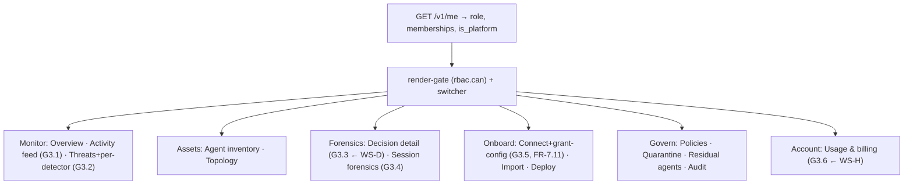

# WS-G — Multi-tenant console (tenant authority + RBAC render-gating + exhaustive dashboard set)

> **Doc role:** This is the **workstream SCOPE** — boundary, dependencies, real `file:line` anchors, footguns, and acceptance criteria. It is an **INPUT to this workstream's implementation-grade LLD**, *not* the granular task breakdown. The granular, buildable tasks are generated **from the approved LLD** (canonical order: HLD → LLD → tasks). See [00-index.md](00-index.md) for the doc-role map.

**Parent HLD:** [hld/serverless-edition.md](../../hld/serverless-edition.md) — §8 hand-off **row 8** (`FR-13.3 console`) + **§6.2(f) "Console sign-in & who-sees-what"** ([:453–:465](../../hld/serverless-edition.md), recommendation row at [:636](../../hld/serverless-edition.md)).
**Status:** Not started
**Owner:** TBD
**Implements:** FR-13.1 (multi-tenant console), FR-13.2 (exhaustive dashboard set), FR-13.3 (login/tenancy model); refines **AD-8 / ADR-019**; adds **ADR-035** (federation seam, *scoped-now / deferred-last*). Net-new → master §7.13.
**Not spike-gated** (the §6.4 GA-gate spike does not block this WS).

> **Next step: an implementation-grade LLD.** This WS doc scopes the build; the LLD details it (concrete React component trees, the `/v1/*` view-API response schemas the dashboards bind to, per-view RBAC capability map, the ADR-035 federation-seam interface, and per-view test cases). **The LLD extends [LLD 26 §5–6](../../lld/26-multi-tenancy.md)** ("`web/console` SSO/RBAC") — it does not start fresh.

---

## 0. Scope-honesty banner — READ THIS FIRST (most of the "auth" half is already DONE)

The owner brief framed WS-G around "fix the security bug + build membership authority." **A code-grounded read shows the membership/RBAC authority is already built and live on dev** (the LLD-26 go-live, 2026-06-24). Do **NOT** rebuild it. Concretely, the following already exist and are wired:

| Capability | Where it already lives | WS-G action |
|---|---|---|
| Server-derived tenant from session (never email domain) | `src/security-controller/app/api/deps.py:316` `resolve_operator_tenant` → `set_current_tenant` | **VERIFY only** (regression-test it; do not rebuild) |
| ALB-OIDC operator auth, signature-verified | `deps.py:282` `verify_alb_oidc` (reads `x-sentra-oidc-data`/`x-amzn-oidc-data`, ES256, `kid` LRU) | **VERIFY** + extend as the ADR-035 seam (M-G3) |
| `X-Aegion-Tenant` switcher validated against membership (403 if not a member) | `deps.py:340–355`; client side `web/console/src/lib/tenant.ts` + `http.ts:` (`tenantHeader()` attached on every request) | **VERIFY** + build the switcher **UI** (M-G2) |
| RBAC `require_role` server authority + `_platform` break-glass | `deps.py:402` `require_role`, `deps.py:382` `require_platform`; applied across `tenancy_routes.py` (`require_role("admin"/"editor"/"owner")`) | **VERIFY** only — extending `require_role` to NON-tenancy mutating routes is **re-homed to WS-M** ([ws-m-authz.md](ws-m-authz.md)); WS-G owns the client render-gate that mirrors it |
| `sentra-tenant-members` (PK `operator_sub` / SK `tenant_id`, attr `role`,`is_primary`) | `app/services/tenant_service.py:244` `MemberStore.by_operator`; CDK table in `cdk/stacks/storage_stack.py` | **DESIGNED-AGAINST** — do not redefine the schema |
| `GET /v1/me` → tenant + role + memberships | `app/api/tenancy_routes.py:59` `get_me`; client `web/console/src/lib/api/me.ts` + `lib/query/useMe.ts` | **REUSE** as the role source for render-gating (M-G2) |
| Client RBAC mirror (render gate only) | `web/console/src/lib/rbac.ts` (`can()`, `Capability` map) | **REUSE** + actually wire it into the views that don't gate yet (M-G2) |
| The `tenantOf()` email-domain bug | `web/console/src/lib/auth.ts:61` — **already downgraded** to "DISPLAY-ONLY, NON-AUTHORITATIVE" with a guard comment | **HARDEN** — prove nothing scopes off it, then make misuse impossible (M-G1) |

**So WS-G's real, unbuilt scope is three things:**
1. **M-G1 — close the residual bug surface:** prove no data-scoping/UI-gating/API-arg reads `tenantOf()`; turn the convention into a *lint/type* guard so a future dev can't reintroduce the leak.
2. **M-G2 — finish RBAC render-gating + the switcher UI:** `rbac.ts`/`useCan()` exist but are wired into only **one** feature today (`PolicyLibraryPage.tsx`); gate every mutating control to role, and build the multi-membership tenant-switcher UI component.
3. **M-G3 — the exhaustive FR-13.2 dashboard set + the ADR-035 federation seam (pre-design, deferred-last).** This is the bulk of the build.

---

## 1. Dependencies

- **Depends on:**
  - **LLD-26 (DONE/dev):** `sentra-tenants` + `sentra-tenant-members`, `resolve_operator_tenant`, `require_role`, `GET /v1/me`. WS-G builds *on* these; if they are not yet promoted to the WS-G target env, that promotion is a **prerequisite**, not a WS-G task.
  - **WS-D (decision-trail persistence, FR-6.8):** the **Decision detail** view (§FR-13.2) renders the full deny-overrides trail. The trail's persisted shape is owned by WS-D. WS-G consumes its read API; **if WS-D's trail API isn't ready, the Decision-detail view binds to the existing `DecisionTrace.tsx` shape and is marked PARTIAL — do not invent the trail schema here.**
  - **WS-H (metering/billing, FR-12.x):** the **Usage & billing** view renders `sentra-usage-rollup` data. WS-H owns the rollup table + its read API. WS-G builds the view; **the usage read-API contract is a WS-H deliverable — prerequisite, not assumption.**
- **Blocks:** none structurally; the console is a leaf consumer. (It is the operator-visible surface other WS work surfaces *through*, but no WS is build-blocked on WS-G.)
- **Shared files / contracts:**
  - `web/console/src/lib/{auth.ts, rbac.ts, tenant.ts, http.ts, api/me.ts, query/useMe.ts}` — shared with any future console WS.
  - `src/security-controller/app/api/deps.py` (`verify_alb_oidc`, `resolve_operator_tenant`, `require_role`) — **shared with LLD-26 / WS-D / WS-H**; touched here only to (a) extend `require_role` coverage to mutating routes and (b) factor the ADR-035 seam. Coordinate edits.
  - `src/security-controller/app/api/tenancy_routes.py` — `/v1/me` shape is shared with the console; do not change its response contract without updating `types/api.ts` (`MeContext`).

---

## 2. Model / read-before-coding (the invariants the implementer MUST hold)

1. **Tenant is server-derived, never client-asserted.** The only authoritative tenant binding is `set_current_tenant(chosen.tenant_id)` inside `resolve_operator_tenant` (`deps.py:355`), after a membership lookup. The client *may* send `X-Aegion-Tenant` as a **preference**; the server re-validates it against the membership set and 403s if the operator isn't a member (`deps.py:351`). **The email domain (`tenantOf()`) is NEVER an authority** — it is a cosmetic label only.
2. **Client RBAC gates rendering, never authorization.** `rbac.ts` / `useCan()` exist so a `viewer` doesn't *see* a control they can't use. The boundary is **always** server-side `require_role`. A tampered client must gain nothing. Restated in `rbac.ts` header comment — do not weaken it.
3. **Role order is `viewer(0) < editor(1) < admin(2) < owner(3)`** (`rbac.ts` `RANK`; server `deps.py` `_ROLE_ORDER` + `role_satisfies`). The two MUST stay identical — a client/server divergence either hides a usable control (annoyance) or shows an unusable one (confusing 403). **Treat the two role maps as one contract.**
4. **`_platform` is a capability, not a tenant role.** A `_platform` operator switching into a non-member tenant defaults to **`viewer`** (`deps.py:347–350`) — never a synthesized admin. The platform-admin cross-tenant surface is **out of WS-G scope** (it's WS-E / LLD-26 §5.5); WS-G must not render platform controls to non-`_platform` operators.
5. **`/v1/me` is the single source of role for the UI.** `useMe()` returns `{sub, email, tenant_id, role, is_platform, memberships[]}` (`MeContext`). All render-gating derives from `data.role`; the switcher renders from `data.memberships` (length > 1).
6. **The console talks only to same-origin `/v1`.** It never sets `x-api-key` (injected server-side by nginx/dev-proxy — `http.ts` SECURITY comment). It never follows the ALB's cross-origin re-auth 302 (`redirect: 'manual'` + `reauthenticate()`). Do not add a second fetch path that breaks these.

---

## 3. Milestones → tasks

### Milestone G1 — Close the residual cosmetic-tenant bug surface (FR-13.1)

The fix already landed (LLD-26 downgraded `tenantOf()` to display-only). G1 makes the residual *un-reintroducible* and proves no current caller leaks.

- **G1.1 — Prove no scoping/gating/API-arg reads `tenantOf()`.** Grep the console for every caller; assert each is display-only.
  ```bash
  grep -rn "tenantOf" web/console/src
  ```
  - Touch-points to confirm: every hit must be a JSX label/avatar/header string. **FOOTGUN: a hit inside a `queryKey`, an http param, or a `can()`/gate predicate is a live cross-tenant leak — fix it to read `useMe().data.tenant_id` instead.**
- **G1.2 — Make misuse a lint/type error.** Add an ESLint `no-restricted-imports`/`no-restricted-syntax` rule (or rename the export to `tenantLabelForDisplay`) so `tenantOf` cannot be passed to `queryKeys.*`, `http.*`, or `rbac.can`. **FOOTGUN: do NOT delete `tenantOf` outright — `AppLayout`/avatar header consume it for display; deleting it breaks the shell. Quarantine, don't remove.**
- **G1.3 — Regression test the server authority.** Add/confirm a backend test that `resolve_operator_tenant` ignores email domain entirely: an operator whose email domain is `acme.io` but whose only membership is `t_globex` resolves to `t_globex`. Touch: `src/security-controller/tests/` (mirror the existing `deps`/tenancy tests). **This is the FR-13.1 acceptance proof.**

### Milestone G2 — Finish RBAC render-gating + the tenant-switcher UI (FR-13.3)

`rbac.ts` + `useCan()` exist but are wired into only `PolicyLibraryPage.tsx` (confirmed: `grep -rln "useCan\|roleSatisfies" web/console/src/features` → 1 file). G2 wires gating everywhere a mutation control renders, and builds the switcher UI.

- **G2.1 — Audit every mutating control and gate it with `useCan()`.** For each feature under `web/console/src/features/{agents,policies,connect,import,quarantine,identity,discovery}`, find create/edit/delete/rotate/release controls and wrap render in `useCan('<capability>')`. Capability map is already defined in `rbac.ts`:

  | Control | `Capability` to gate on |
  |---|---|
  | Import / edit agents | `agents.write` (editor) |
  | Create/edit/delete policy | `policies.write` (editor) |
  | Rotate credential | `credentials.rotate` (editor) |
  | Register / revoke credential | `credentials.write` (admin) |
  | View member list | `members.read` (editor) |
  | Manage members | `members.manage` (admin) |
  | Delete tenant | `tenant.delete` (owner) |
  | View residual agents | `identity.residual.read` (viewer) |

  **FOOTGUN: client gating is UX only.** For each gated *mutation*, confirm the corresponding `/v1` route has a server-side `require_role` dependency. **The non-tenancy mutating routes (`routes.py` — agent/policy/credential CRUD) are NOT all `require_role`-gated today** (only `tenancy_routes.py` is — confirmed by grep). A render gate without a matching server gate is the bug, not the fix.

  > **⚠️ Server-side gate RE-HOMED to WS-M (2026-07-03).** Extending server-side `require_role` to the mutating `routes.py` routes (agent/policy/credential/connection/sigma CRUD) + the anti-IDOR ownership assert is now owned by **[ws-m-authz.md](ws-m-authz.md)** (M-M1/M-M2/M-M3), so authz has one owner instead of being split across WS-G and the runbook BUG-1 line. **WS-G owns only the CLIENT render-gate** (`useCan()`/`rbac.ts`, this milestone's capability table) **+ the tenant-switcher UI** — the UX layer, never the boundary. G2.1's per-mutation check becomes: *confirm the corresponding `/v1` route carries WS-M's server gate* (coordinate — `routes.py`/`deps.py` are shared files). Keep a render-gate + matching-server-gate assertion in coverage; the server gate itself lands in WS-M.

  > **WS-F merge gate (now lands in WS-M).** One of the `routes.py` mutating routes the WS-M extension must cover is the **unauthenticated `PATCH /sigma-rules/{rule_id}` prompt-signature retire path** (`update_sigma_rule`, `routes.py:1435`) **and the `__sigma_version__` version-epoch write it triggers**. Per [lld/35 §3.3](../../lld/35-prompt-signatures.md), this is a **merge-blocking predecessor of WS-F** (the retire path is a fleet-global, no-authz kill-switch that defeats the ADR-034 non-disableable-floor invariant — the store is NOT tenant-partitioned, so the gate must be **platform-operator scope, never tenant-scoped**). WS-F carries its own CI assertion that fails the build if any sigma-mutating route lacks a platform-operator gate; **WS-M (M-M3) is the workstream that actually lands the gate** (re-homed from WS-G) + the **failing-then-passing 403 test** for an un-roled / tenant-scoped caller on the retire path.

- **G2.2 — Build the tenant-switcher UI component.** A header dropdown that lists `useMe().data.memberships` and calls `setActiveTenant(tenantId)` (`lib/tenant.ts`), which writes the `X-Aegion-Tenant` header on subsequent requests (already wired in `http.ts` via `tenantHeader()`). Render **only** when `memberships.length > 1`.
  - On switch: invalidate the React Query cache (`queryClient.clear()` or `invalidateQueries`) so no other tenant's cached data renders. **FOOTGUN: forgetting to invalidate the cache shows the previous tenant's data under the new tenant header until refetch — a visual cross-tenant leak even though the server scoped correctly.**
  - Touch: new `web/console/src/components/ui/TenantSwitcher.tsx`; mount in `web/console/src/app/AppLayout.tsx`.
- **G2.3 — Hide platform-only routes from non-`_platform` operators.** Any `_platform` surface (WS-E) must be gated on `useMe().data.is_platform`. WS-G renders nothing platform-scoped for customer operators. **(If no platform routes exist in this env yet, this is a no-op assertion — note it, don't invent the route.)**

```mermaid
sequenceDiagram
    participant U as Operator (browser)
    participant N as console nginx
    participant ALB as ALB (authenticate-cognito)
    participant API as security-controller (/v1)
    U->>N: GET /v1/me (+ optional X-Aegion-Tenant)
    N->>ALB: forwards; ALB injects signed x-amzn-oidc-data
    N->>API: re-emits as x-sentra-oidc-data
    API->>API: verify_alb_oidc (ES256, kid) → claims.sub
    API->>API: MemberStore.by_operator(sub) → memberships
    API->>API: validate X-Aegion-Tenant ∈ memberships (403 if not)
    API->>API: set_current_tenant(chosen.tenant_id)
    API-->>U: { tenant_id, role, is_platform, memberships[] }
    U->>U: useMe() caches; render-gate via can(role, cap); switcher if >1 membership
```

### Milestone G3 — Exhaustive FR-13.2 dashboard set + ADR-035 federation seam

The **bulk of WS-G**. Existing routes (`web/console/src/app/routes.ts`): `overview, threats, deployments, agents, agentDetail, topology, connect, import, deploy, policies (+new/edit/detail), quarantine, residualAgents, audit`. Decision/session primitives exist (`components/decisions/{DecisionTrace,DecisionReviewPanel}.tsx`, `lib/api/sessions.ts`). The FR-13.2 *required* set and its build status:

| FR-13.2 view | Status today | G3 task |
|---|---|---|
| **Overview** (fleet health, decision volume, ALLOW/DENY split) | EXISTS (`features/overview`) | Verify tenant-scoped; no build |
| **Agent inventory & lifecycle** | EXISTS (`features/agents`, `agentDetail`) | Verify; role-gate writes (G2.1) |
| **Activity / live decision feed** | **MISSING as a first-class view** | **G3.1 build** |
| **Violations & threats (per detector)** | PARTIAL (`features/threats` exists; per-detector breakdown unclear) | **G3.2 — add per-detector facet** |
| **Decision detail** (full FR-6.8 trail) | PARTIAL (`DecisionTrace`/`DecisionReviewPanel` components exist; not a routed view) | **G3.3 — route it; bind to WS-D trail API** |
| **Session forensics** (FR-6.9 sequence reconstruction) | PARTIAL (`lib/api/sessions.ts` + `SessionsResponse`/`SessionDecisionsResponse` exist) | **G3.4 — build the forensics view** |
| **Policies** (author/bind/version) | EXISTS (`features/policies`) | Verify; role-gate (G2.1) |
| **Connectors & import** (FR-7.11 onboarding + status) | PARTIAL (`features/connect`,`import`,`discovery` exist; **FR-7.11 in-console grant config NOT-DONE** per sub-PRD §5) | **G3.5 — add the per-cloud grant-config surface** |
| **Audit & compliance** (FR-6.5 reports) | PARTIAL (`features/audit` exists; compliance *reports* are P1) | Verify audit-trail view; compliance-report export is a LATER increment |
| **Usage & billing** (FR-12.x) | **MISSING** | **G3.6 — build the view; binds to WS-H** |

- **G3.1 — Activity / live decision feed.** A reverse-chron, tenant-scoped, paginated stream of validate decisions (ALLOW/DENY + deciding source + agent + tool). Reuse the cursor-paginated pattern from `sessionsApi`. Backend: a `GET /v1/decisions` (or extend the metrics/timeseries surface — `routes.py:483` `/metrics/decisions-timeseries` exists for the chart; the *row feed* is the gap). **FOOTGUN: do not poll-loop on a tight interval against the audit store fire-and-forget writes — those writes can lag (`validation_service.py:532` `_fire_and_forget`); a "live" feed that promises real-time but reads a lagging store will look broken. Use cursor pagination + a modest refetch interval and label it "near-real-time."**
  - New route: add `activity: '/activity'` to `routes.ts`; nav item under "Monitor".
- **G3.2 — Violations & threats per-detector.** Extend `features/threats` to facet violations by deciding source/detector. The deciding-source taxonomy is the combiner's `winning_source` (`src/security-controller/app/combiners/deny_overrides.py` `metadata['winning_source']`, sources in `app/combiners/sources.py`) — facet on that. **FOOTGUN: render every `Source` enum value, not a hardcoded subset — a new detector (D1–D7 depth lands incrementally) must appear without a console change; drive the facet list from the API response, not a frontend constant.**
- **G3.3 — Decision detail (FR-6.8 full trail).** Promote `DecisionTrace`/`DecisionReviewPanel` to a routed view (`decisionDetail: '/decisions/:requestId'`). Bind to **WS-D's** persisted-trail read API: caller identity, every layer's verdict, the `winning_source`, the reason text. **FOOTGUN: do NOT invent the trail schema — it is WS-D's contract.** Until WS-D ships it, bind to the existing `DecisionTrace` prop shape and mark the view PARTIAL in the acceptance list. Cross-link from the activity feed (G3.1) row → decision detail.
- **G3.4 — Session forensics (FR-6.9).** Build a routed view (`sessionDetail: '/sessions/:sessionId'`) reconstructing a session's action sequence from `sessionsApi.list` + the per-session decisions (`SessionDecisionsResponse`). Show the ordered tool-call sequence, quarantine status, trust trajectory. Reuse `lib/api/sessions.ts` — the client API already exists.
- **G3.5 — Connectors & import grant-config (FR-7.11, NOT-DONE).** Add an in-console surface that shows, per cloud, the exact customer-side grant needed to enable discovery/interception: **AWS** IAM policy JSON + role ARN to assume; **Azure** Service-Principal allowlist; **GCP** service-account/role (GCP = roadmap, render as "coming soon" not a broken form). Surfaced at connect time in `features/connect`. **FOOTGUN: render the grant policy as copy-only read-only text — never let the console attempt to *apply* the grant in the customer's account (it has no such credentials; FR-7.11 is "surface the config," not "execute it").**
- **G3.6 — Usage & billing (FR-12.x).** Build a routed view (`usage: '/usage'`, nav under a new "Account" group) that renders the tenant's metered usage from **WS-H's** `sentra-usage-rollup` read API. Show validations-this-period, plan/quota, and the per-tenant RPS ceiling. **FOOTGUN: the usage read-API is a WS-H deliverable — prerequisite, not assumption. Until it ships, scaffold the view against a typed stub and mark PARTIAL.** Do not read the raw `sentra-meter-events` table from the console (that's the durable ledger, not a query surface).
- **G3.7 — ADR-035 federation seam (PRE-DESIGN ONLY, deferred-last).** Factor the operator-identity extraction in `deps.py:verify_alb_oidc` behind an **IdP-neutral "verified operator subject" interface** — a function returning `VerifiedOperator{sub, email, idp_groups[]}` that today is satisfied by the Cognito/ALB-OIDC path, and *later* by a SAML/OIDC/SCIM federation provider, by config — without changing `resolve_operator_tenant` or any route. **This task is design + the seam interface only; the actual SAML/OIDC/SCIM provider switch is DEFERRED via ADR-035 and is done LAST (or in a later WS).** Competitive login research (Zenity / Splunk / Auth0 Organizations: SSO+SAML+SCIM, org→tenant mapping) is design-fit input for the LLD, not a build task here.
  - **FOOTGUN: do NOT swap Cognito out now.** ADR-035 explicitly keeps Cognito and only pre-shapes the seam; ripping in SAML now is out of scope and de-risks nothing measured.



---

## 4. Error model

| Condition | Surfaced as | Notes |
|---|---|---|
| Operator not a member of requested `X-Aegion-Tenant` | server `403` (`deps.py:351`) → console toast "not a member of requested tenant" | switcher must not even offer a non-member tenant; this is the belt-and-braces server check |
| Operator lacks role for a mutation | server `403` (`require_role`) → toast `requires role >= <r>` | render gate should have hidden the control; the 403 is the boundary |
| ALB session expired (302 to Cognito) | `http.ts` `reauthenticate()` → top-level navigation | do not `fetch`-follow the cross-origin redirect (CSP-blocked) |
| `/v1/me` unavailable | `useMe()` non-throwing fallback (retry:false) → shell still renders, gates default closed (no role ⇒ `can()` returns false) | **fail-secure: missing role hides controls, never shows them** |
| WS-D trail API not yet present | Decision-detail view renders PARTIAL banner; binds to `DecisionTrace` legacy shape | not an error — a documented dependency gap |
| WS-H usage API not yet present | Usage view renders PARTIAL banner against typed stub | dependency gap |

---

## 5. Acceptance criteria

- [ ] `grep -rn "tenantOf" web/console/src` shows **only** display callers (no `queryKey`, `http`, or gate predicate reads it) — G1.1.
- [ ] A lint/type guard fails the build if `tenantOf` is passed to `queryKeys.*`, `http.*`, or `rbac.can` — G1.2.
- [ ] Backend regression test: an operator whose email domain ≠ their membership tenant resolves to the **membership** tenant (proves FR-13.1 authority is server-side) — G1.3.
- [ ] Every mutating control in `features/{agents,policies,connect,import,quarantine,identity}` is wrapped in `useCan('<capability>')` per the §G2.1 map — G2.1.
- [ ] Every gated mutation has a matching **server-side `require_role`** on its `/v1` route — the server gate itself is **landed by WS-M** ([ws-m-authz.md](ws-m-authz.md) M-M1/M-M2/M-M3); WS-G asserts the render-gate maps to it (coordinate; do not double-own the `routes.py`/`deps.py` edit) — G2.1 footgun closed jointly with WS-M.
- [ ] Tenant-switcher UI renders only for `memberships.length > 1`, sets `X-Aegion-Tenant`, and clears the query cache on switch (no stale cross-tenant data) — G2.2.
- [ ] No platform-only control renders for an operator with `is_platform === false` — G2.3.
- [ ] All FR-13.2 views are reachable as routed, tenant-scoped views: Overview, Agent inventory, **Activity feed**, Violations-&-threats **per-detector**, **Decision detail**, **Session forensics**, Policies, Connectors-&-import **(+ FR-7.11 grant-config)**, Audit, **Usage & billing** — G3.1–G3.6.
- [ ] Per-detector violation facet is driven by the API's `winning_source` values, not a frontend constant (a new detector appears with no console change) — G3.2.
- [ ] Decision-detail and Usage views correctly degrade to a PARTIAL banner when WS-D / WS-H APIs are absent, and bind to the real API when present — G3.3/G3.6.
- [ ] FR-7.11 grant-config is copy-only read-only per cloud (AWS live; Azure live; GCP "coming soon"); the console never attempts to apply a grant — G3.5.
- [ ] ADR-035 "verified operator subject" seam exists in `deps.py` (Cognito path satisfies it); **no SAML/OIDC/SCIM provider is swapped in** (deferred) — G3.7.
- [ ] HLD §6.2(f) acceptance: server-derived tenant on every call + `X-Aegion-Tenant` validated against membership + `require_role` server authority — all regression-covered (ties to HLD §6.2(f) E2E test "(6) console login").
- [ ] `npm run build` (tsc + vite) and `npm run lint` pass; backend `pytest tests/` green for touched `deps`/route gating.

---

## 6. Cross-references

- **HLD:** [hld/serverless-edition.md](../../hld/serverless-edition.md) §6.2(f) ([:453–:465](../../hld/serverless-edition.md)), recommendation row ([:636](../../hld/serverless-edition.md)), §8 hand-off row 8 ([:678](../../hld/serverless-edition.md)), security trust-boundaries ([:521–:536](../../hld/serverless-edition.md)), E2E test req (6) ([:564](../../hld/serverless-edition.md)).
- **Sub-PRD:** [prd/serverless-edition.md](../../prd/serverless-edition.md) §4.10 Console Experience ([:231–:238](../../prd/serverless-edition.md)); §5 status ([:325–:327](../../prd/serverless-edition.md)): FR-13.1 NOT-DONE (UI layer), FR-13.2 PARTIAL, FR-13.3 PARTIAL.
- **Sibling WS:** **WS-D** (decision-trail persistence, FR-6.8 — Decision-detail view binds to it); **WS-H** (metering/billing, FR-12.x — Usage view binds to it); **WS-E** (platform-admin surface — `_platform`, out of WS-G scope but shares `deps.py`).
- **LLDs:** [LLD 26 §5–6](../../lld/26-multi-tenancy.md) (membership/RBAC/switcher — the LLD this extends); LLD 08 (auth & ALB — `verify_alb_oidc`, `GET /v1/me`).
- **ADRs:** **ADR-035** (federation seam, scoped-now/deferred-last); **AD-8 / ADR-019** (console multi-tenant SSO/RBAC, refined).
- **Code anchors:** `web/console/src/lib/{auth.ts:61, rbac.ts, tenant.ts, http.ts, api/me.ts, query/useMe.ts}`, `web/console/src/app/{routes.ts, navConfig.ts, AppLayout.tsx}`, `web/console/src/components/decisions/{DecisionTrace,DecisionReviewPanel}.tsx`, `web/console/src/lib/api/sessions.ts`; `src/security-controller/app/api/deps.py:{282,316,402}`, `app/api/tenancy_routes.py:59`, `app/services/tenant_service.py:244`, `app/combiners/{deny_overrides.py,sources.py}`.
