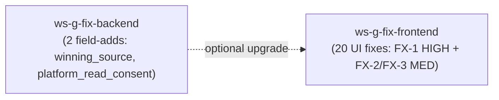

# WS-G fix — code-loop sub-index (review findings → frontend lane + optional backend lane)

> **Orchestration index for `code-loop`.** Closes the 22 code-verified findings from the 2026-07-09 deep review of the built `web/console` (detailed in [../ws-g-fix-review-findings.md](../ws-g-fix-review-findings.md)). Mirrors the proven [../ws-g-build/](../ws-g-build/00-index.md) two-lane split: the fixes are **overwhelmingly frontend** (20 of 22); only **2 are optional backend field-adds** (each with a UI-PARTIAL fallback, so the frontend lane is NOT hard-blocked on them).

> **Launch note:** run `code-loop` on the **frontend lane FIRST** (it carries all 5 HIGH + the security MEDIUMs; the 2 backend field-adds degrade to UI PARTIAL if absent). The backend lane is **optional / can run in parallel or after** — it only upgrades two PARTIAL states to full.
> - `args:{ domain:'frontend', onlyWs:['ws-g-fix-frontend'], tasksDir:'tasks/serverless-edition/ws-g-fix', indexPath:'tasks/serverless-edition/ws-g-fix/00-index.md', unitTestCmd:'npm test', integTestCmd:'npm test', agentPrefix:'harness:' }` — PRIMARY.
> - `args:{ domain:'backend', onlyWs:['ws-g-fix-backend'], ... }` — OPTIONAL (upgrades FX-3.1/FX-3.5 PARTIAL → full).
> - Frontend cwd = `web/console`; tests = `npm test` (Vitest). Backend cwd = `src/security-controller`; tests moto-safe (`env -u AWS_PROFILE` + fake creds + `venv/bin/python`).

| Workstream | Doc | Domain | Scope | Blocking? |
|---|---|---|---|---|
| **ws-g-fix-frontend** ✅ **DONE+DEPLOYED** | [ws-g-fix-frontend.md](ws-g-fix-frontend.md) | frontend (React 19 + TS + Tailwind v4 + Vite; Vitest) | FX-1 (5 HIGH: sigma-toggle gate, `/trail` bind, session-forensics header, agent activity-status map, fleet KPI grid) + FX-2 (security/correctness MEDIUMs) + FX-3 (canvas-fidelity MEDIUMs) + FXR-1..4 residuals + #4 server-side `threat_type` facet. All in `web/console/src`. **Merged main `90b81c9`+`4d3695c`, deployed to prod 2026-07-09, 195 tests green.** | ✅ done — 2 items ship PARTIAL until the backend lane |
| **ws-g-fix-backend** ✅ **DONE 2026-07-10** | [ws-g-fix-backend.md](ws-g-fix-backend.md) | backend (Python + pytest, `src/security-controller`) | 2 field-adds. **FXB-1.1 (`winning_source` on `/decisions` rows) was ALREADY SHIPPED** (`decisions_service.py:554`, WS-G M-G3.3 — the stale "pending" note was wrong). **FXB-1.2 (`platform_read_consent` on `platform_list_tenants` rows) LANDED** — one-line projection, `test_platform_list_projects_consent` green; FE Consent column now shows real state. No CDK. | done — Consent column live once the controller image redeploys |

## Dependency graph

- **No hard edge:** the frontend lane ships FX-3.1 (threats facet) + FX-3.5 (consent column) as PARTIAL/honest-degrade if the backend field-adds aren't present — so it can run **first or standalone**. The backend lane only flips those two to full-fidelity.

## Build order
- **Wave 1 (primary):** ws-g-fix-frontend
- **Wave 2 (optional):** ws-g-fix-backend — then re-verify FX-3.1/FX-3.5 upgrade from PARTIAL to full.

## Notes
- **Green baseline to preserve:** `web/console` `tsc -b` clean + `npm test` 37 files / 118 tests. Every fix adds a real (non-vacuous) test; do not regress the baseline or the verified-correct spine (org-first machinery, RBAC map, D3 parity, platform gate).
- **No `cdk deploy` / no AWS mutation** in the backend lane — code + unit-test only (prod-safety).
- **Full finding detail (file:line + fix + test) is in [../ws-g-fix-review-findings.md](../ws-g-fix-review-findings.md)** — the lane docs point at it by FX-id rather than duplicating.
