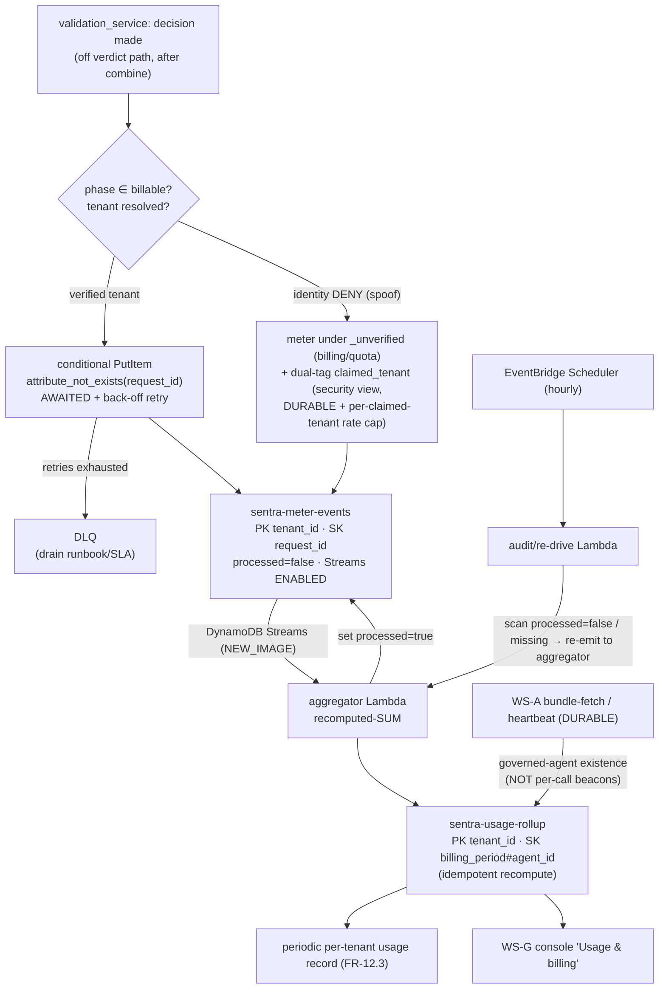

# WS-H — Durable metering pipeline (`sentra-meter-events` + `sentra-usage-rollup` + Streams + hourly re-drive)

> **Doc role:** This is the **workstream SCOPE** — boundary, dependencies, real `file:line` anchors, footguns, and acceptance criteria. It is an **INPUT to this workstream's implementation-grade LLD**, *not* the granular task breakdown. The granular, buildable tasks are generated **from the approved LLD** (canonical order: HLD → LLD → tasks). See [00-index.md](00-index.md) for the doc-role map.

**Parent HLD**: [hld/serverless-edition.md](../../hld/serverless-edition.md) §6.5 (metering — "What is metered", the durable meter-event pipeline, the spoof-DENY dual-tag split, the COGS envelope) and §8 hand-off table, **row 11** (`FR-12.x metering → Durable meter-event pipeline … counters ops-only; usage plans; dual-tag … edge-beacon loss model + billing error bounded to NFR-12 ≥99.9% + DLQ-drain runbook/SLA; governed-agent registration anchored to the durable bundle-fetch/heartbeat path … cost envelope: the 3 named COGS drivers → ADR-033 → LLD 17 + a new metering LLD`). Appendix H (loss model + tier math + COGS figures — owned by the metering LLD, not this WS).
**Status**: Not started
**Owner**: TBD
**Implements**: **FR-12.1** (usage metering off-path), **FR-12.2** (usage-based limits / quota), **FR-12.3** (billing / usage records). **NFR-12** (billable-event accounting ≥ 99.9%, per-tenant, off the hot path). **Decision: ADR-033** (durable meter-event pipeline — wholly new; supersedes the "no separate metering path" mechanism half of ARCHITECTURE §2.10).
**Spike-gated?** **NO.** WS-H is **not** one of the four measure-first spike workstreams (local floor / redactor / DAG scheduler / deep tier). It builds the metering substrate and may be decomposed and built independent of the spike packet. It *consumes* the durable bundle-fetch/heartbeat path (WS-A local floor) for governed-agent registration — see Dependencies.

> **Next step: an implementation-grade LLD.** This WS doc *scopes* the build (the tables, the durable-before-ack write, the aggregator/re-drive Lambdas, the dual-tag split, the quota surface, the COGS model). The concrete DDB attribute types, the conditional-write + retry/back-off code, the Streams batch handler, the EventBridge schedule, the per-tenant usage-plan CDK, the precise COGS figures, and the per-case test tables are an **implementation-grade LLD** that extends **LLD 17** ([lld/17-validation-signal-store.md](../../lld/17-validation-signal-store.md) — the persistence substrate) plus a **new metering LLD** (owns the edge-beacon loss model + tier math + Appendix-H COGS figures). Owner directive: LLDs go to implementation level per workstream.

---

## 1. Status honesty (sub-PRD §5)

[prd/serverless-edition.md](../../prd/serverless-edition.md) §5 / §4.12:
- **FR-12.1 = PARTIAL** — *"raw counters only"*. Evidence: [metrics_publisher.py:62](../../src/security-controller/app/utils/metrics_publisher.py#L62) `ValidationsTotal`, [:112](../../src/security-controller/app/utils/metrics_publisher.py#L112) `Decisions`.
- **FR-12.2 = PARTIAL** — a **single global** API-Gateway usage plan exists ([api_stack.py:176](../../cdk/stacks/api_stack.py#L176) `UsagePlan`, one shared `api_key` at :167, fixed `rate_limit`/`burst_limit`/`quota_limit` from config). **Not** per-tenant, not per-tier.
- **FR-12.3 = NOT-DONE** — no usage record, no billing ledger ([prd §4.12](../../prd/serverless-edition.md):248).

**DONE today — do NOT rebuild (note as existing, leave OPS-ONLY):**
- The CloudWatch counters in [metrics_publisher.py](../../src/security-controller/app/utils/metrics_publisher.py) — `ValidationsTotal{AgentId}` (:62), `Decisions{tenant_id}` (:112), `put_metric_data` (:129). These are **fire-and-forget** ([validation_service.py:60](../../src/security-controller/app/services/validation_service.py#L60) `_fire_and_forget`, audit/metric writes swallow failures). **They stay exactly as-is and are demoted to ops-only** (dashboards/alarms). **FOOTGUN: do NOT make these the billing source of truth** — a dropped `put_metric_data` is silently lost; that is precisely the property a billing ledger may not have. They are *observability*, not *accounting*.
- The spoof/identity-DENY path that already dual-tags `claimed_tenant_id` and counts under the reserved `_unverified` tenant: [routes.py:102](../../src/security-controller/app/api/routes.py#L102) (`request.context["claimed_tenant_id"]`), [routes.py:161](../../src/security-controller/app/api/routes.py#L161) `_identity_deny`, [:182](../../src/security-controller/app/api/routes.py#L182) (the `Decisions` series is tagged `_unverified`, **never** the claimed tenant or `default`). **This billing/quota split logic already exists for the metric series** — WS-H reuses the same `_unverified`-vs-`claimed_tenant_id` rule for the durable ledger; it does NOT reinvent it. The gap WS-H adds is (a) **durability** of the spoof-DENY security write and (b) a **per-claimed-tenant rate cap** on the security view (§6.5 fixes 1 + 2).

**This WS builds only the gap (scope, exactly):**
1. **`sentra-meter-events`** durable-before-ack ledger (FR-12.1) — the new table + the **awaited, retried, conditional** write replacing the fire-and-forget pattern *for the meter event only* (the verdict path and the ops counters are untouched).
2. **`sentra-usage-rollup`** recomputed-SUM aggregate + the Streams→aggregator Lambda (FR-12.3).
3. **Hourly EventBridge-Scheduler audit/re-drive Lambda** (re-drives `processed=false`/missing — the no-miss backstop).
4. **Governed-agent registration** anchored to the durable bundle-fetch/heartbeat path (FR-12.1 charged-dimension correctness).
5. **Per-tenant-per-tier API-Gateway usage plans** + edge-side quota decrement (FR-12.2), replacing the single global plan.
6. **Spoof-DENY hardening**: durable security write + per-`claimed_tenant` rate cap (FR-12.1 security view, ADR-033).
7. **Cost/COGS envelope** → a per-validate cost model naming the 3 drivers (deliverable for the tier price; precise figures in the metering LLD).
8. **DLQ-drain runbook/SLA** + the NFR-12 ≥99.9% acceptance gate.

**Explicitly OUT of this WS (named, not silently dropped):**
- The **pricing dimension** (per-decision vs per-agent vs per-seat vs tiered RPS) — a STRATEGY call ([hld §6.5](../../hld/serverless-edition.md):621, sub-PRD §11.1). The mechanism here **supports any dimension**; WS-H fixes the *charged dimension as per governed agent* (ARCHITECTURE §2.10, re-affirmed by the HLD) but does not set prices.
- The **edge usage-beacon transport** itself (the out-of-band channel the SDK sends volume on) — that channel is **WS-A** (local floor / bundle-refresh / heartbeat). WS-H *defines the beacon's payload contract + consumes it*; it does not build the SDK transport.
- The **invoice/chargeback integration** (Stripe/marketplace billing) — downstream of FR-12.3; WS-H produces the periodic per-tenant *usage record*, not the invoice.
- The exact **Appendix-H loss model + tier-band math + COGS figures** — owned by the metering LLD.

---

## 2. Dependencies

- **Depends on:**
  - **WS-A (local floor + bundle-refresh)** — provides the **durable bundle-fetch + low-frequency heartbeat** path that registers governed-agent *existence* (§6.5: "an agent registers itself durably the first time it fetches its rule bundle"). WS-H's governed-agent count is anchored to this path, **NOT** to per-call edge beacons. *If WS-A's heartbeat/bundle-fetch endpoint does not yet exist, that is an explicit prerequisite — WS-H must not fall back to counting per-call events for existence.*
  - **WS-K (activation/config)** — owns `cdk/config/prod.yaml`; WS-H's per-tenant usage-plan + new-table CDK lands through the same config/deploy discipline. (`tenancy_v2_enabled:false` at [prod.yaml:22](../../cdk/config/prod.yaml#L22) is the real prod flip WS-K owns; WS-H does not flip tenancy.)
  - **Tenancy v2 (DONE on dev)** — the `tenant_id` contextvar + `_unverified` reserved tenant + `claimed_tenant_id` dual-tag already exist ([routes.py:102/161/182](../../src/security-controller/app/api/routes.py#L102), LLD 26, go-live 2026-06-24, tenant `acme`). **Design AGAINST this — do not rebuild tenant scoping.**
- **Blocks:**
  - **WS-G console "Usage & billing" dashboard** (FR-13.2 — [prd §5 FR-13.2](../../prd/serverless-edition.md):237) reads `sentra-usage-rollup`. The rollup schema (PK/SK/attrs below) is the contract WS-G consumes.
  - Any FR-12.3 invoicing/chargeback work (downstream).
- **Shared files / contracts:**
  - [src/security-controller/app/services/validation_service.py](../../src/security-controller/app/services/validation_service.py) — the meter-event emit hook lands here (off the verdict path, after `_capture`/combine, alongside but **separate from** the ops-counter `_fire_and_forget`). Shared with WS-D (full-trail combiner) — WS-H emits *after* the combiner decides; do not couple the two writes.
  - [src/security-controller/app/api/routes.py](../../src/security-controller/app/api/routes.py) — the `_identity_deny` / `_unverified` / `claimed_tenant_id` logic (shared with the tenancy work). WS-H makes the spoof-DENY meter write durable + capped here.
  - [src/security-controller/app/utils/metrics_publisher.py](../../src/security-controller/app/utils/metrics_publisher.py) — **left as ops-only**; WS-H adds a *new* `meter_publisher` module, does not extend this one.
  - [cdk/stacks/api_stack.py](../../cdk/stacks/api_stack.py) — the usage-plan change (single global → per-tenant-per-tier).
  - A **new CDK construct** for the two metering tables (model on [cdk/cdk_constructs/signal_store_table_construct.py](../../cdk/cdk_constructs/signal_store_table_construct.py), which is the closest existing table construct — but with **Streams ENABLED**, unlike the signal store).

---

## 3. Model / read before coding (the invariants)

Hold these before touching code — they are the load-bearing rules from §6.5 / ADR-033 / tenet D:

1. **Substrate vs. charged dimension.** The **metered substrate** is the per-call meter event keyed `(tenant_id, agent_id, request_id)`. The **charged dimension is per *governed agent* (tiered)** — NOT per call. `usage_unit=1` on a meter event is a *usage-count marker* (it powers the rollup, quota, and security view), **NOT** the billing unit. (§6.5 "What is metered"; ARCHITECTURE §2.10.)
2. **Why per-agent, not per-call.** The local floor (WS-A) means **most benign calls never reach the server** — so counting server calls would (a) under-count usage and (b) couple the bill to the *threat mix* (cleaner traffic → fewer escalations → lower bill for the same coverage = the coverage-tax §2.10 rejects). Governed-agent count does not depend on how many calls reach the server. **FOOTGUN: do NOT bill per arrived server call — it structurally under-counts and taxes coverage.**
3. **Durable-before-ack — the opposite of today.** The meter write is a **conditional `PutItem attribute_not_exists(request_id)`**, **AWAITED with back-off retry**, → **DLQ on exhausted retry, never silently dropped.** This is the inverse of the existing fire-and-forget counters/audit. **FOOTGUN: do NOT copy the `_fire_and_forget` pattern for the meter write — that is exactly the lossy property NFR-12 forbids.**
4. **Idempotency end-to-end.** `request_id` is the dedup key (SK / conditional-write guard). The rollup is a **recomputed SUM over the period** — re-driving an already-processed event changes nothing (no double-billing). **FOOTGUN: do NOT make the rollup an incrementing counter (`ADD call_count 1`) — a re-driven Streams record would then double-count. Recompute, don't increment.**
5. **Metering outage ≠ enforcement outage.** The meter write is **off the response path** and **never changes the verdict returned**. A crash in the small window between deciding and writing loses that one event; the **hourly audit re-drive** catches it. Off-path here means *durable + re-driven*, NOT best-effort.
6. **Governed-agent existence is registered durably, beacon volume is not.** Agent *existence* comes from the durable bundle-fetch/heartbeat (WS-A) — paths every agent uses regardless of whether it ever escalates. The **edge usage beacon carries only volume**, never existence, and is **NOT covered by the no-miss guarantee** (the emitting process may die before flush). Volume only sets the coarse request-tier *band*, so single-digit-% beacon loss can't move a band. **FOOTGUN: do NOT register a governed agent off a beacon — a never-escalating agent that never sends a beacon must still be a counted agent.**
7. **Spoof-DENY dual-tag split (tenet D + DoS defense).** `claimed_tenant_id` is **attacker-asserted**. So:
   - **Security/visibility view** → dual-tag to BOTH `_unverified` AND the `claimed_tenant` (so *acme* sees "N spoof attempts against your agents"). This view must be **durable** (a flood must not erase the evidence of itself) and **rate-limited/capped per `claimed_tenant`** (one aggregable signal, not one alert per spoofed call — alert-fatigue defense).
   - **Billing/quota view** → counted ONLY under `_unverified`. **FOOTGUN: NEVER draw a spoof-DENY from the *claimed* tenant's quota/rate budget — an attacker spoofing `acme`'s agent_id at volume would otherwise exhaust `acme`'s budget (DoS).**
8. **The signal store has NO Streams; the meter table needs them.** [signal_store_table_construct.py:81](../../cdk/cdk_constructs/signal_store_table_construct.py#L81) `point_in_time_recovery=False` and no stream — the meter table is a **new** table with `stream=NEW_IMAGE` enabled. Do not bolt Streams onto the signal store.



---

## 4. Milestones → tasks

### Milestone H1 — `sentra-meter-events` durable ledger (FR-12.1)

- **Implements:** FR-12.1 | contract: `sentra-meter-events`, the durable-before-ack write | ADR-033.

**H1.1 — Create the `sentra-meter-events` table (new CDK construct).** Model on [signal_store_table_construct.py](../../cdk/cdk_constructs/signal_store_table_construct.py) but **enable Streams**.

| attr | type | notes |
|---|---|---|
| `tenant_id` | S | **PK.** The *verified* tenant, or `_unverified` for spoof-DENYs. Never the attacker-claimed value. |
| `request_id` | S | **SK + idempotency key.** Conditional-write guard `attribute_not_exists(request_id)`. |
| `agent_id` | S | governed-agent attribution (the charged-dimension join key). |
| `event_time` | S (ISO-8601) | decision timestamp. |
| `decision` | S | `ALLOW` / `DENY` (the combiner verdict). |
| `phase` | S | `request` / `content` / `output` / `memory` (the WS-B `phase` enum; default `request`). |
| `sku` | S | `base` \| `addon:<name>` (e.g. `addon:d1-d7`, `addon:redaction`, `addon:compliance`, `addon:siem`). |
| `usage_unit` | N | `=1` — usage-count marker, **NOT the billing unit** (see Model #1). |
| `processed` | BOOL | `false` on write; aggregator flips `true` (the re-drive backstop reads this). |
| `claimed_tenant_id` | S | attacker-asserted tenant on a spoof-DENY (security view only); absent on verified events. |
| `expires_at` | N (epoch s) | **TTL ~13 months** (DynamoDB TTL attribute) — billing-dispute window, then auto-expire. |

  - GSI **`tenant_id#billing_period` (PK) / `agent_id#event_time` (SK)** — supports the per-period, per-agent rollup recompute and the security view.
  - **Streams: `NEW_IMAGE` ENABLED** (the aggregator trigger). FOOTGUN: the signal store has Streams OFF — do not assume the existing construct enables them.
  - `expires_at` must be set on the TTL-enabled attribute name; **do NOT** let it be unset (an unbounded ledger).

**H1.2 — Durable-before-ack meter write (the new `meter_publisher`).** New module (e.g. `app/utils/meter_publisher.py`), NOT an extension of `metrics_publisher.py`. Emit hook lands in [validation_service.py](../../src/security-controller/app/services/validation_service.py) **after** the combiner decides (after `_capture`/combine, off the verdict path — near where the ops counters fire, but a *separate, awaited* call).

```python
# conceptual — REAL names; full retry/back-off code is the LLD's
async def emit_meter_event(*, tenant_id, request_id, agent_id, decision, phase, sku, claimed_tenant_id=None):
    item = {... "processed": False, "usage_unit": 1, "expires_at": now + TTL_13MO ...}
    for attempt in backoff_schedule():            # AWAITED, not fire-and-forget
        try:
            await ddb.put_item(
                TableName="sentra-meter-events",
                Item=item,
                ConditionExpression="attribute_not_exists(request_id)",  # idempotent dedup
            )
            return
        except ConditionalCheckFailedException:
            return                                 # already metered — idempotent no-op, not an error
        except (ProvisionedThroughputExceeded, transient):
            continue                               # retry with back-off
    await send_to_dlq(item)                         # exhausted → DLQ, NEVER silently dropped
```

  - **FOOTGUN:** `ConditionalCheckFailedException` is the **success/idempotent** path (the event already exists from a retry/re-drive) — do NOT treat it as a failure or DLQ it.
  - **FOOTGUN:** this write is **awaited** but still **off the verdict path** — it must not be able to change or block the `decision` returned to the caller. If you `await` it inline in the response, a slow/failing DDB write must not delay the verdict. Resolve by emitting after the response is computed (or via a bounded background task that still guarantees DLQ on failure) — the LLD fixes the exact placement; the invariant is *verdict latency unaffected, event never lost*.

**H1.3 — DLQ + drain runbook.** An SQS DLQ for exhausted-retry items; a documented **drain runbook + SLA** (operator replays DLQ items into `sentra-meter-events`; replay is idempotent via the conditional write). Acceptance gate ties to NFR-12 ≥99.9%.

### Milestone H2 — `sentra-usage-rollup` + Streams aggregator (FR-12.3)

- **Implements:** FR-12.3 | contract: `sentra-usage-rollup`, recomputed-SUM aggregation.

**H2.1 — Create the `sentra-usage-rollup` table.**

| attr | type | notes |
|---|---|---|
| `tenant_id` | S | **PK.** |
| `billing_period#agent_id` | S | **SK** (e.g. `2026-06#agent-pay-01`). |
| `call_count` | N | recomputed SUM over the period (usage volume). |
| `allow_count` | N | recomputed. |
| `deny_count` | N | recomputed. |
| `sku_breakdown` | M (map) | `{base: n, "addon:d1-d7": n, ...}` recomputed. |
| `tier` | S | request-volume tier band for this agent (coarse, order-of-magnitude steps). |
| `quota_limit` | N | per-agent allotment for the tier (drives edge quota + usage-plan ceiling). |

**H2.2 — Streams→aggregator Lambda.** Triggered by `sentra-meter-events` Streams (`NEW_IMAGE`). For each affected `(tenant_id, billing_period, agent_id)`, **recompute the SUM** from the GSI and `PutItem` the rollup row; then set `processed=true` on the source event(s).
  - **FOOTGUN (Model #4):** recompute, do not `ADD`/increment — a re-driven Streams record (at-least-once delivery) must be a no-op on the totals. The recompute reads the authoritative ledger; the rollup is a *cache* of a SUM, not an accumulator.
  - **FOOTGUN:** Streams deliver **at-least-once**; the handler must be idempotent (the recompute makes it so).

**H2.3 — Periodic per-tenant usage record (FR-12.3).** A per-period materialization of the rollup into the invoice-ready usage record (the charged dimension = governed-agent count × tier + add-on SKUs). This is the FR-12.3 deliverable WS-G's "Usage & billing" view and any downstream invoicing consume. *Pricing numbers are OUT (STRATEGY); the record carries the dimensions, not prices.*

### Milestone H3 — Hourly audit / re-drive (no-miss backstop, NFR-12)

- **Implements:** FR-12.1 no-miss | NFR-12.

**H3.1 — EventBridge-Scheduler hourly Lambda.** Scans `sentra-meter-events` for `processed=false` (stuck, e.g. Streams drop) and re-emits them to the aggregator; reconciles against the ops counters / audit trail to surface *missing* events (crash in the deciding→writing window). Re-drive is idempotent (conditional write + recompute).
  - **FOOTGUN:** the re-drive reconciles but must never *fabricate* an event for usage it has no durable evidence of — a missing event with no audit corroboration is a logged gap, not an invented charge.

### Milestone H4 — Governed-agent registration anchored to the durable path (FR-12.1 charged-dimension correctness)

- **Implements:** FR-12.1 (charged dimension) | depends on **WS-A** heartbeat/bundle-fetch.

**H4.1 — Register governed-agent existence off the durable bundle-fetch + heartbeat (WS-A), NOT per-call beacons.** On first bundle-fetch and on the low-frequency heartbeat, upsert the agent into the governed-agent set used by the rollup's charged-dimension count. **FOOTGUN (Model #6):** a never-escalating agent (only ever resolves locally, never sends a beacon) MUST still be counted — its existence comes from the heartbeat, not from any meter event or beacon. If WS-A's heartbeat path is not yet built, this is a hard prerequisite (do not substitute per-call counting).

**H4.2 — Define the edge usage-beacon payload contract (transport is WS-A).** The beacon carries **volume only** (`agent_id`, count window, sku) — **never** agent existence and **never** raw content. Beacon loss is acceptable (volume only sets the coarse tier band; Model #6). WS-H owns the *payload shape*; WS-A owns the out-of-band transport.

### Milestone H5 — Per-tenant-per-tier quota (FR-12.2)

- **Implements:** FR-12.2 | shared file: [api_stack.py:176](../../cdk/stacks/api_stack.py#L176).

**H5.1 — Replace the single global usage plan with per-tenant-per-tier plans.** Today [api_stack.py:167](../../cdk/stacks/api_stack.py#L167)–192 defines **one** `ApiKey` + **one** `UsagePlan` with fixed `rate_limit`/`burst_limit`/`quota_limit`. Build per-tenant-per-tier usage plans (one plan per tier band; per-tenant key) keyed to the rollup's `tier`/`quota_limit`. API-GW usage plans cap **only calls that actually reach the server**.

**H5.2 — Edge-side quota for the locally-resolved path.** Because the local floor resolves most calls without a server call, API-GW plans can't cap them. The signed bundle (WS-A) carries a **per-agent allotment**; the SDK decrements a local counter and **fails closed** once exhausted. WS-H defines the allotment field in the bundle (sourced from `quota_limit`); WS-A's SDK enforces it. **FOOTGUN (Model #7):** spoof-DENYs are counted under `_unverified` only — they must NEVER decrement the claimed tenant's API-GW quota or edge allotment (DoS).

### Milestone H6 — Spoof-DENY hardening (security view: durable + capped) (ADR-033)

- **Implements:** FR-12.1 security view | shared file: [routes.py:161](../../src/security-controller/app/api/routes.py#L161) `_identity_deny`.

**H6.1 — Make the spoof-DENY security write durable.** Today [routes.py:182](../../src/security-controller/app/api/routes.py#L182) the `_unverified`-tagged `Decisions` metric is fire-and-forget — so it is **suppressed exactly under a flood** (when the signal matters most). The meter event for a spoof-DENY goes through the H1.2 **durable** write (under `_unverified` for billing/quota, dual-tagged `claimed_tenant_id` for the security view), so a flood cannot erase the evidence of itself.

**H6.2 — Per-`claimed_tenant` rate cap on the security view.** Aggregate spoof attempts into a bounded "N spoof attempts against your agents" signal per `claimed_tenant` per window — **not** one alert per spoofed call (alert-fatigue / SOC-flood defense). **FOOTGUN:** the cap is on the *security/alert series*, not on the durable meter write — every spoof-DENY is still durably recorded; only the per-claimed-tenant *alerting* is aggregated/capped.

### Milestone H7 — COGS envelope → per-validate cost model (deliverable)

- **Implements:** FR-12.3 tier-price input | §6.5 COGS envelope.

**H7.1 — Document the 3 new COGS drivers as a per-validate cost model.** ([hld §6.5](../../hld/serverless-edition.md):615.) (1) the **awaited meter `PutItem` per validate** (the durability cost this WS adds); (2) **per-escalation Bedrock inference** (only on escalated calls); (3) **multi-region CDN + HSM/key-management** (bundle distribution, amortized). Model: `blended per-validate COGS ≈ (escalation rate) × (Bedrock inference + 2 DDB writes) + amortized CDN/HSM` — so **escalation rate is the single biggest COGS variable**. WS-H delivers the *model + named drivers* so the per-governed-agent tier price isn't set against an unstated cost base; the **precise figures are the metering LLD's** (Appendix H). FOOTGUN: a locally-resolved call ≈ near-zero marginal COGS — do not size COGS off total call volume; size off *escalation rate*.

---

## 5. Error model

| Condition | Response |
|---|---|
| Meter `PutItem` transient failure (throughput/timeout) | Retry with back-off (awaited). Verdict already returned — unaffected. |
| Meter `PutItem` retries exhausted | → **DLQ** (never silently dropped). Drain runbook replays idempotently (H1.3). |
| `ConditionalCheckFailedException` (request_id exists) | **Success / idempotent no-op** — event already metered. NOT an error, NOT DLQ'd. |
| Crash between deciding and writing the meter event | One event may be lost in-window → **hourly re-drive (H3)** reconciles against audit; logged gap if uncorroborated, never fabricated. |
| Streams delivers a record twice (at-least-once) | Aggregator **recomputes SUM** → no double-count (Model #4). |
| Spoof / identity DENY (`claimed_tenant_id` set) | Billing/quota under `_unverified`; security view durable + dual-tagged + per-`claimed_tenant` rate-capped. Claimed tenant's quota **untouched** (DoS defense). |
| Edge usage beacon lost (process died before flush) | Acceptable — volume only; tier bands are coarse. Agent *existence* still counted off heartbeat (H4). |
| Per-tenant quota exceeded (server path) | API-GW usage-plan 429 (graceful quota-exceeded, FR-12.2). |
| Per-agent edge allotment exhausted (local path) | SDK **fails closed** (deny-by-default) — WS-A enforcement. |
| WS-A heartbeat path absent | **Prerequisite not met** — block H4; do NOT substitute per-call counting for existence. |

---

## 6. Acceptance criteria

- [ ] `sentra-meter-events` exists with **PK `tenant_id`, SK `request_id`**, attrs `agent_id`/`event_time`/`decision`/`phase`/`sku`/`usage_unit`/`processed`/`claimed_tenant_id`/`expires_at`, **TTL ~13 mo enabled**, GSI `tenant_id#billing_period`/`agent_id#event_time`, and **DynamoDB Streams (`NEW_IMAGE`) ENABLED**.
- [ ] The meter write is a **conditional `PutItem attribute_not_exists(request_id)`**, **awaited with back-off retry**, → **DLQ on exhausted retry** (verified: no code path silently drops a meter event; the ops counters in `metrics_publisher.py` remain unchanged and ops-only).
- [ ] `ConditionalCheckFailedException` is handled as an idempotent no-op (a re-driven/duplicate `request_id` does not error and does not DLQ).
- [ ] `sentra-usage-rollup` exists (**PK `tenant_id`, SK `billing_period#agent_id`**) and the Streams aggregator writes it by **recomputed SUM** — a replayed Streams record changes no totals (idempotency test passes).
- [ ] The hourly EventBridge-Scheduler re-drive Lambda re-processes `processed=false`/missing events and is idempotent; never fabricates an uncorroborated event.
- [ ] **Governed-agent existence is registered off the WS-A durable bundle-fetch/heartbeat path** — a never-escalating, never-beaconing agent is still counted as a governed agent (test).
- [ ] The edge usage-beacon **payload contract** is defined (volume only; no existence, no raw content); a lost beacon cannot drop an agent from the governed count or move it across a tier band on single-digit-% loss.
- [ ] Charged dimension = **per governed agent × tier + add-on SKUs**; **no per-server-call billable unit** exists anywhere (verified: billing reads governed-agent count + tier, not arrived-call count).
- [ ] Per-tenant-per-tier API-Gateway usage plans replace the single global plan ([api_stack.py:176](../../cdk/stacks/api_stack.py#L176)); quota-exceeded returns 429 gracefully.
- [ ] Edge-side quota allotment field is carried in the bundle (sourced from `quota_limit`); spoof-DENYs **never** decrement the claimed tenant's server quota or edge allotment (DoS test passes).
- [ ] Spoof-DENY: billing/quota counted **only** under `_unverified`; security view is **durable** (survives a flood) and **rate-capped per `claimed_tenant`** (one aggregable signal, not per-call alerts).
- [ ] **Billable-event accounting accuracy ≥ 99.9% per-tenant, off the hot path (NFR-12)** is met by an end-to-end no-miss/dedup test (durable-before-ack + re-driven event doesn't double-count — the HLD §7 build-requirement test #4).
- [ ] A **DLQ-drain runbook + SLA** is written and the replay is verified idempotent.
- [ ] The **per-validate COGS model** is documented naming the 3 drivers (awaited meter PutItem, per-escalation Bedrock inference, multi-region CDN+HSM), with escalation rate as the dominant variable (figures deferred to the metering LLD).
- [ ] The meter write never changes or delays the verdict returned (metering-outage ≠ enforcement-outage test).

---

## 7. Cross-references

- **HLD**: [hld/serverless-edition.md](../../hld/serverless-edition.md) §6.5 (metering — "What is metered" :570, durable pipeline :576–581, dual-tag/ADR-033 :604–611, COGS :615), §8 hand-off **row 11** (:681), Decisions Ledger row FR-12.x (:639), Cross-references shared-contracts (:659), Appendix H (loss model + tier math + COGS figures — metering-LLD-owned).
- **Sub-PRD**: [prd/serverless-edition.md](../../prd/serverless-edition.md) §4.12 (:247–254 FR-12.1/12.2/12.3), §5 status rows (FR-12.x PARTIAL/NOT-DONE), §9 NFR-12 (:101), §11.1 (pricing dimension — open, OUT of WS).
- **ADR**: **ADR-033** (durable meter-event pipeline; supersedes the "no separate metering path" mechanism half of ARCHITECTURE §2.10 — keeps the per-governed-agent charged dimension).
- **Sibling WS docs**: **WS-A** (local floor / bundle-refresh / heartbeat — provides governed-agent registration + edge quota transport; prerequisite for H4/H5.2), **WS-D** (full-trail combiner — WS-H emits after it decides), **WS-G** (console "Usage & billing" — consumes `sentra-usage-rollup`), **WS-K** (activation/config + CDK deploy discipline).
- **LLDs**: [LLD 17](../../lld/17-validation-signal-store.md) (persistence substrate — meter-events extend it) + a **new metering LLD** (edge-beacon loss model, tier-band math, Appendix-H COGS figures, the conditional-write/Streams/Scheduler implementation detail). [LLD 26](../../lld/26-multi-tenancy.md) (tenancy — `tenant_id` scoping, `_unverified`, `claimed_tenant_id` dual-tag — reused, not rebuilt).
- **Code anchors (verified)**: [metrics_publisher.py:62/112/129](../../src/security-controller/app/utils/metrics_publisher.py#L62) (ops-only counters, fire-and-forget — left as-is), [validation_service.py:60](../../src/security-controller/app/services/validation_service.py#L60) (`_fire_and_forget` — the anti-pattern the meter write must NOT copy), [routes.py:102/161/182](../../src/security-controller/app/api/routes.py#L102) (`_identity_deny` / `_unverified` / `claimed_tenant_id` dual-tag), [api_stack.py:167–192](../../cdk/stacks/api_stack.py#L167) (single global usage plan → per-tenant-per-tier), [signal_store_table_construct.py:81](../../cdk/cdk_constructs/signal_store_table_construct.py#L81) (Streams OFF — the meter table is new, with Streams ON).
