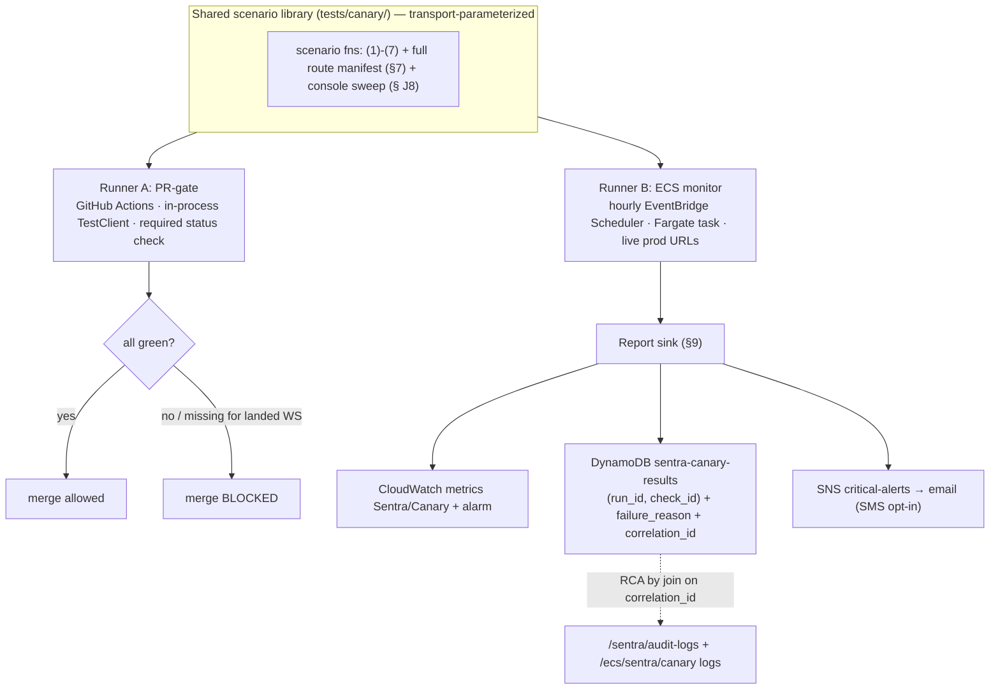
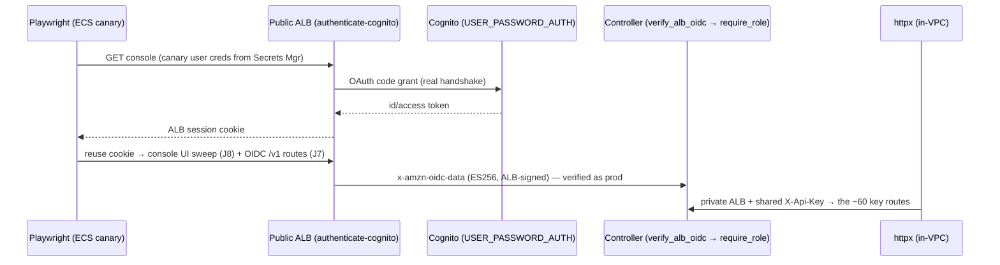

# WS-J — Synthetic canary + e2e test harness (hourly prod monitor **and** PR gate)

> **Doc role:** This is the **workstream SCOPE** — boundary, dependencies, real `file:line` anchors, footguns, and acceptance criteria. It is an **INPUT to this workstream's implementation-grade LLD** ([lld/38-canary-synthetic-monitoring.md](../../lld/38-canary-synthetic-monitoring.md), *to be authored*), *not* the granular task breakdown. Buildable tasks are generated **from the approved LLD** (canonical order: HLD → LLD → tasks). See [00-index.md](00-index.md) for the doc-role map.

**Parent HLD:** [hld/serverless-edition.md](../../hld/serverless-edition.md) — §8 hand-off (the "End-to-end canary / integration tests (build requirement)" carry-row) + **§6.4 line 564** (the six numbered scenarios + the (2b) differential-conformance requirement). Soundness bounds for (2b) live in **Appendix C** ([hld/serverless-edition.md:782](../../hld/serverless-edition.md#L782)).
**Status:** Scope reshaped 2026-07-05 (founder direction) — see §0.
**Owner:** TBD
**Implements (build requirement, not a feature FR):** the §6.4 gating-test mandate over **FR-1.7, FR-3.4, FR-2.8, FR-6.8, FR-3.13, FR-12, FR-13.3, NFR-4, NFR-6, NFR-7, NFR-10, NFR-12**, **extended** (§0) to a **continuous production synthetic monitor** covering **every deployed API** and the **console UI**. It adds no product behavior; it **proves** the behavior every other WS ships — on **every PR** (merge gate) **and every hour in prod** (live monitor) — and, on failure, records **why** so each red check can be root-caused.

---

## 0. Scope reshape (2026-07-05) — read this first

The original WS-J scoped a **PR-gating CI canary only** (GitHub Actions, in-process `TestClient`, six merge-gate scenarios). Founder direction expands it to **two delivery targets over one shared scenario library**, plus **exhaustive API + console coverage** and **failure-reason capture for RCA**. The decisions locked (this WS doc records them; the LLD designs the mechanism):

| # | Decision | What it means for the LLD |
|---|---|---|
| **D-1** | **Dual target: hourly ECS synthetic monitor AND PR merge-gate.** One scenario library (`tests/canary/`), two runners. | The scenario functions must be **transport-parameterized** — the same assertion runs against an **in-process `TestClient`** (PR-gate, hermetic) *or* a **live deployed URL** (ECS monitor, real prod). No scenario forks per runner. |
| **D-2** | **Exhaustive API coverage — every deployed endpoint, happy path AND failure cases.** Not just the six §6.4 scenarios. | The LLD carries a **route manifest** (derived from [lld/21-api-inventory-for-ux.md](../../lld/21-api-inventory-for-ux.md) reconciled against real code — see §7) of all **61 in-code routes** (45 [routes.py](../../src/security-controller/app/api/routes.py) + 16 [tenancy_routes.py](../../src/security-controller/app/api/tenancy_routes.py)) = **65 gateway-wired methods** (61 + 4 demo-agent proxies; **zero unwired** after commit `ff4fdfc`); each gets ≥1 happy + its documented failure modes (401/403/404/409/422/429/DENY). The coverage guard (J1.4) fails red if a wired route has no canary. *(Verified 2026-07-05 — supersedes the earlier "77/68" estimate.)* |
| **D-3** | **Exhaustive console UI canary via headless Playwright (Chromium) in the canary container.** | Not a single smoke ping — a **broad read-only sweep** of every console route (overview, agents, policies list/detail, audit, threats, quarantine, tenant switch, login/logout) asserting render + no 5xx + the backing `/v1` calls fire. Playwright is net-new infra (§ console has zero e2e today). |
| **D-4** | **Auth = dedicated Cognito canary test-user + Playwright real-login.** No product auth change; drops any header-injection shortcut (fail-secure risk). | Playwright completes the **real ALB `authenticate-cognito` handshake** via **hosted-UI form-fill** (a canary user, creds in Secrets Manager) — **NOT** token-mint (`USER_PASSWORD_AUTH` returns JWTs but *no ALB session cookie*, so it can't reach ALB-gated routes; verified 2026-07-05). The authed browser context drives the console UI **and** the OIDC-gated `/v1` routes (`/me`, `/tenants/*`, `/platform/*`) — which **must be called via the console host** (`console.aegionai.ai`), where nginx re-emits `x-sentra-oidc-data` + injects the api-key (raw-ALB/dashboard-host calls 401). The `X-Api-Key` routes are hit by an httpx client against the **public API Gateway URL** (NAT egress, no new SG rule, key + throttling enforced). See §8. |
| **D-5** | **Reporting = CloudWatch metrics + DynamoDB `sentra-canary-results` + SNS→email (SMS optional).** RCA by join, not by hunt. | Every check writes a durable row keyed `(run_id, check_id)` carrying `status`, `failure_reason`, `expected`/`actual`, HTTP status, latency, and a `correlation_id`; CW custom metrics (`Sentra/Canary`) drive an alarm; SNS fires to `sentra-mvp-critical-alerts` (add an **email** subscription; SMS opt-in) on any red check. See §9. |

**Why WS-M is not the same thing (founder asked):** WS-M ([ws-m-authz.md](ws-m-authz.md)) **builds the server-side authz lock** (`require_role` + anti-IDOR on the previously-ungated CRUD routes). WS-J **is the key-holder that tests the lock** — it authenticates as a real operator and asserts *both* directions (an `editor` succeeds; a `viewer`/cross-tenant caller gets 403). WS-M touches no Cognito / token-minting / test users ([ws-m-authz.md:152](ws-m-authz.md#L152)); WS-J provisions exactly one canary Cognito user and mints tokens **only** for itself. WS-M is the code under test; WS-J is the continuous proof it holds in prod.

---

## 1. Dependencies

**Cross-cutting — spans all WS.** WS-J is NOT spike-gated. It can scaffold the harness, both runners, and the scenarios that exercise *already-shipped* behavior — API round-trip, tenant isolation, console login/read sweep — before the local-floor spike resolves. Its scenario set **grows as each sibling WS lands**: a WS is not "done" until its WS-J canary scenario exists and gates.

| Relation | WS / artifact | What is shared |
|---|---|---|
| **Depends on** | WS-B ([ws-b-multiphase-contract.md](ws-b-multiphase-contract.md)) | the `phase` field on `ValidationRequest` — scenario (1) asserts per-phase round-trip once `phase` exists. |
| **Pairs with (gates its claim)** | WS-A ([ws-a-sdk-release.md](ws-a-sdk-release.md) / local-floor) + WS-I ([ws-i-cedar-engine.md](ws-i-cedar-engine.md)) | scenario (2)/(2') — staleness fail-closed + the **bundle-interpreter ≡ `cedarpy` differential conformance** over the closed subset. WS-A/WS-I **own** the interpreter + emitter + corpus *generator*; WS-J **owns the gating differential runner** that consumes the shared corpus and asserts identical verdicts. |
| **Pairs with** | WS-E ([ws-e-redaction.md](ws-e-redaction.md)) | scenario (3) — redaction-before-egress + no-raw-PHI-in-logs. WS-E owns the redactor; WS-J owns the no-leak assertion. |
| **Pairs with** | WS-H (metering durability, [ws-h-metering.md](ws-h-metering.md)) | scenario (4) — durable-before-ack + re-drive dedup (`sentra-meter-events`, Streams, `sentra-usage-rollup`). |
| **Pairs with (tests its lock)** | **WS-M ([ws-m-authz.md](ws-m-authz.md)) — server-side authz** · WS-G (console render-gate) | scenario (6)/(7) — WS-M owns the server `require_role` boundary + anti-IDOR + the sigma platform-gate; WS-J owns the **positive-and-negative authz assertions** (an authorized role succeeds; cross-tenant / under-privileged policy+connection CRUD → 403) on the previously-ungated routes, driven by the canary Cognito user (D-4). |
| **Shared (designed-against, DONE — do NOT rebuild)** | multi-tenancy (LLD 26; dev go-live 2026-06-24; [tasks/26-multi-tenancy/99-go-live-runbook.md](../26-multi-tenancy/99-go-live-runbook.md)) | scenario (5) reuses the **existing** `X-Aegion-Tenant` switcher + `sentra-tenant-members` + `tenant_identity_mode:enforce` (dev). |
| **Shared files (extends, does not replace)** | [tests/integration/conftest.py](../../tests/integration/conftest.py) (`service_urls`, `aws_config` fixtures), [tests/integration/test_e2e_agents.py](../../tests/integration/test_e2e_agents.py) (`requests.post` round-trip style), [.github/workflows/](../../.github/workflows/) | the canary suite lands as **new** `tests/canary/` files reusing these fixtures; a **new** gating CI workflow (PR-gate runner) runs them in-process. |
| **New infra (net-new, see §6/§9)** | ECS canary task + EventBridge Scheduler + `docker/canary/` image + `sentra-canary-results` DDB table + `Sentra/Canary` CW namespace + Playwright | the ECS monitor runner. Copies the [compute_stack.py](../../cdk/stacks/compute_stack.py) task-def pattern; scheduling is **net-new** (no `Schedule`/`ScheduledFargateTask` exists in `cdk/` today). |
| **Blocks** | the go-live runbook's "all canary scenarios green" precondition | a PR cannot merge while any canary scenario is red or missing for a landed WS; a prod canary red pages via SNS. |

---

## 2. Model — read before coding

Hold these invariants; they are what make this a *gate* and a *trustworthy monitor*, not a smoke test:

1. **PR-gating, not advisory (PR-gate runner).** The canary suite is a **required status check** on the protected branch. A failing canary **blocks merge** — same standing as unit tests (§6.4). A canary that warns-but-doesn't-block is not done.
2. **Live-monitoring, not best-effort (ECS runner).** The hourly run against **deployed prod** is the second consumer of the same scenarios. A red hourly run writes a durable failure row (D-5) and pages SNS. It runs against the **real ALB / API Gateway / Cognito**, so it also catches deploy/config/cert/nginx drift that in-process tests never see.
3. **End-to-end, not unit.** A canary drives the **real seam** end-to-end — scenario (1) goes through the actual `POST /v1/validate` → `_run_validation_pipeline` → combiner → response, not a mocked validator. Unit tests live with each WS; WS-J proves the *wired-together* behavior.
4. **The unsafe directions are the assertions.** Every scenario asserts the **fail-open** direction is impossible, not merely that the happy path works:
   - (2)/(2'): a divergence where the **edge ALLOWs what the server would DENY** is a silent fail-OPEN (the stale-ALLOW catastrophe, Appendix C) — the differential test makes that a red build.
   - (3): a **raw** sensitive value reaching egress or a log is the failure; redacted-passes-through is the pass.
   - (4): a **dropped** meter event (under-count) and a **double-counted** re-drive are both failures.
   - (5): a **cross-tenant read/decision** is the failure.
   - (6)/(7): an **under-privileged or cross-tenant mutation that succeeds** is the failure (WS-M's lock leaking).
5. **Determinism is mandatory.** A flaky canary that's allowed to "retry until green" silently disables the gate. Scenarios pin time (monotonic-clock injection for staleness, not `sleep`), seed deterministic fixtures, and assert on **stable** decision sources (`metadata['winning_source']`), never on timing alone. *(ECS-runner caveat: a live prod call can flake on transient network; the LLD must distinguish a **deterministic scenario failure** — always red — from a **transport error** — retried a bounded N times, then reported as `INFRA` not `FAIL`, never silently swallowed. §4.)*
6. **No real network egress of secrets / no real PII in the repo.** The PR-gate runs against **local**/in-process services; scenario (3) uses **synthetic** sensitive markers (sentinel `CANARY-PII-7F3A`), never real PHI, and asserts the sentinel never appears downstream. The ECS runner talks only to our own deployed endpoints.
7. **Fail-secure under harness error too.** If a canary's setup cannot establish its precondition (bundle won't sign, tenant won't seed, Cognito login fails), it **errors red / `INFRA`**, never xfails/skips into green. A skipped security canary is an ungated claim.
8. **Prod-write hygiene (ECS runner writes to real prod).** The hourly monitor MUST NOT pollute prod data: every write uses a **canary-scoped ephemeral tenant** (`canary-<uuid4hex>`) torn down after, tenant-prefixes every PK, and NEVER targets the real `acme-*` fleet or the prod `sentra-meter-events`/signal tables. A read-only-where-possible posture; writes are isolated + cleaned up. This is the single biggest ECS-runner footgun.



---

## 3. Milestones → tasks

> The LLD refines these into buildable tasks. This section fixes **which** scenarios must exist and their pass conditions; per-scenario assertion code, fixture factories, corpus format, CI matrix, ECS/scheduler CDK, and Playwright harness are the LLD's job.

### Milestone J1 — Harness skeleton + BOTH runners

- **J1.1 — Create `tests/canary/` + transport-parameterized fixtures.** New package `tests/canary/{__init__.py,conftest.py}`. The conftest **imports/extends** [tests/integration/conftest.py](../../tests/integration/conftest.py) `service_urls`/`aws_config` (do not duplicate) and adds:
  - a `canary_client` fixture with a **`CANARY_TARGET` switch** (`inprocess` → FastAPI `TestClient(app)` from [src/security-controller/app/main.py](../../src/security-controller/app/main.py), mirroring [src/security-controller/tests/test_health.py](../../src/security-controller/tests/test_health.py); `live` → an httpx/requests client at the deployed URL). One env var flips PR-gate vs ECS-monitor transport. **Scenarios never branch on transport** — they call `canary_client`.
  - a `canary_tenant` fixture yielding an **ephemeral** tenant id (`canary-<uuid4hex>`) seeded into `sentra-tenant-members` and torn down after — reuse the multi-tenancy seed path ([scripts/seed_all.py](../../scripts/seed_all.py)); do NOT hardcode `acme`/`default`.
  - a `canary_operator` fixture (D-4) that, in `live` mode, mints a Cognito session for the dedicated canary user (Secrets Manager cred) and returns an authed context usable for OIDC-gated `/v1` routes; in `inprocess` mode, synthesizes the verified-operator dependency override.
  - FOOTGUN: do **NOT** point the canary at dev/prod `sentra-meter-events` / signal-store / `acme-*` — writes must use a **canary-scoped tenant partition** or a local table (Invariant 8). Tenant-prefix every PK the canary writes.
- **J1.2 — Runner A: gating CI workflow** `.github/workflows/canary.yml` — `on: pull_request: [opened, synchronize]`, a job `canary` that installs controller deps ([requirements.txt](../../src/security-controller/requirements.txt) + `requirements-test.txt`) and runs `pytest tests/canary/ -v -m "not requires_live"` with `CANARY_TARGET=inprocess`. Registered as a **required status check** on the protected branch.
  - FOOTGUN: do **NOT** copy the `claude-code-review`/`eval-ml-classifier` workflow's non-blocking posture — those are advisory. Canary must **exit non-zero on any failure** and be a *required* check. No `continue-on-error: true`, no `|| true`.
- **J1.3 — Runner B: ECS monitor + hourly scheduler + reporting.** The ECS deliverable (LLD designs the CDK):
  - a `docker/canary/Dockerfile` (Python 3.11-slim + httpx/boto3 + **Playwright Chromium**), added to [scripts/build_and_push_images.sh](../../scripts/build_and_push_images.sh) (8th image) with an ECR repo in [storage_stack.py](../../cdk/stacks/storage_stack.py).
  - an ECS Fargate **task definition** copying the [compute_stack.py](../../cdk/stacks/compute_stack.py) pattern (private-subnet, minimal IAM: read Secrets Manager canary cred, write CW metrics + `sentra-canary-results`, publish SNS), entrypoint runs `pytest tests/canary/ -v` with `CANARY_TARGET=live` and the reporting plugin (§9).
  - an **EventBridge Scheduler** rule (`rate(1 hour)`) → `RunTask` on `sentra-mvp-cluster` (net-new pattern; no scheduled task exists in `cdk/` today) — plus **manual on-demand run** support (the same task, invoked ad hoc).
  - the report sink wiring (§9): `sentra-canary-results` DDB table, `Sentra/Canary` CW namespace + alarm, SNS email subscription on `sentra-mvp-critical-alerts`.
- **J1.4 — Scenario/route coverage guard.** `tests/canary/test_coverage_guard.py` asserts (a) every landed WS has its canary scenario present (manifest `REQUIRED_SCENARIOS` keyed by WS letter, gated to *landed* behavior) **and** (b) every **wired API route** in the §7 manifest has a canary check (D-2). Goes red when a route/behavior lands without its canary. FOOTGUN: keep the "not-yet-landed" set explicit so the guard doesn't demand scenarios for un-built WS.

### Milestone J2 — Scenario (1): validate decision ALLOW/DENY round-trip
- **J2.1 — ALLOW round-trip.** POST a benign `ValidationRequest` ([models.py:17](../../src/security-controller/app/api/models.py#L17)) to `POST /v1/validate`; assert HTTP 200, decision `ALLOW`, and `_run_validation_pipeline` ([validation_service.py:220](../../src/security-controller/app/services/validation_service.py#L220)) ran (non-empty trail / `metadata['winning_source']` set by [deny_overrides.py](../../src/security-controller/app/combiners/deny_overrides.py)).
- **J2.2 — DENY round-trip + deciding source.** POST a request that trips a deterministic floor (Cedar `forbid` tool / out-of-bounds param); assert decision `DENY`, **HTTP 200** (a DENY is a *successful* validation), and `metadata['winning_source']` names the deciding validator. FOOTGUN: assert on `winning_source`, NOT on HTTP status — a DENY is not an error response.
- **J2.3 — Per-phase round-trip (depends on WS-B).** Once `phase` exists, parametrize J2.1/J2.2 over `phase` values (`request` today; others as WS-B lands); assert unknown/absent `phase` → 422 or defaults to `"request"` per WS-B's invariant. Skip-gate via the J1.4 manifest flag, not an unconditional skip.

### Milestone J3 — Scenario (2)/(2'): staleness fail-closed + differential conformance
- **J3.1 — Stale-past-bound reverts to deny-by-default.** Drive the WS-A local-floor interpreter with a signed bundle whose cached age is pushed past the max-staleness bound by injecting a **monotonic clock** ([hld §671](../../hld/serverless-edition.md#L671)). Assert a request the *fresh* bundle would ALLOW now resolves **DENY / escalate-to-hosted-PDP**, never a stale ALLOW. FOOTGUN: inject the clock — do NOT use `time.sleep`/wall-clock (flaky → retried-into-green → gate disabled).
- **J3.2 — Tampered / unsigned bundle rejected.** Feed (a) a flipped-byte-after-signing bundle and (b) an unsigned bundle to the verify step; assert both are **rejected before use** ([hld §230](../../hld/serverless-edition.md#L230)) and the floor reverts to deny-by-default. Money-movement tenants require the **crypto-extra** verify path (hash-only rejected — Appendix C [hld:792](../../hld/serverless-edition.md#L792)).
- **J3.3 — Differential conformance: interpreter ≡ `cedarpy` over the closed subset.** Consume the **shared policy+input corpus** produced by WS-A/WS-I (generator + emitter theirs; **runner** WS-J's). For each entry, evaluate via (a) the pure-Python bundle interpreter and (b) authoritative `cedarpy`; assert **identical ALLOW/DENY**. Subset: literal tool allow/deny, numeric/string param bounds, single-session sequence, prompt-signature patterns, **and egress destination/host/path/port** ([hld:788](../../hld/serverless-edition.md#L788)).
  ```python
  for case in load_shared_corpus():                 # generated by WS-A/WS-I
      edge = bundle_interpreter.evaluate(case.bundle, case.request)   # SDK, stdlib-only
      srv  = cedarpy_evaluate(case.policy, case.request)             # authoritative
      assert edge.decision == srv.decision, (case.id, edge, srv)     # divergence == fail-open
  ```
- **J3.4 — Subset-boundary cases.** Two structural assertions (§6.4 line 564):
  - **out-of-subset construct never reaches a bundle** — feed the emitter a Cedar policy using an out-of-allowlist construct; assert it **escalates / fails-closed and emits NO local-ALLOW rule**, never silently DROPs a `forbid` (Appendix C invariant (i)).
  - **unrecognized bundle construct escalates, not local-ALLOWs** — hand the interpreter a synthetic bundle with an unrecognized construct; assert it **escalates to the hosted PDP** (invariant (ii)).
  - FOOTGUN: assert the **structural** guarantee (allowlist ⇒ escalate-by-default), not that the corpus happens to match — a corpus-only differential is insufficient (Appendix C [hld:786](../../hld/serverless-edition.md#L786)).

### Milestone J4 — Scenario (3): redaction-before-egress (pairs WS-E)
- **J4.1 — No raw sensitive value leaves the edge.** Send a request whose `user_input`/`tool_params` carry sentinel `CANARY-PII-7F3A` through the WS-E two-tier redactor; capture what the edge emits toward egress ([guard.py:391](../../demo-agents/sdk/aegion-guard-python/src/aegion_guard/guard.py#L391) `_send` body and/or hosted-side egress). Assert the sentinel **does not appear** (masked/tokenized).
- **J4.2 — No-raw-PHI-in-logs.** After a redacted request, scan controller logs + the audit store ([validation_service.py:532](../../src/security-controller/app/services/validation_service.py#L532) `_fire_and_forget` write) for the sentinel; assert absent. FOOTGUN: audit writes are fire-and-forget — **await/flush** (or bounded-poll) before asserting, or the test races the write and passes vacuously.
- **J4.3 — Redacted value still produces the correct decision.** Assert the masked request still reaches a verdict (redaction must not silently turn a DENY into an ALLOW) — a *functional* gate, not the §6.2(e) masked-recall measurement (that's the spike's job).

### Milestone J5 — Scenario (4): metering no-miss / dedup (pairs WS-H)
- **J5.1 — Durable-before-ack: no miss.** Drive N validations against the WS-H pipeline (new `sentra-meter-events`, PK `tenant_id`, SK `request_id`); assert exactly N durable meter rows for the canary tenant before the response is acked. FOOTGUN: the *old* path ([metrics_publisher.py:129](../../src/security-controller/app/utils/metrics_publisher.py#L129)) is fire-and-forget and swallows failures — assert against the **durable rows** WS-H adds, not `put_metric_data`.
- **J5.2 — Re-drive dedup: no double-count.** Replay the same `request_id` (simulating the hourly EventBridge audit re-drive); assert `sentra-usage-rollup` is **unchanged** (SK `request_id` idempotency). Assert both directions: a new `request_id` increments; a replayed one does not.

### Milestone J6 — Scenario (5): multi-tenant isolation
- **J6.1 — No cross-tenant read.** Seed under `canary_tenant_A`/`canary_tenant_B`; issue reads/decisions as A and assert B's data is **never** returned (and vice-versa). Reuse the **existing** enforcing tenancy path (dev `tenant_identity_mode:enforce`, [cdk/config/dev.yaml:37](../../cdk/config/dev.yaml#L37)); assert, do not rebuild. FOOTGUN: identity-gate DENYs (`_identity_deny`) are **not metered** (memory `identity-deny-not-metered`) — assert the cross-tenant denial via the audit-log `IDENTITY_*` reason, not a decision metric.
- **J6.2 — No cross-tenant decision bleed.** A session/trust/label written under tenant A must not influence tenant B's decision (tenant-scoped label store — [hld:810](../../hld/serverless-edition.md#L810)).

### Milestone J7 — Scenario (6)/(7): authz — API + console (pairs WS-M, WS-G)
- **J7.1 — Server-side role gate (WS-M, the lock under test).** Using the canary Cognito operator (D-4): a `viewer` (or under-privileged/cross-tenant) attempting a mutation on the WS-M-gated routes (`POST/PUT/DELETE /v1/policies`, `PATCH /v1/policies/{id}/status`, agent-policy attach/detach, `POST/PUT/DELETE /v1/connections/*`, `PATCH /v1/sigma-rules/{id}` → `require_platform`) is **rejected 403 server-side**; the authorized role succeeds. Assert the rejection is server-enforced, not just UI-hidden.
- **J7.2 — Console login: membership-derived tenant.** Log in a console user whose **email domain ≠ tenant membership**; assert the resolved tenant comes from server-derived `sentra-tenant-members`, NOT the cosmetic email-domain derivation in [web/console/src/lib/auth.ts](../../web/console/src/lib/auth.ts) (the WS-G bug). A `@gmail.com`/mismatched-domain user must still land in their real tenant.
- **J7.3 — Console role-gated mutation.** A `viewer` mutation via the UI is rejected by `require_role`; `editor`/`admin`/`owner` succeeds per LLD 26 §5-6 (`owner|admin|editor|viewer`, reserved `_platform`). Server-enforced, not UI-hidden.

### Milestone J8 — Console UI exhaustive canary (Playwright, D-3)
- **J8.1 — Playwright harness in the canary container.** Headless Chromium; a fixture that performs the **real ALB Cognito login** (D-4/§8) once per run and reuses the authed browser context. FOOTGUN: the console `/v1` calls are same-origin (nginx injects the API key server-side — see console map); the browser never holds the key, so assertions watch the **network responses**, not a client-held token.
- **J8.2 — Exhaustive route render sweep.** For **every** console route ([web/console/src/app/router.tsx](../../web/console/src/lib/http.ts)) — `/overview`, `/agents` + `/agents/:id`, `/policies` + `/policies/:id` + `/policies/new`, `/audit`, `/threats`, `/quarantine`, topology/connect, tenant switcher — assert: page renders (a known element present), **no 5xx** in the network trace, the backing `/v1` call(s) returned 2xx, and no console-error dialog. This is the "exhaustive console canary" (D-3).
- **J8.3 — Login → tenant-switch → logout lifecycle.** Assert the login lands the correct membership-derived tenant (ties to J7.2), the tenant switcher re-scopes data (`X-Aegion-Tenant`), and logout clears the Cognito session (nginx `/logout` → Cognito). FOOTGUN: Playwright flake (async waits) must be handled by **explicit waits on elements/responses**, never blind `sleep`; a transport flake is reported `INFRA`, a genuine render/assert failure is `FAIL` (Invariant 5).

---

## 4. Error model

| Condition | Required canary behavior |
|---|---|
| A scenario's precondition can't be established (bundle won't sign, tenant won't seed, Cognito login fails) | **Error RED / `INFRA`** — never skip/xfail into green (a skipped security canary is an ungated claim). |
| Controller returns 5xx on a benign request | RED — scenario (1) fails; the pipeline-error→DENY path ([validation_service.py:667](../../src/security-controller/app/services/validation_service.py#L667)) leaking as a 5xx is itself a finding. |
| Interpreter ≡ `cedarpy` divergence (edge ALLOW, server DENY) | RED, **CRITICAL** — silent fail-open; block merge / page. |
| Sentinel PII found in egress or logs | RED, **CRITICAL** — redaction leak; block merge / page. |
| Meter under-count or double-count | RED — metering integrity (NFR-12) violated. |
| Cross-tenant read/decision observed | RED, **CRITICAL** — tenant isolation (NFR-6) violated. |
| Under-privileged / cross-tenant mutation succeeds | RED, **CRITICAL** — WS-M authz lock leaked. |
| Console route renders 5xx / fails to load / backing `/v1` call errors | RED — console regression (deploy/nginx/asset/auth drift). |
| **ECS-runner only:** transient network/transport error to a live endpoint | Bounded retry (N, from LLD); if still failing, report **`INFRA`** (distinct from `FAIL`) with the transport error as `failure_reason` — never silently swallowed, never counted as green. |
| Canary intermittently flaky (deterministic scenario) | Treat as RED until deterministic — **never** add a retry that masks it (a retried-into-green canary is a disabled gate). |

Every RED/`INFRA` check records its `failure_reason` + `expected`/`actual` + `correlation_id` to `sentra-canary-results` (§9) so it can be root-caused.

---

## 5. Acceptance criteria

- [ ] `tests/canary/` exists with **transport-parameterized** fixtures (one `CANARY_TARGET` switch → in-process `TestClient` for PR-gate, live URL for ECS monitor) that **extend** (not duplicate) `tests/integration/conftest.py`; every write uses a **canary-scoped tenant/partition** — no writes to dev/prod meter/signal/tenant tables or the `acme-*` fleet.
- [ ] **Runner A:** `.github/workflows/canary.yml` runs the suite on every PR (`opened`+`synchronize`), exits non-zero on any failure, and is a **required status check** that blocks merge when red (verified: a deliberately-broken canary blocks a test PR).
- [ ] **Runner B:** an ECS Fargate canary task (`docker/canary/`, 8th image, EventBridge Scheduler `rate(1 hour)` + on-demand) runs the same suite against **deployed prod** and writes a report (§9); a red run pages SNS.
- [ ] `test_coverage_guard.py` asserts (a) every *landed* WS has its canary scenario and (b) every **wired API route** (§7 manifest) has a canary check; goes red when a route/behavior lands without its canary.
- [ ] **(1)** ALLOW+DENY round-trips through the real `POST /v1/validate` → `_run_validation_pipeline` → `deny_overrides` pass, asserting on `metadata['winning_source']`; per-`phase` coverage active once WS-B lands.
- [ ] **(2)** Stale-past-bound bundle reverts to deny-by-default (monotonic-clock, no `sleep`); tampered+unsigned bundles rejected before use; money-movement requires crypto-extra verify.
- [ ] **(2')** Differential runner asserts stdlib interpreter ≡ `cedarpy` on **every** shared-corpus entry (incl. egress), **and** both subset-boundary tests pass (out-of-subset never emits local-ALLOW / never drops a `forbid`; unrecognized bundle construct escalates).
- [ ] **(3)** Synthetic sentinel never appears in egressed payload or logs/audit (after the audit write is flushed), and the redacted request still yields the correct decision.
- [ ] **(4)** Exactly-N durable `sentra-meter-events` rows before ack; a re-driven `request_id` leaves `sentra-usage-rollup` unchanged while a new one increments.
- [ ] **(5)** No cross-tenant read or decision bleed under the enforcing tenancy path; cross-tenant denial asserted via the audit `IDENTITY_*` reason.
- [ ] **(6)/(7)** Server-side `require_role` gates every WS-M-covered route (under-privileged/cross-tenant mutation → 403; authorized succeeds); console login resolves the tenant from server-derived membership (not email domain) and role-gates mutations server-side.
- [ ] **Exhaustive API coverage:** every one of the 68 wired endpoints (§7) has ≥1 happy-path check and its documented failure-mode checks (401/403/404/409/422/429/DENY).
- [ ] **Exhaustive console canary:** headless Playwright, authenticated via the real ALB Cognito login as the canary test-user, sweeps every console route asserting render + no 5xx + backing `/v1` 2xx, plus the login→tenant-switch→logout lifecycle.
- [ ] **Reporting/RCA:** every check writes a `sentra-canary-results` row `(run_id, check_id, status, failure_reason, expected, actual, http_status, latency_ms, correlation_id)`; CW `Sentra/Canary` metrics drive an alarm; SNS→email (SMS opt-in) fires on any red; a failure can be root-caused by joining `correlation_id` into `/sentra/audit-logs` + `/ecs/sentra/canary`.
- [ ] No scenario uses skip/xfail/retry to reach green; an unestablished precondition errors red; ECS transport flake is `INFRA`, never green.
- [ ] No real PII and no real network egress of secrets in any canary; all sensitive markers are synthetic sentinels; the canary Cognito user is a dedicated non-privileged test principal.

---

## 6. New AWS infra (ECS monitor runner) — scope notes for the LLD

The LLD designs the CDK; this fixes the shape (grounded against real repo patterns):
- **ECS task def** — copy the [compute_stack.py](../../cdk/stacks/compute_stack.py) service-config pattern; Fargate, `PRIVATE_WITH_EGRESS` subnet, `sentra-mvp-cluster`, reduced CPU/mem (e.g. 512/1024), a **new minimal task role** (read the canary Secrets Manager cred; write CW `Sentra/Canary`; write `sentra-canary-results`; publish SNS) + the shared execution role. Logs → `/ecs/sentra/canary` (7-day).
- **Scheduling — NET-NEW.** No `Schedule`/`ScheduledFargateTask`/`events.Rule` exists in `cdk/` today. Add an **EventBridge Scheduler** (`rate(1 hour)`) → `RunTask` target (a scheduler IAM role that can `ecs:RunTask`), plus an on-demand path (same task def, run manually). LLD decides EventBridge Scheduler vs Scheduled Rule.
- **8th Docker image** — `docker/canary/Dockerfile` (Python 3.11-slim + httpx/boto3 + Playwright Chromium deps), added to [scripts/build_and_push_images.sh](../../scripts/build_and_push_images.sh) `SERVICES` and an ECR repo in [storage_stack.py](../../cdk/stacks/storage_stack.py).
- **Reach (verified 2026-07-05 — corrects the earlier "private ALB in-VPC" note).** The controller `/v1` sits behind an **internal** ALB whose SG ingress is an **SG-referenced allowlist** ([network_stack.py:312-343](../../cdk/stacks/network_stack.py#L312)) — the canary's SG is **not** on it, so private-ALB-direct would connection-refuse. Two clean public paths need **no new SG rule** (both egress via the confirmed single NAT):
  - **Key routes → the public API Gateway URL** (`sentra-mvp` API GW, api-key + throttling enforced — *more* faithful than the private ALB, which ignores the key). This is the reach path for the ~64 `X-Api-Key` routes.
  - **OIDC/tenancy routes + console UI → the console host** `https://console.aegionai.ai` (export `sentra-mvp-console-url`), where the ALB `authenticate-cognito` rule + nginx supply identity/key.
  - *If* a future decision prefers hitting the internal ALB directly, the LLD must add `private_alb_sg.add_ingress_rule(<canary_sg>, tcp(80))` — but the API-Gateway path is the recommended default (zero SG change, real edge). dev stacks **are** prod (acct 531109575379, `us-east-1`, profile `sentra`).

---

## 7. API route manifest — the D-2 coverage list (reconcile in the LLD)

The canary must cover **all 68 wired** endpoints. The LLD carries the authoritative manifest, derived from [lld/21-api-inventory-for-ux.md](../../lld/21-api-inventory-for-ux.md) **reconciled against real code** ([routes.py](../../src/security-controller/app/api/routes.py), [tenancy_routes.py](../../src/security-controller/app/api/tenancy_routes.py), [api_stack.py](../../cdk/stacks/api_stack.py)). Grounding found **drift to fix** (routes live in code but absent/mismarked in LLD 21): `/v1/sessions/{id}/trail`, `/v1/decisions/{id}/verdict`, `/v1/policies/{id}/status` (PATCH), `/v1/sigma-rules/{id}/content`, `DELETE /v1/quarantine/{id}`, all `/v1/connections/*`, and the entire `tenancy_routes.py` set. Groups (auth in parens):

- **Public:** `GET /v1/health` *(none — canary liveness probe)*.
- **`X-Api-Key` (edge; ~60 routes — hit in-VPC):** `/v1/validate`; `/v1/logs`, `/v1/logs/conversation/{id}`; `/v1/sessions`, `/v1/sessions/{id}/decisions|trail`; `/v1/decisions`, `/v1/decisions/{id}/verdict`; `/v1/rollback`, `/v1/rollback/conversation/{id}`; `/v1/quarantine/{id}` (POST+DELETE); `/v1/metrics/overview|platform-distribution|decisions-timeseries`; `/v1/agents` + `/{id}` + `/{id}/tools` + `/{id}/policies` (POST/DELETE); `/v1/policies` CRUD + `/{id}/status`; `/v1/sigma-rules` + `/{id}` (PATCH) + `/{id}/content`; `/v1/discovery/agents|summary|platforms|import`; `/v1/connections` CRUD + `/{id}/test|scan`; the demo-agent routes.
- **ALB OIDC (D-4 canary user, via public ALB):** `/v1/me`, `/v1/identity/residual-agents`, `/v1/agents/{id}/credentials` (+`/{kid}`, `/rotate`), `/v1/tenants` CRUD + members + invites + `/v1/invites/redeem`, `/v1/platform/tenants` (+`/{id}`), `DELETE /v1/feedback/subjects/{locator}`.
- **Skip-list (exist in code but NOT wired at the gateway → always 403; assert they 403, don't test as live routes):** `GET /v1/metrics` (legacy bare), `GET/POST /v1/sessions/{id}/signals` (internal signal producer).
- **Failure-mode axis per route:** no-auth → 401/403; bad/garbage key → 403; missing/bad param → 400/422; not-found id → 404; conflict → 409; quota → 429; `/v1/validate` identity-spoof/invalid-JWT → DENY (not HTTP error); unknown/unbuilt `phase` → 422/DENY.

---

## 8. Auth — current vs. canary (founder-requested comparison)

**Current (real operator, unchanged):** browser → **public ALB `authenticate-cognito`** ([compute_stack.py:846](../../cdk/stacks/compute_stack.py#L846)) → Cognito OAuth code grant → ALB injects a **re-signed ES256 OIDC token** in `x-amzn-oidc-data` (controller reads `x-sentra-oidc-data` w/ native fallback, verifies signature+exp with `algorithms=["ES256"]`, [deps.py:299-309](../../src/security-controller/app/api/deps.py#L299)). Tenant is **server-derived from `sentra-tenant-members`** ([deps.py:335](../../src/security-controller/app/api/deps.py#L335)), never the email domain; `require_role` ([deps.py:392](../../src/security-controller/app/api/deps.py#L392)) layers on top. The `X-Api-Key` routes are checked **only at API Gateway** (auth type `NONE`, single shared key; the app never inspects the key). Agent identity inside `/v1/validate` is a separate ES256-JWT path ([deps.py:111](../../src/security-controller/app/api/deps.py#L111), pins ES256, blocks `none`-downgrade).

**Canary (proposed, NO product change):** the ES256 token is **ALB-signed**, so a canary cannot forge it — it must complete the **real Cognito login**. So Playwright (in the ECS task) logs in the **dedicated canary Cognito user** via the already-enabled `USER_PASSWORD_AUTH` flow ([cognito_stack.py:105](../../cdk/stacks/cognito_stack.py#L105)), and the resulting **authed browser context** drives *both* the exhaustive console UI (J8) *and* direct calls to the OIDC-gated `/v1` routes (J7/§7). The `X-Api-Key` routes are exercised by an in-VPC httpx client with the shared key. **Rejected:** injecting a synthetic `x-*-oidc-data` header directly at the controller — it would require weakening `verify_alb_oidc` to trust an unsigned identity header, a genuine fail-secure hole. The only new credential is the canary user itself (Secrets Manager); real callers authenticate exactly as before.



---

## 9. Reporting + RCA (D-5)

Three layers, joined by a shared `run_id` + per-check `correlation_id` (the request-id the canary sends on each `/v1` call), so RCA is a **query, not a hunt**:

| Sink | Schema / content | RCA role |
|---|---|---|
| **DynamoDB `sentra-canary-results`** (new; PK `run_id`, SK `check_id`, TTL 90d) | per check: `status` (PASS/FAIL/INFRA), `failure_reason`, `expected`, `actual`, `http_status`, `latency_ms`, `correlation_id`, `scenario`, `route` | the queryable **failure ledger** — "every fail this run / this week / this route". |
| **CloudWatch** — metrics `Sentra/Canary` (`ChecksPassed`/`ChecksFailed`/`InfraErrors`, dim per scenario) + Logs `/ecs/sentra/canary` (full request/response bodies, tracebacks, sentinel scan) | metrics drive the **alarm**; logs hold the **deep detail** per `correlation_id`. |
| **SNS `sentra-mvp-critical-alerts`** ([monitoring_stack.py:639](../../cdk/stacks/monitoring_stack.py#L639)) — add an **email** subscription (SMS opt-in) | the **alert delivery** that starts RCA (no pager tool exists; SNS delivers to email/SMS directly). |

**RCA flow:** SNS email fires on a red hourly run → open the `run_id` in `sentra-canary-results` → each `FAIL` row carries `failure_reason` + `correlation_id` → pivot that id into `/sentra/audit-logs` + the `/ecs/sentra/canary` log stream → root-cause. This is exactly "collect all failures, then RCA each."

---

## 10. Cross-references

- **HLD:** [hld/serverless-edition.md:564](../../hld/serverless-edition.md#L564) (§6.4 — six scenarios + (2b) differential + build-requirement mandate); [:782](../../hld/serverless-edition.md#L782) (Appendix C — interpreter-soundness invariants); [:230](../../hld/serverless-edition.md#L230) (staleness/tamper); [:671](../../hld/serverless-edition.md#L671) (§8 hand-off — FR-1.7 local-floor row); [:810](../../hld/serverless-edition.md#L810) (tenant-scoped label store).
- **Sub-PRD:** [prd/serverless-edition.md](../../prd/serverless-edition.md) §5 (status table — gate scenarios to *landed* behavior); FR-1.7 ([:117](../../prd/serverless-edition.md#L117)).
- **Sibling WS:** WS-A ([ws-a-sdk-release.md](ws-a-sdk-release.md) / local-floor) + WS-I ([ws-i-cedar-engine.md](ws-i-cedar-engine.md), corpus generator); WS-B ([ws-b-multiphase-contract.md](ws-b-multiphase-contract.md), `phase`); WS-D ([ws-d-decision-trail.md](ws-d-decision-trail.md), `winning_source`/trail); WS-E ([ws-e-redaction.md](ws-e-redaction.md), redactor); WS-F ([ws-f-prompt-signatures.md](ws-f-prompt-signatures.md)); WS-G (console RBAC render-gate); WS-H ([ws-h-metering.md](ws-h-metering.md)); **WS-M ([ws-m-authz.md](ws-m-authz.md), the server-side authz lock this WS tests)**.
- **DONE / designed-against:** LLD 26 multi-tenancy ([tasks/26-multi-tenancy/99-go-live-runbook.md](../26-multi-tenancy/99-go-live-runbook.md)); dev tenancy `enforce` ([cdk/config/dev.yaml:37](../../cdk/config/dev.yaml#L37)).
- **Existing harness reused:** [tests/integration/conftest.py](../../tests/integration/conftest.py), [tests/integration/test_e2e_agents.py](../../tests/integration/test_e2e_agents.py), [src/security-controller/tests/test_health.py](../../src/security-controller/tests/test_health.py) (`TestClient`).
- **Grounding for the reshape (§0):** API inventory ([lld/21-api-inventory-for-ux.md](../../lld/21-api-inventory-for-ux.md) + code reconcile, §7); console ([web/console/](../../web/console/), Playwright rec); ECS/scheduler/reporting patterns ([compute_stack.py](../../cdk/stacks/compute_stack.py), [monitoring_stack.py](../../cdk/stacks/monitoring_stack.py), [storage_stack.py](../../cdk/stacks/storage_stack.py)); auth ([deps.py](../../src/security-controller/app/api/deps.py), [cognito_stack.py](../../cdk/stacks/cognito_stack.py)).
- **Implementation-grade LLD (next step):** [lld/38-canary-synthetic-monitoring.md](../../lld/38-canary-synthetic-monitoring.md) — transport-parameterized scenario library, route manifest, Playwright harness, ECS task + scheduler CDK, `sentra-canary-results` schema, CI matrix + branch-protection, per-scenario assertion code, seed/teardown ordering.
