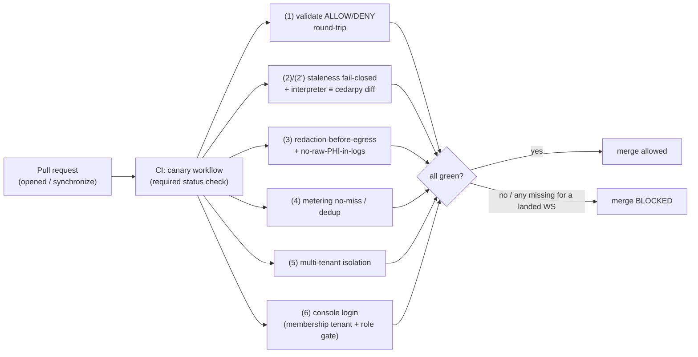
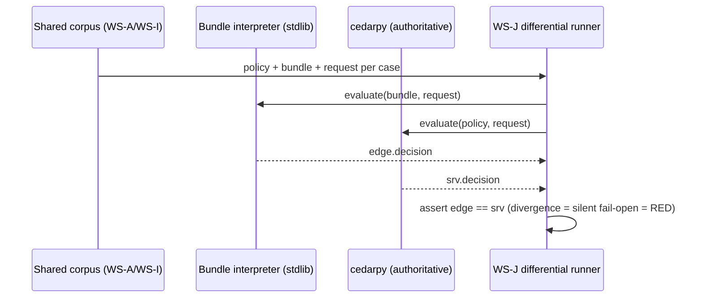

# WS-J — End-to-end canary / integration test harness (PR-gating)

> **Doc role:** This is the **workstream SCOPE** — boundary, dependencies, real `file:line` anchors, footguns, and acceptance criteria. It is an **INPUT to this workstream's implementation-grade LLD**, *not* the granular task breakdown. The granular, buildable tasks are generated **from the approved LLD** (canonical order: HLD → LLD → tasks). See [00-index.md](00-index.md) for the doc-role map.

**Parent HLD:** [hld/serverless-edition.md](../../hld/serverless-edition.md) — §8 hand-off (the "End-to-end canary / integration tests (build requirement)" carry-row) + **§6.4 line 564** (*End-to-end canary / integration tests*, the six numbered scenarios + the (2b) differential-conformance requirement). Soundness bounds for (2b) live in **Appendix C** ([hld/serverless-edition.md:782](../../hld/serverless-edition.md#L782)).
**Status:** Not started
**Owner:** TBD
**Implements (build requirement, not a feature FR):** the §6.4 gating-test mandate over **FR-1.7, FR-3.4, FR-2.8, FR-6.8, FR-3.13, FR-12, FR-13.3, NFR-4, NFR-6, NFR-7, NFR-10, NFR-12** — it does not add product behavior; it **proves** the behavior every other WS ships, on **every PR**, as a **merge gate**.

> **Next step: an implementation-grade LLD = a test-harness / CI LLD.** This WS doc scopes *which* end-to-end scenarios must gate the PR, *which* real fixtures/endpoints they drive, and the harness's structural invariants (isolation, determinism, no-network-leak). It does **not** replace the LLD: the concrete fixture factories, the differential-corpus file format, the CI job matrix, per-scenario assertion code, and the seed/teardown ordering are the LLD's job. This LLD is **cross-cutting** — it coordinates with **every** sibling WS's acceptance-criteria checklist (each WS owns its scenario's pass condition; WS-J owns that the scenario *runs and gates*). Build from *this* doc.

---

## 1. Dependencies

**Cross-cutting — spans all WS.** WS-J is NOT spike-gated (it can scaffold the harness, CI job, and the two scenarios that exercise *already-shipped* behavior — (1) ALLOW/DENY round-trip, (5) tenant isolation, (6) console login — before the local-floor spike resolves). Its scenario set **grows as each sibling WS lands**: a WS is not "done" until its WS-J canary scenario exists and gates.

| Relation | WS / artifact | What is shared |
|---|---|---|
| **Depends on** | WS-B ([ws-b-multiphase-contract.md](ws-b-multiphase-contract.md)) | the `phase` field on `ValidationRequest` — scenario (1) asserts per-phase round-trip once `phase` exists. |
| **Pairs with (gates its claim)** | WS-A ([ws-a-local-floor-bundle.md](ws-a-local-floor-bundle.md)) + WS-I (Cedar bundle-emit, not-yet-filed) | scenario (2)/(2') — staleness fail-closed + the **bundle-interpreter ≡ `cedarpy` differential conformance** over the closed subset. WS-A/WS-I **own** the interpreter + emitter + corpus *generator*; WS-J **owns the gating differential runner** that consumes the shared corpus and asserts identical verdicts. |
| **Pairs with** | WS-E ([ws-e-redaction.md](ws-e-redaction.md)) | scenario (3) — redaction-before-egress + no-raw-PHI-in-logs. WS-E owns the redactor; WS-J owns the no-leak assertion. |
| **Pairs with** | WS-H (metering durability, not-yet-filed) | scenario (4) — durable-before-ack + re-drive dedup (`sentra-meter-events`, Streams, `sentra-usage-rollup`). |
| **Pairs with** | WS-G (console membership/RBAC, not-yet-filed) | scenario (6) — membership-derived tenant + role-gated mutation. |
| **Shared (designed-against, DONE — do NOT rebuild)** | multi-tenancy (LLD 26; dev go-live 2026-06-24; [tasks/26-multi-tenancy/99-go-live-runbook.md](../26-multi-tenancy/99-go-live-runbook.md)) | scenario (5) reuses the **existing** `X-Aegion-Tenant` switcher + `sentra-tenant-members` + `tenant_identity_mode:enforce` (dev). |
| **Shared files (extends, does not replace)** | [tests/integration/conftest.py](../../tests/integration/conftest.py) (`service_urls`, `aws_config` fixtures), [tests/integration/test_e2e_agents.py](../../tests/integration/test_e2e_agents.py) (the `requests.post` round-trip style), [.github/workflows/](../../.github/workflows/) | the canary suite lands as **new** `tests/canary/` files reusing these fixtures; a **new** gating CI workflow runs them. |
| **Blocks** | the go-live runbook's "all canary scenarios green" precondition | a PR cannot merge while any canary scenario is red or missing for a landed WS. |

---

## 2. Model — read before coding

Hold these invariants; they are what make this a *gate*, not a smoke test:

1. **PR-gating, not advisory.** The canary suite is a **required status check** on the protected branch. A failing canary **blocks merge** — the same standing as unit tests. This is the entire point of §6.4 ("run on every PR and **gate** the PR — not just unit tests of each part"). A canary that warns-but-doesn't-block is not done.
2. **End-to-end, not unit.** A canary drives the **real seam** a sibling WS owns end-to-end — e.g. scenario (1) goes through the actual `POST /v1/validate` → `_run_validation_pipeline` → combiner → response, not a mocked validator. Unit tests live with each WS; WS-J proves the *wired-together* behavior.
3. **The unsafe directions are the assertions.** Every scenario asserts the **fail-open** direction is impossible, not merely that the happy path works:
   - (2)/(2'): a divergence where the **edge ALLOWs what the server would DENY** is a silent fail-OPEN (the stale-ALLOW catastrophe, Appendix C) — the differential test's job is to make that divergence a red build.
   - (3): a **raw** sensitive value reaching egress or a log is the failure; redacted-passes-through is the pass.
   - (4): a **dropped** meter event (under-count) and a **double-counted** re-drive are both failures.
   - (5): a **cross-tenant read/decision** is the failure.
4. **Determinism is mandatory.** A flaky canary that's allowed to "retry until green" silently disables the gate. Scenarios pin time (monotonic-clock injection for staleness, not `sleep`), seed deterministic fixtures, and assert on **stable** decision sources (`metadata['winning_source']`), never on timing alone.
5. **No real network egress / no real PII in the repo.** The harness runs against **local** services (the conftest defaults — `http://localhost:8080`/`8081`/`8082`) or an in-process `TestClient`; scenario (3) uses **synthetic** sensitive markers (e.g. a sentinel string `CANARY-PII-7F3A`), never real PHI, and asserts that sentinel never appears downstream.
6. **Fail-secure under harness error too.** If a canary's setup cannot establish the precondition (e.g. the bundle fixture won't sign), it **errors red**, never xfails/skips into green. A skipped security canary is an ungated security claim.



---

## 3. Milestones → tasks

### Milestone J1 — Harness skeleton + CI gate

- **J1.1 — Create `tests/canary/` + shared fixtures.** New package `tests/canary/{__init__.py,conftest.py}`. The conftest **imports/extends** [tests/integration/conftest.py](../../tests/integration/conftest.py) `service_urls`/`aws_config` (do not duplicate them) and adds:
  - a `validate_client` fixture — either FastAPI `TestClient(app)` (in-process, app from [src/security-controller/app/main.py](../../src/security-controller/app/main.py)) for the floor scenarios, or a `requests`-based client at `service_urls['security_controller']` for the wired e2e — mirror the `TestClient` pattern already in [src/security-controller/tests/test_health.py](../../src/security-controller/tests/test_health.py).
  - a `canary_tenant` fixture yielding an **ephemeral** tenant id (e.g. `canary-<uuid4hex>`) seeded into `sentra-tenant-members` and torn down after — reuse the multi-tenancy seed path ([scripts/seed_all.py](../../scripts/seed_all.py)), do NOT hardcode `acme`/`default`.
  - FOOTGUN: do **NOT** point the canary at the dev/prod `sentra-meter-events` / signal-store tables — scenario (4)/(5) must use a **canary-scoped tenant partition** or a local table, or you pollute prod metering. Tenant-prefix every PK the canary writes.
- **J1.2 — New gating CI workflow** `.github/workflows/canary.yml` — `on: pull_request: [opened, synchronize]`, a job `canary` that installs the controller deps ([src/security-controller/requirements.txt](../../src/security-controller/requirements.txt) + `requirements-test.txt`) and runs `pytest tests/canary/ -v -m "not requires_real_aws"`. The job's name is registered as a **required status check** on the protected branch (the LLD/runbook records the branch-protection setting; the workflow file is the WS deliverable).
  - FOOTGUN: do **NOT** copy the `claude-review`/`eval-ml-classifier` workflow's non-blocking posture — those are advisory. Canary must **exit non-zero on any failure** and be a *required* check. A workflow that's green-on-its-own-failure (e.g. `continue-on-error: true`, or `|| true`) defeats the gate.
- **J1.3 — Scenario registry / coverage assertion.** A `tests/canary/test_coverage_guard.py` that asserts every landed WS has its canary scenario present (a manifest list `REQUIRED_SCENARIOS` keyed by WS letter). When a sibling WS merges its behavior but not its canary, this guard goes red — enforcing "a WS isn't done until its canary gates." FOOTGUN: keep the manifest's "not-yet-landed" set explicit so the guard doesn't demand scenarios for un-built WS (it tracks *landed* behavior, gated by the WS's own feature flag where one exists, e.g. `phase` field present).

### Milestone J2 — Scenario (1): validate decision ALLOW/DENY round-trip

- **J2.1 — ALLOW round-trip.** POST a benign request to `POST /v1/validate` (auth: per [src/security-controller/app/api/](../../src/security-controller/app/api/); the integration suite uses unauthenticated localhost) with a `ValidationRequest` body ([src/security-controller/app/api/models.py:17](../../src/security-controller/app/api/models.py#L17)): `request_id`, `session_id`, `agent_id`, `tool_name`, `tool_params`, `user_input`, `operation_type`, `context`, `platform`, `cloud_region`. Assert HTTP 200, response decision `ALLOW`, and that `_run_validation_pipeline` ([src/security-controller/app/services/validation_service.py:220](../../src/security-controller/app/services/validation_service.py#L220)) ran (a non-empty decision trail / `metadata['winning_source']` set by the combiner, [src/security-controller/app/combiners/deny_overrides.py](../../src/security-controller/app/combiners/deny_overrides.py)).
- **J2.2 — DENY round-trip + deciding source.** POST a request that trips a deterministic floor (e.g. a Cedar `forbid` tool, or an out-of-bounds param) and assert decision `DENY`, HTTP 200 (a DENY is a *successful* validation), and `metadata['winning_source']` names the deciding validator (Cedar / prompt-signature / sequence). FOOTGUN: assert on `winning_source`, NOT on which HTTP status — a DENY is **not** an error response.
- **J2.3 — Per-phase round-trip (depends on WS-B).** Once `phase` exists on `ValidationRequest` (WS-B), parametrize J2.1/J2.2 over `phase` values (`request` live today; others as WS-B lands), asserting the request-phase ALLOW/DENY is unchanged and unknown/absent `phase` defaults to `"request"` (WS-B's invariant). Skip-gate this on WS-B's `phase`-present flag via the J1.3 manifest, not an unconditional skip.

### Milestone J3 — Scenario (2)/(2'): staleness fail-closed + differential conformance

- **J3.1 — Stale-past-bound reverts to deny-by-default.** Drive the WS-A local-floor interpreter with a signed bundle whose cached age is pushed **past the max-staleness bound** by injecting a **monotonic clock** (WS-A sources staleness from a monotonic clock — [hld §564/671](../../hld/serverless-edition.md#L671)). Assert: a request that the *fresh* bundle would ALLOW now resolves **DENY / escalate-to-hosted-PDP** (deny-by-default), never a stale ALLOW. FOOTGUN: do **NOT** drive staleness with `time.sleep` or wall-clock — inject the clock; a sleep-based test is flaky and will be retried-into-green, disabling the gate.
- **J3.2 — Tampered / unsigned bundle rejected.** Feed (a) a bundle with a flipped byte after signing and (b) an unsigned bundle to the interpreter's verify step; assert both are **rejected before use** (the SDK verifies the signature before trusting the bundle — [hld §230](../../hld/serverless-edition.md#L230)), and the floor reverts to deny-by-default. For money-movement tenants assert the **crypto-extra** verify path is required (hash-only is rejected — Appendix C [hld:792](../../hld/serverless-edition.md#L792)).
- **J3.3 — Differential conformance: interpreter ≡ `cedarpy` over the closed subset.** Consume the **shared policy+input corpus** produced by WS-A/WS-I (the corpus generator + emitter are theirs; the **runner** is WS-J's). For each corpus entry, evaluate the verdict via (a) the pure-Python bundle interpreter and (b) the authoritative `cedarpy` engine, and assert **identical ALLOW/DENY**. The subset is the closed, non-Cedar set: literal tool allow/deny, numeric/string param bounds, single-session sequence, prompt-signature patterns, **and egress destination/host/path/port** (GROW branch — [hld:788](../../hld/serverless-edition.md#L788)).
  - Pseudo-code (real names):
    ```python
    for case in load_shared_corpus():                 # generated by WS-A/WS-I
        edge = bundle_interpreter.evaluate(case.bundle, case.request)   # SDK, stdlib-only
        srv  = cedarpy_evaluate(case.policy, case.request)             # authoritative
        assert edge.decision == srv.decision, (case.id, edge, srv)     # divergence == fail-open
    ```
- **J3.4 — Subset-boundary cases (the part that catches the unanticipated construct).** Two boundary assertions, both required by §6.4 line 564:
  - **out-of-subset construct never reaches a bundle** — feed the emitter a Cedar policy using a construct outside the allowlist; assert the emitter **escalates / fails-closed and emits NO local-ALLOW rule for it** (it must never silently DROP a `forbid` — Appendix C invariant (i)).
  - **unrecognized bundle construct escalates, not local-ALLOWs** — hand the interpreter a synthetic bundle carrying a construct it doesn't recognize; assert it **escalates to the hosted PDP** (fails closed), never locally ALLOWs (invariant (ii)).
  - FOOTGUN: the boundary tests must assert the **structural** guarantee (allowlist ⇒ escalate-by-default), not just that the corpus happens to match — an unanticipated construct is exactly the one the corpus won't contain, so a corpus-only differential is insufficient (Appendix C [hld:786](../../hld/serverless-edition.md#L786)).



### Milestone J4 — Scenario (3): redaction-before-egress (pairs WS-E)

- **J4.1 — No raw sensitive value leaves the edge.** Send a request whose `user_input`/`tool_params` carry a synthetic sentinel (`CANARY-PII-7F3A`) through the WS-E two-tier redactor, then capture what the edge actually emits toward egress (the `_send` POST body — [demo-agents/sdk/.../guard.py:391](../../demo-agents/sdk/aegion-guard-python/src/aegion_guard/guard.py#L391) — and/or the hosted-side egress). Assert the sentinel **does not appear** in the egressed payload (it is masked/tokenized).
- **J4.2 — No-raw-PHI-in-logs.** After a redacted request, scan the controller logs + the audit store ([src/security-controller/app/services/validation_service.py:532](../../src/security-controller/app/services/validation_service.py#L532) `_fire_and_forget` audit write) for the sentinel; assert absent. FOOTGUN: audit writes are fire-and-forget — the canary must **await/flush** the audit write (or poll the store with a bounded timeout) before asserting, or the test races the write and passes vacuously.
- **J4.3 — Redacted value still produces the correct decision.** Assert the masked request still reaches a verdict (redaction must not silently turn a DENY into an ALLOW). This is the cross-check against the §6.2(e) masked-recall residual — a *functional* gate, not the recall measurement (that's the spike's job).

### Milestone J5 — Scenario (4): metering no-miss / dedup (pairs WS-H)

- **J5.1 — Durable-before-ack: no miss.** Drive N validations against the WS-H pipeline (new `sentra-meter-events`, PK `tenant_id`, SK `request_id`) and assert exactly N durable meter rows for the canary tenant before the response is acked — i.e. the meter write is **durable before ack**, not fire-and-forget. FOOTGUN: the *old* path ([src/security-controller/app/utils/metrics_publisher.py:129](../../src/security-controller/app/utils/metrics_publisher.py#L129)) is fire-and-forget and swallows failures — do NOT assert against `put_metric_data`; assert against the **durable `sentra-meter-events` rows** WS-H adds.
- **J5.2 — Re-drive dedup: no double-count.** Replay the same `request_id` (simulating the hourly EventBridge audit re-drive) and assert the `sentra-usage-rollup` count is **unchanged** — the SK `request_id` makes the re-driven event idempotent. Assert both directions: a genuinely-new `request_id` *does* increment; a replayed one does *not*.

### Milestone J6 — Scenario (5): multi-tenant isolation

- **J6.1 — No cross-tenant read.** Seed data under `canary_tenant_A` and `canary_tenant_B`; issue reads/decisions as A and assert B's data is **never** returned and vice-versa. Reuse the **existing** enforcing tenancy path (dev `tenant_identity_mode:enforce`, [cdk/config/dev.yaml:37](../../cdk/config/dev.yaml#L37)); do NOT rebuild isolation — assert it. FOOTGUN: identity-gate DENYs (`_identity_deny`) are **not metered** and skip Decisions/ValidationsTotal (see memory `identity-deny-not-metered`); assert the cross-tenant attempt is denied via the **audit log `IDENTITY_*` reason** ([/sentra/audit-logs]), not via a decision metric that won't fire.
- **J6.2 — No cross-tenant decision bleed.** A session/trust/label written under tenant A must not influence tenant B's decision (the label store is tenant-scoped DDB — [hld:810](../../hld/serverless-edition.md#L810)). Assert B's decision is independent of A's accumulated state.

### Milestone J7 — Scenario (6): console login (pairs WS-G)

- **J7.1 — Membership-derived tenant (the bug-fix gate).** Log in a console user whose **email domain ≠ their tenant membership**; assert the resolved tenant comes from **server-derived `sentra-tenant-members`**, NOT the cosmetic email-domain derivation in [web/console/src/lib/auth.ts](../../web/console/src/lib/auth.ts) (marked "DISPLAY-ONLY, NON-AUTHORITATIVE" — the bug WS-G fixes). FOOTGUN: a user with a `@gmail.com`/mismatched domain must still land in their real tenant — assert the domain heuristic is NOT load-bearing.
- **J7.2 — Role-gated mutation.** A `viewer` attempting a mutation (policy edit, tenant switch) is rejected by `require_role`; an `editor`/`admin`/`owner` succeeds per the LLD 26 §5-6 role model (`owner|admin|editor|viewer`, reserved `_platform`). Assert the rejection is **server-enforced**, not just UI-hidden.

---

## 4. Error model

| Condition | Required canary behavior |
|---|---|
| A scenario's precondition can't be established (bundle won't sign, tenant won't seed) | **Error RED** — never skip/xfail into green (a skipped security canary is an ungated claim). |
| Controller returns 5xx on a benign request | RED — scenario (1) fails; this is the pipeline-error→DENY path ([validation_service.py:667](../../src/security-controller/app/services/validation_service.py#L667)) leaking as a 5xx, which is itself a finding. |
| Interpreter ≡ `cedarpy` divergence (edge ALLOW, server DENY) | RED, **CRITICAL** — silent fail-open; block merge. |
| Sentinel PII found in egress or logs | RED, **CRITICAL** — redaction leak; block merge. |
| Meter under-count or double-count | RED — metering integrity (NFR-12) violated. |
| Cross-tenant read/decision observed | RED, **CRITICAL** — tenant isolation (NFR-6) violated. |
| Canary intermittently flaky | Treat as RED until deterministic — **never** add a retry that masks it (a retried-into-green canary is a disabled gate). |

---

## 5. Acceptance criteria

- [ ] `tests/canary/` exists with shared fixtures that **extend** (not duplicate) `tests/integration/conftest.py`, and every canary uses a **canary-scoped tenant/partition** — no writes to dev/prod meter/signal/tenant tables.
- [ ] `.github/workflows/canary.yml` runs the canary suite on every PR (`opened`+`synchronize`), exits non-zero on any failure, and is a **required status check** that **blocks merge** when red (verified: a deliberately-broken canary blocks a test PR).
- [ ] `test_coverage_guard.py` asserts every *landed* WS has its canary scenario present and goes red when a behavior lands without its canary.
- [ ] **(1)** ALLOW and DENY round-trips through the real `POST /v1/validate` → `_run_validation_pipeline` → `deny_overrides` pass, asserting on `metadata['winning_source']`, with per-`phase` coverage active once WS-B's `phase` field lands.
- [ ] **(2)** Stale-past-bound bundle reverts to deny-by-default (monotonic-clock-injected, no `sleep`); tampered and unsigned bundles are rejected before use; money-movement requires crypto-extra verify.
- [ ] **(2')** The differential runner asserts the stdlib bundle interpreter ≡ `cedarpy` on **every** entry of the shared closed-subset corpus (incl. egress cases), **and** the two subset-boundary tests pass: out-of-subset construct never emits a local-ALLOW (escalates/fails-closed, never drops a `forbid`); unrecognized bundle construct escalates, never local-ALLOWs.
- [ ] **(3)** Synthetic sentinel never appears in the egressed payload or in logs/audit (after the audit write is flushed/awaited), and the redacted request still yields the correct decision.
- [ ] **(4)** Exactly-N durable `sentra-meter-events` rows before ack (no miss); a re-driven `request_id` leaves `sentra-usage-rollup` unchanged (no double-count) while a new `request_id` increments.
- [ ] **(5)** No cross-tenant read or decision bleed under the existing enforcing tenancy path; cross-tenant denial is asserted via the audit `IDENTITY_*` reason (not a decision metric).
- [ ] **(6)** Console login resolves the tenant from server-derived `sentra-tenant-members` (not email domain), and `require_role` server-enforces role-gated mutations.
- [ ] No scenario uses skip/xfail/retry to reach green; an unestablished precondition errors red.
- [ ] No real PII and no real network egress in any canary; all sensitive markers are synthetic sentinels.

---

## 6. Cross-references

- **HLD:** [hld/serverless-edition.md:564](../../hld/serverless-edition.md#L564) (§6.4 — the six scenarios + (2b) differential conformance, the build-requirement mandate); [hld/serverless-edition.md:782](../../hld/serverless-edition.md#L782) (Appendix C — interpreter-soundness invariants the differential test rests on); [hld/serverless-edition.md:230](../../hld/serverless-edition.md#L230) (staleness/tamper); [hld/serverless-edition.md:671](../../hld/serverless-edition.md#L671) (§8 hand-off — FR-1.7 local-floor row carrying the differential-test deliverable); [hld/serverless-edition.md:810](../../hld/serverless-edition.md#L810) (tenant-scoped label store, for scenario 5).
- **Sub-PRD:** [prd/serverless-edition.md](../../prd/serverless-edition.md) §5 (status table — gate scenarios to *landed* behavior); FR-1.7 ([:117](../../prd/serverless-edition.md#L117)).
- **Sibling WS:** WS-A ([ws-a-local-floor-bundle.md](ws-a-local-floor-bundle.md)) + WS-I (Cedar emit, corpus generator — own the differential corpus); WS-B ([ws-b-multiphase-contract.md](ws-b-multiphase-contract.md), `phase`); WS-D ([ws-d-decision-trail.md](ws-d-decision-trail.md), `winning_source`/trail asserted by scenario 1); WS-E ([ws-e-redaction.md](ws-e-redaction.md), redactor); WS-F ([ws-f-prompt-signatures.md](ws-f-prompt-signatures.md), prompt-signature is one of the closed-subset primitives in the corpus); WS-G (console RBAC, not-yet-filed); WS-H (metering durability, not-yet-filed).
- **DONE / designed-against:** LLD 26 multi-tenancy ([tasks/26-multi-tenancy/99-go-live-runbook.md](../26-multi-tenancy/99-go-live-runbook.md)); dev tenancy `enforce` ([cdk/config/dev.yaml:37](../../cdk/config/dev.yaml#L37)).
- **Existing harness reused:** [tests/integration/conftest.py](../../tests/integration/conftest.py), [tests/integration/test_e2e_agents.py](../../tests/integration/test_e2e_agents.py), [src/security-controller/tests/test_health.py](../../src/security-controller/tests/test_health.py) (`TestClient` pattern).
- **Implementation-grade LLD (next step):** a test-harness / CI LLD — fixture factories, corpus file format (shared with WS-A/WS-I), CI job matrix + branch-protection, per-scenario assertion code, seed/teardown ordering; coordinates with every sibling WS's acceptance-criteria checklist.
