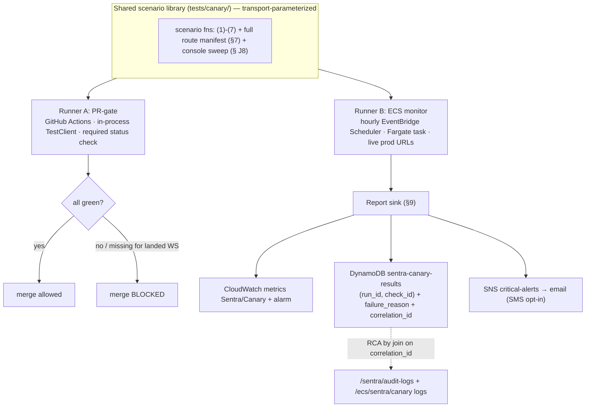
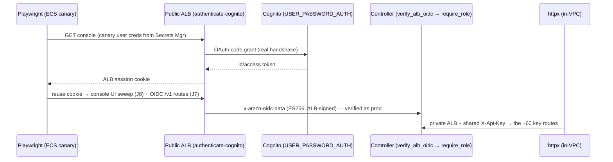

# WS-J — Synthetic canary + e2e test harness (hourly prod monitor **and** PR gate)

> **Doc role:** This is the **workstream SCOPE** — boundary, dependencies, real `file:line` anchors, footguns, and acceptance criteria. It is an **INPUT to this workstream's implementation-grade LLD** ([lld/38-canary-synthetic-monitoring.md](../../lld/38-canary-synthetic-monitoring.md), *to be authored*), *not* the granular task breakdown. Buildable tasks are generated **from the approved LLD** (canonical order: HLD → LLD → tasks). See [00-index.md](00-index.md) for the doc-role map.

**Parent HLD:** [hld/serverless-edition.md](../../hld/serverless-edition.md) — §8 hand-off (the "End-to-end canary / integration tests (build requirement)" carry-row) + **§6.4 line 564** (the six numbered scenarios + the (2b) differential-conformance requirement). Soundness bounds for (2b) live in **Appendix C** ([hld/serverless-edition.md:782](../../hld/serverless-edition.md#L782)).
**Status:** ✅ **Increment 1 DEPLOYED to prod 2026-07-05** (all J1/J2/J-cov/J-infra/J-report/J4/J6 tasks done; live 117/117 PASS; hourly schedule ENABLED). J5/J8 deferred (design-only). **J7 (authz) UNBLOCKED 2026-07-07** — WS-M authz shipped to prod (milestone-102); J7 build tasks authored in **§5A** (reconcile stale-positive manifest + add authorized/under-priv/IDOR/dataplane coverage). J3 deferred (design-only). See §0 + §3 banner + §5A.
**Owner:** TBD
**Implements (build requirement, not a feature FR):** the §6.4 gating-test mandate over **FR-1.7, FR-3.4, FR-2.8, FR-6.8, FR-3.13, FR-12, FR-13.3, NFR-4, NFR-6, NFR-7, NFR-10, NFR-12**, **extended** (§0) to a **continuous production synthetic monitor** covering **every deployed API** and the **console UI**. It adds no product behavior; it **proves** the behavior every other WS ships — on **every PR** (merge gate) **and every hour in prod** (live monitor) — and, on failure, records **why** so each red check can be root-caused.

---

## 0. Scope reshape (2026-07-05) — read this first

The original WS-J scoped a **PR-gating CI canary only** (GitHub Actions, in-process `TestClient`, six merge-gate scenarios). Founder direction expands it to **two delivery targets over one shared scenario library**, plus **exhaustive API + console coverage** and **failure-reason capture for RCA**. The decisions locked (this WS doc records them; the LLD designs the mechanism):

| # | Decision | What it means for the LLD |
|---|---|---|
| **D-1** | **Dual target: hourly ECS synthetic monitor AND PR merge-gate.** One scenario library (`tests/canary/`), two runners. | The scenario functions must be **transport-parameterized** — the same assertion runs against an **in-process `TestClient`** (PR-gate, hermetic) *or* a **live deployed URL** (ECS monitor, real prod). No scenario forks per runner. |
| **D-2** | **Exhaustive API coverage — every deployed endpoint, happy path AND failure cases.** Not just the six §6.4 scenarios. | The LLD carries a **route manifest** (derived from [lld/21-api-inventory-for-ux.md](../../lld/21-api-inventory-for-ux.md) reconciled against real code — see §7) of all **61 in-code routes** (45 [routes.py](../../src/security-controller/app/api/routes.py) + 16 [tenancy_routes.py](../../src/security-controller/app/api/tenancy_routes.py)) = **65 gateway-wired methods** (61 + 4 demo-agent proxies; **zero unwired** after commit `ff4fdfc`); each gets ≥1 happy + its documented failure modes (401/403/404/409/422/429/DENY). The coverage guard (J1.4) fails red if a wired route has no canary. *(Verified 2026-07-05 — supersedes the earlier "77/68" estimate.)* |
| **D-3** | **Exhaustive console UI canary via headless Playwright (Chromium) in the canary container.** | Not a single smoke ping — a **broad read-only sweep** of every console route (overview, agents, policies list/detail, audit, threats, quarantine, tenant switch, login/logout) asserting render + no 5xx + the backing `/v1` calls fire. Playwright is net-new infra (§ console has zero e2e today). |
| **D-4** | **Auth = dedicated Cognito canary test-user + Playwright real-login.** No product auth change; drops any header-injection shortcut (fail-secure risk). | Playwright completes the **real ALB `authenticate-cognito` handshake** via **hosted-UI form-fill** (a canary user, creds in Secrets Manager) — **NOT** token-mint (`USER_PASSWORD_AUTH` returns JWTs but *no ALB session cookie*, so it can't reach ALB-gated routes; verified 2026-07-05). The authed browser context drives the console UI **and** the OIDC-gated `/v1` routes (`/me`, `/tenants/*`, `/platform/*`) — which **must be called via the console host** (`console.aegionai.ai`), where nginx re-emits `x-sentra-oidc-data` + injects the api-key (raw-ALB/dashboard-host calls 401). The `X-Api-Key` routes are hit by an httpx client against the **public API Gateway URL** (NAT egress, no new SG rule, key + throttling enforced). See §8. |
| **D-5** | **Reporting = CloudWatch metrics + DynamoDB `sentra-canary-results` + SNS→email (SMS optional).** RCA by join, not by hunt. | Every check writes a durable row keyed `(run_id, check_id)` carrying `status`, `failure_reason`, `expected`/`actual`, HTTP status, latency, and a `correlation_id`; CW custom metrics (`Sentra/Canary`) drive an alarm; SNS fires to `sentra-mvp-critical-alerts` (add an **email** subscription; SMS opt-in) on any red check. See §9. |

**Why WS-M is not the same thing (founder asked):** WS-M ([ws-m-authz.md](ws-m-authz.md)) **builds the server-side authz lock** (`require_role` + anti-IDOR on the previously-ungated CRUD routes). WS-J **is the key-holder that tests the lock** — it authenticates as a real operator and asserts *both* directions (an `editor` succeeds; a `viewer`/cross-tenant caller gets 403). WS-M touches no Cognito / token-minting / test users ([ws-m-authz.md:152](ws-m-authz.md#L152)); WS-J provisions exactly one canary Cognito user and mints tokens **only** for itself. WS-M is the code under test; WS-J is the continuous proof it holds in prod.

---

## 1. Dependencies

**Cross-cutting — spans all WS.** WS-J is NOT spike-gated. It can scaffold the harness, both runners, and the scenarios that exercise *already-shipped* behavior — API round-trip, tenant isolation, console login/read sweep — before the local-floor spike resolves. Its scenario set **grows as each sibling WS lands**: a WS is not "done" until its WS-J canary scenario exists and gates.

| Relation | WS / artifact | What is shared |
|---|---|---|
| **Depends on** | WS-B ([ws-b-multiphase-contract.md](ws-b-multiphase-contract.md)) | the `phase` field on `ValidationRequest` — scenario (1) asserts per-phase round-trip once `phase` exists. |
| **Pairs with (gates its claim)** | WS-A ([ws-a-sdk-release.md](ws-a-sdk-release.md) / local-floor) + WS-I ([ws-i-cedar-engine.md](ws-i-cedar-engine.md)) | scenario (2)/(2') — staleness fail-closed + the **bundle-interpreter ≡ `cedarpy` differential conformance** over the closed subset. WS-A/WS-I **own** the interpreter + emitter + corpus *generator*; WS-J **owns the gating differential runner** that consumes the shared corpus and asserts identical verdicts. |
| **Pairs with** | WS-E ([ws-e-redaction.md](ws-e-redaction.md)) | scenario (3) — redaction-before-egress + no-raw-PHI-in-logs. WS-E owns the redactor; WS-J owns the no-leak assertion. |
| **Pairs with** | WS-H (metering durability, [ws-h-metering.md](ws-h-metering.md)) | scenario (4) — durable-before-ack + re-drive dedup (`sentra-meter-events`, Streams, `sentra-usage-rollup`). |
| **Pairs with (tests its lock)** | **WS-M ([ws-m-authz.md](ws-m-authz.md)) — server-side authz** · WS-G (console render-gate) | scenario (6)/(7) — WS-M owns the server `require_role` boundary + anti-IDOR + the sigma platform-gate; WS-J owns the **positive-and-negative authz assertions** (an authorized role succeeds; cross-tenant / under-privileged policy+connection CRUD → 403) on the previously-ungated routes, driven by the canary Cognito user (D-4). |
| **Shared (designed-against, DONE — do NOT rebuild)** | multi-tenancy (LLD 26; dev go-live 2026-06-24; [tasks/26-multi-tenancy/99-go-live-runbook.md](../26-multi-tenancy/99-go-live-runbook.md)) | scenario (5) reuses the **existing** `X-Aegion-Tenant` switcher + `sentra-tenant-members` + `tenant_identity_mode:enforce` (dev). |
| **Shared files (extends, does not replace)** | [tests/integration/conftest.py](../../tests/integration/conftest.py) (`service_urls`, `aws_config` fixtures), [tests/integration/test_e2e_agents.py](../../tests/integration/test_e2e_agents.py) (`requests.post` round-trip style), [.github/workflows/](../../.github/workflows/) | the canary suite lands as **new** `tests/canary/` files reusing these fixtures; a **new** gating CI workflow (PR-gate runner) runs them in-process. |
| **New infra (net-new, see §6/§9)** | ECS canary task + EventBridge Scheduler + `docker/canary/` image + `sentra-canary-results` DDB table + `Sentra/Canary` CW namespace + Playwright | the ECS monitor runner. Copies the [compute_stack.py](../../cdk/stacks/compute_stack.py) task-def pattern; scheduling is **net-new** (no `Schedule`/`ScheduledFargateTask` exists in `cdk/` today). |
| **Blocks** | the go-live runbook's "all canary scenarios green" precondition | a PR cannot merge while any canary scenario is red or missing for a landed WS; a prod canary red pages via SNS. |

---

## 2. Model — read before coding

Hold these invariants; they are what make this a *gate* and a *trustworthy monitor*, not a smoke test:

1. **PR-gating, not advisory (PR-gate runner).** The canary suite is a **required status check** on the protected branch. A failing canary **blocks merge** — same standing as unit tests (§6.4). A canary that warns-but-doesn't-block is not done.
2. **Live-monitoring, not best-effort (ECS runner).** The hourly run against **deployed prod** is the second consumer of the same scenarios. A red hourly run writes a durable failure row (D-5) and pages SNS. It runs against the **real ALB / API Gateway / Cognito**, so it also catches deploy/config/cert/nginx drift that in-process tests never see.
3. **End-to-end, not unit.** A canary drives the **real seam** end-to-end — scenario (1) goes through the actual `POST /v1/validate` → `_run_validation_pipeline` → combiner → response, not a mocked validator. Unit tests live with each WS; WS-J proves the *wired-together* behavior.
4. **The unsafe directions are the assertions.** Every scenario asserts the **fail-open** direction is impossible, not merely that the happy path works:
   - (2)/(2'): a divergence where the **edge ALLOWs what the server would DENY** is a silent fail-OPEN (the stale-ALLOW catastrophe, Appendix C) — the differential test makes that a red build.
   - (3): a **raw** sensitive value reaching egress or a log is the failure; redacted-passes-through is the pass.
   - (4): a **dropped** meter event (under-count) and a **double-counted** re-drive are both failures.
   - (5): a **cross-tenant read/decision** is the failure.
   - (6)/(7): an **under-privileged or cross-tenant mutation that succeeds** is the failure (WS-M's lock leaking).
5. **Determinism is mandatory.** A flaky canary that's allowed to "retry until green" silently disables the gate. Scenarios pin time (monotonic-clock injection for staleness, not `sleep`), seed deterministic fixtures, and assert on **stable** decision sources (`metadata['winning_source']`), never on timing alone. *(ECS-runner caveat: a live prod call can flake on transient network; the LLD must distinguish a **deterministic scenario failure** — always red — from a **transport error** — retried a bounded N times, then reported as `INFRA` not `FAIL`, never silently swallowed. §4.)*
6. **No real network egress of secrets / no real PII in the repo.** The PR-gate runs against **local**/in-process services; scenario (3) uses **synthetic** sensitive markers (sentinel `CANARY-PII-7F3A`), never real PHI, and asserts the sentinel never appears downstream. The ECS runner talks only to our own deployed endpoints.
7. **Fail-secure under harness error too.** If a canary's setup cannot establish its precondition (bundle won't sign, tenant won't seed, Cognito login fails), it **errors red / `INFRA`**, never xfails/skips into green. A skipped security canary is an ungated claim.
8. **Prod-write hygiene (ECS runner writes to real prod).** The hourly monitor MUST NOT pollute prod data: every write uses a **canary-scoped ephemeral tenant** (`canary-<uuid4hex>`) torn down after, tenant-prefixes every PK, and NEVER targets the real `acme-*` fleet or the prod `sentra-meter-events`/signal tables. A read-only-where-possible posture; writes are isolated + cleaned up. This is the single biggest ECS-runner footgun.



---

## 3. Milestones → tasks (Increment 1 — regenerated from LLD 38, 2026-07-05)

> **Regenerated from the approved LLD** ([lld/38-canary-synthetic-monitoring.md](../../lld/38-canary-synthetic-monitoring.md)) at zero-ambiguity granularity — a coding agent builds straight from this section without re-reading the LLD. Every task carries real `file:line` touch-points, the concrete class/fn/fixture names + config + the HOW, named footguns, and its MANDATORY unit + integration tests.
>
> **Scope = Increment 1 ONLY** (founder PDF-comment P0s, LLD §1/§2): **P0-1** every **API-key-reachable** wired route (Appendix A `pub`+`key`, EXCLUDING the 16 `oidc` rows) with a positive happy-path AND every documented negative/failure case (a HARD gate); **P0-2** measurable code-logic coverage (route×behavior matrix guard + `pytest --cov` gate ≥85%); **P0-3** SNS `EmailSubscription`→`shshgup@amazon.com`. Plus the ECS/scheduler/DDB/CW/SNS infra, the reporting plugin, the concurrency guard, and prod-write hygiene. **DEFERRED milestones (J3 differential, J5 metering, J7 authz-403 gate, J8 console/Playwright) carry NO Increment-1 build tasks** — see the "Deferred milestones" block after J-report; their design stays in the LLD, each auto-activates via its `landed_flag`.
>
> **Anchor reconciliation (verified against real code 2026-07-05):** `ValidationRequest` is at [models.py:54](../../src/security-controller/app/api/models.py#L54) (scope-doc's earlier `:17` was stale); `_run_validation_pipeline` at [validation_service.py:575](../../src/security-controller/app/services/validation_service.py#L575); `_fire_and_forget` [:118](../../src/security-controller/app/services/validation_service.py#L118) + module `_bg_tasks` [:55](../../src/security-controller/app/services/validation_service.py#L55); `phase` Field [models.py:77](../../src/security-controller/app/api/models.py#L77), `content_text` [:87](../../src/security-controller/app/api/models.py#L87). The Increment-1 milestone set is **J1, J2, J-cov, J-infra, J-report, J4, J6**.
>
> ## ✅ ALL INCREMENT-1 MILESTONES COMPLETE + DEPLOYED (2026-07-05)
> Every Increment-1 milestone below (**J1, J2, J-cov, J-infra, J-report, J4, J6** — all tasks) is **built, merged to `main`, and DEPLOYED live to prod**. Full suite green (207 canary + 12 CDK). The `Sentra-DEV-Canary-Stack` is `CREATE_COMPLETE`, the hourly EventBridge schedule is **ENABLED**, and a live prod run scored **117/117 checks PASS** (durable rows in `sentra-canary-results`, all 5 CloudWatch alarms OK). Deployed via image `sentra/canary:milestone-3` + controller `milestone-101` (carries the SEC-11 + J4.2 controller followups). Post-deploy alarm fix applied (ChecksFailed → NOT_BREACHING + a dedicated `canary-not-running` heartbeat alarm). **DEFERRED milestones J3/J5/J7/J8 remain design-only (no Increment-1 tasks), each auto-activating via its `landed_flag`.**

### Milestone J1 — Harness skeleton + transport-parameterized fixtures + route manifest ✅ DONE

- **J1.1 — Create `tests/canary/` package + the `canary_client` transport switch.**
  - **Touches:** new `tests/canary/__init__.py`, `tests/canary/conftest.py`; extends [tests/integration/conftest.py:47](../../tests/integration/conftest.py#L47) (`service_urls`) + [:66](../../tests/integration/conftest.py#L66) (`aws_config`) via import (do NOT re-declare them); mirrors the `TestClient(app)` pattern at [src/security-controller/tests/test_health.py:8-14](../../src/security-controller/tests/test_health.py#L8) (`from app.main import app`, `TestClient(app)` — `app` object is [main.py:68](../../src/security-controller/app/main.py#L68)).
  - **HOW:** define a `CanaryClient` adapter class (thin wrapper over the underlying client) exposing `.get/.post/.put/.delete/.patch`, a `.correlation_id` property, a `mode` attr (`"inprocess"|"live"`), and per-call latency capture. The `canary_client` pytest fixture reads `CANARY_TARGET` (**the ONLY place that env var is read** — LLD §3.1 hard rule):
    ```python
    @pytest.fixture
    def canary_client(request):
        target = os.environ.get("CANARY_TARGET", "inprocess")
        if target == "inprocess":
            from app.main import app
            return CanaryClient(TestClient(app), mode="inprocess")
        base = os.environ["SENTRA_API_GW_URL"]
        key  = _load_secret("sentra/canary/api-key")     # boto3 secretsmanager
        return CanaryClient(httpx.Client(base_url=base, headers={"X-Api-Key": key}, timeout=8.0), mode="live")
    ```
    Each call injects a fresh `X-Correlation-Id` header (the RCA join key, §9) and records `latency_ms`. `live` calls carry an 8 s per-call timeout (§12).
  - **FOOTGUN:** do **NOT** let any scenario function read `CANARY_TARGET`/`os.environ`/a transport-specific symbol — all transport divergence lives in the fixture (enforced by the J-cov lint check). Do **NOT** re-implement `service_urls`/`aws_config` — import and extend them.
  - **Unit tests** — `test_canary_client` in `tests/canary/test_fixtures.py`: (a) `inprocess` mode returns a `TestClient`-backed adapter and `GET /v1/health` → 200; (b) each call sets a **fresh** unique `X-Correlation-Id` (two calls → two ids); (c) `latency_ms` is populated (>0); (d) `.correlation_id` exposes the last-sent id. **Integration test** — `test_canary_client_live_shape` (marked `requires_live`, skipped without `SENTRA_API_GW_URL`): asserts the `live` branch builds an `httpx.Client` with the `X-Api-Key` header from the secret loader (mock `_load_secret`), base_url = the env URL — exercises the shared `SENTRA_API_GW_URL`/`sentra/canary/api-key` contract.

- **J1.2 — `canary_tenant` ephemeral-tenant fixture (prod-write hygiene, §11).**
  - **Touches:** `tests/canary/conftest.py`; reuses the seed path [scripts/seed_all.py](../../scripts/seed_all.py); writes to `sentra-tenant-members`; teardown in a fixture-finalizer.
  - **HOW:** yield an id `f"canary-{uuid.uuid4().hex}"`; seed one `sentra-tenant-members` row for it; on teardown delete best-effort + idempotent (a teardown failure logs, never reds the run — §11). Seed order tenant-member → operator → policies; teardown reverse. Every write the canary makes is tenant-prefixed on the PK.
  - **FOOTGUN:** **NEVER** hardcode `acme`/`default` or target the real `acme-*` fleet / prod `sentra-meter-events` / real-operator `sentra-tenant-members` rows (Invariant 8, §11). A DENY-tripping scenario MUST use a **fresh `session_id`** each run so trust penalties (`SUSPEND_THRESHOLD=10`/`QUARANTINE_THRESHOLD=40`, [trust_checker.py:18](../../src/security-controller/app/validators/trust_checker.py#L18)) never accumulate onto the canary principal and self-quarantine it.
  - **Unit test** — `test_canary_tenant_ephemeral` in `test_fixtures.py`: id matches `^canary-[0-9a-f]{32}$`; two fixture uses → two distinct ids; teardown is called even when the test body raises (finalizer runs in `finally`). **Integration test** — `test_canary_tenant_seed_teardown` (marked `requires_live`): the seeded member row exists mid-scenario and is gone after teardown — exercises the `sentra-tenant-members` seed contract.

- **J1.3 — `canary_operator` fixture, `inprocess` form only (Increment 1).**
  - **Touches:** `tests/canary/conftest.py`; the test seam `_alb_claims_override` [deps.py:279](../../src/security-controller/app/api/deps.py#L279) (consumed inside `verify_alb_oidc` [:289](../../src/security-controller/app/api/deps.py#L289)); `resolve_operator_tenant` [deps.py:323](../../src/security-controller/app/api/deps.py#L323).
  - **HOW:** in `inprocess` mode, set `deps._alb_claims_override` to a callable returning synthetic verified claims `{"sub": ..., "email": ...}` and seed a matching `sentra-tenant-members` row so `resolve_operator_tenant` resolves a tenant; reset the override to `None` on teardown. The `live` (real-Cognito) form is **Increment-2+ deferred** (§3.2) — do NOT build it now; the fixture raises a clear `NotImplementedError("canary_operator live form is Increment-2 (console/auth)")` if invoked in `live` mode.
  - **FOOTGUN:** the override is a **test-only** seam — production leaves it `None` ([deps.py:289](../../src/security-controller/app/api/deps.py#L289) `# pragma: no cover - test seam`); never wire it into a `live` path. Do NOT grant the operator a `_platform` role (SEC-7: no standing cross-tenant grant) — a throwaway-tenant `viewer` only.
  - **Unit test** — `test_canary_operator_inprocess` in `test_fixtures.py`: with the fixture active, an OIDC-gated handler (e.g. `GET /v1/me`) called `inprocess` returns 200 with the synthetic sub; after teardown `deps._alb_claims_override is None`; invoking the fixture with `CANARY_TARGET=live` raises `NotImplementedError`. **Integration test** — covered by the `inprocess` OIDC code-logic coverage in J-cov (the seam is the shared contract).

- **J1.4 — `route_manifest.py` — the `RouteSpec` frozen manifest (Appendix A).**
  - **Touches:** new `tests/canary/route_manifest.py`; encodes Appendix A verbatim.
  - **HOW:** define `@dataclass(frozen=True) class RouteSpec` with fields `path, method, auth_class, ws_owner, failure_axis: tuple, landed_flag: bool, authz_gap_flag: bool` (LLD §4.1). Build `ROUTE_MANIFEST: list[RouteSpec]` = all 65 rows from Appendix A: 1 `public` (`GET /v1/health`), the `key` rows (validate/logs/sessions/decisions/rollback/quarantine/metrics/agents/policies/sigma/discovery/connections), the 16 `oidc` rows (`landed_flag=False` in Increment 1 — the console/auth deferral), the 4 `demo_proxy` rows. Each `key` mutation row carries `authz_gap_flag=True` per the `G`-marked Appendix-A rows (policy CRUD, agent-policy attach/detach, rollback, quarantine POST/DELETE, discovery/import, connections mutations, sigma PATCH). Encode `failure_axis` from each row's `F` column (e.g. `POST /v1/agents` → `("403","422","409")`). Also define `REQUIRED_SCENARIOS: dict[str, bool]` keyed by scenario letter (J2/J4/J6 `True` now; J3/J5/J7/J8 `False`).
  - **FOOTGUN:** `/v1/tenants/{id}` is GET/**PATCH**/DELETE (not PUT — [tenancy_routes.py:230](../../src/security-controller/app/api/tenancy_routes.py#L230) `@router.patch`); `DELETE /v1/feedback/subjects/{locator}` lives in [routes.py:834](../../src/security-controller/app/api/routes.py#L834) (require_role-gated) but is api-key-reachable — mark it `oidc`/gated. There is **NO skip-list** — `GET /v1/metrics` + `/v1/sessions/{id}/signals` are WIRED after `ff4fdfc` and are live `key` rows.
  - **Unit test** — `test_route_manifest` in `tests/canary/test_route_manifest.py`: (a) exactly 65 rows; (b) exactly 1 `public`, 16 `oidc`, 4 `demo_proxy`, rest `key`; (c) every `authz_gap_flag=True` row is a mutation (`POST/PUT/DELETE/PATCH`); (d) every `oidc` row has `landed_flag=False` (Increment-1 deferral); (e) `failure_axis` values are a subset of the allowed axis set `{"400","401","403","404","409","422","429","DENY"}`; (f) `RouteSpec` is frozen (mutation raises `FrozenInstanceError`). **Integration test** — the J-cov `test_every_wired_route_has_a_canary` join (below) is the manifest↔`app.routes` integration.

### Milestone J2 — Validate ALLOW/DENY round-trip + the all-route positive/negative generator (P0-1) ✅ DONE

- **J2.1 — ALLOW round-trip (REQUIRED).**
  - **Touches:** `tests/canary/test_j2_validate.py`; `POST /v1/validate` handler `validate_tool_call` [routes.py:57](../../src/security-controller/app/api/routes.py#L57) → `_run_validation_pipeline` [validation_service.py:575](../../src/security-controller/app/services/validation_service.py#L575) → `DenyOverrides` [deny_overrides.py](../../src/security-controller/app/combiners/deny_overrides.py); request body `ValidationRequest` [models.py:54](../../src/security-controller/app/api/models.py#L54).
  - **HOW:** `scenario_j2_1_allow(canary_client)` posts a benign well-formed `ValidationRequest` → assert HTTP `200`, `body["decision"] == "ALLOW"`, and `body["metadata"]["winning_source"]` is present (proves the pipeline actually ran, not a short-circuit). Register the covered cell `("/v1/validate","POST"): {"positive"}` for the coverage guard.
  - **FOOTGUN:** assert the pipeline ran via `winning_source` presence — a green 200 with no `winning_source` means the request never reached `DenyOverrides`.
  - **Unit test** — `test_j2_1_allow` in `test_j2_validate.py` (`inprocess`): 200 + ALLOW + `winning_source` present. **Integration test** — same scenario over the real `/v1/validate`→pipeline→combiner seam (this IS the wired-together end-to-end contract).

- **J2.2 — DENY-is-200 + deciding source (REQUIRED).**
  - **Touches:** same handler chain; a Cedar `forbid` tool or out-of-bounds param request.
  - **HOW:** `scenario_j2_2_deny(canary_client)` posts a policy-tripping request → assert `body["decision"] == "DENY"`, **HTTP `200`**, and `body["metadata"]["winning_source"]` names the deciding validator. Register cell `("/v1/validate","POST"): {"DENY"}`.
  - **FOOTGUN:** a DENY is a **successful** validation — assert on `winning_source`/`decision`, **never** on a 4xx/5xx status. Asserting DENY via HTTP status is the forbidden fail-open form.
  - **Unit test** — `test_j2_2_deny` in `test_j2_validate.py`: 200 + DENY + `winning_source` names the validator. **Integration test** — end-to-end DENY through the real pipeline.

- **J2.3 — Per-`phase` round-trip (REQUIRED — WS-B landed).**
  - **Touches:** `phase` `Literal` [models.py:77](../../src/security-controller/app/api/models.py#L77), `KNOWN_PHASES` [models.py:27](../../src/security-controller/app/api/models.py#L27), `content_text` [:87](../../src/security-controller/app/api/models.py#L87).
  - **HOW:** parametrize J2.1/J2.2 over `KNOWN_PHASES` (`{"request","content","output","memory"}`); assert an **unknown** `phase` value → `422` (FastAPI `Literal` validation) and an **unimplemented-but-known** phase does NOT silently ALLOW (must hit `_phase_not_implemented_deny`, WS-B's invariant). Register the `422` cell for `/v1/validate` under the `unknown-phase` axis.
  - **FOOTGUN:** the fail-open forbidden here is an unimplemented phase silently ALLOWing — assert the deny, not just a non-crash.
  - **Unit test** — `test_j2_3_phases` (parametrized over `KNOWN_PHASES`) + `test_j2_3_unknown_phase_422` in `test_j2_validate.py`. **Integration test** — per-phase round-trip over the real endpoint exercises the WS-B `phase`/`content_text` shared contract.

- **J2.4 — All-route positive+negative case generator (P0-1, the HEADLINE P0).**
  - **Touches:** `tests/canary/test_all_routes.py`; drives from `ROUTE_MANIFEST` (J1.4) `failure_axis`; every `pub`+`key` landed route in Appendix A.
  - **HOW:** a parametrized generator that, for **each** API-key-reachable landed `RouteSpec` (skip `oidc` rows — `landed_flag=False` in Inc 1), emits (a) a **positive** cell — a well-formed authenticated request → assert the documented success code (`200`/`201`/`204`) + expected body shape; and (b) one **negative** cell **per `failure_axis` entry**, each mapping to a concrete probe:
    - `400`/`422` malformed body — send a broken/wrong-type body → assert `400` (or `422` where FastAPI owns validation), never a 200-wrapping-an-error;
    - `401` — omit `X-Api-Key` → assert `401`;
    - `403` — a caller lacking authority for the resource → assert `403`;
    - `404` — a well-formed request against a non-existent id → assert `404` (not a 200+empty body);
    - `409` — duplicate-create / illegal-state-transition → assert `409`;
    - `422` — schema-valid-but-semantically-invalid (incl. unknown-`phase`) → assert `422`;
    - `429` — only against the canary's **own dedicated usage plan** (SEC-6), never the enforcement plan;
    - `DENY` — for `/v1/validate` + the demo-proxy `*/action` routes, a policy-tripping request → **HTTP `200` + `decision=="DENY"`** (delegates to J2.2 form).
    Each probe registers its cell `(path, method): {axis}` so the J-cov guard can require it.
  - **FOOTGUN:** negative coverage is a **HARD gate**, not "where applicable" — a route with only a positive check is a RED `ROUTE_NEGATIVE_AXIS_UNCOVERED` gap. Do NOT drive `429` on the shared/enforcement plan (would 429 the action path — the 2026-06-13 outage class). Assert `DENY`-is-`200`, never a 4xx on a DENY.
  - **Unit test** — `test_all_routes` (parametrized `(route, axis)`) in `test_all_routes.py` (`inprocess`): every `pub`+`key` landed route's positive + each failure-axis probe passes. **Integration test** — the same generator run against the real API Gateway in `live` mode (marked so it can run in the hourly monitor) exercises the actual edge auth + throttling contract.

### Milestone J-cov — Coverage guard + measurable code-logic gate (P0-2) ✅ DONE

- **Jc.1 — Route×behavior coverage guard.**
  - **Touches:** new `tests/canary/test_coverage_guard.py`; introspects `app.routes` (`from app.main import app`); joins against `ROUTE_MANIFEST` (J1.4) and the `_collect_canary_targets()` registry the J2.4/J2/J4/J6 scenarios populate.
  - **HOW:** implement `test_every_wired_route_has_a_canary` per LLD §4.2:
    ```python
    wired = {(r.path, m) for r in app.routes for m in getattr(r,"methods",[]) if m != "HEAD"}
    covered = _collect_canary_targets()                  # {(path,method): {axis,...}}
    manifest = {(s.path, s.method): s for s in ROUTE_MANIFEST}
    for key in wired:
        spec = manifest.get(_normalize(key))
        if spec is None: missing.append(("UNKNOWN_ROUTE_NOT_IN_MANIFEST", key)); continue
        if not spec.landed_flag: continue                # exempt (un-built WS / Inc-2 OIDC route)
        if "positive" not in covered.get(key,set()): missing.append(("LANDED_ROUTE_UNCOVERED", key)); continue
        for axis in spec.failure_axis:
            if axis not in covered.get(key,set()): missing.append(("ROUTE_NEGATIVE_AXIS_UNCOVERED", key, axis))
    assert not missing, missing
    ```
    Three symmetric RED conditions: `LANDED_ROUTE_UNCOVERED`, `ROUTE_NEGATIVE_AXIS_UNCOVERED` (P0-1), `UNKNOWN_ROUTE_NOT_IN_MANIFEST`. Also add `test_required_scenarios_present` reading `REQUIRED_SCENARIOS` (landed WS letters gate their scenario's presence).
  - **FOOTGUN:** keep the not-yet-landed set **explicit** via `landed_flag` so the guard doesn't demand scenarios for un-built WS or the deferred OIDC routes — a landed→exempt regression must be a deliberate flag flip, not a silent gap. The guard introspects `app.routes` only — it CANNOT see the API Gateway (that gap is J8.4/J8.5, Increment 2).
  - **Unit test** — `test_coverage_guard_detects_gap` in `test_coverage_guard_meta.py`: feed a synthetic manifest+covered-set and assert each of the three RED conditions fires (uncovered positive, uncovered negative axis, route-not-in-manifest) and that an exempt (`landed_flag=False`) route is skipped. **Integration test** — the real `test_every_wired_route_has_a_canary` run against the actual `app.routes`+manifest IS the integration (goes RED if a route lands without its canary).

- **Jc.2 — Transport-purity lint check.**
  - **Touches:** `tests/canary/test_coverage_guard.py` (or a sibling `test_transport_purity.py`); scans the scenario modules' source.
  - **HOW:** `test_no_scenario_reads_CANARY_TARGET` greps every `scenario_*` function's source (via `inspect.getsource`) for `CANARY_TARGET` / `os.environ` / transport-specific symbols and asserts **none** appear (LLD §3.1 hard rule). Only `conftest.py`'s `canary_client` may read the env var.
  - **FOOTGUN:** a scenario that branches on transport breaks the "same assertion both modes" guarantee and can hide a `live`-only fail-open. Do NOT allowlist exceptions.
  - **Unit test** — `test_transport_purity` in the same file: a synthetic scenario string containing `os.environ["CANARY_TARGET"]` is flagged; a clean one passes. **Integration test** — the real scan over `tests/canary/` scenario modules.

- **Jc.3 — Measurable line/branch coverage gate (`inprocess`, P0-2).**
  - **Touches:** `tests/canary/.coveragerc` (the coverage scope + floor, dotted-module `[run] source`); `tests/canary/README.md` / the on-demand run command; no product-code change.
  - **HOW:** wire the on-demand `inprocess` run to `pytest tests/canary/ -m "not requires_live" --cov --cov-config=tests/canary/.coveragerc --cov-report=term-missing` (LLD §4.3/§10). `.coveragerc` scopes coverage to the **request-path modules the black-box canary is responsible for** — `app.api.routes`, `app.api.tenancy_routes`, `app.api.models`, `app.combiners`, `app.services.validation_service` — with floor **`fail_under = 50`** (measured ~52% as of 2026-07-05). `50%` is a **target-to-tune label** raised as WS-M + the console/auth increment unlock more branches; document it as such. This is `inprocess`-only (the black-box `live` monitor cannot instrument the remote process).
  - **FOOTGUN 1:** use the **dotted** `--cov=app.api.routes` (module) form in `.coveragerc`, NOT the path form `--cov=app/api` — the path form resolves against repo-root cwd, misses `PYTHONPATH=src/security-controller`, and silently reports **0.00%** (a vacuous gate). **FOOTGUN 2:** do NOT scope to the whole `app/api`+`app/services` tree — it holds schedulers/scanners/purge code no HTTP request reaches (→ meaningless ~37%). **FOOTGUN 3:** do NOT put the coverage floor on the `live` ECS entrypoint (black-box; would false-fail). This gate is orthogonal to Jc.1's behavioral matrix — both are required for P0-2.
  - **No UT — this is a run-config/wiring task.** Its proof is the on-demand run itself producing a coverage number ≥ the floor; the acceptance checklist carries the `fail_under=50` box. **Integration test** — the documented on-demand command runs green at ≥50% over the `.coveragerc` request-path scope.

### Milestone J-infra — `canary_stack.py` CDK + docker/canary + 8th image + DDB + CW + scheduler (P0-3 wiring) ✅ DONE + DEPLOYED

- **Ji.1 — `docker/canary/Dockerfile` (Increment 1: httpx + boto3, NO Playwright).**
  - **Touches:** new `docker/canary/Dockerfile`, `docker/canary/entrypoint` (or the pytest invocation); mirrors the other 7 Dockerfiles.
  - **HOW:** `FROM python:3.11-slim`; `pip install httpx boto3 pytest pytest-cov` + the controller test deps needed for `inprocess` imports; COPY `tests/canary/` + the controller `app/`; entrypoint runs `pytest tests/canary/ -v -m "not requires_live and not pr_gate_only"` with `CANARY_TARGET=live` + the reporting plugin (§9). **Do NOT** add Playwright/Chromium — that is Increment-2 (console increment, §8.4).
  - **FOOTGUN:** the container must be able to `import app.main` for the `inprocess` seam paths that run even in `live` builds' selftest? — No: the `live` entrypoint hits deployed URLs and does not import `app`; only include `app/` if a `live` scenario needs a shared model. Keep the image lean (§12 cost).
  - **No UT — Dockerfile.** **Integration test** — `test_canary_image_builds` (CI/manual): `docker build docker/canary/` succeeds and `docker run ... pytest --collect-only tests/canary/` collects the suite (the build+collect contract).

- **Ji.2 — 8th image in `build_and_push_images.sh` + ECR repo in `storage_stack.py`.**
  - **Touches:** [scripts/build_and_push_images.sh:42](../../scripts/build_and_push_images.sh#L42) `SERVICES=("security-controller" "dashboard" "customer-query-agent" "payment-agent")`; [storage_stack.py:985](../../cdk/stacks/storage_stack.py#L985) `repository_names` list.
  - **HOW:** append `"canary"` to the `SERVICES` array; append `"canary"` to `storage_stack.py`'s `repository_names` so an `ecr.Repository` `sentra/canary` is created ([storage_stack.py:989](../../cdk/stacks/storage_stack.py#L989) pattern, `image_scan_on_push`).
  - **FOOTGUN:** the `SERVICES` array order matters only for build order; the ECR repo name is `sentra/canary` (matches the task-def `from_registry` URI in Ji.4). Don't create the repo in two places.
  - **No UT — config/wiring.** **Integration test** — a CDK unit test `test_canary_ecr_repo_created` in `tests/unit/` asserts the synthesized StorageStack template has an `AWS::ECR::Repository` with `RepositoryName: sentra/canary` (the shared ECR contract).

- **Ji.3 — `sentra-canary-results` DynamoDB table.**
  - **Touches:** new `cdk/stacks/canary_stack.py`; follows the [storage_stack.py:154-163](../../cdk/stacks/storage_stack.py#L154) DDB pattern (`PAY_PER_REQUEST`, `time_to_live_attribute="ttl"`).
  - **HOW:** `dynamodb.Table(self, "CanaryResults", table_name="sentra-canary-results", partition_key=Attribute("run_id", STRING), sort_key=Attribute("check_id", STRING), billing_mode=PAY_PER_REQUEST, time_to_live_attribute="ttl", point_in_time_recovery=False, removal_policy=RemovalPolicy.DESTROY)`. Schema per LLD §9.2: rows carry `status` (`PASS|FAIL|INFRA|SKIPPED_OVERLAP`), `failure_reason`, `expected`/`actual`, `http_status`, `latency_ms`, `correlation_id`, `scenario`, `route`, `ttl` (epoch, 90-day).
  - **FOOTGUN:** `point_in_time_recovery=False` + `RemovalPolicy.DESTROY` (ephemeral observability data — do NOT RETAIN). TTL attribute name MUST be `ttl` and rows MUST set it (90d) or the table grows unbounded.
  - **No UT — CDK infra.** **Integration test** — `test_canary_results_table` in `tests/unit/`: synthesized template has the table with PK `run_id`/SK `check_id`, `BillingMode: PAY_PER_REQUEST`, TTL on `ttl` (the results-schema contract the plugin writes).

- **Ji.4 — ECS Fargate task def + roles in `canary_stack.py`.**
  - **Touches:** `cdk/stacks/canary_stack.py`; copies [compute_stack.py:1678](../../cdk/stacks/compute_stack.py#L1678) (`FargateTaskDefinition`) / [:1689](../../cdk/stacks/compute_stack.py#L1689) (`add_container`) / [:1693](../../cdk/stacks/compute_stack.py#L1693) (`from_registry`) pattern; runs on the existing `sentra-mvp-cluster` [compute_stack.py:94](../../cdk/stacks/compute_stack.py#L94) in a `PRIVATE_WITH_EGRESS` subnet.
  - **HOW:** `FargateTaskDefinition(family="sentra-canary", cpu=512, memory_limit_mib=1024, task_role=canary_task_role, execution_role=<shared exec role>)`; `add_container("CanaryContainer", image=from_registry(".../sentra/canary:latest"), logging=aws_logs(stream_prefix="canary", log_group=LogGroup("/ecs/sentra/canary", retention=ONE_WEEK)), environment={"CANARY_TARGET":"live","SENTRA_API_GW_URL":api_gw_url,"CANARY_RESULTS_TABLE":results_table.table_name})`. **Canary task role (NEW, minimal — SEC-4):** `secretsmanager:GetSecretValue` on `sentra/canary/*`; `cloudwatch:PutMetricData` (namespace `Sentra/Canary`); `dynamodb:PutItem/Query` on `sentra-canary-results`; `sns:Publish` on `sentra-canary-alerts` + `sentra-mvp-critical-alerts`; `ecs:ListTasks` scoped to `cluster=sentra-mvp-cluster` (§12.1 guard). **NO** `apigateway:GET` in Increment 1 (that's J8.4/J8.5, Inc-2). Reuse the shared ECS **execution** role.
  - **FOOTGUN:** run on-demand via the scheduler's `RunTask`, NOT a long-lived `FargateService` (a canary runs to completion each hour then exits). Reach is the **public API Gateway** (`SENTRA_API_GW_URL`) — the internal-ALB SG allowlist ([network_stack.py:312](../../cdk/stacks/network_stack.py#L312)) does NOT include the canary SG, so a direct private-ALB call would connection-refuse. No `SENTRA_CONSOLE_URL`/Playwright env in Inc-1.
  - **No UT — CDK infra.** **Integration test** — `test_canary_task_def` in `tests/unit/`: template has a `sentra-canary` task def (512/1024), the container env carries `CANARY_TARGET=live`, and the task role's policy has exactly the SEC-4 actions and NO product-table write / NO `apigateway:GET` (the least-privilege contract).

- **Ji.5 — EventBridge Scheduler `rate(1 hour)` + scheduler IAM role + on-demand path.**
  - **Touches:** `cdk/stacks/canary_stack.py`; net-new (no `Schedule`/`ScheduledFargateTask` exists in `cdk/` today).
  - **HOW:** an EventBridge `Schedule` (or L1 `CfnSchedule`) with `rate(1 hour)`, target = `RunTask` on `sentra-mvp-cluster` for the canary task def, subnet `PRIVATE_WITH_EGRESS`. **EventBridge Scheduler role (NEW):** `ecs:RunTask` on the canary task def + `iam:PassRole` on **both** the canary task role and the execution role (both must be passable to `RunTask`). Expose the same task def for ad-hoc on-demand `RunTask`.
  - **FOOTGUN:** EventBridge Scheduler has **NO overlap control** (§12.1) — each fire is independent; at-most-one is enforced by the entrypoint `ecs:ListTasks` guard (J-report), NOT any scheduler setting. `iam:PassRole` MUST cover the execution role too or `RunTask` fails at deploy/runtime.
  - **No UT — CDK infra.** **Integration test** — `test_canary_scheduler` in `tests/unit/`: template has a `Schedule` `rate(1 hour)` → ECS `RunTask` target, and the scheduler role allows `ecs:RunTask` + `iam:PassRole` on both roles (the scheduling contract).

- **Ji.6 — CW `Sentra/Canary` alarm + `sentra-canary-alerts` topic + `EmailSubscription`→`shshgup@amazon.com` (P0-3).**
  - **Touches:** `cdk/stacks/canary_stack.py`; SNS topic + `EmailSubscription` pattern [monitoring_stack.py:639](../../cdk/stacks/monitoring_stack.py#L639) (`sns.Topic`) / [:88](../../cdk/stacks/monitoring_stack.py#L88)/[:647](../../cdk/stacks/monitoring_stack.py#L647) (`sns_subs.EmailSubscription`); the existing `sentra-mvp-critical-alerts` topic is imported by ARN/name for the sustained-escalation path.
  - **HOW:** create a **dedicated** `sns.Topic(topic_name="sentra-canary-alerts")` (SEC-8 — routine canary pages here so flapping can't desensitize the shared audience). Add `sns_subs.EmailSubscription("shshgup@amazon.com")` to it (**P0-3**; a one-time SNS confirmation click is required before delivery). Alarm: `ChecksFailed >= 1` over 1h with `treat_missing_data=BREACHING` (monitor-the-monitor), action `SnsAction(canary_alerts_topic)`. The `ProductFivexxFail` class alarm (§9.4) actions the **critical** topic. SMS: none.
  - **FOOTGUN:** the email endpoint MUST be `shshgup@amazon.com` verbatim (founder P0-3). Route routine FAILs to `sentra-canary-alerts`, ONLY sustained/product-5xx escalations to `sentra-mvp-critical-alerts` (SEC-8) — do NOT point routine FAILs at the shared critical topic. `treat_missing_data=BREACHING` so a canary that fails to run at all also alarms.
  - **No UT — CDK infra/config.** **Integration test** — `test_canary_sns_email` in `tests/unit/`: template has a `sentra-canary-alerts` SNS topic with an `EmailSubscription` endpoint `shshgup@amazon.com`, and the `ChecksFailed` alarm with `TreatMissingData: breaching` actioning the canary topic (the P0-3 + alarm contract).

### Milestone J-report — Reporting plugin + `sentra-canary-results` writes + concurrency guard ✅ DONE

- **Jr.1 — `reporting_plugin.py` — pytest `pytest_runtest_makereport` hook (`live`-write only).**
  - **Touches:** new `tests/canary/reporting_plugin.py`; writes `sentra-canary-results` (Ji.3); reads `CanaryClient.correlation_id`/`latency_ms`.
  - **HOW:** implement `pytest_runtest_makereport(item, call)` mapping outcome → `status` (`passed`→PASS, `failed`→FAIL, an INFRA marker raised by the retry wrapper→INFRA). **In `live` mode ONLY**, write one row per check `(run_id, check_id, status, failure_reason, expected, actual, http_status, latency_ms, correlation_id, scenario, route, ttl)`; a local/on-demand `inprocess` run emits to stdout only, **never** writes prod. Defense-in-depth (§9.3): before `sns:Publish` to `sentra-mvp-critical-alerts`, assert `sts:GetCallerIdentity` is the canary task-role ARN (belt-and-suspenders on top of the IAM scoping).
  - **FOOTGUN:** the `if mode=="live"` write branch is ONE guard — the load-bearing boundary is IAM (only the canary task role has `PutItem`/`Publish`, §9.3). Do NOT let a developer's `sentra`-cred `inprocess` run write to prod. `run_id` = `canary-<iso8601>-<uuid4hex>`; `check_id` = `<scenario>.<sub>` or `route:<METHOD> <path>`.
  - **Unit test** — `test_reporting_plugin` in `tests/canary/test_reporting_plugin.py`: (a) `passed`→PASS row, `failed`→FAIL row, INFRA-marker→INFRA row; (b) `inprocess` mode writes ZERO rows (stdout only); (c) `live` mode writes exactly one row per check with all schema fields populated (mock DDB via `moto`/stub); (d) the `sts:GetCallerIdentity` guard blocks a non-canary-role publish. **Integration test** — a `live`-mode run writes rows to `sentra-canary-results` joinable by `correlation_id` (the RCA contract).

- **Jr.2 — INFRA-vs-FAIL-vs-PASS three-state model + bounded retry.**
  - **Touches:** `tests/canary/reporting_plugin.py` + a `canary_client` retry wrapper (J1.1); LLD §9.1.
  - **HOW:** classify by **who produced the error** (§9.1): **INFRA** = a `live` transport error with **no HTTP response** (DNS/conn-reset/conn-refused/TLS/client-timeout) → bounded retry `N=2` short backoff+jitter, then record `INFRA` (never green, never FAIL, never swallowed); **FAIL** = a deterministic assertion failure OR **any `5xx` returned by a service** (ALB 502/503, Cognito 5xx, controller 500) → NEVER retried, pages; **PASS** = assertion passed. Emit `ProductFivexxFail` as a distinct metric for the service-5xx class (§9.4 → critical topic).
  - **FOOTGUN:** a service-returned `5xx` is a **FAIL that pages**, NOT an INFRA blip — do not bucket it as transport. A deterministic FAIL is NEVER retried (a retried-into-green canary is a disabled gate). INFRA only exists in `live` mode.
  - **Unit test** — `test_three_state_model` in `test_reporting_plugin.py`: a no-response transport error retries N=2 then→INFRA; a service 5xx→FAIL (+ `ProductFivexxFail`) with no retry; an assertion failure→FAIL with no retry; a pass→PASS. **Integration test** — covered by the live-run classification in Jr.1's integration.

- **Jr.3 — CW metric emission (`ChecksPassed/ChecksFailed/InfraErrors/ChecksExpected`) + escalation alarms.**
  - **Touches:** `tests/canary/reporting_plugin.py` (`PutMetricData` at end-of-run); `canary_stack.py` alarms (Ji.6).
  - **HOW:** at end-of-run the plugin `PutMetricData` to `Sentra/Canary`: `ChecksPassed`, `ChecksFailed`, `InfraErrors` (dimensioned per `scenario`), plus **`ChecksExpected`** = the manifest-required count for the currently-landed WS set (anti-false-PASS, §9.4). Composite alarms: `Passed+Failed+Infra < Expected` → alarm (a run that silently drops checks); `InfraErrors` health-check streak over 2 consecutive runs → page (sustained-INFRA, §9.1).
  - **FOOTGUN:** `ChecksExpected` is what makes "reports green by running fewer checks" detectable — a partial run overwrites `(run_id,check_id)` rows leaving no duplicate to notice, so the count is the only independent attestation. Emit it every run.
  - **Unit test** — `test_metric_emission` in `test_reporting_plugin.py`: end-of-run emits the four metrics with correct values; `ChecksExpected` equals the landed-set manifest count. **Integration test** — `test_checks_expected_shortfall_alarms` in `tests/unit/`: the synthesized alarm fires when `Passed+Failed+Infra < Expected` (the anti-false-PASS contract).

- **Jr.4 — At-most-one concurrency startup guard + `CanarySkippedOverlap` signal.**
  - **Touches:** the container entrypoint (Ji.1); `ecs:ListTasks` (task role, Ji.4); `sentra-canary-results` + `Sentra/Canary` (Ji.3/Jr.3); LLD §12.1.
  - **HOW:** on start the entrypoint calls `ecs:ListTasks(cluster="sentra-mvp-cluster", family="sentra-canary", desiredStatus="RUNNING")`; if another canary task is already `RUNNING`, exit `0` **without running any scenario** — but FIRST emit a **distinct** `CanarySkippedOverlap` CW metric AND a `sentra-canary-results` row with `status=SKIPPED_OVERLAP` (§12.1 G3-4(b)) so the skip is not indistinguishable from a healthy run to the `ChecksFailed`/missing-data/`ChecksExpected` alarms. Composite alarm: `CanarySkippedOverlap` on 2 consecutive periods → page. Also enforce the 15-min hard deadline externally (container `stopTimeout` + scheduler-side `StopTask`) so a wedged task is reaped (§12).
  - **FOOTGUN:** a bare `exit 0` skip emits ZERO PASS/FAIL rows, which reads as "nothing failed" — the `SKIPPED_OVERLAP` row + metric are MANDATORY or a persistent skip silently stops coverage. The deadline reap must be EXTERNAL (a wedged task can't stop itself).
  - **Unit test** — `test_startup_guard` in `tests/canary/test_entrypoint.py`: with a mocked `ecs:ListTasks` returning another RUNNING canary → exit 0 + emits `CanarySkippedOverlap` metric + `SKIPPED_OVERLAP` row; with no other task → proceeds to run. **Integration test** — `test_skipped_overlap_alarm` in `tests/unit/`: the `CanarySkippedOverlap` 2-period composite alarm exists (the overlap-visibility contract).

### Milestone J4 — Redaction-before-egress (redaction-plumbing, REQUIRED now, live-safe) ✅ DONE

- **J4.1 — No raw sentinel at egress (a sentinel SET, not one literal).**
  - **Touches:** `tests/canary/test_j4_redaction.py`; SDK `_send` [guard.py:642](../../demo-agents/sdk/aegion-guard-python/src/aegion_guard/guard.py#L642) (call site [:396](../../demo-agents/sdk/aegion-guard-python/src/aegion_guard/guard.py#L396)); WS-E redactor (Tier-1 edge + stage-2 server, DONE).
  - **HOW:** `scenario_j4_1_egress(canary_client)` places a **sentinel set** spanning the redactor's declared classes — PAN, SSN, email, phone — in **both** `user_input` **and** `tool_params`, then asserts **each** sentinel is **absent** independently from what the edge emits (`inprocess`: capture the `_send` body; `live`: hosted-side egress). Track WS-E's actual coverage contract, not one fixed format.
  - **FOOTGUN:** J4 proves the mechanism is **wired and firing** (a plumbing/regression gate) — it is NOT a DLP completeness guarantee (an *uncovered* class leaking is measured by the WS-0 spike + WS-E corpus, not here). Assert each class independently (an OR would hide a per-class regression).
  - **Unit test** — `test_j4_1_egress` (parametrized over the sentinel set × `{user_input, tool_params}`) in `test_j4_redaction.py`: each sentinel absent from the emitted body. **Integration test** — the redacted request over the real edge→egress path (the WS-E redactor contract).

- **J4.2 — No-raw-PII-in-logs — deterministic barrier, never a poll (`inprocess` form).**
  - **Touches:** `test_j4_redaction.py`; `_fire_and_forget` [validation_service.py:118](../../src/security-controller/app/services/validation_service.py#L118) populating module `_bg_tasks` [:55](../../src/security-controller/app/services/validation_service.py#L55); call sites `log_signals` [:891](../../src/security-controller/app/services/validation_service.py#L891)/[:968](../../src/security-controller/app/services/validation_service.py#L968), `log_decision` [:904](../../src/security-controller/app/services/validation_service.py#L904)/[:980](../../src/security-controller/app/services/validation_service.py#L980).
  - **HOW:** two provable forms in priority order. **`inprocess` (deterministic):** after the request, `await asyncio.gather(*validation_service._bg_tasks)` to drain outstanding audit writes, THEN scan the audit store for the sentinel → absent is a real negative. **positive-intercept (both modes):** assert positively on the **redacted** `request=`/`markers=` args passed INTO `log_decision`/`log_signals` at the call boundary — the sentinel is already masked there. The `live` form uses the positive-intercept via the hosted-side capture hook, which **does not exist on `main` today** → J4.2 `live` is **EXEMPT-until-the-hook-lands** (a WS-E/controller delta, §5.8); it gates `inprocess`/on-demand only.
  - **FOOTGUN:** do **NOT** prove a negative by polling the eventual audit store — a merely-slow fire-and-forget write passes vacuously then lands 200 ms later (a vacuous-green PII test). Drain `_bg_tasks` first, or use the positive-intercept.
  - **Unit test** — `test_j4_2_logs_drain` in `test_j4_redaction.py` (`inprocess`): drain `_bg_tasks` then assert the sentinel is absent from the audit store; and `test_j4_2_intercept` asserts the `log_decision` `request=` arg is already masked. **Integration test** — the drain-then-scan over the real fire-and-forget audit path (the `_bg_tasks` barrier contract).

- **J4.3 — Redacted value still yields the correct decision (functional gate).**
  - **Touches:** `test_j4_redaction.py`; the full validate pipeline.
  - **HOW:** `scenario_j4_3_functional(canary_client)` sends a request that SHOULD DENY, carrying sentinels; assert the masked request still reaches `decision=="DENY"` — redaction must not turn a DENY into an ALLOW. This is a functional gate, NOT the §6.2(e) masked-recall measurement (the spike's job).
  - **FOOTGUN:** pick a request whose DENY is driven by a field that survives redaction (e.g. tool identity / param bound), so redaction masking the sentinel doesn't remove the DENY trigger itself.
  - **Unit test** — `test_j4_3_functional` in `test_j4_redaction.py`: masked DENY-request → still DENY. **Integration test** — over the real pipeline (redaction↔decision contract).

### Milestone J6 — Multi-tenant isolation (landed-today, REQUIRED now) ✅ DONE

- **J6.1 — No cross-tenant read.**
  - **Touches:** `tests/canary/test_j6_tenancy.py`; `canary_tenant` fixture (J1.2, two instances A/B); `tenant_identity_mode: enforce` [dev.yaml:37](../../cdk/config/dev.yaml#L37); `resolve_tenant_from_jwt` [deps.py:111](../../src/security-controller/app/api/deps.py#L111).
  - **HOW:** `scenario_j6_1(canary_client, canary_tenant)` seeds data under `canary_tenant_A` and `canary_tenant_B` (two ephemeral `canary-<uuid4hex>` tenants), reads/decides as A, and asserts B's data is **never** returned (and vice-versa), reusing the existing enforcing tenancy path — assert, do not rebuild.
  - **FOOTGUN:** identity-gate DENYs (`_identity_deny`) are **NOT metered** (memory `identity-deny-not-metered`) — assert the cross-tenant denial via the audit-log `IDENTITY_*` reason, NOT a decision metric. Use a fresh `session_id` per DENY-tripping call (§11 self-quarantine invariant).
  - **Unit test** — `test_j6_1_no_cross_read` in `test_j6_tenancy.py`: A cannot read B's rows and vice-versa; the denial surfaces an `IDENTITY_*` audit reason. **Integration test** — over the real `enforce`-mode tenancy path (the LLD-26 isolation contract).

- **J6.2 — No cross-tenant decision bleed.**
  - **Touches:** `test_j6_tenancy.py`; tenant-scoped label/trust store ([hld:810](../../hld/serverless-edition.md#L810)).
  - **HOW:** `scenario_j6_2` writes a session/trust/label under tenant A, then asserts a decision under tenant B is **not influenced** by A's state (tenant-scoped store isolates them).
  - **FOOTGUN:** trust state keys on `session_id` ([trust_checker.py:35](../../src/security-controller/app/validators/trust_checker.py#L35)) AND tenant — use distinct sessions per tenant so the test proves *tenant* isolation, not just session isolation.
  - **Unit test** — `test_j6_2_no_bleed` in `test_j6_tenancy.py`: A's label does not change B's decision. **Integration test** — over the real tenant-scoped label store (decision-isolation contract).

### Deferred milestones (Increment 2+ — DESIGN in the LLD, NO Increment-1 build tasks)

Each is fully designed in LLD 38; none is built in Increment 1. Each auto-activates when its `landed_flag`/env-flag flips (the coverage guard reads it — no code change to activate).

- **J3 — Staleness fail-closed + differential conformance (WS-A local-floor + WS-I emitter).** LLD §5.2/§5.3/§6.4. **Designed-but-EXEMPT** — the SDK `bundle_interpreter.evaluate()` + corpus generator do not exist on `main` (SDK 0.2.0 ships only `LocalFloorVerdict`). *Auto-activation:* `landed_flag` (interpreter+emitter present) **AND** `LOCAL_FLOOR_SHIPPED=="true"`. The interim **server-only Cedar regression** over the corpus (§5.3, via the net-new `corpus_cedar_oracle` adapter over `CedarEvaluator.is_authorized` [evaluator.py:67](../../src/security-controller/app/validators/cedar/evaluator.py#L67)) gates today, but is out of the Increment-1 P0 scope defined for this task run and is not authored here.
- **J5 — Metering no-miss / dedup (WS-H).** LLD §5.5. **EXEMPT** — no `sentra-meter-events` durable writer on `main`. *Auto-activation:* the `sentra-meter-events` writer lands (`WS_H_LANDED`). `inprocess`/on-demand only (`@pytest.mark.pr_gate_only`) — the hourly prod monitor SKIPS J5 (billing hygiene, DEC-4).
- **J7 — Authz, server + console (WS-M).** LLD §5.7. **EXEMPT per-route** off each `RouteSpec.authz_gap_flag` (all 17 WS-M-scope rows ungated today). *Auto-activation:* each route flips the moment *its* `require_role`/`require_platform` lands. (The J7.0 IDOR-is-live tripwire that monitors the open gap is designed in §5.7 but is not an Increment-1 P0 build item for this run.)
- **J8 — Console UI sweep + Cognito hosted-UI login fixture + all 16 OIDC-gated `/v1` route coverage (WS-G/WS-M).** LLD §6. **DEFERRED (Increment 2+)** — console + auth are "build in progress" (founder 2026-07-05); Increment 1 carries no browser session and no Playwright/Chromium (§8.4). *Auto-activation:* the console/auth increment lands (Playwright + the real Cognito login fixture); the 16 `oidc` manifest rows flip `landed_flag` and the console-route guard (§6.2) activates.

---

## 4. Error model

| Condition | Required canary behavior |
|---|---|
| A scenario's precondition can't be established (bundle won't sign, tenant won't seed, Cognito login fails) | **Error RED / `INFRA`** — never skip/xfail into green (a skipped security canary is an ungated claim). |
| Controller returns 5xx on a benign request | RED — scenario (1) fails; the pipeline-error→DENY path ([validation_service.py:667](../../src/security-controller/app/services/validation_service.py#L667)) leaking as a 5xx is itself a finding. |
| Interpreter ≡ `cedarpy` divergence (edge ALLOW, server DENY) | RED, **CRITICAL** — silent fail-open; block merge / page. |
| Sentinel PII found in egress or logs | RED, **CRITICAL** — redaction leak; block merge / page. |
| Meter under-count or double-count | RED — metering integrity (NFR-12) violated. |
| Cross-tenant read/decision observed | RED, **CRITICAL** — tenant isolation (NFR-6) violated. |
| Under-privileged / cross-tenant mutation succeeds | RED, **CRITICAL** — WS-M authz lock leaked. |
| Console route renders 5xx / fails to load / backing `/v1` call errors | RED — console regression (deploy/nginx/asset/auth drift). |
| **ECS-runner only:** transient network/transport error to a live endpoint | Bounded retry (N, from LLD); if still failing, report **`INFRA`** (distinct from `FAIL`) with the transport error as `failure_reason` — never silently swallowed, never counted as green. |
| Canary intermittently flaky (deterministic scenario) | Treat as RED until deterministic — **never** add a retry that masks it (a retried-into-green canary is a disabled gate). |

Every RED/`INFRA` check records its `failure_reason` + `expected`/`actual` + `correlation_id` to `sentra-canary-results` (§9) so it can be root-caused.

---

## 5. Acceptance criteria (Increment 1 — one checklist, objectively verifiable)

> Scope = Increment 1 (P0-1/P0-2/P0-3 + infra). The deferred milestones (J3/J5/J7/J8) are NOT in this checklist — their acceptance lands with their owning increment.

**Harness + fixtures + manifest (J1)**
- [x] `tests/canary/` package exists with **transport-parameterized** fixtures (`canary_client` — the ONLY reader of `CANARY_TARGET`; `canary_tenant`; `canary_operator` `inprocess`-only) that **extend** (not duplicate) `tests/integration/conftest.py` `service_urls`/`aws_config`.
- [x] `canary_client` in `inprocess` mode wraps `TestClient(app)` and `GET /v1/health` → 200; in `live` mode builds an `httpx.Client` with the `X-Api-Key` from `sentra/canary/api-key`; every call injects a fresh `X-Correlation-Id` and records `latency_ms`.
- [x] `canary_tenant` yields `canary-<uuid4hex>`, seeds one `sentra-tenant-members` row, and tears down best-effort/idempotent in a finalizer; **no writes to `acme-*` / prod `sentra-meter-events` / real-operator rows**; every canary write is tenant-prefixed.
- [x] `route_manifest.py` has exactly **65** `RouteSpec` rows (1 public + 16 oidc[`landed_flag=False`] + 4 demo_proxy + rest key), each with `failure_axis`, `landed_flag`, `authz_gap_flag`; the 17 `G`-marked mutations carry `authz_gap_flag=True`.

**P0-1 — all-API positive + negative (HARD gate)**
- [x] Every **API-key-reachable** landed route in Appendix A (public + key, excluding the 16 oidc rows) has a **positive** happy-path check AND a check for **every** entry in its `failure_axis` (`400`/`401`/`403`/`404`/`409`/`422`/`429`/`DENY`-is-`200`, per route).
- [x] `POST /v1/validate` ALLOW → 200+ALLOW+`winning_source` present; DENY → **HTTP 200**+`decision=="DENY"`+`winning_source` names the validator (never a 4xx/5xx on a DENY); unknown `phase` → 422; per-`phase` round-trip over `KNOWN_PHASES`.
- [x] `429` is asserted **only** against the canary's own dedicated usage plan, never the enforcement/shared plan.

**P0-2 — measurable code-logic coverage**
- [x] `test_coverage_guard.py` route×behavior matrix goes **RED** on `LANDED_ROUTE_UNCOVERED`, `ROUTE_NEGATIVE_AXIS_UNCOVERED` (a positive-only route is a gap), and `UNKNOWN_ROUTE_NOT_IN_MANIFEST`; exempts `landed_flag=False` routes.
- [x] The transport-purity lint (`test_no_scenario_reads_CANARY_TARGET`) passes — no scenario reads the transport env var.
- [x] **pytest-cov gate:** `CANARY_TARGET=inprocess pytest tests/canary/ -m "not requires_live" --cov --cov-config=tests/canary/.coveragerc` passes at ≥ the `.coveragerc` `fail_under=50` floor (measured ~52%; `50%` labeled target-to-tune; scope = request-path modules, dotted-module form not path form); the gate is `inprocess`-only (not on the `live` entrypoint).

**Infra (J-infra) + P0-3**
- [x] `docker/canary/Dockerfile` (`python:3.11-slim` + `httpx` + `boto3`, **NO Playwright**) is the 8th image in `build_and_push_images.sh` `SERVICES` with an `ecr.Repository` `sentra/canary` in `storage_stack.py`.
- [x] `canary_stack.py` synthesizes: `sentra-canary-results` DDB (PK `run_id`/SK `check_id`, `PAY_PER_REQUEST`, TTL `ttl` 90d, `DESTROY`); a `sentra-canary` Fargate task def (512/1024, `PRIVATE_WITH_EGRESS`, `CANARY_TARGET=live`) with a minimal SEC-4 task role (secrets `sentra/canary/*`, CW `Sentra/Canary`, DDB `sentra-canary-results`, SNS both canary topics, `ecs:ListTasks` cluster-scoped — **no product-table write, no `apigateway:GET`**); an EventBridge Scheduler `rate(1 hour)`→`RunTask` + a scheduler role with `ecs:RunTask`+`iam:PassRole` on both roles + an on-demand path.
- [x] **P0-3:** a dedicated `sentra-canary-alerts` SNS topic carries an `EmailSubscription` to **`shshgup@amazon.com`**; the `ChecksFailed>=1` alarm (`treat_missing_data=NOT_BREACHING` — fires only on a real failure; a once-per-hour metric under BREACHING false-flaps on the gap between runs, observed+fixed in prod 2026-07-05) actions the canary topic; a dedicated `canary-not-running` heartbeat alarm (`ChecksExpected` LESS_THAN, BREACHING, 2/2 periods) owns the "did not run" concern; only sustained/product-5xx escalations action `sentra-mvp-critical-alerts`.

**Reporting + resiliency (J-report)**
- [x] The `pytest_runtest_makereport` plugin writes one `sentra-canary-results` row per check **in `live` mode only** (`inprocess` = stdout only); the `sts:GetCallerIdentity`==canary-task-role guard blocks a non-canary publish.
- [x] Three-state model holds: a no-HTTP-response transport error retries N=2 then→`INFRA`; a service-returned `5xx`→`FAIL` (+`ProductFivexxFail`, pages critical) with no retry; a deterministic assertion failure→`FAIL` with no retry; nothing retried-into-green.
- [x] The plugin emits `ChecksPassed/ChecksFailed/InfraErrors/ChecksExpected`; a `Passed+Failed+Infra < Expected` composite alarm fires on a check-dropping run; a 2-run health-INFRA streak pages.
- [x] At-most-one startup guard: on an already-`RUNNING` canary the entrypoint exits 0 but emits a `CanarySkippedOverlap` metric + a `status=SKIPPED_OVERLAP` results row (a skip is never indistinguishable from green); a 2-period `CanarySkippedOverlap` composite alarm pages.

**Landed security scenarios (J4, J6)**
- [x] **J4** redaction: the sentinel SET (PAN/SSN/email/phone) in both `user_input` and `tool_params` is each **absent** at egress; the `inprocess` no-PII-in-logs form drains `validation_service._bg_tasks` before scanning (never a poll) OR asserts the redacted `log_decision`/`log_signals` args positively; a masked DENY-request still yields DENY. (J4.2 `live` is exempt-until-the-hook-lands.)
- [x] **J6** tenancy: no cross-tenant read or decision bleed under `tenant_identity_mode:enforce`; the cross-tenant denial is asserted via the audit `IDENTITY_*` reason (not a decision metric); DENY-tripping scenarios use a fresh `session_id`.

**Cross-cutting**
- [x] **unit tests pass** (covering: `canary_client`/`canary_tenant`/`canary_operator` fixtures, the `RouteSpec` manifest shape, the J2 ALLOW/DENY/phase asserts, the J2.4 all-route positive+negative probes, the three coverage-guard RED conditions + transport-purity lint, the reporting plugin's live-write/three-state/metric-emission/startup-guard, and the J4/J6 sentinel + isolation asserts).
- [x] **integration tests pass** (covering: the `/v1/validate`→`_run_validation_pipeline`→`DenyOverrides` end-to-end seam; the all-route generator against the real API Gateway edge in `live`; the manifest↔`app.routes` coverage join; the WS-E redactor edge→egress + `_bg_tasks` audit barrier; the LLD-26 `enforce`-mode tenancy isolation; and the synthesized CDK templates — ECR repo, results table, task def + least-privilege role, scheduler, `EmailSubscription`→`shshgup@amazon.com`, the anti-false-PASS + overlap alarms).
- [x] No scenario uses skip/xfail/retry to reach green; an unestablished precondition errors **RED/`INFRA`**, never a silent skip; ECS transport flake is `INFRA`, never green.
- [x] No real PII and no real egress of secrets; all sensitive markers are the synthetic sentinel `CANARY-PII-7F3A`; secrets live only in `sentra/canary/*` (Secrets Manager); the canary carries **no standing `_platform` grant** (SEC-7).

---

## 5A. Increment 2 — J7 authz coverage (WS-M landed → build now)

> **Trigger (2026-07-07):** WS-M ([ws-m-authz.md](ws-m-authz.md), lld/39) is **CODE-DONE + DEPLOYED to prod** (milestone-102, task-def `sentra-security-controller:58`). The 19 `authz_gap_flag=True` **key**-reachable mutations now carry `require_role`/`require_platform` + `assert_owns`; the canary manifest (`tests/canary/route_manifest.py`) was authored **before** WS-M and still asserts a *positive-2xx* on those routes — that stale contract is what tripped `sentra-mvp-canary-checks-failed` (0→19 ChecksFailed, 03:05 & 04:05 UTC). This section closes the J7 deferral: reconcile the manifest to the landed contract AND add the authz-regression coverage the founder asked for. **The canary tests the CODE, not the docs** — every fact below is grepped from real `routes.py`/`deps.py`/`ownership.py`/`config.py`, not from lld/38-Appendix-A (which is stale — see the "verify vs docs" notes).
>
> **Two-mode discipline (the ONE hard rule, lld/38 §3.1):** a `scenario_*` fn references only `canary_client`/`canary_operator`/`canary_tenant`, never `CANARY_TARGET`/`os.environ`. All transport divergence lives in the fixtures. J7 has a **documented live-weaker exception** (like J3.3/J4.2): the operator-identity + agent-JWT mint uses `deps._alb_claims_override` ([deps.py:301](../../src/security-controller/app/api/deps.py#L301)) + `set_current_tenant`, which are **in-process-only test seams** — the deployed service has no such seam and the canary holds no real Cognito operator cred (only `sentra/canary/api-key`). So **J7's authorized-positive + wrong-role-403 + IDOR checks are `inprocess`(PR-gate) hermetic; `live` is EXEMT-until-J8** (the Cognito hosted-UI login fixture, D-4). What `live` DOES gain now: the *no-identity* leg (X-Api-Key only, no operator/JWT → 401/403) — that IS the current prod reality and is what the hourly monitor asserts.

**Verified contract (grepped 2026-07-07 — the join keys, resolve by NAME not line#):**

| # | Route (path, method) | Handler | Gate | `assert_owns` kind | wrong-tenant status |
|---|---|---|---|---|---|
| 1 | `POST /v1/policies` | `create_policy` | `require_role("editor")` | — (born-scoped) | — |
| 2 | `PUT /v1/policies/{id}` | `update_policy` | `require_role("editor")` | POLICY | 404 (existence-masked) |
| 3 | `DELETE /v1/policies/{id}` | `delete_policy` | `require_role("admin")` | POLICY | 404 |
| 4 | `PATCH /v1/policies/{id}/status` | `set_policy_status` | `require_role("editor")` | POLICY | 404 |
| 5 | `POST /v1/agents/{id}/policies` | `attach_agent_policy` | `require_role("editor")` | AGENT then POLICY | 403 (agent) |
| 6 | `DELETE /v1/agents/{id}/policies/{pid}` | `detach_agent_policy` | `require_role("editor")` | AGENT | 403 |
| 7 | `POST /v1/connections` | `create_connection` | `require_role("admin")` | — (born-scoped) | — |
| 8 | `PUT /v1/connections/{id}` | `update_connection` | `require_role("admin")` | CONNECTION | 404 |
| 9 | `POST /v1/connections/{id}/test` | `test_connection` | `require_role("editor")` | CONNECTION | 404 |
| 10 | `POST /v1/connections/{id}/scan` | `scan_connection` | `require_role("editor")` | CONNECTION | 404 |
| 11 | `DELETE /v1/connections/{id}` | `delete_connection` | `require_role("admin")` | CONNECTION | 404 |
| 12 | `PATCH /v1/sigma-rules/{id}` | `update_sigma_rule` | **`require_platform`** | — (fleet-global) | 403 |
| 13 | `DELETE /v1/quarantine/{id}` | `release_session` | `require_role("admin")` | SESSION | 404 |
| 14 | `POST /v1/quarantine/{id}` | `quarantine_session` | `require_role("admin")` | SESSION | 404 |
| 15 | `POST /v1/rollback` | `rollback_action` | `require_role("admin")` | ACTION | 404 |
| 16 | `POST /v1/rollback/conversation/{id}` | `rollback_conversation` | `require_role("admin")` | CONVERSATION | 404 |
| 17 | `POST /v1/discovery/import` | `discovery_import` | `require_role("editor")` | — (bulk prefix-stamp) | — |
| 18 | `POST /v1/decisions/{id}/verdict` | `post_decision_verdict` | `require_role("editor")` | SESSION | 404 |
| 19 | `POST /v1/sessions/{id}/signals` | `post_session_signal` | **interim fail-closed** (403) | — | 403 |
| — | `GET /v1/sessions/{id}/signals`, `GET /v1/sessions/{id}/trail` | `get_session_signals`/`get_session_trail` | **`_dataplane_tenant_bind`** (verified agent JWT, NOT `require_role` — Invariant 6) | — | 401 (under enforce / latch) |

- **`assert_owns(ctx, ResourceKind, id)`** lives in [app/api/ownership.py](../../src/security-controller/app/api/ownership.py) (shipped). 403-vs-404 rule: tenant-prefixed/obviously-foreign id (AGENT) → **403**; existence-sensitive opaque id (POLICY/CONNECTION/SESSION/ACTION/CONVERSATION) in another tenant → **404** (RFC 9110 existence-mask). Store-error/unresolvable → **deny** (never allow).
- **Verdict route (#18) resolves a doc discrepancy:** lld/38 Appendix A listed only `GET .../verdict`; the real wired route is **`POST`** with `require_role("editor")` + `assert_owns(SESSION, decision_id.split(":")[0])` ([routes.py:1200,1218](../../src/security-controller/app/api/routes.py#L1200)) and it **is** already `gap=True` in the manifest. No manifest add needed — but its authz probe must assert `SESSION`-scoped 404, not AGENT-403.
- **Dataplane latch (config truth, docs omit it):** `require_dataplane_credential` (default **False**, [config.py:152](../../src/security-controller/app/config.py#L152)) and the effective identity ceiling `TENANT_IDENTITY_MODE` (deployed = `enforce`) both feed `_dataplane_tenant_bind` ([routes.py:465](../../src/security-controller/app/api/routes.py#L465)): a missing/invalid agent JWT → **401** when EITHER the latch is on OR the tenant enforces; shadow/off + latch-off → no bind (ambient read). `POST /signals` interim reject is gated by `external_signal_write_enabled` (default **False**, [config.py:303](../../src/security-controller/app/config.py#L303)) → **403** today.

### J7 build tasks

- **J7.1 — Reconcile the manifest positive-contract to the landed authz gate (closes the alarm).**
  - **Touches:** `tests/canary/route_manifest.py`, `tests/canary/scenarios.py` (`scenario_j2_4_positive`), `tests/canary/test_all_routes.py`.
  - **HOW:** the positive probe carries only `X-Api-Key` (no operator/JWT — hermetic can't mint at collection time, live has no operator cred). For a `authz_gap_flag=True` **or** dataplane-latched row, the **documented-correct positive outcome is a 401/403** (fail-secure refusal of an unauthenticated caller), NOT a 2xx. Make `scenario_j2_4_positive` branch on the spec: a gated route asserts `resp.status_code in (401, 403)` (+ the existing "never 5xx, never fake-200" invariant); an ungated route keeps the `(200,201,202,204,404,400,422)` set. Add a `RouteSpec` field the scenario reads (e.g. reuse `authz_gap_flag` + a new `dataplane_bind: bool` for the 2 GET reads + `POST /signals`), so the branch is manifest-driven, not a hand-list.
  - **FOOTGUN:** do NOT just widen the allowed-status set to include 401/403 for ALL routes — that would make a genuinely-broken auth on a *public/key read* (e.g. `GET /v1/agents` starts 401ing) pass silently. The gate must be **per-route**: gated routes REQUIRE 401/403, ungated routes FORBID them. This is the SEC-12 `AUTHZ_GAP_CLOSED_MANIFEST_STALE` inversion — a `gap=True` row that now returns 2xx is itself a RED (the lock leaked).
  - **Unit test** — `test_j7_1_gated_positive_is_refused` in a new `test_j7_authz.py`: every `authz_gap_flag`/dataplane row, no-identity → 401/403 (hermetic); a spot ungated route → 2xx/404. **Integration test** — the same over the real API Gateway edge in `live` (the 19 routes 401/403 with only the api-key). This is the leg that turns the prod alarm green.

- **J7.2 — Authorized-positive: the correct role/identity SUCCEEDS (hermetic).**
  - **Touches:** `tests/canary/scenarios.py` (new `scenario_j7_authorized`), `tests/canary/conftest.py` (fix `canary_operator` to actually seed the membership row — see footgun), `tests/canary/test_j7_authz.py`.
  - **HOW:** parameterize `canary_operator` by role (`viewer|editor|admin|_platform`). For each gated route, mint an operator at **≥ the route's required role** in the route's owning tenant, create the owned resource under that tenant, then assert the mutation reaches its handler (2xx, OR a documented 400/404-on-empty — never 401/403). Drives `require_role` + `assert_owns` positive paths. `require_platform` route (#12) uses a `_platform`-membership operator.
  - **FOOTGUN (real bug found):** `canary_operator`'s docstring claims it "seeds a matching `sentra-tenant-members` row" but the code ([conftest.py:289](../../tests/canary/conftest.py#L289)) does NOT — it only installs `_alb_claims_override`. A minted operator with no membership fails `resolve_operator_tenant` (no primary membership → 403), so an authorized-positive test would falsely 403. Fix: seed one `sentra-tenant-members` row (`operator_sub`=the minted sub, `tenant_id`, `role`, `is_primary=True`) under the moto table, keyed to the requested role; tear down in the finalizer. Reuse the `_seed_tenant_member` shape already in conftest.
  - **Unit test** — `test_j7_2_authorized_role_succeeds` (per-route, role ≥ required → not 401/403). **Integration test** — `inprocess`-only (marked EXEMPT in `live` with an explicit reason string, per the J3.3/J4.2 pattern — no silent skip).

- **J7.3 — Under-privileged role is REFUSED with 403 (hermetic; the RBAC ladder proof).**
  - **Touches:** `scenarios.py` (`scenario_j7_underprivileged`), `test_j7_authz.py`.
  - **HOW:** mint an operator **one tier below** the route's required role (an `editor` for an `admin` route like delete/rollback/quarantine/connection-write; a `viewer` for an `editor` route; a tenant-`admin` for the `require_platform` sigma route) in the owning tenant, then assert the mutation → **403** (`require_role`/`require_platform` denies). This is the leg that proves the ladder isn't merely "logged-in = allowed."
  - **FOOTGUN:** the sigma route (#12) is `require_platform`, NOT `require_role("owner")` — a tenant `admin`/`owner` must STILL 403 (pinned by WS-M's own `test_sigma_retire_tenant_admin_403`). Assert with a tenant-scoped `admin`, not just a `viewer`, or the test is vacuous.
  - **Unit test** — `test_j7_3_underprivileged_403` (per-route, role = required−1 → 403). **Integration test** — `inprocess`-only, `live`-EXEMPT (reason string).

- **J7.4 — No-IDOR: cross-tenant ownership is REFUSED (hermetic; the BUG-1 regression guard).**
  - **Touches:** `scenarios.py` (`scenario_j7_cross_tenant_idor`), `test_j7_authz.py`.
  - **HOW:** for each `assert_owns`-carrying route, create a resource under **tenant A**, then mint an operator with a **sufficient role in tenant B** and attempt the mutation on A's resource id. Assert the documented refusal per the ownership table: AGENT → **403**; POLICY/CONNECTION/SESSION/ACTION/CONVERSATION → **404** (existence-masked). This directly guards the BUG-1 IDOR WS-M closed — a success here is a `CRITICAL` finding (§4 error-model "Under-privileged / cross-tenant mutation succeeds → RED CRITICAL").
  - **FOOTGUN (warm-cache IDOR):** POLICY ownership MUST be proven against the tenant-blind `PolicyService.get_policy` cache (`policy:{id}` process-wide singleton). To make the test non-vacuous, prime the cache by having tenant A read its policy first, THEN attempt the tenant-B cross-read — asserting the bypass (direct tenant-scoped point-read) still 404s. A test that never warms the cache can't catch a cache-reintroduced IDOR.
  - **Unit test** — `test_j7_4_cross_tenant_refused` (per-`assert_owns` route → 403/404 per kind; POLICY includes the warm-cache variant). **Integration test** — `inprocess`-only, `live`-EXEMPT (reason string).

- **J7.5 — Dataplane-read JWT bind + signals fail-closed (mixed mode).**
  - **Touches:** `scenarios.py` (`scenario_j7_dataplane_bind`, `scenario_j7_signals_failclosed`), `route_manifest.py` (mark the 2 GET reads + `POST /signals`), `test_j7_authz.py`.
  - **HOW:** (a) `GET /v1/sessions/{id}/signals` + `/trail` with no agent JWT under the enforce ceiling (or `require_dataplane_credential=True`) → **401** ("verified agent identity required"); with a verified-agent-JWT bind → reaches the read (200/empty). Hermetic mints the JWT via `resolve_tenant_from_jwt`'s test path + `set_current_tenant`; `live` asserts only the no-JWT-401 leg (the enforce reality). (b) `POST /v1/sessions/{id}/signals` external write with `external_signal_write_enabled=False` (default) → **403** interim fail-closed; assert the reject, and (hermetic) that flipping the flag on changes the contract. This proves the external-producer injection surface stays closed.
  - **FOOTGUN:** `GET /trail` REQUIRES a `request_id` query param — without it FastAPI 422s *before* the auth bind (this is why `/trail` incidentally "passed" pre-J7 while `/signals` 401'd). The dataplane-bind assertion must send a well-formed request (with `request_id` for `/trail`) so the 401 it asserts comes from the JWT bind, not a missing-param 422.
  - **Unit test** — `test_j7_5_dataplane_requires_jwt` + `test_j7_5_signals_failclosed`. **Integration test** — the no-JWT-401 + signals-403 legs in `live` (both are the deployed reality); the positive-bind + flag-flip legs are `inprocess`-only.

- **J7.6 — Coverage-guard: activate the J7 gate + the manifest-stale tripwire.**
  - **Touches:** `tests/canary/route_manifest.py` (`REQUIRED_SCENARIOS["J7"]=True`), `tests/canary/test_coverage_guard.py` (or the guard module), `tests/canary/test_route_manifest.py`.
  - **HOW:** flip `J7` on in `REQUIRED_SCENARIOS`. Add two guard conditions (lld/38 §5.7/§5.8, SEC-12): `AUTHZ_GAP_CLOSED_MANIFEST_STALE` — a `authz_gap_flag=True` route whose live/hermetic positive probe returns 2xx (the lock is gone or the flag is stale) → RED; and require that every `authz_gap_flag`/dataplane route has a registered J7 cell (no-identity + — hermetic — authorized + under-priv + IDOR) or the guard REDs `AUTHZ_CELL_UNCOVERED`. This is the mechanism that keeps a future new mutation from landing ungated-and-untested.
  - **FOOTGUN:** the guard join is on `(path, method)` — the two `/signals` methods (GET read-bind vs POST fail-closed) and the two `/quarantine` methods are distinct cells; don't collapse by path. And `landed_flag=False` (the 9 oidc rows) stay EXEMPT from the J7 gate (J8's concern), so scope the requirement to `auth_class in ("public","key")`.
  - **Unit test** — `test_j7_6_guard_reds_on_stale_gap` (synthesize a `gap=True` row returning 2xx → guard RED) + `test_j7_6_requires_authz_cells`. **Integration test** — the full `inprocess` guard pass over the real manifest is green with J7 active.

**J7 acceptance (Increment 2 — objectively verifiable):**
- [ ] `CANARY_TARGET=inprocess pytest tests/canary/ -m "not requires_live"` is **green** — the 19 gated routes' positive probes assert 401/403 (no-identity), and J7.2–J7.4 prove authorized-success / under-priv-403 / cross-tenant-404·403 hermetically.
- [ ] The `live` entrypoint's positive probes on the 19 gated routes assert 401/403 (the deployed reality) — so the hourly `sentra-mvp-canary-checks-failed` alarm returns to 0 without weakening any check.
- [ ] `canary_operator` actually seeds the `sentra-tenant-members` row it documents; role-parameterized (`viewer|editor|admin|_platform`); torn down idempotently; still `inprocess`-only (its `live` form raises `NotImplementedError` until J8).
- [ ] Coverage guard: `REQUIRED_SCENARIOS["J7"]=True`; a `authz_gap_flag=True` route returning 2xx → RED (`AUTHZ_GAP_CLOSED_MANIFEST_STALE`); every gated key-route has its J7 cells or RED `AUTHZ_CELL_UNCOVERED`; the 9 oidc rows stay EXEMPT (`landed_flag=False`).
- [ ] Every J7 `live`-EXEMPT leg (authorized-positive, under-priv, IDOR — need the mint seam) carries an explicit reason string (never a silent skip/xfail; §4 error-model — a skipped security canary is an ungated claim).
- [ ] No new product-code change; J7 is test-only. The `deps._alb_claims_override` + `set_current_tenant` mints are confined to fixtures, never a scenario body (transport-purity lint still passes).

---

## 6. New AWS infra (ECS monitor runner) — scope notes for the LLD

The LLD designs the CDK; this fixes the shape (grounded against real repo patterns):
- **ECS task def** — copy the [compute_stack.py](../../cdk/stacks/compute_stack.py) service-config pattern; Fargate, `PRIVATE_WITH_EGRESS` subnet, `sentra-mvp-cluster`, reduced CPU/mem (e.g. 512/1024), a **new minimal task role** (read the canary Secrets Manager cred; write CW `Sentra/Canary`; write `sentra-canary-results`; publish SNS) + the shared execution role. Logs → `/ecs/sentra/canary` (7-day).
- **Scheduling — NET-NEW.** No `Schedule`/`ScheduledFargateTask`/`events.Rule` exists in `cdk/` today. Add an **EventBridge Scheduler** (`rate(1 hour)`) → `RunTask` target (a scheduler IAM role that can `ecs:RunTask`), plus an on-demand path (same task def, run manually). LLD decides EventBridge Scheduler vs Scheduled Rule.
- **8th Docker image** — `docker/canary/Dockerfile` (Python 3.11-slim + httpx/boto3 + Playwright Chromium deps), added to [scripts/build_and_push_images.sh](../../scripts/build_and_push_images.sh) `SERVICES` and an ECR repo in [storage_stack.py](../../cdk/stacks/storage_stack.py).
- **Reach (verified 2026-07-05 — corrects the earlier "private ALB in-VPC" note).** The controller `/v1` sits behind an **internal** ALB whose SG ingress is an **SG-referenced allowlist** ([network_stack.py:312-343](../../cdk/stacks/network_stack.py#L312)) — the canary's SG is **not** on it, so private-ALB-direct would connection-refuse. Two clean public paths need **no new SG rule** (both egress via the confirmed single NAT):
  - **Key routes → the public API Gateway URL** (`sentra-mvp` API GW, api-key + throttling enforced — *more* faithful than the private ALB, which ignores the key). This is the reach path for the ~64 `X-Api-Key` routes.
  - **OIDC/tenancy routes + console UI → the console host** `https://console.aegionai.ai` (export `sentra-mvp-console-url`), where the ALB `authenticate-cognito` rule + nginx supply identity/key.
  - *If* a future decision prefers hitting the internal ALB directly, the LLD must add `private_alb_sg.add_ingress_rule(<canary_sg>, tcp(80))` — but the API-Gateway path is the recommended default (zero SG change, real edge). dev stacks **are** prod (acct 531109575379, `us-east-1`, profile `sentra`).

---

## 7. API route manifest — the D-2 coverage list (reconcile in the LLD)

The canary must cover **all 65 wired methods** (61 in-code routes + 4 demo-proxy; verified 2026-07-05 — supersedes the earlier "68" estimate). The LLD ([lld/38](../../lld/38-canary-synthetic-monitoring.md) §4 + Appendix A) carries the authoritative manifest, derived from [lld/21-api-inventory-for-ux.md](../../lld/21-api-inventory-for-ux.md) **reconciled against real code** ([routes.py](../../src/security-controller/app/api/routes.py), [tenancy_routes.py](../../src/security-controller/app/api/tenancy_routes.py), [api_stack.py](../../cdk/stacks/api_stack.py)). Grounding found **drift to fix** (routes live in code but absent/mismarked in LLD 21): `/v1/sessions/{id}/trail`, `/v1/decisions/{id}/verdict`, `/v1/policies/{id}/status` (PATCH), `/v1/sigma-rules/{id}/content`, `DELETE /v1/quarantine/{id}`, all `/v1/connections/*`, and the entire `tenancy_routes.py` set. Groups (auth in parens):

- **Public:** `GET /v1/health` *(none — canary liveness probe)*.
- **`X-Api-Key` (edge; ~60 routes — hit in-VPC):** `/v1/validate`; `/v1/logs`, `/v1/logs/conversation/{id}`; `/v1/sessions`, `/v1/sessions/{id}/decisions|trail`; `/v1/decisions`, `/v1/decisions/{id}/verdict`; `/v1/rollback`, `/v1/rollback/conversation/{id}`; `/v1/quarantine/{id}` (POST+DELETE); `/v1/metrics/overview|platform-distribution|decisions-timeseries`; `/v1/agents` + `/{id}` + `/{id}/tools` + `/{id}/policies` (POST/DELETE); `/v1/policies` CRUD + `/{id}/status`; `/v1/sigma-rules` + `/{id}` (PATCH) + `/{id}/content`; `/v1/discovery/agents|summary|platforms|import`; `/v1/connections` CRUD + `/{id}/test|scan`; the demo-agent routes.
- **ALB OIDC (D-4 canary user, via public ALB):** `/v1/me`, `/v1/identity/residual-agents`, `/v1/agents/{id}/credentials` (+`/{kid}`, `/rotate`), `/v1/tenants` CRUD + members + invites + `/v1/invites/redeem`, `/v1/platform/tenants` (+`/{id}`), `DELETE /v1/feedback/subjects/{locator}`.
- **Skip-list (exist in code but NOT wired at the gateway → always 403; assert they 403, don't test as live routes):** `GET /v1/metrics` (legacy bare), `GET/POST /v1/sessions/{id}/signals` (internal signal producer).
- **Failure-mode axis per route:** no-auth → 401/403; bad/garbage key → 403; missing/bad param → 400/422; not-found id → 404; conflict → 409; quota → 429; `/v1/validate` identity-spoof/invalid-JWT → DENY (not HTTP error); unknown/unbuilt `phase` → 422/DENY.

---

## 8. Auth — current vs. canary (founder-requested comparison)

**Current (real operator, unchanged):** browser → **public ALB `authenticate-cognito`** ([compute_stack.py:846](../../cdk/stacks/compute_stack.py#L846)) → Cognito OAuth code grant → ALB injects a **re-signed ES256 OIDC token** in `x-amzn-oidc-data` (controller reads `x-sentra-oidc-data` w/ native fallback, verifies signature+exp with `algorithms=["ES256"]`, [deps.py:299-309](../../src/security-controller/app/api/deps.py#L299)). Tenant is **server-derived from `sentra-tenant-members`** ([deps.py:335](../../src/security-controller/app/api/deps.py#L335)), never the email domain; `require_role` ([deps.py:392](../../src/security-controller/app/api/deps.py#L392)) layers on top. The `X-Api-Key` routes are checked **only at API Gateway** (auth type `NONE`, single shared key; the app never inspects the key). Agent identity inside `/v1/validate` is a separate ES256-JWT path ([deps.py:111](../../src/security-controller/app/api/deps.py#L111), pins ES256, blocks `none`-downgrade).

**Canary (proposed, NO product change):** the ES256 token is **ALB-signed**, so a canary cannot forge it — it must complete the **real Cognito login**. So Playwright (in the ECS task) logs in the **dedicated canary Cognito user** via the already-enabled `USER_PASSWORD_AUTH` flow ([cognito_stack.py:105](../../cdk/stacks/cognito_stack.py#L105)), and the resulting **authed browser context** drives *both* the exhaustive console UI (J8) *and* direct calls to the OIDC-gated `/v1` routes (J7/§7). The `X-Api-Key` routes are exercised by an in-VPC httpx client with the shared key. **Rejected:** injecting a synthetic `x-*-oidc-data` header directly at the controller — it would require weakening `verify_alb_oidc` to trust an unsigned identity header, a genuine fail-secure hole. The only new credential is the canary user itself (Secrets Manager); real callers authenticate exactly as before.



---

## 9. Reporting + RCA (D-5)

Three layers, joined by a shared `run_id` + per-check `correlation_id` (the request-id the canary sends on each `/v1` call), so RCA is a **query, not a hunt**:

| Sink | Schema / content | RCA role |
|---|---|---|
| **DynamoDB `sentra-canary-results`** (new; PK `run_id`, SK `check_id`, TTL 90d) | per check: `status` (PASS/FAIL/INFRA), `failure_reason`, `expected`, `actual`, `http_status`, `latency_ms`, `correlation_id`, `scenario`, `route` | the queryable **failure ledger** — "every fail this run / this week / this route". |
| **CloudWatch** — metrics `Sentra/Canary` (`ChecksPassed`/`ChecksFailed`/`InfraErrors`, dim per scenario) + Logs `/ecs/sentra/canary` (full request/response bodies, tracebacks, sentinel scan) | metrics drive the **alarm**; logs hold the **deep detail** per `correlation_id`. |
| **SNS `sentra-mvp-critical-alerts`** ([monitoring_stack.py:639](../../cdk/stacks/monitoring_stack.py#L639)) — add an **email** subscription (SMS opt-in) | the **alert delivery** that starts RCA (no pager tool exists; SNS delivers to email/SMS directly). |

**RCA flow:** SNS email fires on a red hourly run → open the `run_id` in `sentra-canary-results` → each `FAIL` row carries `failure_reason` + `correlation_id` → pivot that id into `/sentra/audit-logs` + the `/ecs/sentra/canary` log stream → root-cause. This is exactly "collect all failures, then RCA each."

---

## 10. Cross-references

- **HLD:** [hld/serverless-edition.md:564](../../hld/serverless-edition.md#L564) (§6.4 — six scenarios + (2b) differential + build-requirement mandate); [:782](../../hld/serverless-edition.md#L782) (Appendix C — interpreter-soundness invariants); [:230](../../hld/serverless-edition.md#L230) (staleness/tamper); [:671](../../hld/serverless-edition.md#L671) (§8 hand-off — FR-1.7 local-floor row); [:810](../../hld/serverless-edition.md#L810) (tenant-scoped label store).
- **Sub-PRD:** [prd/serverless-edition.md](../../prd/serverless-edition.md) §5 (status table — gate scenarios to *landed* behavior); FR-1.7 ([:117](../../prd/serverless-edition.md#L117)).
- **Sibling WS:** WS-A ([ws-a-sdk-release.md](ws-a-sdk-release.md) / local-floor) + WS-I ([ws-i-cedar-engine.md](ws-i-cedar-engine.md), corpus generator); WS-B ([ws-b-multiphase-contract.md](ws-b-multiphase-contract.md), `phase`); WS-D ([ws-d-decision-trail.md](ws-d-decision-trail.md), `winning_source`/trail); WS-E ([ws-e-redaction.md](ws-e-redaction.md), redactor); WS-F ([ws-f-prompt-signatures.md](ws-f-prompt-signatures.md)); WS-G (console RBAC render-gate); WS-H ([ws-h-metering.md](ws-h-metering.md)); **WS-M ([ws-m-authz.md](ws-m-authz.md), the server-side authz lock this WS tests)**.
- **DONE / designed-against:** LLD 26 multi-tenancy ([tasks/26-multi-tenancy/99-go-live-runbook.md](../26-multi-tenancy/99-go-live-runbook.md)); dev tenancy `enforce` ([cdk/config/dev.yaml:37](../../cdk/config/dev.yaml#L37)).
- **Existing harness reused:** [tests/integration/conftest.py](../../tests/integration/conftest.py), [tests/integration/test_e2e_agents.py](../../tests/integration/test_e2e_agents.py), [src/security-controller/tests/test_health.py](../../src/security-controller/tests/test_health.py) (`TestClient`).
- **Grounding for the reshape (§0):** API inventory ([lld/21-api-inventory-for-ux.md](../../lld/21-api-inventory-for-ux.md) + code reconcile, §7); console ([web/console/](../../web/console/), Playwright rec); ECS/scheduler/reporting patterns ([compute_stack.py](../../cdk/stacks/compute_stack.py), [monitoring_stack.py](../../cdk/stacks/monitoring_stack.py), [storage_stack.py](../../cdk/stacks/storage_stack.py)); auth ([deps.py](../../src/security-controller/app/api/deps.py), [cognito_stack.py](../../cdk/stacks/cognito_stack.py)).
- **Implementation-grade LLD (next step):** [lld/38-canary-synthetic-monitoring.md](../../lld/38-canary-synthetic-monitoring.md) — transport-parameterized scenario library, route manifest, Playwright harness, ECS task + scheduler CDK, `sentra-canary-results` schema, CI matrix + branch-protection, per-scenario assertion code, seed/teardown ordering.
