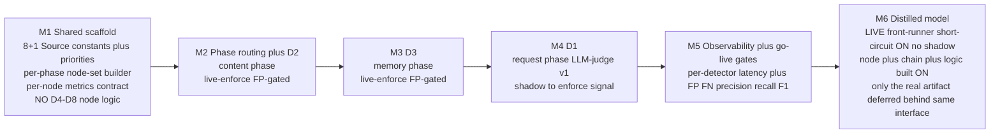
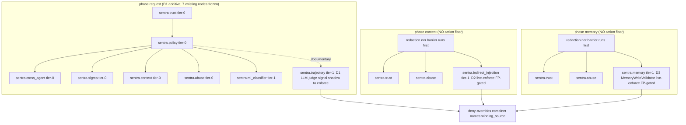

# WS-L — Detection Depth (P0 slice: **D1 + D2 + D3 + the distilled front-runner**)

**Workstream:** WS-L (Serverless Edition) — Detection Depth, the buildable P0 slice.
**Parent LLD (SOURCE OF TRUTH):** [lld/32-detection-depth.md](../../lld/32-detection-depth.md) (APPROVED — grilled + reconciled). **When this doc and lld/32 disagree, the LLD wins** — this file is the buildable projection of it; do not re-decide anything here.
**Status:** TASKS-DONE (buildable). **Owner:** TBD.
**Implements:** FR-3.5 (D1 conversation-trajectory), FR-3.6 (D2 indirect/second-order injection), FR-3.9 (D3 memory-integrity), **FR-3.12 (distilled model — the LIVE tier-1 front-runner: node + chain + short-circuit built ON this WS, M6; the real §8-distilled *artifact* swaps in later behind the same interface)**.
**Spike-gated?** Founder overrode the WS-0 gate for WS-L 2026-07-02 (builds now). WS-0 results (§5.2 Finding-1 recall) inform the D2 quality bar but do not block the build.

---

## 0. LOUD SCOPE BANNER — read this first

> ### THIS WORKSTREAM BUILDS **D1, D2, D3, and the DISTILLED front-runner (M6)**. **D4, D5, D6, D7, D8 ARE NOT BUILT HERE.**
>
> Founder directive 2026-07-03 (non-negotiable). Of the eight defense-in-depth layers in lld/32, **three (D1/D2/D3) are coder-ready** — D2 (indirect injection, `content` phase) and D3 (memory integrity, `memory` phase) are clean phase-handler builds; D1 (conversation trajectory, `request` phase) is the **LLM-judge-over-transcript v1** signal — **plus the distilled model as the LIVE tier-1 front-runner (M6)**. **D4/D5/D6/D7/D8 are each blocked on a dependency that does not exist yet** (see [§8 NOT IN THIS WORKSTREAM](#8-not-in-this-workstream-d4d5d6d7d8)). This WS **builds the code structure all eight layers plug into** (the 8+1 `Source` constants, the priority table, the per-phase node-set builder, the per-node metrics contract, the "add-a-D-node" recipe) — but **the node logic for D4-D8 is not written**. Do NOT hand D4/D5/D6/D7/D8 to a code-loop from this doc; every one of their rows in lld/32 §5.10 is design-inventory, not a coder-ready spec.
>
> **The DISTILLED model (M6) is a LIVE front-runner, short-circuit ON, NO shadow** (lld/32 §4.1, R5-B; founder 2026-07-03). Its node + chain + short-circuit decision logic are BUILT ON this WS: it runs FIRST in the tier-1 model chain and a **confident verdict decides + short-circuits Haiku** (confident-DENY → block; confident-ALLOW → allow; low-conf/error/timeout → Haiku, fail-secure). The short-circuit is **intrinsic — no OFF gate, no shadow window**. The only thing deferred is the **real distilled *artifact*** (from the §8 loop → WS-E feedback store, not built): until it lands, the interim classifier returns escalate so Haiku runs (verdict-equivalent, T-EQUIV), then the real artifact swaps in behind the same interface and confident verdicts start short-circuiting live — no wiring change. SEC-7 (a confident-clean input skipping the strong tier) is a **founder-accepted live risk** mitigated by a HIGH confidence threshold + the floor/D2/D3 running first + the §14 disagreement-rate drift monitor, NOT by a shadow window.
>
> **D1 is the LLM-JUDGE v1, NOT the trained GRU.** The GRU-on-generated-corpus is v2, explicitly deferred (lld/32 §5.1, §5.10). D1 v1 needs **no training corpus**. D1 is a **probabilistic SIGNAL into the combiner (shadow→enforce)**, **NEVER a standalone gate** — there is a published hard solvability ceiling on multi-turn detection (lld/32 §5.1).
>
> **D2/D3 are LIVE-ENFORCE, not shadow** — gated on a measured **FP/precision budget** (lld/32 **R5-C**). The FP budget is a rollout threshold, not a shadow phase; a forgotten enable under-blocks (a missed detection caught by §14 quality metrics), never a surprise false-positive outage.

---

## 1. Why this workstream exists (the gap it closes)

WS-B ([lld/30](../../lld/30-multiphase-contract.md)) shipped the multi-phase **contract** — the additive `phase` field, `KNOWN_PHASES`, the `_CONTENT_FIELD` map, and the **"known-but-unbuilt → fail-secure DENY"** stub (`_phase_not_implemented_deny`, `phase_handler_not_implemented:<phase>`) — but explicitly did **not** build the `content`/`memory`/`output` detection handlers. WS-C ([lld/31](../../lld/31-dag-scheduler.md)) shipped the **DAG scheduler mechanism** (`ValidatorNode` / `cost_tier` / `depends_on` / `run_dag`) but registers only the `request`-phase node set. WS-L is the owner that fills the two P0 phase handlers (**content=D2**, **memory=D3**) as WS-C nodes replacing the WS-B stubs, plus the **D1 request-phase trajectory signal**, plus the shared scaffold every future depth layer plugs into.

The `output` phase stays on WS-B's `phase_handler_not_implemented:output` stub (D5 is not built — [§8](#8-not-in-this-workstream-d4d5d6d7d8)).

---

## 2. Sequencing (founder call) — build in this milestone order

D2/D3 come first because they are clean `content`/`memory`-phase builds with **NO request-phase-DAG regression risk** (they build a brand-new per-phase node set; the `request` DAG is never touched). D1 comes next because it runs on `phase=request` and **MUST NOT perturb WS-C's T-EQUIV golden baseline** — it is purely additive (a new node; the existing 7 request nodes stay byte-identical). **M6 (distilled model) is sequenced LAST** (founder call 2026-07-03: "I'm not particular about *when* you code the distilled model") — but it is a **LIVE front-runner with the short-circuit ON, no shadow** (lld/32 §4.1). Its node + chain + short-circuit logic ship ON; only the real §8-distilled *artifact* is deferred (interim classifier returns escalate → Haiku runs → verdict-equivalent until the artifact swaps in behind the same interface). Also a request-phase node → same T-EQUIV care as D1 (verdict-equivalence, not byte-identity).



---

## 3. Read before coding — the invariants/footguns you must hold

These are lld/32's load-bearing tie-breakers. Hold all of them; violating any is a defect, not a style nit.

1. **Nodes, not a parallel subsystem (footgun #1).** Every layer is a `ValidatorNode` in WS-C's DAG with a declared `cost_tier` + `depends_on`. Do **NOT** hard-code `asyncio.gather` inside a node — the sole gather is `_run_tier1_with_edges` ([run.py:256](../../src/security-controller/app/services/scheduler/run.py#L256)); a self-gathering node re-introduces summed latency and bypasses the run-mode flag.
2. **No new `CostTier` enum member (lld/32 §4).** There are exactly two: `DETERMINISTIC="tier-0"` and `EXPENSIVE_MODEL="tier-1"` ([node.py:20-28](../../src/security-controller/app/services/scheduler/node.py#L20)). Every D-node that calls a model is **tier-1 by definition**. Adding a third tier re-cuts WS-C's `run_dag` frontier split — forbidden.
3. **The `request`-phase DAG is BYTE-FOR-BYTE frozen except the one additive D1 node (FIX-E).** `build_dag("request")` must return the same node list, each `order_key`, every `depends_on` as today — the one addition allowed by this WS is the new `sentra.trajectory` node appended to the request set (M4). The existing 7 nodes and their edges do not move. Pinned by `test_request_phase_dag_unchanged` (T-EQUIV golden-list).
4. **Content is NOT the action floor (lld/32 §6.1, tenet B).** The `content`/`memory` node sets deliberately exclude the action-authorization nodes (`sentra.policy`, `sentra.cross_agent`, `sentra.context`). An ingested-content or memory-write check has no *action* to authorize; running those nodes would emit meaningless signals that pollute WS-D's trail. Keep **only** `[redaction.ner, sentra.trust, sentra.abuse, <the D-node>]`.
5. **Fail secure, never fail open.** A content/memory node ABSTAIN → **DENY** (`phase_handler_abstain:<phase>`) via the phase-aware `all_allow`, never a silent route to ALLOW. A no-denier content/memory run must terminate in DENY, not the synthetic ALLOW at [run.py:534](../../src/security-controller/app/services/scheduler/run.py#L534).
6. **Route AFTER the identity gate (FIX-I / SEC-13).** The content/memory routing edit must land **after** the identity-gate block ([routes.py:122-178](../../src/security-controller/app/api/routes.py#L122)), NOT in place of GUARD-2 ([routes.py:96-102](../../src/security-controller/app/api/routes.py#L96)). Routing into the pipeline before identity is resolved runs D-nodes for an unauthenticated caller → elevation-of-privilege. Pinned by `test_content_memory_phase_requires_identity_gate`.
7. **Additive-only to `sources.py` — no existing value moves (WS-C T-COMBINER-CLEAN).** The 8+1 new `Source` constants and their `DEFAULT_PRIORITIES` entries are additive; **no existing priority (`trust` 90 / `policy` 80 / `sigma` 70 / `ml` 65 / `context` 60 / `abuse`,`cross_agent` 50) and no existing tie-break order changes**. Pinned by a test asserting the existing table is unchanged.
8. **`STATIC_FALLBACK_ORDER` = the emitted request-phase source set (FIX-K, lld/33 T-TRAIL-14(a)).** A request-phase source is added to `STATIC_FALLBACK_ORDER` ([sources.py:113](../../src/security-controller/app/combiners/sources.py#L113)) **only in the same wave its node is added to `build_dag('request')` and actually emits a Signal.** In this WS that is **`sentra.trajectory` (D1) and `sentra.distilled` (M6)** (both are LIVE request-phase nodes that emit on every floor-survivor) — added to the fallback order in **M4** and **M6.1** respectively when each node lands. D4/D6/D7/D8 request-phase sources get **`SOURCE_DISPLAY_NAMES` labels only** (safe anytime), **NOT** fallback-order entries, until their node emits. **D2/D3 are phase-specific (content/memory) → they are NEVER in the request-phase `STATIC_FALLBACK_ORDER`** (lld/32 §9.4). Premature registration makes `set(STATIC_FALLBACK_ORDER)` a strict superset of the emitted set → T-TRAIL-14(a) RED.
   - **8a. THE TRIPLE-EQUALITY — the WS-L→WS-D contract (lld/33 §13 pt 5, §631/§651).** The live guard `test_coverage_drift_guard_both_paths` ([tests/unit/test_trail_builder.py:158-161](../../src/security-controller/tests/unit/test_trail_builder.py#L158)) asserts **three co-equal sets**, not one: `set(STATIC_FALLBACK_ORDER) == set(registry._ORDER) == set(STEP_LABEL_TO_SOURCE.values())`. So **every** request-phase node WS-L adds (`sentra.trajectory`, `sentra.distilled`) must be added to **all three surfaces in the same PR** — (i) `STATIC_FALLBACK_ORDER` (the list), (ii) `_ORDER` in [registry.py:61-69](../../src/security-controller/app/services/scheduler/registry.py#L61) (the order-key map — a new integer key, NOT a reuse of ML's `order_key`; reusing ML's key leaves `_ORDER` a 7-set while the fallback becomes an 8-set → guard RED on line 160), and (iii) a `STEP_LABEL_TO_SOURCE` entry in [sources.py:95-103](../../src/security-controller/app/combiners/sources.py#L95). **The `_step_timings` key is the DOTTED source string** (`timed(node.source, …)`, [run.py:297](../../src/security-controller/app/services/scheduler/run.py#L297)) — so the new `STEP_LABEL_TO_SOURCE` rows key on the dotted `"sentra.trajectory"`/`"sentra.distilled"` (mapping the dotted source to itself), **unlike** the existing short-label rows (`"ml"→sentra.ml_classifier`). Missing any one of the three → the guard fails on line 160 or 161. **Never map plumbing labels** (`session`/`pipeline`/`handle`/`abuse_policy_load`/`policy_fallback`) — they stay deliberately unmapped.
9. **`trajectory_state` is server-side-write-only (SEC-3).** D1's trajectory state is written ONLY by the D1 node server-side; it is NEVER accepted from a client-asserted field. The server never trusts a client-asserted trust/taint/trajectory level (`content_text` is bounded at 1 MiB; an unknown phase 422s, never DENYs).
10. **D1 is a SIGNAL, never a standalone gate (lld/32 §5.1 hard solvability ceiling).** [FACT] Safety-aligned models represent Crescendo-style responses as *more* benign the longer the conversation runs (arXiv 2507.02956, 2025); no published method reliably detects multi-turn attacks at low FP. D1 feeds the deny-overrides combiner as one probabilistic vote (priority 68, below sigma 70); it must never be the sole decider.
11. **Corpus-license discipline (D1-v2 only; v1 needs no corpus).** Before any v2 GRU ingest: read the LICENSE file (not the HF tag), legal-review, pin the commit. Confirmed 2026-07-03: MHJ (CC-BY-NC) eval-only; XGuard-Train / CoSafe (no license) not usable; SafeMTData (conflict) eval-only. Absent-license = all-rights-reserved. **Training is the gated act** — held-out eval on cleared sets is fine, training on them is not. D1 **v1 trains nothing**, so this bites only if v2 is ever revived.

---

# Milestones → tasks

Every behavior-changing task carries BOTH a named unit test (real `test_<name>` in a real file) AND an integration test exercising the cross-component seam. Server-side UTs land in `src/security-controller/tests/` (new files named per task); integ tests extend the existing multi-phase / scheduler seam tests. Hermetic run (project memory): `env -u AWS_PROFILE` + fake creds + `AWS_DEFAULT_REGION=us-east-1` + the package venv python.

---

## Milestone M1 — Shared scaffold (the structure all 8 layers plug into; D4-D8 node logic NOT built)

**Goal:** register the full signal taxonomy + priorities + per-phase node-set builder pattern + per-node metrics contract, so adding a D-node later is a small additive PR. Only D1/D2/D3 node logic is written (M2-M4). **D4/D5/D6/D7/D8 get constants + priorities + display labels but no node.**

- **Implements:** the lld/32 §9 signal taxonomy + the §6 node-set-builder extension pattern.
- **Touches:** [sources.py:15](../../src/security-controller/app/combiners/sources.py#L15) (`Source`), [sources.py:51](../../src/security-controller/app/combiners/sources.py#L51) (`DEFAULT_PRIORITIES`), [sources.py:130](../../src/security-controller/app/combiners/sources.py#L130) (`SOURCE_DISPLAY_NAMES`), [registry.py:72](../../src/security-controller/app/services/scheduler/registry.py#L72) (`build_dag`), [registry.py:26](../../src/security-controller/app/services/scheduler/registry.py#L26) (docstring drift), [metrics_publisher.py:19](../../src/security-controller/app/utils/metrics_publisher.py#L19) (`MetricsPublisher`).

### M1.1 — add the 8+1 `Source` constants (all 8 layers + distilled) — lld/32 §9.1

- **Change:** add ten additive constants to `class Source` ([sources.py:15](../../src/security-controller/app/combiners/sources.py#L15)), all `SENTRA_*`, next to the existing internal validators. Distilled is a **distinct producer** (do NOT reuse `SENTRA_ML_CLASSIFIER`):
  ```python
  # sources.py — class Source (additive; lld/32 §9.1). ALL registered even though
  # only trajectory/indirect/memory get a NODE in this WS. The others are scaffold.
  SENTRA_TRAJECTORY: Final[str]  = "sentra.trajectory"          # D1 (built M4)
  SENTRA_INDIRECT: Final[str]    = "sentra.indirect_injection"  # D2 (built M2)
  SENTRA_MEMORY: Final[str]      = "sentra.memory"              # D3 (built M3)
  SENTRA_TAINT: Final[str]       = "sentra.taint"               # D4 (NOT built)
  SENTRA_OUTPUT_DLP: Final[str]  = "sentra.output_dlp"          # D5 (NOT built)
  SENTRA_NETWORK: Final[str]     = "sentra.network"             # D6 (NOT built)
  SENTRA_EGRESS: Final[str]      = "sentra.egress"              # D6 (NOT built)
  SENTRA_PROVENANCE: Final[str]  = "sentra.provenance"          # D7 (NOT built)
  SENTRA_ANOMALY: Final[str]     = "sentra.anomaly"             # D8 (NOT built)
  SENTRA_DISTILLED: Final[str]   = "sentra.distilled"           # distilled model (node = LATER)
  ```
- **Note (lld/32 C5):** all ten use the `SENTRA_*` prefix, diverging from lld/31 §5's "no new `sentra`-prefixed identifier" rule — deliberate (these strings persist in the DDB audit + are read by the SOC console `winning_source`). They join lld/31 §16's rename backlog; do NOT rename them here.
- **UT** (`tests/test_wsl_scaffold.py`): **`test_new_source_constants_present`** — all ten constants exist on `Source`, each value is the exact dotted string above, and `SENTRA_DISTILLED != SENTRA_ML_CLASSIFIER` (distinct producers).
- **INTEG:** covered by M1.4's boot-time registration-completeness test (the assertion imports these).

### M1.2 — add the 10 `DEFAULT_PRIORITIES` entries (additive; existing unchanged) — lld/32 §9.2

- **Change:** add ten entries to `DEFAULT_PRIORITIES` ([sources.py:51](../../src/security-controller/app/combiners/sources.py#L51)), higher=stronger (LLD 20 §11 convention). **No existing value moves.**
  ```python
  # sources.py — DEFAULT_PRIORITIES (additive; lld/32 §9.2). higher = stronger.
  Source.SENTRA_NETWORK: 85,     # D6
  Source.SENTRA_TAINT: 78,       # D4
  Source.SENTRA_EGRESS: 77,      # D6
  Source.SENTRA_PROVENANCE: 75,  # D7
  Source.SENTRA_TRAJECTORY: 68,  # D1  (below sigma 70, above ml 65)
  Source.SENTRA_DISTILLED: 66,   # distilled (above ml 65, below sigma 70)
  Source.SENTRA_OUTPUT_DLP: 63,  # D5
  Source.SENTRA_INDIRECT: 62,    # D2
  Source.SENTRA_MEMORY: 58,      # D3
  Source.SENTRA_ANOMALY: 55,     # D8
  ```
- **FOOTGUN — additive only (invariant 7 / WS-C T-COMBINER-CLEAN).** Do NOT change `trust` 90 / `policy` 80 / `sigma` 70 / `ml` 65 / `context` 60 / `abuse`,`cross_agent` 50 / edge 40 / `redaction.ner` 0, and do NOT change the tie-break order. New entries slot between existing values.
- **FOOTGUN — do NOT touch `default_priority()` ([sources.py:82](../../src/security-controller/app/combiners/sources.py#L82))** — an unknown source still returns 0; the new entries just mean these are no longer unknown.
- **UT** (`tests/test_wsl_scaffold.py`):
  - **`test_existing_priorities_unchanged`** — a hard-coded snapshot dict of the 8 pre-WS-L entries (trust=90…redaction.ner=0) equals the corresponding subset of `DEFAULT_PRIORITIES` after the edit. Must fail if any existing value moves. Pins T-COMBINER-CLEAN.
  - **`test_new_priorities_values`** — each new source maps to its exact value above; assert the ordering constraints (`sigma 70 > distilled 66 > ml 65`, `sigma 70 > trajectory 68`).
- **INTEG:** covered by M1.4.

### M1.3 — add `SOURCE_DISPLAY_NAMES` labels for all 10 (safe anytime) — lld/32 §9.3/§9.4

- **Change:** add human labels to `SOURCE_DISPLAY_NAMES` ([sources.py:130](../../src/security-controller/app/combiners/sources.py#L130)) for all ten new sources (e.g. `"Conversation trajectory"`, `"Indirect injection"`, `"Memory integrity"`, `"Taint flow"`, `"Output DLP"`, `"Network firewall"`, `"Egress reputation"`, `"Provenance"`, `"Anomaly"`, `"Distilled classifier"`). Labels are display-only, never a join key — safe to add for all ten even though most have no node.
- **UT** (`tests/test_wsl_scaffold.py`): **`test_display_names_cover_new_sources`** — every one of the ten new `Source` values has a non-empty entry in `SOURCE_DISPLAY_NAMES`.

### M1.4 — boot-time registration-completeness invariant (SEC-5) — lld/32 §9.3

- **Change:** add (or extend the existing) startup assertion so **every registered `ValidatorNode.source`** (across every phase `build_dag` can produce) is present in `DEFAULT_PRIORITIES` **and** `SOURCE_DISPLAY_NAMES`, and — for **request-phase** sources — in `STATIC_FALLBACK_ORDER`. A missing entry fails fast at boot (an unregistered source ranks priority 0 and silently loses tie-breaks → audit mis-attribution).
- **FOOTGUN — the fallback-order half of the assertion is REQUEST-PHASE ONLY (FIX-K, invariant 8).** Do NOT assert content/memory-phase sources (`sentra.indirect_injection`, `sentra.memory`) are in `STATIC_FALLBACK_ORDER` — they are phase-specific and must stay OUT of it (lld/32 §9.4). Assert priority + display for all; assert fallback-order membership only for the sources `build_dag("request")` emits.
- **UT** (`tests/test_wsl_scaffold.py`): **`test_all_registered_sources_have_priority_and_labels`** — build the node set for each phase (`request`/`content`/`memory`), collect every `node.source`, assert each is in `DEFAULT_PRIORITIES` and `SOURCE_DISPLAY_NAMES`; assert each **request**-phase emitted source is in `STATIC_FALLBACK_ORDER` and each content/memory-only source is **not** in it.
- **INTEG** (`tests/test_wsl_scaffold_boot.py`): construct the app / call the startup hook and assert it does not raise with the current registration; then monkeypatch a node with an unregistered source and assert the boot assertion **raises** (proves fail-fast, not a silent 0-priority).

### M1.5 — the per-phase node-set builder pattern (replace the `if phase != "request": pass` degradation) — lld/32 §6.1/§6.2

- **Change:** in `build_dag(service, phase, stamp_ctx)` ([registry.py:72](../../src/security-controller/app/services/scheduler/registry.py#L72)), **replace** the current no-op degradation ([registry.py:85-88](../../src/security-controller/app/services/scheduler/registry.py#L85), `if phase != "request": pass`) with a **per-phase node-set builder**. The `request` branch returns the existing list **byte-for-byte** (FIX-E); `content`/`memory` branches return their own node sets (filled in M2/M3); `output` and any other known phase return the request-degrade OR an empty set that the phase-aware `all_allow` turns into a fail-secure DENY (its handler is the WS-B stub — output stays stubbed, [§8](#8-not-in-this-workstream-d4d5d6d7d8)).
  ```python
  # registry.py build_dag — the per-phase node-set builder (pattern; M2/M3 fill content/memory).
  # request → the EXISTING request node list, BYTE-FOR-BYTE (FIX-E). The one additive
  #           change this WS makes to it is the D1 sentra.trajectory node (M4).
  # content → [redaction.ner barrier, sentra.trust, sentra.abuse, sentra.indirect_injection]  (M2)
  # memory  → [redaction.ner barrier, sentra.trust, sentra.abuse, sentra.memory]              (M3)
  # (output does NOT reach here for a live handler — routes.py keeps it on the WS-B stub.)
  ```
- **FOOTGUN — the `request` branch stays byte-identical (invariant 3, FIX-E).** The existing 7 `ValidatorNode` registrations ([registry.py:284-333](../../src/security-controller/app/services/scheduler/registry.py#L284)) — their `source`, `cost_tier`, `run`, `depends_on`, `order_key` — do not move. The NER-barrier append ([registry.py:350-358](../../src/security-controller/app/services/scheduler/registry.py#L350), keyed on `phase in _CONTENT_PHASES`) stays.
- **FOOTGUN — do NOT add a new `CostTier` (invariant 2).** D-nodes reuse `EXPENSIVE_MODEL` (tier-1) or `DETERMINISTIC` (tier-0).
- **FOOTGUN — the D-nodes are ORDINARY nodes, NOT barriers.** Do NOT reuse `_is_barrier` / `Source.REDACTION_NER` for a D-node ([run.py:55](../../src/security-controller/app/services/scheduler/run.py#L55) — the barrier is the NER redactor only; lld/32 §5.10 barrier note).
- **UT** (`tests/test_wsl_node_sets.py`):
  - **`test_request_phase_dag_unchanged`** (T-EQUIV golden-list) — `build_dag(svc, "request", ctx)` returns a node list whose `(source, cost_tier, depends_on, order_key)` tuple-per-node equals a frozen golden snapshot (the pre-M4 baseline, then updated in M4 to add exactly one trajectory node — see M4.4). Must fail if any existing node moves.
  - **`test_content_phase_node_set`** / **`test_memory_phase_node_set`** — stubs asserting the content/memory sets equal the exact source lists above (filled in M2.3/M3.2; they FAIL until then — mark xfail with a lld/32 §6 reference, flip to pass when the node lands).
- **INTEG:** covered by M2/M3 seam tests.

### M1.6 — the per-node `MetricsPublisher` contract (off the response path) — lld/32 §14.1

- **Change:** add `publish_node_metrics(node_source, phase, decision, latency_ms)` to `MetricsPublisher` ([metrics_publisher.py:19](../../src/security-controller/app/utils/metrics_publisher.py#L19), namespace `Sentra/SecurityController`), modeled on the disagreement-metric precedent `publish_cedar_shadow_metric` ([metrics_publisher.py:177](../../src/security-controller/app/utils/metrics_publisher.py#L177)). Keyed on `node_source` (dimension) + `phase` (dimension). Fire-and-forget, self-guarding (never raises into the verdict path) — it is emitted from the scheduler's `timed(node.source, …)` seam ([run.py:297](../../src/security-controller/app/services/scheduler/run.py#L297),[326](../../src/security-controller/app/services/scheduler/run.py#L326),[457](../../src/security-controller/app/services/scheduler/run.py#L457)), OFF the response path.
- **FOOTGUN — never on the response path / never raises.** A metrics failure must never change or delay a verdict (mirror `_phase_not_implemented_deny`'s best-effort try/except pattern at [routes.py:236](../../src/security-controller/app/api/routes.py#L236)).
- **UT** (`tests/test_wsl_metrics.py`): **`test_publish_node_metrics_shape`** — calling `publish_node_metrics("sentra.indirect_injection", "content", "DENY", 12.3)` posts a data point with the `node_source` + `phase` dimensions and the decision/latency values (spy on the CloudWatch client); a raise inside the publish is swallowed (assert no exception propagates).
- **INTEG:** covered by M5's per-detector metric-emission seam test.

### M1.7 — fix the registry docstring drift (WS-D → WS-L) — lld/32 §14 hygiene

- **Change:** [registry.py:26](../../src/security-controller/app/services/scheduler/registry.py#L26) docstring says "WS-D adds D1–D7 as additional tier-1 nodes here" — this is **WRONG**; WS-L (this workstream) owns the D-nodes, not WS-D (decision-trail). Change "WS-D adds D1–D7" → "WS-L adds D1–D3 (P0); D4–D8 scaffolded, not built". (Note: [node.py:28](../../src/security-controller/app/services/scheduler/node.py#L28)'s "D1-D7 (added by WS-L)" comment is already correct — leave it.)
- **UT:** none (comment-only). Verified by grep in the acceptance checklist.

### M1.8 — the "add-a-D-node" recipe (doc, for the future layers) — lld/32 §4/§6

- **Change:** add a short doc block (in this file, [§9](#9-the-add-a-d-node-recipe) below) that a future D-layer build follows: (1) constant already in `Source` (M1.1); (2) priority already in `DEFAULT_PRIORITIES` (M1.2); (3) display label already in `SOURCE_DISPLAY_NAMES` (M1.3); (4) register the node in the correct-phase branch of `build_dag`, `cost_tier=EXPENSIVE_MODEL` if it calls a model, `depends_on=(Source.SENTRA_POLICY,)` documentary edge (dropped cleanly on non-request phases by `_toposort`); (5) if it is a **request-phase** source, add it to `STATIC_FALLBACK_ORDER` **in the same PR** (FIX-K); (6) add its `publish_node_metrics` call (already automatic via the `timed` seam); (7) name lld/33 T-TRAIL-14(a) in the PR.
- **No test** (documentation task).

---

## Milestone M2 — Phase routing + D2 (content phase, indirect/second-order injection)

**Goal:** route `content` into the pipeline (after identity), flip the no-denier verdict to DENY on content/memory, and build the D2 node. **Live-enforce, FP/precision-gated.**

- **Implements:** FR-3.6 (D2 indirect injection). Node source `SENTRA_INDIRECT`, reason `INDIRECT_INJECTION`, tier-1, `phase=content`.
- **Touches:** [routes.py:96-102](../../src/security-controller/app/api/routes.py#L96) (GUARD 2), [validation_service.py:632](../../src/security-controller/app/services/validation_service.py#L632) (`_all_allow` closure) + [validation_service.py:652](../../src/security-controller/app/services/validation_service.py#L652) (`phase` resolution), [registry.py:72](../../src/security-controller/app/services/scheduler/registry.py#L72) (`build_dag` content branch), a new validator module under `app/validators/`.

### M2.1 — route `content`/`memory` INTO the pipeline, AFTER the identity gate (FIX-I / SEC-13) — lld/32 §6, edit-site (1)

- **Change:** today GUARD 2 ([routes.py:96-102](../../src/security-controller/app/api/routes.py#L96)) early-returns `_phase_not_implemented_deny` for **every** non-`request` phase. Change it so `content` and `memory` **fall through** to the identity gate + pipeline (like `request` does), while `output` (and any other known-but-unbuilt phase) **stays** on the stub. The routing into the pipeline happens **below** the identity-gate block ([routes.py:122-178](../../src/security-controller/app/api/routes.py#L122)) — the same `validation_service.validate_tool_call(request)` call sites that `request` uses.
  ```python
  # routes.py — GUARD 2, revised. content/memory now fall through to identity + pipeline;
  # output stays stubbed (D5 not built — §8).
  if phase not in ("request", "content", "memory"):   # i.e. "output" today
      return await _phase_not_implemented_deny(
          request, reason=f"phase_handler_not_implemented:{phase}"
      )
  # request/content/memory: continue to the identity gate (resolve_tenant_from_jwt),
  # THEN validation_service.validate_tool_call → _run_validation_pipeline →
  # build_dag(self, phase, ...) picks the phase node set.
  ```
- **FOOTGUN — route AFTER identity, not in place of GUARD 2 (invariant 6, FIX-I/SEC-13).** If you make GUARD 2 route content/memory into `validation_service` *before* [routes.py:122](../../src/security-controller/app/api/routes.py#L122)'s `resolve_tenant_from_jwt`, a content/memory call runs the D-nodes for an unauthenticated caller → EoP. The identity gate must run first (it already calls `validation_service.validate_tool_call(request)` on every accept branch — content/memory ride those same branches).
- **FOOTGUN — do NOT route `output`.** `output` has no live handler (D5 not built) — it stays on `phase_handler_not_implemented:output`.
- **UT** (`tests/test_wsl_phase_routing.py`):
  - **`test_content_memory_phase_requires_identity_gate`** — with identity ENFORCE on, a `phase="content"` call from an unverified/spoofed caller returns the **identity** DENY (`IDENTITY_*`), and `build_dag`/the D2 node is **not** reached (spy). Pins FIX-I/SEC-13 (D-nodes never run before identity resolves).
  - **`test_output_phase_still_stubbed`** — `phase="output"` still returns `phase_handler_not_implemented:output` (D5 not built).
- **INTEG** (`tests/test_multiphase_contract.py` extension, `TestClient`): identity DISABLED → `POST {phase:"content"}` reaches the pipeline (a real D2 verdict, M2.3); identity ENFORCE + bad token → `phase="content"` returns the identity DENY, pipeline not entered.

### M2.2 — phase-aware `all_allow` (FIX-H/FIX-J): no-denier content/memory → DENY, not ALLOW — lld/32 §6, edit-site (3)

- **Change:** the synthetic tail ALLOW ([run.py:534](../../src/security-controller/app/services/scheduler/run.py#L534)) is correct for `request` but WRONG for content/memory (a content run where no node denied must fail secure, not silently ALLOW). Pass a **phase-aware `all_allow`** into `run_dag` (the arg already exists at the `run_dag` signature, [run.py:393](../../src/security-controller/app/services/scheduler/run.py#L393)). In `_run_validation_pipeline`, make `_all_allow` ([validation_service.py:632](../../src/security-controller/app/services/validation_service.py#L632)) return a **DENY** (`reason=f"phase_handler_abstain:{phase}"`, fail-secure) when `phase in ("content","memory")` and an ALLOW when `phase == "request"`.
  ```python
  # validation_service.py — _all_allow becomes phase-aware.
  def _all_allow() -> ValidationResult:
      if phase in ("content", "memory"):
          # no D-node denied AND none abstained-to-DENY → the deep check produced no
          # verdict → fail secure. (A content/memory run has no synthetic ALLOW tail.)
          return ValidationResult(decision="DENY", reason=f"phase_handler_abstain:{phase}",
                                  should_deny=True)
      return ValidationResult(decision="ALLOW", reason="All validation checks passed",
                              should_deny=False,
                              platform=stamp_ctx.get("platform"),
                              cloud_region=stamp_ctx.get("cloud_region"))
  ```
- **FOOTGUN — FIX-J scope/`UnboundLocalError`.** `_all_allow` is defined at [validation_service.py:632](../../src/security-controller/app/services/validation_service.py#L632) but `phase` is resolved at [validation_service.py:652](../../src/security-controller/app/services/validation_service.py#L652) (**after** the closure def). **Hoist the `phase = getattr(request, "phase", "request") or "request"` line ABOVE the `_all_allow` def** (or have the closure read `request.phase` directly at call time), else the closure captures an unbound `phase` → `UnboundLocalError` at request time.
- **FOOTGUN — the `request`-phase branch of `_all_allow` stays byte-identical (invariant 3).** The synthetic ALLOW for `request` keeps its `platform`/`cloud_region` stamp — do not regress the T-EQUIV baseline.
- **UT** (`tests/test_wsl_phase_routing.py`):
  - **`test_content_no_denier_fails_secure`** — a `phase="content"` run where the D2 node ABSTAINs (or, in a pre-M2.3 stub, no D-node denies) terminates in **DENY** `phase_handler_abstain:content`, NOT ALLOW. Pins invariant 5 + FIX-H.
  - **`test_request_all_allow_unchanged`** — a `phase="request"` run with no denier still returns the synthetic ALLOW carrying `platform`/`cloud_region` (T-EQUIV, unchanged).
  - **`test_phase_resolution_hoisted_no_unbound`** — a content run does not raise `UnboundLocalError` (regression pin for FIX-J).
- **INTEG:** covered by M2.4 (a content call with no injection signal → DENY-fail-secure until D2 votes ALLOW).

### M2.3 — the content node set + the D2 node — lld/32 §5.2/§6.2

- **Change:** in `build_dag` content branch, return **`[redaction.ner barrier, sentra.trust, sentra.abuse, sentra.indirect_injection]`** (NOT the action floor — invariant 4). Register the D2 node: `source=Source.SENTRA_INDIRECT`, `cost_tier=CostTier.EXPENSIVE_MODEL`, `depends_on=(Source.SENTRA_POLICY,)` (documentary; dropped cleanly on content by `_toposort`'s present-only in-degree, [run.py:171-173](../../src/security-controller/app/services/scheduler/run.py#L171) — do NOT re-add `sentra.policy` to the content set), `order_key=0`. Build the validator (new module `app/validators/indirect_injection.py`) doing **3 passes over the REDACTED `content_text`**:
  1. **sigma pass** — `await service.sigma_engine.match_rules(req.content_text)` (cheap regex over known signatures, first).
  2. **content-framed ML** — the ML classifier on the novel subset, framed as "is this ingested content trying to inject instructions?".
  3. **two heuristics** — instruction-density (imperative-verb ratio, second-person) + encoding/obfuscation scan (base64, homoglyphs, zero-width).
- **FOOTGUN (the named one) — do NOT reuse `_run_sigma` for D2.** The request-phase `_run_sigma` closure ([registry.py:122-123](../../src/security-controller/app/services/scheduler/registry.py#L122)) calls `service.sigma_engine.match_rules(req.user_input)` — on a content call `user_input` is empty, so it scans nothing. D2 MUST call `service.sigma_engine.match_rules(req.content_text)` ([sigma_engine.py:340](../../src/security-controller/app/validators/sigma_engine.py#L340) — `match_rules(self, user_input)` takes the string to scan). Passing `content_text` here is the whole point.
- **FOOTGUN — reads the REDACTED `content_text`.** The `redaction.ner` barrier runs FIRST (it is a barrier, [run.py:55](../../src/security-controller/app/services/scheduler/run.py#L55)); D2 reads the mutated (redacted) `content_text`. Guards must operate on the redacted view.
- **FOOTGUN — first-wave STANDALONE, no taint thread into D4.** D4 is not built ([§8](#8-not-in-this-workstream-d4d5d6d7d8)); D2 does not thread a taint label anywhere. It is a plain tier-1 node.
- **FOOTGUN — D2 ABSTAIN → DENY via `all_allow` (M2.2), not via node registration.** Do not register a fail-open default.
- **UT** (`tests/test_indirect_injection.py`):
  - **`test_d2_sigma_reads_content_text_not_user_input`** — a `ValidationRequest` with `content_text` carrying a known injection signature and **empty** `user_input` → D2 DENYs `INDIRECT_INJECTION`. Must fail if the node calls `match_rules(user_input)`. Pins the named footgun.
  - **`test_d2_heuristics_instruction_density`** / **`test_d2_heuristics_obfuscation`** — high imperative-density content and base64/zero-width-obfuscated content each raise the D2 signal.
  - **`test_d2_clean_content_allows`** — benign ingested content → D2 votes ALLOW (no false DENY).
  - **`test_d2_source_and_reason`** — a D2 DENY carries `source == Source.SENTRA_INDIRECT`, `reason`/`violation_type` naming `INDIRECT_INJECTION`.
- **UT** (`tests/test_wsl_node_sets.py`): flip **`test_content_phase_node_set`** to pass — the content branch returns exactly `[redaction.ner, sentra.trust, sentra.abuse, sentra.indirect_injection]`; assert `sentra.policy`/`cross_agent`/`context` are absent.
- **INTEG** (`tests/test_multiphase_contract.py` extension): `POST {phase:"content", content_text:<injection>}` (identity disabled) → **200 DENY** `INDIRECT_INJECTION`; `POST {phase:"content", content_text:<benign>}` → **200 ALLOW**. The `request` pipeline is unaffected (regression: existing request tests green).

### M2.4 — D2 live-enforce FP/precision gate wiring (R5-C) — lld/32 §5.2 MEAS-D2-RECALL / R5-C

- **Change:** D2 is **live-enforce** (blocks in the first wave), gated on a measured FP/precision budget (R5-C). Wire the enforce/advisory decision so D2's DENYs are turned on once the offline eval-harness (M5) clears the FP budget; a not-yet-cleared D2 stamps its result **advisory** (does not decide) rather than shadow-relocating. Use the existing tier-1 enforce mechanism (`metadata["enforce"]=True` lets a tier-1 DENY decide via `_is_hard_deny`, [run.py:69](../../src/security-controller/app/services/scheduler/run.py#L69); mirror `_apply_ml_enforce_wrapper` at [registry.py:402](../../src/security-controller/app/services/scheduler/registry.py#L402)).
- **Note (lld/32 §5.2 Finding-1):** WS-0 measured ~57–60% recall on the same sigma+ML stack D2 reuses (unmasked 0.565 / masked 0.601, CIs overlap — a detector-coverage gap, not a masking loss). The **≥0.85 recall** bar is a **QUALITY TARGET** the improvement plan pursues (MEAS-D2-RECALL), **NOT** the enforce-graduation gate. The enforce gate is the **FP/precision budget** (R5-C).
- **FOOTGUN — the FP budget does NOT create a shadow phase (R5-C).** It is a threshold on measured FP-rate below which D2's DENYs are on. A forgotten enable under-blocks (missed detection, caught by §14), never a surprise FP outage.
- **UT** (`tests/test_indirect_injection.py`): **`test_d2_advisory_until_enforce`** — with the enforce flag off, a D2 DENY is captured **advisory** (`_is_hard_deny` false → does not decide the verdict); with enforce on, `metadata["enforce"]=True` and the D2 DENY decides. Pins R5-C wiring.
- **INTEG:** covered by M5's eval-harness gate (the harness computes the FP/precision that graduates D2).

---

## Milestone M3 — D3 (memory phase, memory-integrity)

**Goal:** build the D3 memory-write validator on the `memory` phase. **Live-enforce, FP/precision-gated. Read-path stays OFF.**

- **Implements:** FR-3.9 (D3 memory-integrity). Node source `SENTRA_MEMORY`, reason `MEMORY_POISONING`, tier-1, `phase=memory`.
- **Touches:** [registry.py:72](../../src/security-controller/app/services/scheduler/registry.py#L72) (`build_dag` memory branch), a new validator module `app/validators/memory_write.py`. **Design-only / net-new:** `MemoryWriteValidator`, the KMS-MAC integrity check, the `sentra-agent-memory` governance record store — none exist today.

### M3.1 — the memory node set — lld/32 §6.3

- **Change:** in `build_dag` memory branch, return **`[redaction.ner barrier, sentra.trust, sentra.abuse, sentra.memory]`** (NOT the action floor — invariant 4; cross-agent memory-write scoping is an accepted residual per lld/32 §6.3, the request-time floor is the backstop). Register the D3 node: `source=Source.SENTRA_MEMORY`, `cost_tier=CostTier.EXPENSIVE_MODEL`, `depends_on=(Source.SENTRA_POLICY,)` (documentary, dropped cleanly on memory), `order_key=0`.
- **UT** (`tests/test_wsl_node_sets.py`): flip **`test_memory_phase_node_set`** to pass — the memory branch equals `[redaction.ner, sentra.trust, sentra.abuse, sentra.memory]`; assert policy/cross_agent/context absent.

### M3.2 — the `MemoryWriteValidator` (integrity guards) — lld/32 §5.3

- **Change:** build `MemoryWriteValidator` (new `app/validators/memory_write.py`) at the memory chokepoint, reading the **REDACTED** memory candidate (`content_text` post-NER, SEC-4). Guards are **structural/metadata**, not value-dependent:
  - **provenance mandatory** — a memory write without provenance DENYs.
  - **untrusted memory cannot self-promote** — `trust_weight ≤ 0.3` cap on untrusted-sourced memory.
  - **memory tightens, never loosens security** — the policy engine ignores any memory that expands `allowed_tools`, raises a limit, or skips a check (`MEMORY_POISONING`).
  - **signed + tamper-evident** via **KMS `GenerateMac`/`VerifyMac`** over immutable birth facts.
  - **decay-bounded per-kind** — short TTL for `AGENT_INFERENCE`, long/none for `OPERATOR_DIRECTIVE`.
- **FOOTGUN (the named one) — canonicalize BEFORE hash/MAC (lld/32 §5.3).** Content + birth facts MUST be canonicalized before hashing/MAC (stable byte encoding: normalize Unicode form, whitespace, JSON key order) — else the same logical memory hashes/MACs differently → spurious re-verify failure. Determinism must hold over the **redacted** view.
- **FOOTGUN — the self-promotion trust cap is DEFAULT-UNTRUSTED, keyed on SERVER-DERIVED provenance, NOT on a self-asserted `source` label (fail-secure; engineering.md "never trust external data").** Do **not** implement the cap as an allowlist that only clamps `trust_weight` when `provenance.source` is in a closed untrusted set (`agent_inference`/`tool_output`/`ingested`/`external`) — the `source` string is fully attacker-controlled (it rides in the request payload), so an attacker sets `source="operator"`/`"system"`/`"user"` and skips the cap, claiming `trust_weight=1.0` on a tool-sourced memory — the exact self-promotion the guard exists to block. **Invert to default-untrusted:** every write starts at the `≤ 0.3` untrusted cap and is exempted **only** for a provenance the server can attest (derived from the verified identity-gate anchor / a server-set provenance stamp), never a self-declared label. **UT — `test_d3_self_asserted_source_cannot_bypass_cap`:** a write with `provenance.source="operator"` (or any string outside the attested set) + `trust_weight=1.0` that would loosen posture is capped/DENIED, not exempted.
- **FOOTGUN — the tamper-evidence MAC is MANDATORY for any trust/effect-asserting write, never optional (fail-secure).** Do **not** run `VerifyMac` only when the candidate itself supplies both `birth_facts` and `mac` — that lets an attacker forging a poisoned memory simply omit `mac` (or `birth_facts`) to skip the integrity gate (a fail-open check). A write that asserts trust/effects with a **missing** `mac` → **DENY** (`MEMORY_POISONING`), not skip. And **never accept a locally-HMAC'd MAC as authentic in an enforce decision** — a fixed non-secret key (e.g. `b"sentra-memory-integrity-dev"`) is offline-forgeable by anyone, so the enforce path requires the KMS `VerifyMac` (or a secret-manager-held key), never the local dev fallback (`engineering.md`: no hardcoded secrets; fail secure). The local-HMAC path is dev-only and MUST NOT decide a security verdict. **UT — `test_d3_missing_mac_denies` + `test_d3_local_dev_mac_not_authentic_in_enforce`:** a trust-asserting write with no `mac` DENIES once D3 enforces; a `mac` computed with the dev key does not verify on the KMS enforce path.
- **FOOTGUN — read-path stays OFF.** `AGENT_MEMORY_READ_ENABLED=false` until the write-path guards are live-enforcing and clearing the FP/precision budget (lld/32 §6.3). Do NOT build a read-path check in this WS.
- **FOOTGUN — D3 ABSTAIN → DENY** `phase_handler_abstain:memory` via the phase-aware `all_allow` (M2.2), fail-secure.
- **UT** (`tests/test_memory_write.py`):
  - **`test_d3_missing_provenance_denies`** — a memory write lacking provenance → DENY `MEMORY_POISONING`.
  - **`test_d3_untrusted_cannot_self_promote`** — an untrusted-sourced memory attempting `trust_weight > 0.3` → DENY.
  - **`test_d3_self_asserted_source_cannot_bypass_cap`** — a write with `provenance.source` set to any string outside the server-attested trusted set (e.g. `"operator"`/`"system"`/`"user"`) + `trust_weight=1.0` that would loosen posture is capped/DENIED — the trust cap is default-untrusted and does NOT exempt on a self-asserted label. Pins the fail-secure inversion.
  - **`test_d3_missing_mac_denies`** — a trust/effect-asserting memory write with **no `mac`** (or no `birth_facts`) → DENY `MEMORY_POISONING` once D3 enforces (the integrity gate is mandatory, not skip-on-omission).
  - **`test_d3_local_dev_mac_not_authentic_in_enforce`** — a `mac` computed with the local dev key does **not** verify on the enforce path (which requires KMS `VerifyMac` / a secret-manager key); only a KMS-produced MAC verifies. Pins "never accept a self-forgeable MAC in a security decision".
  - **`test_d3_memory_cannot_loosen_security`** — a memory write expanding `allowed_tools` / raising a limit → DENY.
  - **`test_d3_canonicalize_before_hash`** — two byte-different-but-logically-identical memory candidates (different Unicode form / whitespace / JSON key order) produce the **same** MAC (canonicalization holds), and a genuinely tampered candidate fails `VerifyMac`. Pins the named footgun.
  - **`test_d3_clean_memory_allows`** — a well-formed provenance-bearing memory write → ALLOW.
  - **`test_d3_source_and_reason`** — a D3 DENY carries `source == Source.SENTRA_MEMORY`, reason `MEMORY_POISONING`.
- **INTEG** (`tests/test_multiphase_contract.py` extension): `POST {phase:"memory", content_text:<poisoned>}` (identity disabled) → **200 DENY** `MEMORY_POISONING`; `POST {phase:"memory", content_text:<clean, provenance-bearing>}` → **200 ALLOW**. Read-path assertion: a memory-READ path is not exercised (flag off).

### M3.3 — D3 live-enforce FP/precision gate (R5-C) — lld/32 §5.3 / R5-C

- **Change:** identical mechanism to M2.4 — D3 live-enforce, gated on the measured FP/precision budget; advisory until the M5 eval-harness clears it; enforce via `metadata["enforce"]=True`.
- **UT** (`tests/test_memory_write.py`): **`test_d3_advisory_until_enforce`** — mirrors `test_d2_advisory_until_enforce`.
- **INTEG:** covered by M5.

---

## Milestone M4 — D1 (request phase, LLM-judge-over-transcript v1)

**Goal:** add the D1 conversation-trajectory node to the **request** phase as an ADDITIVE node (existing 7 unchanged). **LLM-judge v1, NO training corpus. Shadow→enforce. NEVER a standalone gate.**

- **Implements:** FR-3.5 (D1 conversation-trajectory). Node source `SENTRA_TRAJECTORY`, reason `TRAJECTORY_ESCALATION`, tier-1, `phase=request`, priority 68.
- **Touches:** [registry.py:72](../../src/security-controller/app/services/scheduler/registry.py#L72) (`build_dag` request branch — the one additive node), [sources.py:113](../../src/security-controller/app/combiners/sources.py#L113) (`STATIC_FALLBACK_ORDER` — add `sentra.trajectory` in THIS PR, FIX-K), a new validator module `app/validators/trajectory.py`.

### M4.1 — the D1 LLM-judge node (v1, no corpus) — lld/32 §5.1

- **Change:** build the D1 node (new `app/validators/trajectory.py`): an **LLM-judge over the running transcript** (JAILJUDGE-style; guard-model prompt: "is this conversation escalating toward harm?"). `source=Source.SENTRA_TRAJECTORY`, `cost_tier=CostTier.EXPENSIVE_MODEL`, `depends_on=(Source.SENTRA_POLICY,)`, appended to the **request** node set. Feeds the deny-overrides combiner as a **probabilistic signal** (priority 68). ABSTAIN on outage / when `D1_ENABLED=false`.
- **FOOTGUN — D1 is a SIGNAL, NEVER a standalone gate (invariant 10, lld/32 §5.1).** Do not let a D1 verdict alone DENY the request; it is one vote into the combiner. The hard solvability ceiling means even a perfect corpus buys no clean gate; measure by ASR-reduction + own the benign-FP budget.
- **FOOTGUN — v1 is the LLM-judge; the trained GRU is v2, DEFERRED.** Do NOT build the GRU / titan-embed / `trajectory_state`-DDB-sequence-classifier in this WS. If v2 is ever revived, the corpus-license discipline (invariant 11) is the gate.
- **UT** (`tests/test_trajectory.py`):
  - **`test_d1_escalating_transcript_signals`** — a multi-turn transcript escalating toward harm raises the D1 signal (`TRAJECTORY_ESCALATION`); a benign transcript does not.
  - **`test_d1_is_signal_not_gate`** — a D1 "high risk" verdict alone (no other denier) does **not** by itself DENY when D1 is advisory; it contributes a signal the combiner weighs. Pins invariant 10.
  - **`test_d1_abstains_on_outage_and_disabled`** — guard-model outage → ABSTAIN (no signal, not a DENY); `D1_ENABLED=false` → ABSTAIN.
  - **`test_d1_source_and_reason`** — `source == Source.SENTRA_TRAJECTORY`, reason `TRAJECTORY_ESCALATION`.

### M4.2 — `trajectory_state` server-side-write-only (SEC-3) — lld/32 §5.1 SEC-3

- **Change:** if D1 persists any trajectory state, it is **written ONLY by the D1 node server-side** — never read from a client-asserted field on `ValidationRequest`. Closes the tamper path where a client lowers its own `trajectory_risk` to evade a crescendo DENY.
- **FOOTGUN — never trust a client-asserted trajectory level (SEC-3).** The server ignores any client-supplied trajectory/risk field; it derives trajectory only from server-observed transcript + its own prior state.
- **UT** (`tests/test_trajectory.py`): **`test_d1_ignores_client_asserted_trajectory`** — a `ValidationRequest` carrying an attacker-supplied low `trajectory_risk` in `context`/params does not lower D1's computed risk; D1 uses only its server-side state. Pins SEC-3.

### M4.3 — D1 shadow→enforce graduation — lld/32 §5.1 / R5-C

- **Change:** D1 starts **shadow** (advisory; `metadata["enforce"]` unset → `_is_hard_deny` false → non-deciding) and graduates to **enforce** only after the M5 eval-harness clears its FP budget AND the ASR-reduction is measured. D1 is LATER within this WS (built last, enforce gated).
- **FOOTGUN — do NOT enforce D1 on day one.** Because of the solvability ceiling, D1 enforce needs a measured benign-FP budget first; ship it advisory, graduate on evidence.
- **UT** (`tests/test_trajectory.py`): **`test_d1_shadow_by_default`** — with no enforce flag, a D1 DENY is captured advisory and does not decide the verdict.

### M4.4 — register `sentra.trajectory` in `STATIC_FALLBACK_ORDER` (FIX-K, same PR as the node) — lld/32 §9.4

- **Change — extend ALL THREE co-equal surfaces in this PR** (invariant #8a — the live guard asserts `set(STATIC_FALLBACK_ORDER) == set(_ORDER) == set(STEP_LABEL_TO_SOURCE.values())`, so adding `sentra.trajectory` to only one leaves the build RED):
  1. add `Source.SENTRA_TRAJECTORY` to `STATIC_FALLBACK_ORDER` ([sources.py:113](../../src/security-controller/app/combiners/sources.py#L113));
  2. add a `Source.SENTRA_TRAJECTORY: <n>` entry to `_ORDER` ([registry.py:61-69](../../src/security-controller/app/services/scheduler/registry.py#L61)) — a new order-key value (the D1 node's `order_key` in M4.1 reads it); **do not omit it** or `set(_ORDER)` stays a 7-set while the fallback becomes an 8-set → guard line 160 RED;
  3. add a `"sentra.trajectory": Source.SENTRA_TRAJECTORY` row to `STEP_LABEL_TO_SOURCE` ([sources.py:95-103](../../src/security-controller/app/combiners/sources.py#L95)) — keyed on the **dotted source string** (`timed(node.source, …)` keys `_step_timings` by `node.source`, [run.py:297](../../src/security-controller/app/services/scheduler/run.py#L297)), mapping it to itself, unlike the existing short-label rows.
  Update the T-EQUIV golden snapshot in `test_request_phase_dag_unchanged` (M1.5) to include exactly one new node (`sentra.trajectory`) — the existing 7 unchanged.
- **FOOTGUN — FIX-K coupling to lld/33 T-TRAIL-14(a) is a TRIPLE equality (invariant #8a).** `coverage_set("request")` must EQUAL the emitted request-phase source set, AND `STATIC_FALLBACK_ORDER`/`_ORDER`/`STEP_LABEL_TO_SOURCE.values()` must all be the same set. Adding `sentra.trajectory` to the node set without adding it to all three (or vice-versa) makes the sets unequal → `test_coverage_drift_guard_both_paths` RED. They land together.
- **UT** (`tests/test_wsl_scaffold.py`): **`test_trajectory_in_request_fallback_order`** — `sentra.trajectory` is now in `STATIC_FALLBACK_ORDER`, in `_ORDER`, and in `STEP_LABEL_TO_SOURCE.values()`; `set(STATIC_FALLBACK_ORDER)` equals the set of sources `build_dag("request")` emits AND equals `set(_ORDER)` AND `set(STEP_LABEL_TO_SOURCE.values())` (couples FIX-K / T-TRAIL-14(a) triple-equality — the existing `test_coverage_drift_guard_both_paths` must stay green); `sentra.indirect_injection`/`sentra.memory` are still **absent** from all three.
- **INTEG** (`tests/test_multiphase_contract.py` extension / trail seam): a `phase="request"` decision trail's coverage set equals the request-phase emitted set (now including `sentra.trajectory`), and does **not** flag any source as "expected-but-not-run" (T-TRAIL-14(a) green).

---

## Milestone M5 — Observability + go-live gates for D1-D3

**Goal:** per-detector latency + FP/FN/precision/recall/F1 via `MetricsPublisher` + the offline eval-harness; the shadow→enforce / FP-budget graduation criteria for D1-D3.

- **Implements:** lld/32 §14 (observability & metrics) + the R5-C rollout gate.
- **Touches:** `MetricsPublisher` (M1.6's `publish_node_metrics`), a new eval-harness module `tests/eval/` (or `scripts/eval_detection_depth.py`), the scheduler `timed` seam ([run.py:297](../../src/security-controller/app/services/scheduler/run.py#L297),[326](../../src/security-controller/app/services/scheduler/run.py#L326),[457](../../src/security-controller/app/services/scheduler/run.py#L457)).

### M5.1 — per-node latency + decision-count metrics — lld/32 §14.1

- **Change:** every node emits `publish_node_metrics(node_source, phase, decision, latency_ms)` from the `timed(node.source, …)` seam (M1.6). Three families: **Latency** (per-node p50/p95/p99), **Decision counts** (ALLOW/DENY/ABSTAIN + `winning_source` distribution), **Quality** (FP/FN/precision/recall/F1 per detector — precision=TP/(TP+FP), recall=TP/(TP+FN), F1=2·P·R/(P+R)).
- **UT** (`tests/test_wsl_metrics.py`): **`test_every_node_emits_latency_metric`** — running a content DAG emits a `publish_node_metrics` call per node with the right `node_source`/`phase` dimensions (spy).
- **INTEG** (`tests/test_wsl_metrics.py`): a full `phase="content"` run emits per-node latency + one decision count per node (spy on the CloudWatch client); the verdict is unchanged whether the metric publish succeeds or raises (off-path).

### M5.2 — offline eval-harness (the authoritative quality gate) — lld/32 §14.2

- **Change:** an offline eval-harness scores D1/D2/D3 against the WS-0 / WS-F corpus and computes FP/FN/precision/recall/F1 per detector. This is the **authoritative** gate — no threshold/rollout change ships without a green harness run. Online estimators complement it: (a) human-adjudicated overturns = online FP; (b) the §8 reclassify re-scores sampled ALLOWs = online FN. (The reclassify loop itself is not built in this WS — it is the offline retrain path; the harness is the offline eval.)
- **FOOTGUN — no shadow to infer quality from (lld/32 §14.2).** Because D2/D3 enforce (no shadow node), quality comes from the offline harness + online overturn estimators, not a shadow comparison.
- **UT** (`tests/eval/test_eval_harness.py`): **`test_eval_harness_computes_prf1`** — the harness on a tiny labeled fixture computes correct precision/recall/F1 for a detector (sanity of the metric math).
- **INTEG** (`tests/eval/test_eval_harness.py`): the harness runs D2 against a small labeled injection corpus and returns an FP-rate + recall the gate reads; assert the gate blocks enforce-graduation when FP-rate exceeds the budget.

### M5.3 — shadow→enforce graduation criteria (R5-C) — lld/32 §5/§14 / R5-C

- **Change:** codify the graduation gate: **D2/D3 enforce live once the offline harness FP-rate is below the R5-C budget**; **D1 graduates shadow→enforce once its benign-FP budget AND ASR-reduction are measured**. Wire the enforce flags (M2.4/M3.3/M4.3) to read the gate outcome. Alarms (lld/32 §14.4): per-detector p99 breach; FP-rate breach (→ page + consider auto-disable of that layer's DENYs); F1 regression on corpus re-run (→ block threshold/rollout change).
- **UT** (`tests/test_wsl_metrics.py`): **`test_fp_budget_gate_blocks_enforce`** — a detector whose measured FP-rate exceeds the budget cannot be flipped to enforce (the gate returns advisory); below budget it can. Pins R5-C.
- **INTEG:** covered by M5.2's harness gate seam.

---

## Milestone M6 — Distilled model — LIVE front-runner, short-circuit ON, NO shadow — lld/32 §4.1/§4.3

> **Founder decision (2026-07-03, reconciled with lld/32 §4.1 which is source of truth): the distilled model is a LIVE front-runner with the short-circuit ON — no shadow, no OFF gate.** The node runs FIRST in the tier-1 model chain and its confident verdict DECIDES + short-circuits Haiku. This matches lld/32 §4.1/§9.4/SEC-7 exactly (the earlier "short-circuit ships OFF / Part B gated" framing was a ws-doc drift from the LLD — corrected here). "I'm not particular about *when* you code the distilled model, but the short-circuit should be on, and it should be a front-runner, no shadow" (founder).
>
> **What that means for what's buildable now vs later — the split is the ARTIFACT, not the mechanism:**
> - **The node + chain + live short-circuit decision logic — BUILT NOW, short-circuit intrinsic (no enable flag).** The mechanism ships on and is exercised end-to-end.
> - **The real distilled *artifact* — later (a swap behind the same interface).** It comes from the §8 offline distill loop → WS-E feedback store (not built). Until it ships, `DistilledClassifier.classify` returns an **interim escalate verdict** (no confident short-circuit *fires* because the interim has nothing confident to say) → Haiku runs → **verdict-equivalent to today (T-EQUIV holds)**. This is NOT shadow: the short-circuit is live and WILL fire the instant a confident verdict exists; the interim simply never produces one. When the §8 artifact swaps in, confident verdicts start short-circuiting Haiku with zero wiring change.

**Goal:** register `sentra.distilled` as the LIVE tier-1 chain-HEAD in front of `sentra.ml_classifier`, with the short-circuit ON and intrinsic (no `_ENABLED` gate). A confident distilled verdict decides + skips Haiku from day one; the interim classifier just returns escalate until the real artifact lands, so Haiku runs in the meantime — verdict-equivalent, live, no shadow.

- **Implements:** lld/32 §4.1 (distilled LIVE cheap tier-1 chain-head, no shadow, R5-B) + §4.3 (how distilled+heavy compose as DAG nodes) + SEC-7 (the accepted live short-circuit risk + its mitigations). FR-3.12.
- **Touches:** `registry.py` (new `sentra.distilled` ValidatorNode + the `sentra.ml_classifier` node's `depends_on` re-point + the short-circuit branch in `_run_ml`), `run.py` `run_chain` (the chain the two nodes form), the M1 `SENTRA_DISTILLED` constant (already scaffolded), `config.py` (`DISTILLED_CONFIDENCE_TRUST_THRESHOLD` + `DISTILLED_TIMEOUT_MS` — **note: NO `DISTILLED_SHORTCIRCUIT_ENABLED` flag; the short-circuit is intrinsic**), a new `app/validators/distilled_classifier.py`.
- **Read before coding — the decision flow (lld/32 §4.1, founder-locked, LIVE):** distilled runs FIRST in the model chain → **confident DENY → DENY + short-circuit** (Haiku does not run) · **confident ALLOW → ALLOW + short-circuit** (Haiku does not run — the latency win) · **low-confidence → run Haiku** (escalate) · **error 4XX/5XX / timeout(>100ms) → run Haiku (FAIL-SECURE fallback — NEVER treat an errored distilled call as ALLOW)**. Then Haiku unchanged (ALLOW→allow, DENY→deny, undecided→Sonnet). The short-circuit is **live from day one** — the interim classifier just never returns a confident verdict, so in practice Haiku runs until the real §8 artifact lands. **SEC-7 (the accepted live risk):** a crafted confident-clean input could skip the strong Haiku→Sonnet tier; mitigated by the HIGH `DISTILLED_CONFIDENCE_TRUST_THRESHOLD` + the deterministic floor/D2/D3 running before the short-circuit + the §8/§14 offline+online disagreement-rate drift monitor that auto-reverts — NOT by a shadow window. This is a founder-accepted risk (lld/32 SEC-7).

### M6.0 — config fields + the `DistilledClassifier` (interim classifier, real artifact swaps in) — lld/32 §4.1 / FIX-A3

- **Change 1 — config fields** (`app/config.py`, in `class Settings(BaseSettings)`, mirror the existing `Field(default=…, validation_alias=…)` pattern at [config.py:10-70](../../src/security-controller/app/config.py#L10)) — **note there is NO short-circuit-enable flag; the short-circuit is intrinsic/live:**
  ```python
  # --- distilled model (WS-L M6): LIVE front-runner, short-circuit ON, no shadow ---
  distilled_enabled: bool = Field(default=True, validation_alias="DISTILLED_ENABLED")
  # the node is REGISTERED + LIVE by default (front-runner). This is an operability
  # kill-switch (disable the node if it misbehaves), NOT a shadow gate — there is no
  # separate "short-circuit off" mode: when enabled, a confident verdict short-circuits.
  distilled_confidence_trust_threshold: float = Field(default=0.9, validation_alias="DISTILLED_CONFIDENCE_TRUST_THRESHOLD")
  # its OWN threshold — NOT ml_confidence_trust_threshold (the small model's confidence
  # scale differs; FIX-A3). Set HIGH so only genuinely-easy verdicts short-circuit (SEC-7 mitigation 2).
  distilled_timeout_ms: int = Field(default=100, validation_alias="DISTILLED_TIMEOUT_MS")
  # the <100ms wall; breach → concrete escalate verdict (→ Haiku), never abstain (M6.1 footgun)
  ```
- **Change 2 — the classifier class** (new `app/validators/distilled_classifier.py`, mirror `ml_classifier.py`'s `class …Validator` + `async def validate(self, req) -> ValidationResult` shape). It returns a `ValidationResult` whose `confidence` (0.0–1.0, [models.py:230](../../src/security-controller/app/api/models.py#L230)) + `should_deny` + `decision` drive the M6.2 short-circuit:
  ```python
  class DistilledClassifier:
      """LIVE cheap tier-1 chain-HEAD. The short-circuit is intrinsic (M6.2):
      a confident verdict decides + skips Haiku. Until the real §8-distilled
      artifact swaps in, `classify` returns an INTERIM escalate verdict (no
      confident short-circuit fires — Haiku runs). Same interface either way."""
      async def classify(self, req: ValidationRequest) -> ValidationResult:
          # INTERIM (until §8 artifact, M6.3): return a concrete non-confident
          #   escalate verdict — ValidationResult(decision="ALLOW", should_deny=False,
          #     confidence=0.0, metadata={"escalate": True, "model": "distilled_interim"}).
          #   confidence 0.0 < threshold ⇒ NOT confident ⇒ escalate branch ⇒ Haiku runs
          #   ⇒ verdict-equivalent to today (T-EQUIV, M6.1). The short-circuit is LIVE
          #   but never fires because the interim never returns a confident verdict.
          # REAL (§8 artifact, M6.3): load the distilled model, return a real
          #   {decision, should_deny, confidence}; a confident verdict NOW short-circuits
          #   Haiku live. SAME return contract — no wiring/config change.
          ...
  ```
- **FOOTGUN — the interim classifier must emit `confidence=0.0` + `metadata['escalate']=True`, a CONCRETE non-abstain ALLOW.** That is what makes the LIVE short-circuit verdict-equivalent *until the real model lands*: the interim never clears the confidence threshold, so the (live) short-circuit never fires and Haiku always runs → T-EQUIV holds. This is NOT shadow — the mechanism is on; the interim simply has nothing confident to say. Do NOT return `ValidationResult.abstain(...)` from the interim (that would abort the chain and skip Haiku — M6.1 footgun).
- **Wire it on the service** (`ValidationService.__init__`, next to `self.ml_classifier`): `self.distilled_classifier = DistilledClassifier()`.
- **UT** (`tests/test_wsl_distilled.py`):
  - **`test_distilled_config_defaults`** — `distilled_enabled` defaults **True** (LIVE front-runner); `distilled_confidence_trust_threshold` default 0.9; **there is NO `distilled_shortcircuit_enabled` field** (the short-circuit is intrinsic); each reads its `validation_alias`.
  - **`test_distilled_interim_is_escalate_not_abstain`** — the interim `classify()` returns `should_deny=False`, `confidence==0.0`, `metadata['escalate'] is True`, and **`is_abstain` is False** (concrete verdict, so `run_chain` does not abort; Haiku runs).
- **INTEG:** none (config + classifier class; the live seam is exercised by M6.1/M6.2). *(no standalone integ — pure wiring; the contract seam is covered downstream.)*

### M6.1 — the `sentra.distilled` node (LIVE) + the chain edge — lld/32 §4.3

- **Change — the node factory + registration** (`registry.py`, mirror `_run_ml` at [registry.py:153-159](../../src/security-controller/app/services/scheduler/registry.py#L153) and its `ValidatorNode` at [registry.py:326-332](../../src/security-controller/app/services/scheduler/registry.py#L326)). Add, inside `build_dag` next to `_run_ml`:
  ```python
  async def _run_distilled(req: ValidationRequest, sess: Dict) -> ValidationResult:
      # LIVE cheap tier-1 chain-HEAD. ONE awaitable — NO asyncio.gather (the only
      # gather is _run_tier1_with_edges, run.py:256). Hard <100ms wall; on
      # timeout OR error return a CONCRETE escalate verdict (→ Haiku runs),
      # NEVER abstain (would abort the chain, run_chain run.py:322) and NEVER
      # a silent ALLOW (fail-secure fallback, founder-locked §4.1).
      try:
          result = await asyncio.wait_for(
              service.distilled_classifier.classify(req),
              timeout=settings.distilled_timeout_ms / 1000,
          )
      except (asyncio.TimeoutError, Exception):   # 4XX/5XX/timeout → escalate to Haiku
          return ValidationResult(decision="ALLOW", should_deny=False,
                                  confidence=0.0,
                                  metadata={"escalate": True, "distilled_error": True})
      return result   # its own {decision, should_deny, confidence, metadata}
  ```
  and register it as a LIVE request-phase node (enabled by default; the flag is an operability kill-switch, not a shadow gate):
  ```python
  # in the request-phase branch of build_dag, alongside the ml node:
  if settings.distilled_enabled:                   # DEFAULT True — live front-runner
      nodes.append(ValidatorNode(
          source=Source.SENTRA_DISTILLED,          # M1.1 constant, priority 66 (M1.2)
          cost_tier=CostTier.EXPENSIVE_MODEL,      # tier-1 model node; NOT a new CostTier
          run=_run_distilled,
          depends_on=(Source.SENTRA_POLICY,),      # runs after the tier-0 floor resolves
          order_key=_ORDER[Source.SENTRA_DISTILLED],  # its OWN _ORDER key (added below) — NOT a reuse of ML's
      ))
  ```
  `sentra.distilled` needs its **own** `_ORDER` entry ([registry.py:61-69](../../src/security-controller/app/services/scheduler/registry.py#L61)) — add `Source.SENTRA_DISTILLED: <n>` with a value that orders it as the head of the model chain (before ML's key). Do **not** reuse ML's `order_key`: `_ORDER` is one of the three co-equal sets the trail drift-guard checks (invariant #8a), so a `sentra.distilled` node with no `_ORDER` key leaves `set(_ORDER)` short of `STATIC_FALLBACK_ORDER` → guard RED.
- **Change — re-point the ml node to make the chain** (edit the existing `ValidatorNode` at [registry.py:326-332](../../src/security-controller/app/services/scheduler/registry.py#L326)): `depends_on=(Source.SENTRA_POLICY,)` → **`depends_on=(Source.SENTRA_DISTILLED,)` when `distilled_enabled`** (else `(SENTRA_POLICY,)` for the kill-switch-off state). So `_build_chains` groups `distilled → ml` into one `run_chain` ([run.py:299](../../src/security-controller/app/services/scheduler/run.py#L299)) that threads the distilled result into `ctx[Source.SENTRA_DISTILLED]` for the ml node to read (M6.2).
- **`sentra.distilled` emits on every floor-survivor → FIX-K / T-TRAIL-14 satisfied (lld/32 §9.4), across ALL THREE surfaces (invariant #8a).** Because the node is LIVE by default and returns a concrete verdict on every survivor, `SENTRA_DISTILLED` IS in the emitted request-phase source set — so it is registered **in the same PR** in (i) `STATIC_FALLBACK_ORDER`, (ii) `_ORDER` (its own key, above), and (iii) `STEP_LABEL_TO_SOURCE` (`"sentra.distilled": Source.SENTRA_DISTILLED`, keyed on the dotted source per [run.py:297](../../src/security-controller/app/services/scheduler/run.py#L297)) — so the live `test_coverage_drift_guard_both_paths` triple-equality stays green. Distilled is registered because it emits, unlike the LATER D4/D6/D7/D8 which don't yet (they get `SOURCE_DISPLAY_NAMES` labels only).
- **FOOTGUN — T-EQUIV (WS-C golden baseline) holds via VERDICT-equivalence, not byte-identity.** The node is present + ml re-pointed (the request node list grows by one), but the interim classifier always escalates (M6.0) so Haiku still runs on every survivor and the returned verdict is unchanged. Assert **verdict-equivalence** on the request corpus, not a byte-identical node list. (The kill-switch-off state — `distilled_enabled=False` — restores the byte-identical graph, for incident rollback only.)
- **FOOTGUN — chain abort semantics** (`run_chain`, [run.py:318-323](../../src/security-controller/app/services/scheduler/run.py#L318)): an upstream **abstain aborts the chain** (downstream fails to the floor, skipping Haiku). So `_run_distilled` must return the concrete escalate verdict (above) on low-conf/error/timeout — **never `abstain`** — or Haiku is skipped exactly when it's needed. (An upstream hard-DENY does NOT abort; the DENY is captured and the combiner is order-independent.)
- **UT** (`tests/test_wsl_distilled.py`):
  - **`test_distilled_is_live_tier1_chain_head`** — with defaults (`distilled_enabled=True`): `sentra.distilled` is in the request node set, `cost_tier==EXPENSIVE_MODEL`, `sentra.ml_classifier.depends_on == (Source.SENTRA_DISTILLED,)`; `_build_chains` yields one chain with distilled before ml.
  - **`test_distilled_emits_so_fallback_order_valid`** — the live distilled node returns a concrete (non-abstain) verdict on a survivor, so `SENTRA_DISTILLED` is in the emitted set that `STATIC_FALLBACK_ORDER` must equal, AND is present in `_ORDER` and in `STEP_LABEL_TO_SOURCE.values()` (invariant #8a triple-equality; assert the existing `test_coverage_drift_guard_both_paths` stays green). Pins FIX-K.
  - **`test_distilled_killswitch_off_restores_graph`** — with `distilled_enabled=False` (operability kill-switch): no `sentra.distilled` node, `sentra.ml_classifier.depends_on == (Source.SENTRA_POLICY,)` (byte-identical graph — rollback path).
  - **`test_distilled_never_abstains_on_error`** — `_run_distilled` whose inner `classify` raises / exceeds `distilled_timeout_ms` returns a concrete `should_deny=False` verdict with `metadata['escalate']=True` and `is_abstain==False` (chain continues to Haiku; fail-secure, never ALLOW-and-stop).
  - **`test_distilled_run_is_single_awaitable`** — `_run_distilled` issues no `asyncio.gather` (one `classify` awaitable).
- **INTEG** (`tests/test_wsl_distilled.py`): a `phase="request"` run with defaults (distilled LIVE + interim classifier) returns the SAME verdict as the kill-switch-off graph (T-EQUIV verdict-equivalence — the interim always escalates so Haiku still decides) — the load-bearing regression guard against WS-C's baseline while the mechanism is live.

### M6.2 — the LIVE short-circuit branch in the ml (chain-tail) node — lld/32 §4.1 / SEC-7

- **Change — the short-circuit branch inside `_run_ml`** (edit the ml factory at [registry.py:153-159](../../src/security-controller/app/services/scheduler/registry.py#L153); it receives the chain-local `ctx` as `sess` — `run_chain` calls `node.run(request, {**session, **ctx})`, [run.py:326](../../src/security-controller/app/services/scheduler/run.py#L326), so the distilled result is at `sess[Source.SENTRA_DISTILLED]`). **The short-circuit is intrinsic — there is NO enable flag; it fires whenever the distilled verdict is confident:**
  ```python
  async def _run_ml(req: ValidationRequest, sess: Dict) -> ValidationResult:
      distilled = sess.get(Source.SENTRA_DISTILLED)          # upstream chain result, or None
      if (distilled is not None
              and not distilled.metadata.get("escalate")     # confident (not the escalate path)
              and distilled.confidence is not None
              and distilled.confidence >= settings.distilled_confidence_trust_threshold):
          # LIVE short-circuit: CONFIDENT distilled verdict → skip Haiku entirely.
          # Return abstain so THIS ml node emits no signal; the distilled node's
          # own captured verdict (ALLOW or DENY) is what the combiner sees.
          return ValidationResult.abstain("distilled_shortcircuit")
      # else — low-confidence / escalate / error / interim → run Haiku (fail-secure).
      result = await service.ml_classifier.validate(req)
      return _apply_ml_enforce_wrapper(result)
  ```
- **The four outcomes this realizes** (founder-locked §4.1, LIVE): distilled **confident-DENY** → distilled's DENY is the captured verdict, ml abstains (Haiku skipped) → DENY wins the combiner; distilled **confident-ALLOW** → ml abstains, distilled's ALLOW stands (no other denier) → ALLOW, Haiku skipped (the latency win); distilled **low-conf / escalate / interim** → `metadata['escalate']` truthy or confidence below threshold → ml runs Haiku; distilled **error/timeout** → M6.1 returns escalate → ml runs Haiku (fail-secure). **Until the real §8 artifact lands, only the escalate branch is reachable (the interim never returns confident) → Haiku always runs → T-EQUIV. The moment the real artifact ships, confident verdicts short-circuit live — no code change.**
- **SEC-7 — the accepted live risk (lld/32 SEC-7), NOT a reason to gate the short-circuit off.** A crafted confident-clean input could skip the strong Haiku→Sonnet tier. Mitigations built into the design (NOT a shadow window): (1) the deterministic floor + D2/D3 run BEFORE the short-circuit (only the heavy ML tier is skipped, never the floor); (2) `distilled_confidence_trust_threshold` set HIGH; (3) the §8 offline reclassify + the §14 online distilled-vs-heavy disagreement-rate drift monitor that **auto-reverts** the short-circuit (via the kill-switch) if disagreement climbs. Founder-accepted.
- **FOOTGUN — read `sess[SENTRA_DISTILLED]`, not a fresh call.** The distilled verdict is already computed by the chain head and threaded via `ctx`; re-invoking the classifier here would double-run it and break the single-awaitable contract.
- **UT** (`tests/test_wsl_distilled.py`):
  - **`test_confident_distilled_shortcircuits_haiku`** — a *confident* distilled result in `sess` (ALLOW and, separately, DENY) → `_run_ml` returns `abstain("distilled_shortcircuit")` and `ml_classifier.validate` is NOT called (mock asserts zero calls); the distilled signal decides. The live latency-win path.
  - **`test_interim_distilled_runs_haiku`** — the interim distilled result (`metadata['escalate']=True`, confidence 0.0) → Haiku runs (the pre-artifact steady state; T-EQUIV).
  - **`test_lowconf_distilled_runs_haiku`** — a real-but-low-confidence distilled verdict (confidence < threshold) → Haiku runs.
  - **`test_distilled_own_threshold`** — the short-circuit gate compares against `distilled_confidence_trust_threshold`, NOT `ml_confidence_trust_threshold` (construct a confidence between the two values, assert the distilled threshold governs). FIX-A3.
  - **`test_no_shortcircuit_enable_flag`** — assert there is no `distilled_shortcircuit_enabled` setting and the branch fires purely on confidence (the short-circuit is intrinsic/live, not gated).
- **INTEG** (`tests/test_wsl_distilled.py`): `phase="request"` with a confident-clean distilled verdict (inject via a test-double classifier) → response served with **zero** Haiku Bedrock calls (spy on the Bedrock client) — the live latency-win path proven; with the interim classifier → Haiku called (the pre-artifact path).

### M6.3 — the real §8-distilled artifact (later — a swap behind the same interface) — lld/32 §4.1/§8

- **The MECHANISM is live now (M6.0-M6.2); only the real ARTIFACT is later.** The `DistilledClassifier.classify` interim (M6.0) is swapped for the real small text-classifier when: (1) the **§8 offline distill loop** exists (reads the **WS-E feedback store** — NOT built, WS-E spike-gated); (2) the loop has distilled Sonnet/Opus labels into the artifact. On swap, confident verdicts begin short-circuiting Haiku live (the mechanism was already on) — the FR-3.12 latency win lands.
- **HOW the swap works (why building the live mechanism now pays off):** the real artifact drops in behind the **same `DistilledClassifier.classify` interface** (M6.0) and the **same `_run_distilled` / `_run_ml` short-circuit branch** (M6.1/M6.2) — the future PR changes only the classifier body (load artifact + infer). **No scheduler, node, chain, config, or short-circuit-logic change — and nothing to "flip on" (the short-circuit is already live; it starts firing the moment a confident verdict exists).**
- **Continuous SEC-7 monitoring (built in M5, active once the real artifact ships):** the §14 online distilled-vs-heavy disagreement-rate drift monitor re-scores a sample of confident short-circuits against the heavy model; a rising rate auto-reverts via the `distilled_enabled` kill-switch. This is the live-monitoring substitute for a shadow window (SEC-7 mitigation 4).
- **SEC-7 GATE before the short-circuit is trusted for money-movement scope (traceability — the interim never short-circuits, so this bites only once the real artifact lands).** A crafted *confident-clean* input that skips the strong Haiku→Sonnet tier is the SEC-7 residual. Before the confident short-circuit is relied upon for **financial-action / money-movement** scope, two conditions must hold: (1) the §14 online disagreement/drift alarm is **live and paging** (not just emitting a metric); (2) `distilled_confidence_trust_threshold` has been **re-validated against an adversarial confident-clean corpus** (WS-0/WS-F red-team set of inputs engineered to drive the cheap model to a false confident-ALLOW) — not only the benign corpus. Until both hold, money-movement scope routes to Haiku (do not honor the distilled ALLOW short-circuit for that scope). Flagged for the artifact-swap PR, consistent with the beachhead's in-VPC financial-action posture.
- **No UT/INTEG here** — this task ships no code this workstream (it is the artifact-swap recipe + the SEC-7 monitoring hook, both built/documented above). *(no-code task: exempt from UT/INTEG by declaration.)*
- **Cross-WS dependency chain:** WS-E feedback store → §8 offline distill loop → real artifact → (swap the classifier body; short-circuit already live). Tracked, not built.

---

## D1-D3 node graph (the built layers)



---

## 8. NOT IN THIS WORKSTREAM (D4/D5/D6/D7/D8)

These five layers are **NOT built** here. The scaffold ([M1](#milestone-m1--shared-scaffold-the-structure-all-8-layers-plug-into-d4-d8-node-logic-not-built)) registers each one's `Source` constant + `DEFAULT_PRIORITIES` entry + `SOURCE_DISPLAY_NAMES` label, so **the code structure supports adding them later** (follow the [add-a-D-node recipe](#9-the-add-a-d-node-recipe)) — but **the node logic is not written**, and each request-phase source is deliberately withheld from `STATIC_FALLBACK_ORDER` until its node emits (FIX-K, invariant 8). Every one-line blocker below is from **lld/32 §5.10**; each is design-inventory, NOT a coder-ready spec — do NOT hand any to a code-loop from this doc.

| Layer | Source constant | One-line blocker (lld/32 §5.10) |
|---|---|---|
| **D4 — taint / information-flow** | `SENTRA_TAINT` (78) | **CONTRACT-CHANGE (other WS):** needs the WS-E redactor to emit a session-deterministic token id / HMAC (a nonce-contract change); without it, D4-as-matcher must be dropped (§5.4). |
| **D5 — output DLP** | `SENTRA_OUTPUT_DLP` (63) | **CAPABILITY-MISSING:** the **PDP→PEP rewrite loop** (REDACT/HOLD hand-back) does not exist; a DENY-only output handler is low value. Unowned/undated (§5.5, §15). `phase=output` stays on WS-B's `phase_handler_not_implemented:output` stub. |
| **D6 — network / egress** | `SENTRA_NETWORK` (85), `SENTRA_EGRESS` (77) | **PURCHASE + PRIVACY:** needs a **paid** threat feed (free tiers bar commercial use) + an IP-is-PII privacy posture; the FQDN allow-list needs authoring/learning (§5.6). |
| **D7 — provenance** | `SENTRA_PROVENANCE` (75) | **ECOSYSTEM + REUSE:** useless unless **agents actually send signed tokens**; the verifier must reuse the identity-gate ES256 anchor, not a parallel scheme (§5.7, SEC-8). |
| **D8 — anomaly** | `SENTRA_ANOMALY` (55) | **STATS-STORE + differentiator-unbuilt:** needs a **baseline stats store** to pin; local z-score is table-stakes, the cross-vendor flywheel is unbuilt (§5.8). |

**Distilled model — LIVE in this WS now (M6), unlike D4-D8.** Its front-runner **node + chain + short-circuit decision logic are BUILT and LIVE in M6** (the `sentra.distilled` chain-head + the confidence-gated short-circuit in `_run_ml`, **short-circuit ON, intrinsic, no shadow, no OFF gate**) — real, tested code that lands this workstream. Only the **real model artifact** (from the §8 offline distill loop → WS-E feedback store, not built) is deferred: until it ships, the interim classifier returns escalate (so Haiku runs, T-EQUIV), then the real artifact swaps in behind the same interface and confident verdicts short-circuit Haiku live — no wiring/flag change (M6.3). **D1-v2 (trained GRU)** — deferred; v1 (LLM-judge) is what this WS builds. **The offline reclassify/retrain loop** — not built (the M5 eval-harness is the offline *eval*, not the retrain pipeline).

---

## 9. The add-a-D-node recipe

For a future D-layer build (D4-D8 or distilled), each step is a small additive PR:

1. **Constant** — already in `Source` ([sources.py:15](../../src/security-controller/app/combiners/sources.py#L15), M1.1).
2. **Priority** — already in `DEFAULT_PRIORITIES` ([sources.py:51](../../src/security-controller/app/combiners/sources.py#L51), M1.2).
3. **Display label** — already in `SOURCE_DISPLAY_NAMES` ([sources.py:130](../../src/security-controller/app/combiners/sources.py#L130), M1.3).
4. **Node** — register in the correct-phase branch of `build_dag` ([registry.py:72](../../src/security-controller/app/services/scheduler/registry.py#L72)); `cost_tier=EXPENSIVE_MODEL` if it calls a model (no new `CostTier`, invariant 2); `depends_on=(Source.SENTRA_POLICY,)` documentary edge (dropped cleanly on non-request phases by `_toposort`, invariant on [run.py:171-173](../../src/security-controller/app/services/scheduler/run.py#L171)). Never reuse `_is_barrier`/`REDACTION_NER`.
5. **Fallback order** — if (and only if) it is a **request-phase** source, add it to `STATIC_FALLBACK_ORDER` **in the same PR** (FIX-K, invariant 8). Content/memory/output sources stay OUT.
6. **Metrics** — automatic via the `timed` seam + `publish_node_metrics` (M1.6).
7. **Name lld/33 T-TRAIL-14(a)** in the PR (the WS-L→WS-D pre-merge coverage-set contract).

---

## Workstream-level acceptance checklist

- [ ] **SCOPE:** only D1/D2/D3 have node logic; D4/D5/D6/D7/D8 have Source constant + priority + display label but **no node** ([§8](#8-not-in-this-workstream-d4d5d6d7d8)); the scaffold-supports-others statement holds (recipe [§9](#9-the-add-a-d-node-recipe)).
- [ ] All ten new `Source` constants added, `SENTRA_DISTILLED != SENTRA_ML_CLASSIFIER`. *(test_new_source_constants_present)*
- [ ] Ten `DEFAULT_PRIORITIES` entries added; **existing priorities + tie-break order unchanged** (T-COMBINER-CLEAN). *(test_existing_priorities_unchanged, test_new_priorities_values)*
- [ ] Ten `SOURCE_DISPLAY_NAMES` labels added. *(test_display_names_cover_new_sources)*
- [ ] Boot-time registration-completeness assertion (SEC-5) fails fast on a missing entry; fallback-order half is request-phase only. *(test_all_registered_sources_have_priority_and_labels; boot test raises on unregistered source)*
- [ ] `build_dag` per-phase node-set builder replaces the `if phase != "request": pass` degradation; **`request` branch byte-for-byte frozen except the additive D1 node** (FIX-E, T-EQUIV). *(test_request_phase_dag_unchanged)*
- [ ] `publish_node_metrics(node_source, phase, decision, latency_ms)` added, off the response path, never raises into the verdict. *(test_publish_node_metrics_shape)*
- [ ] `registry.py:26` docstring WS-D→WS-L drift fixed. *(grep verified)*
- [ ] `content`/`memory` route INTO the pipeline **AFTER** the identity gate (FIX-I/SEC-13); `output` stays stubbed. *(test_content_memory_phase_requires_identity_gate, test_output_phase_still_stubbed)*
- [ ] Phase-aware `all_allow` (FIX-H): no-denier content/memory → **DENY** `phase_handler_abstain:<phase>`; `phase` resolution hoisted above the closure (FIX-J, no `UnboundLocalError`); `request` ALLOW unchanged. *(test_content_no_denier_fails_secure, test_phase_resolution_hoisted_no_unbound, test_request_all_allow_unchanged)*
- [ ] **D2** content node set = `[redaction.ner, sentra.trust, sentra.abuse, sentra.indirect_injection]` (NOT the action floor); D2 calls `match_rules(content_text)` NOT `_run_sigma(user_input)`; reads redacted content; 3 passes; live-enforce FP-gated. *(test_content_phase_node_set, test_d2_sigma_reads_content_text_not_user_input, test_d2_heuristics_*, test_d2_clean_content_allows, test_d2_source_and_reason, test_d2_advisory_until_enforce)*
- [ ] **D3** memory node set = `[redaction.ner, sentra.trust, sentra.abuse, sentra.memory]`; `MemoryWriteValidator` integrity guards (trust cap default-untrusted on server-attested provenance, not a self-asserted `source` label; MAC mandatory + KMS-only in enforce, never a local dev-key MAC); canonicalize-before-hash; read-path OFF; live-enforce FP-gated. *(test_memory_phase_node_set, test_d3_missing_provenance_denies, test_d3_untrusted_cannot_self_promote, test_d3_self_asserted_source_cannot_bypass_cap, test_d3_missing_mac_denies, test_d3_local_dev_mac_not_authentic_in_enforce, test_d3_memory_cannot_loosen_security, test_d3_canonicalize_before_hash, test_d3_clean_memory_allows, test_d3_source_and_reason, test_d3_advisory_until_enforce)*
- [ ] **D1** request-phase LLM-judge v1 (no corpus); a SIGNAL never a standalone gate; `trajectory_state` server-side-write-only (SEC-3); shadow→enforce; ADDITIVE node (existing 7 frozen); GRU v2 deferred. *(test_d1_escalating_transcript_signals, test_d1_is_signal_not_gate, test_d1_abstains_on_outage_and_disabled, test_d1_source_and_reason, test_d1_ignores_client_asserted_trajectory, test_d1_shadow_by_default)*
- [ ] `sentra.trajectory` added to `STATIC_FALLBACK_ORDER` **in the D1 PR** (FIX-K); `set(STATIC_FALLBACK_ORDER)` equals the request-phase emitted set (T-TRAIL-14(a)); D2/D3 sources absent from it. *(test_trajectory_in_request_fallback_order)*
- [ ] Per-detector latency + FP/FN/precision/recall/F1 via `MetricsPublisher`; offline eval-harness is the authoritative quality gate; R5-C FP-budget gate blocks enforce-graduation. *(test_every_node_emits_latency_metric, test_eval_harness_computes_prf1, test_fp_budget_gate_blocks_enforce)*
- [ ] **M6 distilled — LIVE front-runner, short-circuit ON, no shadow; only the real artifact deferred.** Config fields (`distilled_enabled` default **True** = live; `distilled_confidence_trust_threshold` 0.9; `distilled_timeout_ms` 100; **NO `_shortcircuit_enabled` flag — the short-circuit is intrinsic**) + `DistilledClassifier` interim (concrete escalate, `confidence=0.0`, never abstain); `sentra.distilled` is a LIVE tier-1 chain-head (default enabled), `sentra.ml_classifier.depends_on` → `(SENTRA_DISTILLED,)`; distilled emits on every survivor → `STATIC_FALLBACK_ORDER` valid (FIX-K/T-TRAIL-14); `_run_distilled` never abstains on error/timeout (concrete escalate → Haiku, fail-secure); the short-circuit branch in `_run_ml` fires purely on confidence (reads `sess[SENTRA_DISTILLED]` + `DISTILLED_CONFIDENCE_TRUST_THRESHOLD`, not the Haiku threshold) — a confident verdict skips Haiku LIVE; interim always escalates → Haiku runs → request verdict T-EQUIV-equivalent until the real artifact swaps in behind the same interface. `distilled_enabled=False` is an operability kill-switch (byte-identical graph) not a shadow mode. SEC-7 accepted-live-risk (HIGH threshold + floor/D2/D3-first + §14 disagreement drift-monitor auto-revert). *(test_distilled_config_defaults, test_distilled_interim_is_escalate_not_abstain, test_distilled_is_live_tier1_chain_head, test_distilled_emits_so_fallback_order_valid, test_distilled_killswitch_off_restores_graph, test_distilled_never_abstains_on_error, test_distilled_run_is_single_awaitable, test_confident_distilled_shortcircuits_haiku, test_interim_distilled_runs_haiku, test_lowconf_distilled_runs_haiku, test_distilled_own_threshold, test_no_shortcircuit_enable_flag)*
- [ ] **unit tests pass** (covering: the 10 Source constants + priorities-additive + display labels + boot completeness; per-phase node-set builder + request-DAG-unchanged; per-node metrics contract; content/memory route-after-identity + phase-aware all_allow + FIX-J hoist; D2 content-text sigma + heuristics + clean-allow + advisory-until-enforce; D3 provenance/self-promote/loosen/canonicalize/clean + advisory-until-enforce; D1 escalation-signal + signal-not-gate + abstain + SEC-3 + shadow-by-default; fallback-order FIX-K; eval-harness P/R/F1 + FP-budget gate). *(run: `env -u AWS_PROFILE AWS_DEFAULT_REGION=us-east-1 AWS_ACCESS_KEY_ID=test AWS_SECRET_ACCESS_KEY=test venv/bin/python -m pytest src/security-controller/tests/test_wsl_*.py src/security-controller/tests/test_indirect_injection.py src/security-controller/tests/test_memory_write.py src/security-controller/tests/test_trajectory.py src/security-controller/tests/test_wsl_distilled.py -v`)* — includes M6 distilled wiring UTs.
- [ ] **integration tests pass** (covering the seams: `phase="content"` reaches the pipeline only after identity + returns a real D2 verdict; `phase="memory"` returns a real D3 verdict; identity ENFORCE + bad token blocks content/memory before the D-node; the request pipeline + T-EQUIV baseline unchanged after the D1 node; request-phase trail coverage-set = emitted set with `sentra.trajectory` and NOT flagging expected-but-not-run; per-node metrics emitted off-path; eval-harness FP-budget gate). *(run: `env -u AWS_PROFILE AWS_DEFAULT_REGION=us-east-1 AWS_ACCESS_KEY_ID=test AWS_SECRET_ACCESS_KEY=test venv/bin/python -m pytest src/security-controller/tests/test_multiphase_contract.py src/security-controller/tests/eval/ -v`)*

---

## Cross-references

- **Derived from (SOURCE OF TRUTH):** [lld/32-detection-depth.md](../../lld/32-detection-depth.md) — §4 (tiered node model), §5.1 (D1 trajectory / LLM-judge v1 / solvability ceiling / SEC-3), §5.2 (D2 indirect injection / content-text sigma / MEAS-D2-RECALL), §5.3 (D3 memory integrity / MemoryWriteValidator / canonicalize-before-hash / KMS-MAC), §5.10 (per-layer blockers), §6 (three per-phase handlers / node-set builder / FIX-E/H/I/J), §9 (Source constants + priorities + FIX-K STATIC_FALLBACK_ORDER discipline / §9.4), §14 (observability / eval-harness / go-live gates), R5-C (D2/D3 live-enforce FP-gated), SEC-3/SEC-5/SEC-13.
- **Shared contracts this WS OWNS (canonical names — join keys):** `Source.SENTRA_TRAJECTORY` (68) · `Source.SENTRA_INDIRECT` (62) · `Source.SENTRA_MEMORY` (58) · `Source.SENTRA_TAINT` (78) · `Source.SENTRA_OUTPUT_DLP` (63) · `Source.SENTRA_NETWORK` (85) · `Source.SENTRA_EGRESS` (77) · `Source.SENTRA_PROVENANCE` (75) · `Source.SENTRA_ANOMALY` (55) · `Source.SENTRA_DISTILLED` (66) · the `content`/`memory` `build_dag` node sets · reasons `INDIRECT_INJECTION` / `MEMORY_POISONING` / `TRAJECTORY_ESCALATION` / `phase_handler_abstain:<phase>` · `MemoryWriteValidator` · `publish_node_metrics`.
- **Contract from:**
  - **WS-B** ([lld/30](../../lld/30-multiphase-contract.md) / [ws-b-multiphase-contract.md](ws-b-multiphase-contract.md)) — the phase contract: `ValidationRequest.phase`, `content_text` (1 MiB bound), `KNOWN_PHASES`, `_CONTENT_FIELD`, and the `_phase_not_implemented_deny` stub the content/memory handlers replace (`output` keeps it).
  - **WS-C** ([lld/31](../../lld/31-dag-scheduler.md) / [ws-c-dag-scheduler.md](ws-c-dag-scheduler.md)) — the node registry (`ValidatorNode` / `CostTier` / `depends_on` / `build_dag` / `run_dag`), **T-EQUIV** (request-DAG-unchanged golden baseline, FIX-E), **T-COMBINER-CLEAN** (existing priorities + tie-break unchanged).
- **Consumes / coordinates with:**
  - **WS-E** ([lld/29](../../lld/29-redaction.md) / [ws-e-redaction.md](ws-e-redaction.md)) — the `redaction.ner` barrier that redacts `content_text` FIRST; D2/D3 read the redacted view. D4 (not built) is what needs WS-E's nonce-contract change.
  - **WS-D** ([lld/33](../../lld/33-decision-trail.md) / [ws-d-decision-trail.md](ws-d-decision-trail.md)) — **T-TRAIL-14(a)** couples `STATIC_FALLBACK_ORDER` to the emitted request-phase source set (FIX-K); name it in the D1 PR and every future request-phase D-node PR.
  - **WS-0** ([ws-0-measure-first-spike.md](ws-0-measure-first-spike.md) / [ws-0-result-packet.md](ws-0-result-packet.md)) — the ~57–60% recall Finding-1 informing the D2 quality bar (MEAS-D2-RECALL); the WS-F corpus feeds the M5 eval-harness.
- **Skills:** `sentra:threat-taxonomy` (the 8-value threat_type enum + the Sigma/ML detector contract D2 reuses) · `sentra:cedar-policy-patterns` (Cedar decides `request`-phase policy — the content/memory node sets deliberately exclude it).
