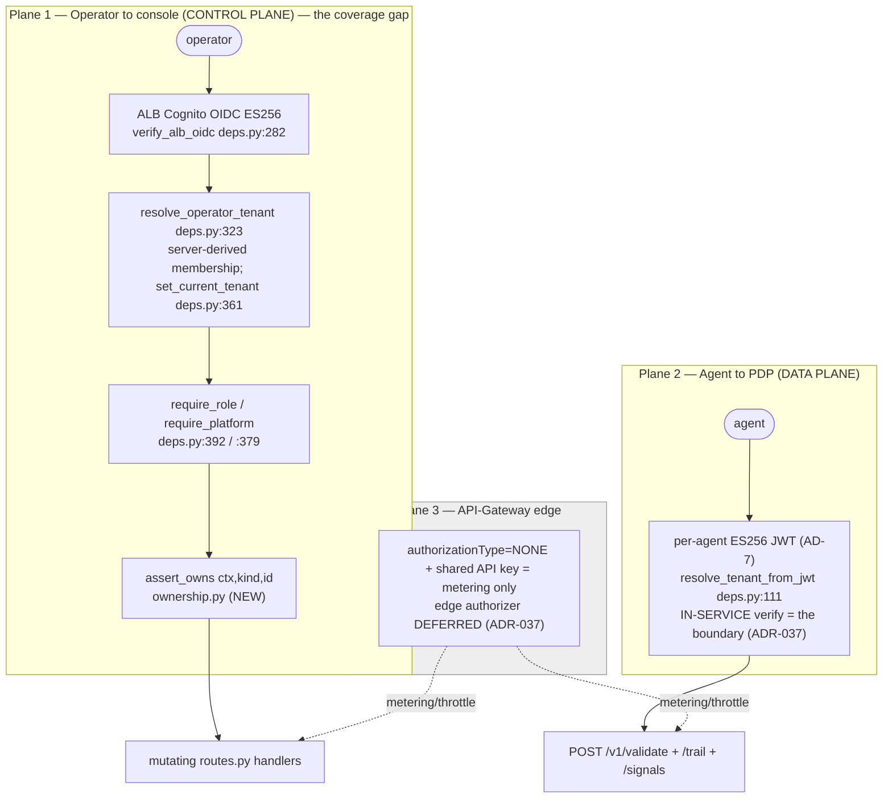
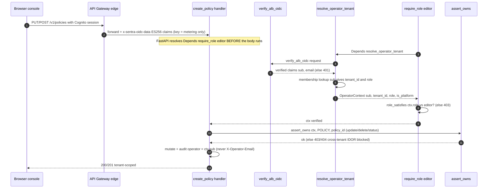

# WS-M — Authentication & Authorization (control-plane RBAC coverage + anti-IDOR + in-service data-plane boundary)

> **Doc role:** This is the **Phase-2 build-task doc** (granular, zero-ambiguity tasks generated from the approved LLD). It supersedes the earlier scope-only version. The §2 "read before coding" model is the scope context an implementer must hold; the milestones (§4) are the buildable tasks. Canonical order: HLD → **LLD ([lld/39](../../lld/39-authz-rbac-edge-authorizer.md))** → these tasks.

**Parent LLD:** [lld/39-authz-rbac-edge-authorizer.md](../../lld/39-authz-rbac-edge-authorizer.md) (approved, grill-hardened 2026-07-06). **Parent HLD:** [hld/serverless-edition.md](../../hld/serverless-edition.md) §6.2(f) / §6.3 / §6.6 row (f) / §8 residual #1.
**Status:** TASKS-DONE (build-ready) · **Owner:** TBD · **Last updated:** 2026-07-06

> **⚙️ BUILD STATE (2026-07-06, code-loop run 1):** **M0 + M1 are DONE and merged to `main`** (`cc289ef`) — `app/api/ownership.py` (`assert_owns` over all 6 `ResourceKind`s), the systemic authz-coverage gate (`tests/test_authz_coverage_gate.py`), M1 policy-CRUD/bind RBAC + anti-IDOR (closes BUG-1), and the ALB-OIDC signer/issuer pin (`tests/test_verify_alb_oidc_pin.py`), all hardened through 3 FIX-B integration rounds; full hermetic suite green (1002 pass). **Remaining scope for THIS run: M2, M3, M5.** Do **not** rebuild M0/M1 — reuse `ownership.py`'s `assert_owns`/`ResourceKind` as-is. As each M2/M3/M5 route grows its real gate, **remove that route's `PENDING WS-M …` entry from `_AUTHZ_ALLOWLIST`** in `tests/test_authz_coverage_gate.py` (that removal is part of the milestone's DoD — the gate then re-fires if the route regresses). M4/M6 remain design-only (not built).
**Implements:** FR-10.1 (multi-tenant isolation) · FR-10.3/10.5 (verified agent identity / prod activation) · FR-13.1 (multi-tenant console, no cross-tenant leak) · FR-13.3 (console auth & tenancy + RBAC role model) · FR-6.8 (trail-read authz *contrast*, unchanged) · NFR-10.
**Decisions:** **ADR-037** (in-service JWT check IS the data-plane auth boundary; edge authorizer deferred/optional — reframed 2026-07-06) · **consumes** ADR-035 (federation seam), ADR-034 (non-disableable floor → sigma retire is platform-scoped), ADR-019/AD-8 (Cognito+RBAC), AD-7 (verified per-agent identity). *(ADR-036 is TAKEN = Detection-Depth Enforce Overrides — do NOT conflate.)*

---

## 0. Gating — NOT spike-gated; start now (P0-security)

**NOT gated by WS-0.** Touches neither the local-floor synchronous-deep thesis nor the redaction-recall question the spike measures. **Start-now, P0-security:** the M1 anchor closes **BUG-1**, a *live production* IDOR (per [[dev-stack-is-prod]] the `Sentra-DEV-*` stacks ARE prod, account `531109575379`) — any holder of the shared API key can CRUD **any** tenant's policies today.

**WS-F relationship (founder 2026-07-05): TRACKED, non-blocking — NOT a hard merge-gate.** WS-F ships ahead; its CI check emits a **non-blocking WARNING** until WS-M lands M3 (the platform-operator gate on the sigma-retire path), which clears it. The earlier "WS-F does not merge until…" hard-gate framing is **superseded**. Land M3 as a known WS-M item; WS-F is not blocked waiting.

---

## 1. Dependencies

- **Depends on:** **LLD-26 §5–6** (the RBAC primitives — `require_role`/`require_platform`/`resolve_operator_tenant`/`role_satisfies`/`_ROLE_ORDER`/`OperatorContext`, all **built + live on dev**; WS-M reuses, does not rebuild) · **LLD-08 §6.5** (`verify_alb_oidc` / ALB-Cognito — built) · **AD-7 / TENANCY_V2** (`resolve_tenant_from_jwt`, enforcing tenant `acme` on dev).
- **Implements sibling fixes + closes the loop (founder 2026-07-06):** WS-M **owns the code** for two gaps its siblings surfaced but do not fix themselves — **the WS-F sigma platform-gate (M3)** and **the WS-D `/trail`+`/signals` verified-JWT tenant bind (M5.2, a fix to already-deployed WS-D code)**. Each carries a **loop-closure task**: on landing, WS-M updates the owning sibling doc to mark the gap CLOSED (WS-F CI WARNING → green; WS-D D5.3/T-TRAIL-21 → "bind shipped"). So there is no dangling "someone else will fix it later."
- **Blocks / clears:** **WS-F** (M3 lands the gate + flips its CI WARNING green) · **WS-D** (M5.2 fixes its deployed `/trail` cross-tenant-read gap) · **WS-K** (K8 suite consumes the positive-authz assertions on the fixed routes) · **WS-J** (canary pairs-with — positive-authz coverage on the previously-ungated routes).
- **Shared (coordinate edits — these files are touched by other WS):** `deps.py` (auth primitives — LLD-26/WS-D own), `routes.py` (WS-D/WS-G touch), `tenancy_routes.py` (WS-G touches; the `_assert_owns_agent` re-export), the NEW `app/api/ownership.py` (owned here; WS-D/WS-G consume), `policy_service.py`/`cache_manager.py` (WS-D/WS-H own the policy store + caching — the M0 cache-bypass touches these), `audit_logger.py` (the M2 rollback tenant-stamp predecessor).
- **Consumes (design-only):** the ADR-035 `VerifiedOperator{sub, email, idp_groups[]}` seam WS-G designs (G3.7) — WS-M does **not** swap the IdP.

---

## 2. Model — read before coding

### 2.1 The three auth planes (do not conflate)

- **Plane 1 — operator to console (control plane).** RBAC **built + live on dev** (LLD-26 go-live 2026-06-24). The gap is *coverage*: `tenancy_routes.py` is fully gated (10 gates); `routes.py` gates exactly **one** route (`delete_feedback_subject`, the positive template). WS-M is the retrofit.
- **Plane 2 — agent to PDP (data plane).** The **in-service** `resolve_tenant_from_jwt` check ([routes.py:196](../../src/security-controller/app/api/routes.py) for `/validate`) is the **authoritative boundary** (ADR-037). The committed M5 work makes that check *complete + fail-secure* on every data-plane route. **The edge authorizer is DEFERRED** — optional defense-in-depth, not built here.
- **Plane 3 — API-Gateway edge.** `authorizationType=NONE` + single shared API key = **metering only** (AWS: keys are not auth). Demoted; DoS handled by gateway throttling/WAF. Edge authorizer addable later with zero redesign (§4.M4).

### 2.2 Invariants (load-bearing)

1. **Server-side is the boundary; the client render-gate is UX.** Every gated mutation has a matching `Depends(require_role(...))`.
2. **Authenticate *and* authorize the specific resource (no IDOR).** Being logged in is not enough — `assert_owns(ctx, kind, id)` before mutating. This is OWASP API1:2023 BOLA.
3. **Derive the operator from verified identity, never a spoofable header.** Drop `X-Operator-Email` as an *authority*; key attribution on `ctx.sub` (guaranteed non-empty; `ctx.email` may be `""`).
4. **Fleet-global mutations require *platform* scope, not tenant scope.** The sigma-rule store is not tenant-partitioned (M3).
5. **Fail-secure default.** Missing/invalid OIDC → 401; below-role → 403; cross-tenant target → 403/404; unknown role → deny. `assert_owns` denies on mismatch **or lookup failure** — never "allow because we couldn't check".
6. **Do NOT `require_role` the data-plane reads.** `/trail` + `/signals` carry no operator role — their fix is the M5 verified-JWT *tenant bind*, not an RBAC gate. (They are cross-tenant-readable today — a real gap, NOT "structural isolation".)
7. **TENANCY_V2 is ON in the live env** (`dev.yaml:25 tenancy_v2_enabled:true`, dev=prod, enforcing since 2026-06-24) → POLICY + SESSION tenant-scoping are effective now; **no flag-flip predecessor** for this WS. `assert_owns` keeps a deny-on-unresolvable-tenant guard for a future flag-off env.

### 2.3 The route inventory (verified — resolve by handler NAME, not line; the file drifts)

`routes.py` imports `require_role`/`OperatorContext` ([routes.py:19](../../src/security-controller/app/api/routes.py)) and applies it to exactly **one** route — `delete_feedback_subject` (the positive template). Every route below is otherwise **ungated**. Line numbers are the 2026-07-06 `main` refresh; **the coder confirms by symbol name**.

| # | Route | Handler | ~line | Identity today | Target gate | Ownership |
|---|---|---|---|---|---|---|
| 1 | `POST /v1/policies` | `create_policy` | 1243 | `X-Operator-Email` | `require_role("editor")` | scope body to `ctx.tenant_id` (no cross-tenant target on create) |
| 2 | `PUT /v1/policies/{id}` | `update_policy` | 1287 | `X-Operator-Email` | `require_role("editor")` | `assert_owns(POLICY, id)` |
| 3 | `DELETE /v1/policies/{id}` | `delete_policy` | 1342 | `X-Operator-Email` | `require_role("admin")` | `assert_owns(POLICY, id)` |
| 4 | `PATCH /v1/policies/{id}/status` | `set_policy_status` | 1384 | `X-Operator-Email` | `require_role("editor")` | `assert_owns(POLICY, id)` |
| 5 | `POST /v1/agents/{id}/policies` | `attach_agent_policy` | 953 | `X-Operator-Email` | `require_role("editor")` | `assert_owns(AGENT, agent_id)` **then** `assert_owns(POLICY, policy_id)` (order matters) |
| 6 | `DELETE /v1/agents/{id}/policies/{pid}` | `detach_agent_policy` | 973 | `X-Operator-Email` | `require_role("editor")` | `assert_owns(AGENT, agent_id)` |
| 7 | `POST /v1/connections` | `create_connection` | 813 | none | `require_role("admin")` | born tenant-scoped (create N/A) |
| 8 | `PUT /v1/connections/{id}` | `update_connection` | 833 | none — writes `role_arn`/Azure `secret_ref` | `require_role("admin")` | `assert_owns(CONNECTION, id)` |
| 9 | `POST /v1/connections/{id}/test` | `test_connection` | 859 | none — live `sts:AssumeRole` | `require_role("editor")` | `assert_owns(CONNECTION, id)` |
| 10 | `POST /v1/connections/{id}/scan` | `scan_connection` | 879 | none | `require_role("editor")` | `assert_owns(CONNECTION, id)` |
| 11 | `DELETE /v1/connections/{id}` | `delete_connection` | 893 | none | `require_role("admin")` | `assert_owns(CONNECTION, id)` |
| 12 | `PATCH /v1/sigma-rules/{id}` | `update_sigma_rule` | 1517 | none — fleet-global kill-switch | **`require_platform`** (M3) | — (fleet-global, not tenant) |
| 13 | `DELETE /v1/quarantine/{id}` | `release_session` | 1887 | `operator_id` query (default `"operator"`) | `require_role("admin")` | `assert_owns(SESSION, id)` |
| 14 | `POST /v1/quarantine/{id}` | `quarantine_session` | 1801 | `operator_id` in body | `require_role("admin")` | `assert_owns(SESSION, id)` |
| 15 | `POST /v1/rollback` | `rollback_action` | 1672 | `operator_id` in body | `require_role("admin")` | `assert_owns(ACTION, action_id)` (§4.M2 net-new) |
| 16 | `POST /v1/rollback/conversation/{id}` | `rollback_conversation` | 1731 | `operator_id` in body (default `"system"`) | `require_role("admin")` | `assert_owns(CONVERSATION, id)` |
| 17 | `POST /v1/discovery/import` | `discovery_import` | 768 | none | `require_role("editor")` | prefix-stamp imported `agent_id`s to `ctx.tenant_id` |
| 18 | `POST /v1/decisions/{id}/verdict` | `post_decision_verdict` | 987 | `operator_id` in body | authenticate + derive from `ctx` | `assert_owns(SESSION, id)` (session-scoped) |
| 19 | `POST /v1/sessions/{id}/signals` | `post_session_signal` | 524 | none — external producer write | **interim fail-closed** (M2); full producer credential DESIGN-ONLY (deferred) | — |
| — | `GET /v1/sessions/{id}/trail` | `get_session_trail` | 464 | **no auth** | **M5 JWT-tenant-bind** (NOT `require_role`) | — |
| — | `GET /v1/sessions/{id}/signals` | `get_session_signals` | 448 | **no auth** | **M5 JWT-tenant-bind** (NOT `require_role`) | — |
| — | `DELETE /v1/feedback/subjects/{id}` | `delete_feedback_subject` | 903 | `require_role("admin")` (done) | **DONE — positive template** | tenant-scoped via `ctx` |

### 2.4 The operator-mutation auth flow (sequence)

### 2.5 What is DONE (do NOT re-task — from lld/39 §14)

| Already built (dev) | Evidence |
|---|---|
| `require_role`/`require_platform`/`role_satisfies`/`_ROLE_ORDER`/`OperatorContext` | deps.py:392/379/372/39/240 |
| `verify_alb_oidc` (ES256 + `kid` LRU) | deps.py:282, `_ALBKeyCache` :250 |
| `resolve_operator_tenant` (server-derived membership + `set_current_tenant`) | deps.py:323 / :361 |
| `resolve_tenant_from_jwt` (per-agent JWT, enforcing tenant `acme`) | deps.py:111 |
| `_assert_owns_agent` (delimited-prefix) | tenancy_routes.py:48 |
| `tenancy_routes.py` fully gated (10 gates — the regression-guard set) | require_role 86/138/151/234/267/290/309/349, require_platform 437/454 |
| `delete_feedback_subject` gated (positive template) | routes.py:903 |
| TENANCY_V2 ON in live env → POLICY+SESSION isolation effective | dev.yaml:25 |

### 2.6 DEFERRED / design-only (do NOT build here)

- **Edge authorizer (ADR-037 §4)** — deferred; optional defense-in-depth. See §4.M4 for the design-of-record only.
- **Route-19 full producer credential + shape validation (§5.3 D4)** — design-only; the *interim fail-closed guard* ships with M1–M3 (§4.M2.8).
- **Tier-2 customer custom roles / M6 federation provider switch** — roadmap; WS-M consumes the seam design-only, no IdP swap.

---

## 3. Error model

| Condition | Response | Where |
|---|---|---|
| Missing/invalid ALB-OIDC on a control-plane mutation | **401** | `verify_alb_oidc` (deps.py:282) |
| Authenticated but role `< min_role` | **403** | `require_role` (deps.py:392) |
| Right role, target belongs to another tenant (IDOR) | **403** (tenant-prefixed/obviously-foreign id) / **404** (opaque existence-sensitive id) — never mutate | `assert_owns` (§4.M1.2) |
| Tenant-scoped caller (not `_platform`) on `PATCH /sigma-rules` | **403** | `require_platform` (deps.py:379) |
| Unknown role string | deny | `role_satisfies`→False (deps.py:372) |
| `X-Operator-Email` present but no verified identity | **rejected** — header is not authority | §4.M1.3 |
| Ownership lookup fails (store error / unresolvable tenant) | **deny** (403/404), never allow | `assert_owns` fail-secure |
| Data-plane read (`/trail`,`/signals`) reached without a verified JWT tenant bind | **deny** (M5) — NOT ungated-ambient-`default` | §4.M5 |
| Rollback of an action that can't be tenant-resolved (Logs Insights timeout) | **retryable** distinct status (`RESOLUTION_UNAVAILABLE`), NOT a cross-tenant 404 | §4.M2.5 |

**403-vs-404 masking rule:** default **403** ("not allowed"), **except** where mere existence is sensitive — policy/connection/session lookups by opaque id → cross-tenant target masked as **404** (a 403 would confirm the id is a live record in another tenant). Agent ids are tenant-prefixed → **403**.

---

## 4. Milestones → tasks

> **Test-env note (all tasks):** run the security-controller suite hermetically — `env -u AWS_PROFILE AWS_ACCESS_KEY_ID=test AWS_SECRET_ACCESS_KEY=test <pkg>/venv/bin/python -m pytest …` (a leaked real `AWS_PROFILE` fakes ~37 failures — [[controller-tests-moto-safe-env]]).
> **Deploy-flush footgun (every route/gate change):** after gating a route you MUST re-flush the gateway or it 403s for the wrong reason. App-layer route change → immutable-image build → `ecs update-service --force-new-deployment`; then `apigateway create-deployment` to flush the stale prod-stage snapshot ([[apigw-per-resource-no-proxy]], [[sentra-prod-deploy-mechanism]]).

### Milestone M0 — the ownership helper + the systemic gate (land FIRST, before route fixes)

**M0.1 — Create `app/api/ownership.py` with the generalized `assert_owns`.**
- New module (NOT in `deps.py` — deps.py holds only auth primitives; adding store point-reads there pulls service imports into the auth module). Signature: `def assert_owns(ctx: OperatorContext, kind: ResourceKind, resource_id: str) -> None`.
- `ResourceKind(str, Enum)`: `AGENT="agent"`, `POLICY="policy"`, `CONNECTION="connection"`, `SESSION="session"`, `ACTION="action"`, `CONVERSATION="conversation"`.
- Dispatch (fail-secure — denies on mismatch OR lookup failure; reads resolve tenant from `ctx`, never the ambient contextvar):
  - **AGENT** — delimited-prefix, no read: `if not resource_id.startswith(ctx.tenant_id + "-"): raise HTTPException(403, "agent not owned by tenant")`. (Delimiter-safe — never bare `startswith`.)
  - **CONNECTION** — flag-independent structural (born tenant-scoped, PK *is* `tenant_id`, [connections_service.py:167-174](../../src/security-controller/app/services/connections_service.py)): tenant-scoped point-read `(ctx.tenant_id, connection_id)`; present ⇒ owned, absent ⇒ **404**.
  - **SESSION** — structural but v2-gated (effective because TENANCY_V2 on): tenant-scoped read via `SessionManager` keyed on `tenancy.item_key('session_id', id)` ([session_manager.py:94](../../src/security-controller/app/utils/session_manager.py)); absent ⇒ 404; if the record can't be tenant-resolved (flag-off / stray) → **DENY**, never fall through to a bare-key read. **Store = `SessionManager`, NOT `decisions_service.signal_pk_value`** (that governs the `/trail` signals store — do not conflate).
  - **POLICY** — stored-attribute compare via `_tenant_of_policy(resource_id, ctx.tenant_id)` = **DIRECT tenant-scoped DDB point-read that BYPASSES `PolicyService.get_policy`** (see footgun); `None` ⇒ 404; `owner != ctx.tenant_id` ⇒ 403.
  - **CONVERSATION** — same tenant-scoped SESSION read.
  - **ACTION** — `_tenant_of_action` (the net-new Logs Insights path, M2.3).
- **`_assert_owns_agent` alias + repoint:** re-export `_assert_owns_agent` from `ownership.py` (thin alias `assert_owns(ctx, AGENT, agent_id)`), import it into `tenancy_routes.py`, and repoint its existing call sites **without behavior change**.
- **FOOTGUN (POLICY cache):** `_tenant_of_policy` MUST NOT call `PolicyService.get_policy` — that caches by a **tenant-blind key** `f"policy:{policy_id}"` ([policy_service.py:196](../../src/security-controller/app/services/policy_service.py)) in a process-wide singleton ([cache_manager.py:271](../../src/security-controller/app/utils/cache_manager.py)); a warm cache serves tenant A's row to tenant B → re-opens the IDOR. Use a direct tenant-scoped point-read on `(ctx.tenant_id, policy_id)`. (Coordinate with WS-D/WS-H who own `policy_service.py`/`cache_manager.py`.)
- **Unit tests** (`tests/test_ownership.py`): `test_assert_owns_agent_prefix_match_ok`, `test_assert_owns_agent_foreign_prefix_403`, `test_assert_owns_agent_short_prefix_no_false_match` (t_01 vs t_01hxyz-…), `test_assert_owns_connection_present_ok` / `_absent_404`, `test_assert_owns_session_present_ok` / `_absent_404`, `test_assert_owns_session_unresolvable_denies` (flag-off fixture → deny not fall-through), `test_assert_owns_policy_owner_match_ok` / `_foreign_owner_403` / `_missing_404`, `test_assert_owns_policy_bypasses_cache` (warm-cache tenant-A then tenant-B still denies — see M7), `test_assert_owns_lookup_error_denies`.
- **Integration tests** (`tests/test_ownership_integ.py` — `assert_owns` is a **shared contract** owned by WS-M): `test_ownership_helper_reused_by_tenancy_routes` — drive an existing gated `tenancy_routes` mutation through the re-exported alias, assert the 10 gates still behave (regression guard for the move).

**M0.2 — Systemic ungated-route CI enumerator (lands BEFORE/WITH the first route fix).**
- A build-failing test that enumerates every `@router.post/put/patch/delete` handler in `routes.py` + `tenancy_routes.py` and **fails if any lacks an authz `Depends`** (`require_role` / `require_platform`), with an **explicit allowlist** (with a reason each) for the deliberate data-plane exceptions: `get_session_trail`, `get_session_signals` (reads, gated by M5 JWT-bind not `require_role`), and `post_session_signal` (route 19, while interim-fail-closed). **The grep MUST accept `Depends(require_platform)` as a gate**, not only `require_role` (else it false-fails once M3 lands route 12).
- Also assert (ownership-coverage half — not just presence-of-Depends): every route taking a path-param resource id has a corresponding `assert_owns` call OR is on an explicit ownership-exempt allowlist with a reason.
- **Unit tests** (`tests/test_authz_coverage_gate.py`): `test_all_mutating_routes_have_authz_depends`, `test_gate_accepts_require_platform` (a route gated with `require_platform` passes), `test_role_gated_but_ownership_missing_route_fails` (proves it catches the subtler half of the bug — a route with `require_role` but no `assert_owns`), `test_allowlist_requires_reason`.
- **Integration test:** N/A (pure static-analysis test — no cross-component boundary). *Stated opt-out: this task is a self-contained CI check.*
- **M1 acceptance also includes an exploitation-review task:** grep the audit log for historical policy/connection mutations whose `X-Operator-Email`/`operator_id` tenant ≠ the target's tenant; **record the result** (an unrun check is not a clean bill; do not assert "no exploitation occurred").

### Milestone M1 — close BUG-1 (policy CRUD + agent-policy bind, routes 1–6) + the signer-pin predecessor

**M1.0 — HARD PREDECESSOR: signer-ARN + Cognito-issuer pin in `verify_alb_oidc` (lands unconditionally at M1).**
- Plain ES256 verification accepts a token signed by **any** in-region ALB / **any** Cognito pool. BUG-1's closure rests on `verify_alb_oidc` rejecting a forged token, so the pin is load-bearing, not deferrable.
- In `verify_alb_oidc` ([deps.py:282-319](../../src/security-controller/app/api/deps.py)): after signature verify, assert the JWT header `signer` == the expected ALB ARN **and** `iss`/`token_use` match the expected Cognito pool. Must apply to **whichever header is read** (`x-sentra-oidc-data` first, then native `x-amzn-oidc-data`).
- **AS-1 build-time check:** run `aws elbv2 describe-load-balancers` + count in-region `authenticate-cognito` ALBs and Cognito pools; if >1, escalate as a SEC defect (account `531109575379` hosts multiple stacks → non-trivial odds). Record the expected signer-ARN/issuer set.
- **Unit tests** (`tests/test_verify_alb_oidc_pin.py`): `test_pin_rejects_foreign_alb_signer` (a token from a second in-region ALB → 401), `test_pin_rejects_wrong_issuer`, `test_pin_enforced_on_x_sentra_oidc_data_path`, `test_pin_enforced_on_x_amzn_oidc_data_path` (both header paths — fallback can't bypass).
- **Integration test** (`verify_alb_oidc` is a shared contract with LLD-08/26): `test_pin_end_to_end_control_plane_mutation` — a forged-signer token → 401 before any handler body runs.
- **Coordinate:** shared primitive owned by LLD-08 §6.5 / LLD-26 — get owner sign-off on the edit.

**M1.1 — Gate the 6 policy-CRUD/bind routes + drop `X-Operator-Email` as authority.**
- Add exactly one param per route: `ctx: OperatorContext = Depends(require_role("editor"))` (create/update/status/attach/detach) or `Depends(require_role("admin"))` (delete) — see §2.3 table. FastAPI resolves it BEFORE the body runs.
- **Drop `X-Operator-Email` as an authority.** Feed the existing `operator_email=` audit param from **verified `ctx`**. **Attribution key is `ctx.sub`** (guaranteed non-empty; `verify_alb_oidc` 401s on missing `sub`), NOT `ctx.email` (may be `""` if the pool omits email — `email = claims.get("email","")`). A request presenting `X-Operator-Email` with no verified identity is **rejected** (header is not an authority).
- **Unit tests** (`tests/test_policy_routes_authz.py`): per route — `test_<handler>_missing_oidc_401`, `test_<handler>_below_role_403`, `test_<handler>_operator_derived_from_ctx_sub`, `test_<handler>_x_operator_email_ignored_as_authority`.
- **Integration tests** (`tests/integration/test_policy_crud_authz.py` — the policy-CRUD routes are a **shared contract**): `test_policy_crud_end_to_end_editor_ok`, `test_policy_delete_requires_admin`.

**M1.2 — Anti-IDOR ownership assert on routes 2–6.**
- `update_policy`/`delete_policy`/`set_policy_status`: `assert_owns(ctx, POLICY, policy_id)` before the mutation. `attach_agent_policy`: `assert_owns(AGENT, agent_id)` **then** `assert_owns(POLICY, policy_id)` (both, in order). `detach_agent_policy`: `assert_owns(AGENT, agent_id)`. `create_policy`: no target to own — scope the new record to `ctx.tenant_id`.
- **Unit tests:** `test_update_policy_cross_tenant_404`, `test_attach_foreign_agent_403`, `test_attach_own_agent_foreign_policy_404`, `test_create_policy_scoped_to_ctx_tenant`.
- **Integration test:** `test_cross_tenant_policy_mutation_blocked` — tenant-B operator targeting tenant-A's policy → 403/404, no mutation.

**M1.3 — Attribution non-spoofable (defense-in-depth on M1.1).**
- Ensure the supplied body/header `operator_email` value **never reaches any downstream consumer** — assert the field is dropped, not merely that the audit label is `ctx.sub` (a handler that audits `ctx` but forwards `body.operator_email` downstream still leaks).
- **Unit test:** `test_conflicting_operator_email_dropped_not_forwarded`. **Integration:** covered by M1.1's end-to-end.

### Milestone M2 — credential-bearing connections (7–11) + containment (13–14) + rollback (15–16) + import (17) + fake-200 fix

**M2.1 — Connections (7–11).** `require_role("admin")` on create/update/delete, `require_role("editor")` on test/scan; `assert_owns(CONNECTION, id)` on 8–11. **FOOTGUN:** `update_connection` writes an IAM `role_arn`/Azure SP `secret_ref` and `test`/`scan` drive live `sts:AssumeRole` — an ungated caller triggers cross-account calls. The cross-*tenant* dimension is already blocked (born tenant-scoped PK); the real gap is a **role/privilege gap** (a `viewer` doing credential writes) — gate it.
- **Unit tests** (`tests/test_connection_routes_authz.py`): per route 401/below-role-403; `test_update_connection_requires_admin`, `test_test_connection_requires_editor`, `test_connection_cross_tenant_404`.
- **Integration test:** `test_connection_credential_write_gated` — a `viewer` cannot reach `update_connection`/`test_connection`.

**M2.2 — Quarantine/release (13–14).** `require_role("admin")`; **derive `operator_id` from verified `ctx.sub`, not body/query**; `assert_owns(SESSION, session_id)`. **FOOTGUN:** today `release_session` lets a contained agent lift its own quarantine — de-containment must be authenticated + admin.
- **Unit tests:** `test_release_session_requires_admin`, `test_quarantine_operator_from_ctx_not_body`, `test_release_cross_tenant_session_404`.
- **Integration test:** `test_contained_session_cannot_self_release`.

**M2.3 — Rollback ACTION/CONVERSATION ownership (15–16) — the ONE net-new resolution path.** `require_role("admin")` + the 3-piece ownership + piece-4 idempotency:
- **Piece 1 (HARD PREDECESSOR — the tenant field does NOT exist today):** stamp `event["tenant_id"] = tenancy.current_tenant()` in `_build_log_event`'s reversible-action branch ([audit_logger.py:625-634](../../src/security-controller/app/utils/audit_logger.py)). Today NO `tenant_id` is on the action record (audit_logger.py:146 is a metric dimension, NOT the persisted event) — so `_tenant_of_action` + the tenant re-check are **non-functional until this stamp lands** (would 404 every rollback, or fall back to id-only IDOR). This predecessor must merge before M2.3's gate.
- **Piece 2 (injection-safe exact match):** replace `| filter @message like "{action_id}"` ([rollback_coordinator.py:196](../../src/security-controller/app/utils/rollback_coordinator.py)) with an exact match on the auto-discovered JSON field `filter action_id = <val> and tenant_id = <ctx.tenant_id>` (drop the `like` **and** the no-op `parse @message /(?<log_data>.*)/` at :195). Reject (never escape-interpolate) any `action_id` failing the allowlist regex `^act-[a-z_]+-\d{14}-[0-9a-f]{6}$` (grammar from audit_logger.py:631) → 400/404. Extend the in-code re-verify ([rollback_coordinator.py:228](../../src/security-controller/app/utils/rollback_coordinator.py)) to also assert `log_data['tenant_id'] == ctx.tenant_id`.
- **Piece 3 (legacy + money-movement tradeoff):** the whole current 7-day log is un-stamped. (a) quantify the un-stamped set at M-time; (b) **prefer a one-time offline backfill** of `tenant_id` over a standing break-glass; (c) if break-glass is needed, it is **`_platform`-only (insider path, out of the tenant-B-vs-A thesis)** + **dual-control / two-person or explicit target-tenant authorization** (dual-audit is detection, NOT prevention — a lone `_platform` credential must NOT reverse a money action), scoped to one specific `action_id`. Do NOT cite the §2 viewer-only break-glass model as authority (it requires "a separate audited elevation", deps.py:348).
- **`assert_owns(CONVERSATION, id)`** (route 16): a conversation is NOT a session row — it lives only in CloudWatch Logs under `multi_agent_context.conversation_id`. FIX-B repointed the dispatch to a tenant-scoped Logs-Insights resolution (`_tenant_of_conversation` / `_query_conversation_tenant_sync`), NOT the session-context read (a session read 404'd every real conversation). **The `assert_owns` gate proves the operator owns ONE matching event; it does NOT by itself scope the reversal.** The conversation-path fix (2026-07-07, branch `codeloop/ws-m-convfix`) mirrors all THREE single-action protections onto `RollbackCoordinator.rollback_conversation` so the money-movement reversal is tenant-safe end-to-end: (1) the enumeration `audit_logger.query_logs_by_conversation(conversation_id, tenant_id=ctx.tenant_id)` appends an exact `filter tenant_id = "<val>"` clause — a shared/colliding `conversation_id` cannot list another tenant's reversible actions; (2) `_rollback_single_action` re-verifies `log['tenant_id'] == tenant_id` and SKIPS fail-secure on mismatch (defence-in-depth, never a 500, never leaks the owner); (3) each reversal claims the M2.4 idempotency ledger via `_claim_rollback(action_id)` before executing (concurrent conversation rollbacks cannot double-reverse). The route passes `tenant_id=ctx.tenant_id`. Zero owned reversible actions is a normal 0-count success, not an error.
- **Unit tests** (`tests/test_rollback_ownership.py`): `test_rollback_cross_tenant_action_404`, `test_rollback_action_id_regex_rejects_crafted`, `test_rollback_prestamp_action_denies_or_breakglass` (never silent unscoped), `test_rollback_freshly_stamped_action_ok` (proves stamp→query→re-check wired), `test_build_log_event_stamps_tenant_id` (piece 1), and `test_rollback_conversation_route_threads_tenant_id_into_coordinator` (route passes `ctx.tenant_id`). Conversation-path enumeration + re-verify tests live in `tests/test_rollback_conversation_tenant.py`: `test_conversation_enumeration_is_tenant_scoped`, `test_foreign_tenant_action_skipped_never_reversed`, `test_tenant_none_reverts_to_legacy_no_reverify` (each fails if its protection is reverted).
- **Integration test:** `test_rollback_tenant_scoped_end_to_end`.

**M2.4 — Rollback idempotency (piece 4 — the replay guard is provably dead).** The only guard reads `original_action['rollback_status']=='ROLLED_BACK'` ([rollback_coordinator.py:122](../../src/security-controller/app/utils/rollback_coordinator.py)) but that field is written once as `'NOT_ROLLED_BACK'` on the immutable record and `_log_rollback` writes a separate event ([:298-360](../../src/security-controller/app/utils/rollback_coordinator.py)) never mutating the original → the guard never trips; `_rollback_refund` ([:271](../../src/security-controller/app/utils/rollback_coordinator.py)) is an unconditional `update_item`.
- **Fix:** a durable idempotency marker keyed on `action_id` — a conditional `PutItem` into a small rollback-ledger (`ConditionExpression='attribute_not_exists(action_id)'`) **before** the reversal; a duplicate/concurrent second caller fails the condition → returns "already rolled back". (Copy the conditional-write pattern at [credentials_service.py:179-191](../../src/security-controller/app/services/credentials_service.py).)
- **Unit tests** (`tests/test_rollback_idempotency.py`): `test_serial_second_rollback_returns_already_done`, `test_rollback_ledger_conditional_put`. The CONVERSATION path claims the same ledger — `tests/test_rollback_conversation_tenant.py`: `test_conversation_claims_ledger_before_reversal`, `test_second_conversation_rollback_does_not_double_reverse`, `test_failed_reversal_releases_claim_on_conversation_path`.
- **Integration test:** `test_two_concurrent_rollbacks_one_reversed_write`.

**M2.5 — Rollback resolution-substrate freshness (design note + test).** `_get_action_from_logs` is a best-effort poll-with-timeout (max 5s, [:215/:236](../../src/security-controller/app/utils/rollback_coordinator.py)) over eventually-consistent 7-day Logs Insights. On query-timeout or non-`Complete` status, return a **distinct retryable status** (log internal `RESOLUTION_UNAVAILABLE`) — do NOT report an authorized operator's just-taken reversal as a cross-tenant "not found". (Long-term: a durable tenant-keyed point-read should be the ownership authority; note as a follow-up.)
- **Unit test:** `test_rollback_logs_timeout_returns_retryable_not_404`.
- **Integration test:** N/A (covered by M2.3 integ). *Opt-out: internal-status refinement.*

**M2.6 — Discovery import (17).** `require_role("editor")` + **prefix-stamp every imported/promoted `agent_id` to `ctx.tenant_id`** (`id = f"{ctx.tenant_id}-{raw_id}"`) before write, so no imported record lands under another tenant.
- **Unit tests:** `test_discovery_import_requires_editor`, `test_imported_agent_ids_prefixed_to_ctx_tenant`.
- **Integration test:** `test_discovery_import_tenant_scoped`.

**M2.7 — Verdict route (18).** authenticate + derive `operator_id` from `ctx.sub` (not body) + `assert_owns(SESSION, session_id)`.
- **Unit tests:** `test_verdict_operator_from_ctx`, `test_verdict_cross_tenant_session_404`. **Integration:** covered by M2.2's session suite.

**M2.8 — Route-19 interim fail-closed guard (SHIPS WITH M1–M3, not deferred).** `post_session_signal` is an external-producer write feeding the deny-overrides combiner + FP/FN training. Default: **reject external `POST /v1/sessions/{id}/signals` (403/404)** until the full producer credential lands (removes the current lenient-accept path). The combiner loses no *first-party* signal (agents post via `/validate`, not this route). The full producer credential + `threat_type` 8-value-enum + bounded-`priority` validation is **design-only/deferred (D4)** — an unknown `threat_type` from an external producer is a HARD reject (400/drop), explicitly NOT a detector ABSTAIN→ALLOW.
- **Unit tests** (`tests/test_post_session_signal_guard.py`): `test_external_signal_rejected_failclosed`, `test_lenient_accept_path_removed`.
- **Integration test:** `test_external_producer_write_blocked_during_window`.

**M2.9 — Fake-200 factory hardening (D3).** `_connection_http(exc)` ([routes.py:790-803](../../src/security-controller/app/api/routes.py)) is a mapper factory that *returns* `HTTPException`; all six callers correctly `raise` it (no currently-firing fake-200). Harden against reintroduction: make the factory itself raise — `_raise_connection_http(exc) -> NoReturn` (ConnectionNotFound→404, ProviderNotAvailable→409, NotConnected→409, InvalidRoleArn→400, else→500), callers become `_raise_connection_http(exc)`. **AND** the one live 200-on-failure — `test_connection` (route 9) returns `200 {ok:false, message}` on a *rejected* credential (a legitimate probe-result envelope per the partial-success carve-out): keep the 200 envelope but ensure `message` is **customer-safe** (no raw provider AssumeRole/principal-ARN/STS detail — log internal detail server-side).
- **Unit tests** (`tests/test_connection_error_contract.py`): `test_connection_error_maps_to_real_status_not_200` (transport/unknown → 404/409/400/500), `test_test_connection_rejected_credential_message_sanitized`.
- **Integration test:** `test_connection_failure_returns_honest_status`.

### Milestone M3 — platform-scope gate on the fleet-global sigma-retire chain (clears WS-F's CI WARNING)

**M3.1 — Gate `update_sigma_rule` (route 12) at PLATFORM scope.** `ctx: OperatorContext = Depends(require_platform)` on `PATCH /sigma-rules/{rule_id}` ([routes.py:1517](../../src/security-controller/app/api/routes.py)) — **NOT `require_role`**. The gate covers both the PATCH handler **and** the `_bump_enforcement_version` epoch write ([sigma_rules_service.py:402](../../src/security-controller/app/services/sigma_rules_service.py)) it triggers — they are one call chain behind one door.
- **WHY platform, not tenant:** the sigma store (`sentra-sigma-rules-metadata` + S3 `sigma_rules/llm/`) is **NOT tenant-partitioned** ([lld/35 §13](../../lld/35-prompt-signatures.md)); one retire flips a rule to `deprecated`, which `load_rules_metadata_from_dynamodb` ([sigma_engine.py:100](../../src/security-controller/app/validators/sigma_engine.py)) then stops loading — stripping it for **every** tenant. A tenant-scoped role here lets any tenant-admin disable a detection rule fleet-wide (the disable-switch ADR-034 forbids, via the CRUD door).
- **FOOTGUN:** copying the tenant-scoped `delete_feedback_subject` pattern here is the **wrong-scope trap** — that route is correctly tenant-scoped; this one must be platform.
- **WS-F CI coordination (already reconciled):** WS-F's CI grep accepts `Depends(require_platform)` (lld/35 §3.3 lines 106/172/631/708) — no further propagation owed. Landing M3 clears WS-F's non-blocking WARNING (tracked dependency, founder 2026-07-05).
- **Unit tests** (`tests/test_sigma_rule_authz.py`): `test_sigma_retire_unroled_403`, **`test_sigma_retire_tenant_admin_403`** (a merely-tenant-scoped `admin`, NOT `_platform`, gets 403 — this is what pins platform-vs-tenant), `test_sigma_retire_platform_operator_200`, `test_bump_enforcement_version_behind_platform_gate`.
- **Integration test** (the sigma-retire chain is a **shared contract** with WS-F): `test_sigma_retire_platform_gated_end_to_end` — asserts both the un-roled AND the tenant-scoped-admin 403, and a platform operator 200.

**M3.2 — Close the loop with WS-F (doc update on landing).** When M3.1 merges: (a) confirm WS-F's CI check (F6.5) flips WARNING→green against the landed `require_platform` gate; (b) update [ws-f-prompt-signatures.md](ws-f-prompt-signatures.md) — the three §3.3 threat-table rows (currently "OPEN — tracked, non-blocking dep on WS-M") → **CLOSED (WS-M M3, `<commit>`)**, and the sibling-ref line 411; (c) update [lld/35 §3.3](../../lld/35-prompt-signatures.md) acceptance checklist to CLOSED. This is a WS-M deliverable, not a WS-F follow-up — the loop closes here.

### Milestone M5 — the in-service data-plane auth boundary (ADR-037 — the committed deliverable)

**M5.1 — Deny missing/invalid agent JWT on the data plane INDEPENDENT of `identity_mode` (close the tokenless-fallthrough).**
- Today `resolve_tenant_from_jwt` returns `unverified(effective_mode=ceiling)` on a missing token ([deps.py:119-129](../../src/security-controller/app/api/deps.py)) and `routes.py` denies only at `enforce` (`should_deny`, deps.py:100-102); at `shadow`/`off` a tokenless call falls through to the legacy path ([routes.py:263-270](../../src/security-controller/app/api/routes.py)) — validated, unverified, on the `default` context.
- **Fix:** a **missing/invalid** agent JWT is denied on the data plane regardless of `identity_mode`. (A *forged* bad-signature token already always fails.) Sequencing nuance: `identity_mode` stays the *enforcement-strictness* rollout latch (shadow→enforce governs whether an *unverified-but-well-formed* posture is allowed during soak); **missing/invalid-token rejection is NOT `identity_mode`-gated**.
- **Unit tests** (`tests/test_dataplane_jwt_boundary.py`): `test_tokenless_validate_denied_at_shadow`, `test_tokenless_validate_denied_at_off`, `test_forged_jwt_denied_all_modes`, `test_wellformed_unverified_allowed_only_in_soak`.
- **Integration test** (shared contract with WS-D): `test_dataplane_requires_verified_jwt`.

**M5.2 — Bind the verified tenant on `/trail` + `/signals` (fix DEPLOYED WS-D code — close the §2.2 cross-tenant-read gap).**
> **This fixes already-shipped WS-D code, not just a design gap.** WS-D (decision-trail) is CODE-DONE + deployed, and its `/trail`+`/signals` read handlers ship **without** the tenant bind — so for a non-enforcing tenant the reads hit the co-mingled `default` partition (a live cross-tenant read). WS-M **owns this fix** (the sweep found WS-D's doc overclaimed "structural isolation"; the code never bound the tenant). Prioritize M5.2 accordingly.
- `get_session_trail` ([routes.py:464](../../src/security-controller/app/api/routes.py)) + `get_session_signals` ([routes.py:448](../../src/security-controller/app/api/routes.py)) take **no** auth dependency and resolve the partition from the ambient `tenancy.current_tenant()` (`"default"`) — so non-enforcing tenants' rows co-mingle in `default#{session_id}` and any caller with a session_id reads them (a real cross-tenant read, NOT "structural isolation").
- **Fix:** add `resolve_tenant_from_jwt` as a dependency on both handlers, deny (401) on absent/invalid at enforce, and `set_current_tenant(ctx.tenant_id)` around the `DecisionsService` call in a `try/finally` (mirror [routes.py:244-261](../../src/security-controller/app/api/routes.py)). Equivalently, pass the verified tenant explicitly into `get_session_trail`/`get_session_signals`. **Do NOT add `require_role`** (Invariant 6 — these are data-plane reads, not operator mutations).
- **Unit tests:** `test_trail_read_binds_verified_tenant`, `test_trail_unbound_context_denies_not_default`, `test_signals_read_binds_verified_tenant`.
- **Integration test:** `test_cross_tenant_trail_read_returns_zero_rows` (tenant-B reading tenant-A's session → zero rows / 404 after the fix — the regression test for the gap; this is the same assertion WS-D's T-TRAIL-21 makes, now run against the *bound* handler).
- **Close the loop with WS-D (doc update on landing):** when M5.2 merges, update [ws-d-decision-trail.md](ws-d-decision-trail.md) — the corrected D5.3 note + T-TRAIL-21 → **"bind SHIPPED (WS-M M5.2, `<commit>`); `/trail` now tenant-isolated"**. The WS-D deployed code is patched by this task; WS-D's doc reflects it. Loop closes here.

**M5.3 — Same-task ContextVar reset on the operator dependency (defense-in-depth hygiene).**
- `resolve_operator_tenant` calls `set_current_tenant` on success only ([deps.py:361](../../src/security-controller/app/api/deps.py)) with no matching reset (unlike the data-plane sets at routes.py:244/261). NOT a cross-request leak (asyncio isolates the ContextVar per Task — verified). The real risk: a non-gated handler reading `current_tenant()` with no operator bind acts on `"default"`. Fix: balance the set with `reset_current_tenant(token)` in a `finally`, same-task token pattern (mirror routes.py:244→261), scoped to the operator dependency.
- **FOOTGUN:** do **NOT** reset via a Starlette `BaseHTTPMiddleware` — verified no-op (`ValueError: Token created in a different Context`); and do **NOT** remove the module-level `default=DEFAULT_TENANT` (tenancy.py:40-42; ~49 sites + the disabled `/validate` path rely on it).
- **Unit test (non-vacuous — single shared context, NOT two TestClient requests):** `test_operator_dependency_resets_contextvar` — drive `resolve_operator_tenant` twice inside one manually-created `contextvars.Context` (set tenant-A, then a raising resolve on the SAME context), assert the `finally` reset left the sentinel/unbound, not tenant-A. (A two-request TestClient test is vacuously green — Starlette copies context per request — and MUST NOT be used.)
- **Integration test:** N/A (in-process contextvar behavior). *Opt-out: no cross-component boundary.*

### Milestone M4 — Edge authorizer (DEFERRED — design-of-record only, NOT built)

**Not a build task.** Per ADR-037 the in-service check (M5) is the boundary; the edge authorizer is optional defense-in-depth, addable later with zero redesign. Design of record if ever built: a REQUEST-type Lambda authorizer verifying the same ES256 JWT, returning IAM allow/deny + context `{tenant_id, role, sub}`, shared key demoted to metering-only. **Handlers MUST NOT read the authorizer-injected context as an authz input** (zero-trust of edge context — closes the confused-deputy path; the app-layer checks stay the only authz inputs). No task, no test — recorded so a future build has the contract.

### Milestone M6 — Federation seam (DEFER the provider switch — consume design-only)

**Not a build task.** Consume the IdP-neutral `VerifiedOperator{sub, email, idp_groups[]}` seam WS-G designs (G3.7) so federation later is a config change. Ensure no new call site reads the raw Cognito `sub` directly (keep the one claim-extraction seam). **Do NOT** swap Cognito out; **do NOT** rebuild the live membership/RBAC layer; **no** Tier-3 customer-authored permissions. SCIM deprovisioning + the actual SAML/OIDC switch stay deferred.

### Milestone M7 — authz tests as the arbiter (the definition-of-done)

The retrofit isn't done until, for every gated route, the tests below pass. (Tests are distributed into the per-milestone test files above; M7 is the consolidated matrix + the special-case tests.)

| Test class | Assertion | Applies to | Test file |
|---|---|---|---|
| (a) authn | missing/invalid OIDC → 401 | all 18 gated routes | per-route authz files |
| (b) authz | authenticated but role `< min_role` → 403 | all `require_role` routes | per-route authz files |
| (c) anti-IDOR | tenant-B targeting tenant-A's policy/agent/connection/session → 403 (or 404 opaque) | routes 2–16, 18 | per-route authz files |
| (c-warm) warm-cache POLICY | tenant A reads `p1` first (warm cache), tenant B `assert_owns(POLICY,"p1")` still denies | routes 2–4 | `test_ownership.py::test_assert_owns_policy_bypasses_cache` |
| (c-nonvacuous) POLICY+SESSION | cross-tenant test passes flag-on; with flag forced off the helper still denies | routes 2–4, 13–14 | `test_ownership.py` |
| (M3 both-403) | un-roled AND tenant-admin (not `_platform`) → 403; platform → 200 | route 12 | `test_sigma_rule_authz.py` |
| (data-plane read gap) | tenant-B reading tenant-A's `/trail` → zero rows/404 after M5 fix | `/trail`,`/signals` | `test_dataplane_jwt_boundary.py` |
| (D3 fake-200) | transport/unknown failure → real 4xx/5xx not 200; route-9 rejected-cred message sanitized | routes 7–11 | `test_connection_error_contract.py` |
| (attribution) | conflicting body `operator_id`/`operator_email` → audit records `ctx.sub` AND body value not forwarded | routes 1–6,13–16,18 | `test_policy_routes_authz.py` |
| (empty-email attribution) | claims with no `email` still yield a non-empty verified identity (`ctx.sub`) | routes 1–6,13–16,18 | `test_policy_routes_authz.py` |
| rollback idempotency | serial 2nd → already-done; two concurrent → one REVERSED write | routes 15/16 | `test_rollback_idempotency.py` |
| rollback anti-IDOR/injection | cross-tenant→404; crafted action_id→400/404; pre-stamp→deny/break-glass; fresh→ok | routes 15/16 | `test_rollback_ownership.py` |
| break-glass | `_platform` viewer (non-member tenant) at each admin/editor route 1–18 → 403 by ladder | routes 1–18 | `test_breakglass_denied.py` |
| contextvar reset (non-vacuous) | shared-context raise-after-bind leaves sentinel not tenant-A | operator dep | `test_dataplane_jwt_boundary.py` |
| signer/issuer pin | both header paths enforce the pin | `verify_alb_oidc` | `test_verify_alb_oidc_pin.py` |

**Sibling test hooks:** WS-F CI check flips WARNING→green when M3 lands; **WS-J** canary carries positive-authz coverage on the previously-ungated routes (pairs-with); **WS-K** K8 suite extended with a positive authz assertion on the fixed policy-CRUD routes + a money-movement-`enforce`-gate assertion (a money-movement tenant is not flipped to `enforce` until the M5 in-service fail-secure completeness is verified live).

---

## 5. Acceptance criteria (one checklist for the whole workstream)

- [ ] **M0:** `app/api/ownership.py` exists with `assert_owns` over AGENT/POLICY/CONNECTION/SESSION/ACTION/CONVERSATION; `_assert_owns_agent` re-exported and `tenancy_routes.py`'s existing gates repointed with no behavior change (the 10-gate regression suite still green).
- [ ] **M0:** the systemic CI enumerator fails the build on any ungated `post/put/patch/delete` (accepts `require_platform`; catches role-gated-but-ownership-missing); allowlist entries each carry a reason.
- [ ] **M0:** the audit-trail exploitation review is **run and its result recorded**.
- [ ] **M1:** the signer-ARN + Cognito-issuer pin lands in `verify_alb_oidc` on both header paths; AS-1 ALB/pool count run + recorded.
- [ ] **M1 (BUG-1 closed):** routes 1–6 carry `require_role` + anti-IDOR ownership; `X-Operator-Email` is no longer an authority (operator = `ctx.sub`); a cross-tenant policy call → 403/404.
- [ ] **M2:** connection routes 7–11 gated (viewer cannot write credentials/trigger AssumeRole); quarantine/release 13–14 admin-gated with `operator_id` from `ctx` (contained session cannot self-release).
- [ ] **M2:** rollback 15–16 tenant-scoped (ACTION/CONVERSATION `assert_owns`); the `tenant_id` emit-stamp predecessor landed in `_build_log_event`; the injection-safe exact-match query + regex reject; idempotency ledger (no double-reverse); break-glass (if shipped) is `_platform`+dual-control.
- [ ] **M2:** discovery import 17 editor-gated + tenant-prefix-stamps imported ids; verdict 18 authenticated + session-owned; route-19 interim fail-closed guard ships; the fake-200 factory hardened + route-9 message sanitized.
- [ ] **M3:** `update_sigma_rule` + `_bump_enforcement_version` are `require_platform`-gated; a tenant-admin (not `_platform`) gets 403; WS-F's CI WARNING clears.
- [ ] **M3 loop-closure:** on landing, `ws-f-prompt-signatures.md` (3 threat rows + line 411) and `lld/35 §3.3` are updated to CLOSED (WS-M owns the doc update, not a WS-F follow-up).
- [ ] **M5:** every data-plane route denies a missing/invalid JWT independent of `identity_mode`; `/trail` + `/signals` bind the verified tenant (cross-tenant read → zero rows); the operator-dependency contextvar reset lands.
- [ ] **M5.2 loop-closure:** the deployed WS-D `/trail`+`/signals` code is patched (tenant bind shipped); `ws-d-decision-trail.md` D5.3 + T-TRAIL-21 updated to "bind SHIPPED (WS-M M5.2)".
- [ ] **`GET /trail` + `/signals` do NOT carry `require_role`** — a test proves cross-tenant returns zero rows via the JWT-tenant-bind, not RBAC.
- [ ] **Edge authorizer + route-19 producer credential + Tier-2 roles are NOT built** (design-only/deferred) — recorded, not tasked.
- [ ] **unit tests pass** (covering all cases named in §4).
- [ ] **integration tests pass** (covering the shared-contract seams: `assert_owns`, the policy-CRUD routes, the sigma-retire chain, the data-plane JWT boundary).

---

## 6. Cross-references

- **LLD:** [lld/39-authz-rbac-edge-authorizer.md](../../lld/39-authz-rbac-edge-authorizer.md) — §2 (planes), §3.1 (signer-pin/M1.0), §3.2 (role map/M1.1), §3.3 (ownership helper + rollback/M0,M2), §3.5 (sigma/M3), §3.6 (error model), §3.7 (fake-200/M2.9), §4 (edge authorizer/M4 deferred), §5 (in-service boundary/M5), §13 (test matrix/M7), §14 (status ledger).
- **Decisions:** ADR-037 (in-service boundary) · ADR-035 (federation seam, consume) · ADR-034 (sigma platform scope) · ADR-019/AD-8 (Cognito+RBAC) · AD-7 (verified identity). *(ADR-036 = detection-depth, NOT this.)*
- **Shared contracts (Phase-3 sweep join keys):** `require_role`/`require_platform`/`verify_alb_oidc`/`resolve_operator_tenant`/`resolve_tenant_from_jwt`/`role_satisfies`/`_ROLE_ORDER`/`OperatorContext` (deps.py — LLD-26/08 own) · **`assert_owns(ctx, ResourceKind, resource_id)`** (NEW, `ownership.py` — WS-M owns, supersedes/wraps `_assert_owns_agent`) · the 18 mutating routes + route 19 · the sigma retire chain (`update_sigma_rule` → `_bump_enforcement_version`) · the `VerifiedOperator{sub,email,idp_groups[]}` seam (WS-G owns).
- **Upstream (LLDs to extend, not rebuild):** LLD-26 §5–6 (RBAC primitives + `sentra-tenant-members`) · LLD-08 §6.5 (`verify_alb_oidc`) · lld/35 §3.3 (sigma authz + WS-F CI WARNING, already reconciled).
- **Sibling refs (the sweep verifies consistency):** **WS-G** ([ws-g-console.md](ws-g-console.md) — client render-gate + ADR-035 seam; shares `ownership.py`/`tenancy_routes.py`) · **WS-D** ([ws-d-decision-trail.md](ws-d-decision-trail.md) — data-plane read; co-owns the `/trail`-`/signals` bind + policy-cache touch; do NOT re-home) · **WS-F** ([ws-f-prompt-signatures.md](ws-f-prompt-signatures.md) — sigma CI WARNING; M3 clears it) · **WS-K** ([ws-k-production-activation.md](ws-k-production-activation.md) — K8 suite + two-latch enforce flip + go-live gate) · **WS-J** ([ws-j-canary-tests.md](ws-j-canary-tests.md) — positive-authz canary coverage) · **WS-A** (A5.4 leaked-signing-key — WS-M is the upstream authoring control).
- **Memory:** [[policy-crud-routes-no-authz]] ≡ BUG-1 · [[dev-stack-is-prod]] · [[apigw-per-resource-no-proxy]] + [[sentra-prod-deploy-mechanism]] · [[identity-deny-not-metered]] · [[controller-tests-moto-safe-env]] · [[authz-identity-model-reframe-2026-07-06]].
