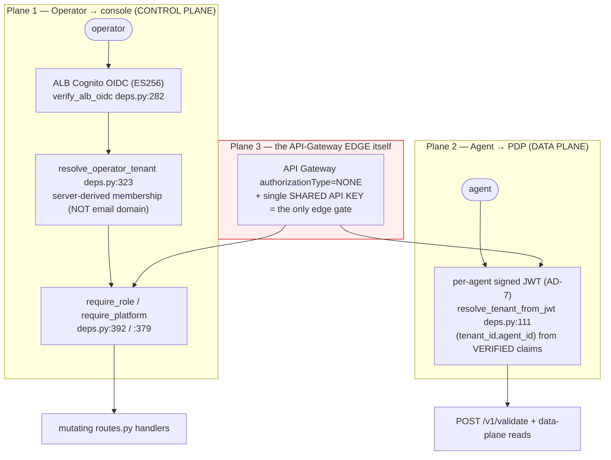

# WS-M — Authentication & Authorization (control-plane RBAC + anti-IDOR + edge authorizer)

> **Doc role:** This is the **workstream SCOPE** — boundary, dependencies, real `file:line` anchors, footguns, and acceptance criteria. It is an **INPUT to this workstream's implementation-grade LLD**, *not* the granular task breakdown. The granular, buildable tasks are generated **from the approved LLD** (canonical order: HLD → LLD → tasks). See [00-index.md](00-index.md) for the doc-role map.

**Parent HLD:** [hld/serverless-edition.md](../../hld/serverless-edition.md) — §6.2(f) (*Console sign-in & who-sees-what*), §6.3 (*Security & networking* — the AuthN/Z plane split), §6.6 recommendation table row (f).
**Status:** Not started (scope-stage — LLD not yet authored → **lld/36**)
**Owner:** TBD
**Implements:** FR-10.1 (multi-tenant isolation) · FR-13.3 (console auth & tenancy model + RBAC role model) · FR-13.1 (multi-tenant console, no cross-tenant leak). Touches FR-10.3/FR-10.5 (verified agent identity / prod activation) and FR-6.8 (the decision-trail read is the authz *contrast* pattern, not an item to change).
**New decision:** **ADR-036** (edge/gateway authorizer + shared-API-key replacement — a *new* decision, distinct from ADR-035 console federation). **Consumes** ADR-035 (federation seam) and **ADR-034** (non-disableable floor → why the sigma retire path is platform-scoped).

> **Next step: an implementation-grade LLD (→ lld/36).** This WS doc scopes the build (which routes, which invariants, which footguns). It does **not** replace the LLD: exact `Depends(...)` signatures, the ownership-assertion helper, the per-route role map, the edge-authorizer design, and the test matrix are the LLD's job. **The LLD extends [LLD 26 §5–6](../../lld/26-multi-tenancy.md)** (the RBAC authority already built there) and **LLD 08** (ALB/Cognito auth) — it does **not** start fresh and does **not** re-litigate the §6.2(f) Cognito-now decision. Build from *this* doc; the LLD details it.

---

## 0. Gating — NOT spike-gated; start now (P0-security)

**This workstream is NOT gated by WS-0.** It touches neither the local-floor synchronous-deep thesis nor the redaction recall question the spike measures. It is **start-now**, and it is **P0-security**: the anchor deliverable closes **BUG-1**, a *live* production IDOR (per [[dev-stack-is-prod]] the `Sentra-DEV-*` stacks ARE prod, account `531109575379`) — any holder of the shared API key can CRUD **any** tenant's policies today. See [99-go-live-runbook.md:57](99-go-live-runbook.md#L57).

**It is a merge-blocking predecessor of WS-F.** WS-F does not merge until the `PATCH /sigma-rules/{rule_id}` retire path is behind a platform-operator gate (§4 M-M3) and WS-F's own CI assertion passes ([lld/35 §3.3](../../lld/35-prompt-signatures.md)). Land WS-M's sigma gate before WS-F's merge gate trips.

---

## 1. Why this workstream exists (the consolidation)

"Auth" was **scattered across five docs with no single owner**, and the two real holes were filed as footnotes inside unrelated workstreams. WS-M pulls the *server-side authorization boundary* into one owned place. The split is deliberate:

| Concern | Owner | Rationale |
|---|---|---|
| **Server-side `require_role` coverage on mutating routes** (the boundary) | **WS-M** | The authz boundary is server-side; a render gate without a server gate is the bug, not the fix. |
| **Client render-gating** (`useCan()` / `rbac.ts`), tenant-switcher UI | **WS-G** | UX only — a `viewer` shouldn't *see* a control they can't use. Never the boundary. |
| **`require_role`/`require_platform`/`verify_alb_oidc` primitives** | **LLD-26 §5–6 / LLD-08** (shared library) | Already built + live on dev; WS-M is the *coverage* owner, not the primitive owner. |
| **ADR-035 federation seam** (SAML/OIDC/SCIM behind the IdP-neutral seam) | **WS-G** (design-only) / deferred | WS-M *consumes* the seam; it does **not** swap the IdP. |
| **WS-F sigma-retire CI assertion** | **WS-F** | WS-F owns the build check; WS-M *lands the gate* it checks for. |
| **Leaked-signing-key response** (A5.4) | **WS-A** | Crypto/key-compromise is WS-A's; WS-M is the *upstream authoring control* (defense-in-depth). |
| **Data-plane read RBAC** (`GET /trail`, `/signals`) | **out of scope — do NOT touch** | Deliberately no RBAC: tenant-scoped by verified-JWT contextvar + composite PK (WS-D §D5.3). |

**Ownership was duplicated:** BUG-1 was assigned to "multi-tenancy / LLD-26" in the runbook *and* to WS-G M-G2.1 as an M-G2 item — two docs claiming the same fix under different owners. WS-M becomes the single owner so it isn't dropped between workstreams. ([[policy-crud-routes-no-authz]] ≡ BUG-1.)

---

## 2. Model — the three auth planes (read before coding)

Auth in Sentra is **three distinct planes**. Conflating them is the trap — the founder brief risks pointing this WS at the console (already built) instead of the two real gaps.

**Plane 1 — operator → console. Mostly BUILT + LIVE (dev).** Cognito OIDC verified at the ALB ([deps.py:282](../../src/security-controller/app/api/deps.py#L282), ES256, `kid`-keyed LRU). Tenant is **server-derived from membership, never the email domain** ([deps.py:323](../../src/security-controller/app/api/deps.py#L323) `resolve_operator_tenant` → `sentra-tenant-members`, PK `operator_sub`/SK `tenant_id`); the `X-Aegion-Tenant` switcher is a client preference **re-validated server-side against the membership set** (deny non-member, [deps.py:340](../../src/security-controller/app/api/deps.py#L340)). RBAC is server-authoritative: `require_role` ([deps.py:392](../../src/security-controller/app/api/deps.py#L392)), `require_platform` ([deps.py:379](../../src/security-controller/app/api/deps.py#L379)), roles **`viewer`(0) < `editor`(1) < `admin`(2) < `owner`(3)`** + reserved **`_platform`** (`_ROLE_ORDER` [deps.py:39](../../src/security-controller/app/api/deps.py#L39), `role_satisfies` [deps.py:372](../../src/security-controller/app/api/deps.py#L372) — unknown role → False, fail-secure). Built at the LLD-26 go-live (2026-06-24). **WS-M does not rebuild this.**

**Plane 2 — agent → PDP data plane.** Per-agent signed-JWT identity (**AD-7** / FR-10.3, TENANCY_V2): the controller resolves authoritative `(tenant_id, agent_id)` from the **verified** credential, never a body field ([deps.py:111](../../src/security-controller/app/api/deps.py#L111) `resolve_tenant_from_jwt`). Enforcing for tenant `acme` on dev. **Interim residual:** a **shared/tenant-scoped API key** path still exists where per-agent JWT isn't yet enforced — HLD §6.3 leaves *"is verified identity a hard GA gate or interim-mitigated?"* open (sub-PRD §11.4). WS-M owns adjudicating that gate + the AD-7 prod-rollout coordination (with the WS-K enforce flip).

**Plane 3 — the API-Gateway edge itself (the open architectural gap).** The hosted PDP is fronted by API Gateway + ALB; the **API-Gateway method is `authorizationType=NONE` and a single SHARED API KEY is the only edge gate** ([99-go-live-runbook.md:57](99-go-live-runbook.md#L57)). The shared key is injected server-side (nginx/dev-proxy); the console never sets `x-api-key`. So the key protects the **programmatic/agent surface**, and Plane-1's `require_role` layer does **not** cover the raw `routes.py` policy-CRUD handlers — only `tenancy_routes.py`. **The authz coverage is asymmetric between the two route modules, and that asymmetry is the vulnerability.**

### 2.1 Invariants (load-bearing)

1. **Server-side is the boundary; the client render-gate is UX.** A tampered client must gain nothing. Every gated *mutation* must have a matching server-side `Depends(require_role(...))`.
2. **Authenticate *and* authorize the specific resource (no IDOR).** It is not enough that the caller is logged in — assert the caller **owns the target** `agent_id`/policy/connection/session before mutating. Mirror `tenancy_routes._assert_owns_agent` ([tenancy_routes.py:48](../../src/security-controller/app/api/tenancy_routes.py#L48)).
3. **Derive the operator from the verified identity, never a spoofable header.** Drop `X-Operator-Email` (default `"unknown"`, [deps.py:8-9](../../src/security-controller/app/api/deps.py#L8)) as an *authority*; keep it at most as a legacy audit-label alias fed from verified `ctx.email`. The verified header family is `x-amzn-oidc-data`/`x-sentra-oidc-data` (ES256-verified) — do not conflate the two.
4. **Fleet-global mutations require *platform* scope, not tenant scope.** The sigma-rule store is **not** tenant-partitioned; a tenant-scoped role on a fleet-global mutation is a cross-tenant coverage event (see M-M3).
5. **Fail-secure default.** Missing/invalid OIDC → 401; below-role → 403; unknown role → deny. Never fail open.
6. **Do NOT over-gate data-plane reads.** `GET /v1/sessions/{id}/trail` and `/signals` deliberately carry **no** `require_role` — isolation is structural (verified-JWT contextvar + tenant-composite PK, [routes.py:381](../../src/security-controller/app/api/routes.py#L381), WS-D §D5.3). A naive "add `require_role` everywhere" sweep would wrongly break these. The distinguishing signal: `X-Operator-Email` (spoofable, control-plane *mutation*) = **fix**; verified-JWT contextvar (data-plane *read*) = **leave alone**.

### 2.2 The positive template (already correct — copy it)

`tenancy_routes.py` is the clean reference: **13 `require_role`/`require_platform` gates** (grep), every mutation carrying a gate **and** an ownership assertion. And `routes.py` itself proves the same file *can* be gated correctly — **`delete_feedback_subject`** ([routes.py:821](../../src/security-controller/app/api/routes.py#L821), gate at [:823](../../src/security-controller/app/api/routes.py#L823) `require_role("admin")`) is the **one** gated mutating route in `routes.py`, and it is tenant-scoped via `ctx.tenant_id` (not a header). The rest of `routes.py` simply predates that discipline and was never retrofitted. WS-M is that retrofit.

---

## 3. The authz surface — what is ungated today (the inventory)

`routes.py` imports `require_role` ([routes.py:19](../../src/security-controller/app/api/routes.py#L19)) but applies it to exactly **one** route. Every other mutating route below has **no `Depends` authz gate**. Line numbers verified against the current file (the [99-go-live-runbook.md:57](99-go-live-runbook.md#L57) BUG-1 numbers are stale — the file has grown).

| # | Route | Handler | `routes.py:line` | Gate today | Severity | Target gate |
|---|---|---|---|---|---|---|
| **BUG-1 — policy CRUD (the known hole)** ||||||
| 1 | `POST /v1/policies` | `create_policy` | [1161](../../src/security-controller/app/api/routes.py#L1161) | `X-Operator-Email` only | **CRITICAL** | `require_role("editor")` + tenant-own |
| 2 | `PUT /v1/policies/{id}` | `update_policy` | [1205](../../src/security-controller/app/api/routes.py#L1205) | `X-Operator-Email` only | **CRITICAL** | `require_role("editor")` + tenant-own |
| 3 | `DELETE /v1/policies/{id}` | `delete_policy` | [1260](../../src/security-controller/app/api/routes.py#L1260) | `X-Operator-Email` only | **CRITICAL** | `require_role("admin")` + tenant-own |
| 4 | `PATCH /v1/policies/{id}/status` | `set_policy_status` | [1302](../../src/security-controller/app/api/routes.py#L1302) | `X-Operator-Email` only | **CRITICAL** | `require_role("editor")` + tenant-own |
| 5 | `POST /v1/agents/{id}/policies` | `attach_agent_policy` | [871](../../src/security-controller/app/api/routes.py#L871) | `X-Operator-Email`, no ownership | **CRITICAL** | `require_role("editor")` + **assert owns `agent_id` + policy tenant** |
| 6 | `DELETE /v1/agents/{id}/policies/{pid}` | `detach_agent_policy` | [891](../../src/security-controller/app/api/routes.py#L891) | `X-Operator-Email`, no ownership | **CRITICAL** | `require_role("editor")` + assert owns `agent_id` |
| **Beyond BUG-1 — surfaced by this inventory** ||||||
| 7 | `PUT /v1/connections/{id}` | `update_connection` | [751](../../src/security-controller/app/api/routes.py#L751) | **none** — writes `role_arn`/Azure SP `client_id`+`secret_ref` | **CRITICAL** | `require_role("admin")` + tenant-own |
| 8 | `POST /v1/connections/{id}/test` | `test_connection` | [777](../../src/security-controller/app/api/routes.py#L777) | **none** — live `sts:AssumeRole`/Azure probe | **CRITICAL** | `require_role("editor")` + tenant-own |
| 9 | `POST /v1/connections` | `create_connection` | [731](../../src/security-controller/app/api/routes.py#L731) | **none** | **HIGH** | `require_role("admin")` + tenant-own |
| 10 | `POST /v1/connections/{id}/scan` | `scan_connection` | [797](../../src/security-controller/app/api/routes.py#L797) | **none** | **HIGH** | `require_role("editor")` + tenant-own |
| 11 | `DELETE /v1/connections/{id}` | `delete_connection` | [811](../../src/security-controller/app/api/routes.py#L811) | **none** | **HIGH** | `require_role("admin")` + tenant-own |
| 12 | `PATCH /v1/sigma-rules/{id}` | `update_sigma_rule` | [1435](../../src/security-controller/app/api/routes.py#L1435) | **none** — fleet-global detection kill-switch | **HIGH** | **`require_platform`** (see M-M3) |
| 13 | `DELETE /v1/quarantine/{id}` | `release_session` | [1805](../../src/security-controller/app/api/routes.py#L1805) | **none** — `operator_id` query param | **HIGH** | `require_role("admin")` + tenant-own |
| 14 | `POST /v1/quarantine/{id}` | `quarantine_session` | [1719](../../src/security-controller/app/api/routes.py#L1719) | **none** — `operator_id` in body | **HIGH** | `require_role("admin")` + tenant-own |
| 15 | `POST /v1/rollback` | `rollback_action` | [1590](../../src/security-controller/app/api/routes.py#L1590) | **none** — `operator_id` in body | **HIGH** | `require_role("admin")` + tenant-own |
| 16 | `POST /v1/rollback/conversation/{id}` | `rollback_conversation` | [1649](../../src/security-controller/app/api/routes.py#L1649) | **none** — `operator_id` default `"system"` | **HIGH** | `require_role("admin")` + tenant-own |
| 17 | `POST /v1/discovery/import` | `discovery_import` | [686](../../src/security-controller/app/api/routes.py#L686) | **none** | **HIGH** | `require_role("editor")` + tenant-scope imported ids |
| 18 | `POST /v1/decisions/{id}/verdict` | `post_decision_verdict` | [905](../../src/security-controller/app/api/routes.py#L905) | **none** — `operator_id` in body; feeds FP/FN training | **MEDIUM** | authenticate + tenant-own |
| 19 | `POST /v1/sessions/{id}/signals` | `post_session_signal` | [442](../../src/security-controller/app/api/routes.py#L442) | **none** — external producer write | **MEDIUM** | dedicated data-plane credential + tenant-scope |
| — | `GET /v1/sessions/{id}/trail` | `get_session_trail` | [381](../../src/security-controller/app/api/routes.py#L381) | **none — CORRECT** (data-plane read) | — | **do NOT change** (Invariant 6) |

**Two surprises worth the founder's attention** (both worse or more subtle than the tracked policy hole):
- **The connection routes (7–11) are credential-bearing and entirely ungated** — `update_connection` writes an IAM `role_arn` / Azure SP secret ref, and `test`/`scan` drive **live cross-account STS calls**. Cross-tenant cloud-credential read/replace + live AssumeRole is arguably worse than the policy IDOR and is **not** in the BUG-1 write-up.
- **`operator_id` is self-asserted in the body** for quarantine/rollback/verdict (14/15/16/18) — so even the *audit attribution* is spoofable, not just the authz. Deriving it from verified `ctx` fixes both.

---

## 4. Milestones → tasks (scope-level; LLD refines)

### Milestone M-M1 — close BUG-1 (policy CRUD + agent-policy bind)
- **Implements:** FR-10.1 · closes BUG-1 / [[policy-crud-routes-no-authz]] | routes 1–6.
- **M1.1** — Add `ctx: OperatorContext = Depends(require_role("editor"))` to create/update/status/attach; `require_role("admin")` to delete. Derive the operator from verified `ctx.email`/`ctx.sub`; **drop `X-Operator-Email` as an authority** (feed the existing `operator_email=` audit param from `ctx.email`).
- **M1.2** — **Anti-IDOR ownership assert.** Before `validate_policy`/rebind: assert the target policy's tenant `== ctx.tenant_id`, and for attach/detach call the delimited ownership check on `agent_id` (reuse `_assert_owns_agent`, [tenancy_routes.py:48](../../src/security-controller/app/api/tenancy_routes.py#L48)). Validate `policy_id` belongs to `ctx.tenant_id`.
- **M1.3 — FOOTGUN (shared file, API-GW flush).** `deps.py`/`routes.py` are shared with LLD-26/WS-D/WS-G — coordinate edits. A newly-gated/edited route must also be re-flushed at the gateway or it 403s at the edge for the wrong reason ([[apigw-per-resource-no-proxy]], [[sentra-prod-deploy-mechanism]] — `create-deployment` to flush the stale prod-stage snapshot).

### Milestone M-M2 — gate the credential-bearing + containment + rollback routes
- **Implements:** FR-10.1 | routes 7–17.
- **M2.1 — Connections (7–11).** `require_role("admin")` on create/update/delete, `require_role("editor")` on read-probe test/scan; tenant-scope every connection to `ctx.tenant_id`. **FOOTGUN:** `update_connection` is credential-bearing and `test`/`scan` drive live STS — an ungated caller can trigger cross-account calls against a connection they don't own.
- **M2.2 — Quarantine/release (13–14) + rollback (15–16).** `require_role("admin")`; derive `operator_id` from verified `ctx` (not body/query); assert the session/action tenant `== ctx.tenant_id`. **FOOTGUN:** `release_session` lets a contained agent lift its *own* quarantine today — de-containment must be authenticated.
- **M2.3 — Discovery import (17).** `require_role("editor")`; tenant-scope promoted `agent_id`s to `ctx.tenant_id`.

### Milestone M-M3 — platform-operator gate on the sigma retire path (WS-F merge-gate)
- **Implements:** ADR-034 | route 12; **merge-blocking predecessor of WS-F**.
- **M3.1 — Gate `update_sigma_rule` at PLATFORM scope.** `ctx = Depends(require_platform)` (or an explicit platform-scope `require_role` checking `is_platform`) on `PATCH /sigma-rules/{rule_id}` ([routes.py:1435](../../src/security-controller/app/api/routes.py#L1435)) **and** the `__sigma_version__` version-epoch write it triggers (`SigmaRulesService._bump_enforcement_version`, [sigma_rules_service.py:405](../../src/security-controller/app/services/sigma_rules_service.py#L405)) — they are **one call chain** behind one missing door.
- **M3.2 — WHY platform, not tenant (the load-bearing subtlety).** The sigma store (`sentra-sigma-rules-metadata` + S3 `sigma_rules/llm/`) is **not** tenant-partitioned ([lld/35 §13](../../lld/35-prompt-signatures.md)); one retire flips a rule to `deprecated`, which `load_rules_metadata_from_dynamodb` ([sigma_engine.py:100](../../src/security-controller/app/validators/sigma_engine.py#L100)) then stops loading — stripping it from the enforced set **for every tenant**. A tenant-scoped role wired to a fleet-global mutation lets any tenant-admin retire a rule fleet-wide, and an ungated path is the disable-switch **ADR-034 forbids**, reached through the CRUD door. **FOOTGUN:** copying the tenant-scoped `delete_feedback_subject` pattern here is the wrong-scope trap.
- **M3.3 — Failing-then-passing 403 test.** Assert **both** an un-roled caller **and** a merely-tenant-scoped caller (a tenant admin who is *not* `_platform`) get 403; a genuine platform operator gets 200. The tenant-scoped-still-403 assertion is what pins the platform-vs-tenant decision. (WS-F owns the **CI assertion** that fails the build if any sigma-mutating route lacks a platform gate — WS-M lands the gate it checks for.)

### Milestone M-M4 — edge authorizer + shared-API-key replacement (ADR-036)
- **Implements:** FR-10.5 · **new decision ADR-036** | Plane 3.
- **M4.1 — Decide the replacement** for `authorizationType=NONE` + single shared API key: a Lambda/JWT API-Gateway authorizer, IAM auth, or per-tenant scoped keys bound to the `require_role` layer. This is architecturally distinct from ADR-035 (console federation) and AD-7 (per-agent JWT) — it is *what authenticates a request at the gateway*. **Record as ADR-036.** (LLD-level; the WS commits the decision, not necessarily the full rollout.)
- **M4.2 — Coordinate with WS-K.** The activation K8 suite ([ws-k-production-activation.md:311](ws-k-production-activation.md#L311)) already asserts `require_role` + `X-Aegion-Tenant` membership; extend it with a **positive authz assertion** on the newly-gated policy-CRUD routes.

### Milestone M-M5 — verified-identity (AD-7) GA-gate adjudication
- **Implements:** FR-10.3/FR-10.5 | Plane 2 residual.
- **M5.1 — Adjudicate** whether verified per-agent identity is a **hard GA gate** or interim-mitigated by tenant-scoped API keys (HLD §6.3 / sub-PRD §11.4 open). Own the AD-7 prod-rollout coordination (credential issuance/rotation, coverage drive) with the WS-K two-latch enforce flip (`effective = min(env ceiling, tenant.identity_mode)`). *(May be the one genuinely spike-adjacent item — sequence after the WS-0-informed money-movement routing is settled; not a blocker for M1–M3.)*

### Milestone M-M6 — federation seam (design-only; DEFER the provider switch)
- **Implements:** ADR-035 (consume, don't own the switch) | Plane 1.
- **M6.1** — Consume the IdP-neutral `VerifiedOperator{sub, email, idp_groups[]}` seam that WS-G designs (G3.7) so federation later is a config change. **FOOTGUN:** do **not** swap Cognito out now (explicit, [ws-g-console.md:144](ws-g-console.md#L144)); do **not** rebuild the live membership/RBAC layer. SCIM deprovisioning + the actual SAML/OIDC switch stay **deferred / done-last**.

### Milestone M-M7 — authz tests as the arbiter
- **Implements:** the engineering "tests are the arbiter" standard.
- **M7.1** — For every gated route: (a) missing/invalid OIDC → 401; (b) below-role → 403; (c) valid operator of tenant B targeting tenant A's policy/agent/connection/session → 403 (anti-IDOR). Mirror the `tenancy_routes` authz test pattern. The fix isn't done until these pass. Add WS-M as a **pairs-with** in WS-J so the canary harness carries positive-authz coverage on the previously-ungated routes.

---

## 5. Error model

| Condition | Response |
|---|---|
| Missing / invalid ALB-OIDC on a control-plane mutation | **401** (`verify_alb_oidc`) |
| Authenticated but role `< min_role` | **403** (`require_role`) |
| Authenticated, right role, but target belongs to another tenant (IDOR) | **403** (ownership assert) — never mutate |
| Tenant-scoped caller (not `_platform`) on `PATCH /sigma-rules` | **403** (platform-scope required) |
| Unknown role string | deny (`role_satisfies` → False) |
| `X-Operator-Email` present but no verified identity | **rejected** — header is not an authority |
| Data-plane read (`/trail`, `/signals`) | **no `require_role`** — tenant-scoped by verified-JWT + composite PK (unchanged) |

---

## 6. Acceptance criteria

- [ ] **BUG-1 closed:** the 6 policy-CRUD/bind routes (1–6) carry `require_role` + an anti-IDOR ownership assert; `X-Operator-Email` is no longer an authority (operator derived from verified `ctx.email`). A cross-tenant call returns 403 (test).
- [ ] The credential-bearing connection routes (7–11) are gated + tenant-scoped; a caller cannot read/replace another tenant's cloud-account binding or trigger AssumeRole against a connection they don't own (test).
- [ ] Quarantine/release + rollback (13–16) are `admin`-gated with `operator_id` derived from verified `ctx`; a contained session cannot self-release (test).
- [ ] **`PATCH /sigma-rules/{id}` + the `__sigma_version__` write are `require_platform`-gated;** a tenant-scoped admin gets 403 (not just an un-roled caller) — the failing-then-passing 403 test asserts both, and WS-F's CI assertion passes. **WS-F is unblocked to merge.**
- [ ] `GET /v1/sessions/{id}/trail` and `/signals` are **unchanged** — still no `require_role` (a test proves cross-tenant returns zero rows via composite PK, not via RBAC).
- [ ] ADR-036 (edge authorizer / shared-key replacement) is written; the WS-K K8 suite carries a positive authz assertion on the fixed routes.
- [ ] The verified-identity (AD-7) GA-gate question is adjudicated in the LLD (hard-gate vs interim), coordinated with the WS-K enforce flip.
- [ ] The federation seam is consumed design-only; **no** IdP swap, **no** rebuild of the live membership/RBAC layer, SCIM/provider-switch explicitly deferred.
- [ ] Every gated route has a 401 / 403 / cross-tenant-403 test (M7); no route regresses the `tenancy_routes` positive template.
- [ ] **LLD deliverables flagged (not built here):** exact `Depends` signatures + per-route role map, the ownership-assertion helper's reuse-vs-generalize call, the ADR-036 authorizer mechanism pick, and the AD-7 GA-gate adjudication are named as LLD work.

---

## 7. Cross-references
- **Implements:** FR-10.1 (tenant isolation) · FR-13.3 (console auth & tenancy + RBAC role model) · FR-13.1 (multi-tenant console, no cross-tenant leak) · FR-6.8 (trail-read authz *contrast*, unchanged) · NFR-10.
- **Decisions:** **ADR-036** (NEW — edge authorizer + shared-API-key replacement) · ADR-035 (federation seam — WS-M *consumes*, does not swap the IdP) · ADR-034 (non-disableable floor → sigma retire path must be platform-scoped) · ADR-019 / AD-8 (Cognito + RBAC console layer) · AD-7 (verified per-agent identity / TENANCY_V2).
- **Shared contracts:** `require_role(role)` / `require_platform` / `verify_alb_oidc` / `resolve_operator_tenant` ([deps.py:392/379/282/323](../../src/security-controller/app/api/deps.py#L392)) · `OperatorContext` + verified `ctx.email` (replaces spoofable `X-Operator-Email`) · `_assert_owns_agent` ([tenancy_routes.py:48](../../src/security-controller/app/api/tenancy_routes.py#L48)) · the policy-CRUD routes ([routes.py:1161/1205/1260/1302/871/891](../../src/security-controller/app/api/routes.py#L1161)) · the sigma retire chain ([routes.py:1435](../../src/security-controller/app/api/routes.py#L1435) → `_bump_enforcement_version` [sigma_rules_service.py:405](../../src/security-controller/app/services/sigma_rules_service.py#L405)).
- **Upstream (LLDs to extend):** [lld/26-multi-tenancy.md](../../lld/26-multi-tenancy.md) §5–6 (RBAC authority — the primitives already built) · LLD 08 (ALB/Cognito auth) · [lld/35-prompt-signatures.md](../../lld/35-prompt-signatures.md) §3.3 (sigma retire authz). WS-M's own LLD → **lld/36**.
- **Sibling refs:** **WS-G** (owns client render-gating + the ADR-035 seam; WS-M lands the *server* gate) · **WS-A** ([A5.4](ws-a-local-floor-bundle.md) leaked-signing-key path — WS-M is the *upstream authoring control*, defense-in-depth) · **WS-D** (verified-JWT data-plane read — deliberately no RBAC; do **not** re-home) · **WS-F** (owns the sigma-retire CI assertion; WS-M is its merge-gate predecessor) · **WS-J** (canary authz assertions — add WS-M as pairs-with) · **WS-K** (prod authz verification / K8 suite).
- **Code touch-points:** [routes.py](../../src/security-controller/app/api/routes.py) (the 18 mutating routes + the 1 correct read), [deps.py](../../src/security-controller/app/api/deps.py) (auth primitives — coverage owner, not primitive owner), [tenancy_routes.py](../../src/security-controller/app/api/tenancy_routes.py) (the positive template).
- **Memory:** [[policy-crud-routes-no-authz]] ≡ BUG-1 · [[dev-stack-is-prod]] (this IDOR is live in prod) · [[apigw-per-resource-no-proxy]] + [[sentra-prod-deploy-mechanism]] (re-flush the gateway after gating a route).
