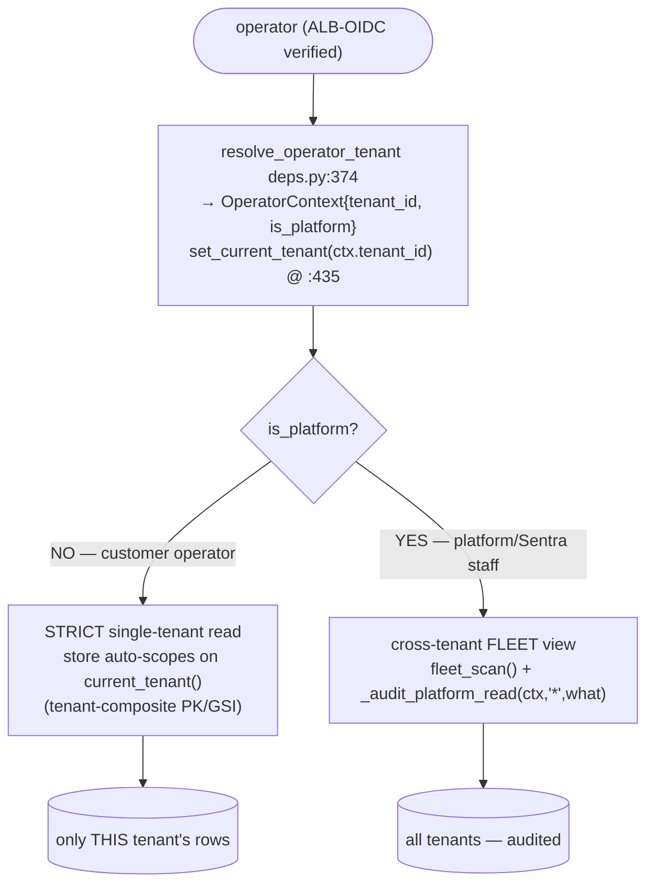

# WS-N — Read-route auth + tenant-scoping (close the 21 ungated read gaps)

> **Doc role:** Phase-2 **build-task doc** (granular, zero-ambiguity). Follow-on to **WS-M** ([ws-m-authz.md](ws-m-authz.md)). **Design-of-record: [lld/40](../../lld/40-multi-tenant-console.md) §6.2 (D10 — tenant-bind the console reads) + §6.10 (D11 — tenant-scope the Overview tiles)** — WS-N is the **tasks-stage decomposition + single implementing owner** of that D10/D11 backend work (founder 2026-07-07: "WS-N is the single owner"). lld/40 designed it and pre-sketched it as a "WS-M/WS-D edit class"; that pre-assignment is **retargeted to WS-N** (reconciled below + in lld/40 §6.2/§6.10). WS-M gated the *mutating* routes; WS-N gates the *read* routes — the 2026-07-07 audit + lld/40 §2 proved 21 of them carry **neither auth nor tenant scope** and read the ambient `default` partition. The Invariant-6 reversal (reclassifying `/trail`+`/signals` from agent-lane to operator-lane) is recorded by **ADR-038** (lld/40 §6.2 / §16), which **WS-M must approve before the D10 PR merges**.

**Parent LLD:** [lld/39-authz-rbac-edge-authorizer.md](../../lld/39-authz-rbac-edge-authorizer.md) (§2 three planes, §5 in-service boundary). **Parent HLD:** [hld/serverless-edition.md](../../hld/serverless-edition.md) §6.2(f)/§6.3.
**Status:** TASKS-DONE (build-ready) · **Owner:** TBD · **Last updated:** 2026-07-07
**Implements:** FR-10.1 (multi-tenant isolation — extended to reads) · FR-13.1 (multi-tenant console, no cross-tenant leak) · FR-13.3 (console auth). **Decisions:** consumes **ADR-037** (in-service boundary) + **ADR-038** (lld/40 §6.2/§16 — reclassifies `/trail`+`/signals` from the agent data-plane lane to the operator control-plane lane; **WS-M must approve before the D10 PR merges**, since WS-M owns the invariant being narrowed) + the WS-M `resolve_operator_tenant`/`OperatorContext`/`assert_owns` primitives. **On "Invariant 6":** the "data-plane reads carry no `require_role`" rule is enumerated in **WS-M** ([ws-m-authz.md](ws-m-authz.md) §2.2 #6), and lld/39 references it as the *former* disposition (lld/39:118,230 already mark it "was … (Invariant 6)" and narrow it). WS-N is the *operator-read* mirror: adding `Depends(resolve_operator_tenant)` is **operator-authentication + tenant-bind, NOT a `require_role` role-gate** — a distinction lld/40 §6.2 makes explicitly. ADR-038 narrows Invariant 6 to genuine *agent*-consumed reads (`POST /v1/validate` + route-19 write ingest).

> **⚙️ FOUNDER MANDATE (2026-07-07):** *"Every API has to have auth and be tenant based. One customer should never be able to see/do anything for another customer, period."* Model: **customer operator → authenticated + STRICTLY scoped to their own tenant; platform operator (`is_platform`) → cross-tenant fleet view (audited).**

---

## 1. Dependencies

- **Depends on (all BUILT + live — reuse, do not rebuild):**
  - `resolve_operator_tenant` ([deps.py:374](../../src/security-controller/app/api/deps.py#L374)) — verifies ALB-OIDC, resolves membership, and **already calls `set_current_tenant(chosen.tenant_id)` at [deps.py:435](../../src/security-controller/app/api/deps.py#L435)** before returning `ctx`. This is the load-bearing fact: **adding `Depends(resolve_operator_tenant)` auto-binds the request tenant** for every downstream store call that routes through `tenancy.query_or_scan()`/`item_key()` on a tenant-composite store.
  - `OperatorContext{sub, email, role, tenant_id, is_platform}` ([deps.py:269](../../src/security-controller/app/api/deps.py)).
  - `assert_owns(ctx, ResourceKind, resource_id)` ([ownership.py](../../src/security-controller/app/api/ownership.py)) — for by-id reads (AGENT/POLICY/CONNECTION/SESSION/CONVERSATION).
  - `tenancy.fleet_scan(table, **kw)` ([tenancy.py:343](../../src/security-controller/app/utils/tenancy.py#L343)) — the genuine cross-tenant scan; the **platform-view path**.
  - `_audit_platform_read(ctx, target_tenant, what)` ([tenancy_routes.py:381](../../src/security-controller/app/api/tenancy_routes.py#L381)) — the audited cross-tenant read gate (`"*"` = aggregate/allowed+audited; `<id>` = per-tenant, consent-gated). **Every platform cross-tenant read MUST call this.**
- **Blocks:** **WS-G** (the console render-gate + multi-tenant demo assume these reads are tenant-isolated). WS-N **IS** the backend prerequisite lld/40 calls **D10** (§6.2) + **D11** (§6.10) — a HARD pre-demo sequencing gate (lld/40:296: the G3.1/G3.3/G3.4 console routes stay feature-flagged off until this merges green). *(Note: "D10/D11" are `lld/40` section IDs, NOT `ws-g-console.md` milestone IDs — WS-G's own doc uses G1/G2/G3.)*
- **Shared (coordinate edits — WS-M/WS-D/WS-G touch too):** `routes.py`, `deps.py` (WS-M owns; WS-N only ADDS `Depends` params to read handlers — do not touch WS-M's mutating gates), the 3 service methods in M-N2.

---

## 2. Model — read before coding

### 2.1 The two operator classes (the whole design)



### 2.2 Invariants (load-bearing)

1. **Every read route authenticates.** No route reaches a store without `Depends(resolve_operator_tenant)` (or the data-plane `_dataplane_tenant_bind` for the two agent-facing session reads). The ONLY exemptions are `/health` (liveness) and the already-correct routes.
2. **Customer operator = STRICT own-tenant.** A non-platform `ctx` reads only `ctx.tenant_id`'s rows. **A customer must never see another customer's data — no header, no query param, no path can override this** (`X-Aegion-Tenant` for a non-platform operator is re-validated against membership and 403s a non-member — the header read + `chosen` match + `raise HTTPException(403, "not a member of requested tenant")` live in `_resolve_operator_tenant_inner` at [deps.py:414-427](../../src/security-controller/app/api/deps.py#L414) — it can NEVER select a foreign tenant).
3. **Platform operator = fleet view, ALWAYS audited.** Cross-tenant reads go through `fleet_scan()` + `_audit_platform_read(ctx, "*", "<what>")`. A platform read that isn't audited is the bug. **⚠️ `_platform` is now a FLEET-READ-ALL grant (WS-N-6):** `is_platform = any(m.tenant_id == PLATFORM_TENANT)` ([deps.py:411](../../src/security-controller/app/api/deps.py#L411)) is not client-spoofable (server-derived membership), but WS-N *widens its blast radius from mutations to all reads*. A single mis-provisioned `_platform` membership (support handoff, a buggy invite/redeem path) → read of EVERY tenant's data with only an audit row, no per-tenant consent gate. This membership MUST be tightly controlled + **alarmed** (see M-N0.3): any operator holding BOTH a customer membership and `_platform` is a flagged anomaly.
4. **Bind-only where the store is tenant-composite; service-change only where it hard-uses `fleet_scan`.** Do NOT add redundant tenant filters to a store that already composites on `current_tenant()` — it's noise and risks double-scoping. Do NOT leave a `fleet_scan`-backed route bound to nothing — that's the current leak.
5. **Fleet dashboards are DUAL-MODE, not hard-bound.** The **2 genuinely fleet-scanned** routes (`/sessions` → `SessionManager.query_sessions`, and the `count_sessions_by_status` call inside `/metrics/overview`) are fleet-wide *by design for a platform operator*. Naively binding them to `ctx.tenant_id` for everyone would **break the platform/founder dashboard**. They take `tenant_id: Optional[str]=None` → customer passes `ctx.tenant_id` (scoped); platform passes `None` (fleet_scan + audit). **⚠️ CORRECTED (drift sweep 2026-07-07): `/metrics/platform-distribution` (`get_cloud_provider_distribution`) does NOT hard-use `fleet_scan`** — it already auto-scopes via `list_agents → query_or_scan(current_tenant())`. To give a *platform* operator the fleet distribution, the dual-mode branch must go in `list_agents`/`_scan_all_agents_sync` (switch `query_or_scan → fleet_scan` when scope is None), NOT in `get_cloud_provider_distribution`. See M-N2 / N-1.

### 2.3 FOOTGUNS (do NOT do X — it breaks Y)

- **FG-1 — do NOT hard-bind the fleet-scanned routes to `ctx.tenant_id` unconditionally.** `SessionManager.query_sessions` ([session_manager.py:610](../../src/security-controller/app/utils/session_manager.py#L610) — `fleet_scan(self.table,…)`) and `count_sessions_by_status` → `_count_sessions_by_status_sync` ([session_manager.py:717](../../src/security-controller/app/utils/session_manager.py#L717)) **genuinely call `fleet_scan()`**. Binding them single-tenant for everyone silently breaks the platform fleet dashboard. Make them dual-mode (M-N2). **⚠️ `get_cloud_provider_distribution` is NOT in this set** — it calls `list_agents` (:251) → `query_or_scan` (:120/:124), already tenant-scoped. Do NOT add a `tenant_id→fleet_scan` branch to it (there's no fleet_scan to make optional); make `list_agents` fleet-aware instead if platform-distribution needs a fleet view (N-1, verified drift-sweep 2026-07-07).
- **FG-2 — do NOT add a tenant filter inside a service that already uses `query_or_scan()`/`item_key()`.** Those auto-scope on `current_tenant()`, which `resolve_operator_tenant` already set. Adding a second filter is redundant and can double-compose the key → zero rows. These are **bind-only** (M-N1).
- **FG-3 — Sigma rules are fleet-global, NOT tenant-partitioned** (confirmed: `sentra-sigma-rules-metadata` has no `{tenant}#` PK — [lld/35 §13](../../lld/35-prompt-signatures.md)). `GET /v1/sigma-rules` + `/content` get `Depends(resolve_operator_tenant)` for **authentication only** — do NOT add a tenant filter (every tenant legitimately sees the same fleet rules). This is the one auth-yes/tenant-scope-no exception (Invariant 1 satisfied; Invariant 2 N/A — no tenant-owned data).
- **FG-4 — the console will NOT break.** It runs behind ALB `authenticate-cognito`; the ALB injects `x-amzn-oidc-data` on every request, which `resolve_operator_tenant` reads. But **tests + local dev MUST provide the ALB header** (`_alb_claims_override`, [deps.py](../../src/security-controller/app/api/deps.py)) or they 401. A curl without the header now correctly 401s.
- **FG-5 — by-id reads need `assert_owns`, not just a bind.** A bind scopes a *list* query; a by-id `get_item` on a tenant-composite PK also auto-scopes, BUT for defense-in-depth + an honest 404 (not a cross-tenant 200), the by-id reads (M-N3) call `assert_owns(ctx, kind, id)` — mirrors WS-M's mutating by-id pattern.
- **FG-6 — CloudWatch-Logs-backed routes** (`/logs`, `/logs/conversation/{id}`, `/metrics`, `/metrics/decisions-timeseries`) do NOT read DynamoDB — no composite PK auto-scope. **⚠️ BLOCKER (drift sweep 2026-07-07, WS-N-5):** the audit-log events + the `ValidationsTotal` metric these routes read **do NOT carry a per-tenant field** for tokenless/`_unverified` traffic, and the log group is fleet-shared. So a customer-scoped query is **not deliverable by string-filtering alone**. M-N4 is therefore a **fail-CLOSED pre-req** (see M-N4 below): until a stamped `tenant_id` exists on every relevant log/metric write path, a **customer** read of these routes returns an explicit `4xx tenant-scoped telemetry unavailable`, NEVER fleet rows. Platform operator → fleet (audited).
- **FG-7 — dual-caller routes (WS-N-7): `/sessions` and `/sessions/{id}/decisions` also have a TOKENLESS server-to-server caller** — the dashboard / cross-cloud demo runner (`src/dashboard/services/security_controller_client.py`). Binding them to `resolve_operator_tenant` (operator-OIDC-only) would **401 the runner**, same class as the canary break. Each of these needs a **caller inventory** (M-N0.2) and a **service-credential path** for the machine caller, not just operator OIDC — do NOT assume every caller is a browser operator.
- **FG-8 — the WS-J canary manifest MUST be reclassified IN LOCKSTEP (WS-N-2, CRITICAL).** The frozen canary ([tests/canary/route_manifest.py](tests/canary/route_manifest.py)) classifies all 21 reads as `auth_class='key'`; its positive probe sends X-Api-Key only, **no OIDC header, and FORBIDS 401/403**. The instant WS-N makes these routes require OIDC, the live hourly canary probe gets 401 → **false RED alarm in prod**. M-N8 reclassifies those rows to `oidc` in the same change. Do NOT ship WS-N without M-N8.

### 2.4 Route classification (from the 2026-07-07 audit + drift sweep — the work-list)

| Class | Fix | Routes |
|---|---|---|
| **M-N1 bind-only** (DDB composite auto-scopes) | + `Depends(resolve_operator_tenant)` | `/decisions`(2), `/agents`(7a), `/policies`(8a), `/connections`(9a), **`/metrics/platform-distribution`(5d)** *(corrected N-1: auto-scopes via list_agents→query_or_scan; NOT dual-mode — but see M-N2 note if a platform FLEET distribution view is wanted)* |
| **M-N1-dc dual-caller** (bind + machine-caller path) | + `Depends` + service-credential path for the tokenless runner (FG-7) | `/sessions/{id}/decisions`(3) |
| **M-N2 dual-mode** (genuinely `fleet_scan` today) | + `Depends` + service `tenant_id: Optional` param (None→fleet_scan+audit) | `/sessions`(4 — also dual-caller, FG-7), `/metrics/overview`(5b — the `count_sessions_by_status` call) |
| **M-N3 by-id** (bind + ownership) | + `Depends` + `assert_owns` | `/agents/{id}`(7b), `/agents/{id}/tools`(7c — global tool registry, bind-only, no assert_owns), `/policies/{id}`(8b), `/connections/{id}`(9b), `/logs/conversation/{id}`(1b) |
| **M-N4 CloudWatch reads** (**fail-closed pre-req**, FG-6) | + `Depends` + customer→fail-closed-until-tenant-stamped, platform→fleet+audit | `/logs`(1a), `/metrics`(5a — deprecated, still gate), `/metrics/decisions-timeseries`(5c) |
| **M-N5 discovery** (policy-derived read-model) | + `Depends` (confirm tenant-scoping of the source) | `/discovery/agents`(6a), `/discovery/summary`(6b), `/discovery/platforms`(6c) |
| **M-N6 fleet-global (auth-only)** | + `Depends` ONLY, no tenant filter (FG-3) | `/sigma-rules`(10), `/sigma-rules/{id}/content` |
| **M-N8 canary lockstep** (WS-J coordination, CRITICAL) | reclassify 21 rows `key→oidc` in `route_manifest.py` | (test manifest, not a route) |

---

## 3. Milestones → tasks

### Milestone N0 — the reusable platform-dual-mode helper (LAND FIRST)

**N0.1 — `_operator_read_scope(ctx, what)` helper** in `routes.py` (new, near `_dataplane_tenant_bind`). Returns the tenant to scope to, and audits a platform fleet read:
```python
def _operator_read_scope(ctx: OperatorContext, what: str) -> Optional[str]:
    """Resolve the read tenant for an operator read.
      * customer operator  -> ctx.tenant_id (STRICT own-tenant; already bound by
        resolve_operator_tenant @ deps.py:435, returned here for explicit service calls)
      * platform operator  -> None (fleet view) + audited via _audit_platform_read(ctx,'*',what)
    A customer NEVER gets None (never a fleet view)."""
    if ctx.is_platform:
        _audit_platform_read(ctx, "*", what)   # aggregate cross-tenant, audited
        return None                             # None => fleet_scan in the dual-mode services
    return ctx.tenant_id
```
- **Unit** (`tests/test_read_route_scope.py`): `test_customer_scope_returns_own_tenant`, `test_customer_scope_never_none` (assert a non-platform ctx never yields None even with `is_platform` spoofed absent — **fail-secure default**), `test_platform_scope_returns_none_and_audits` (spy `_audit_platform_read` called with `"*"`), `test_platform_audit_records_what`.
- **Integ:** N/A (pure helper — exercised by every M-N2 integ test; stated opt-out).

**N0.2 — Caller inventory (PRE-REQ, WS-N-7/FG-7).** Before gating, produce a written enumeration: `grep '@router.get' routes.py tenancy_routes.py` joined against the auth-dep set, proving the 21 set is **exhaustive + disjoint** from the `_dataplane_tenant_bind` (`/trail`,`/signals`) and already-gated sets. For EACH of the 21, list every known caller — **web/console SPA (OIDC), the hourly canary (X-Api-Key only — see N8), the dashboard/cross-cloud demo runner (`src/dashboard/services/security_controller_client.py` — TOKENLESS server-to-server), connectors** — and confirm each caller can present the identity the new gate requires. Any route with a tokenless machine caller (esp. `/sessions`, `/sessions/{id}/decisions`) is flagged **dual-caller** → needs a service-credential path (a machine principal / internal-service token), NOT operator-OIDC-only. Output: a table appended to this doc. **No route is gated until its callers are inventoried** (else we 401 a legitimate machine caller in prod).
- **Unit:** N/A (analysis task — output is the caller table; stated opt-out). **Integ:** N/A.

**N0.3 — `_platform` fleet-read-all guardrail (WS-N-6).** Add a metric/alarm for any operator holding BOTH a customer-tenant membership AND `_platform` (the mis-provisioned-support-handoff anomaly), and a test that such an operator is handled per the intended support policy — not silently handed all-tenant reads. Document that `_platform` is now a fleet-read-all grant requiring tight control.
- **Unit** (`tests/test_platform_grant_guard.py`): `test_dual_membership_operator_flagged`, `test_platform_fleet_read_emits_audit_row`.
- **Integ:** N/A (metric/alarm — stated opt-out; the audit-row write is covered by M-N2 integ).

### Milestone N1 — bind-only routes — `Depends(resolve_operator_tenant)`

**N1.1 — add the dep to each M-N1 route** (`routes.py`): `scan_decisions`(:574), `get_session_decisions`(:450), `get_agents`(:1236), `get_policies`(:1347), `list_connections`(:952). Add `ctx: OperatorContext = Depends(resolve_operator_tenant)` to each signature. No service change (FG-2 — store auto-scopes on the now-bound `current_tenant()`). For a **platform** operator these stay single-tenant on the operator's own tenant unless they use the dual-mode routes; that's acceptable (these 5 are not the fleet dashboards).
- **Unit** (`tests/test_read_route_authz.py`, one block per route): `test_<route>_missing_oidc_401` (no ALB header → 401), `test_<route>_binds_ctx_tenant` (spy `current_tenant()` inside the service call == `ctx.tenant_id`), `test_<route>_customer_sees_only_own_tenant` (seed tenant-A + tenant-B rows; ctx=A; assert only A rows returned — the anti-cross-tenant proof).
- **Integ** (`tests/integration/test_read_route_isolation.py`): `test_decisions_cross_tenant_isolation` — real store (moto), tenant-A operator scanning `/decisions` sees zero tenant-B decisions. (This seam — operator-read × tenant-composite store — is the shared contract WS-N owns; ≥1 integ test required.)

### Milestone N2 — dual-mode fleet routes (2) — bind + service `tenant_id` param

**N2.1 — `SessionManager.query_sessions`** ([session_manager.py:555](../../src/security-controller/app/utils/session_manager.py#L555)): add `tenant_id: Optional[str] = None`. When `tenant_id` is not None → `tenancy.query_or_scan()` scoped to it; when None → keep `fleet_scan()` (platform). Route `get_sessions`(:640): add `Depends`, call with `tenant_id=_operator_read_scope(ctx, "sessions.list")`.
**N2.2 — `SessionManager.count_sessions_by_status`** ([:692](../../src/security-controller/app/utils/session_manager.py#L692)): same `tenant_id: Optional` param + same fleet_scan/query_or_scan branch. Called by `/metrics/overview`.
**N2.3 — `/metrics/platform-distribution` = BIND-ONLY, not dual-mode (CORRECTED, N-1).** `get_cloud_provider_distribution` ([agent_service.py:243](../../src/security-controller/app/services/agent_service.py#L243)) already auto-scopes: it calls `list_agents` (:251) → `_scan_all_agents_sync` → `query_or_scan(current_tenant())` (:120/:124). So route `get_platform_distribution`(:783) gets **`Depends(resolve_operator_tenant)` only** → a customer sees their own tenant's distribution (correct). **If a PLATFORM operator needs the fleet distribution, the dual-mode branch goes in `list_agents`/`_scan_all_agents_sync`** (accept an optional `scope`; None → `fleet_scan` instead of `query_or_scan`), NOT in `get_cloud_provider_distribution`. Decide at build: (a) platform sees own-tenant only (simplest, bind-only) OR (b) make `list_agents` fleet-aware (then thread `_operator_read_scope` through). Do NOT add a no-op `tenant_id→fleet_scan` param to `get_cloud_provider_distribution` (there is no fleet_scan there to gate).
- **Unit** (`tests/test_dualmode_reads.py`): per method — `test_<m>_customer_scoped_to_tenant` (tenant_id set → query_or_scan, NOT fleet_scan — spy which path), `test_<m>_platform_fleet_scan_when_none` (tenant_id None → fleet_scan), `test_metrics_overview_customer_excludes_other_tenant` (seed A+B; ctx=A customer → counts reflect only A), `test_metrics_overview_platform_sees_fleet` (ctx=platform → counts reflect A+B + `_audit_platform_read` called).
- **Integ** (`tests/integration/test_read_route_isolation.py`): `test_sessions_customer_isolation_platform_fleet` — moto: customer-A `/sessions` → only A; platform `/sessions` → A+B (audited). Shared-contract seam (fleet_scan dual-mode) — required.

### Milestone N3 — by-id reads (5) — bind + `assert_owns`

**N3.1** (`routes.py`): `get_agent`(:1275) + `assert_owns(ctx, AGENT, agent_id)`; `get_policy_by_id`(:1416) + `assert_owns(POLICY, id)`; `get_connection`(:979) + `assert_owns(CONNECTION, id)`; `get_conversation_timeline`(:1858) + `assert_owns(CONVERSATION, conversation_id)`. `get_agent_tools`(:1304) → bind-only (tool registry is global — no assert_owns; FG-3-adjacent, note it). All get `Depends(resolve_operator_tenant)`.
- **Unit** (`tests/test_read_route_authz.py`): per route `test_<route>_missing_oidc_401`, `test_<route>_foreign_id_404` (ctx=A, id owned by B → 404 via assert_owns, NOT a 200 leak), `test_<route>_own_id_ok`.
- **Integ:** `test_by_id_read_cross_tenant_404` — moto, A requests B's policy/agent/connection id → 404.

### Milestone N4 — CloudWatch-Logs reads (3) — FAIL-CLOSED pre-req (WS-N-5/FG-6)

**N4.0 — PRE-REQ investigation (BLOCKING, do FIRST + write the finding into this doc).** Confirm whether every CloudWatch log event / metric these 3 routes read carries a **stamped `tenant_id`** on ALL write paths — **including tokenless/`_unverified` demo traffic** (the drift sweep found the general audit event + `ValidationsTotal` metric do NOT carry a per-tenant field for that traffic, and the log group is fleet-shared). A unit test that asserts "the query string contains a tenant filter" proves the STRING was built, NOT that the rows are partitionable — do not mistake one for the other.

**N4.1 — gate + fail-closed for customers** (`routes.py`): `get_logs`(:395), `get_metrics`(:674 deprecated but gate it), `get_decisions_timeseries`(:795) get `Depends(resolve_operator_tenant)`. Then:
- **Platform** operator → `_operator_read_scope` returns None → fleet (unfiltered) + `_audit_platform_read`. (Platform fleet telemetry is the legitimate use of these today.)
- **Customer** operator → if N4.0 proved the events carry a reliable `tenant_id`, scope the Logs-Insights query by it (`filter tenant_id = "<ctx.tenant_id>"`, mirror `rollback_coordinator._query_conversation_tenant_sync`). **If NOT** (the current reality for the general audit/metrics streams) → **FAIL CLOSED**: return an explicit `4xx` "tenant-scoped telemetry not yet available" — **NEVER fleet rows to a customer**. Do not ship a customer read of these 3 routes returning fleet data.
- **Unit** (`tests/test_cloudwatch_read_scope.py`): `test_logs_customer_failclosed_when_untenanted` (customer ctx + untenanted stream → 4xx, NOT fleet rows), `test_logs_platform_fleet_audited`, `test_logs_customer_scoped_when_tenant_field_present` (only if N4.0 unblocks it), `test_metrics_timeseries_customer_failclosed_or_scoped`.
- **Integ:** N/A hermetic (CloudWatch not moto-backed) — **stated opt-out**; MUST add a go-live-runbook step that queries two real tenants and diffs (proves the live scoping, since no automated proof exists).

### Milestone N5 — discovery reads (3) — bind + confirm source scoping

**N5.1** (`routes.py`): `discovery_agents`(:821), `discovery_summary`(:848), `discovery_platforms`(:855) get `Depends(resolve_operator_tenant)`. **Verify** the discovery read-model source: if it's derived from tenant-scoped connections/scans, scope to `ctx.tenant_id`; if it's a static/global cache with no tenant data, bind-only for auth (note which). Discovery reflects a tenant's own imported agents → should be tenant-scoped.
- **Unit** (`tests/test_read_route_authz.py`): `test_discovery_agents_missing_oidc_401`, `test_discovery_agents_customer_scoped` (if source is tenant-scoped), `test_discovery_summary_tenant_scoped`.
- **Integ:** folded into `test_read_route_isolation.py` if the source is tenant-scoped; else stated opt-out (static global).

### Milestone N6 — fleet-global auth-only (2) — `Depends` ONLY (FG-3)

**N6.1** (`routes.py`): `get_sigma_rules`(:1661), `get_sigma_rule_content`(:1795) get `Depends(resolve_operator_tenant)` for **authentication only** — NO tenant filter (rules are fleet-global; every tenant sees the same set).
- **Unit** (`tests/test_read_route_authz.py`): `test_sigma_rules_missing_oidc_401`, `test_sigma_rules_authed_returns_fleet_rules` (any authenticated tenant → same full rule set; assert NOT tenant-filtered).
- **Integ:** N/A (no tenant-owned data / no cross-tenant seam — stated opt-out per FG-3).

### Milestone N7 — the systemic read-coverage gate (extend WS-M's M0.2)

**N7.1** — extend `tests/test_authz_coverage_gate.py` (WS-M's enumerator; it is **GET-blind today** — `_MUTATING = {"POST","PUT","PATCH","DELETE"}` at [test_authz_coverage_gate.py:77](../../src/security-controller/tests/test_authz_coverage_gate.py#L77), filtered at :88) to assert **every GET route** on `routes.py`+`tenancy_routes.py` carries an auth dependency OR is on a reasoned allowlist (`/health`; the 2 agent-facing `_dataplane_tenant_bind` reads — until D10 rebinds them to the operator lane, then they too are `resolve_operator_tenant`). **FOOTGUN: the existing `_has_authz_depends` recognizer (:94-115) only matches `require_role`/`require_platform` — it does NOT recognize a bare `Depends(resolve_operator_tenant)` as a gate.** N7 MUST add a new recognizer predicate for the read case (a GET authed by `resolve_operator_tenant` with no role), not reuse `_has_authz_depends` as-is. Additive to WS-M's file (no conflict — it's GET-blind), but coordinate the shared edit. Per lld/40 §5.2/:184-186, a **tenant-partitioned read may NEVER be allowlisted** — the allowlist is only for genuinely tenant-agnostic routes. (Different gate from WS-J's `route_manifest.py` canary — N7 is the in-app enumerator; N8 is the canary manifest.)
- **Unit:** `test_all_read_routes_have_auth_dep`, `test_read_gate_accepts_dataplane_bind`, `test_read_allowlist_requires_reason`.
- **Integ:** N/A (static analysis — stated opt-out, mirrors WS-M M0.2).

### Milestone N8 — WS-J canary manifest reclassification (CRITICAL, lockstep with deploy — WS-N-2)

**N8.1** — in the SAME change that ships the gates, reclassify the 21 read rows in `tests/canary/route_manifest.py` from `auth_class='key'` to `'oidc'` (and update each row's `failure_axis`). **Why (BLOCKING):** the live hourly canary sends **X-Api-Key only, no OIDC header** ([tests/canary/conftest.py:208](tests/canary/conftest.py)); its positive probe for a `key` route asserts `status in {200,201,202,204,404,400,422}` and **forbids 401/403** ([tests/canary/scenarios.py:169](tests/canary/scenarios.py)). The instant WS-N makes these routes require OIDC, they 401 the canary probe → **live prod canary goes RED (false SEC-alarm)**, even though the code is correct. Reclassifying to `oidc` tells the canary the 401-without-OIDC is the *expected* secure behavior. **Coordinate with WS-J** (owns the manifest). Verify: after reclassify, the canary's negative/positive probes expect the OIDC posture.
- **Unit** (`tests/canary/test_route_manifest.py` or the manifest's own test): `test_read_routes_are_oidc_class` (the 21 rows are `auth_class='oidc'`, not `key`), `test_no_read_route_forbids_401_under_oidc` (the positive probe for these accepts the OIDC-secured posture).
- **Integ:** N/A hermetic (the live canary runs in prod) — **stated opt-out**; go-live-runbook step: after deploy, confirm the next canary run is GREEN (not RED on the reclassified routes).

**N8.2 — the published OpenAPI contract MUST be updated in lockstep (drift surface, found 2026-07-07).** [docs/integration/aegion-guard-api.openapi.yaml](../../docs/integration/aegion-guard-api.openapi.yaml) has a global `security: [ApiKeyAuth]` (:62-63); the *mutating* routes already override to `security: [{OperatorSession: []}]` (e.g. `/policies` POST :477), but **all 21 read routes inherit the global `ApiKeyAuth`** and document as API-key-only. Once WS-N gates them, the spec is WRONG (a customer read is now operator-OIDC + tenant-scoped, not key-auth). For each of the 21, add `security: [{OperatorSession: []}]` (the canonical scheme name the spec already uses for operator routes) + document the tenant-scope + the 401/403/404 responses + the platform fleet-view semantics. Same class of drift as N8.1 (canary) — the API contract and the canary must both reflect the new auth posture. **Coordinate with whoever owns the integration spec.**
- **Unit** (`tests/integration/test_openapi_contract.py` or a doc-lint): `test_read_routes_declare_operator_session` (every one of the 21 read paths carries `OperatorSession` security, not the inherited `ApiKeyAuth`) — a machine check so the spec can't silently re-drift.
- **Integ:** N/A (doc/contract lint — stated opt-out).

---

## 4. Error model

| Condition | Response |
|---|---|
| No/invalid ALB-OIDC on a read route | **401** `verify_alb_oidc` raises (customer-safe) |
| Customer operator, foreign `X-Aegion-Tenant` (non-member) | **403** (`resolve_operator_tenant` membership re-validate) |
| Customer operator, by-id read of foreign resource | **404** via `assert_owns` (never a cross-tenant 200) |
| Platform operator cross-tenant read | 200 fleet data + `_audit_platform_read(ctx,"*",what)` row written |
| Platform per-tenant read without consent (if ever added) | **403** `platform_read_consent not granted` (existing pattern) |

---

## 5. Acceptance criteria (one checklist)

- [ ] **N0.1:** `_operator_read_scope` helper lands; customer→own-tenant, platform→None+audit; a customer never yields None (fail-secure default).
- [ ] **N0.2:** caller inventory written (21 routes × every caller: console/canary/demo-runner/connector); dual-caller routes flagged; no route gated before its callers are confirmed able to present the required identity.
- [ ] **N0.3:** `_platform` fleet-read-all guardrail — alarm on dual (customer + `_platform`) membership; documented as a fleet-read-all grant.
- [ ] **N1:** the bind-only reads (`/decisions`,`/agents`,`/policies`,`/connections`,`/metrics/platform-distribution`) carry `Depends(resolve_operator_tenant)`; a customer sees only their tenant's rows (cross-tenant scan returns zero foreign rows).
- [ ] **N1-dc / N2:** the dual-caller (`/sessions/{id}/decisions`) + genuinely-fleet-scanned (`/sessions`, `count_sessions_by_status`) routes handle BOTH the tokenless machine caller (service-credential path — does NOT 401 the demo runner) AND the dual-mode tenant scope (customer=scoped, platform=fleet_scan+audited; founder dashboard still shows the fleet).
- [ ] **N3:** the 5 by-id reads carry `Depends` + `assert_owns` (foreign id → 404, not a 200 leak).
- [ ] **N4:** CloudWatch reads gated; N4.0 tenant-field investigation written; **customer read FAILS CLOSED (4xx, never fleet rows)** where the stream carries no tenant field; platform→fleet+audit.
- [ ] **N5:** discovery reads gated + scoped to the tenant's own source (or noted global).
- [ ] **N6:** sigma-rule reads gated for auth, NOT tenant-filtered (fleet-global, FG-3).
- [ ] **N7:** the systemic in-app gate (`test_authz_coverage_gate.py`) fails the build on any new ungated GET route.
- [ ] **N8 (CRITICAL, lockstep):** the 21 rows in WS-J's `route_manifest.py` are reclassified `key→oidc` in the SAME change (canary stays GREEN post-deploy); AND the published `docs/integration/aegion-guard-api.openapi.yaml` gives each of the 21 read routes `security: [{OperatorSession: []}]` (no longer the inherited `ApiKeyAuth`) + tenant-scope + 401/403/404 responses.
- [ ] **No customer can read another customer's data on ANY of the 21 routes** — proven by the cross-tenant isolation integ tests (the founder mandate, objectively verified).
- [ ] **The console is not broken** — verified: every route the console calls returns 200 for an authenticated operator (ALB header present).
- [ ] **unit tests pass** (covering all cases named in §3).
- [ ] **integration tests pass** (covering the operator-read × tenant-composite-store seam + the dual-mode fleet seam — `tests/integration/test_read_route_isolation.py`).

---

## 6. Cross-references

- **Design-of-record:** **[lld/40](../../lld/40-multi-tenant-console.md) §6.2 (D10)** + **§6.10 (D11)** — the approved design this task doc decomposes. Also [lld/39](../../lld/39-authz-rbac-edge-authorizer.md) §2/§5 (the in-service boundary + Invariant-6, narrowed by ADR-038). WS-N is the tasks-stage build doc; lld/40 stays the design.
- **Sibling refs (sweep verified 2026-07-07):** **WS-M** ([ws-m-authz.md](ws-m-authz.md) — owns `resolve_operator_tenant`/`assert_owns`/the GET-blind coverage gate WS-N extends; owns Invariant 6 → **must approve ADR-038**; shared files `routes.py`/`deps.py`. D10's PR is owned by WS-M-authz-class per lld/40:296 — **retargeted to WS-N as implementer** per founder 2026-07-07) · **WS-G** ([ws-g-console.md](ws-g-console.md) — the console consumer; realizes lld/40 D10/D11 via G3.1/G3.4; those console routes stay flag-off until WS-N merges green) · **WS-D** ([ws-d-decision-trail.md](ws-d-decision-trail.md) — owns the `/trail`+`/signals` trail SHAPE; WS-N re-binds them from the agent lane to the operator lane per ADR-038, reviewed with WS-D) · **WS-J** ([ws-j-canary-tests.md](ws-j-canary-tests.md) — owns `route_manifest.py`; N8 reclassifies 6 rows `key→oidc` in lockstep) · **WS-H** ([ws-h-metering.md](ws-h-metering.md) — owns *usage/billing* (`GET /v1/usage`, new `meter_publisher`); **does NOT own `/metrics/overview`** (WS-H demotes `metrics_publisher.py` to ops-only, `ws-h-metering.md:23,56`). **CORRECTED: the `/metrics/overview` bind is lld/40 D11's, not WS-H's** — coordinate the overview change with the D11 owner (WS-N/WS-M), and only *usage* reads with WS-H).
- **Shared contract WS-N owns:** *operator-read tenant scope* — every read route resolves its tenant via `resolve_operator_tenant` (customer, strict own-tenant) or `fleet_scan`+`_audit_platform_read` (platform, audited). Consumers: WS-G (console), WS-H (usage reads).
