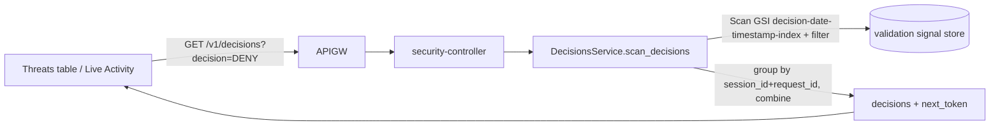
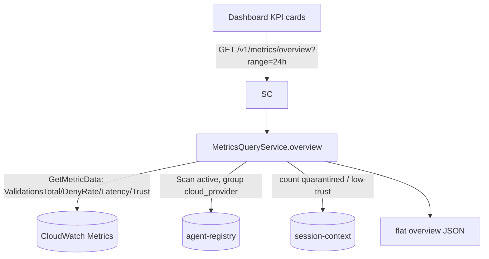
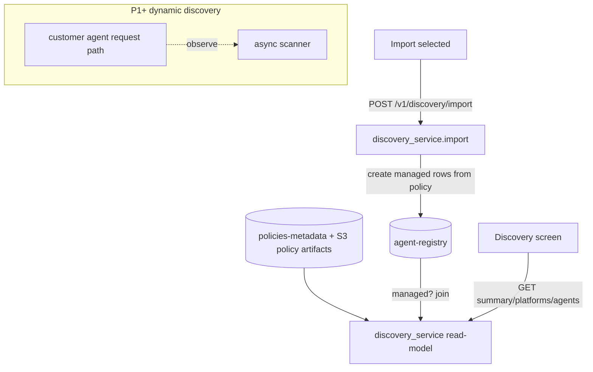

# Workstream 21 — SOC Console P0 APIs (build spec)

**Version**: 1.0
**Last Updated**: 2026-06-06
**Status**: Ready for Review
**Contract reference**: [`lld/21-api-inventory-for-ux.md`](../lld/21-api-inventory-for-ux.md) (LLD 21 is the *contract*; this doc is the *build spec* — per-API logic, exact resources, and wiring so implementation does not have to second-guess).

> Scope: **P0 only** — the APIs needed to power the MVP Aegion SOC console. Deployments domain (P1) and the FP%/FN dashboard metric (P2) are excluded except where capture is silent. Each API below states its **Tier** (A = live, B = implemented-but-not-exposed, C = net-new), the exact backend handler/service/store, request/response, errors, **API Gateway wiring**, and work items.

---

## 0. Critical callouts — issues found in the existing implementation

These are real, verified against the code. Fix as part of P0 where marked.

| # | Severity | Issue | Evidence | Action |
|---|----------|-------|----------|--------|
| C1 | **Blocker** | **Core metrics not emitted — and this was a DELIBERATE removal, not an oversight.** `_handle_deny`/`_handle_allow` carry a `NOTE (2025-12-02): Metrics publishing removed from here … should be published by agents AFTER actual execution … See Milestone 4 in workstream-9`. **Verified:** no execution-time emitter exists anywhere (`grep` for `publish_validation_metrics`/metric names in `src/` excl. tests = empty), so the post-execution path was **never built**. Re-adding is the pragmatic fix; see §0.1-F1 for the reversal rationale (these are *decision* metrics, distinct from *execution* metrics). | [`validation_service.py:363,421`](../src/security-controller/app/services/validation_service.py#L363) | Reverse the WS-9 M4 decision **consciously** (T01); emit decision metrics at validation time. No double-count risk (verified). |
| C2 | **Blocker** | **`/v1/metrics` output shape ≠ UI overview shape.** Current return is nested `{requests:{}, latency:{}, sessions:{}, threats:{}}`; the console `overview` card wants flat `threats_blocked / active_agents / trust_score / …`. Also it runs **slow Logs Insights** and returns `_default_metrics()` (all zeros) on timeout. | [`metrics_service.py` `_default_metrics`](../src/security-controller/app/services/metrics_service.py); LLD 21 §11.2 | Build `GET /v1/metrics/overview` as a **new** endpoint backed by `GetMetricData` + DDB (do **not** reuse `/v1/metrics` as-is). |
| C3 | **High** | **`/v1/logs` API Gateway wiring is wrong.** APIGW passes `start_time`, `end_time`, `session_id`, `limit`; the FastAPI route expects `since`, `until` and also supports `agent_id`, `decision`, `threat_type` (none of which are passed). So through APIGW, time filters silently no-op and the Threats filters (`decision`, `agent_id`, `threat_type`) are dropped. | [`api_stack.py:345-371`](../cdk/stacks/api_stack.py#L345) vs [`routes.py:80-116`](../src/security-controller/app/api/routes.py#L80) | Fix `pass_query_params` + `request_parameters` to the real names (`since`/`until`/`agent_id`/`decision`/`threat_type`). |
| C4 | **High** | **No `cloud_provider` anywhere.** Agent registry stores `platform` = connector (`sentra\|bedrock\|azure_foundry`), not a hosting cloud. `platform-distribution` / discovery cloud grouping have no source. | [`seed_agents.py:89,178`](../scripts/seed_agents.py#L89); LLD 21 §10.1 | Add `cloud_provider` attr + GSI to agent registry (see §6.2). |
| C5 | Medium (scale) | **Enrichment does N full-table Scans.** `list_agents(enrich=True)` calls `get_avg_trust_score` + `get_active_sessions_count` **per agent**, each a `table.scan` with a `FilterExpression` on `sentra-session-context` — despite the `agent-updated-index` GSI existing. O(agents × scan). | [`session_manager.py:608-645`](../src/security-controller/app/utils/session_manager.py#L608) | OK at MVP (~5 agents). P1: switch to `Query` on `agent-updated-index`. |
| C6 | Medium (scale) | **`/v1/sessions` and `/v1/decisions` use `Scan`+filter**, not partition `Query`. `/v1/decisions` scans GSI-2 and filters by `timestamp_ms` instead of `Query`-ing per `decision_date`. | [`session_manager.py:531`](../src/security-controller/app/utils/session_manager.py#L531); [`decisions_service.py:237`](../src/security-controller/app/services/decisions_service.py#L237) | OK at MVP. P1: day-partition `Query`. |
| C7 | Medium | **`/v1/agents` has TWO hidden filters, not one** (Kiro F4): `visibility != 'internal'` (drops the security-controller itself) **and** `platform != 'bedrock'`. D1 ("show all clouds") removes the **bedrock** filter; **D4 (resolved):** keep the **visibility** filter as a safety net **and** stop registering the security-controller (T07). | [`agent_service.py:123-128`](../src/security-controller/app/services/agent_service.py#L123) | **T05** — remove `bedrock` filter, keep `visibility=internal`; **T07** — de-register security-controller; ensure `cloud_provider` populated (T04). |
| C8 | **High** | **Pagination shapes are inconsistent and public-facing** (Kiro F3). `scan_decisions` returns `next_cursor`+`has_more`; `get_session_decisions` returns `total` only; Tier A `/v1/policies`,`/v1/sigma-rules` return `has_more` with no token. **Decision: one canonical standard — `next_token` only, no `has_more`** (LLD §11.1). | [`decisions_service.py:283-285`](../src/security-controller/app/services/decisions_service.py#L283) | **T06** — normalize **all** list endpoints (net-new + Tier A) before ship. |

### 0.1 Verification notes (Kiro review — all findings confirmed against code)

External review by Kiro, independently re-verified. **All accurate.** Resolutions:

- **F1 — C1 is a reversal, not an oversight.** The WS-9 Milestone-4 note removed metrics from validation so *agents* publish *after execution*. That path was never built (verified empty). **Resolution:** the dashboard needs **decision metrics** (`ValidationsTotal/DenyRate/ValidationLatency/TrustScoreAverage`) which are *correctly* measured at validation time — they describe what the controller *decided*, not what the agent *executed*. These are a different concern from the execution metrics WS-9 deferred, and the names don't collide. So T01 re-adds them at validation time with this rationale documented; no double-count.
- **F2 — T01 signature was wrong.** Correct: `publish_validation_metrics(decision, latency_ms, agent_id, trust_score, threat_type=None, severity=None)`. And `publish_session_metrics(quarantined_count, suspended_count)` is a **fleet-wide gauge** — publish via a **periodic aggregate count query**, NOT a per-transition call (per-transition would push `1` and corrupt the gauge). T01 corrected.
- **F3 — list response shape (→ new C8/T06).** Standardize on `next_token`; service currently emits `next_cursor`/`has_more`.
- **F4 — two filters (→ C7/T05/D4).** `visibility=internal` also hides the security-controller. Recommended default: remove only the cloud filter, **keep** `visibility=internal` (Sentra's own infra shouldn't appear in a customer fleet) — confirm via **D4**.
- **F5 — `active_agents` KPI contradicts D1.** LLD §11.2 said "excl. bedrock"; D1 includes all clouds. **Fixed in LLD §11.2** → count all managed agents (still excludes `visibility=internal` per D4).
- **F6 — old `/v1/metrics` returns silently-wrong `sessions:{…}=0`** (hardcoded, `# Would need separate query`). The new `/v1/metrics/overview` (T20) sources sessions from DDB, so it's correct; flagged so nothing keeps reading the old endpoint for session counts.
- **F7 — discovery `risk` is heuristic, not measured.** `risk` is non-null in §11.3 but P0 derives it from WRITE-tool presence. **UI must label it provisional** until dynamic discovery (T62).
- **F8 — P0 discovery idempotency has no backing store.** P0 builds no tables, so `Idempotency-Key` can't persist. **Resolution:** descope idempotency for P0 discovery — `import` is naturally safe (skips already-`managed`), `scan` is a read. See §5.4.
- **F9 — `false_positive_pct` wording.** Aligned: "operator-overturned DENYs ÷ DENYs = `FalsePositiveOverturns / Denials`, a **confirmed-FP lower bound**" (LLD §11.2 + §12.3).

---

## 1. Shared conventions (read once)

### 1.1 Request path
Public REST API Gateway (`/v1/*`, `prod`) → VPC Link → NLB → private ALB → `security-controller` FastAPI. Routes live in [`src/security-controller/app/api/routes.py`](../src/security-controller/app/api/routes.py).

### 1.2 Two API Gateway wiring patterns (both already in use)
1. **`StandardApiEndpoint` construct** — for new path segments. Creates resource + method. See [`api_endpoint_construct.py`](../cdk/cdk_constructs/api_endpoint_construct.py).
2. **`resource.add_method(...)` direct** — when attaching a method to an existing resource (the pattern used for `policies`/`sigma-rules`). See [`api_stack.py:474`](../cdk/stacks/api_stack.py#L474).

Integration is always built with `create_http_integration(nlb_base_url, backend_path, method, vpc_link=…, pass_query_params=…, include_api_key_header=…)` from [`api_gateway_helpers.py`](../cdk/utils/api_gateway_helpers.py). **Query params must be declared twice**: in `pass_query_params` (integration mapping) *and* `request_parameters` (method, `False`=optional). Path params: `request_parameters={"method.request.path.<name>": True}`.

### 1.3 Config / store inventory (settings → table)
From [`config.py`](../src/security-controller/app/config.py):

| Setting attr | Default table / value | Used by |
|---|---|---|
| `dynamodb_session_table` | `sentra-session-context` (GSI `agent-updated-index`) | sessions, trust, quarantine |
| `dynamodb_agent_registry_table` | `sentra-agent-registry` (GSI `status-index`) | agents inventory/detail |
| `dynamodb_tool_registry_table` | `sentra-tool-registry` (GSI `type-index`) | agent tools |
| `dynamodb_policies_metadata_table` | `sentra-policies-metadata` (GSI `agent-index`, `status-index`) | policies, attach |
| `dynamodb_sigma_rules_metadata_table` | `sentra-sigma-rules-metadata` | sigma rules |
| `dynamodb_validation_signals_table` | validation signal store (PK `session_id`, SK `sk`; GSI `agent-timestamp-index`, `decision-date-timestamp-index`) | decisions, signals, verdict |
| `cloudwatch_log_group` | `/sentra/audit-logs` | logs, conversation timeline |
| (const) | CloudWatch namespace `Sentra/SecurityController` | metrics |

### 1.4 Auth/roles
API key (usage plan) + bearer (Cognito via ALB). Roles per LLD 21 §11.1: `viewer` (reads), `operator` (writes), `admin` (connections). `/v1/health` public.

### 1.5 Pagination / errors
Per LLD 21 §11.1: `limit` (max 200) + opaque `cursor`; `next_token` in response. Error envelope `{error, error_code, request_id}` with the §11.1 HTTP→code table.

---

## 2. Tier A — already live (use as-is)

Wired in `api_stack.py` and implemented. **No backend work** except C3 (logs param fix).

| API | Handler | Console use | Note |
|-----|---------|-------------|------|
| `GET /v1/logs` | [routes.py:80](../src/security-controller/app/api/routes.py#L80) → `LogsService` (Logs Insights) | Audit Trail, forensic search | **Fix C3 wiring.** Use for forensic/audit, **not** the live Threats feed (slow). |
| `GET·POST /v1/policies`, `GET·PUT·DELETE /v1/policies/{id}` | [routes.py:380-635](../src/security-controller/app/api/routes.py#L380) → `PolicyService` | Policies screen | DDB metadata + S3 content. |
| `GET /v1/sigma-rules`, `PATCH /v1/sigma-rules/{id}` | [routes.py:635-737](../src/security-controller/app/api/routes.py#L635) | Policies / Threats rules | — |
| `POST /v1/rollback` | [routes.py:796](../src/security-controller/app/api/routes.py#L796) → `RollbackCoordinator` | Remediation | 200/400/404/500 already handled. |
| `GET /v1/health` | [routes.py:30](../src/security-controller/app/api/routes.py#L30) | infra | public. |

---

## 3. Tier B — implemented, needs API Gateway wiring only

Routes exist in `routes.py`; **none are in `api_stack.py`**. Work = add the resource/method + correct param passthrough. Response shapes below are the **actual current** outputs.

### 3.1 `GET /v1/metrics` — ⚠ do not expose as the overview card
- **Handler**: [routes.py:245](../src/security-controller/app/api/routes.py#L245) → `MetricsService.query_metrics(since, until)`.
- **Actual response** (nested, slow, zeros on failure): `{requests:{total,allow_count,deny_count,deny_rate}, latency:{avg_ms,p50_ms,p95_ms,p99_ms}, sessions:{active,quarantined,suspended}, threats:{<type>:count}}`.
- **⚠ F6**: `sessions.{active,quarantined,suspended}` are **hardcoded `0`** (`# Would need separate query`). So this endpoint returns *silently-wrong* session counts. The new `overview` sources sessions from DDB. Do not let anything keep reading `/v1/metrics` for session numbers.
- **Decision**: the console KPI card uses **`GET /v1/metrics/overview`** (§5.1, net-new, fast). `/v1/metrics` may be exposed for debugging but is **not** the dashboard source. See C2.

### 3.2 `GET /v1/agents` — Agent Inventory
- **Handler**: [routes.py:273](../src/security-controller/app/api/routes.py#L273) → `AgentService.list_agents(enrich=True)`.
- **Store**: `sentra-agent-registry` Scan; enrich joins `sentra-session-context` (per-agent, see C5) + ECS for uptime. **Today excludes `platform=='bedrock'` — T05 removes that** (show all clouds, D1). Keeps excluding `visibility=='internal'` (D4).
- **Response (per agent)**: `agent_id, name, platform, security_type, visibility, type, status` + when enriched `uptime_seconds, last_seen, trust_score_avg, requests_total, requests_allowed, requests_denied, active_sessions`. → wrapped `{agents:[...], total}`.
- **Query**: `enrich` (bool, default true).
- **APIGW wiring** — add a GET on the existing `agents_resource`:
  ```python
  # api_stack.py — agents_resource already exists (has customer-query/payment children)
  agents_resource.add_method(
      "GET",
      integration=create_http_integration(
          self.nlb_base_url, "/v1/agents", "GET", vpc_link=self.api_vpc_link,
          pass_query_params={"enrich": "method.request.querystring.enrich"},
      ),
      api_key_required=True,
      request_parameters={"method.request.querystring.enrich": False},
  )
  ```

### 3.3 `GET /v1/agents/{agent_id}` — Agent Detail
- **Handler**: [routes.py:308](../src/security-controller/app/api/routes.py#L308); **404** when not found (already raised).
- **APIGW**: create `agent_id_resource = agents_resource.add_resource("{agent_id}")` then `add_method("GET", …)` with `request_parameters={"method.request.path.agent_id": True}`.
- **Callout**: `{agent_id}` is a sibling of static `customer-query`/`payment`. API Gateway routes static paths first, so this is safe — but reuse this same `agent_id_resource` for `/tools` (§3.4) and `/policies` (§5.4).

### 3.4 `GET /v1/agents/{agent_id}/tools` — Agent Detail (tools)
- **Handler**: [routes.py:337](../src/security-controller/app/api/routes.py#L337) → `AgentService.get_agent_tools` (joins `sentra-policies-metadata` → `sentra-tool-registry`); 404 mapped.
- **APIGW**: `tools_resource = agent_id_resource.add_resource("tools")`; `add_method("GET", …, request_parameters={"method.request.path.agent_id": True})`.

### 3.5 `GET /v1/sessions` — Quarantined KPI / Threats
- **Handler**: [routes.py:214](../src/security-controller/app/api/routes.py#L214) → `SessionManager.query_sessions(status, agent_id, limit)`; `table.scan`+filter (C6).
- **Query**: `status` (`active|quarantined|suspended`), `agent_id`, `limit` (default 50, max 200).
- **APIGW**: new `sessions_resource = v1_resource.add_resource("sessions")`, `add_method("GET", …)` passing `status, agent_id, limit`.

### 3.6 `GET /v1/sessions/{session_id}/decisions` — drill-down
- **Handler**: [routes.py:135](../src/security-controller/app/api/routes.py#L135) → `DecisionsService.get_session_decisions` (Query PK=`session_id`, combiner per `request_id`; p95 ≤100ms).
- **APIGW**: `session_id_resource = sessions_resource.add_resource("{session_id}")`; `decisions_res = session_id_resource.add_resource("decisions")`; GET with path param + optional `request_id, agent_id, limit`.

### 3.7 `GET /v1/decisions` — **Threats feed + Allowed-vs-Blocked source**
- **Handler**: [routes.py:167](../src/security-controller/app/api/routes.py#L167) → `DecisionsService.scan_decisions`.
- **Logic**: Scan GSI `decision-date-timestamp-index` with `FilterExpression timestamp_ms BETWEEN since AND until` + optional `agent_id`/`decision`/`threat_type`; `Limit=min(limit,200)`; group by `(session_id, request_id)`; combine. **Scan, not Query** (C6). Raises `ValueError`→400 on bad cursor.
- **Response (post-T06, canonical §11.1)**: `{decisions[], total, next_token}`. `next_token` = base64 `LastEvaluatedKey` (`null` = last page); client passes it back in `?cursor=`. **No `has_more`/`next_cursor`** (rename today's `scan_decisions` output).
- **Query**: `since, until, agent_id, decision, threat_type, limit (default 50), cursor`.
- **APIGW**: `decisions_resource = v1_resource.add_resource("decisions")`; GET passing all six query params.
- **Console**: power the **Threats table** with `?decision=DENY`; this is the fast path (not `/logs`).



### 3.8 `GET /v1/logs/conversation/{conversation_id}` — Audit trace
- **Handler**: [routes.py:737](../src/security-controller/app/api/routes.py#L737) → `ConversationService.get_timeline` (hierarchical tree + statistics). Empty timeline if not found (200).
- **APIGW**: under existing `logs` resource — `conv_resource = logs_resource.add_resource("conversation").add_resource("{conversation_id}")`; GET with path param.

### 3.9 `POST /v1/quarantine/{session_id}` — operator action
- **Handler**: [routes.py:925](../src/security-controller/app/api/routes.py#L925) → `SessionManager`; validates `reason`+`operator_id` (400), 404 if session missing.
- **Min role**: `operator`.
- **APIGW**: `quarantine_resource = v1_resource.add_resource("quarantine").add_resource("{session_id}")`; POST with body validator + path param.

> **Tier B summary of CDK work**: ~9 `add_method`/`add_resource` blocks in `api_stack.py`, plus the C3 logs fix. No service code changes (except optional C5/C6 perf, deferred).

---

## 4. P0 backend prerequisites (do first)

1. **C1 — emit metrics** (reverses WS-9 M4; see §0.1-F1): in `validation_service.py`, after a decision is combined, call `await self.metrics_publisher.publish_validation_metrics(decision, latency_ms, agent_id, trust_score, threat_type, severity)` *(exact arg order)*. Publish session gauges via a **periodic aggregate count** → `publish_session_metrics(quarantined_count, suspended_count)`, **not** per-transition. Without this §5.1–5.3 return zeros.
2. **C2 — metrics read path**: implement `GetMetricData` reads (new `MetricsQueryService` or extend `MetricsService`) over namespace `Sentra/SecurityController`, dims `AgentId/Decision/ThreatType`.
3. **C4 — `cloud_provider`**: add attribute to `sentra-agent-registry` items + seed; add GSI (see §6.2). Backfill seed in `scripts/seed_agents.py`.
4. **C3 — logs wiring fix** (see §0).

---

## 5. Tier C — net-new P0 APIs (full build spec)

Contract shapes in LLD 21 §11.2–11.5. Below = handler location, logic, store, wiring.

### 5.1 `GET /v1/metrics/overview` — role `viewer`
- **New handler**: `routes.py` → new `MetricsQueryService.overview(range)`.
- **Logic**:
  1. From CloudWatch `GetMetricData` over `range`: `requests_total`=Σ`ValidationsTotal`; `threats_blocked`=Σ`DenyRate` (count); `avg_latency_ms`=avg `ValidationLatency`; `trust_score`=avg `TrustScoreAverage`; `attack_categories`=distinct `ThreatType` dims.
  2. From DDB `sentra-agent-registry`: `active_agents` (status=active, **all cloud providers per D1**; excl. `visibility=internal` per D4), `clouds`=distinct `cloud_provider`.
  3. From DDB `sentra-session-context`: `quarantined` (status=quarantined), `agents_below_threshold` (avg trust < 70).
  4. `trust_status` from thresholds (≥80 healthy / 50–79 degraded / <50 critical).
  5. `threats_blocked_delta_pct`, `false_positive_pct` → **`null`** for P0 (no prior-window / verdict data; see C1, §5.5).
- **Response**: LLD 21 §11.2 typed table.
- **Errors**: 400 (bad `range`), 401, 503 (degrade per LLD 21 §10.4 — return last good / DDB-only, never `—`).
- **APIGW**: `metrics_resource = v1_resource.add_resource("metrics")`; `overview_res = metrics_resource.add_resource("overview")`; GET passing `range`.



### 5.2 `GET /v1/metrics/platform-distribution` — role `viewer` (not paginated)
- **Logic**: `GetMetricData` not used; **DDB Scan/Query `sentra-agent-registry` grouped by `cloud_provider`** (needs C4). Compute `count` + `pct` (round, remainder to largest bucket so Σ=100). `label` from a static map (`aws→"AWS"`, etc.) or registry region field.
- **Response**: `{total_nodes, providers:[{cloud_provider,label,count,pct}]}`.
- **APIGW**: `metrics_resource.add_resource("platform-distribution")` GET.

### 5.3 `GET /v1/metrics/decisions-timeseries` — role `viewer` (not paginated)
- **Logic**: `GetMetricData` with `Period`=bucket (3600 for `1h`, 86400 for `1d`), two queries (ALLOW/DENY via `Decision` dim). Build **dense** series (zero-fill empty buckets). **Reject** `range=30d & bucket=1h` (>200 pts) → 400.
- **Response**: `{range, bucket, series:[{t, allowed, blocked}]}`.
- **APIGW**: `metrics_resource.add_resource("decisions-timeseries")` GET passing `range, bucket`.

### 5.4 Discovery — **STATIC, policy-derived (start simple)**

> **Scope decision:** "discovery" has two senses — **(A) agent inventory** (*which agents exist*) and **(B) topology** (*what an agent connects to*). P0 = **(A) computed as a read-model** over existing data (agents in policy artifacts not yet managed), and **(B) static topology from the policy** (`allowed_tools`, `allowed_callers`). **Dynamic discovery** — observing the agent's *actual runtime request path* — needs request-path interception from the customer agent and is **deferred to P1+** (T62). **No new tables, no async scan worker for P0.**

**New module** `app/services/discovery_service.py`. **Sources (all existing):** `sentra-policies-metadata` (GSI `agent-index`) → agent list + `created_at`; the S3 policy artifact → `platform/cloud_region` (`→cloud_provider`), `allowed_tools`, `allowed_callers`; `sentra-agent-registry` → managed vs unmanaged. **`DiscoveredAgents` / `DiscoveryScans` tables are NOT built in P0.**

| API | Role | Logic (read-model) |
|-----|------|--------------------|
| `GET /v1/discovery/agents` | viewer | list agents from `policies-metadata`; `status` = `managed` if in registry else `unmanaged`; `first_seen` = policy `created_at`; `cloud_provider` from policy; `framework`/`risk` = **defaults** (no runtime signal — `risk` from presence of WRITE tools, `framework`=`unknown`) |
| `GET /v1/discovery/summary` | viewer | counts over the same read-model: `detected`, `unmanaged`, `new_24h` (policy `created_at` > 24h), `providers_connected/total` |
| `GET /v1/discovery/platforms` | viewer | group read-model by `cloud_provider`; `status` = `idle` (no live scan in P0), `last_scan` = now |
| `POST /v1/discovery/import` | operator | promote to managed (D2 contract below). **Idempotency best-effort in P0** (F8): no key store — safety comes from skipping already-`managed` rows, not from `Idempotency-Key` |
| `POST /v1/discovery/scan` *(optional P0)* | operator | **synchronous re-read** of policy artifacts (refresh cache); returns immediately `{status:"idle", detected:<n>}`. No async job, no `scans/{id}` — the read-model is always live. |
- **Import (D2 decided — no templates domain for P0)**: body = `{ agent_ids: str[], enforcement_mode?: monitor|enforce }`. **Everything the registry record needs is policy-derived** (discovery is policy-driven): `agent_id, name, platform, cloud_region→cloud_provider`, `allowed_tools`→**topology**, `allowed_callers`→**agent↔agent topology**. Customer supplies only **selection** + optional **enforcement_mode** (default `monitor`). Sentra fields default secure: `security_type=secured`, `guardrails_enabled=true`, `type` inferred (WRITE tools→action, READ-only→query, overridable). **Governing policy = the policy the agent was discovered from** (no `policy_template_id`).
  - Validates `agent_ids` exist in a policy (422 if all unknown); skips already-`managed` (409→`skipped`); creates registry rows from policy-derived fields; per-row result. (No discovered-row state to flip — managed/unmanaged is computed by registry presence.)
  - **Credentials/connection are NOT needed at import** when discovery found the agent via an already-bound connector. New creds are only required to onboard a *new* cloud/connector → the **Connections** flow (deferred, T61).
- **APIGW**: `discovery_resource = v1_resource.add_resource("discovery")` with children `summary`, `platforms`, `agents`, `import` (+ optional `scan`). **No `scans/{scan_id}`** in P0.



### 5.5 Agent ↔ Policy attach — role `operator`
- **New handlers** under `agent_id_resource` (§3.3).
- **`POST /v1/agents/{agent_id}/policies`** body `{policy_id}` → validate agent + policy exist (404), 409 if already attached; store as `attached_policy_ids` string-set ADD on the registry item (or a join row in `sentra-policies-metadata`). Return `{agent_id, policy_id, status:"attached", attached_at}`.
- **`DELETE /v1/agents/{agent_id}/policies/{policy_id}`** → DELETE from set; 404 if not attached.
- **APIGW**: `policies_res = agent_id_resource.add_resource("policies")` POST; `policies_res.add_resource("{policy_id}")` DELETE.

### 5.6 FP/FN verdict capture (silent, P0) — role `operator`
- **`POST /v1/decisions/{decision_id}/verdict`**, `decision_id = {session_id}:{request_id}`. Body `{verdict: false_positive|confirmed_threat|false_negative|confirmed_safe, reason, operator_id}`.
- **Logic**: parse `decision_id`; locate decision rows in signal store (PK=`session_id`, filter `request_id`); write `operator_verdict, verdict_reason, verdict_by, verdict_at` attrs; **409** if already set. On `false_positive`/`false_negative`, emit CloudWatch `FalsePositiveOverturns`/`FalseNegativeReports` (P0: write only; **do not surface** `false_positive_pct` — stays `null`, LLD 21 §12.6).
- **APIGW**: `decisions_resource.add_resource("{decision_id}").add_resource("verdict")` POST.

---

## 6. New DynamoDB tables (CDK — `storage_stack.py`)

Follow the existing `dynamodb.Table` pattern in [`storage_stack.py`](../cdk/stacks/storage_stack.py). On-demand billing; `created_at`/`updated_at` on every item.

### 6.1 `DiscoveredAgents` / `DiscoveryScans` — **DEFERRED to P1 (dynamic discovery)**
P0 discovery is a **read-model** over `policies-metadata` + `agent-registry` (§5.4) — **no new tables**. The schemas below are only needed once dynamic discovery (runtime request-path observation) lands (T62):
- **DiscoveredAgents** (P1): PK `id` (`disc-…`). GSI `status-index` (PK `status`, SK `first_seen`), GSI `provider-index` (PK `cloud_provider`, SK `first_seen`). Attrs: `id, name, cloud_provider, platform, framework, first_seen, risk, status, source`.
- **DiscoveryScans** (P1): PK `scan_id`. GSI `latest-index` (PK const `"SCAN"`, SK `started_at`). Attrs: `scan_id, cloud_providers(SS), status, started_at, finished_at, detected_count, error`.

### 6.2 Agent registry extension (C4)
Add `cloud_provider` attribute to `sentra-agent-registry` items (seeded). Update `scripts/seed_agents.py` to set `cloud_provider`. Add `attached_policy_ids` (SS) for §5.5. **GSI `cloud-provider-index` deferred to P1** (Kiro review): the distribution uses a Scan at MVP scale; add the GSI + per-provider `Select=COUNT` queries when the fleet grows.

> `Connections` table + endpoints are **deferred** (LLD 21 §13 / discovery is policy-driven, so provider onboarding is off the P0 critical path). Build only if the Import/Connect-Provider screen ships in P0.

---

## 7. Master task tracker

> **Status — ALL P0 PHASES COMPLETE (2026-06-06):** Controller suite **359 passed / 0 failed / 10 skipped**; CDK **24 passed** (full ApiStack + StorageStack synth).
> - **Phase 0** (T01–T07): metrics emission reversal, `MetricsQueryService`, `pagination` util, cloud_provider GSI, logs APIGW fix, bedrock filter, dereg security-controller.
> - **Phase 1** (T10–T17): Tier B APIGW wiring (agents/sessions/decisions/conversation/quarantine).
> - **Phase 2** (T20–T22): metrics overview/platform-distribution/decisions-timeseries (CW GetMetricData + DDB join) + APIGW.
> - **Phase 3** (T31–T34): static policy-derived **DiscoveryService** (read-model, no new tables) + import; agent↔policy attach/detach; FP/FN **verdict capture** (silent) + APIGW.
> - **Phase 4** (T40–T42): per-endpoint happy+error matrix; metric emission verified; `/v1/decisions?decision=DENY` Threats path confirmed.
> - New code: `app/services/metrics_query_service.py`, `app/services/discovery_service.py`, `app/utils/pagination.py`, `DecisionsService.record_verdict`, `AgentService.{attach,detach}_policy`/`get_cloud_provider_distribution`, `SessionManager.count_*`.
> - New tests: `test_pagination.py`, `test_metrics_query_service.py`, `test_metrics_endpoints.py`, `test_discovery_service.py`, `test_phase3_endpoints.py`, `test_verdict_service.py`, `cdk/tests/test_storage_stack.py`, `cdk/tests/test_api_stack.py`.
> - **Deferred (tracked):** T50/T51 perf (P1), T60/T61 deployments/connections (P1), T62 dynamic discovery (P1), T70 FP/FN display+re-check (P2).
>
> **Kiro review round 2 (2026-06-07) — all blockers fixed; 362 controller / 24 CDK passing:**
> - **T01 (blocker):** wired `publish_session_metrics` — overview emits the CloudWatch session gauge on dashboard reads (no scheduler in controller); console reads counts from DDB.
> - **T04 (blocker):** dropped the unused `cloud-provider-index` GSI (distribution uses a Scan at MVP scale; per-provider COUNT queries deferred to P1). storage_stack + CDK test + LLD §6.2/§11.7 updated.
> - **Trust nullability (blocker):** LLD §11.2 now types `trust_score` as `int?` and `trust_status` includes `unknown` (null ≠ a misleading 0). Test enshrines it.
> - **Discovery limit/cursor (medium):** now honored via offset pagination in `list_discovered` (+ malformed-cursor → 400).
> - **record_verdict atomicity (low):** documented the non-atomic partial-write edge + TransactWriteItems hardening path.
> - **Not changed (with rationale):** `models.py` cross-cloud fields are **pre-existing WS-15** work (in git status before this session), not WS-21; `utcnow()` matches existing file style; missing-trust→100 is a documented "no data = not flagged" default.

Every blocker (`C*` from §0) and build item as one ID'd, trackable list. **Type**: 🛑 blocker · 🐞 bug · 🔧 build · ❓ decision · ⏩ deferred. **Status**: ☐ todo · ◐ in-progress · ☑ done.

| ID | Task | Type | Pri | Ref | Depends on | Status |
|----|------|------|-----|-----|-----------|--------|
| **T01** | **Reverse WS-9 M4** (document why): emit decision metrics at validation time. Call `publish_validation_metrics(decision, latency_ms, agent_id, trust_score, threat_type, severity)` *(exact arg order)*. For session gauges, run a **periodic aggregate count** → `publish_session_metrics(quarantined_count, suspended_count)` (NOT per-transition) | 🛑 | P0 | C1/F1/F2 | — | ☑ |
| **T02** | `MetricsQueryService` reading `GetMetricData` (ns `Sentra/SecurityController`, dims `AgentId/Decision/ThreatType`) | 🛑 | P0 | C2 | T01 | ☑ |
| **T03** | Fix `/v1/logs` APIGW params → `since/until/agent_id/decision/threat_type` (both `pass_query_params` + `request_parameters`) | 🐞 | P0 | C3 | — | ☑ |
| **T04** | Add `cloud_provider` attr (seeded) to `sentra-agent-registry`; add `attached_policy_ids` (SS); update `seed_agents.py`. (GSI `cloud-provider-index` deferred to P1 — distribution uses Scan at MVP scale) | 🔧 | P0 | C4 | — | ☑ |
| **T05** | In `agent_service.list_agents`: remove the `platform=='bedrock'` filter (D1); **keep** `visibility=='internal'` filter (D4 safety net). Ensure `cloud_provider` set for all | 🐞 | P0 | C7/D1/D4 | T04 | ☑ |
| **T06** | **Standardize pagination on `next_token` across ALL list endpoints** (canonical LLD §11.1): drop `has_more`/`next_cursor`. Covers net-new (`/v1/decisions`, `/sessions/{id}/decisions`, discovery) **and Tier A** (`/v1/logs`, `/v1/policies`, `/v1/sigma-rules`). Public-facing → fix before console ships | 🐞 | P0 | C8/F3 | — | ☑ |
| **T07** | Remove `security-controller` from agent-registry seed ([`seed_agents.py:140`](../scripts/seed_agents.py#L140)) — it's control-plane infra, not a governed agent (D4). Verify nothing reads that registry entry before removing; keep `visibility=internal` filter (T05) as safety net | 🐞 | P0 | D4 | — | ☑ |
| **T10** | Expose `GET /v1/agents` (add_method on `agents_resource`, pass `enrich`) | 🔧 | P0 | §3.2 | — | ☑ |
| **T11** | Expose `GET /v1/agents/{agent_id}` (create `{agent_id}` resource, path param) | 🔧 | P0 | §3.3 | — | ☑ |
| **T12** | Expose `GET /v1/agents/{agent_id}/tools` | 🔧 | P0 | §3.4 | T11 | ☑ |
| **T13** | Expose `GET /v1/sessions` (status/agent_id/limit) | 🔧 | P0 | §3.5 | — | ☑ |
| **T14** | Expose `GET /v1/sessions/{session_id}/decisions` | 🔧 | P0 | §3.6 | T13 | ☑ |
| **T15** | Expose `GET /v1/decisions` (since/until/agent_id/decision/threat_type/limit/cursor) | 🔧 | P0 | §3.7 | — | ☑ |
| **T16** | Expose `GET /v1/logs/conversation/{conversation_id}` | 🔧 | P0 | §3.8 | — | ☑ |
| **T17** | Expose `POST /v1/quarantine/{session_id}` (role operator) | 🔧 | P0 | §3.9 | — | ☑ |
| **T20** | Build `GET /v1/metrics/overview` (flat KPI, CW+DDB, deltas/FP%=null) | 🔧 | P0 | §5.1 | T01,T02,T04 | ☑ |
| **T21** | Build `GET /v1/metrics/platform-distribution` (DDB grouped by `cloud_provider`) | 🔧 | P0 | §5.2 | T04 | ☑ |
| **T22** | Build `GET /v1/metrics/decisions-timeseries` (GetMetricData by period, dense, guard 30d/1h) | 🔧 | P0 | §5.3 | T01,T02 | ☑ |
| **T31** | `discovery_service.py` **read-model** (no new tables): `policies-metadata` ⋈ `agent-registry`; topology from policy `allowed_tools`/`allowed_callers` | 🔧 | P0 | §5.4 | T04 | ☑ |
| **T32** | Discovery endpoints (`agents`, `summary`, `platforms`, `import`, optional `scan`) + APIGW. **No `scans/{id}`** | 🔧 | P0 | §5.4 | T31 | ☑ |
| **T33** | Agent↔policy `POST`/`DELETE /v1/agents/{id}/policies[/{policy_id}]` + APIGW | 🔧 | P0 | §5.5 | T04,T11 | ☑ |
| **T34** | Verdict capture `POST /v1/decisions/{decision_id}/verdict` + signal-store attrs + **silent** `FalsePositiveOverturns`/`FalseNegativeReports` | 🔧 | P0 | §5.6 | T15 | ☑ |
| **T40** | Tests: each endpoint 200 happy-path + every documented error code | 🔧 | P0 | §7.2 | all build | ☑ |
| **T41** | Verify metrics non-zero after T01 (validate path emits) | 🔧 | P0 | C1 | T01,T20 | ☑ |
| **T42** | Verify Threats table reads `/v1/decisions?decision=DENY` (not `/logs`) | 🔧 | P0 | §3.7 | T15 | ☑ |
| **D1** | **RESOLVED**: show all agents from all cloud providers — remove bedrock filter (→ T05) | ❓ | P0 | C7 | — | ☑ |
| **D2** | **RESOLVED**: no `/policy-templates` for P0. Import = `{agent_ids, enforcement_mode?}`; identity+tools+**topology** from the associated policy; secure defaults; creds only via Connections (deferred) | ❓ | P0 | §5.4 | — | ☑ |
| **D3** | **RESOLVED**: capture both FP+FN (silent) = P0 via T34; display/re-check = P2 (T70). FN UX control added by Kombai (external) | ❓ | P0 | LLD §12 | — | ☑ |
| **D4** | **RESOLVED**: keep `visibility=='internal'` hidden from the fleet (safety net). **Also: the security-controller should not be registered as an agent at all** → T07. Filter stays as defense-in-depth | ❓ | P0 | C7/§0.1 | — | ☑ |
| **T50** | Perf: enrich via `Query` on `agent-updated-index` (drop per-agent Scan) | ⏩ | P1 | C5 | — | ☐ |
| **T51** | Perf: `/v1/decisions` + `/v1/sessions` day-partition `Query` (drop Scan) | ⏩ | P1 | C6 | — | ☐ |
| **T60** | Deployments domain (endpoints + `Deployments`/`DeploymentEvents` tables) | ⏩ | P1 | LLD §6.3 | — | ☐ |
| **T61** | Connections onboarding (`/v1/connections` + table) | ⏩ | P1 | §6.2 | — | ☐ |
| **T62** | **Dynamic discovery**: observe agent runtime request path → async scanner + `DiscoveredAgents`/`DiscoveryScans` tables + `scans/{id}` job status | ⏩ | P1 | §5.4/§6.1 | T32 | ☐ |
| **T70** | Background re-check (rule-replay → oracle) + FP%/FN dashboard display | ⏩ | P2 | LLD §12 | T34 | ☐ |

### 7.1 Phased execution order
- **Phase 0 (unblock):** T01 → T02; T03, T04 *(parallel)*; T05 after T04.
- **Phase 1 (Tier B wiring + shape fixes):** T10–T17 *(parallel; T12 after T11, T14 after T13)*; **T06** (pagination rename) before T14/T15 ship to UI.
- **Phase 2 (metrics):** T20, T21, T22.
- **Phase 3 (net-new):** T31 → T32 *(read-model discovery, no tables)*; T33; T34 *(parallel after deps)*.
- **Phase 4 (verify):** T40, T41, T42.
- **Decisions:** D1, D2, D3 all **resolved** (see tracker) — no open blockers.

### 7.2 Per-endpoint test matrix (T40)
For each endpoint: ☐ 200 happy-path · ☐ 400 (bad param/body) · ☐ 401/403 (auth/role) · ☐ 404 (path id) where applicable · ☐ 409 (conflict) for attach/import/verdict · ☐ pagination round-trip (`cursor`/`next_token`) for list endpoints.

---

## 8. Out of P0 (tracked above as ⏩)
- **Dynamic discovery** (T62) — runtime request-path observation; P0 discovery is static/policy-derived only.
- **Deployments** (T60) · **Connections** onboarding (T61) — P1.
- **C5/C6** scan→Query perf (T50/T51) — P1.
- **`false_positive_pct` / FN display** + background re-check (T70) — P2; P0 only captures verdicts silently (T34).
